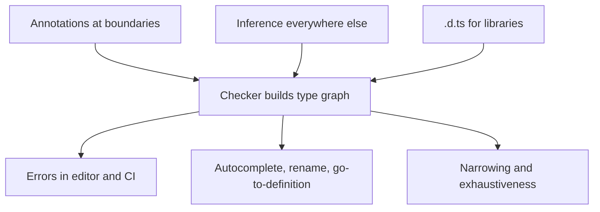

## Introduction

A small script written by one person in an afternoon can live comfortably in JavaScript. The author remembers which functions take which arguments, what shape each object has, and which values can be `null`. Now scale that up: two hundred modules, fifteen developers, code written three years ago by someone who has left. Nobody remembers all those facts any more. They exist only implicitly — in the code's behaviour and in people's heads — and every change risks breaking an assumption somewhere else.

TypeScript's answer is to write those facts down in a form a machine can check. A function signature like `formatPrice(amount: number, currency: "USD" | "EUR"): string` is documentation, but unlike a comment it cannot go out of date: if the code and the signature disagree, the build fails. That single idea — **assumptions become checked contracts** — is the source of nearly every benefit people cite.

This lesson goes through those benefits one by one, each with code you can run, and then explains how to adopt TypeScript so you actually get them. It builds on [[b2-ts-vs-javascript]], which covered what TypeScript can and cannot catch; the costs are weighed honestly in the next lesson, [[b2-ts-disadvantages]].

## Before you start

- **What TypeScript is** and type erasure — [[b2-what-is-typescript]].
- **How it differs from JavaScript**, especially that external data still needs runtime validation — [[b2-ts-vs-javascript]].
- **Modules** — `import` and `export` between files, used in the refactoring example. See [[b1-modules]].

## The intuition

Imagine a building's electrical wiring. You could wire a house without a diagram; the electrician who did it knows where every cable runs. Years later, someone wants to knock down a wall. Without the diagram they must guess, test, and hope. With an accurate diagram they know immediately which circuits pass through that wall.

Types are the wiring diagram of a codebase, with one advantage over paper diagrams: the compiler checks that the diagram matches the actual wiring on every build. When you change something, it tells you every place that is affected. The analogy stops working in one respect: a wiring diagram is drawn separately, whereas most TypeScript types are **inferred** from the code itself, so the "diagram" is largely produced for you (see [[b2-type-inference]]).

## Benefit 1: Bugs caught before they run

The most direct benefit is that mistakes visible in the code's structure are reported while you type: misspelled properties, wrong argument types, missing arguments, possibly-`null` values used without a check. [[b2-ts-vs-javascript]] showed such bugs side by side.

How much does this matter in practice? A 2017 study by Gao, Bird and Barr, "To Type or Not to Type", took a sample of bugs that had been fixed in public JavaScript projects and checked whether adding TypeScript or Flow annotations would have flagged them. About 15% would have been caught by the type checker alone. That is a meaningful share of real, shipped bugs found at zero runtime cost — and it understates the value, because it does not count the bugs a developer never commits since the editor flagged them in seconds.

## Benefit 2: Refactoring without fear

The benefit experienced engineers usually rank highest is **safe refactoring**. In JavaScript, changing a function's signature means searching the codebase for callers and hoping you found them all, including dynamic ones. In TypeScript, the compiler finds them for you.

Suppose a shop's `formatPrice` used to assume dollars, and you change it to require a currency:

```typescript title="money.ts"
// Before: formatPrice(amount: number): string
// After: callers must say which currency they mean
export function formatPrice(amount: number, currency: "USD" | "EUR"): string {
  return new Intl.NumberFormat("en-US", { style: "currency", currency }).format(amount);
}
```

```typescript title="cart.ts"
import { formatPrice } from "./money.js";

console.log(formatPrice(19.5, "USD"));
console.log(formatPrice(42));
```

```output
cart.ts(4,13): error TS2554: Expected 2 arguments, but got 1.
```

Every call site that was not updated is now a compile error with an exact location. In a real codebase that list might contain forty entries across twenty files, and when it is empty you know the change is complete. The same applies when you rename a property, remove a field from an API response type, or add a required prop to a React component.

Editors take this further. "Rename symbol" in VS Code uses the type information to rename a property everywhere it is used *as that property* — not everywhere the text `name` appears — which a plain search-and-replace cannot do reliably in JavaScript.

## Benefit 3: Self-documenting code and better tooling

A typed signature tells the reader what goes in and what comes out without opening the function body. Compare `function schedule(task, options)` with:

```typescript title="schedule.ts"
interface ScheduleOptions {
  runAt: Date;
  retries?: number;        // optional: defaults are applied inside
  onFail?: (error: Error) => void;
}

declare function schedule(task: () => Promise<void>, options: ScheduleOptions): string;
```

The typed version answers questions the untyped one leaves open: the task must be an async function, `runAt` is a `Date` rather than a timestamp or string, `retries` is optional, and the function returns a string (probably an ID). `declare` here means "this function exists elsewhere"; it lets you write a signature without a body.

The editor uses these types to give accurate autocomplete (type `options.` and see exactly three properties), inline documentation on hover, "go to definition" that lands in the right place, and errors as you type. This is all served by the **TypeScript language service** (`tsserver`), which runs the same checker as `tsc`. For a developer new to a codebase, this is often the biggest day-one benefit: you can explore unfamiliar code by following types instead of reading every implementation.

## Benefit 4: Modelling states that cannot be misused

Types can describe data more precisely than "an object with some fields". A common pattern models an API call that either succeeds with data or fails with an error, never both:

```typescript title="result.ts"
type ApiResult<T> =
  | { ok: true; data: T }
  | { ok: false; error: string };

interface User { id: number; name: string }

function describe(result: ApiResult<User>): string {
  if (result.ok) {
    return `Loaded ${result.data.name}`;   // here result.data exists
  }
  return `Failed: ${result.error}`;        // here only result.error exists
}

console.log(describe({ ok: true, data: { id: 1, name: "Linus" } }));
console.log(describe({ ok: false, error: "404 Not Found" }));
```

```output
Loaded Linus
Failed: 404 Not Found
```

`ApiResult<T>` is a **discriminated union**: a type that is one of several shapes, told apart by a shared literal field (`ok`). Inside `if (result.ok)`, TypeScript **narrows** `result` to the success shape, so `result.data` is available; after the `if`, only the failure shape remains. If you try to read `result.data` without checking `ok` first, compilation fails:

```output
bad.ts(5,17): error TS2339: Property 'data' does not exist on type 'ApiResult<string>'.
  Property 'data' does not exist on type '{ ok: false; error: string; }'.
```

In JavaScript, nothing stops code from reading `data` on a failed result and passing `undefined` deeper into the app. Here the type makes the invalid state unrepresentable. The `<T>` makes it **generic** — one definition works for users, orders or anything else (see [[b2-generics]] and [[b2-discriminated-unions]]).

## Benefit 5: The compiler remembers every case

Business logic often switches over a fixed set of values. When someone adds a new value, every `switch` needs updating, and in JavaScript the forgotten ones fail silently by falling through to a default. TypeScript can make a missing case a compile error:

```typescript title="status.ts"
type OrderStatus = "pending" | "shipped" | "delivered" | "cancelled";

function label(status: OrderStatus): string {
  switch (status) {
    case "pending":
      return "Waiting for payment";
    case "shipped":
      return "On its way";
    case "delivered":
      return "Delivered";
    default: {
      const unhandled: never = status;
      throw new Error(`Unknown status: ${unhandled}`);
    }
  }
}

console.log(label("shipped"));
```

```output
status.ts(12,13): error TS2322: Type '"cancelled"' is not assignable to type 'never'.
```

After the three `case`s, narrowing has removed `"pending"`, `"shipped"` and `"delivered"`, so in the `default` branch `status` can only be `"cancelled"`. `never` is the type with no values; assigning anything to it is an error. Once you add `case "cancelled"`, nothing is left, `status` becomes `never`, and the code compiles. This **exhaustiveness check** turns "remember to update every switch" into a compiler-enforced checklist (see [[b2-exhaustiveness-assertnever]]).

## Benefit 6: Collaboration and onboarding at scale

The benefits above compound in teams. Types at module boundaries — component props, API clients, database rows, event payloads — act as contracts between people. A backend change that alters a response type can be propagated to the frontend types (often generated from an OpenAPI schema or shared in a monorepo), and the frontend build immediately shows what broke. Code review becomes easier because reviewers can see the shape of data in the diff. New team members get guided by the editor rather than by tribal knowledge.

This is why most large JavaScript codebases — VS Code itself, Slack's desktop app, Airbnb's frontend, and the source of frameworks such as Angular and Vue 3 — are written in TypeScript, and why most new React and Node.js project templates default to it.

## How the benefits are produced



All benefits come from one structure: the checker builds a graph of every value's type, combining your annotations, its own inference and the declaration files of your dependencies. Editor features query that graph; errors are places where the graph is inconsistent. The more of your program that is genuinely typed — rather than `any` — the more complete the graph and the more useful every feature becomes.

## Getting the benefits in practice

The benefits are not automatic. A codebase full of `any`, with strictness turned off, compiles cleanly while checking very little. Teams that get real value tend to follow the same practices:

**Enable `strict`.** It turns on `noImplicitAny`, `strictNullChecks` and related checks. TypeScript 6.0 enables it by default; in older projects you may need to turn it on and fix errors folder by folder (see [[b2-strict-compiler-options]]).

**Type the boundaries carefully, let inference handle the rest.** Annotate function parameters, exported functions, component props and data models. Local variables rarely need annotations (see [[b2-optional-static-typing]]).

**Validate external data at runtime.** Types for API responses are only as trustworthy as the validation behind them. A schema library such as Zod can both validate and produce the TypeScript type.

**Prefer `unknown` over `any`.** `unknown` means "I do not know yet, so make me check"; `any` means "stop checking". See [[b2-unknown]] and [[b2-avoiding-any]].

**Run the checker in CI.** `tsc --noEmit` as a required build step ensures type errors cannot be merged. Add type-aware lint rules with typescript-eslint to catch patterns such as floating promises.

> [!TIP] Measure the change
> If you are making the case to a team, track something concrete before and after adoption: the number of production `TypeError`s, time to onboard a developer, or how long large renames take. Benefits that are measured are easier to defend.

## In real systems

A typical modern stack uses types end to end. A database schema produces row types (Prisma, Drizzle and Kysely do this), the backend exposes typed handlers, an OpenAPI or tRPC layer shares request and response types with the frontend, and React components declare their props. A change to a database column then shows up as compile errors in the API handler and the UI component that render it. That chain is what people mean by "end-to-end type safety", and it is the strongest argument for TypeScript in full-stack work.

## Common mistakes

**Adopting TypeScript without `strict`.** Without `strictNullChecks`, `null` is assignable to everything and the most common runtime crash is not checked. The project looks typed but is not.

**Using `any` to make errors go away.** Each `any` disables checking for that value and spreads: properties read from it are also `any`. Use `unknown` and narrow.

**Annotating everything.** Redundant annotations (`const count: number = 0`) add noise and make refactors longer. Annotate boundaries; trust inference inside.

**Trusting types for external data.** An interface for an API response is not validation. Validate at the boundary.

**Ignoring type errors because the build still emits.** `tsc` emits despite errors by default. Make the CI step fail.

## Interview perspective

**"Why would you choose TypeScript for a new project?"** Give mechanisms, not slogans: compile-time error detection, safe refactoring because signature changes surface every caller, self-documenting APIs and precise tooling via the language service, and expressive modelling (discriminated unions, exhaustiveness). Then add a caveat — external data still needs runtime validation — which shows judgement.

**"How do you convince a team to adopt TypeScript?"** Propose gradual adoption (`allowJs`, convert shared modules first), strict mode for new files, CI type checks, and measurable goals. Acknowledge costs (build tooling, learning curve) and how to contain them.

**"What does `never` do in an exhaustive switch?"** It is the type with no values. If every case is handled, the remaining type is `never` and the assignment compiles; a forgotten case leaves a real type that cannot be assigned to `never`, producing an error.

## Practice

1. Write a `PaymentMethod` union of `"card" | "paypal" | "bank"` and a function with an exhaustive switch. Add `"crypto"` to the union and observe the error.
2. Convert a JavaScript function that returns either `{ data }` or `{ error }` into one returning `ApiResult<T>`, and update a caller to narrow on `ok`.
3. In a small two-file project, rename a property on an exported interface using your editor's "Rename symbol". Compare the result with a text search-and-replace.

```quiz
Q: A developer adds a required parameter to a widely used function. Why is this safer in TypeScript than in JavaScript?
- [ ] TypeScript automatically supplies a default for the new parameter
- [x] Every call site that does not pass the new argument becomes a compile error with its location
- [ ] TypeScript prevents changing signatures of exported functions
- [ ] The runtime throws a clear error at each outdated call
> The checker compares every call with the new signature, so missing arguments are listed before anything runs. No defaults are added, signatures can change freely, and at runtime JavaScript would silently pass `undefined`.
```

```quiz
Q: In an exhaustive `switch` over a union, what makes `const unhandled: never = status` fail to compile when a case is missing?
- [ ] `never` variables cannot be declared inside `default`
- [ ] The `throw` after it is unreachable
- [x] The unhandled member is still a possible type of `status`, and no value is assignable to `never`
- [ ] TypeScript requires every `switch` to list all cases
> Narrowing removes each handled case. If one remains, `status` has that literal type, which is not assignable to `never`. TypeScript does not require exhaustive switches in general; this pattern opts into the check.
```

## Quick revision {#quick-revision}

- Core idea: types turn implicit assumptions into checked contracts that cannot go out of date.
- Bug detection: about 15% of sampled public JavaScript bugs were detectable by type checking (Gao, Bird and Barr, 2017).
- Refactoring: signature or shape changes surface every affected call site as an error; editor rename is type-aware.
- Self-documentation and tooling: signatures explain usage; `tsserver` powers autocomplete, hover docs, navigation.
- Modelling: discriminated unions plus narrowing make invalid states unrepresentable.
- Exhaustiveness: assigning to `never` in `default` makes a missing case a compile error.
- Teams: typed boundaries act as contracts; end-to-end types connect database, API and UI.
- To get the benefits: `strict`, typed boundaries, inference inside, `unknown` over `any`, runtime validation at the edges, `tsc --noEmit` in CI.

## Key takeaways {#key-takeaways}

- TypeScript's value comes from making assumptions explicit and machine-checked.
- The benefit that grows most with codebase size is safe refactoring.
- Precise types — unions, narrowing, exhaustiveness — prevent misuse, not just typos.
- The benefits depend on discipline: strict mode, few `any`s and validated boundaries.
- Static types complement, but do not replace, tests and runtime validation.
