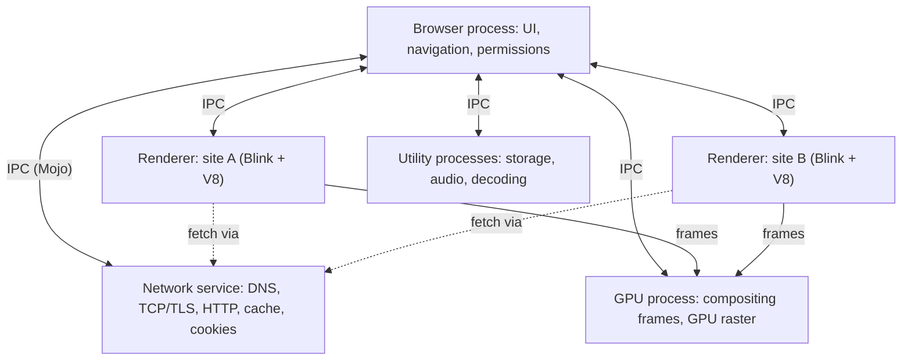

## Introduction

When you write `document.querySelector('button').addEventListener('click', save)`, it is tempting to picture "the browser" as one program that reads your code from top to bottom. In reality, by the time that line runs, at least four separate operating-system processes have cooperated: one drew the address bar you typed into, one fetched your HTML over the network, one parsed it and is now running your JavaScript, and one is putting the result on the screen through the graphics card. Inside the process running your code, several threads are working at once.

This lesson is the map of that machinery. It answers three questions:

1. **What are the parts?** A browser contains a user interface, a networking stack, a rendering engine, a JavaScript engine, storage, and a graphics layer.
2. **Why are they split into separate processes?** So that one crashing or malicious page cannot take down — or read — everything else, and so that slow work in one place does not freeze another.
3. **How do they cooperate?** Through message passing between processes, which shapes what your code can and cannot do.

A frontend engineer needs this map for practical reasons. Performance problems such as janky scrolling only make sense once you know that scrolling can happen on a different thread from your JavaScript. Security rules such as "a cross-origin iframe cannot read your page" are enforced partly by putting that iframe in a different process. And interview questions like "what happens when you type a URL and press Enter?" are really questions about this architecture.

Most of the specifics here describe **Chromium**, the open-source project behind Chrome, Edge, Opera, Brave and many others, because its architecture is the best documented and the most widely deployed. Firefox and Safari follow the same broad principles with different details, which the lesson points out where it matters.

## Before you start

- **The JavaScript engine and its host** — that JavaScript itself has no DOM or network; the host environment provides them. See [[b1-engine-vs-host]] and [[b1-runtime-browser]].
- **The event loop** — that a JavaScript thread runs one task at a time to completion. See [[b1-event-loop]].
- **Origins** — that an origin is scheme + host + port. See [[b3-same-origin]]. The lesson re-explains what it needs.

You do not need any operating-systems background. The one OS idea used — the difference between a process and a thread — is explained below.

## The intuition

Think of a large restaurant. The front-of-house staff greet guests and take orders; they never cook. Each kitchen station prepares food for its own tables. A single expediter at the pass assembles finished plates and sends them out. A purchasing office deals with suppliers.

If a fire breaks out at one station, the restaurant does not want the whole building to burn, so stations are separated by walls. Cooks at one station cannot walk into another station's fridge. When a cook needs supplies, they do not phone the supplier directly; they send a request to the purchasing office, which decides whether to allow it.

A multi-process browser is organised the same way:

| Restaurant | Browser |
|---|---|
| Front of house | **Browser process** — the address bar, tabs, buttons, permissions |
| Kitchen stations, one per group of tables | **Renderer processes** — one runs each site's HTML, CSS and JavaScript |
| Expediter at the pass | **GPU process** — combines everything into the final frame on screen |
| Purchasing office | **Network service** — the only place that talks to the internet |
| Fire walls between stations | Process boundaries and the **sandbox** |

The analogy stops working in one place: restaurant stations share a building's air and plumbing, while browser processes share nothing in memory by default. Every interaction between them is an explicit message. That strictness is what makes the design safe.

## Processes and threads in one paragraph each

A **process** is a running program with its own private memory, given to it by the operating system. Code in one process cannot read or write another process's memory; if it needs something from another process it must send a message through **Inter-Process Communication (IPC)**, which the OS mediates. If a process crashes, the OS cleans it up and other processes keep running.

A **thread** is a sequence of instructions running inside a process. All threads in a process share that process's memory, so they can cooperate cheaply but can also interfere with each other. A process starts with one thread and can create more.

The browser uses both tools on purpose. **Processes** give isolation: a crash or a compromised page is contained. **Threads** give parallelism within one job: while one thread runs your JavaScript, another can keep scrolling smooth. Processes are covered in [[b3-browser-processes]] and threads in [[b3-browser-threads]].

## The major components

Long before browsers were multi-process, they were described as a set of logical components. That component view is still useful, because each component now maps onto one or more processes.

| Component | Responsibility | Where it lives in Chromium |
|---|---|---|
| **User interface** | Address bar, tabs, back/forward buttons, menus, permission prompts | Browser process |
| **Browser engine** | Coordinates the UI and the rendering engine: starts navigations, routes input | Browser process |
| **Rendering engine** | Parses HTML and CSS, builds the DOM, computes style and layout, produces paint instructions | Renderer process (Blink) |
| **JavaScript engine** | Parses, compiles and runs JavaScript; manages the JS heap and garbage collection | Renderer process (V8), embedded in the rendering engine |
| **Networking** | DNS, connections, TLS, HTTP, caching, cookies | Network service (its own process on desktop) |
| **Graphics / UI backend** | Talks to the GPU and the OS window system to draw frames | GPU process |
| **Data persistence** | Cookies, `localStorage`, IndexedDB, cache storage, history | Storage service and the browser process |

Two of these are worth separating clearly because they are often confused. The **rendering engine** (Blink in Chromium, WebKit in Safari, Gecko in Firefox) understands HTML and CSS and owns the DOM. The **JavaScript engine** (V8, JavaScriptCore, SpiderMonkey) understands only the JavaScript language. When your code calls `document.createElement`, V8 does not know what a document is: it calls into Blink through **bindings**, small pieces of glue code that expose Blink's C++ objects as JavaScript objects. That boundary is why DOM calls are noticeably more expensive than plain JavaScript calls. See [[b3-rendering-engine]] and [[b3-javascript-engine-browser]].

## From one process to many

Early browsers — Internet Explorer 6, Firefox before 2016, Safari before 2011 — ran everything in a single process. All tabs shared one memory space and, largely, one main thread. That had three consequences that users felt every day:

1. **One bad page crashed everything.** A bug triggered by any tab, or by a plugin such as Flash, brought down the whole browser and every other tab with it.
2. **One busy page froze everything.** A long-running script in one tab could make the UI and all other tabs unresponsive, because they waited for the same thread.
3. **One exploited page could reach everything.** If an attacker found a memory-corruption bug in the HTML parser, their code ran with full access to the browser's memory — including other sites' cookies and open pages — and to the user's files.

Google Chrome launched in September 2008 with a different design: each tab (more precisely, each group of related pages) got its own **renderer process**, and those renderers ran inside an OS **sandbox** that denies them direct access to the file system, network and most system calls. The browser process stayed small and trusted; everything that touched untrusted web content ran in a low-privilege process.

Other browsers converged on the same idea. Internet Explorer 8 split tabs into separate processes in 2009. Safari introduced a separate web-content process with WebKit2 in Safari 5.1 (2011). Firefox's long-running Electrolysis project shipped multiple content processes to most users in 2017. Then, after the Spectre CPU vulnerabilities were disclosed in January 2018, browsers went further: Chrome 67 (2018) enabled **site isolation**, putting every site in its own process even when sites are embedded in each other through iframes, and Firefox followed with Project Fission in Firefox 95 (2021). That story is told in [[b3-site-isolation]].

> [!NOTE] "One process per tab" is a simplification
> Chromium allocates renderer processes per **site** (roughly, per registrable domain such as `example.com`), not per tab. Two tabs of the same site may share a process, and one tab with cross-site iframes may use several. On memory-constrained devices the browser also merges some processes. Treat "one process per tab" as the beginner version of a more precise rule.

## The Chromium architecture at a glance



The browser process sits at the centre. It is the only fully privileged process: it starts the others, decides which renderer gets which page, and checks every sensitive request that a renderer makes. Renderers are the opposite: they do the most complex work (parsing arbitrary HTML, running arbitrary JavaScript) and therefore have the fewest privileges. When a renderer wants a resource, it asks the network service through an IPC channel; when it wants a cookie or a file, the request is checked against what that renderer's site is allowed to have. Finished frames from all renderers flow to the GPU process, which combines them — including iframes rendered by different processes — into the single image you see.

Chromium's IPC system is called **Mojo**. You never use it from web code, but knowing it exists explains a lot: `postMessage` between a page and a cross-site iframe, a `fetch()` call, and a click on the page are all, under the hood, messages travelling between processes.

## Following one page load through the components

The rest of this module zooms into each step, but it helps to see the whole journey once.

1. **Input.** You type `shop.example/cart` into the address bar and press Enter. The browser process's UI thread decides this is a URL rather than a search query. See [[b3-url-navigation]].
2. **Network.** The browser process asks the network service to fetch the URL. The network service resolves the name with DNS, opens a TCP and TLS connection, sends an HTTP request and starts receiving a response. See [[b3-dns-resolution]], [[b3-tcp-tls-handshake]] and [[b3-http-request-response]].
3. **Process selection.** When the response headers arrive and say this is an HTML document, the browser process picks (or creates) a renderer process for the site `https://shop.example` and **commits** the navigation to it. See [[b3-document-download]].
4. **Parsing and running.** In the renderer, Blink parses the HTML into the DOM, fetches CSS and scripts (again through the network service), and V8 executes your JavaScript on the renderer's **main thread**. See [[b3-main-thread]].
5. **Rendering.** The main thread computes style and layout and records paint instructions. The **compositor thread** splits the page into layers and tiles, which are rasterised into pixels, mostly on the GPU. See [[b3-compositor-thread]] and [[b3-raster-threads]].
6. **Display.** The GPU process combines the page's frame with the browser UI and any out-of-process iframes and presents it to the screen.

From then on the cycle continues: input events go from the browser process to the renderer, JavaScript updates the DOM, and new frames are produced, ideally 60 or more times a second. That ongoing loop is the subject of [[b3-critical-rendering-path]] and [[b3-browser-event-loop]].

## Engines across browsers

Different browsers are built on different engines. Knowing which is which explains why a CSS feature can work in Chrome and Edge but not Safari, and why "test in Chrome and Firefox" is not enough.

| Browser | Rendering engine | JavaScript engine | Notes |
|---|---|---|---|
| Chrome, Edge, Opera, Brave, Samsung Internet | Blink | V8 | Edge switched from its own EdgeHTML engine to Chromium in January 2020 |
| Safari (macOS, iOS) | WebKit | JavaScriptCore | Blink was forked from WebKit in 2013 |
| Firefox | Gecko | SpiderMonkey | Parts of the Servo research engine (written in Rust) were merged into Gecko |
| Any browser on iOS | WebKit | JavaScriptCore | Apple required all iOS browsers to use WebKit; from iOS 17.4, apps distributed in the EU may use other engines |

So Chrome on an iPhone has historically been WebKit underneath with Chrome's UI on top — a common source of "it works in Chrome on Android but not Chrome on iOS" bug reports.

## Worked example: watching the architecture

You can see the architecture directly, without any code. In Chrome on desktop:

1. Open three tabs: two on the same site (say, two articles on `developer.mozilla.org`) and one on a different site.
2. Open Chrome's **Task Manager** (Shift+Esc on Windows and Linux, or the menu *More tools → Task manager*).

You will see one row for the *Browser*, one for the *GPU Process*, one for the *Network Service*, several *Utility* rows, and rows labelled *Tab: …* or *Renderer*. Often the two same-site tabs share one renderer row while the other site has its own; that grouping is the per-site process model at work. (Whether same-site tabs share depends on how they were opened and on memory pressure, so your exact rows may differ.)

Now, to see responsiveness isolation, paste this into the DevTools console of one tab:

```js title="freeze-this-tab.js"
// Busy-wait for 5 seconds on this tab's main thread.
const end = Date.now() + 5000;
while (Date.now() < end) {
  // Nothing else on this thread can run until the loop exits.
}
console.log('done');
```

During those five seconds that tab ignores clicks and its JavaScript-driven animations stop. Switch to another tab, type in the address bar, or scroll a different site: everything else stays responsive, because those run on other threads and in other processes. (This was not run as part of writing this lesson; it describes the standard Chromium behaviour. Even within the frozen tab, some scrolling and CSS `transform` animations may keep going, because they are handled off the main thread — see [[b3-compositor-thread]].)

To see the same story as a timeline, record a page load in the **Performance** panel. The tracks labelled *Main*, *Compositor*, *Raster* (or *GPU*) and *Network* correspond directly to the threads and processes described here.

## In real systems

The architecture shows up in day-to-day engineering decisions far more than its low-level nature suggests:

- **Performance work** is mostly about keeping the renderer's main thread free, because that one thread runs your JavaScript, style, layout and paint recording. Moving heavy computation into a Web Worker ([[b3-web-workers]]) and animating `transform`/`opacity` instead of `top`/`left` ([[b3-transform-opacity-compositing]]) both exploit the thread layout.
- **Security headers** such as `Cross-Origin-Opener-Policy` and `Cross-Origin-Embedder-Policy` ([[b3-coop-coep]]) exist to tell the browser it may put your page in its own process and enable powerful features such as `SharedArrayBuffer`.
- **Crash reports** like Chrome's "Aw, Snap!" page are a renderer process dying — usually from running out of memory — while the browser process survives to show the error.
- **Electron and similar frameworks** reuse this architecture for desktop apps: Electron's "main process" is Chromium's browser process with Node.js added, and each window's "renderer process" is a Chromium renderer.

## Trade-offs and alternatives

Multi-process architecture is not free:

| Benefit | Cost |
|---|---|
| A crash in one site's renderer does not affect others | Each process carries its own copy of engine data structures, so memory use grows with the number of sites |
| A compromised renderer is sandboxed and holds only one site's data | Communication between components needs IPC, which is slower than a function call and must be carefully validated |
| Busy JavaScript in one site cannot freeze the UI or other sites | Starting a process takes time, so browsers keep a spare renderer warm and reuse processes where safe |

Browsers therefore adapt. Chrome on desktop runs the network service in its own process, but on low-memory Android devices it may run some services inside the browser process to save memory. Firefox caps the number of content processes and shares them across same-site tabs. The principle — isolate untrusted content, keep the privileged core small — stays fixed while the exact process count is a tuning decision.

## Common mistakes

- **"JavaScript runs in the browser's main thread."** There is no single main thread. Each renderer process has its own main thread, and the browser process has its own UI thread. A busy script blocks its renderer's main thread only.
- **"The JavaScript engine renders the page."** V8 runs JavaScript; Blink parses HTML, computes styles, lays out and paints. They are separate engines connected by bindings.
- **"Each tab is a process."** Process allocation follows sites, not tabs, and adapts to memory. Use Task Manager to see the real grouping.
- **"A renderer can fetch anything it likes."** Renderers have no direct network or disk access. All requests go through the network service and browser process, which enforce rules such as cookie and CORS policy.
- **"Chrome on iOS is the same as Chrome on Android."** Outside the EU exception, every iOS browser uses WebKit, so rendering bugs follow Safari, not Chrome.

## Interview perspective

"Explain the architecture of a modern browser" is a common opening question for frontend and full-stack roles; it also serves as the setup for "what happens when you type a URL". A strong answer is layered: start with components, then explain the process split and *why*, then mention threads.

> [!INTERVIEW] A concise answer
> "Modern browsers are multi-process. A privileged browser process owns the UI and coordinates navigation. Web content runs in sandboxed renderer processes, one per site with site isolation, each containing the rendering engine and a JavaScript engine. Networking runs in a separate network service, and a GPU process composites frames. The split gives crash isolation, security — a compromised renderer can't read other sites — and responsiveness. Inside a renderer, the main thread runs JS, style and layout, while the compositor and raster threads keep scrolling and animations smooth."

Likely follow-ups:

- **Why not use threads instead of processes?** Threads share memory, so a memory-corruption exploit or a Spectre-style read in one thread could access another site's data. Processes give OS-enforced memory isolation and allow sandboxing with reduced privileges.
- **What is the cost of more processes?** Memory overhead and IPC latency; browsers mitigate with process reuse and limits.
- **Where does a `fetch()` actually go?** From the renderer over IPC to the network service, which applies cookies, caching and CORS checks before the response comes back.

## Practice

1. Open Chrome's Task Manager with five tabs from three different sites. Predict the number of renderer rows before looking, then explain any difference.
2. Using the freeze snippet above, compare a CSS `@keyframes` animation of `transform` with one of `margin-left` while the main thread is blocked. Write down which keeps moving and explain why using the thread model.
3. Draw the component table from memory, then label each component with the process it runs in.
4. Explain to a non-engineer why a crashed tab shows an error page instead of closing the browser.

```quiz
Q: A page runs an infinite loop in its JavaScript. In a modern multi-process browser, what is the expected result?
- [ ] The whole browser freezes until the user force-quits it
- [x] That page's renderer becomes unresponsive, while the browser UI and other sites keep working
- [ ] The JavaScript engine automatically moves the loop to a background thread
- [ ] The GPU process stops drawing frames for all tabs
> The loop occupies the main thread of one renderer process. The browser process (address bar, tabs) and other sites' renderers have their own threads, so they stay responsive; the browser eventually offers to stop the page. Engines never move a running script to another thread — JavaScript on a given thread runs to completion — and the GPU process keeps compositing frames from other sources.
```

```quiz
Q: Which pairing of rendering engine and JavaScript engine is correct?
- [ ] Safari — Blink and V8
- [ ] Firefox — WebKit and JavaScriptCore
- [x] Chrome — Blink and V8
- [ ] Edge (current) — EdgeHTML and Chakra
> Chrome uses Blink for HTML/CSS and V8 for JavaScript. Safari uses WebKit with JavaScriptCore, Firefox uses Gecko with SpiderMonkey, and Edge abandoned EdgeHTML and Chakra when it moved to Chromium in 2020.
```

## Quick revision {#quick-revision}

- A browser = UI + browser engine + rendering engine + JavaScript engine + networking + graphics + storage.
- Rendering engine (Blink/WebKit/Gecko) owns HTML, CSS and the DOM; JavaScript engine (V8/JavaScriptCore/SpiderMonkey) runs JS; they meet through bindings.
- Process = private memory, crash and security boundary, talks via IPC. Thread = shares memory, used for parallelism.
- Chromium processes: browser (privileged coordinator), renderers (sandboxed, per site), GPU, network service, utility services.
- Multi-process gives stability, security and responsiveness; costs memory and IPC overhead.
- History: single-process → Chrome 2008 multi-process → site isolation after Spectre (Chrome 67, Firefox 95).
- Page load: browser process handles input → network service fetches → browser commits to a renderer → main thread parses and runs JS → compositor/raster produce tiles → GPU process displays.
- On iOS all browsers have historically used WebKit.

## Key takeaways {#key-takeaways}

- A modern browser is a set of cooperating processes, not one program; the privileged browser process coordinates sandboxed renderers that run web content.
- Processes provide isolation (crashes and exploits stay contained); threads provide parallelism inside a process.
- Your JavaScript runs on one renderer's main thread alongside style, layout and paint — which is why keeping that thread free is the core of frontend performance.
- The rendering engine and the JavaScript engine are different components joined by bindings.
- Security rules you meet later, from CORS to cross-origin iframes, are enforced partly by this process architecture.
