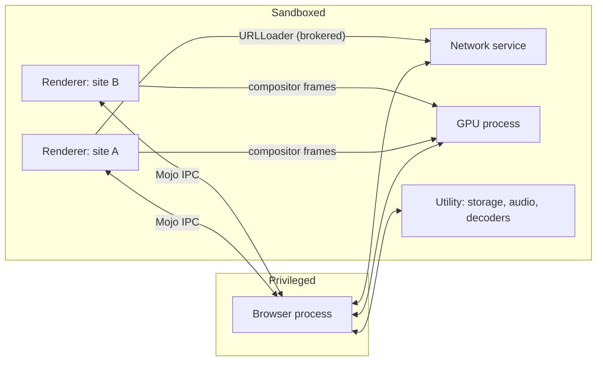

## Introduction

The [[b3-browser-overview]] lesson described a modern browser as a set of cooperating processes. This lesson opens each of those processes and looks inside: what it owns, what it is forbidden to do, and why the line between processes is drawn exactly where it is.

The design follows one guiding question: **what happens if this piece of code is attacked or crashes?** Code that handles untrusted web content will eventually meet a malicious page, and code written in C++ will eventually have a memory-safety bug. Browser engineers cannot prevent every bug, so they arrange the program so that each bug does limited damage. Each process is a compartment sized to that goal.

Chromium's security team summarises the principle as the **Rule of 2**: a component may have at most two of these three properties — it processes **untrusted input**, it is written in an **unsafe language** such as C or C++, and it runs with **high privilege**. A renderer parses hostile HTML in C++, so it must have low privilege. The browser process has high privilege and is written in C++, so it must avoid parsing untrusted data itself — when it needs to, it hands the data to a sandboxed utility process. Keep that rule in mind; it explains almost every process in this lesson.

The descriptions below are of desktop Chromium (Chrome, Edge, Brave, Opera) in 2024–2026. Exact process lists change between versions and platforms, and Android merges some processes to save memory. Firefox and Safari use the same categories under different names, noted where useful.

## Before you start

- **Processes, threads and IPC** — introduced in [[b3-browser-overview]].
- **The event loop and the main thread** — a thread runs one task at a time. See [[b1-event-loop]].
- **Origins and sites** — what makes two URLs "same site". See [[b3-same-origin]] and [[b3-same-site-vs-same-origin]].

## The intuition: compartments with a guarded centre

Picture an embassy. The ambassador's office holds the keys, the seal and the authority to sign documents; very few people get in. Visitors are handled in separate interview rooms, each with a locked door. An interviewer in a room cannot open the filing cabinets; they must send a written request to the office, which checks it against that visitor's file before answering.

The **browser process** is the ambassador's office. Each **renderer process** is an interview room holding one site's content. The **network service**, **GPU process** and **utility processes** are specialist departments that do risky or heavy jobs on the office's behalf. Every request is a written message, and every message from an interview room is treated as possibly forged.



The renderers do have direct channels to the network service and the GPU process, but those channels are created *by the browser process* and come pre-restricted: a renderer locked to `a.example` receives a network channel that is labelled with that site, so the network service knows which cookies and which CORS rules apply.

## How the processes talk: Mojo IPC

Chromium's IPC system is **Mojo**. A Mojo interface is declared in a small definition language, and generated code turns method calls into messages sent over an OS pipe. When renderer code calls a method on an interface backed by another process, Mojo serialises the arguments, the other process deserialises them, runs the method and (optionally) sends a reply.

Two properties of IPC shape the whole architecture. First, IPC is **asynchronous and slower than a function call** — microseconds rather than nanoseconds — so the interfaces are designed to batch work and avoid chatty round trips. Second, **every message from a less-privileged process is untrusted**. If a renderer sends "give me the cookies for `bank.example`", the browser process does not trust the renderer's claim about which site it is; it checks the site the renderer was **locked** to when it was created. A renderer that sends an impossible message is assumed to be compromised and is killed.

You can see the same pattern at small scale in Node.js, which can start child processes and exchange messages with them. This is an analogy, not Chromium code, but the behaviour — separate memory, message-only communication, a crash that the parent survives — is the same.

```js title="browser.mjs"
import { fork } from 'node:child_process';

// Each "renderer" is a separate OS process with its own memory.
const renderer = fork(new URL('./renderer.mjs', import.meta.url));

renderer.on('message', (msg) => console.log('browser received:', msg));
renderer.on('exit', (code, signal) => {
  console.log(`renderer died (code=${code}, signal=${signal})`);
  console.log('browser process still running: show "Aw, Snap!" page');
});

// IPC: the only way to talk to the renderer is a message.
renderer.send({ type: 'navigate', url: 'https://a.example/' });
```

```js title="renderer.mjs"
process.on('message', (msg) => {
  if (msg.type === 'navigate') {
    process.send({ type: 'committed', url: msg.url });
    // Simulate the OS killing a renderer that ran out of memory.
    setTimeout(() => process.kill(process.pid, 'SIGKILL'), 50);
  }
});
```

```output
browser received: { type: 'committed', url: 'https://a.example/' }
renderer died (code=null, signal=SIGKILL)
browser process still running: show "Aw, Snap!" page
```

Run `node browser.mjs` with both files in one folder. The parent sends a "navigate" message, the child replies, and then the child is killed by a signal — the same thing the OS does to a renderer that exceeds its memory limit. The parent's `exit` handler runs and the parent carries on. Nothing in the child could have corrupted the parent's memory, because they never shared any. That is the guarantee Chromium relies on.

## Browser Process {#b3-browser-process}

The **browser process** is the single, privileged process that represents the browser application itself. When you launch Chrome, it is the first process to start, and if it exits, the whole browser exits. Everything else is its child.

### What it owns

The browser process is responsible for anything that needs trust or a global view:

- **The user interface around the page**: the window, tabs, address bar (the omnibox), back and forward buttons, bookmarks bar, menus, permission prompts and download shelf. Web content can never draw over these, which is why a page cannot fake the address bar.
- **Navigation**: deciding whether typed text is a URL or a search, starting the network request, handling redirects, and choosing which renderer process will host the resulting page. This flow is covered in [[b3-url-navigation]].
- **Process management**: creating renderer processes, assigning each to a site (the **site lock**), reusing them where allowed, keeping a **spare renderer** warm so the next navigation does not wait for a process launch, and killing processes that misbehave.
- **Security policy**: every request from a renderer for cookies, storage, files or permissions is checked against that renderer's site lock. Chromium calls the central record of "what may this child process access" the *ChildProcessSecurityPolicy*.
- **Profile data**: history, bookmarks, passwords, settings, and extension management.
- **Input routing**: the OS delivers mouse and keyboard events to the browser window. The browser process decides which renderer (or which out-of-process iframe — see [[b3-cross-site-iframes]]) should receive each event and forwards it.

### Threads inside it

The browser process has a **UI thread**, which runs the browser's interface and most of its coordination logic, and an **IO thread**, which handles IPC traffic with child processes. (Despite the name, the IO thread no longer performs network I/O; that moved to the network service.) Additional pool threads handle file access and other blocking work. The rule inside the browser is the same as in a web page: never block the UI thread, or the whole browser chrome freezes.

### Why it is kept small

The browser process runs with the user's full privileges: it can read the profile directory, open files, and talk to the OS. A bug exploited here would give an attacker everything. So the browser process follows the Rule of 2 by **not parsing untrusted web content**. It does not run page JavaScript, does not parse arbitrary HTML, and sends risky parsing jobs — decoding an image for a notification icon, unpacking an extension, parsing JSON from the network — to a sandboxed utility process ([[b3-utility-process]]).

### What a crash looks like

If a renderer crashes, you get a "sad tab" in one tab. If the browser process crashes, every window disappears at once, and on the next launch Chrome offers to restore the session. Because the browser process is small and does not touch hostile input directly, these crashes are rare compared to renderer crashes.

> [!NOTE] Firefox and Safari
> Firefox calls its equivalent the **parent process** (or "chrome process" — Firefox uses *chrome* to mean browser UI, unrelated to Google Chrome). Safari's equivalent is the **UI process** of WebKit's multi-process model.

## Renderer Process {#b3-renderer-process}

A **renderer process** is where web content actually runs. It contains the rendering engine (Blink in Chromium), the JavaScript engine (V8), and everything needed to turn HTML, CSS and JavaScript into a picture and to react to user input. Your page's code always runs in a renderer process; it has no way to run code in any other.

### What it does

For each document assigned to it, a renderer:

1. Receives the HTML response body as a stream, handed over when the browser process commits the navigation, and parses them into the DOM ([[b3-document-download]]).
2. Parses CSS into the CSSOM, computes styles, lays out boxes and records paint instructions ([[b3-critical-rendering-path]]).
3. Executes JavaScript in V8, including event handlers, timers and promise callbacks, through the page's event loop ([[b3-browser-event-loop]]).
4. Produces **compositor frames** — descriptions of layers and tiles — and sends them to the GPU process for display.
5. Receives input events forwarded by the browser process and dispatches them to the DOM.

Inside, the work is spread across threads: the **main thread** (JavaScript, style, layout, paint recording), the **compositor thread** (scrolling, layer animation, frame production), **raster threads**, and any Web Worker threads the page creates. Those threads are the subject of [[b3-browser-threads]].

### How renderers are assigned

Chromium assigns renderers by **site**: the scheme plus the registrable domain (eTLD+1), so `https://mail.example.com` and `https://docs.example.com` are the same site `https://example.com`, while `https://example.org` is different. With **site isolation** (on by default on desktop since Chrome 67), a renderer process is **locked** to one site and will only ever host documents from that site; documents from other sites — including cross-site iframes inside the same tab — go to other renderers. Details and exceptions are in [[b3-site-isolation]].

Several tabs of the same site can share one renderer. A link opened with `rel="noopener"` (the default for `target="_blank"` links in current browsers) starts a new **browsing context group** with no `window.opener` reference, which frees the browser to put it in a different process from the page that opened it:

```html title="index.html"
<!-- The new tab cannot reach this page through window.opener,
     so the browser is free to give it a fresh renderer process. -->
<a href="https://a.example/report" target="_blank" rel="noopener">Open report</a>
```

When the page does need a reference — for example an OAuth popup that posts a message back — the two windows must be able to script each other, so same-site windows stay in the same process.

### The sandbox

Renderers run inside an OS-level **sandbox**. On Windows this uses restricted tokens and job objects; on macOS, the Seatbelt sandbox profile; on Linux, namespaces and seccomp-bpf system-call filters. The details differ, but the effect is the same: a renderer **cannot** open files, create network sockets, start processes, read the clipboard or access the GPU on its own. For each of those it must send an IPC request that a more privileged process checks.

This is why the sandbox matters even though Blink and V8 are heavily tested. Suppose an attacker's page triggers a memory-corruption bug in V8 and takes control of the renderer. Without a sandbox, the attacker could read the user's files. With it, the attacker controls one process that can only do what that site was already allowed to do. To escape, they need a *second* bug in the browser process or the OS kernel — a "sandbox escape". Real-world browser exploits therefore come in chains, and the sandbox is what turns a single bug into a much harder multi-bug problem. See [[b3-browser-security-sandbox]].

### Crashes and memory

When a renderer dies — most often because the page exhausted memory, sometimes because of a bug, or because the browser killed it after a suspicious IPC message — the tab shows the "Aw, Snap!" page (or "He's dead, Jim!" in older versions). Only documents in that process are affected. You can trigger this deliberately by typing `chrome://crash` in the address bar, which is useful for testing how your app recovers.

Each renderer has its own V8 heap per thread, so memory leaks are per process too. A single-page app that grows to several gigabytes will eventually be killed by the browser or the OS, and the Performance and Memory panels in DevTools show that renderer's heap ([[b1-memory-leaks]]).

### Other kinds of renderer

**Extension pages** and extension background service workers run in renderer processes dedicated to that extension. **Service workers** for a site run in a renderer for that site, sometimes without any visible tab. And DevTools itself is a web app running in its own renderer.

## GPU Process {#b3-gpu-process}

The **GPU process** is the one process that talks to the graphics card. Renderers and the browser UI describe what they want drawn; the GPU process executes those drawing commands through the platform graphics API (Direct3D on Windows, Metal on macOS, Vulkan or OpenGL elsewhere) and puts the final frame on the screen. There is normally exactly one GPU process per browser.

### Why it is separate

Two reasons put graphics in its own process.

**GPU drivers are unreliable.** Graphics drivers are large, vendor-written, frequently buggy, and run partly in the OS kernel. A driver crash inside the browser process would take down the browser; inside a dedicated process, Chromium can restart it. If the GPU process crashes repeatedly, Chrome disables hardware acceleration for that GPU and falls back to software rendering, which is slower but keeps working. `chrome://gpu` shows which features are hardware accelerated and which have been disabled.

**Renderers must not touch the GPU directly.** Giving a sandboxed renderer raw access to the driver would open a large attack surface, since driver bugs can lead to kernel compromise. Instead, renderers write GPU commands into a shared **command buffer**; the GPU process validates each command before passing it to the driver. When your page uses WebGL or WebGPU, the calls you make in JavaScript become commands in this buffer, checked and executed in another process.

### What it does

- **Display compositing.** Each renderer produces compositor frames for its documents; the browser process produces frames for the tab strip and address bar. Chromium's **Viz** display compositor, running in the GPU process, aggregates all of these — including frames from out-of-process iframes — into one final image per screen refresh. This is how a page with three cross-site iframes still appears as one seamless picture.
- **Rasterisation.** Turning paint instructions into pixels is usually done on the GPU in modern Chromium, in the GPU process ("out-of-process rasterization"). See [[b3-raster-threads]].
- **WebGL, WebGPU and canvas acceleration.** Executing the page's graphics commands.
- **Hardware video decode and encode**, where the platform supports it.

### What it means for you

The GPU process explains why some animations stay smooth while JavaScript is busy: once a layer's pixels are on the GPU, moving or fading that layer is cheap work for the compositor and GPU, needing no new main-thread work ([[b3-transform-opacity-compositing]]). It also explains a class of bugs that appear only on certain machines: features such as WebGL or certain CSS filters can behave differently when the GPU is on a driver block list and the browser has fallen back to software.

## Network Process {#b3-network-process}

The **network service** (often called the network process) is the component that performs all network I/O for the browser: DNS lookups, TCP and QUIC connections, TLS, HTTP/1.1, HTTP/2 and HTTP/3, the HTTP cache, cookies, proxies and certificate verification. On desktop Chromium it runs in its own process; on Android devices with little memory it may run inside the browser process.

### Why it is separate

Networking code parses data from arbitrary servers — HTTP headers, compressed bodies, certificates, QUIC packets — so it handles untrusted input in C++. Putting it in a separate process means a crash in the network stack restarts the network service instead of killing the browser, and Chromium has been progressively sandboxing this process so that a compromise gains little. It also gives a single, central place to enforce network-level security rules for every renderer.

### How a request flows

When page JavaScript calls `fetch('/api/cart')`, or the HTML parser discovers ``:

1. The renderer creates a request on a **URLLoaderFactory** — a Mojo interface the browser process gave it when the renderer was created, already bound to that renderer's site and origin.
2. The network service receives the request. It knows, from the factory, which site and origin the request comes from; it does not rely on what the renderer claims.
3. It checks the HTTP cache, attaches cookies the requester is allowed to send (following `SameSite` rules — see [[b3-cookie-security-model]]), and opens or reuses a connection.
4. When the response arrives, it applies **CORS** checks ([[b3-cors]]) and **Cross-Origin Read Blocking** (CORB, being replaced by Opaque Response Blocking, ORB). The latter refuses to deliver, say, a cross-site JSON or HTML body into a renderer that requested it as an `` or `<script>`, so the bytes never enter a process where a Spectre-style attack could read them.
5. The response body is streamed back to the renderer through a data pipe.

Moving CORS enforcement into the network service matters for security: a compromised renderer could skip a CORS check implemented in its own code, but it cannot skip one implemented in another process.

### Navigations versus subresources

Navigations are special. When you go to a new page, the **browser process** starts the request through the network service, because it has to see the response headers before it knows which renderer should receive the document (the site might differ from the current one, or the response might be a download). Subresources — images, scripts, `fetch()` — are requested by the renderer that needs them. That distinction is central to [[b3-url-navigation]].

### Observing it

`chrome://net-export` records a log of all network-service activity, which `netlog_viewer` can display; it shows DNS lookups, connection reuse and individual sockets. In everyday debugging, the DevTools Network panel shows the same requests from the page's point of view.

## Utility / Plugin Processes {#b3-utility-process}

**Utility processes** are short-lived or single-purpose sandboxed processes that run one service each on behalf of the browser process. They exist so that risky or crash-prone work — mostly parsing data that came from outside — does not run inside the privileged browser process. **Plugin processes** were the historical predecessor for running third-party browser plugins such as Flash; they no longer exist in modern browsers.

### Why utility processes exist

Return to the Rule of 2. The browser process sometimes has to handle untrusted data: unpacking an extension's `.crx` file, decoding an image for a desktop notification, parsing a JSON response for a browser feature, or converting a page to PDF for printing. Doing that in C++ inside the high-privilege process breaks the rule. Instead the browser process starts a sandboxed utility process, hands it the bytes over IPC, and receives a safe, already-parsed result. If a malicious file crashes or exploits the parser, the damage stays in a throwaway process with no privileges.

### Common utility services

Open Chrome's Task Manager and you will typically see rows such as:

| Utility service | Job |
|---|---|
| **Storage Service** | Backs `localStorage`, IndexedDB and Cache Storage for all sites ([[b3-web-storage]]) |
| **Audio Service** | Mixes and outputs audio, so audio glitches or driver bugs do not crash the browser |
| **Data Decoder Service** | Parses untrusted JSON, XML and images for browser features |
| **Video Capture Service** | Accesses the camera for `getUserMedia` |
| **Printing / PDF compositor** | Assembles printed pages and PDFs, including out-of-process iframes |
| **Unzip, file-util, speech** | Assorted one-off tasks |

The exact set depends on platform, version and which features you have used — some services start only on demand and exit when idle.

### Plugin processes: a short history

Before HTML5 could play video or run rich interactive content, browsers relied on **plugins** such as Adobe Flash, Java applets and Silverlight, loaded through the Netscape Plugin API (**NPAPI**). Plugins were native code with broad system access and were a leading cause of crashes and security vulnerabilities. Chrome ran them in separate **plugin processes** to contain the damage, and later introduced its own sandbox-friendly Pepper Plugin API (**PPAPI**).

Chrome removed NPAPI support in Chrome 45 (2015). Adobe ended Flash on 31 December 2020, and Chrome removed Flash support in Chrome 88 (January 2021). Today there are no general third-party plugin processes: what plugins did is done by web platform features (`<video>`, WebAssembly, WebGL) running in ordinary sandboxed renderers. The built-in PDF viewer, once a PPAPI plugin, is now implemented with web technology and the PDFium library.

> [!TIP] Why the history matters
> When an interviewer asks why browsers moved away from plugins, the architectural answer is that a plugin is privileged native code processing untrusted input — exactly what the Rule of 2 forbids. Web platform features can run in the sandboxed renderer instead.

## Worked example: following a `fetch()` and a frame

Put the processes together with a concrete page. A user on `https://shop.example/cart` clicks *Update*, and the page's handler does this:

```js title="cart.js"
document.querySelector('#update').addEventListener('click', async () => {
  const res = await fetch('/api/cart', { method: 'POST', body: '{"qty":2}' });
  const cart = await res.json();
  document.querySelector('#total').textContent = cart.total;
});
```

| Step | Process (thread) | What happens |
|---|---|---|
| 1 | GPU / OS → **browser** (UI) | The OS delivers the mouse click to the browser window; the browser hit-tests and finds the `shop.example` renderer |
| 2 | **Renderer** (compositor → main) | The event is forwarded over IPC, then queued as a task on the main thread, which dispatches `click` to the listener |
| 3 | **Renderer** (main) → **network service** | `fetch` sends a request via the renderer's URLLoaderFactory, labelled with origin `https://shop.example` |
| 4 | **Network service** | Attaches `shop.example` cookies, reuses an open HTTP/2 connection, receives the JSON |
| 5 | **Renderer** (main) | The promise resolves in a later task; the handler updates `textContent` |
| 6 | **Renderer** (main → compositor, raster) | Style, layout and paint run for the change; a new compositor frame is produced |
| 7 | **GPU process** | Viz combines the page's frame with the browser UI and displays it |

Five processes or threads cooperated for one button click, and every arrow between them was a message. This is not run code you can paste and time — the exact threads involved vary by version — but it is the standard flow, and you can see steps 2–6 as separate tracks in a DevTools Performance recording.

## In real systems

- **Monitoring crashes in production**: a renderer crash is invisible to your JavaScript (the process is gone), so teams detect it indirectly — for example by noticing a session ended without a `pagehide` event, or with the Reporting API's crash reports in Chromium.
- **Memory budgets**: on low-end Android devices Chrome kills background renderers aggressively. Apps that store state only in memory lose it; storing drafts in IndexedDB survives because the Storage Service is a separate process.
- **WebGL-heavy apps** (maps, design tools) must handle the `webglcontextlost` event, which fires when the GPU process restarts or the driver resets.
- **Security reviews** of browser features (and Electron apps) ask the same Rule-of-2 question: which process parses this input, and what privilege does it have?

## Trade-offs and alternatives

| Decision | Benefit | Cost |
|---|---|---|
| Many renderers | Crash and exploit containment per site | Memory: each renderer duplicates engine state |
| Separate network service | Central enforcement of cookies, CORS, CORB; restartable | Extra IPC hop for every request |
| Separate GPU process | Driver crashes are survivable; renderers stay sandboxed | Command-buffer validation overhead |
| Utility processes | Untrusted parsing stays out of the privileged process | Process start-up latency for each job |

Browsers tune these trade-offs per device. Chrome on Android, under memory pressure, runs the network service in the browser process and isolates only sites where users log in. Firefox limits content processes and runs some services in a shared "socket" or "utility" process. The categories survive; the process counts are tuning.

## Common mistakes

- **Thinking the renderer fetches directly.** It has no sockets. All network access goes through the network service, which is why CORS cannot be bypassed by a compromised renderer.
- **Assuming one tab equals one renderer.** Same-site tabs can share; cross-site iframes add more. Check Task Manager.
- **Blaming JavaScript for a GPU problem.** Visual glitches on specific machines often come from the GPU process falling back to software or from driver bugs; `chrome://gpu` tells you the state.
- **Treating `chrome://crash` sad tabs as rare.** Out-of-memory renderer kills are common on mobile. Persist important state.
- **Mentioning Flash as a current plugin.** NPAPI ended in Chrome 45 and Flash in Chrome 88.

## Interview perspective

> [!INTERVIEW] What interviewers listen for
> Not a memorised list of process names, but the *reason* for each boundary: "The renderer handles untrusted content in C++, so it's sandboxed with low privilege. The browser process is privileged, so it avoids parsing web content. The network service centralises cookie and CORS enforcement outside the renderer, and the GPU process isolates driver bugs."

Questions to prepare:

- **What happens when a renderer crashes?** That renderer's documents show an error page; the browser process and other renderers are unaffected; the user can reload.
- **Why does CORS enforcement live in the network service?** Because enforcement in the renderer could be skipped by an attacker who controls the renderer; the network service is a separate, less exposed process.
- **How does a page draw if the renderer cannot access the GPU?** It sends compositor frames and command buffers to the GPU process, which validates and executes them.
- **What replaced plugins?** Web platform features running in sandboxed renderers: `<video>`, WebAssembly, WebGL, the built-in PDF viewer.

## Practice

1. In Chrome's Task Manager, find the Network Service, GPU Process and Storage Service rows. Open IndexedDB in a page and watch whether the storage row's activity changes.
2. Visit `chrome://process-internals` and find which site each renderer is locked to.
3. For each of these, name the process that does the work: decoding a PNG in an ``, unpacking a newly installed extension, sending a `Set-Cookie` header's cookie to the jar, compositing a cross-site iframe.
4. Extend the Node example so the "browser" restarts a crashed "renderer" and re-sends the last navigation. What state is lost?

```quiz
Q: An attacker fully controls a site-locked, sandboxed renderer. Which of these can the attacker most directly do?
- [ ] Read cookies belonging to other sites from the cookie jar
- [ ] Open a TCP socket to any server and send raw data
- [x] Run arbitrary code with the privileges of that renderer, which can only access what its site is allowed
- [ ] Draw a fake address bar on top of the browser UI
> Compromise gives code execution inside one sandboxed process. Cookies live in the network service and are handed out only for the renderer's locked site; sockets are created only by the network service; the browser UI is drawn by the browser process. To do more, the attacker needs a second bug to escape the sandbox.
```

```quiz
Q: Why does the browser process, rather than the renderer, start the network request for a top-level navigation?
- [ ] Renderers are not allowed to make any network requests
- [x] The browser must see the response before it can choose which renderer (or a download) should receive it
- [ ] Navigation requests use a different protocol from subresource requests
- [ ] The browser process has a faster network connection
> Which renderer is right depends on the final URL's site after redirects, and whether the response is even a document. Renderers do request their own subresources through the network service; navigations need the browser's decision first.
```

```quiz
Q: Which statement about plugin processes is accurate for current Chrome?
- [ ] Flash still runs in a sandboxed plugin process
- [ ] NPAPI plugins run in utility processes
- [x] Third-party plugin support has been removed; NPAPI ended in Chrome 45 and Flash in Chrome 88
- [ ] Each extension runs in a plugin process
> Chrome dropped NPAPI in 2015 and Flash in January 2021. Extensions run in renderer processes, and utility processes run Chromium's own services, not third-party plugins.
```

## Quick revision {#quick-revision}

- **Rule of 2**: at most two of untrusted input, unsafe language, high privilege.
- **Browser process**: privileged; UI, navigation, process allocation and site locks, permission/security checks, profile data; UI thread + IO (IPC) thread; its crash ends the browser.
- **Renderer process**: Blink + V8; sandboxed; locked to one site with site isolation; main, compositor, raster and worker threads; crash = sad tab; `rel="noopener"` lets new tabs get a new process.
- **GPU process**: one per browser; Viz display compositor aggregates frames (including OOPIFs); GPU raster; validates command buffers for WebGL/WebGPU; restarts on driver crashes, falls back to software.
- **Network service**: DNS, TCP/QUIC, TLS, HTTP, cache, cookies; enforces CORS and CORB/ORB; renderers use a URLLoaderFactory bound to their origin; navigations started by the browser process.
- **Utility processes**: sandboxed single-purpose services (storage, audio, data decoder, printing). Plugin processes are history: NPAPI removed Chrome 45, Flash Chrome 88.
- All communication is Mojo IPC; messages from lower-privilege processes are untrusted.

## Key takeaways {#key-takeaways}

- Every process boundary in Chromium answers "what if this code is attacked or crashes?"
- Renderers do the riskiest work, so they get the least privilege and must ask other processes for network, storage and GPU access.
- The browser process is the trusted coordinator; it avoids parsing untrusted data by delegating to utility processes.
- Central enforcement in the network service means a compromised renderer cannot bypass cookie or CORS rules.
- The GPU process both contains driver instability and composites frames from many processes into one screen.
- Plugins disappeared because native, privileged plugin code violated the same principles the process model is built on.
