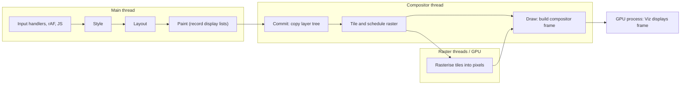

## Introduction

[[b3-browser-processes]] explained how the browser is split into processes. This lesson looks inside the most important one for a frontend engineer — the **renderer process** that runs your page — and at the **threads** that divide its work.

Why should you care about threads when JavaScript itself is single-threaded? Because "single-threaded" describes *your code*, not the browser. Your JavaScript, along with style calculation, layout and paint recording, runs on one thread: the **main thread**. If your code keeps it busy for 300 milliseconds, the page cannot respond to a click for 300 milliseconds. But other threads keep working in the meantime: the **compositor thread** can still scroll the page and run some animations, and **raster threads** can still turn already-recorded drawings into pixels. Knowing which thread does what tells you:

- why a heavy `for` loop freezes buttons but not necessarily scrolling,
- why animating `transform` stays smooth while animating `left` stutters,
- why a `touchmove` listener can ruin scroll performance, and
- when to move work into a **Web Worker**, a background thread you control.

The details describe Chromium (Chrome, Edge and other Chromium browsers), whose rendering architecture is publicly documented under the name *RenderingNG*. Firefox (with its WebRender compositor) and Safari share the same broad split between a main thread and an off-main-thread compositor.

## Before you start

- **The event loop and run-to-completion** — one task at a time; a task cannot be interrupted by another task on the same thread. See [[b1-event-loop]] and [[b1-run-to-completion]].
- **Processes vs threads** — threads share memory inside one process. See [[b3-browser-overview]].
- **The rendering pipeline in outline** — style → layout → paint → composite. See [[b3-critical-rendering-path]]; this lesson re-explains enough to follow.

## The intuition

Think of an animation studio producing a cartoon. A single **director** decides what each scene contains — characters, positions, dialogue. Doing that takes thought, and the director can only work on one scene at a time. **Painters** then turn the director's sketches into finished cels. A **camera operator** takes the finished cels and films them, sliding them across the background, zooming and fading, one frame at a time.

Once the cels are painted, the camera operator can pan across a painted background or slide a cel along without asking the director anything. But if the scene itself must change — a character's arm moves to a new pose — the director has to redraw it, and the camera operator waits.

| Studio | Renderer thread |
|---|---|
| Director | **Main thread**: JavaScript, DOM, style, layout, paint recording |
| Painters | **Raster threads** (and the GPU): turning drawing commands into pixels |
| Camera operator | **Compositor thread**: positioning layers, scrolling, simple animations, producing frames |
| Assistant working in another room, passing notes | **Web Worker**: your background JavaScript, no access to the scene |

The analogy holds for the key point — the compositor can keep moving existing layers without the main thread — and breaks in one place: in a real browser the "cels" are tiles of layers held as GPU textures, and painters work on tiles in parallel.

## The frame pipeline in one picture

To understand the threads you need the outline of how one frame is made. At 60 Hz a display refreshes every 16.7 ms; on a 120 Hz screen, every 8.3 ms. For smooth motion the browser must produce a new frame within that budget.



The main thread produces a *description* of the page — display lists saying "draw this text here, fill this rectangle there" grouped into layers. The **commit** hands that description to the compositor thread. From then on the compositor thread owns it: it splits layers into tiles, asks raster workers to turn tiles into pixels, and assembles the visible tiles into a **compositor frame** for the GPU process to display.

## Main Thread {#b3-main-thread}

The **main thread** is the single thread in a renderer process that runs the page's JavaScript and owns its DOM. Almost everything your code touches lives on it, and so does most of the browser's own work to turn the DOM into something drawable. That makes it the most contended resource in frontend performance.

### What runs on it

On the main thread, interleaved through the event loop ([[b3-browser-event-loop]]):

- **HTML parsing** and DOM construction (the [[b3-preload-scanner]] runs separately, which is why resources are discovered early even when the parser is blocked).
- **All JavaScript on the page**: scripts, event handlers, timers, promise reactions, `requestAnimationFrame` callbacks, framework rendering such as React's reconciliation.
- **Style**: matching CSS selectors to elements and computing every element's final styles.
- **Layout**: computing the size and position of every box ([[b3-layout]]).
- **Paint**: recording drawing commands into display lists ([[b3-paint]]). This is recording, not producing pixels.
- **Garbage collection** of the page's JavaScript heap — much of V8's GC work runs concurrently on helper threads, but some phases still pause the main thread.

Because all of this shares one thread, it all competes for the same frame budget. A 50 ms click handler is 50 ms during which style, layout, paint and other input cannot run.

### Run-to-completion makes blocking visible

The main thread runs one task at a time and never interrupts a task. The following program, run in Node.js, shows the consequence; a browser main thread behaves the same way.

```js title="block.mjs"
const start = performance.now();

setTimeout(() => {
  const waited = Math.round((performance.now() - start) / 100) * 100;
  console.log(`timer callback ran after ~${waited} ms (requested 0 ms)`);
}, 0);

// 500 ms of synchronous work: nothing else on this thread can run.
const end = start + 500;
while (performance.now() < end) {}
console.log('synchronous work finished');
```

```output
synchronous work finished
timer callback ran after ~500 ms (requested 0 ms)
```

The timer was due almost immediately, but its callback is a separate task, and the loop occupies the thread until it finishes. In a browser, a click, a `requestAnimationFrame` callback and the next frame's style and layout would all wait the same way. (The measured delay is rounded to 100 ms; the exact number varies slightly from run to run.)

### Long tasks and the frame budget

A task that runs for more than **50 ms** is called a **long task**. The number comes from the RAIL performance model: if each task is under 50 ms, any input arriving during a task can still be handled within roughly 100 ms, which users perceive as instant. The `PerformanceObserver` API reports long tasks ([[b3-long-task-api]]), and the Core Web Vital **Interaction to Next Paint (INP)** measures how long real interactions wait ([[b3-core-web-vitals]]).

To keep animations smooth, the main thread's share of each frame — `requestAnimationFrame` callbacks, style, layout, paint — must fit inside the frame budget alongside everything else. Practical tactics follow directly from the thread model:

- **Break up long tasks** by yielding: `await` a `setTimeout` or `scheduler.yield()` (Chromium 129+) between chunks so input and rendering can run in between ([[b3-long-tasks-browser]]).
- **Batch DOM reads and writes** so layout is computed once per frame instead of repeatedly ([[b3-layout-thrashing]]).
- **Move pure computation off the thread** with a Web Worker (below).

> [!WARNING] "Async" is not "off the main thread"
> `async`/`await` and promises do not create threads. An `async` function that sorts a million items still sorts them on the main thread; `await` only splits work into separate tasks at the points where you wait. Only Workers (and browser-internal threads) run in parallel.

### Why the DOM is main-thread only

Why not let several threads update the DOM at once? Because the DOM, style and layout data are large, interlinked structures. Allowing concurrent mutation would require locks around nearly every operation, making the common case slower and introducing race conditions into every web page. The web platform chose a simpler contract: one thread owns the document, and other threads communicate with it by message. That is why Workers cannot touch `document`.

## Compositor Thread {#b3-compositor-thread}

The **compositor thread** is a second thread in each renderer process that takes the page's layers, as painted by the main thread, and turns them into frames — positioning, scrolling, clipping and blending them — without needing the main thread for each frame. It is the reason a page can often keep scrolling smoothly even when its JavaScript is busy.

### What it does

- **Receives commits** of the layer tree and display lists from the main thread. Chromium keeps a *pending* tree (being rasterised) and an *active* tree (being drawn), so the compositor can keep drawing the old version until the new one's tiles are ready.
- **Divides layers into tiles** and decides which tiles to rasterise first: those in the viewport, then those just outside it in the scroll direction.
- **Handles scrolling and pinch-zoom** directly, by changing a layer's scroll offset and producing a new frame — no style, layout or paint needed.
- **Runs compositor animations**: CSS animations and transitions, and Web Animations, of properties it can apply to already-rasterised layers — mainly `transform` and `opacity`, and in Chromium some `filter` cases.
- **Produces compositor frames** and sends them to the GPU process's display compositor each vsync.

### Why `transform` animations survive a busy main thread

Animating `left` changes an element's position in layout. Each frame needs new layout and paint on the main thread, so if the main thread is busy, the animation stalls. Animating `transform: translateX()` on an element that has its own compositing layer only changes how an existing bitmap is placed. The compositor thread can compute and apply that every frame on its own.

```css title="slide.css"
/* Runs on the compositor: smooth even while JavaScript is busy. */
.toast-good { animation: slide-in 300ms ease-out; }
@keyframes slide-in {
  from { transform: translateX(100%); }
  to   { transform: translateX(0); }
}

/* Needs layout every frame on the main thread: stutters under load. */
.toast-bad { animation: slide-in-left 300ms ease-out; position: relative; }
@keyframes slide-in-left {
  from { left: 100%; }
  to   { left: 0; }
}
```

If you start both animations and then block the main thread with the busy loop from the previous section, the `transform` version keeps moving and the `left` version freezes until the loop ends. (This is standard Chromium behaviour; it was not run as part of writing this lesson, and whether the browser actually promotes the element to its own layer is a heuristic decision.) See [[b3-transform-opacity-compositing]] and [[b3-compositor-layers]].

### When the compositor must wait for the main thread

The compositor can scroll on its own only if no JavaScript might want to stop the scroll. A `touchstart`, `touchmove` or `wheel` listener could call `event.preventDefault()` to cancel scrolling, so when such a listener exists over the touched area, the compositor must send the event to the main thread and **wait** for the handler to finish before scrolling. If the main thread is busy, scrolling stalls.

The fix is to declare that your listener will not cancel the scroll:

```js title="track-scroll.js"
// passive: true promises not to call preventDefault(),
// so the compositor can scroll immediately.
window.addEventListener('touchmove', onTouchMove, { passive: true });

function onTouchMove(event) {
  // Read positions for analytics; never cancel the scroll here.
  console.log(event.touches[0].clientY);
}
```

Since Chrome 56, `touchstart` and `touchmove` listeners registered on `window`, `document` or `body` are passive by default, and Chrome 73 did the same for `wheel` and `mousewheel`. Listeners on other elements still default to non-passive, so pass `{ passive: true }` explicitly. If you do need to block scrolling (a custom drag gesture), use the CSS `touch-action` property instead; it tells the compositor in advance which gestures to ignore, with no main-thread round trip.

Other things also force main-thread involvement in scrolling, such as `position: fixed` elements with certain backgrounds in older versions, or scroll-linked effects written in JavaScript. Chromium's DevTools *Rendering → Scrolling performance issues* option highlights such regions.

### Checkerboarding

If the user scrolls faster than tiles can be rasterised, the compositor reaches areas with no pixels yet. It draws them blank (or as a checkerboard in debug builds) and fills them in as raster catches up. This is the compositor choosing to stay responsive rather than wait — a direct trade-off of the threaded design.

## Raster Threads {#b3-raster-threads}

**Rasterisation** is turning drawing commands — "fill this rounded rectangle with this colour", "draw these glyphs at these positions" — into actual pixels in a bitmap. **Raster threads** are the worker threads that do this, and in modern Chromium much of the work is executed on the GPU on their behalf. Rasterisation sits between the main thread's paint step (which only records commands) and the compositor's draw step (which places finished pixels on screen).

### Tiles and priority

The compositor does not rasterise a whole page at once. It divides each layer into **tiles** — rectangles a few hundred pixels across — and rasterises only the tiles that are visible or likely to become visible soon. Tiles in the viewport get the highest priority; tiles just outside it in the direction of scrolling come next; far-away tiles may never be rasterised. This keeps memory bounded on long pages and lets raster run in parallel, since independent tiles can be processed by different threads at once.

### CPU raster, GPU raster and out-of-process raster

There are two ways to produce a tile's pixels:

- **Software (CPU) raster**: the Skia graphics library draws into memory on a CPU thread, and the bitmap is uploaded to the GPU as a texture.
- **GPU raster**: Skia translates the drawing commands into GPU operations, and the GPU draws straight into a texture. This is much faster for large areas and avoids an upload.

In current Chromium on most hardware, GPU raster is the default and it runs **out of process**: the renderer serialises paint commands, and the GPU process executes them ("OOP-R", out-of-process rasterisation). The renderer's raster worker threads remain important for **image decoding** — turning compressed JPEG, PNG, WebP or AVIF data into pixels — and for CPU raster when the GPU path is unavailable (blocklisted driver, software rendering).

### Image decoding and the main thread

Large images are expensive to decode. By default Chromium decodes images on raster threads, off the main thread, as tiles that contain them are rasterised. Two APIs give you more control:

```js title="swap-hero.js"
// Runs as a module script, so top-level await is allowed.
const img = new Image();
img.src = '/hero-large.avif';

// decode() resolves once the image is decoded and ready to paint,
// so inserting it will not cause a blank frame or a decode stall.
await img.decode();
document.querySelector('.hero').replaceChildren(img);
```

The `decoding="async"` attribute on `` hints that the browser may present other content before this image is decoded. Both are hints about *when* the decode can happen; neither moves it onto the main thread.

### What raster cost looks like

Raster work appears in the DevTools Performance panel on tracks named *Raster* or *GPU*. Heavy raster typically comes from very large layers, expensive effects such as large `box-shadow` or `filter: blur()`, and huge images scaled down in CSS. Because raster is off the main thread, it rarely blocks input, but it can still drop frames or cause checkerboarding during fast scrolling. See [[b3-paint-optimization]].

## Worker Threads in the Browser {#b3-worker-threads-browser}

A **Web Worker** is a JavaScript thread that you create from a page. It runs your script in parallel with the main thread, with its own event loop and its own global scope, but **without access to the DOM**. It communicates with the page only by sending messages. Workers are the web platform's answer to "this computation is too heavy for the main thread".

### Kinds of worker

| Kind | Created with | Shared by | Typical use |
|---|---|---|---|
| **Dedicated worker** | `new Worker(url)` | The one page that created it | CPU-heavy work: parsing, compression, image processing, search indexing ([[b3-dedicated-workers]]) |
| **Shared worker** | `new SharedWorker(url)` | All same-origin pages that connect to it | One shared connection or cache across several tabs ([[b3-shared-workers]]) |
| **Service worker** | `navigator.serviceWorker.register(url)` | All pages in its scope | Network proxy for offline support, caching and push ([[b3-service-workers]]) |
| **Worklet** | e.g. `audioContext.audioWorklet.addModule(url)` | Engine-specific | Small hooks into rendering or audio pipelines, such as `AudioWorklet` |

Each worker gets its own V8 **isolate** — a separate JavaScript heap — so objects are never shared by reference between the page and the worker. Dedicated workers normally run as a thread inside the same renderer process as their page; service workers have their own lifecycle and may run when no page is open.

### A complete example

The page below counts primes up to five million when a button is clicked. Done on the main thread, this would freeze the page for the duration; in a worker, buttons, typing and animations stay responsive.

```js title="main.js"
const worker = new Worker(new URL('./primes.worker.js', import.meta.url), {
  type: 'module',
});

worker.addEventListener('message', (event) => {
  const { count, ms } = event.data;
  document.querySelector('#out').textContent = `${count} primes in ${ms} ms`;
});

document.querySelector('#run').addEventListener('click', () => {
  worker.postMessage({ limit: 5_000_000 });
});
```

```js title="primes.worker.js"
// Runs on a worker thread: no DOM, its own event loop and global scope.
self.addEventListener('message', (event) => {
  const { limit } = event.data;
  const t0 = performance.now();
  const sieve = new Uint8Array(limit + 1);
  let count = 0;
  for (let i = 2; i <= limit; i++) {
    if (sieve[i]) continue;
    count++;
    for (let j = i * i; j <= limit; j += i) sieve[j] = 1;
  }
  self.postMessage({ count, ms: Math.round(performance.now() - t0) });
});
```

Clicking *Run* shows `348513 primes in N ms`. The count is exact (there are 348,513 primes below five million, and the sieve was checked with Node.js); the time depends on the machine. Walk through the flow: the click handler only posts a message and returns immediately, so the main thread is free. The worker receives the message as a task on its own event loop, runs the sieve to completion on its own thread, and posts the result. The page receives it as a new `message` task and updates the DOM — the only part that has to happen on the main thread. `type: 'module'` lets the worker use `import`; module workers are supported in all current major browsers ([[b3-worker-modules]]).

### Copying versus transferring data

`postMessage` copies its argument with the **structured clone algorithm** ([[b1-structured-clone]]): objects, arrays, `Map`, `Date`, typed arrays and more are deep-copied; functions and DOM nodes cannot be sent. Copying an 8 MB image buffer costs time on both threads. For large binary data, **transfer** ownership instead. The same semantics are available through `structuredClone`, which lets us show them in Node.js:

```js title="transfer.mjs"
const pixels = new Uint8Array(8_000_000); // 8 MB of image data
const buffer = pixels.buffer;

// Copy: the receiver gets its own 8 MB; the sender keeps its data.
const copy = structuredClone(buffer);
console.log('after copy:    ', buffer.byteLength, copy.byteLength);

// Transfer: ownership moves; the sender's buffer is detached.
const moved = structuredClone(buffer, { transfer: [buffer] });
console.log('after transfer:', buffer.byteLength, moved.byteLength);
```

```output
after copy:     8000000 8000000
after transfer: 0 8000000
```

After a transfer the original `ArrayBuffer` is **detached**: its length becomes 0 and it can no longer be used. With a worker the call is `worker.postMessage(buffer, [buffer])`. Transfers are close to free regardless of size, which is why image and audio pipelines use them. `ArrayBuffer`, `MessagePort`, `ImageBitmap` and `OffscreenCanvas` are among the transferable types ([[b3-worker-transferables]]).

### Shared memory

A `SharedArrayBuffer` is genuinely shared: both threads see the same bytes, and `Atomics` provides safe reads, writes and waiting. After the Spectre vulnerabilities, browsers restricted it to **cross-origin isolated** pages — those served with `Cross-Origin-Opener-Policy: same-origin` and `Cross-Origin-Embedder-Policy: require-corp` — because shared memory can be used to build precise timers for side-channel attacks. Check `self.crossOriginIsolated` before relying on it ([[b3-coop-coep]]).

### What workers cannot do

Workers have no `document`, `window` or DOM elements, and cannot read layout. They do have `fetch`, `WebSocket`, IndexedDB, timers, `crypto` and, through `OffscreenCanvas`, canvas drawing. Starting a worker costs a few milliseconds and some memory, so create one long-lived worker per job rather than one per message. See [[b3-worker-limitations]] and [[b3-worker-use-cases]].

> [!MISTAKE] Moving DOM-heavy work to a worker
> If the slow part of your code is building thousands of DOM nodes or measuring layout, a worker cannot help — that work must happen on the main thread. Workers help when the slow part is pure computation whose *result* is small enough to send back.

## Reading the threads in DevTools

Open the DevTools **Performance** panel, record a few seconds while interacting with a page, and you will see tracks that map directly to this lesson:

| Track | Thread | What to look for |
|---|---|---|
| **Main** | Main thread | Long tasks (red-cornered, over 50 ms), *Recalculate Style*, *Layout*, *Paint* |
| **Compositor** | Compositor thread | Frame production; usually light |
| **Raster / GPU** | Raster workers and GPU process | Large raster blocks during scroll or after big paints |
| **Worker** tracks | Each Web Worker | Your off-main-thread computation |
| **Frames** | — | Dropped or partially presented frames |

A typical diagnosis: a scroll stutters, the *Main* track shows a 200 ms `touchmove` handler, and the event listener was not passive. Or an animation stutters, the *Main* track shows *Layout* every frame, and the animated property was `top`.

## In real systems

- **Framework scheduling**: React's concurrent rendering splits render work into small units and yields to the browser between them, precisely so the main thread can handle input. It does not use extra threads.
- **Partytown and similar libraries** move third-party scripts such as analytics into a worker, proxying the few DOM calls they need, to protect the main thread.
- **Figma, Google Earth, Photoshop on the web** run heavy computation (often WebAssembly) in workers and draw via WebGL/WebGPU, keeping the main thread for UI.
- **Search-as-you-type** in large client-side datasets is commonly implemented with the index in a worker.

## Trade-offs and alternatives

| Approach | Good for | Limits |
|---|---|---|
| Yield on the main thread | DOM-bound work split into chunks | Total work is unchanged; only responsiveness improves |
| Compositor-friendly CSS (`transform`, `opacity`) | Animations and transitions | Extra layers cost GPU memory; overusing `will-change` hurts |
| Web Worker | Pure computation, parsing, compression | No DOM; message cost; startup cost |
| `SharedArrayBuffer` + `Atomics` | Very high-throughput shared data | Requires cross-origin isolation; concurrency bugs |
| Server-side work | Work that does not need to run on the client | Network latency |

## Common mistakes

- **Expecting `async` code to run in parallel.** Promises schedule work on the same thread.
- **Non-passive touch or wheel listeners on scrolling content.** They force the compositor to wait for JavaScript before every scroll.
- **Animating layout properties** (`top`, `left`, `width`, `height`) for motion that could be a `transform`.
- **Putting `will-change: transform` on everything.** Each promoted layer uses memory and raster time; promote only what actually animates.
- **Sending huge objects to workers by copy** every message, so cloning costs more than the computation saved. Transfer buffers instead.
- **Creating a new worker per task.** Reuse a worker or a small pool.

## Interview perspective

> [!INTERVIEW] A strong summary
> "The renderer's main thread runs JavaScript plus style, layout and paint recording, so long tasks there block input and frames. The compositor thread takes committed layers and handles scrolling and transform/opacity animations independently, unless a non-passive listener forces it to wait. Raster turns paint commands into tile pixels, mostly on the GPU in modern Chrome. For heavy computation I'd use a Web Worker and transfer ArrayBuffers rather than copy them."

Common questions:

- **Why can the page scroll while JavaScript is stuck?** Scrolling is handled by the compositor thread using already-rasterised tiles, as long as no non-passive listener must run first.
- **Why are `transform` animations cheaper than `left`?** They skip layout and paint; the compositor repositions an existing layer.
- **What is a long task and why 50 ms?** A task over 50 ms; keeping tasks shorter means input can be handled within about 100 ms.
- **Can a worker update the DOM?** No; it posts a message and the main thread applies the change.
- **Follow-up: what is the cost of a worker?** Startup time, memory for a separate heap, and serialisation cost for each message.

## Practice

1. Build a page with a button that runs the prime sieve on the main thread and another that runs it in a worker. Record both in the Performance panel and compare the *Main* track.
2. Add a CSS spinner animated with `transform: rotate()` and another with `margin-left`. Block the main thread for two seconds and describe what each does.
3. Add a non-passive `touchmove` listener with a 100 ms busy loop to a long page, test scrolling in device emulation, then make it passive and compare.
4. Modify the worker example to send a 50 MB `Uint8Array` to the worker, first by copy and then by transfer, and measure the difference with `performance.now()`.

```quiz
Q: The main thread is blocked for 2 seconds. Which is most likely to keep running smoothly?
- [ ] A click handler that toggles a class
- [ ] An animation of `left` from 0 to 300px
- [x] A CSS animation of `transform: translateX()` on its own layer
- [ ] A `requestAnimationFrame` loop updating a canvas
> The compositor thread can apply `transform` animations to an existing layer without the main thread. Click handlers and `requestAnimationFrame` callbacks are JavaScript and must run on the blocked main thread, and animating `left` needs layout on the main thread every frame.
```

```quiz
Q: Why does `{ passive: true }` on a `touchmove` listener improve scrolling?
- [ ] It runs the listener on the compositor thread
- [ ] It makes the listener run less often
- [x] It promises the listener will not cancel scrolling, so the compositor can scroll without waiting for the main thread
- [ ] It moves the listener into a Web Worker
> The listener still runs on the main thread. What changes is that the compositor no longer has to wait for the listener's result to know whether `preventDefault()` was called, so scrolling proceeds immediately.
```

```quiz
Q: After `worker.postMessage(buf, [buf])`, what is true of `buf` on the sending side?
- [ ] It still holds the data, and the worker has a copy
- [x] It is detached: its `byteLength` is 0 and it cannot be used
- [ ] It is shared with the worker, and both see updates
- [ ] It throws when posted, because ArrayBuffers cannot be sent
> Listing the buffer in the transfer list moves ownership to the worker without copying, leaving the sender's buffer detached. Sharing requires a `SharedArrayBuffer`, which needs cross-origin isolation.
```

## Quick revision {#quick-revision}

- Renderer threads: **main** (JS, DOM, style, layout, paint recording, parsing), **compositor** (commit, tiling, scroll, transform/opacity animations, frames), **raster** (tile pixels, image decode), **workers** (your parallel JS).
- Frame budget: 16.7 ms at 60 Hz, 8.3 ms at 120 Hz. Long task = over 50 ms.
- Run-to-completion: no task can interrupt another on the same thread; `async` is not parallel.
- Compositor can scroll and animate `transform`/`opacity` while the main thread is busy; non-passive `touch`/`wheel` listeners force it to wait. Use `{ passive: true }` or `touch-action`.
- Raster is per tile, prioritised by viewport; modern Chromium usually rasterises on the GPU in the GPU process; raster threads still decode images. `img.decode()`, `decoding="async"`.
- Workers: dedicated, shared, service, worklets; own isolate and event loop; no DOM; `postMessage` uses structured clone; transfer `ArrayBuffer`s to avoid copies; `SharedArrayBuffer` needs cross-origin isolation.

## Key takeaways {#key-takeaways}

- JavaScript is single-threaded, but the browser is not: the main thread is one of several threads in each renderer.
- Anything on the main thread competes with input handling and rendering, so long tasks show up directly as unresponsiveness.
- The compositor thread is what keeps scrolling and well-chosen animations smooth; your job is not to make it wait.
- Rasterisation turns recorded paint into pixels in tiles, off the main thread and mostly on the GPU.
- Web Workers give you real parallelism for computation, at the price of no DOM access and message-based communication.
