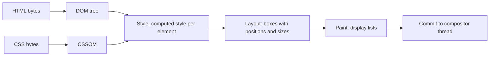

## Introduction

Every browser has a component whose job is to take a web document — HTML, CSS, images, fonts — and turn it into something that can be drawn and interacted with. That component is the **rendering engine** (also called the *layout engine* or *browser engine*). In Chrome and Edge it is **Blink**; in Safari, **WebKit**; in Firefox, **Gecko**.

The rendering engine is easy to confuse with two neighbours. It is not the **browser**: Chrome is a browser product (address bar, sync, extensions) built around Blink. And it is not the **JavaScript engine**: V8 runs JavaScript, but it has no idea what a `<div>` is. Blink owns the DOM, CSS, layout and painting, and exposes them to V8 so your scripts can use them. When you hear "this works in Chromium browsers but not Safari", the difference almost always lives in the rendering engine.

Why does this matter to an engineer?

- **Performance.** Every DOM change you make sets the engine's pipeline — style, layout, paint — in motion. Knowing what each stage does tells you which changes are cheap and which are expensive.
- **Compatibility.** Users run three engines. Features land in them at different times, and bugs differ between them.
- **Architecture.** The engine runs inside the sandboxed renderer process ([[b3-renderer-process]]), on the main thread ([[b3-main-thread]]), which explains both its security model and why its work competes with your JavaScript.

This lesson is the overview of the engine itself. The individual pipeline stages each have their own lessons, linked as they come up.

## Before you start

- **Browser architecture** — what the renderer process is and where the engine sits in it. See [[b3-browser-overview]] and [[b3-browser-processes]].
- **Threads in the renderer** — main thread versus compositor. See [[b3-browser-threads]].
- **The JavaScript engine** — what V8 does on its own. See [[b1-js-engine]].

## The intuition

Think of a print shop that receives manuscripts with styling notes. A typesetter reads the manuscript and identifies its structure — headings, paragraphs, lists (parsing). A stylist works out, for each piece, which notes apply: fonts, sizes, colours (style). A layout artist decides where everything goes on each page and how much space it takes (layout). Finally someone writes precise printing instructions — "draw this text here in 16-point black" — for the press operators (paint). The press itself is a separate department.

The rendering engine is the typesetter, stylist, layout artist and instruction writer. The "press" — rasterising pixels and putting them on screen — is the compositor and GPU, covered in [[b3-browser-threads]]. And JavaScript is a client who keeps phoning in changes ("make the total green", "add a paragraph"), each of which may send work back through several of these desks.

## What the engine is responsible for

| Area | What the engine does | Learn more |
|---|---|---|
| **HTML parsing** | Tokenises HTML and builds the DOM tree, with the HTML standard's error recovery | [[b3-document-download]], [[b3-dom-tree-model]] |
| **CSS parsing and style** | Parses stylesheets into the CSSOM, matches selectors, resolves the cascade, computes each element's values | [[b3-cssom]], [[b3-render-tree]] |
| **Layout** | Computes the geometry of every box: block and inline flow, flexbox, grid, tables, text shaping and line breaking | [[b3-layout]] |
| **Paint** | Records ordered drawing commands (display lists), handles stacking contexts and layers | [[b3-paint]] |
| **Compositing setup** | Decides layers and property trees and commits them to the compositor | [[b3-compositing]] |
| **DOM and Web APIs** | Implements `document`, elements, events, timers, `fetch` (calling into the network service), Canvas, many more | [[b3-dom]] |
| **Event dispatch** | Hit-tests input and dispatches events through the DOM with capture and bubbling | [[b3-dom-events]] |
| **Accessibility** | Builds the accessibility tree that screen readers use | [[b3-a11y-roles]] |

Notice what is *not* in the list: running JavaScript (the JavaScript engine), talking to the network (the network service), and drawing pixels (raster and the GPU process). The engine sits between them as the owner of the document.

## The pipeline, stage by stage

When a page loads or changes, the engine moves data through a series of stages. Each stage reads the output of the previous one and produces a new structure.



**Parse.** The HTML parser produces the **DOM** — a tree of node objects. The CSS parser produces the **CSSOM** — the structured form of every stylesheet rule.

**Style.** For every element the engine finds the matching rules, applies the cascade (origin, specificity, order, `!important`, layers), fills in inherited and initial values, and stores a **computed style**. Elements with `display: none` get no box in the next stage.

**Layout.** Using the computed styles, the engine computes the size and position of every box. This is where text is shaped and broken into lines, flex items are sized, and grid tracks are resolved. Chromium's current layout engine, **LayoutNG**, produces an immutable **fragment tree** describing the result.

**Paint.** The engine walks the laid-out boxes in painting order (backgrounds, then borders, then content, respecting stacking contexts and `z-index`) and records **display items** — commands like "fill rect", "draw text run". It does not produce pixels. Chromium also builds **property trees** describing transforms, clips, effects and scroll offsets so the compositor can apply them without repainting.

**Commit.** The result is handed to the compositor thread, which tiles, rasterises and draws it ([[b3-compositor-thread]], [[b3-raster-threads]]). Chromium's whole modern pipeline is documented under the name **RenderingNG**.

### A toy pipeline you can run

The real stages involve millions of lines of C++, but their *shape* is small enough to model. This program takes a ready-made DOM tree (skipping parsing), computes styles with inheritance, lays out blocks vertically and records a display list:

```js title="toy-engine.mjs"
// A toy rendering pipeline: DOM -> style -> layout -> paint (display list).
const dom = {
  tag: 'body', children: [
    { tag: 'h1', text: 'Cart' },
    { tag: 'p', text: 'Two items' },
    { tag: 'p', text: 'Total: $30', className: 'total' },
  ],
};

const stylesheet = [
  { match: (n) => n.tag === 'body', style: { color: 'black', fontSize: 16 } },
  { match: (n) => n.tag === 'h1', style: { fontSize: 32 } },
  { match: (n) => n.className === 'total', style: { color: 'green' } },
];

// Style: apply matching rules in order; inherit color and fontSize.
function computeStyle(node, parentStyle = {}) {
  const style = { color: parentStyle.color, fontSize: parentStyle.fontSize };
  for (const rule of stylesheet) if (rule.match(node)) Object.assign(style, rule.style);
  node.style = style;
  for (const child of node.children ?? []) computeStyle(child, style);
}

// Layout: stack block children vertically; line height = 1.5 * fontSize.
function layout(node, y = 0) {
  node.box = { y, height: node.text ? node.style.fontSize * 1.5 : 0 };
  let cursor = y + node.box.height;
  for (const child of node.children ?? []) {
    layout(child, cursor);
    cursor += child.box.height;
  }
  node.box.height = cursor - y;
}

// Paint: record drawing commands; nothing is turned into pixels yet.
function paint(node, list = []) {
  if (node.text) list.push(`drawText("${node.text}", y=${node.box.y}, ` +
    `${node.style.fontSize}px, ${node.style.color})`);
  for (const child of node.children ?? []) paint(child, list);
  return list;
}

computeStyle(dom);
layout(dom);
console.log(paint(dom).join('\n'));
console.log('page height:', dom.box.height);
```

```output
drawText("Cart", y=0, 32px, black)
drawText("Two items", y=48, 16px, black)
drawText("Total: $30", y=72, 16px, green)
page height: 96
```

Trace it once. Style runs top-down: `body` gets black 16px; `h1` inherits black and overrides the size to 32px; the second `p` inherits black and is then turned green by the `.total` rule — inheritance first, then matching rules, as in real CSS. Layout runs next: the `h1` is 48px tall (32 × 1.5), so the first paragraph starts at `y=48`, and each 16px paragraph takes 24px, giving a page height of 96. Paint only *records* commands in order.

The model also shows why some changes are more expensive than others. Changing the total's colour from green to red invalidates only style and paint for that element — its box does not move. Changing the `h1`'s font size changes its height, so every box below it must be laid out again, then repainted. Real engines track exactly this kind of dependency to redo as little work as possible ([[b3-reflow-repaint]], [[b3-style-layout-paint-order]]). The toy also ignores almost everything that makes real engines hard: inline layout and line breaking, floats, flex and grid, selector matching performance, incremental invalidation, and text shaping for every script and font.

### Why reading layout can be expensive

Engines are lazy: when JavaScript changes a style, the engine marks things *dirty* and waits, hoping to batch several changes into one style-and-layout pass before the next frame. But if your code then *reads* something that depends on layout, such as `offsetHeight` or `getBoundingClientRect()`, the engine must bring layout up to date immediately to return a correct answer. This is a **forced synchronous layout**. Doing it in a loop — write, read, write, read — makes the engine lay out the page repeatedly in one task, a problem called **layout thrashing** ([[b3-layout-thrashing]]).

```js title="thrash.js"
const items = document.querySelectorAll('.item');

// Slow: each read forces layout because the previous write dirtied it.
for (const el of items) {
  el.style.width = `${el.parentElement.offsetWidth / 2}px`;
}

// Fast: read everything first, then write everything.
const widths = [...items].map((el) => el.parentElement.offsetWidth);
items.forEach((el, i) => { el.style.width = `${widths[i] / 2}px`; });
```

This is browser-only code and was not run as part of writing this lesson; the DevTools Performance panel flags the first loop's repeated *Layout* entries with a "Forced reflow" warning.

## How JavaScript talks to the engine

V8 and Blink are separate C++ libraries. When your code runs `document.querySelector('#total').textContent = '$40'`, three things happen:

1. V8 looks up `querySelector` on the `document` object. That object is a **wrapper**: a JavaScript object that points to Blink's C++ `Document`.
2. The call goes through **bindings**, glue code generated from the interface definitions in the web standards, which are written in **Web IDL** (Interface Definition Language). The bindings convert the JavaScript string argument to Blink's string type, call the C++ method, and wrap the returned C++ `Element` in a JavaScript object (creating a wrapper the first time, reusing it afterwards).
3. Setting `textContent` similarly crosses into Blink, which replaces the element's children and marks style and layout dirty.

Each crossing has a cost: type conversions, checks, and sometimes allocations. A plain JavaScript property access can be optimised by V8's JIT into a few machine instructions; a DOM property access cannot be fully inlined in the same way. That is one reason libraries that minimise DOM operations (virtual DOM diffing, batching updates, `DocumentFragment`) help — the other, bigger reason being the style and layout work each change triggers. The DOM wrappers also link the two engines' memory: Blink's DOM nodes and V8's wrapper objects are garbage-collected together, which is why a detached DOM node kept alive by a JavaScript reference leaks memory ([[b1-memory-leaks]]).

The same structure exists in every browser: WebKit pairs with **JavaScriptCore**, Gecko with **SpiderMonkey**. Node.js uses V8 *without* Blink, which is exactly why Node has no `document` ([[b1-engine-vs-host]]).

## The engines and where they came from

| Engine | Used by | Lineage |
|---|---|---|
| **Blink** | Chrome, Edge, Opera, Brave, Vivaldi, Samsung Internet, Electron apps | Forked from WebKit in April 2013 (first shipped in Chrome 28) |
| **WebKit** | Safari on macOS and iOS; every browser on iOS (outside the EU exception) | Apple's 2001 fork of KDE's KHTML engine, open-sourced in 2005 |
| **Gecko** | Firefox | Netscape's engine, open-sourced via Mozilla in 1998; parts of the Rust research engine Servo (style system "Stylo", WebRender) merged from 2017 |
| *Trident / EdgeHTML* | Internet Explorer / old Edge | Retired; Edge moved to Chromium in January 2020 |
| *Presto* | Opera until 2013 | Retired when Opera moved to Chromium |

Two historical points explain today's landscape. First, Chrome launched in 2008 using **WebKit** for rendering with its own V8 JavaScript engine and multi-process architecture. By 2013 the two projects' needs diverged — Chromium's multi-process model was hard to reconcile with WebKit's — and Google forked WebKit as Blink. That is why Blink and WebKit share old code, naming (`-webkit-` prefixes still work in Chrome) and many behaviours, but have diverged steadily since.

Second, on iOS, Apple's App Store rules required every browser to use WebKit, so "Chrome for iOS" and "Firefox for iOS" have historically been WebKit with a different user interface. Since iOS 17.4 (2024), apps distributed in the European Union may use other engines, but most browsers on iOS still use WebKit. For a frontend engineer, testing on Safari is therefore testing on every iPhone browser.

Today, effectively three engines matter: Blink, WebKit and Gecko. Fewer engines means less compatibility work, but it also concentrates influence — a frequent topic in discussions about web standards.

## Standards and interoperability

Engines are independent implementations of shared standards: the **WHATWG** maintains the living HTML, DOM and Fetch standards; the **W3C** CSS Working Group maintains CSS specifications; **Ecma TC39** maintains JavaScript (implemented by the JavaScript engines). A feature is "part of the web" when it is specified and implemented by multiple engines.

To keep engines consistent, browser vendors share **Web Platform Tests (WPT)**, a large cross-engine test suite, and since 2021 have run a joint annual effort (Compat 2021, then **Interop** from 2022), in which they jointly choose focus areas (for example, container queries, `:has()`, subgrid) and report pass rates. When features ship at different times, sites such as caniuse.com and MDN's compatibility tables show which engine versions support what.

Historically, engines exposed experimental features with **vendor prefixes** (`-webkit-`, `-moz-`, `-ms-`). Developers shipped prefixed code, and engines then had to support prefixes forever. Vendors now prefer feature flags and time-limited trials (Chromium's **origin trials**), but some prefixed properties survive in daily use — `-webkit-line-clamp`, for example, is the standard way to clamp text to a number of lines and works in all three engines.

## Handling engine differences

Because users run different engines, robust code asks whether a *feature* exists, not which *browser* is running.

```js title="feature-detect.js"
// JavaScript API: check the object or method exists.
if ('IntersectionObserver' in window) {
  observeLazyImages();
} else {
  loadAllImages();
}

// CSS feature: ask the engine's own parser.
if (CSS.supports('selector(:has(a))')) {
  document.documentElement.classList.add('has-has');
}
```

```css title="layout.css"
.card-grid { display: flex; flex-wrap: wrap; }

/* Only engines that understand subgrid apply this block. */
@supports (grid-template-rows: subgrid) {
  .card-grid { display: grid; grid-template-columns: repeat(3, 1fr); }
  .card { display: grid; grid-row: span 3; grid-template-rows: subgrid; }
}
```

(Browser-only code; not run as part of writing this lesson.) `CSS.supports()` and `@supports` ask the engine's actual CSS parser whether it accepts a declaration, so they stay correct as engines change. The alternative, **user-agent sniffing** — parsing `navigator.userAgent` to guess the browser — breaks constantly: every Chromium browser claims to be "Mozilla … AppleWebKit … Chrome … Safari", Chrome on iOS is WebKit underneath, and Chromium has reduced the detail in the user-agent string. Use sniffing only to work around a specific known bug in a specific engine version, and remove the workaround when the bug is fixed.

## In real systems

- **Testing matrices** at most companies cover the three engines — typically Chrome (Blink), Safari on iOS (WebKit) and Firefox (Gecko) — rather than every browser brand, because brands on the same engine render alike.
- **Playwright** ships builds of Chromium, WebKit and Firefox precisely so automated tests can run against all three engines on any OS.
- **Electron, Tauri and WebView apps** embed an engine: Electron bundles Chromium; Tauri uses the OS's web view (WebKit on macOS, WebView2/Chromium on Windows, WebKitGTK on Linux), so the same app can meet different engines on different platforms.
- **Performance work** targets the pipeline stages: reducing selector complexity and DOM size cuts style time, avoiding layout thrashing cuts layout time, and promoting animations to the compositor avoids paint ([[b3-paint-optimization]]).

## Trade-offs and alternatives

- **One engine everywhere** (as on pre-2024 iOS) simplifies testing but removes competition on features and performance.
- **Multiple independent engines** keep standards honest — a spec must be implementable twice — at the cost of compatibility work for developers.
- **Polyfills** fill gaps for missing JavaScript APIs; CSS features usually cannot be polyfilled well, so progressive enhancement with `@supports` is the usual approach.
- **Server-rendered HTML** reduces what the engine must do in JavaScript but still flows through the same parse–style–layout–paint pipeline.

## Common mistakes

- **Calling V8 the rendering engine.** V8 runs JavaScript; Blink renders. They are connected by bindings.
- **Treating Chrome on iOS as Chromium.** Outside the EU exception it is WebKit; test Safari.
- **User-agent sniffing for features.** Use `'api' in window`, `CSS.supports()` and `@supports`.
- **Interleaving DOM writes and layout reads** in loops, forcing repeated synchronous layout.
- **Assuming all `-webkit-` properties are Safari-only.** Many are supported by Blink and Gecko for compatibility.

## Interview perspective

> [!INTERVIEW] What to say
> "The rendering engine — Blink, WebKit or Gecko — owns the DOM and CSS. It parses HTML and CSS, computes styles, lays out boxes, records paint commands and commits them to the compositor, all on the renderer's main thread. JavaScript reaches it through Web IDL bindings, so DOM access crosses an engine boundary. Blink forked from WebKit in 2013; Firefox uses Gecko. Because engines differ, I use feature detection and test on all three."

Likely questions:

- **Difference between rendering engine and JavaScript engine?** Document versus language; Blink versus V8; linked by bindings.
- **What triggers layout versus paint only?** Geometry changes (size, position, font) need layout; visual-only changes (colour, background) need paint; `transform`/`opacity` on a composited layer need neither.
- **What is a forced synchronous layout?** Reading a layout-dependent property after an unflushed style change, making the engine compute layout immediately.
- **Why might a feature work in Chrome but not on an iPhone?** Every iOS browser has historically used WebKit.

## Practice

1. Extend `toy-engine.mjs` so that `display: none` removes a node from layout and paint, and add a rule that sets a `marginTop`.
2. In the toy, change the `h1` font size and count which nodes' `y` values change; then change only the total's colour and compare.
3. Record the thrash example in the Performance panel and find the forced reflow warning; then record the fixed version.
4. Pick three CSS features from caniuse.com and write `@supports` fallbacks for one that is not yet in all three engines.

```quiz
Q: A script sets `el.style.color = 'red'` on an element. Which pipeline stages must the engine redo for that element?
- [ ] Parse, style, layout and paint
- [x] Style and paint — the box's geometry does not change
- [ ] Layout only
- [ ] None: colour changes are handled entirely by the compositor
> Colour affects computed style and what is drawn, but not size or position, so layout can be skipped. Only `transform` and `opacity` (and some filters) on composited layers can skip paint as well.
```

```quiz
Q: Why is `document.body.offsetHeight` sometimes expensive to read?
- [ ] It makes a network request
- [ ] It is computed in a Web Worker
- [x] If styles or the DOM changed since the last layout, the engine must perform layout synchronously to return an accurate value
- [ ] It forces the page to repaint every pixel
> Engines defer layout until needed. Reading a geometry property after a change forces that deferred layout to happen immediately, inside your task — the basis of layout thrashing.
```

```quiz
Q: Which statement about engines is correct?
- [ ] Blink and WebKit are the same engine under different names
- [x] Blink was forked from WebKit in 2013 and the two have diverged since
- [ ] Firefox uses Blink with SpiderMonkey
- [ ] Edge still uses EdgeHTML
> Blink began as a fork of WebKit and still shares history and some behaviour with it, but they are separate projects. Firefox uses Gecko, and Edge switched to Chromium (Blink) in 2020.
```

## Quick revision {#quick-revision}

- Rendering engine = owner of the document: HTML/CSS parsing, DOM, style, layout, paint, events, Web APIs, accessibility. Runs on the renderer's main thread.
- Not the JS engine (V8/JavaScriptCore/SpiderMonkey) and not the browser product.
- Pipeline: HTML → DOM; CSS → CSSOM; style → computed style; layout → boxes (LayoutNG fragment tree); paint → display lists + property trees; commit → compositor. Chromium calls it RenderingNG.
- Colour change: style + paint. Geometry change: style + layout + paint. Reading layout after a write forces synchronous layout; batch reads then writes.
- Bindings generated from Web IDL wrap C++ DOM objects as JS objects; DOM calls cost more than plain JS; wrappers and nodes are collected together.
- Engines: Blink (Chromium browsers; forked from WebKit 2013), WebKit (Safari, iOS; from KHTML), Gecko (Firefox; Servo parts). EdgeHTML retired 2020.
- Interop: WHATWG/W3C specs, Web Platform Tests, Interop project; vendor prefixes legacy; origin trials.
- Feature-detect with `'x' in window`, `CSS.supports()`, `@supports`; avoid UA sniffing.

## Key takeaways {#key-takeaways}

- The rendering engine turns documents into drawable output and owns the DOM; the JavaScript engine only runs your code and reaches the DOM through bindings.
- Each DOM or style change re-enters a pipeline of style, layout and paint; knowing which stages a change triggers is the basis of rendering performance.
- Engines defer work, so reading layout right after writing styles forces expensive synchronous layout.
- Three engines matter today — Blink, WebKit and Gecko — and iOS has historically meant WebKit for everyone.
- Write code against features, not browser names: feature detection survives engine changes; user-agent sniffing does not.
