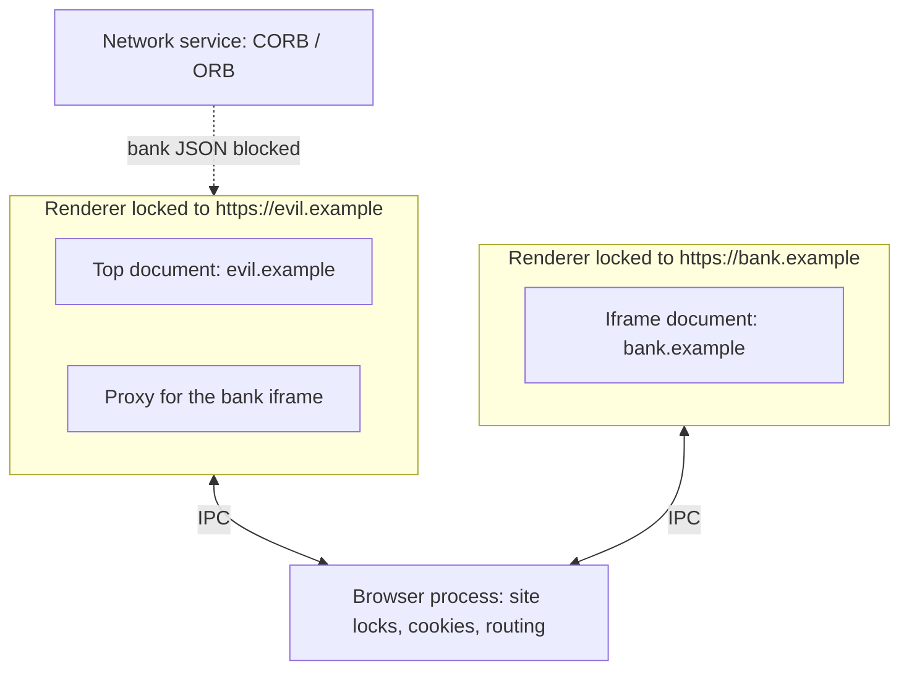

## Introduction

For most of the web's history, browsers protected sites from each other with *rules*: the **same-origin policy** ([[b3-same-origin]]) said that JavaScript from `evil.example` may not read the DOM, cookies or responses of `bank.example`. The rules were enforced by checks inside the renderer — the same process that ran both sites' code when one embedded the other.

In January 2018 that stopped being enough. The **Spectre** family of CPU vulnerabilities showed that code running in a process can, with careful timing measurements, read memory anywhere in that process, ignoring every check the program makes. If `evil.example` embedded `bank.example` in an iframe and both ran in one renderer, the bank's data sat in memory that the attacker's JavaScript could, in principle, read.

The browser's answer was **site isolation**: never put documents from different sites in the same renderer process. Then there is nothing of the bank's in the attacker's process to read. Chrome enabled it for all sites on desktop in Chrome 67 (2018); Firefox shipped its equivalent, Project Fission, by default in Firefox 95 (2021). It is one of the largest architectural changes browsers have made, and it explains several modern web features — `Cross-Origin-Opener-Policy`, `Cross-Origin-Embedder-Policy`, the restrictions on `SharedArrayBuffer`, and the deprecation of `document.domain`.

This lesson covers why isolation is by **site**, how it can be tightened to **origin**, and how a page made of iframes from several sites still looks and behaves like one page when its parts live in different processes.

## Before you start

- **Renderer processes and the sandbox** — see [[b3-browser-processes]], especially [[b3-renderer-process]].
- **Origins** — scheme, host and port. See [[b3-origin-definition]] and [[b3-same-origin]].
- **Iframes** — how one document embeds another. See [[b3-iframes]].
- **Navigation commit** — the browser process picks a renderer after the response headers arrive. See [[b3-url-navigation]].

## The intuition

Imagine an office where every client's paperwork used to be kept in one shared room, and staff were only *told* not to read other clients' files. That works until someone discovers that, by watching how long the filing clerk takes to answer certain questions, they can deduce what is in a folder they are not allowed to open. Rules about who may open which drawer do not help, because no drawer is opened.

The fix is not a better rule; it is separate rooms. Each client's files go in a room that only that client's staff can enter. Spectre-style tricks still work inside a room, but the room contains nothing belonging to anyone else.

Site isolation builds those rooms. Its key design question is **how big each room should be** — one per site, or one per origin — and how to keep a page working when its pieces are in different rooms.

## Why Spectre changed the rules

Modern CPUs **speculatively execute** instructions before they know whether they should: when the code reaches an `if`, the CPU guesses the outcome and runs ahead. If the guess was wrong, it discards the results — but the speculative work leaves traces in the CPU cache. By timing memory accesses afterwards, an attacker can infer values the speculative code touched, including values the program's own bounds checks were supposed to protect.

For browsers the conclusion was stark: **JavaScript can potentially read any memory in its own process**. Browser vendors applied mitigations — coarser timers such as reduced `performance.now()` precision, disabling `SharedArrayBuffer` (which can build precise timers) — but these only slow attacks down. The robust defence is to ensure that a process running untrusted code contains no data that code is not allowed to see. That is a statement about process allocation, so it had to be solved in the browser's architecture.

Site isolation also strengthens defence against ordinary renderer exploits. If an attacker uses a memory-corruption bug to take over a renderer, they gain only what that renderer holds and what the browser process will give a process locked to the attacker's site.

## Sites, not origins

An **origin** is the triple scheme + host + port: `https://mail.example.com:443`. A **site** is coarser: the scheme plus the **registrable domain**, also called **eTLD+1** — the public suffix (effective top-level domain, such as `com` or `co.uk`) plus one more label. `https://mail.example.com` and `https://docs.example.com` are different origins but the same site, `https://example.com`. Ports are ignored for the site. ([[b3-same-site-vs-same-origin]] covers the comparison in detail.)

The **Public Suffix List** decides what counts as a public suffix. It contains not only country domains like `co.uk` but also shared-hosting domains such as `github.io`, so that `alice.github.io` and `mallory.github.io` are different sites even though they share a parent domain. The following program computes origin and site with a tiny excerpt of that list:

```js title="site.mjs"
// A tiny excerpt of the Public Suffix List. Real browsers ship
// the full list (thousands of entries such as co.uk and github.io).
const PUBLIC_SUFFIXES = new Set(['com', 'org', 'uk', 'co.uk', 'github.io']);

function registrableDomain(hostname) {
  const labels = hostname.split('.');
  // Find the longest public suffix, then keep one more label (eTLD+1).
  for (let i = 0; i < labels.length; i++) {
    const suffix = labels.slice(i).join('.');
    if (PUBLIC_SUFFIXES.has(suffix)) {
      return i === 0 ? hostname : labels.slice(i - 1).join('.');
    }
  }
  return hostname;
}

function site(urlString) {
  const url = new URL(urlString);
  return `${url.protocol}//${registrableDomain(url.hostname)}`;
}

const pairs = [
  ['https://mail.example.com', 'https://docs.example.com'],
  ['https://example.com', 'http://example.com'],
  ['https://example.com', 'https://example.com:8443'],
  ['https://shop.example.co.uk', 'https://bank.example.co.uk'],
  ['https://alice.github.io', 'https://mallory.github.io'],
];

for (const [a, b] of pairs) {
  const sameOrigin = new URL(a).origin === new URL(b).origin;
  const sameSite = site(a) === site(b);
  console.log(`${a} vs ${b}`);
  console.log(`  same origin: ${sameOrigin}, same site: ${sameSite} (${site(a)})`);
}
```

```output
https://mail.example.com vs https://docs.example.com
  same origin: false, same site: true (https://example.com)
https://example.com vs http://example.com
  same origin: false, same site: false (https://example.com)
https://example.com vs https://example.com:8443
  same origin: false, same site: true (https://example.com)
https://shop.example.co.uk vs https://bank.example.co.uk
  same origin: false, same site: true (https://example.co.uk)
https://alice.github.io vs https://mallory.github.io
  same origin: false, same site: false (https://alice.github.io)
```

Two lines deserve attention. The `co.uk` pair is same-site because both hosts are under `example.co.uk`; without `co.uk` in the list, the program would have computed the site as `co.uk` and lumped every British company together. The `github.io` pair is cross-site only because `github.io` is on the list — which is exactly why hosting providers add themselves to it. (The longest-suffix search here is a simplification; the real algorithm also handles wildcard and exception rules.)

### Why the default boundary is the site

If origins are the security boundary of the same-origin policy, why isolate by the coarser site? Because of a legacy feature: **`document.domain`**. Historically, two same-site pages such as `a.example.com` and `b.example.com` could both set `document.domain = 'example.com'` and then access each other's DOM *synchronously*, as if same-origin. Synchronous access to another document's objects is only possible if both live in the same process, so the browser had to keep same-site pages together in case they used it. The site was the smallest unit the platform guaranteed would never need synchronous cross-access.

There is also a cost argument. Many sites use many subdomains (`www`, `static`, `api`, `login`); one process per origin would multiply process count, and memory, significantly. The next section shows how that boundary is being tightened as `document.domain` disappears.

## How site isolation works

When the browser process commits a navigation ([[b3-url-navigation]]), it computes the site of the final URL and gives the document to a renderer **locked** to that site. A locked renderer will only ever host documents of that one site, for its whole lifetime. The browser process records the lock and enforces it in three ways:

1. **Process allocation.** Cross-site documents — new tabs, popups, and iframes alike — always go to a different process.
2. **Data access.** Whenever the renderer asks for cookies, `localStorage`, IndexedDB, saved passwords or permissions, the browser process checks that the requested origin belongs to the renderer's site. A renderer locked to `evil.example` that asks for `bank.example` cookies is assumed compromised and killed.
3. **Network responses.** The network service blocks responses that should never enter a cross-site process. **Cross-Origin Read Blocking (CORB)** — being replaced by **Opaque Response Blocking (ORB)** — stops a page from pulling `bank.example`'s JSON or HTML into its own process by requesting it as an `` or `<script>`, which the same-origin policy would otherwise allow as an opaque "no-cors" load.

The third point is subtle and important. Without it, an attacker would not need to embed the bank's *page*; it could request `https://bank.example/api/account` as an image source. The response would be useless as an image, but its bytes would land in the attacker's process — readable via Spectre. CORB/ORB inspects the response type and replaces such bodies with an empty response before they reach the renderer.



### What site isolation does not protect

Site isolation is a boundary between *sites*. It does not help with:

- **Same-site, cross-origin data.** `blog.example.com` and `admin.example.com` can share a process by default. A vulnerability in a user-generated subdomain can threaten others on the same site — a good reason to host untrusted content on a separate registrable domain (as Google does with `googleusercontent.com`).
- **Resources a site legitimately lets in.** If `bank.example` serves its data with `Access-Control-Allow-Origin: *`, or as JavaScript that any page may include, then the data enters the including page's process by design.
- **Bugs in the browser process or OS.** Isolation contains a compromised renderer; it does not stop an attacker with a sandbox escape.
- **Classic web attacks** such as XSS, CSRF or clickjacking, which operate within the rules rather than by reading memory.

### Coverage and cost

On desktop Chrome, every site is isolated. On Android, where memory is tighter, Chrome isolates only some sites — those where the user has logged in with a password (since Chrome 77), and later also sites using OAuth logins or sending COOP headers — and only on devices with enough memory. Firefox with Fission isolates all sites on desktop. Safari's WebKit has been developing site isolation but has historically rendered cross-site iframes in the embedding page's process; check current release notes before relying on it.

The main cost is memory. Chrome's engineers reported around 10–13% total memory overhead when site isolation launched on desktop, mitigated by the existing per-site process sharing for same-site tabs.

## Origin-Keyed Processes {#b3-origin-keyed-processes}

An **origin-keyed process** is a renderer locked to a single *origin* — such as `https://admin.example.com` — rather than to a whole site. It tightens site isolation so that different subdomains of one site are kept apart too. Pages can request this with the **`Origin-Agent-Cluster`** response header, and some other conditions also lead to origin keying.

### Agent clusters: the spec concept underneath

The HTML specification does not talk about processes; browsers are free to allocate them as they like. What it does define is the **agent cluster**: a group of JavaScript execution contexts (windows, workers) that may share memory and synchronously access each other's objects. Two documents in the same agent cluster *must* be in the same process, because synchronous object access requires shared memory. Two documents in different agent clusters *may* be split.

By default, agent clusters were **site-keyed**: all same-site documents in a browsing context group formed one cluster, so that `document.domain` could work. An **origin-keyed agent cluster** contains documents of one origin only. Once a page's agent cluster is origin-keyed, nothing in the spec requires it to share a process with its same-site siblings, so the browser *can* put it in its own process.

### Opting in with `Origin-Agent-Cluster`

A server opts a page in with a structured header whose value is a boolean:

```http title="Response header"
Origin-Agent-Cluster: ?1
```

The effects, in Chromium since version 88:

- The document gets an **origin-keyed agent cluster**.
- **`document.domain` can no longer be used** to relax the same-origin policy for that page; setting it has no effect.
- The browser may place the origin in its own process. Chromium on desktop uses the header as a hint to do so when resources allow; the specification only guarantees the agent-cluster behaviour, so treat the process separation as a performance and security *hint*, not a guarantee.

A page can check which kind of cluster it got:

```js title="check-cluster.js"
// true if this document is in an origin-keyed agent cluster.
console.log(window.originAgentCluster);
```

This is a browser-only API and the result depends on headers and browser version; it was not run as part of writing this lesson.

The header must be consistent across an origin. If a browser has already put some document of `admin.example.com` in a site-keyed cluster within a browsing context group, a later document of the same origin in that group stays site-keyed even if it sends `?1`, because the browser never splits one origin across both kinds of cluster in a group.

### Origin keying by default

Because `document.domain` was the main reason for site-keyed clusters, browsers have been retiring it. From **Chrome 115**, documents get origin-keyed agent clusters by default, which makes `document.domain` setting a no-op unless a page explicitly opts back out with `Origin-Agent-Cluster: ?0` (see [[b3-document-domain-legacy]]). Default *processes* in Chrome remain site-keyed for memory reasons; the default change frees the browser to move to origin-keyed processes later without breaking pages.

Other routes to origin-keyed isolation:

- **Cross-origin isolated pages** — those sending `Cross-Origin-Opener-Policy: same-origin` and `Cross-Origin-Embedder-Policy: require-corp` (or `credentialless`) — get an origin-keyed agent cluster, which is part of why they may use `SharedArrayBuffer` and high-precision timers ([[b3-cross-origin-isolation]], [[b3-coop-coep]]).
- **Enterprise policy** or the command-line flag `--isolate-origins=https://admin.example.com` forces specific origins into their own processes.

### When to use it

Send `Origin-Agent-Cluster: ?1` when one subdomain handles sensitive data and shares a site with less-trusted content — an admin panel next to user-generated pages, or a payments subdomain next to a marketing site. It also has a performance side: a heavy app on one subdomain will not share a main thread with pages on another subdomain. Do not use it if your pages still depend on `document.domain`; migrate them to `postMessage` first.

> [!NOTE] What changes for your code
> Almost nothing, unless you used `document.domain`. Same-origin policy rules are unchanged; same-site, cross-origin frames already could not touch each other's DOM without `document.domain`. Communication through `postMessage` works the same whether or not the frames share a process.

## Cross-Site iframe Process Boundaries {#b3-cross-site-iframes}

With site isolation, a **cross-site iframe** — an iframe whose document comes from a different site than its parent — is rendered in a *different renderer process* from the page that embeds it. Chromium calls these **out-of-process iframes (OOPIFs)**. A single tab showing a news article with an embedded video player and an ad may therefore use three renderer processes, yet the user sees one seamless page. This section explains how the browser keeps that illusion intact.

### Which iframes go out of process

| Iframe content | Process (Chromium, full site isolation) |
|---|---|
| Same origin as parent | Parent's process |
| Same site, different origin (e.g. `cdn.example.com` in `www.example.com`) | Parent's process, unless origin-keyed |
| Different site | A process locked to the iframe's site |
| `about:blank` or `srcdoc` | Inherits the creator's origin, so parent's process |
| Several iframes of the same other site in one page | Usually share one process for that site |

The decision is made per navigation: if a frame later navigates from a same-site URL to a cross-site one, its document moves to a different process at commit.

### The frame tree spans processes

Every page has a **frame tree**: the top document and, nested beneath it, each iframe's document. With OOPIFs that tree is split across processes. Each renderer holds full documents for the frames of its own site and lightweight **proxies** for frames that live elsewhere. A proxy is enough to support everything the web platform allows across origins anyway:

- `window.frames`, `window.parent` and `window.top` return objects that work across processes.
- `iframe.contentWindow.postMessage(data, origin)` becomes an IPC message, delivered asynchronously to the other process — which is fine, because `postMessage` was always asynchronous. See [[b3-postmessage-origin-check]].
- Setting `iframe.contentWindow.location` to navigate the frame is forwarded to the browser process.
- Reading `iframe.contentWindow.document` throws a `SecurityError`, exactly as it did before isolation — the proxy holds no DOM.

That last point is why OOPIFs were possible without breaking the web: the same-origin policy already forbade synchronous access to a cross-origin frame's contents, so moving that content to another process is invisible to correct code.

### Drawing one picture from several processes

The parent renderer lays out the page and decides where the iframe's box is and how big it is. It sends that size to the browser process, which forwards it to the iframe's renderer. The iframe's renderer lays out and paints its own document, and each process produces its own **compositor frame**. In the GPU process, the **Viz** display compositor stitches the frames together, placing the iframe's output into the hole reserved for it in the parent's frame, including clipping, scrolling and transforms. See [[b3-gpu-process]] and [[b3-compositing]].

### Delivering input

A click on the iframe's area arrives at the browser process first. The browser process performs **hit testing** — determining which frame is under the pointer — using information from the compositor, then forwards the event to the iframe's renderer, with coordinates translated into that frame's space. Keyboard focus, scrolling that bubbles from an inner frame to its parent, find-in-page, accessibility trees and printing all need similar cross-process coordination; making each of them work was much of the multi-year effort behind site isolation.

### Interaction with iframe security features

Process isolation complements, rather than replaces, the iframe security controls you set:

- The `sandbox` attribute ([[b3-iframe-sandbox]]) restricts what the framed document may do — run scripts, submit forms, navigate the top page. It applies regardless of process.
- `X-Frame-Options` and `Content-Security-Policy: frame-ancestors` let a site refuse to be framed at all, which is the defence against clickjacking ([[b3-csp-frame-ancestors]]). Site isolation does not stop clickjacking, because the attack works by overlaying UI, not by reading memory.
- `allow` (Permissions Policy) controls which powerful features — camera, geolocation, payment — the iframe may request.

### Performance considerations

Each OOPIF of a new site may need a new process, which costs memory and some start-up time; a page full of third-party iframes is measurably heavier with isolation. The benefits run the other way too: a busy third-party iframe — a heavy ad, say — runs on its *own* main thread, so its long tasks no longer block the parent page's JavaScript. With same-process iframes, an ad's busy loop would freeze the article it was embedded in.

> [!IMPORTANT] Do not rely on iframe timing being synchronous
> Code that assumes a cross-site iframe's `load` event, size change or message arrives at a particular point relative to the parent's own tasks can break, because the two now run on different threads in different processes. Coordinate with explicit `postMessage` handshakes.

## Worked example: a page with two iframes

Suppose `https://news.example` renders this:

```html title="article.html"
<h1>Election results</h1>
<iframe src="https://static.news.example/chart.html" title="Results chart"></iframe>
<iframe src="https://video-host.example/embed/123" title="Video"></iframe>
<iframe src="https://ads.adnetwork.example/slot?id=9" title="Advertisement"></iframe>
```

| Frame | Site | Process in desktop Chrome |
|---|---|---|
| Top document | `https://news.example` | Renderer A (locked to `news.example`) |
| `static.news.example` chart | `https://news.example` | Renderer A (same site) |
| Video embed | `https://video-host.example` | Renderer B |
| Ad | `https://adnetwork.example` | Renderer C |

Now consider what each party can do:

- The chart iframe is same-site but cross-origin. Its JavaScript cannot read the top document's DOM (same-origin policy), but it shares a process — so a Spectre attack from the chart could in principle read the article's memory. If `static.news.example` hosted untrusted content, the site could send `Origin-Agent-Cluster: ?1` from it, or better, move it to a separate registrable domain.
- The ad runs in Renderer C. Even if the ad script is malicious and exploits a V8 bug, it controls a process holding only `adnetwork.example` data. It cannot request `news.example` cookies from the browser process, and CORB/ORB prevents it from pulling `news.example` JSON into its process.
- If the ad runs a 500 ms loop, Renderer C's main thread is blocked; the article in Renderer A keeps responding to scrolls and clicks.
- The article and the video player talk only through `postMessage`, which works identically across processes.

You can verify the allocation yourself in Chrome's Task Manager (iframe processes appear as *Subframe: https://…* rows) or at `chrome://process-internals`, which lists each frame and its process lock. (This describes standard Chrome desktop behaviour; it was not run as part of writing this lesson.)

## In real systems

- **Separate domains for untrusted content.** Large platforms serve user uploads, sandboxed previews and third-party code from dedicated registrable domains so that site isolation separates them from the main app.
- **Cross-origin isolation for powerful features.** Apps that need `SharedArrayBuffer` for WebAssembly threads (video editors, games, Figma-like tools) deploy COOP and COEP, which also gives them origin-keyed isolation.
- **Ads and embeds.** Out-of-process iframes mean a heavy third-party embed is both safer and less able to block your main thread, though it still costs memory and CPU on the device.
- **`document.domain` migrations.** Teams with legacy subdomain integrations have replaced `document.domain` with `postMessage` because of Chrome 115's change.

## Trade-offs and alternatives

| Approach | Protects | Costs |
|---|---|---|
| Rules only (pre-2018) | Logical access via APIs | Nothing against Spectre or renderer compromise |
| Timer coarsening, no `SharedArrayBuffer` | Slows Spectre attacks | Breaks high-performance features; not a real fix |
| Site-keyed processes (default) | Cross-site data from memory reads and renderer compromise | ~10% memory; complex cross-process frames |
| Origin-keyed processes | Also cross-origin, same-site data | More processes; no `document.domain` |
| Separate registrable domain | Strongest separation for untrusted content | Operational cost; cookies cannot be shared |

## Common mistakes

- **Equating site and origin.** `a.example.com` and `b.example.com` are the same site but different origins; by default they can share a process.
- **Thinking isolation replaces the same-origin policy.** Both apply. The policy defines what code may access; isolation makes the policy hold even against memory-reading attacks.
- **Expecting isolation to stop clickjacking or XSS.** Use `frame-ancestors`, `X-Frame-Options` and output encoding for those.
- **Serving sensitive JSON with a wrong `Content-Type`** (for example `text/plain`). CORB/ORB decides what to block partly from the response type; correct types plus `X-Content-Type-Options: nosniff` help it protect you.
- **Relying on `document.domain`.** It is a no-op by default from Chrome 115; use `postMessage`.

## Interview perspective

> [!INTERVIEW] The core answer
> "Spectre means JavaScript can potentially read any memory in its own process, so the same-origin policy alone isn't enough. Site isolation puts each site — scheme plus eTLD+1 — in its own locked renderer process, including cross-site iframes, which become out-of-process iframes composited together by the GPU process. The browser process enforces the lock when handing out cookies and storage, and CORB/ORB keeps cross-site data out of the wrong process. Origin-Agent-Cluster can tighten it to per-origin."

Follow-ups to expect:

- **Why site rather than origin?** `document.domain` let same-site pages access each other synchronously, which requires a shared process; also memory cost.
- **How does `postMessage` work across processes?** It becomes an asynchronous IPC message via the browser process — and it was always asynchronous, so nothing changes for code.
- **Why is `SharedArrayBuffer` gated behind COOP/COEP?** It enables precise timers; cross-origin isolation guarantees no cross-origin data is in the process without consent.
- **What would you do with user-generated content?** Serve it from a separate registrable domain, ideally on the Public Suffix List if users get subdomains.

## Practice

1. For each pair, say whether it is same-origin and same-site: `https://a.example.com` / `https://a.example.com:444`; `https://x.github.io` / `https://y.github.io`; `http://example.org` / `https://example.org`. Then extend `site.mjs` and check.
2. Build a page with a cross-site iframe and inspect it in `chrome://process-internals`. Change the iframe to same-site and compare.
3. Put a 2-second busy loop in an iframe's script. Observe the parent page's responsiveness with the iframe on the same site versus a different site.
4. Explain to a teammate why `fetch('https://bank.example/api', { mode: 'no-cors' })` from another site gets an opaque response *and* why the body never enters the calling process.

```quiz
Q: Why did browsers move from same-origin checks alone to process-level site isolation?
- [ ] The same-origin policy had a specification bug
- [x] Spectre-style attacks let JavaScript read memory in its own process regardless of the browser's checks
- [ ] Processes are faster than threads for rendering
- [ ] Iframes could not be displayed correctly in one process
> Speculative-execution attacks bypass checks the program makes, because they infer memory contents through timing rather than through any API. The only robust defence is not to have another site's data in the attacker's process at all.
```

```quiz
Q: `https://www.example.com` embeds `https://widgets.example.com` in an iframe. In desktop Chrome with default settings and no special headers, where does the iframe run?
- [x] In the same renderer process as the parent, because they are the same site
- [ ] In a separate process, because they are different origins
- [ ] In the GPU process
- [ ] In a utility process
> Processes are keyed by site by default, and both URLs share the site `https://example.com`. The iframe would get its own process only if it were cross-site, or if origin-keyed isolation were requested (e.g. `Origin-Agent-Cluster: ?1`) and granted.
```

```quiz
Q: In a page with an out-of-process iframe, which component combines the parent's and the iframe's output into one image?
- [ ] The parent renderer's main thread
- [ ] The network service
- [x] The display compositor (Viz) in the GPU process
- [ ] The iframe's renderer, which draws into the parent's memory
> Each renderer produces its own compositor frame; Viz in the GPU process places the iframe's frame into the space reserved for it in the parent's frame. Renderers cannot write into each other's memory.
```

```quiz
Q: What does sending `Origin-Agent-Cluster: ?1` guarantee according to the specification?
- [ ] The page always gets its own OS process
- [x] The page gets an origin-keyed agent cluster, so `document.domain` cannot relax same-origin checks; a separate process is permitted but not guaranteed
- [ ] The page becomes cross-origin isolated and can use `SharedArrayBuffer`
- [ ] Cookies are no longer shared between subdomains
> The header changes the agent cluster, which allows — and in Chromium usually leads to — origin-keyed processes. Cross-origin isolation requires COOP and COEP, and cookie scoping is unaffected.
```

## Quick revision {#quick-revision}

- Spectre (2018): JS can read memory in its own process → isolation must be per process.
- Site = scheme + eTLD+1 (Public Suffix List; ports ignored). Origin = scheme + host + port.
- Site isolation: each renderer locked to one site; cross-site tabs, popups and iframes go elsewhere. Chrome 67 desktop (all sites); Android partial (password/OAuth/COOP sites); Firefox Fission in 95.
- Enforcement: process allocation, browser-process checks on cookies/storage/passwords, CORB/ORB in the network service.
- Not covered: same-site cross-origin data, data a site shares deliberately, browser/OS bugs, XSS/CSRF/clickjacking.
- Site keying existed because of `document.domain` (synchronous same-site access). Chrome 115 made agent clusters origin-keyed by default; `Origin-Agent-Cluster: ?0` opts out.
- `Origin-Agent-Cluster: ?1` → origin-keyed agent cluster; Chromium may give the origin its own process; `window.originAgentCluster` reports it. COOP+COEP also origin-keys.
- OOPIFs: frame tree split across processes with proxies; `postMessage`/`location` via IPC; contentDocument access still throws; Viz composites; browser hit-tests input; iframe long tasks no longer block parent.

## Key takeaways {#key-takeaways}

- Site isolation turns the same-origin policy from a rule enforced by code into a boundary enforced by the operating system.
- Processes are keyed by site rather than origin for compatibility with `document.domain` and to limit memory; origin-keyed processes tighten this when needed.
- The browser process and network service enforce each renderer's site lock, so a compromised renderer cannot ask for other sites' data.
- Cross-site iframes run in their own processes but still look and behave like part of the page, thanks to proxies, IPC and compositing in the GPU process.
- Put untrusted content on its own registrable domain if you want the browser's strongest separation by default.
