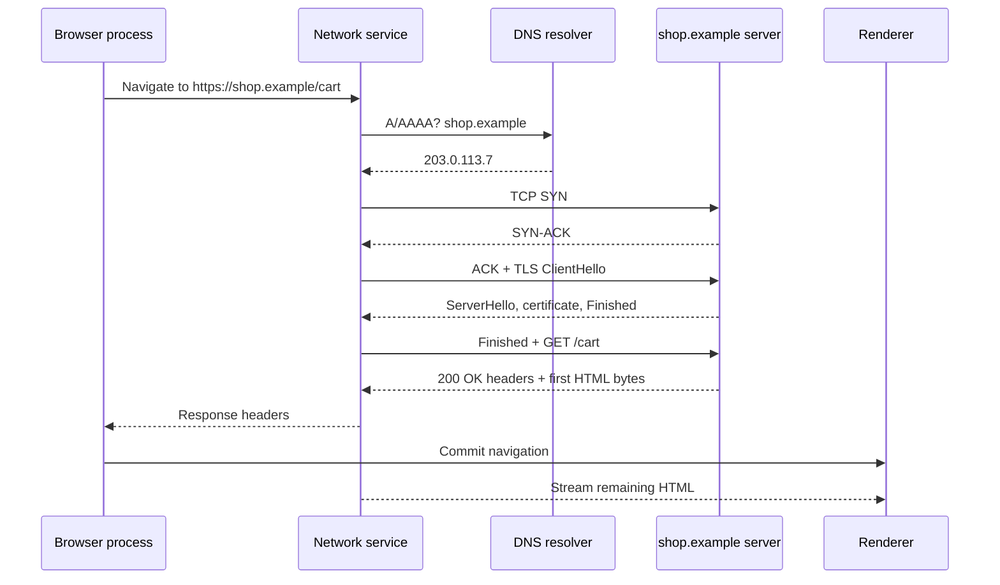
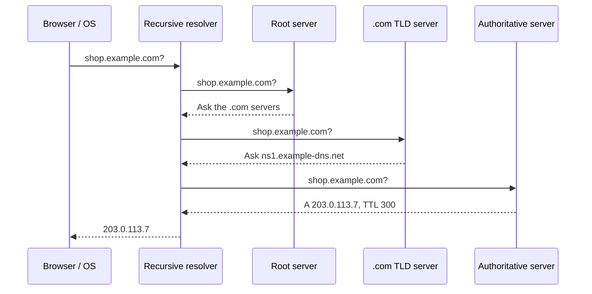

## Introduction

"What happens when you type a URL into the browser and press Enter?" is probably the most famous web interview question, and for good reason: answering it well requires knowing networking, security, HTTP, browser architecture and rendering, and how they fit together. It is also a practical question. Every millisecond users wait before seeing your page is spent in one of the steps this lesson describes, and each step has its own optimisation.

This lesson follows one navigation — to `https://shop.example/cart` — from the moment you press Enter until the browser has the first bytes of HTML in its parser. What happens after that, turning HTML into pixels, is the [[b3-critical-rendering-path]].

The journey has six stages:

1. **URL handling** in the browser process: deciding what you typed and where to go.
2. **DNS resolution**: turning `shop.example` into an IP address.
3. **TCP and TLS handshakes**: opening a reliable, encrypted connection.
4. **HTTP request and response**: asking for the document and receiving headers.
5. **Commit**: choosing a renderer process and handing it the response.
6. **Document download**: streaming bytes into the HTML parser.

The architectural details follow Chromium; the networking steps are defined by internet standards and are the same in every browser.

## Before you start

- **Browser processes** — the browser process coordinates, the network service performs I/O, renderers run pages. See [[b3-browser-processes]].
- **URLs and origins** — the parts of a URL and what an origin is. See [[b3-same-origin]].
- **Network layers, loosely** — that HTTP runs on top of TCP (or QUIC), which runs on top of IP. [[c4-tcp-ip]] covers this in depth; the lesson explains what it uses.

One term is used throughout: a **round trip time (RTT)** is the time for a packet to travel from the client to a server and for the reply to come back. It is roughly 1–20 ms to a nearby data centre, 70–100 ms across the Atlantic, and 150–300 ms on some mobile networks. Many setup steps cost a fixed number of round trips, so RTT, not bandwidth, usually dominates how long the first request takes.

## The intuition

Sending a letter to a company you have never written to before involves several separate steps. You look up the company's street address from its name (DNS). You phone ahead to confirm someone will accept your letters and agree on a code so nobody else can read them (TCP and TLS handshakes). Then you send your actual request and get a reply (HTTP). Only then does someone at your end start reading the reply (parsing) — and if the reply is long, they start reading the first page while the rest is still arriving.

Each preliminary step requires waiting for an answer before you can continue, which is why a first visit to a distant site feels slow, and why browsers work hard to remember answers (caches) and keep phone lines open (connection reuse).



## Step 1: URL handling in the browser process

Navigation begins in the **browser process**, on its UI thread, because the address bar (the *omnibox*) belongs to the browser, not to any page.

**Is it a URL or a search?** Text like `shop.example/cart` has no scheme, so it is not a complete URL. You can see the same distinction with the standard `URL` parser:

```js title="parse.mjs"
const url = new URL('https://Shop.Example.com:443/cart/../checkout?step=2#pay');

console.log(url.href);
console.log(url.protocol, url.hostname, url.port || '(default)');
console.log(url.pathname, url.search, url.hash);
console.log(url.origin);

// Text with no scheme is not a URL on its own: the omnibox must guess.
console.log(URL.canParse('example.com/cart'));
console.log(URL.canParse('https://example.com/cart'));
```

```output
https://shop.example.com/checkout?step=2#pay
https: shop.example.com (default)
/checkout ?step=2 #pay
https://shop.example.com
false
true
```

Parsing normalises the URL: the hostname is lower-cased, the default port `443` disappears, and `cart/..` is resolved away. (`URL.canParse` needs Node.js 19.9+ or a current browser.) The omnibox applies heuristics on top: text containing a dot and no spaces looks like a hostname, text like `best pizza` looks like a search. It then fills in a scheme. Since Chrome 90, a hostname typed without a scheme is tried over `https://` first, falling back to `http://` only if HTTPS fails.

**HSTS upgrades.** If the host is on the browser's **HTTP Strict Transport Security (HSTS)** list — either because it sent a `Strict-Transport-Security` header on an earlier visit, or because it is on the preload list built into the browser — any `http://` URL is rewritten to `https://` before a single packet is sent. DevTools shows this as a `307 Internal Redirect`; no server was involved.

**`beforeunload`.** If the current tab has a page that registered a `beforeunload` handler (typically to warn about unsaved changes), the browser asks that page's renderer to run it, and may show a confirmation dialog, before continuing.

**Start the request.** The browser process creates a navigation request and asks the network service to fetch the URL. In parallel, if the destination is a different site from the current page, Chromium may already start a renderer process for it, so that process start-up overlaps with network time.

## DNS Resolution {#b3-dns-resolution}

**DNS (Domain Name System) resolution** is the process of converting a human-readable hostname such as `shop.example` into the IP address of a server, such as `203.0.113.7` (IPv4) or `2001:db8::7` (IPv6). Computers connect to IP addresses, not names, so every connection to a new hostname starts with a DNS lookup — unless the answer is already cached. For a full treatment of the protocol, see [[c4-dns]]; this section focuses on what happens during a browser navigation.

### Caches first

A lookup does not go to the internet if a nearby cache already knows the answer. In order, the browser can find an answer in:

1. **The browser's own host cache.** Chromium keeps recent lookups in memory; `chrome://net-internals/#dns` shows it and lets you clear it.
2. **The operating system.** The OS resolver checks the `hosts` file (`/etc/hosts` on macOS and Linux) and its own cache. Chromium either calls the OS resolver or uses its built-in DNS client, depending on platform and settings, but it honours the `hosts` file either way.
3. **The recursive resolver.** If nothing local knows, a query goes to a **recursive resolver** — usually run by your ISP or employer, or a public one such as `1.1.1.1` or `8.8.8.8`. Popular names are almost always in its cache.

Every DNS answer carries a **Time To Live (TTL)** in seconds, which says how long caches may reuse it. A TTL of 300 means "ask again after five minutes". Short TTLs let operators move traffic quickly; long TTLs mean fewer lookups.

You can query the OS resolver from Node.js. The answer reflects the machine it runs on; on a typical laptop, `localhost` resolves from the `hosts` file without any network traffic:

```js title="dns-lookup.mjs"
import { lookup } from 'node:dns/promises';
console.log(await lookup('localhost', { all: true }));
```

```output
[ { address: '::1', family: 6 }, { address: '127.0.0.1', family: 4 } ]
```

### When the recursive resolver has to ask

On a cache miss, the recursive resolver walks the DNS hierarchy from the top. Names are read right to left: `shop.example.com.` ends in an implicit root `.`.



The **root servers** (13 named server identities, each run as many machines around the world) know where the **Top-Level Domain (TLD)** servers for `.com`, `.org`, `.uk` and so on are. The TLD servers know which **authoritative name servers** are responsible for `example.com`. The authoritative server holds the actual records. The resolver caches every answer along the way, so the next lookup for anything under `.com` skips the root entirely. In practice a full walk is rare; most browser lookups take a few milliseconds from a cache, and a miss to a nearby resolver typically costs one RTT to that resolver plus whatever the resolver needs.

### Record types the browser cares about

| Record | Meaning | Browser use |
|---|---|---|
| `A` | Hostname → IPv4 address | Connect over IPv4 |
| `AAAA` | Hostname → IPv6 address | Connect over IPv6 |
| `CNAME` | Alias to another name | Common for CDNs: `shop.example` → `shop.example.cdn-provider.net` |
| `HTTPS` (SVCB) | Connection hints for a service | Can advertise HTTP/3 support and Encrypted Client Hello keys before connecting |

Browsers usually ask for `A` and `AAAA` at the same time. If both exist, they use **Happy Eyeballs** (RFC 8305): try IPv6, and if it has not connected within a short delay, race an IPv4 connection, using whichever succeeds first. This avoids long hangs on networks where IPv6 is broken.

### Privacy and security

Classic DNS is sent unencrypted over UDP, so anyone on the network path can see — and potentially forge — which sites you look up. **DNS over HTTPS (DoH)** sends queries inside an encrypted HTTPS connection; Chrome's "Use secure DNS" setting uses DoH when your configured resolver supports it. **DNSSEC** lets resolvers verify that answers were signed by the domain owner ([[c4-dnssec]]). Even without either, TLS protects you from a forged DNS answer: an attacker who sends you to the wrong IP still cannot present a valid certificate for `shop.example`.

### Making DNS cheaper

For hostnames your page will need soon — a CDN, an API domain, a font host — you can ask the browser to resolve them early:

```html title="index.html"
<link rel="dns-prefetch" href="https://cdn.example-assets.net">
<link rel="preconnect" href="https://api.shop.example" crossorigin>
```

`dns-prefetch` performs only the lookup. `preconnect` performs the lookup *and* the TCP and TLS handshakes described next, so it saves more but costs more; use it for a small number of origins you are certain to use within seconds. Chromium also speculatively resolves hostnames while you type in the omnibox and for links on the current page.

## TCP & TLS Handshake {#b3-tcp-tls-handshake}

Once the browser has an IP address, it must open a **connection** to the server before it can send an HTTP request. For HTTPS over HTTP/1.1 or HTTP/2, that is two handshakes layered on each other: a **TCP handshake** that establishes a reliable byte stream, then a **TLS handshake** that agrees on encryption keys and proves the server's identity. Each handshake costs round trips, which is why connection setup is often the largest part of a first request. Protocol details are covered in [[c4-tcp-handshake]] and [[c4-tls13-handshake]].

### TCP: the three-way handshake

**TCP (Transmission Control Protocol)** delivers bytes in order and retransmits lost packets. Before data flows, client and server exchange sequence numbers so each side can track what has arrived:

1. Client → server: **SYN** ("I want to connect; my starting sequence number is *x*").
2. Server → client: **SYN-ACK** ("acknowledged *x*; mine is *y*").
3. Client → server: **ACK** ("acknowledged *y*").

The client can send data along with its ACK, so TCP costs **one RTT** before the first byte of anything else can be sent.

A new TCP connection also starts slowly. **Slow start** limits how much data the server may send before receiving acknowledgements; modern servers typically start with an initial window of 10 segments, about 14 KB. That is the origin of the advice to fit a page's critical HTML and CSS in its first ~14 KB: those bytes can arrive in the first round trip of the response.

### TLS: agreeing keys and proving identity

**TLS (Transport Layer Security)** turns the TCP byte stream into an encrypted, authenticated channel. With **TLS 1.3** (RFC 8446, 2018), the handshake takes one round trip:

1. **ClientHello** — the client lists supported cipher suites, sends its half of a key exchange (a **key share**), names the host it wants with **Server Name Indication (SNI)** so a server hosting many sites can pick the right certificate, and lists application protocols it speaks with **ALPN (Application-Layer Protocol Negotiation)**, for example `h2` and `http/1.1`.
2. **ServerHello … Finished** — the server picks parameters, sends its key share, and — already encrypted — its **certificate**, a signature proving it holds the certificate's private key, and a *Finished* message.
3. The client verifies everything, sends its own *Finished*, and immediately sends the HTTP request in the same flight.

**TLS 1.2** needed **two** round trips for a full handshake, because the key exchange took an extra exchange. TLS 1.3 also supports **0-RTT resumption**: a client that connected recently can send its request in the very first flight using a key from the earlier session. Because 0-RTT data can be replayed by an attacker, browsers and servers restrict it to safe, idempotent requests such as `GET`.

### Certificate validation

The browser accepts the server's certificate only if:

- it chains, through intermediate certificates, to a **root certificate** the browser or OS trusts;
- its **Subject Alternative Name** list includes the hostname you requested;
- it is within its validity dates and has not been revoked (Chrome uses its own pushed revocation lists rather than live OCSP lookups); and
- for Chrome, it has been logged publicly under **Certificate Transparency**.

If any check fails, you get a full-page warning such as `NET::ERR_CERT_AUTHORITY_INVALID`. See [[b3-tls-certificates]].

### Counting round trips

Here is the arithmetic for a first visit, assuming every step costs one RTT of 80 ms (a reasonable figure for a server on another continent; a DNS cache miss to a nearby resolver is often faster, and a cache hit nearly free):

```js title="budget.mjs"
// Rough cost of a first visit before the first byte of HTML arrives.
const rttMs = 80; // round trip to a server on another continent
const steps = [
  ['DNS (resolver cache miss)', 1 * rttMs],
  ['TCP handshake', 1 * rttMs],
  ['TLS 1.3 handshake', 1 * rttMs],
  ['HTTP request -> first byte', 1 * rttMs],
];
let total = 0;
for (const [name, ms] of steps) {
  total += ms;
  console.log(`${name.padEnd(28)} +${ms} ms  = ${total} ms`);
}
console.log(`With TLS 1.2 (2 RTT) it would be ${total + rttMs} ms`);
```

```output
DNS (resolver cache miss)    +80 ms  = 80 ms
TCP handshake                +80 ms  = 160 ms
TLS 1.3 handshake            +80 ms  = 240 ms
HTTP request -> first byte   +80 ms  = 320 ms
With TLS 1.2 (2 RTT) it would be 400 ms
```

That last line ignores the server's own processing time, which comes on top. Notice that three quarters of the 320 ms is setup — no page content has been requested yet. That is why the next three techniques matter so much.

| Technique | What it saves |
|---|---|
| **Connection reuse** (keep-alive, HTTP/2 multiplexing) | All handshakes for every later request to the same origin |
| **HTTP/3 over QUIC** | Combines transport and TLS handshakes into one RTT; 0-RTT on resumption |
| **CDN edge servers** | Shrinks the RTT itself by terminating connections close to the user |

### HTTP/3 and QUIC

**HTTP/3** runs over **QUIC**, a transport built on UDP that integrates TLS 1.3 into its own handshake, so a new connection needs one round trip in total instead of two. QUIC also avoids TCP's *head-of-line blocking*, where one lost packet stalls every stream on the connection. Browsers do not know in advance that a server speaks HTTP/3, so typically the first connection uses HTTP/2 over TCP, and the server advertises HTTP/3 with an `Alt-Svc` response header (or an `HTTPS` DNS record); later connections use QUIC. See [[b3-http3-quic]].

## HTTP Request & Response {#b3-http-request-response}

With a secure connection open, the browser sends an **HTTP request** — a method, a path and a set of headers — and the server replies with an **HTTP response** — a status code, headers and a body. For a navigation, the request asks for a document, and the response's headers decide what the browser does next: render it, follow a redirect, download it, or show an error. The structure of HTTP messages in general is covered in [[b3-http-request-structure]] and [[b3-http-response-structure]].

### The navigation request

A typed navigation in a current Chromium browser sends something like this (shown in HTTP/1.1 text form for readability; HTTP/2 and HTTP/3 carry the same fields in binary, with lower-case names and pseudo-headers such as `:method` and `:path`):

```http title="Navigation request"
GET /cart HTTP/1.1
Host: shop.example
Upgrade-Insecure-Requests: 1
User-Agent: Mozilla/5.0 (Macintosh; Intel Mac OS X 10_15_7) AppleWebKit/537.36 ...
Accept: text/html,application/xhtml+xml,application/xml;q=0.9,image/avif,...
Accept-Encoding: gzip, deflate, br, zstd
Accept-Language: en-GB,en;q=0.9
Sec-Fetch-Site: none
Sec-Fetch-Mode: navigate
Sec-Fetch-User: ?1
Sec-Fetch-Dest: document
Cookie: session=7f3a9c; theme=dark
```

Each header has a job:

- **`Host`** names the site, so one IP address can serve many sites.
- **`Accept`** says the browser prefers HTML for a navigation. **`Accept-Encoding`** lists compression it can decode (Brotli `br`; `zstd` since Chrome 123). **`Accept-Language`** lets the server pick a language.
- **`Sec-Fetch-*`** are **Fetch Metadata** headers. The browser sets them and page JavaScript cannot forge them. `Sec-Fetch-Site: none` means the user started this navigation directly (typed or bookmarked) rather than a page on some other site. `Sec-Fetch-Mode: navigate` and `Sec-Fetch-Dest: document` say it is a top-level page load. Servers use these to reject cross-site requests to sensitive endpoints.
- **`Cookie`** carries cookies stored for `shop.example` — attached by the network service, never chosen by the page. Which cookies are sent on cross-site navigations depends on their `SameSite` attribute ([[b3-cookie-security-model]]).

### The response

```http title="Navigation response"
HTTP/1.1 200 OK
Content-Type: text/html; charset=utf-8
Content-Encoding: br
Cache-Control: no-cache
Strict-Transport-Security: max-age=31536000; includeSubDomains
Content-Security-Policy: default-src 'self'
Set-Cookie: cart_seen=1; Path=/; Secure; HttpOnly; SameSite=Lax
Alt-Svc: h3=":443"; ma=86400
Transfer-Encoding: chunked

<!doctype html>
<html lang="en">
...
```

- The **status code** classifies the result. `200` means success; `3xx` codes redirect; `4xx` are client errors such as `404`; `5xx` are server errors. See [[b3-http-status-codes]].
- **`Content-Type`** is the single most important header for a navigation: it tells the browser this is HTML and how its bytes are encoded.
- **`Content-Encoding: br`** means the body is Brotli-compressed; the network service decompresses it before the renderer sees it.
- **`Cache-Control`** controls whether and how this response may be cached ([[b3-http-caching]]).
- **Security headers** — HSTS, Content Security Policy and others ([[b3-security-headers]]) — are applied to the new document. Headers such as `Cross-Origin-Opener-Policy` even influence which process the document goes into ([[b3-site-isolation]]).
- **`Set-Cookie`** stores a cookie; **`Alt-Svc`** advertises HTTP/3 for future connections.

### Redirects

If the status is a redirect, the `Location` header names the new URL, and the browser process starts the navigation again from that URL — possibly to a different host, which means another DNS lookup and handshake. The status code decides whether the method is preserved:

| Status | Meaning | Method on the follow-up request |
|---|---|---|
| `301 Moved Permanently` | Permanent; may be cached | Browsers change `POST` to `GET` (historical behaviour) |
| `302 Found` | Temporary | Browsers change `POST` to `GET` |
| `303 See Other` | "Go GET this instead", used after form posts | Always `GET` |
| `307 Temporary Redirect` | Temporary | Method and body preserved |
| `308 Permanent Redirect` | Permanent | Method and body preserved |

Every redirect costs at least one more RTT, so chains like `http://example.com` → `https://example.com` → `https://www.example.com` → `https://www.example.com/en/` are a common, avoidable source of slow first loads.

### Time to First Byte

The time from starting the request to receiving the first byte of the response is **Time to First Byte (TTFB)**. It includes redirects, DNS, connection setup and the server's own processing. Server processing — querying a database, rendering a template — is often the biggest part for dynamic pages, and caching at a CDN edge is the usual fix. The **`103 Early Hints`** status (supported in Chromium since version 103) lets a server send `Link: rel=preload` headers while it is still computing the real response, so the browser can start fetching CSS early.

## Committing the navigation

When the response headers arrive, the **browser process** — not a renderer — inspects them and makes several decisions:

1. **Is it a document?** If `Content-Disposition: attachment` is set or the `Content-Type` is something the browser does not render (say, `application/zip`), the navigation turns into a **download** handled by the download manager, and the current page stays.
2. **Is it safe?** Chrome's Safe Browsing may check the URL against lists of known malicious sites and show an interstitial warning.
3. **Which renderer?** Based on the final URL's site (after redirects), the browser picks an existing renderer locked to that site or uses a new one. If it started a speculative renderer earlier for the right site, it is used now. Headers like `Cross-Origin-Opener-Policy` can force a fresh browsing context group and process ([[b3-site-isolation]]).
4. **Commit.** The browser sends a *CommitNavigation* message to the chosen renderer, including the response headers and a data pipe for the body. The renderer creates the new document and replies that it has committed. At this moment the address bar updates to the new URL and the session history gains an entry.

The **old page** is now unloaded: its `pagehide` (and possibly `unload`) events run, and its renderer may be reused, shut down, or kept with the page frozen in the **back/forward cache** so that pressing Back restores it instantly ([[b3-bfcache]]). Note that until commit, the old page is still fully interactive — which is why a slow server makes you stare at the old page with a spinner rather than a blank one.

## Document Download & Parsing Start {#b3-document-download}

**Document download** is the phase after commit in which the HTML response body streams from the network service into the renderer and the HTML parser starts building the DOM. The key idea is that it is **streaming**: the browser does not wait for the whole document to arrive before it starts parsing, fetching subresources or even painting. A 300 KB HTML page can show its header long before its footer has been downloaded.

### From bytes to characters

The network delivers bytes, already decompressed by the network service. The parser needs characters, so first the renderer must know the document's **character encoding**. It determines it in this order:

1. A **byte order mark (BOM)** at the start of the body, if present.
2. The `charset` parameter of the HTTP `Content-Type` header, such as `text/html; charset=utf-8`.
3. A `<meta charset="utf-8">` found by **prescanning** the first 1024 bytes of the document.
4. Otherwise, heuristics and a locale-dependent default.

That is why `<meta charset="utf-8">` should be the first element in `<head>`: if it appears after the first 1024 bytes, the browser may have to guess, and if it guessed wrong, re-parse the document.

Decoding must also cope with chunks that end in the middle of a multi-byte character. The `TextDecoder` API exposes the same streaming behaviour the parser relies on:

```js title="chunks.mjs"
// "café" in UTF-8 is 63 61 66 C3 A9: the é takes two bytes.
const bytes = new TextEncoder().encode('<p>café</p>');
const chunk1 = bytes.slice(0, 7); // ends in the middle of é
const chunk2 = bytes.slice(7);

// Decoding each network chunk on its own corrupts the character.
const naive = new TextDecoder();
console.log(naive.decode(chunk1) + naive.decode(chunk2));

// A streaming decoder keeps the half character until the next chunk.
const streaming = new TextDecoder('utf-8');
let html = streaming.decode(chunk1, { stream: true });
html += streaming.decode(chunk2);
console.log(html);
```

```output
<p>caf��</p>
<p>café</p>
```

The first decoder treats each chunk as complete, so both halves of `é` become replacement characters (`�`). The streaming decoder holds the incomplete byte back until the next chunk arrives. The browser's decoder does the same, which is why network chunk boundaries never corrupt text in a correctly labelled page.

### MIME types and sniffing

The renderer trusts the `Content-Type` header to decide how to treat the body: `text/html` is parsed as HTML, `text/plain` is displayed as text, `image/png` is shown as an image. When the header is missing, browsers **sniff** the first bytes to guess the type. Sniffing has caused security bugs — a file uploaded as an image but containing HTML could be run as a page — so servers should always send an accurate `Content-Type`, and `X-Content-Type-Options: nosniff` tells the browser not to second-guess it.

### Tokenising and tree construction

Parsing proceeds in two stages, both on the renderer's main thread:

- The **tokeniser** turns characters into tokens: start tags, end tags, attributes, text, comments.
- The **tree builder** turns tokens into DOM nodes, applying HTML's error-recovery rules (unclosed `<p>` elements, misnested tags) so that every input produces some tree. See [[b3-dom-tree-model]].

As soon as the first chunk is parsed, the document exists and `document.readyState` is `"loading"`. When the parser reaches a `<link rel="stylesheet">`, `` or `<script src>`, it asks the network service to fetch those resources — reusing the same HTTP/2 or HTTP/3 connection if they are on the same origin, which is the payoff of connection reuse.

### What can pause the parser

A classic `<script src="app.js">` without `async`, `defer` or `type="module"` is **parser-blocking**: the parser stops, waits for the script to download and run (because the script might call `document.write` or inspect the DOM so far), then continues. Stylesheets do not block the parser but do block rendering, and scripts wait for pending stylesheets before running. See [[b3-parser-blocking]] and [[b1-script-loading]].

While the parser is paused, the **preload scanner** — a lightweight second parser — reads ahead through the raw HTML and starts fetching resources it finds, so a blocking script at the top does not delay discovering images further down ([[b3-preload-scanner]]).

### Lifecycle milestones

| Milestone | When it happens |
|---|---|
| `readyState = "loading"` | Parsing has begun |
| `readyState = "interactive"`, then `DOMContentLoaded` | The whole document is parsed and deferred scripts have run ([[b3-domcontentloaded]]) |
| `readyState = "complete"`, then `load` | All subresources such as images and stylesheets have finished loading too |

Rendering does not wait for any of these. The browser can paint as soon as it has enough DOM and all render-blocking CSS, which is why servers that **flush** the `<head>` early — sending the start of the HTML before the slow database query for the body finishes — get faster first paints.

## Measuring a real navigation

The browser records the timestamp of each step for the current page in a **Navigation Timing** entry. Run this in the DevTools console on any page after it has loaded (it is browser-only and was not run as part of writing this lesson; the numbers vary by page and network):

```js title="navigation-timing.js"
const [nav] = performance.getEntriesByType('navigation');
const ms = (a, b) => Math.round(nav[b] - nav[a]);

console.table({
  redirects: ms('redirectStart', 'redirectEnd'),
  dns: ms('domainLookupStart', 'domainLookupEnd'),
  tcpAndTls: ms('connectStart', 'connectEnd'),
  tls: nav.secureConnectionStart ? ms('secureConnectionStart', 'connectEnd') : 0,
  ttfb: ms('requestStart', 'responseStart'),
  download: ms('responseStart', 'responseEnd'),
  domContentLoaded: Math.round(nav.domContentLoadedEventEnd),
  load: Math.round(nav.loadEventEnd),
  protocol: nav.nextHopProtocol, // e.g. "h2" or "h3"
});
```

On a repeat visit you will often see `dns` and `tcpAndTls` at `0`: the DNS answer was cached and a connection was reused. That is the clearest demonstration that most of a first-visit cost is setup. The DevTools Network panel's *Timing* tab shows the same breakdown for every individual request.

## In real systems

- **CDNs** cut every phase: anycast DNS answers from nearby, short RTT to edge servers makes handshakes cheap, and cached HTML at the edge reduces TTFB to a few milliseconds.
- **Redirect hygiene**: production sites avoid chains by redirecting `http://example.com` straight to the final canonical URL, and submit their domain to the HSTS preload list so even the first redirect disappears.
- **`preconnect` for third parties**: pages that load fonts or APIs from another origin preconnect to it, saving DNS, TCP and TLS on the critical path.
- **Early flushing and streaming SSR**: frameworks such as Next.js and Remix stream HTML so the `<head>` (and its CSS and preloads) reaches the browser while data for the body is still being fetched.
- **Real-user monitoring** tools collect Navigation Timing from real visits, letting teams see whether DNS, connection or server time dominates for users in each region.

## Trade-offs and alternatives

- **Short DNS TTLs** make failover fast but cause more lookups; long TTLs are cheaper but slow to change.
- **`preconnect`** saves a round trip or three when the connection is used soon, but wasted preconnects consume sockets and server resources. Limit them to a few critical origins.
- **TLS 1.3 0-RTT** removes a round trip on resumption, but its data can be replayed, so only idempotent requests may use it.
- **HTTP/3** improves lossy mobile networks; it can be blocked by networks that drop UDP, so browsers always keep TCP as a fallback.
- **Inlining critical CSS** makes the first ~14 KB self-sufficient for the first render but cannot be cached separately like a stylesheet ([[b3-critical-css]]).

## Common mistakes

- **Saying "the browser downloads the HTML, then parses it."** Parsing starts with the first chunk; the document is streamed.
- **Forgetting the handshakes.** DNS → TCP → TLS → HTTP is at least three or four round trips on a first visit; ignoring them makes latency estimates wildly optimistic.
- **Using `301` or `302` after a form `POST` and expecting the method to be kept.** Use `307`/`308` to keep it, or `303` to switch to `GET` deliberately.
- **Placing `<meta charset>` late in `<head>`.** It must appear within the first 1024 bytes.
- **Serving files with the wrong `Content-Type`.** Browsers may refuse, sniff, or download them instead of rendering. Add `X-Content-Type-Options: nosniff` and send correct types.
- **Thinking the address bar updates when you press Enter.** It shows the new URL at commit, after the response headers arrive.

## Interview perspective

Interviewers use this question to gauge breadth. A strong answer is structured, mentions processes and costs, and goes deeper wherever the interviewer probes.

> [!INTERVIEW] A structured answer
> "The browser process parses the input, applies HSTS, and runs `beforeunload`. The network service resolves DNS through caches and a recursive resolver, opens TCP and does a TLS 1.3 handshake — about three round trips before the request on a cold visit, fewer with QUIC or a reused connection. It sends a GET with cookies and Fetch Metadata headers. On the response, the browser checks redirects, content type and Safe Browsing, picks a renderer for the site and commits. The renderer streams the HTML into the parser, which builds the DOM, fetches subresources, and the rendering pipeline paints."

Likely follow-ups:

- **How does DNS caching work?** Browser, OS and recursive resolver caches, each bounded by the record's TTL.
- **Why is TLS 1.3 faster than 1.2?** The client sends its key share in the first message, saving a round trip; 0-RTT resumption saves another.
- **What decides whether a response is rendered or downloaded?** `Content-Type` and `Content-Disposition`, inspected by the browser process before commit.
- **What is TTFB and how would you reduce it?** Time to the first response byte; reduce redirects, use a CDN, cache at the edge, use Early Hints, speed up the backend.
- **When does `DOMContentLoaded` fire?** After the document is fully parsed and deferred scripts have run, without waiting for images.

## Practice

1. Run the Navigation Timing snippet on three sites, first in a private window and then again after a reload. Explain each phase that dropped to zero.
2. Use `dig +trace example.com` (or an online DNS tracing tool) and match each step of its output to the resolution diagram.
3. In the DevTools Network panel, find a request whose *Timing* tab shows DNS, Initial connection and SSL. Calculate how much of the total time was setup.
4. A site's first load takes 1.2 s TTFB from Australia but 150 ms from Europe. List what you would check, in order, and what each fix would be.
5. Write a server route that redirects a form `POST` so the follow-up is a `GET`, and justify the status code you chose.

```quiz
Q: A user's browser already has a TLS connection open to `shop.example` from a previous page. Which steps are skipped for the next navigation to `shop.example/cart`?
- [ ] Only the DNS lookup
- [x] DNS, TCP and TLS — the request goes straight onto the existing connection
- [ ] Nothing: every navigation repeats every step
- [ ] The HTTP request, because the response is always cached
> A reused connection is already resolved, connected and encrypted, so the browser can send the HTTP request immediately. Whether the response itself comes from cache depends on `Cache-Control`, which is a separate question.
```

```quiz
Q: The first 2 KB of an HTML document has arrived, but the remaining 200 KB has not. What can the browser already be doing?
- [ ] Nothing until the whole document has downloaded
- [ ] Only decompressing the data
- [x] Parsing the received HTML into the DOM and starting fetches for resources it has found
- [ ] Firing `DOMContentLoaded`
> HTML is parsed incrementally as chunks arrive, and discovered resources are fetched immediately (by the parser or the preload scanner). `DOMContentLoaded` needs the whole document parsed.
```

```quiz
Q: A form posts to `/order`, and the server responds `302 Found` with `Location: /order/42`. What does the browser send next?
- [ ] `POST /order/42` with the same body
- [x] `GET /order/42`
- [ ] Nothing: 302 is an error
- [ ] `HEAD /order/42`
> For historical compatibility, browsers change `POST` to `GET` on `301` and `302`. To preserve the method and body you need `307` or `308`; to make the switch to `GET` explicit, the conventional status is `303 See Other`.
```

```quiz
Q: Why does TLS 1.3 complete its handshake in one round trip while TLS 1.2 needs two?
- [ ] TLS 1.3 skips certificate validation
- [ ] TLS 1.3 uses UDP instead of TCP
- [x] The client sends its key share in the ClientHello, so the server can finish key agreement in its first reply
- [ ] TLS 1.3 does not encrypt the handshake
> Certificates are still validated (and in TLS 1.3 they are even sent encrypted), and TLS 1.3 still runs over TCP; it is QUIC that runs over UDP. The saving comes from guessing the key-exchange group up front.
```

## Quick revision {#quick-revision}

- Flow: omnibox → (HSTS, `beforeunload`) → DNS → TCP → TLS → HTTP request → response headers → redirect / download / commit → stream body into the parser.
- Browser process starts navigations and decides commit; network service does DNS, sockets, TLS, HTTP, cookies; renderer parses.
- DNS: browser cache → OS (`hosts`) → recursive resolver → root → TLD → authoritative. TTL bounds caching. `A`, `AAAA`, `CNAME`, `HTTPS` records. Happy Eyeballs, DoH. `dns-prefetch`, `preconnect`.
- TCP: SYN, SYN-ACK, ACK = 1 RTT; slow start ~14 KB first window.
- TLS 1.3: 1 RTT (ClientHello with key share, SNI, ALPN); TLS 1.2: 2 RTT; 0-RTT resumption only for idempotent requests. Certificate: chain, SAN hostname, dates, revocation, CT.
- HTTP/3 = QUIC over UDP, transport + TLS in 1 RTT; discovered via `Alt-Svc` or `HTTPS` DNS record.
- Request headers: `Host`, `Accept*`, `Cookie`, `Sec-Fetch-Site/Mode/Dest/User`. Response: status, `Content-Type`, `Content-Encoding`, `Cache-Control`, security headers, `Set-Cookie`.
- Redirects: 301/302 turn POST into GET; 303 always GET; 307/308 keep method. TTFB; `103 Early Hints`.
- Commit: browser picks renderer by site, sends CommitNavigation; URL bar updates; old page unloads or enters bfcache.
- Download: streaming; encoding from BOM → HTTP charset → `<meta charset>` in first 1024 bytes; nosniff; tokenizer → tree builder; parser-blocking scripts; preload scanner; `loading` → `interactive`/`DOMContentLoaded` → `complete`/`load`.

## Key takeaways {#key-takeaways}

- A navigation is a relay between processes: the browser process decides, the network service fetches, and a renderer chosen by site parses and renders.
- On a first visit, setup round trips — DNS, TCP, TLS — often cost more than transferring the page; caching answers and reusing connections removes them.
- TLS 1.3 and QUIC exist largely to cut handshake round trips.
- The response headers, not the URL, decide what the browser does: render, redirect, download or block.
- HTML is streamed and parsed incrementally, so what you send first — charset, critical CSS, preloads — shapes how fast the page appears.
- Navigation Timing lets you measure every phase on real pages instead of guessing.
