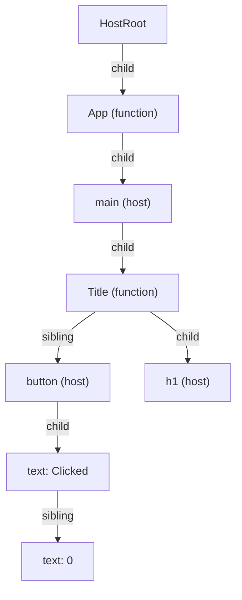
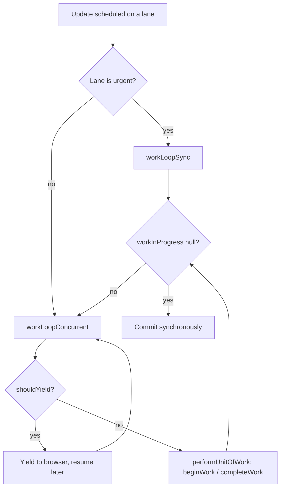

## Introduction

When you call `setState`, React has to work out what the new UI looks like. It calls the affected components, compares their output with the previous output ([[b4-reconciliation]]), and finally changes the DOM. In a big application that work can take tens of milliseconds. Meanwhile the browser's main thread is busy, so it cannot handle clicks, run animations or paint. The page feels stuck.

Up to version 15, React did this work with plain recursion: a function rendered a component, then called itself on each child, then on each grandchild. Recursion is simple, but it has a hard limit. Once it starts, it cannot stop until the whole tree is done, because the progress lives on the JavaScript call stack. A slow render of 200 ms blocked the page for the whole 200 ms, even if the user was typing.

**React Fiber** is the rewrite of React's core that removed that limit. It shipped in React 16 in 2017 and is still how React works today. The idea is to keep the progress of rendering in ordinary JavaScript objects instead of on the call stack. Each component instance and each DOM element gets one of these objects, called a **fiber**. A fiber is both a node in a tree and a **unit of work**. Because the work is a list of objects rather than a chain of nested function calls, React can process one unit, check the clock, hand control back to the browser, and continue later. It can also stop and throw the unfinished work away.

You never use fibers directly, and their fields are private and change between versions. But Fiber explains a lot of what you see in public React: why render must be pure, why hooks must be called in the same order, why effects run only after commit, how transitions keep typing smooth, and what the React DevTools component tree actually shows. Senior frontend interviews often ask about it for exactly that reason.

## Before you start

- **The rendering lifecycle**, meaning trigger, render and commit. See [[b4-rendering-lifecycle]].
- **Reconciliation**, meaning how React compares new elements with the previous render. See [[b4-reconciliation]].
- **React elements and the virtual DOM**, meaning the objects your components return. See [[b4-virtual-dom]].
- **The event loop and the call stack.** JavaScript runs one task at a time on one thread, and the browser can only paint between tasks. See [[b1-event-loop]], [[b1-call-stack]] and [[b3-browser-event-loop]].
- **Hooks basics.** Read [[b4-hooks-model]] first.

## The intuition

Imagine reading a very long report aloud to a room, and people sometimes raise their hands with urgent questions. If you keep your place only in your head, a long interruption means you lose track and must start the section again. If you put a bookmark in the report and write a note on it, you can stop at the end of any paragraph, answer the question, and continue exactly where you left off. You can even decide the section you were reading is now out of date and start a newer version instead.

The old recursive reconciler kept its place "in its head", on the call stack. Fiber keeps its place on bookmarks. A fiber records which component it is, what it was given, what it produced, and where to go next. A single variable points to the current bookmark, so React always knows where to continue.

The analogy stops in one place. React does not pause in the middle of a component function. A component always runs from start to finish. React only pauses *between* fibers.

## Why recursion was the problem

Here is roughly how a recursive renderer works:

```javascript
function renderRecursively(element) {
  const output = callComponent(element);   // run the component
  for (const child of output.children) {
    renderRecursively(child);              // progress is stored on the call stack
  }
}
```

While this runs, its progress lives in stack frames. There is no way to say "stop here and resume at this exact child in the next frame". The function has to return, all the way up, before the browser can do anything else. Three things follow:

- **No yielding.** A long render blocks input and painting for its whole duration. See [[b3-long-tasks-browser]].
- **No priorities.** An urgent update, such as a keystroke, has to wait behind a slow, unimportant one, such as filtering a big list.
- **No discarding.** If newer data arrives halfway through, the old render must still finish.

Fiber fixes all three by turning the recursion into a loop over linked objects. It also made several features possible that the old design could not support well. Error boundaries, components returning arrays or strings, and portals all arrived with React 16. Suspense and the concurrent features of React 18, such as transitions and `useDeferredValue`, came later on the same base.

## Fiber Tree Concepts {#b4-fiber-tree}

A **fiber** is a plain JavaScript object that React creates for every component instance, DOM element and text node in your UI. Together, the fibers form the **fiber tree**: React's long-lived, internal record of what is on screen. Elements are rebuilt on every render and thrown away. Fibers stay around and are updated, which is why state can survive from one render to the next.

### What a fiber holds

These are the most important fields. The names come from React's source code. They are internal and can change, but the ideas have been stable for years.

| Field | What it stores |
|---|---|
| `tag` | What kind of fiber it is, such as function component, class component, host component (a DOM element), host text or host root |
| `type` | The component function or class, or a tag string like `'div'` |
| `key` | The element's key, used when reconciling lists |
| `stateNode` | The real DOM node for host fibers, or the instance for class components |
| `child`, `sibling`, `return` | Pointers to the first child, the next sibling, and the parent |
| `pendingProps`, `memoizedProps` | The props for this render, and the props from the last finished render |
| `memoizedState` | Saved state. For a function component this is the start of its linked list of hooks |
| `updateQueue` | Pending state updates, and for function components their effects |
| `flags`, `subtreeFlags` | What must happen to this fiber in commit (insert, update, delete, run effects), and a summary of the flags in its subtree |
| `lanes`, `childLanes` | Which priority levels have pending work on this fiber, and anywhere below it |
| `alternate` | The matching fiber in the other tree (explained below) |

### Linked by child, sibling and return

A fiber does not keep an array of its children. It has a pointer to its **first child**. Each child points to its **next sibling**, and every fiber points back to its parent through `return`. The name `return` fits: it is where the work goes back to once a fiber is finished, the same way a function call returns to its caller.



The diagram only shows `child` and `sibling` arrows. Every fiber also has a `return` pointer to its parent. With these three pointers, React can walk the whole tree depth-first with a simple loop and one variable, which is what makes pausing possible.

### Looking at a real fiber tree

React DOM stores a reference to its internal root on the root object. The program below walks the fibers of a small app and prints them. It reads private fields such as `_internalRoot`, which are not a public API. Use code like this only to explore and learn, never in an application.

```jsx title="inspect-fibers.jsx"
import { useState } from 'react';
import { createRoot } from 'react-dom/client';

function Title({ text }) {
  return <h1>{text}</h1>;
}

function App() {
  const [count, setCount] = useState(0);
  const [open] = useState(true);
  return (
    <main>
      <Title text="Fiber" />
      <button onClick={() => setCount(count + 1)}>Clicked {count}</button>
    </main>
  );
}

const root = createRoot(document.getElementById('root'));
root.render(<App />);

// Run after the first render has committed (for example from a button or the console)
function label(f) {
  if (typeof f.type === 'string') return `<${f.type}>`;
  if (typeof f.type === 'function') return f.type.name;
  if (f.tag === 3) return 'HostRoot';
  if (f.tag === 6) return `text "${f.memoizedProps}"`;
  return `tag ${f.tag}`;
}

function print(fiber, depth = 0) {
  for (let f = fiber; f !== null; f = f.sibling) {
    const parent = f.return ? label(f.return) : 'null';
    console.log(`${'  '.repeat(depth)}${label(f)}  tag=${f.tag} return=${parent}`);
    if (f.child) print(f.child, depth + 1);
  }
}

const current = root._internalRoot.current;
print(current);

const hooks = [];
for (let h = current.child.memoizedState; h !== null; h = h.next) hooks.push(h.memoizedState);
console.log('App hooks list:', hooks);
console.log('stateNode of <main>:', current.child.child.stateNode.tagName);
```

Output with React 19.2:

```output
HostRoot  tag=3 return=null
  App  tag=0 return=HostRoot
    <main>  tag=5 return=App
      Title  tag=0 return=<main>
        <h1>  tag=5 return=Title
      <button>  tag=5 return=<main>
        text "Clicked "  tag=6 return=<button>
        text "0"  tag=6 return=<button>
App hooks list: [ 0, true ]
stateNode of <main>: MAIN
```

There are several things to notice here.

**Components and DOM elements are both fibers.** `App` and `Title` are function component fibers (tag 0). `<main>`, `<h1>` and `<button>` are host component fibers (tag 5). Only host fibers have a DOM node in `stateNode`. A function component has no DOM node of its own, which is why you cannot put a ref on one unless it passes the ref down.

**Text gets fibers too, with one shortcut.** The button's children are `"Clicked "` and `{count}`, two text pieces, so React creates two host text fibers (tag 6). `<h1>` has a single string child, so React DOM skips the text fiber and sets the element's text content directly.

**Hooks are a linked list on the fiber.** `App` called `useState(0)` and then `useState(true)`, and its `memoizedState` is a list holding `0` and then `true`. React finds each hook's state by **position in that list**. On the next render, the first `useState` call reads the first node, the second reads the second, and so on. If a hook were called conditionally, every later hook would read the wrong node. This is the mechanical reason behind the [[b4-rules-of-hooks]] and [[b4-hook-call-order]].

**The HostRoot fiber is the top.** Above it sits the `FiberRootNode`, the object behind `root._internalRoot`. It is not a fiber. It holds the container DOM node, scheduling information, and a pointer named `current` to the HostRoot fiber of the tree on screen.

### Two trees: current and work-in-progress

At any moment React can have two versions of a fiber:

- The **current** fiber describes what is on screen now.
- The **work-in-progress** fiber is the version React is building for the next render.

The two point at each other through `alternate`. When an update starts, React creates a work-in-progress copy of each fiber it needs to process. The first time, it allocates a new object. Later it reuses the old alternate. Props, state and flags are written to the work-in-progress version. The current tree is never changed during rendering. That is what lets React drop unfinished work safely: the screen and its record of the screen stay as they were.

When rendering finishes and the commit has changed the DOM, React switches one pointer: `fiberRoot.current = finishedWork`. The work-in-progress tree is now current, and the old current tree becomes the spare to reuse next time. Graphics programmers call this **double buffering**: draw the next frame off-screen, then swap. You can watch the swap happen:

```javascript
// Continuing the inspection program above
const fiberRoot = root._internalRoot;
const before = fiberRoot.current;
const appBefore = before.child;
console.log('App alternate after mount:', appBefore.alternate);

document.querySelector('button').click();  // React processes the update

// Run after the click's render has committed
console.log('root.current switched:', fiberRoot.current !== before);
console.log('old current is now the alternate:', fiberRoot.current.alternate === before);
console.log('App fibers point at each other:', fiberRoot.current.child.alternate === appBefore);
```

```output
App alternate after mount: null
root.current switched: true
old current is now the alternate: true
App fibers point at each other: true
```

On mount, `App` has only one fiber, so its alternate is `null`. The click creates a work-in-progress `App` fiber, and after commit that fiber is current, with the old one as its alternate. On later updates React reuses these two objects back and forth instead of allocating new ones, which keeps garbage collection low.

### Flags and lanes

Two kinds of bookkeeping on each fiber guide the work.

**Flags** record what the commit phase must do to the fiber. `Placement` means insert or move its DOM node, `Update` means apply changed props, `ChildDeletion` means remove some of its children, and other flags mean it has effects or a ref to handle. `subtreeFlags` combines the flags of all descendants, so the commit phase can skip any subtree whose `subtreeFlags` is zero. Older versions of React kept a separate linked "effect list" for this. Current versions use `subtreeFlags`.

**Lanes** record pending work by priority. A lane is a bit in a bitmask. There are lanes for synchronous updates (from clicks and key presses), continuous input (dragging, scrolling), default updates (timers and network responses), several transition lanes, retries after Suspense, and idle work. A fiber's `lanes` says which priorities have updates waiting on that fiber. `childLanes` says the same for its subtree. React picks the highest-priority lanes with pending work and renders only those updates. Lower-priority updates stay queued for a later pass. See [[b4-update-priorities]].

> [!NOTE] Internals are not an API
> Field names like `memoizedState`, `subtreeFlags` and `_internalRoot` are implementation details. They have changed between major versions and will change again. Learn them to understand React's behaviour, and rely only on the public APIs in your code. DevTools and testing libraries handle these details for you.

## Fiber Work Loop {#b4-fiber-work-loop}

The **work loop** is the part of React that walks the fiber tree during the render phase. It processes one fiber at a time, and, for low-priority work, it checks after each fiber whether it should give control back to the browser. It replaces recursion with a `while` loop and a pointer called `workInProgress`.

### Begin and complete

Each fiber goes through two steps.

**`beginWork(fiber)`** is the step on the way down. React works out the fiber's children. For a function component, this means calling the component with its props, which runs its hooks, and then reconciling the returned elements against the existing child fibers. For a host component, it means reconciling `props.children`. `beginWork` returns the fiber's first child, which is the next unit of work, or `null` if there are no children. If nothing changed for this fiber, `beginWork` can **bail out** instead (described below).

**`completeWork(fiber)`** is the step on the way back up, once all of a fiber's children are finished. For a newly mounted host component, React creates the DOM node here and appends its already-created child nodes to it. The node is built off-screen and is not yet in the document. For an updated host component, React marks it with the `Update` flag. In React 19 the actual comparison of old and new props, and the DOM writes, happen later in commit. `completeWork` also merges the children's flags into the parent's `subtreeFlags`.

The driver joins the two steps together. This is a simplified version of the real code in `ReactFiberWorkLoop`:

```javascript
function performUnitOfWork(unitOfWork) {
  const next = beginWork(unitOfWork.alternate, unitOfWork, renderLanes);
  unitOfWork.memoizedProps = unitOfWork.pendingProps;
  if (next === null) {
    completeUnitOfWork(unitOfWork);   // no children: finish this fiber and move on
  } else {
    workInProgress = next;            // go down to the first child
  }
}

function completeUnitOfWork(unitOfWork) {
  let fiber = unitOfWork;
  do {
    completeWork(fiber.alternate, fiber, renderLanes);
    if (fiber.sibling !== null) {
      workInProgress = fiber.sibling; // start the next sibling's subtree
      return;
    }
    fiber = fiber.return;             // all children done: complete the parent
    workInProgress = fiber;
  } while (fiber !== null);
}

function workLoopSync() {
  while (workInProgress !== null) performUnitOfWork(workInProgress);
}

function workLoopConcurrent() {
  while (workInProgress !== null && !shouldYield()) performUnitOfWork(workInProgress);
}
```

The only difference between the two loops is `shouldYield()`. In the concurrent loop, React checks the time after each unit of work. Once it has worked for about 5 milliseconds (the default slice in React's scheduler package), or once the browser needs to paint, `shouldYield()` returns `true`. The loop then exits with `workInProgress` still pointing at the next fiber. React's scheduler queues a new task, using `MessageChannel` in browsers so it is not slowed down by `setTimeout`'s minimum delays. The browser handles input and paints, and then the loop continues from the saved fiber.

### Watching the traversal order

The toy program below copies the structure of the real loop: fibers linked by `child`, `sibling` and `return`, and a loop that stops after a fixed number of units to stand in for the time budget. It runs on its own in Node.js or a browser console.

```javascript title="fiber-loop.mjs"
// A toy model of React's work loop: fibers linked by child / sibling / return,
// walked without recursion.
function createFiber(type, children = []) {
  const fiber = { type, child: null, sibling: null, return: null };
  let prev = null;
  for (const c of children) {
    const childFiber = createFiber(c.type, c.children);
    childFiber.return = fiber;
    if (prev === null) fiber.child = childFiber;
    else prev.sibling = childFiber;
    prev = childFiber;
  }
  return fiber;
}

const root = createFiber('App', [
  { type: 'Header', children: [{ type: 'h1' }] },
  { type: 'List', children: [{ type: 'li#1' }, { type: 'li#2' }] },
]);

function beginWork(fiber) {
  console.log(`begin    ${fiber.type}`);
  return fiber.child; // the next unit of work, if any
}

function completeWork(fiber) {
  console.log(`complete ${fiber.type}`);
}

function performUnitOfWork(fiber) {
  const next = beginWork(fiber);
  if (next !== null) return next;
  // No child: complete this fiber, then move to a sibling or back up.
  let node = fiber;
  while (node !== null) {
    completeWork(node);
    if (node.sibling !== null) return node.sibling;
    node = node.return;
  }
  return null;
}

let workInProgress = root;
let units = 0;
const budget = 4; // pretend the 5 ms slice allows 4 units

function workLoop() {
  let done = 0;
  while (workInProgress !== null && done < budget) {
    workInProgress = performUnitOfWork(workInProgress);
    done++;
    units++;
  }
  if (workInProgress !== null) {
    console.log(`-- yield to the browser after ${units} units --`);
    setTimeout(workLoop, 0); // React's scheduler uses a MessageChannel
  } else {
    console.log(`render phase finished in ${units} units`);
  }
}

workLoop();
```

```output
begin    App
begin    Header
begin    h1
complete h1
complete Header
begin    List
-- yield to the browser after 4 units --
begin    li#1
complete li#1
begin    li#2
complete li#2
complete List
complete App
render phase finished in 6 units
```

Follow the pointer. React begins `App`, goes down to `Header` and then `h1`. `h1` has no child, so it completes, and since it has no sibling, the walk returns up and completes `Header`. `Header` has a sibling, so the next unit is `List`. Then the budget runs out. The loop exits, the browser gets the main thread, and the next task continues exactly at `li#1`, because `workInProgress` was left pointing there. Each fiber is begun exactly once, and a parent is completed only after all of its children. This is a depth-first traversal, and pausing it costs nothing more than leaving one variable set.

### Which renders actually yield

Not every update uses the concurrent loop. React chooses based on the lanes being rendered:

| Update | Lane | Loop |
|---|---|---|
| Click, key press, other discrete events | Sync | `workLoopSync`, never yields |
| Continuous input such as drag or scroll | Input continuous | Sync loop |
| Updates outside events: timers, network responses | Default | Sync loop |
| `startTransition`, `useTransition`, `useDeferredValue` | Transition | Concurrent loop, yields about every 5 ms |
| Suspense retries, idle and offscreen work | Retry / idle | Concurrent loop |

So for most ordinary updates, React renders in one go, exactly like the old reconciler. Time slicing is only used for updates you mark as non-urgent. If such an update waits too long, React marks its lane as expired and renders it synchronously, so low-priority work cannot be delayed forever. See [[b4-transitions]] and [[b4-urgent-vs-nonurgent]].

### Interruption and restarting

Suppose a transition is halfway through rendering a slow list when the user types a character. The keystroke creates a sync-lane update. When the concurrent loop next yields, React sees higher-priority work waiting. It drops the half-built work-in-progress tree and renders the urgent update first, committing the new input value straight away. Then it starts the transition again from the top, now including the latest input.

This is why **render must be pure**. A component in the abandoned work already ran, but its result was never committed and its effects never fired. If it had changed a global variable or sent a request during render, those side effects would have happened for a UI that never appeared, and they would happen again on the restart. See [[b4-interruptible-rendering]] and [[b4-pure-rendering]].

### Bailouts: skipping subtrees

The work loop does not call every component on every update. In `beginWork`, React checks whether a fiber can **bail out**: the props object is the same one as last time (`oldProps === newProps`), the context it reads has not changed, and the fiber has no pending updates in the lanes being rendered. If so, React does not call the component. It then looks at `childLanes`. If nothing below has pending work either, the whole subtree is skipped in one step. If something below does have work, React clones the children without re-rendering and continues down towards the fiber that needs it.

Lanes are what make this cheap. When `setState` runs on a deep component, React marks that fiber's `lanes` and walks up the `return` pointers setting `childLanes` on every ancestor. During the render, the work loop follows that trail straight to the updated component, skipping every unrelated branch. This is also how the children-as-props optimisation and `memo` work. Both produce the identical-props condition that permits a bailout. See [[b4-parent-child-rendering]].

### After the loop: commit

When `workInProgress` becomes `null`, the render phase is done and React has a finished tree. Commit then runs **synchronously, with no yielding**. React walks the tree, guided by `subtreeFlags`, and does the following in order:

1. Runs the before-mutation work.
2. Performs the DOM mutations: insertions, prop updates and deletions.
3. Switches `root.current` to the finished tree.
4. Runs layout effects and attaches refs.

Passive effects (`useEffect`) are scheduled to run afterwards. The commit cannot be sliced, because a half-applied set of DOM changes would show the user an inconsistent page. The full order of commit steps is in [[b4-commit-phase]].



In this diagram the sync path keeps looping inside `workLoopSync` until the tree is done. The arrow back to `workLoopConcurrent` applies only to concurrent renders.

```quiz
Q: Why does React store rendering progress in fiber objects instead of using recursive function calls?
- [ ] Objects use less memory than stack frames
- [x] Progress kept in heap objects can be paused, resumed or discarded, while progress on the call stack cannot be suspended mid-way
- [ ] Recursion is not supported in JavaScript engines
- [ ] It allows components to run in parallel on several threads
> A recursive render keeps its position in stack frames, so it must unwind completely before the browser can do anything else. With fibers, the position is a single workInProgress pointer, so React can stop between units, let the browser paint or handle input, and continue later, or drop the work entirely. React still runs on one thread.

Q: During a concurrent render, React yields to the browser and then a higher-priority update arrives. What happens to the components that already rendered in the unfinished work?
- [ ] Their DOM changes are committed immediately so that work is not wasted
- [ ] Their effects run, but their DOM changes are discarded
- [x] Their results are thrown away; nothing was committed and no effects run, and they may be rendered again later
- [ ] React finishes the old render first and then processes the urgent update
> Work-in-progress fibers are separate from the current tree, so React can discard them safely. Only committed work changes the DOM or runs effects. This is why render must be pure: abandoned renders leave no trace only if the components had no side effects.

Q: A component's hooks are stored as a linked list on its fiber. Why does that make calling a hook inside an `if` statement a bug?
- [ ] Linked lists cannot store booleans
- [x] React matches each hook call to its stored state by position, so skipping a call shifts every later hook onto the wrong node
- [ ] Hooks inside conditions run during the commit phase
- [ ] The fiber is frozen after the first render
> On every render React walks the hook list in order, one node per hook call. If a call is skipped, the following calls read state that belongs to a different hook. That is the mechanical reason for the rules of hooks.
```

## How it works internally

Let's follow one update from start to finish.

1. A click handler calls `setCount(1)`. React adds an update object to the hook's queue. It gives the update a lane, here the sync lane because a click is a discrete event. It marks the fiber's `lanes`, and sets `childLanes` on each ancestor up to the root.
2. React tells the scheduler that the root has work. For a sync lane, it processes the root in a microtask at the end of the event. All updates from the same handler are already queued by then, which is how batching works.
3. React prepares the root for this render. It creates the work-in-progress HostRoot from `current.alternate`, or allocates it the first time, and sets `workInProgress` to it.
4. The work loop runs. Fibers with nothing to do bail out using `childLanes`. The `Counter` fiber is begun. React calls `Counter`, processes the queued update in the hooks list so that `count` is now `1`, and reconciles the returned elements, flagging the changed text.
5. `completeWork` runs on the way back up and collects flags into `subtreeFlags`.
6. With the tree finished, commit applies the DOM change, switches `root.current` to the new tree, and runs layout effects. Because the update was sync, passive effects are flushed at the end of the commit, before the browser can paint.

Errors fit into the same design. If a component throws during render, React unwinds up the `return` pointers looking for a class component with `getDerivedStateFromError` or `componentDidCatch`. That is an error boundary ([[b4-error-boundaries]]). React then renders the boundary's fallback in place of the failed subtree. Suspense works in a similar way. A component that suspends, by throwing a promise or calling `use`, sends React up to the nearest Suspense boundary, which shows its fallback until the data is ready ([[b4-suspense]]).

## Worked example: keeping input responsive with a transition

A search box filters 20,000 items, and each item renders a small component. Without any priority hints, every keystroke updates both the input and the list at the same sync priority. Each keystroke therefore waits for the whole list to render, and typing feels laggy.

```jsx title="Search.jsx"
import { useState, useTransition, memo } from 'react';

const ITEMS = Array.from({ length: 20000 }, (_, i) => `Item ${i}`);

const Results = memo(function Results({ query }) {
  const matches = ITEMS.filter((item) => item.includes(query));
  return (
    <ul>
      {matches.map((item) => <li key={item}>{item}</li>)}
    </ul>
  );
});

export default function Search() {
  const [text, setText] = useState('');
  const [query, setQuery] = useState('');
  const [isPending, startTransition] = useTransition();

  function handleChange(e) {
    setText(e.target.value);              // urgent: sync lane
    startTransition(() => {
      setQuery(e.target.value);           // non-urgent: transition lane
    });
  }

  return (
    <>
      <input value={text} onChange={handleChange} />
      {isPending && <p>Updating…</p>}
      <Results query={query} />
    </>
  );
}
```

Here is what the fiber engine does with one keystroke.

- `setText` lands on the sync lane and `setQuery` on a transition lane. React renders the sync lane first, with `workLoopSync`. `Results` is memoised and its `query` prop has not changed in this render, so it bails out and only the input and the pending message are processed. The commit shows the new character straight away.
- React then renders the transition lane with `workLoopConcurrent`. Rendering `Results` and its thousands of `li` fibers takes a while, but the loop yields about every 5 ms, so the browser stays free to handle the next keystroke.
- If the user types another character before the transition finishes, React throws away the half-built list. It renders the new sync update and then restarts the transition with the latest query. The list does not render separately for every intermediate value.

Without Fiber, none of this is possible: the list render would be one uninterruptible block. In practice you would also limit the work itself, for example with virtualization ([[b4-virtualization]]). Transitions keep the page responsive, but they do not make the work smaller.

## In real systems

**React DevTools.** The Components tab is a view of the fiber tree. Selecting a component shows the props, state and hooks read from its fiber. The Profiler records how long each fiber's render took in each commit. See [[b4-react-devtools]] and [[b4-profiler]].

**Concurrent features.** `useTransition`, `useDeferredValue`, Suspense for data, streaming server rendering and selective hydration all rely on Fiber's ability to render at different priorities and to pause or abandon work. See [[b4-concurrent-rendering]].

**Custom renderers.** The reconciler is a separate package, `react-reconciler`. Renderers such as React Native, react-three-fiber (3D scenes) and Ink (terminal UIs) supply a "host config" that says how to create and update their host objects. Fiber handles everything else.

**Debugging production issues.** Stack traces from React errors show frames like `beginWork`, `performUnitOfWork` and `commitRoot`. Knowing which phase they belong to tells you whether a crash happened while rendering (your component code) or during commit (refs, effects or DOM operations).

## Trade-offs and alternatives

Fiber gave React interruptibility and priorities. The price is complexity and some overhead.

| Benefit | Cost |
|---|---|
| Rendering can yield, so long renders need not block input | Each component instance carries a fiber object, and updated ones have two |
| Updates have priorities, and urgent work can interrupt non-urgent work | Render must be pure, and impure components break in surprising ways |
| Unfinished work can be discarded safely | Abandoned work is wasted CPU time |
| Suspense, error boundaries and streaming fit naturally | The internals are hard to read, and behaviour depends on scheduling details |
| One reconciler supports many renderers | A loop over linked objects is somewhat slower than a tight recursive walk for small trees |

Time slicing also has limits. It keeps the page responsive, but it does not make rendering faster, and the total work can even grow when renders are restarted. A single slow component (one function that takes 100 ms) still blocks the thread for 100 ms, because React cannot pause inside a function. Fine-grained reactive frameworks like Solid and Svelte 5 avoid much of this work by updating only the DOM nodes that depend on changed data. They do not usually offer the same interruptible rendering model.

## Common mistakes

> [!MISTAKE] Believing concurrent rendering runs components in parallel
> Fiber still runs on the browser's single main thread. "Concurrent" means React can interleave several renders by pausing and resuming between units of work, not that it runs them at the same time on different cores.

**Assuming every update is time-sliced.** Clicks, key presses and ordinary updates render synchronously. Only transitions, deferred values and Suspense retries use the yielding loop.

**Thinking React can pause inside a slow component.** The smallest unit of work is a whole fiber. Expensive calculations inside one component still block. Split the work, memoise it, or move it off the main thread.

**Relying on internal fields.** Code that reads `__reactFiber$…` properties or `_internalRoot` breaks on upgrades. Use refs, context and DevTools instead.

**Side effects in render "because it only renders once".** With interruptible rendering, Strict Mode and Suspense, a render can happen several times or never be committed. Effects belong in `useEffect`, `useLayoutEffect` or event handlers.

**Confusing fibers with elements.** Elements are rebuilt every render and thrown away. Fibers persist and hold state. Saying "React keeps the elements from last time" is imprecise. It keeps fibers.

## Interview perspective

Fiber questions show up in senior frontend interviews. Interviewers do not expect you to recite source code. They want to know why Fiber exists, what a fiber is, and how it enables concurrent features.

> [!INTERVIEW] What a strong answer sounds like
> "Fiber is React's reconciler since React 16. The old reconciler rendered recursively, so a big update blocked the main thread until it finished. Fiber represents each component instance as an object linked by child, sibling and return pointers, so rendering becomes a loop over units of work that React can pause between, prioritise with lanes, and discard. It keeps a current tree and a work-in-progress tree and swaps them on commit. The render phase can be interrupted; the commit phase is synchronous. That design is what makes transitions, Suspense and error boundaries possible."

Questions to prepare:

- **What problem did Fiber solve?** The recursive renderer could not pause, set priorities or abandon work, so long renders blocked input and painting.
- **What is a fiber?** An object per component instance or host node holding its type, props, state (the hooks list), DOM node, flags, lanes, and child, sibling and return pointers. It is also a unit of work.
- **What are the current and work-in-progress trees?** The current tree describes the screen. The work-in-progress tree is built off to the side during render and becomes current at commit. The two are linked by `alternate`.
- **Which phase can be interrupted?** Render can. Commit cannot, because the DOM must never be left half updated.
- **How does React decide when to yield?** In concurrent renders it checks `shouldYield()` after each unit. The scheduler's default slice is about 5 ms.
- **What are lanes?** Bitmask priorities on updates and fibers. React renders the highest-priority pending lanes and uses `childLanes` to skip subtrees with no work.
- **Why are hooks order-dependent?** Their state lives in a linked list on the fiber, matched by call position.

A common follow-up is: *"If rendering can be interrupted, why do effects run only once per update?"* Effects are attached to fibers but only executed during and after commit, and only committed work is ever executed.

## Practice

1. **Trace a traversal.** On paper, list the begin and complete order for this tree: `App → [Nav → [Link, Link], Main → [Article → [p]], Footer]`.
2. **Extend the toy loop.** Add an `alternate` field and a `current` tree to `fiber-loop.mjs`, and make `beginWork` reuse the alternate instead of creating a new object.
3. **Inspect your own app.** In a development build of a small project, walk `root._internalRoot.current` and print each function component's hooks list. Match each entry to a hook call.
4. **Feel the difference.** Build the search example with and without `startTransition`. Throttle the CPU 4x in DevTools and compare how typing feels. Then record both in the Profiler and look for the yielded slices.
5. **Explain a bailout.** Add `console.log` to a parent, a memoised child and a non-memoised child. Predict which ones the work loop calls for a state update in the parent, and explain each in terms of identical props and lanes.

## Quick revision {#quick-revision}

- Fiber is React's reconciler since React 16. It replaced the recursive stack reconciler, which could not pause.
- A **fiber** is one object per component instance, host element or text node. It is both a tree node and a unit of work.
- Key fields: `tag`, `type`, `key`, `stateNode` (DOM node or class instance), `child`/`sibling`/`return`, `pendingProps`/`memoizedProps`, `memoizedState` (the hooks linked list), `updateQueue`, `flags`/`subtreeFlags`, `lanes`/`childLanes`, `alternate`.
- Hooks are matched by position in the fiber's hook list, which is why their call order must be stable.
- **Double buffering**: the current tree is on screen and the work-in-progress tree is built in render. `root.current` switches at commit, and `alternate` links the pairs.
- Work loop: `beginWork` on the way down (call the component, reconcile children) and `completeWork` on the way up (create DOM nodes off-screen, collect flags). The traversal is depth-first, driven by one `workInProgress` pointer.
- `workLoopSync` never yields. `workLoopConcurrent` checks `shouldYield()` (about a 5 ms slice) after each unit.
- Sync, continuous and default lanes render synchronously. Transitions, deferred values and retries are time-sliced. Expired lanes render synchronously.
- Urgent updates can interrupt a concurrent render, and the unfinished work is discarded and restarted, so render must be pure.
- Bailout: identical props, no context change and no pending lanes means the component is skipped. Empty `childLanes` means the whole subtree is skipped.
- Commit is synchronous and guided by `subtreeFlags`. Effects run only for committed work.

## Key takeaways {#key-takeaways}

- Fiber turned React's rendering from an unstoppable recursion into a loop over linked objects, so work can be paused, prioritised and discarded.
- A fiber is React's persistent record of one instance: its type, props, hooks state, DOM node and pending work, linked to its parent, first child and next sibling.
- React builds each update in a separate work-in-progress tree and swaps it in at commit, so the screen is never left half-updated.
- The work loop begins fibers on the way down and completes them on the way up. In concurrent renders it gives control back to the browser about every 5 ms.
- Interruptible rendering is the reason render must be pure and hooks must keep their order. Lanes and bailouts are the reason React can skip unchanged parts of the tree.
