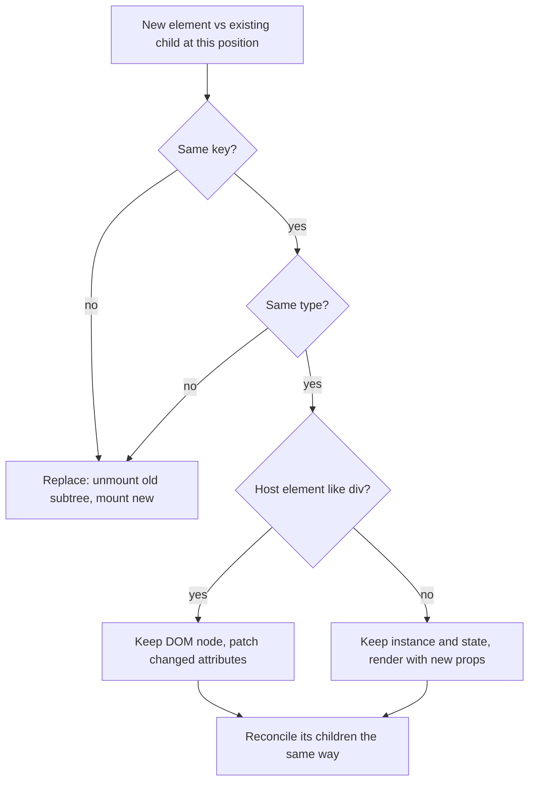

## Introduction

React lets you write UI as a function of data: whenever state changes, your components return a fresh description of the whole screen. But the browser does not accept "here is the whole screen again" — it has a live DOM tree with focused inputs, scroll positions, running CSS animations, selected text and images that have already loaded. Throwing that tree away and building a new one on every keystroke would be slow, and it would destroy all of that state: the input you are typing into would lose focus after every character.

So React needs to answer a question after every render: **given the description the components returned last time and the one they return now, what is the smallest sensible set of changes to make to the real DOM, and which component instances should survive?** The process of answering it is called **reconciliation**, and the comparison algorithm at its heart is usually called **diffing**.

Reconciliation is why declarative UI is practical. It also decides something more visible than performance: **whether a component keeps its state**. A form that unexpectedly clears, a counter that carries its value to the wrong item, or a video that restarts when a sibling changes are all reconciliation decisions. Once you know the rules, these bugs become predictable and easy to fix.

This lesson covers the rules and the algorithm. [[b4-rendering-lifecycle]] places reconciliation in the update cycle, [[b4-virtual-dom]] describes the element trees being compared, [[b4-fiber]] describes the data structure React uses to do the work, and [[b4-keys]] goes deep on the one tool you have for controlling identity.

## Before you start

- **The rendering lifecycle** — trigger, render, commit. Reconciliation happens inside the render phase; its results are applied in commit. See [[b4-rendering-lifecycle]].
- **React elements** — JSX produces plain objects with a `type`, `props` and `key`. See [[b4-react-element]].
- **State belongs to a component instance** — and survives re-renders. See [[b4-state]].
- **Lists with `map`** — rendering an array of JSX. See [[b4-rendering-lists]].
- **The DOM tree** — nodes, parents and children. See [[b3-dom]].

## The intuition

Imagine you manage the seating plan for a theatre and receive a new plan every few minutes. People are already sitting in seats, with their coats and bags. You could clear the whole theatre and reseat everyone from scratch each time — correct, but slow and disruptive. Or you could compare the new plan with the current seating, leave everyone who has not moved where they are, ask a few people to change seats, and seat newcomers.

To compare plans quickly, you need a way to decide whether "the person in seat 12 on the old plan" is "the same person" as "the person in seat 12 on the new plan". If every guest wears a name badge, you can match them by name even if they changed rows. If they do not, the best you can do is assume whoever is in seat 12 is still the same person — which goes wrong the moment someone new sits in seat 1 and everyone shifts along.

That is reconciliation. Seats are positions in the tree, the person's role (usher, guest, musician) is the element **type**, and name badges are **keys**. React keeps instances — with their state and DOM nodes — wherever it can match them, and replaces them where it cannot.

The analogy stops in one place: a person keeps their coat when they move seats, and a React component keeps its state when it moves within a list *only if it has a key*. Without keys, React does not move instances at all; it reuses whatever instance is at each position.

## What reconciliation compares

Each render of a component returns a tree of **React elements** — lightweight objects like `{ type: 'li', key: null, props: { children: 'Milk' } }`. React keeps, from the previous commit, an internal tree that records what each position currently holds: which component type, which instance with which state, which DOM node. (Internally these are **fibers**; see [[b4-fiber-tree]].)

Reconciliation walks the new elements and, position by position, matches each one against what currently exists there. For each match it decides one of four outcomes:

| Outcome | When | Effect on state | Effect on DOM |
|---|---|---|---|
| **Update** | Same type (and same key) at this position | Kept | Existing node kept; changed attributes and text patched |
| **Replace** | Different type, or different key | Old subtree's state destroyed; new state initialised | Old nodes removed; new nodes created |
| **Insert** | New element with nothing to match | Initialised | Nodes created and inserted |
| **Delete** | Old child with no matching new element | Destroyed (effects cleaned up) | Nodes removed |

With keyed children there is a fifth: **move** — the same instance and DOM node, placed at a new position.

Reconciliation does *not* touch the DOM itself. It records the needed changes on the internal tree; the commit phase applies them all at once.

## The rules in one picture



For elements without an explicit key, React compares by position among their siblings, which behaves as if the key were the index. The next section explains each rule, why it exists, and what it costs.

## Diffing Heuristics {#b4-diffing}

**Diffing heuristics** are the simplifying assumptions React makes so that comparing two UI trees is fast enough to do on every update. Instead of searching for the mathematically smallest set of changes, React follows a few cheap rules that are right for almost every real UI.

### Why heuristics are needed

Turning one tree into another with the fewest possible operations (insert, delete, relabel, move) is the **tree edit distance** problem. The best general algorithms take on the order of O(n³) time for trees of n nodes. A modest page has thousands of elements: for 1,000 nodes, n³ is a billion steps — far too slow to run each time someone types a letter.

React instead uses an **O(n)** algorithm, visiting each element roughly once. It can do this because it relies on two assumptions about how UIs actually change:

1. **Two elements of different types produce different trees.** If a `<div>` becomes a `<span>`, or `<Article>` becomes `<Comment>`, React does not try to find similarities inside them. It throws away the old subtree and builds the new one.
2. **The developer can mark which children are the same across renders with a `key`.** Among siblings, React matches children by key, so it can recognise moves without searching.

A third assumption is implicit: **React only compares nodes at the same depth.** It never checks whether a subtree moved to a different parent; it compares the children of a node with that node's previous children, and nothing else.

These assumptions mean React sometimes does more DOM work than strictly necessary. In exchange, every diff is linear, predictable and cheap. Real UIs rarely move a subtree across parents or swap types while keeping identical contents, so the trade is a very good one.

### Rule 1: Different types — replace the whole subtree

When the element at a position changes type, React **unmounts** the old one and **mounts** the new one. Every component beneath it is unmounted too, its state is destroyed, its effects are cleaned up, and its DOM nodes are removed. The new subtree starts from scratch.

```jsx
// Render 1
<div>
  <Counter />
</div>

// Render 2: the wrapper changed from div to section
<section>
  <Counter />
</section>
```

`Counter` looks the same in both, but its parent's type changed, so React destroys the `<div>` subtree — including `Counter` and its state — and mounts a new `Counter` inside a new `<section>`. The worked example below shows this happening with real state.

"Type" means the element's `type` field. For DOM elements it is the tag string (`'div'`). For components it is the **function or class itself**, compared by reference. That has a sharp consequence:

```jsx
function SearchPage() {
  const [query, setQuery] = useState('');

  // BUG: a new SearchBox function is created on every render of SearchPage
  function SearchBox() {
    const [draft, setDraft] = useState('');
    return <input value={draft} onChange={(e) => setDraft(e.target.value)} />;
  }

  return <SearchBox />;
}
```

Every render of `SearchPage` defines a brand-new `SearchBox` function. To React it is a different type from the previous render's `SearchBox`, so it unmounts the old one and mounts a new one — losing `draft` and the input's focus on every update. **Always define components at the top level of a module**, never inside another component.

### Rule 2: Same DOM type — keep the node, patch attributes

When both elements are DOM elements of the same type, React keeps the existing DOM node and only updates the attributes that changed:

```jsx
<button className="btn" title="Save" disabled={false}>Save</button>
// becomes
<button className="btn btn-primary" title="Save" disabled={false}>Save</button>
```

React sets `className` on the existing button and leaves everything else alone. For `style`, it compares property by property, so `style={{ color: 'red', fontWeight: 'bold' }}` becoming `style={{ color: 'green', fontWeight: 'bold' }}` updates only `color`. Then it reconciles the button's children.

Keeping the node is what preserves browser state: focus, text selection, the cursor position inside an input, scroll position, a playing `<video>`.

### Rule 3: Same component type — keep the instance, render with new props

When both elements are the same component, React keeps the component instance — its state, refs and effects — and renders it with the new props. The component returns a new subtree, and React reconciles that recursively. This is how a parent can pass new props down while the child keeps its own state.

### Rule 4: Children — compare by position, or by key

After deciding about a node, React reconciles its children. Without keys, React compares children **by index**: first old child with first new child, second with second, and so on. That is cheap and fine when items are only added or removed at the end. It goes wrong when items are inserted at the start.

Here is a list rendered first with `['Milk', 'Eggs']`, then with `'Bread'` added at the front. The program below records every DOM operation on the list for two versions: one using the index as key (identical to having no key), one using the item as key.

```jsx title="PrependList.jsx"
function ShoppingList({ items, keyed }) {
  return (
    <ul>
      {items.map((item, i) => (
        <li key={keyed ? item : i}>{item}</li>
      ))}
    </ul>
  );
}

// Render 1: items = ['Milk', 'Eggs']
// Render 2: items = ['Bread', 'Milk', 'Eggs']
```

Logging the DOM operations React performs for render 2 (recorded by wrapping `insertBefore`, `appendChild` and text-node setters):

```output
index keys: li text "" -> "Eggs", text "Milk" -> "Bread", text "Eggs" -> "Milk", appendChild(Eggs)
item keys:  li text "" -> "Bread", insertBefore(Bread)
```

With index keys, React matched old position 0 (`Milk`) with new position 0 (`Bread`) and changed its text, did the same for position 1, and then created a new `<li>` at the end for `Eggs`. Every existing item was modified. With item keys, React recognised that `Milk` and `Eggs` were still there, left them untouched, and inserted one new node before them.

For plain text the difference is only efficiency. For items with state — an input, a checkbox, a component with `useState` — index matching attaches the old state to the *wrong item*, because the instance at position 0 now displays `Bread` but still holds whatever was typed for `Milk`. That bug is explained in full in [[b4-index-key-danger]].

### How React reconciles a keyed list

For an array of keyed children, React runs a linear algorithm (the function in React's source is `reconcileChildrenArray`). Knowing its shape explains which items React moves.

1. **Walk both lists from the start while keys match.** Matching items are updated in place. This makes the common case — nothing moved, maybe something appended — very fast.
2. **If the new list ended, delete the remaining old children. If the old list ended, insert the remaining new children.**
3. **Otherwise, put the remaining old children in a map from key to child.** Then go through the remaining new children in order. For each one, look its key up in the map: if found, reuse that instance (removing it from the map); if not, create a new one.
4. **Decide moves with a single pointer.** React remembers `lastPlacedIndex`, the largest old index among children it has kept in place so far. A reused child whose old index is *greater than or equal to* `lastPlacedIndex` stays where it is and becomes the new `lastPlacedIndex`. A reused child whose old index is *smaller* must have been overtaken, so it is marked to be moved.
5. **Delete everything left in the map.** Those keys no longer exist.

This is linear, but it does not always find the minimum number of moves. Take `[A, B, C, D]` and move `D` to the front:

| New child | Old index | `lastPlacedIndex` before | Decision |
|---|---|---|---|
| D | 3 | 0 | Stays; `lastPlacedIndex = 3` |
| A | 0 | 3 | 0 < 3 → move |
| B | 1 | 3 | 1 < 3 → move |
| C | 2 | 3 | 2 < 3 → move |

React moves three nodes, although moving `D` alone would do. The reverse change, moving `A` from the front to the back, costs one move: `B`, `C` and `D` stay in place and only `A` is moved. Running both changes and logging the DOM operations confirms it:

```output
last to front: appendChild(A), appendChild(B), appendChild(C)
first to back: appendChild(D)
```

(In the second case `D` is appended because, when going from `[D, A, B, C]` back to `[A, B, C, D]`, `D` is the overtaken item.) Moves of existing nodes are cheap, so this rarely matters. It is a good illustration of what "heuristic" means: correct always, minimal usually.

### What the heuristics cannot see

Because React only compares siblings at the same level, it cannot recognise a subtree that moved to a different parent. If you wrap an existing component in a new `<div>` or move it from one container to another, React sees "old child deleted here, new child created there", and the component remounts with fresh state. When you need a component to keep its state across such a change, keep its position in the tree stable — for example render the wrapper in both cases and change only its styling. (Portals do not change this: a portal's children are reconciled at their position in the React tree, wherever their DOM ends up.)

> [!NOTE] Keys are unique among siblings only
> A key needs to be unique within one list of siblings, not across the whole app. React compares keys only among children of the same parent, so two different lists can both contain a child with `key="1"`.

```quiz
Q: Why can React diff two element trees in O(n) time when general tree-diff algorithms take O(n³)?
- [ ] It diffs the real DOM instead of element trees
- [x] It assumes different element types produce different subtrees and matches children only by position or key among siblings
- [ ] It runs the diff in a Web Worker
- [ ] It only re-renders components whose props changed
> Those assumptions remove the expensive search: React never looks for similar content inside a subtree whose type changed, never considers moves across parents, and matches siblings directly by key or index. The cost is that some changes cause more DOM work than the theoretical minimum.

Q: A list is reordered from [A, B, C, D] to [D, A, B, C]. All items have stable keys. How many DOM nodes does React move?
- [ ] 1 (only D)
- [x] 3 (A, B and C)
- [ ] 4 (all of them)
- [ ] 0 (keys prevent moves)
> React keeps D in place first, setting lastPlacedIndex to D's old index, 3. Each of A, B and C has an old index below 3, so each is marked to move. The result is correct, just not the minimal number of moves.
```

## Position in the tree is identity

The rules above lead to a principle that explains most state-preservation behaviour: **React associates state with a position in the tree, identified by the type and key at that position.** It does not care about the component's name in your source code or which branch of an `if` produced it.

Two consequences surprise people.

**Same type at the same position keeps state, even across "different" components.** In this code the two branches look like different counters:

```jsx
{isPlayerX ? <Counter name="X" /> : <Counter name="Y" />}
```

But both branches produce a `Counter` at the same position. To React, it is one counter whose `name` prop changed. Toggling `isPlayerX` keeps the count. If you want separate state, give them different keys (`key="X"` and `key="Y"`) — see [[b4-keys-state-reset]].

**Conditional children keep their siblings' positions stable.** JSX children are an array, and `false`, `null` and `undefined` still occupy a slot:

```jsx
<div>
  {showBanner && <Banner />}
  <Form />
</div>
```

The children array is `[<Banner />, <Form />]` or `[false, <Form />]`. `Form` is at index 1 either way, so showing and hiding the banner never resets the form. Compare with an early return that changes the structure:

```jsx
if (showBanner) {
  return <div><Banner /><Form /></div>;
}
return <div><Form /></div>;
```

Now `Form` is at index 1 in one case and index 0 in the other. React sees a different type at each position, and the form remounts — its contents vanish — whenever the banner toggles. The full set of preserve-and-reset patterns is in [[b4-state-identity]].

## Worked example: watching state survive and reset

This program renders the same `Counter` component in three situations and toggles them all at once.

```jsx title="Identity.jsx"
import { useState, useEffect } from 'react';
import { createRoot } from 'react-dom/client';

function Counter({ name }) {
  const [count, setCount] = useState(0);
  useEffect(() => {
    console.log(`mount ${name}`);
    return () => console.log(`unmount ${name}`);
  }, []);
  return <b onClick={() => setCount(count + 1)}>{name}:{count} </b>;
}

function App() {
  const [flag, setFlag] = useState(false);
  return (
    <div>
      <button onClick={() => setFlag(!flag)}>toggle</button>
      {flag ? <Counter name="X" /> : <Counter name="Y" />}
      {flag ? <div><Counter name="P" /></div> : <section><Counter name="Q" /></section>}
    </div>
  );
}

createRoot(document.getElementById('root')).render(<App />);
```

Click the first counter twice, then click "toggle". The console and the page show:

```output
mount Y
mount Q
page: Y:2 Q:0
--- toggle
unmount Q
mount P
page: X:2 P:0
```

The first slot switched from `<Counter name="Y" />` to `<Counter name="X" />`. Same type, same position: React updated the instance's `name` prop and kept its state, so `X` shows `2` — the clicks made on `Y`. There was no unmount or mount for it; the effect with an empty dependency array did not re-run.

The second slot switched from a `<section>` to a `<div>`. The `Counter` inside looks identical, but its parent's type changed, so Rule 1 applied: React unmounted the whole `<section>` subtree, cleaning up `Q`'s effect, and mounted a fresh `<div>` with a fresh `Counter`. Even if `Q` had been clicked, `P` would show `0`.

If you add a `key` that differs between branches to the first slot — `<Counter key="X" …/>` and `<Counter key="Y" …/>` — React treats them as different identities, and the first slot would also log an unmount and a mount on toggle.

## How it works internally

Reconciliation happens during the render phase, inside React's work loop ([[b4-fiber-work-loop]]). When React processes a fiber whose component has rendered, it calls the child reconciler with two inputs: the fiber's current children (a linked list of fibers from the last commit) and the new children (the elements just returned).

The child reconciler has separate paths for a single element, for text, and for arrays or iterables. For a single element it looks for an existing child with the same key and type and reuses it, deleting the rest. For arrays it runs the keyed algorithm described above. Reusing a child means creating or recycling its **work-in-progress** fiber from the existing one, copying over its state and DOM node, and attaching the new props. Replacing means creating a fresh fiber and marking the old one for deletion.

Instead of touching the DOM, the reconciler sets **flags** on fibers: `Placement` for inserts and moves, `Update` for changed props, and `ChildDeletion` on a parent for children to remove. After the render phase finishes, the commit phase walks the flagged fibers and performs the DOM operations, which is why the user never sees an intermediate state.

React also skips work wherever it can. If a fiber has no pending updates and receives the identical props object (because its parent did not render it again, or `memo` compared props and found them equal), React **bails out**: it does not call the component and, if no descendant has pending work either, skips the whole subtree. Reconciliation therefore costs time proportional to the part of the tree that actually rendered, not to the size of the whole app.

## In real systems

**Forms and editors.** A text field that loses focus on every keystroke is almost always a reconciliation problem — usually a component defined inside another component, or a key generated with `Math.random()`, causing a remount on every render.

**Resetting on purpose.** Changing a `key` is the standard way to discard a subtree's state: `<ProfileForm key={userId} />` gives each user a fresh form, with no effect that copies props into state. See [[b4-resetting-state]].

**Routing and layouts.** Routers keep shared layouts (navigation, sidebars) at a stable position in the tree, so navigating between pages only replaces the page content and the layout keeps its state, such as a scrolled sidebar or an open menu.

**Animations and media.** A playing `<video>` or a CSS transition survives an update only if React keeps its DOM node. Wrapping it conditionally in a different element type restarts it. Animation libraries rely on stable keys to tell an item that moved from one that was removed and re-added.

**Third-party DOM code.** If a jQuery plugin or a browser extension changes DOM nodes that React manages, React's records no longer match the DOM, and later reconciliation can fail with errors such as `Failed to execute 'removeChild' on 'Node'`. Give such code its own DOM node that React renders empty and never touches, and manage it from an effect. See [[b4-virtual-dom-limitations]].

## Trade-offs and alternatives

| Aspect | React's reconciliation | Alternative |
|---|---|---|
| Diff cost | O(n) per rendered subtree | Optimal tree edit distance: around O(n³), impractical |
| DOM operations | Near-minimal; extra moves or replacements in rare cases | Hand-written DOM code can be exactly minimal but must be maintained by hand |
| Work proportional to | Size of the subtree that re-rendered | Fine-grained reactive libraries (Solid, Svelte 5) update only the bound DOM node, with no tree diff |
| Identity control | Type, position and `key` | Manual: you decide which node is which |

The real cost of reconciliation is usually not the diff itself but the rendering that precedes it: React must call every component in the re-rendered subtree to get elements to compare. A one-character change in a big form can re-render hundreds of components. The tools for reducing that are covered in [[b4-memoization-perf]] and [[b4-state-colocation]].

## Common mistakes

> [!MISTAKE] Defining a component inside another component
> The inner function is a new type on every render, so React remounts it each time: its state resets and inputs lose focus. Move the component to the top level of the module and pass what it needs as props.

**Using the array index as a key for lists that change order.** Inserting, deleting or sorting moves data between positions while state stays put, so state attaches to the wrong item. Use a stable ID from the data. See [[b4-index-key-danger]].

**Generating keys during render.** `key={Math.random()}` or `key={crypto.randomUUID()}` produces a new key every render, so every item remounts every time — slow, and it wipes all state and focus.

**Changing the wrapper element conditionally.** `{isCompact ? <div><Editor /></div> : <section><Editor /></section>}` remounts `Editor` when `isCompact` flips. Keep one wrapper and change its class.

**Expecting separate state from two branches of a ternary.** `{a ? <Panel /> : <Panel />}` is one panel to React. Give the branches different keys if they should be independent.

**Assuming reconciliation compares against the real DOM.** React compares the new elements with its own record of the previous render, not with the live DOM. Changes made to the DOM outside React are invisible to it and may be overwritten or cause errors.

## Interview perspective

Reconciliation questions test whether you understand how React turns declarative output into DOM changes and why keys matter. The strongest answers state the rules, say why they exist (the O(n³) → O(n) trade), and connect them to state preservation.

> [!INTERVIEW] What a strong answer sounds like
> "After a render, React compares the new element tree with the previous one. If the type at a position differs, it unmounts the old subtree and mounts the new one. If it is the same, it keeps the DOM node or component instance — so state is preserved — and updates props, then recurses into the children. Siblings are matched by key, or by index if there are no keys. These heuristics make the diff O(n) instead of the O(n³) of a general tree diff."

Questions to prepare:

- **What is reconciliation?** Comparing the new element tree with the previous one to decide what to keep, update, create, move or delete, then applying the result in the commit phase.
- **Is reconciliation the same as the virtual DOM?** Reconciliation is the algorithm; "virtual DOM" refers to the in-memory element trees it compares. In modern React it runs on the fiber tree.
- **When does React unmount and remount a component instead of updating it?** When the element type or key at its position changes, or when it moves to a different parent.
- **Why is a component defined inside another component a bug?** Its function identity changes every render, so its type changes and it remounts.
- **How does React handle a list without keys?** It matches children by index; insertions at the front or reorders cause unnecessary updates and misplaced state, and React warns in development.
- **Does React find the minimal set of DOM operations?** No. It finds a near-minimal set in linear time; for example moving the last item to the front moves every other item instead.

A common follow-up is *"How would you preserve a component's state when it moves between two containers?"* — React cannot track cross-parent moves, so either keep it at a stable position and change styling, or lift its state up so remounting does not lose anything.

## Practice

1. **Predict remounts.** For each change, predict whether `Editor` keeps its state, then verify with a mount/unmount effect: (a) `<Editor />` → `<Editor readOnly />`; (b) `<div><Editor /></div>` → `<Editor />`; (c) `<Editor key="a" />` → `<Editor key="b" />`; (d) `{x && <Tip />}<Editor />` with `x` toggling.
2. **Find the remount.** Write a search page whose input loses focus on every keystroke because a component is defined inside another. Fix it and explain the fix in terms of element type.
3. **Count the moves.** On paper, run the keyed-list algorithm for `[A, B, C, D, E]` → `[B, E, A, C, D]`. Which nodes are moved?
4. **Reset on purpose.** Build a chat window that clears its draft message when the selected contact changes, using only a `key`.

## Quick revision {#quick-revision}

- Reconciliation compares the new element tree with the previous render's tree and decides: update, replace, insert, delete or move. The commit phase applies the result.
- General tree diff is around O(n³); React's heuristics make it O(n).
- Heuristic 1: **different type → replace the whole subtree** (state destroyed, DOM recreated).
- Heuristic 2: **keys identify siblings** across renders; without keys, siblings are matched by index.
- React only compares nodes at the same level; a subtree moved to a new parent remounts.
- Same DOM type → keep node, patch only changed attributes (and only changed `style` properties).
- Same component type → keep instance and state, render with new props, recurse.
- Component type is compared by reference: components defined inside components remount every render.
- State is tied to **position + type + key**, not to where the JSX appears in your code.
- `false`/`null`/`undefined` children keep their slot, so conditional siblings do not shift positions.
- Keyed list algorithm: in-order pass, then key map, then `lastPlacedIndex` to decide moves. Moving the last item to the front moves all the others.
- Bailout: no pending work and identical props → component skipped; reconciliation cost scales with the re-rendered subtree.

## Key takeaways {#key-takeaways}

- Reconciliation is how React turns "here is the whole UI again" into a small set of DOM changes while preserving instances and their state.
- React trades optimal diffing for speed with simple rules: a type change replaces a subtree, keys identify siblings, and comparisons stay within one level.
- Whether a component keeps its state depends on its type, key and position in the tree — not on how your source code is arranged.
- Most surprising resets and leaks come from changing a wrapper type, defining components inside components, or using unstable or index keys.
- The diff itself is cheap; the expensive part is usually rendering the components whose output is being compared.
