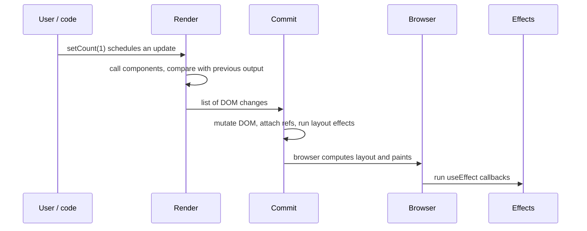

## Introduction

When you write a React component, you never tell the browser "change this text node" or "insert this list item". You describe what the screen should look like for the current data, and React works out what to change. That raises an obvious question: *when* does React do this work, and in what order? When is your component function called? When does the DOM actually change? When do effects run, and why does `useLayoutEffect` exist alongside `useEffect`?

The answer is the **rendering lifecycle**: the fixed sequence React follows for every update. In plain words, it has three steps, plus a fourth for effects:

1. **Trigger** — something tells React the UI might need to change (the app starts, or state changes).
2. **Render** — React calls your components to find out what the UI should look like now.
3. **Commit** — React applies the necessary changes to the real DOM.
4. **Effects** — after the commit, React runs the effect functions you registered with `useLayoutEffect` and `useEffect`.

The browser then paints the new pixels on screen. Layout effects run before that paint; ordinary effects normally run after it.

An engineer needs this model for practical reasons. Almost every confusing React bug — a value that "lags one render behind", a tooltip that flickers into place, a component that re-renders when nothing seemed to change, an effect that fires twice, an infinite loop — becomes easy to explain once you know which step is running. It is also the foundation for performance work: you cannot decide whether to reach for [[b4-react-memo|React.memo]] until you know what makes a component render in the first place. The lessons on [[b4-reconciliation]], [[b4-virtual-dom]] and [[b4-fiber]] then explain *how* React performs the render and commit steps internally.

## Before you start

You need:

- **Components and JSX** — a component is a function that returns JSX. See [[b4-component-model]] and [[b4-jsx]].
- **State with `useState`** — calling the setter schedules an update. See [[b4-state]] and [[b4-usestate]].
- **Props** — data passed from a parent to a child. See [[b4-props]].
- **Effects, at least by name** — `useEffect` runs code after rendering. The details are in [[b4-useeffect]] and [[b4-uselayouteffect]]; this lesson explains *when* they run.
- **How browsers draw a page** — the browser turns DOM changes into pixels through style, layout and paint. See [[b3-render-steps]].

Two meanings of "render" collide here. The *browser* renders when it lays out and paints pixels. *React* renders when it calls your components. In this lesson "render" always means React's step unless it says "browser paint".

## The intuition

Think of an architect and a construction crew renovating a building. The architect (render) draws a complete plan of how the building should look now. Drawing is cheap and has no effect on the building: the architect can redraw the plan, throw a half-finished drawing away when the client changes their mind, or draw the same plan twice to double-check it. Only when the plan is final does the crew (commit) go to the site and make the changes — and they compare the new plan with the building as it stands, so they knock down only the walls that moved and repaint only the rooms whose colour changed. Once construction is done, the decorators and inspectors (effects) come in to do work that needs the finished building: hanging pictures, connecting the electricity to the grid, measuring rooms.

Three things in this picture match React precisely. The plan is a description, not the building — your components return a description of the UI, not DOM nodes. Drawing must have no side effects, because a drawing may be discarded. And the crew touches only what differs between plans, which is why re-rendering a component does not necessarily change the DOM at all.

Where the analogy stops working: a real architect redraws a whole building, but React only re-renders the part of the component tree affected by an update. And the crew in React works all at once in a single uninterrupted burst — the browser never shows a half-renovated page.

## The three steps at a glance

Here is a single update, from a click to the effect that runs afterwards:



The rest of the lesson takes each concept in turn. First, what counts as a render at all.

## Render vs Re-render {#b4-render-vs-rerender}

A **render** is React calling your component function (or a class component's `render` method) to get the JSX it returns. That is all it is: a function call that produces a description of the UI. The very first render of a component, when it appears on screen for the first time, is called the **initial render** or **mount**. Every later render of the *same* component instance is a **re-render**.

These words are often used loosely, so it pays to separate four events that beginners tend to merge:

| Event | What happens | State | DOM |
|---|---|---|---|
| Mount (initial render) | Component appears for the first time; React calls it and creates DOM nodes | Initialised from `useState(initial)` | Created and inserted |
| Re-render | React calls the same instance again because of an update | Kept — `useState` returns the current value | Updated only where output differs, possibly not at all |
| Remount | The old instance is destroyed and a new one is mounted in its place | Lost — starts again from the initial value | Old nodes removed, new ones created |
| Unmount | Component disappears | Discarded | Removed |

The most important line is the second. **A re-render does not reset state and does not rebuild the DOM.** When a component re-renders, React calls the function again; `useState` hands back the value stored from last time rather than the initial value; the function returns new JSX; and React compares it with the previous JSX to find what changed. If nothing in the output changed, the DOM is not touched at all.

Here is a component that logs every time it renders:

```jsx title="Counter.jsx"
import { useState } from 'react';
import { createRoot } from 'react-dom/client';

function Counter() {
  const [count, setCount] = useState(0);
  console.log(`render Counter, count = ${count}`);

  return (
    <div>
      <h1>Shopping cart</h1>
      <button onClick={() => setCount(count + 1)}>Items: {count}</button>
    </div>
  );
}

createRoot(document.getElementById('root')).render(<Counter />);
```

Load the page and click the button twice:

```output
render Counter, count = 0
render Counter, count = 1
render Counter, count = 2
```

The first line is the mount. The next two are re-renders of the *same* instance — `count` survives between them because React stores state outside the function, attached to the component's position in the tree. On each re-render the function returns a whole new JSX description, including the unchanged `<h1>`, yet React only updates the text inside the button. The `<h1>` DOM node is the same object it was on mount. If you open the browser's DevTools Elements panel while clicking, only the button's text flashes as modified.

This tells you what a re-render costs: running your component function and comparing its output. That is usually cheap — far cheaper than the DOM work most people imagine. It becomes expensive only when the function itself does heavy computation or when a single update re-renders a very large subtree. The lesson on [[b4-why-rerenders]] covers how to find those cases.

A **remount** is a different and much bigger event. It happens when React decides that the component at a position is no longer the same component — because its type changed, its `key` changed, or it was removed and re-added. The old instance's state is thrown away, its effects are cleaned up, and a fresh instance starts from scratch. [[b4-reconciliation]] and [[b4-keys]] explain exactly when React decides this; for now, hold on to the distinction: re-render keeps state, remount loses it.

> [!NOTE] Render is not the same as "updates the screen"
> Saying "the component re-rendered" tells you React called the function. It does not tell you the DOM changed or that anything visible happened. A component can re-render a hundred times and produce zero DOM mutations.

## What Causes a Component to Render {#b4-render-triggers}

A component renders only when React has a reason to call it. There is a short, complete list of reasons, and learning it is the fastest way to reason about performance and about "why did this run?" bugs.

### 1. The initial render

The app starts when you create a root and render into it:

```jsx
import { createRoot } from 'react-dom/client';
createRoot(document.getElementById('root')).render(<App />);
```

This mounts `App` and, recursively, everything it returns. (See [[b4-react-root]] for the root API.)

### 2. The component's own state changes

Calling a state setter from `useState`, or `dispatch` from `useReducer`, schedules a re-render of the component that owns that state. Class components do the same with `this.setState` and `this.forceUpdate`.

The setter does not re-render immediately. It **queues** an update, and React processes the queue a little later — in React 18 and later, all updates made in the same event (or the same tick of any other task) are **batched** into a single render. That is why reading `count` right after `setCount(count + 1)` still gives the old value: the current render's variables are a snapshot. See [[b4-state-update-batching]] and [[b4-state-snapshots]].

There is one escape: if the new value is the same as the current one, compared with `Object.is`, React can skip the render. The skip is not always total, which surprises people. Here is a component whose button always sets the state to `1`:

```jsx title="SameValue.jsx"
import { useState } from 'react';
import { createRoot } from 'react-dom/client';

function Toolbar() {
  const [value, setValue] = useState(0);
  console.log(`render Toolbar, value = ${value}`);
  return (
    <>
      <button onClick={() => setValue(1)}>Set to 1</button>
      <Icon />
    </>
  );
}

function Icon() {
  console.log('  render Icon');
  return null;
}

createRoot(document.getElementById('root')).render(<Toolbar />);
```

Click the button three times:

```output
render Toolbar, value = 0
  render Icon
render Toolbar, value = 1
  render Icon
render Toolbar, value = 1
```

The first click changes `0` to `1`, so both components render. The second click sets `1` again: React calls `Toolbar` once more, sees the result is identical, and stops — `Icon` is not rendered. The third click is skipped completely. React's documentation states it this way: React *may* still call your component before skipping its children. Your code should not depend on either outcome; it only needs to be correct whenever it is called.

`Object.is` compares objects by reference, not by contents. This is why mutating state does nothing:

```jsx
const [user, setUser] = useState({ name: 'Ada' });

function renameBroken() {
  user.name = 'Grace';  // mutates the existing object
  setUser(user);        // same reference: Object.is says "unchanged", render skipped
}

function renameFixed() {
  setUser({ ...user, name: 'Grace' });  // new object: React re-renders
}
```

The broken version changes the data but React never hears about a *new* value, so the screen keeps showing "Ada". Always give React a new object or array. See [[b4-state-immutability]] and [[b1-primitive-vs-reference]].

### 3. The parent renders

When a component renders, React by default renders every component it returns, and so on down the tree. This is the most common reason a component renders, and it is covered in its own section below.

### 4. A context it reads changes

A component that reads a context with `useContext` (or the React 19 `use` function) re-renders whenever the nearest provider above it receives a different `value`, again compared with `Object.is`. This happens even if every component between the provider and the consumer skipped rendering. See [[b4-usecontext]] and [[b4-context-rerenders]].

### 5. An external store it subscribes to changes

Libraries such as Redux and Zustand keep state outside React. They connect through `useSyncExternalStore`, which re-renders the subscribing component when the store's snapshot changes. From React's point of view this behaves like a state update.

### What is *not* on the list

**Props changing is not a trigger by itself.** Props are arguments the parent passes when *it* renders. The only way a child can receive new props is for its parent to render, so "props changed" is always a consequence of reason 3. This matters in debugging: if a child re-renders, look upward for the parent that rendered.

Likewise, changing a regular variable, a ref (`ref.current = …`), or a property on a mutated object never triggers a render. React only knows about changes that go through its update functions.

```quiz
Q: A child component receives a prop `user` from its parent. The parent mutates `user.age += 1` inside a click handler and does nothing else. What happens?
- [ ] The child re-renders because its prop changed
- [ ] React detects the mutation and re-renders the parent
- [x] Nothing re-renders; the screen keeps showing the old age
- [ ] React throws an error because props are frozen
> React only renders in response to its own triggers: a state setter, a parent render, a context change or a store change. Mutating an object is none of these, so nobody re-renders. The data and the screen silently disagree until some unrelated update happens.
```

## Parent / Child Rendering Behavior {#b4-parent-child-rendering}

When a component renders, what happens to the components inside it? The default rule is simple: **when a component renders, React renders all of its child components too, recursively — whether or not their props changed.**

React does this because, by default, it cannot know that a child's output would be the same. A child might read a value from somewhere other than its props, and React's contract is that the UI is always consistent with the latest data. Rendering is usually cheap, so React errs on the side of correctness and lets you opt out where it matters.

Rendering only ever flows *down* the tree. When a component's state changes, React re-renders that component and its descendants. Its parent, its siblings and the rest of the tree are not rendered.

```mermaid title="setState in List re-renders List and its descendants only"
flowchart TD
    App["App (not rendered)"] --> Header["Header (not rendered)"]
    App --> List["List — setState here"]
    List --> Row1["Row (rendered)"]
    List --> Row2["Row (rendered)"]
    Row2 --> Avatar["Avatar (rendered)"]
```

There are three important exceptions to "children always render", and real React applications depend on all three. This program demonstrates each:

```jsx title="ParentChild.jsx"
import { useState, memo, createContext, useContext } from 'react';
import { createRoot } from 'react-dom/client';

const Theme = createContext('light');

function Plain() {
  console.log('  render Plain');
  return <p>plain</p>;
}

const Memoized = memo(function Memoized({ label }) {
  console.log('  render Memoized');
  return <p>{label}</p>;
});

const MemoWithObject = memo(function MemoWithObject({ style }) {
  console.log('  render MemoWithObject');
  return <p style={style}>styled</p>;
});

const MemoReadsTheme = memo(function MemoReadsTheme() {
  const theme = useContext(Theme);
  console.log(`  render MemoReadsTheme (${theme})`);
  return <p>{theme}</p>;
});

function Slot() {
  console.log('  render Slot (passed as children)');
  return <p>slot</p>;
}

function Panel({ children }) {
  const [open, setOpen] = useState(0);
  console.log(` render Panel ${open}`);
  return (
    <section>
      <button id="panel" onClick={() => setOpen(open + 1)}>toggle</button>
      {children}
    </section>
  );
}

function App() {
  const [n, setN] = useState(0);
  console.log(`render App ${n}`);
  return (
    <Theme value={n % 2 ? 'dark' : 'light'}>
      <button id="app" onClick={() => setN(n + 1)}>update App</button>
      <Plain />
      <Memoized label="hi" />
      <MemoWithObject style={{ color: 'red' }} />
      <MemoReadsTheme />
      <Panel>
        <Slot />
      </Panel>
    </Theme>
  );
}

createRoot(document.getElementById('root')).render(<App />);
```

After mount, click "update App", then click "toggle":

```output
render App 0
  render Plain
  render Memoized
  render MemoWithObject
  render MemoReadsTheme (light)
 render Panel 0
  render Slot (passed as children)
render App 1
  render Plain
  render MemoWithObject
  render MemoReadsTheme (dark)
 render Panel 0
  render Slot (passed as children)
 render Panel 1
```

Walk through the second block, which is the re-render of `App`:

- **`Plain` rendered** even though it has no props at all. That is the default rule.
- **`Memoized` did not render.** [[b4-react-memo|`memo`]] tells React to compare the new props with the old ones, key by key with `Object.is` ([[b4-shallow-comparison]]), and skip rendering if they are all equal. `"hi"` equals `"hi"`, so React skipped it.
- **`MemoWithObject` rendered anyway.** Its `style` prop is written as an object literal, so every render of `App` creates a *new* object. `{ color: 'red' }` is not `Object.is`-equal to the previous `{ color: 'red' }`, so the memo comparison fails. This is the reason `useMemo` and `useCallback` exist — see [[b4-referential-equality]].
- **`MemoReadsTheme` rendered** because the context value changed from `light` to `dark`. Context consumers re-render on a context change even when `memo` would otherwise skip them.
- **`Panel` rendered** because its parent did (it is not memoised), and **`Slot` rendered** with it, because in this render `App` created a brand-new `<Slot />` element.

Now the third block. Clicking "toggle" changed `Panel`'s own state. `Panel` rendered, but `Slot` — which is visibly inside the panel — did not. This is the **children-as-props** exception. The `<Slot />` element was created by `App`, not by `Panel`; `Panel` merely places the `children` it received. Since `App` did not render, `children` is the *very same element object* as last time, and when React sees that a child's element is identical to the previous one, it knows nothing about it can have changed and skips it. This is a free, `memo`-less optimisation: lifting expensive content up into a parent and passing it as `children` keeps it out of the child's re-renders. See [[b4-children-prop]] and [[b4-composition]].

To summarise the rule precisely: when a component renders, React renders each of its children **unless** the child's element is the identical object it received last time (the children-as-props case), or the child is wrapped in `memo` and its props are shallowly equal to the previous ones. Independently of its parent, a component always renders if its own state changed or a context it reads changed.

> [!TIP] Re-renders are not automatically a problem
> Seeing children re-render is normal and usually harmless. Optimise only when a profiler shows a render is slow — see [[b4-profiler]]. In React 19 projects, the React Compiler can add this kind of memoisation automatically; see [[b4-react-compiler-performance]].

## Render Phase {#b4-render-phase}

The **render phase** is the step in which React calls your components to work out what the UI should look like, and compares the result with what is currently on screen. It produces a plan for the commit phase; it does not change the DOM.

### What happens during render

For each component that needs rendering, React:

1. Sets up the hooks machinery so that each `useState`, `useReducer`, `useContext` and `useMemo` call returns this component's current values, in the order they are called. (Order is how React matches calls to stored state — see [[b4-hook-call-order]].)
2. Calls the component function with its props. Your code runs: variables are computed, hooks are called, and JSX is returned. JSX compiles to function calls that create plain JavaScript objects called **React elements** — see [[b4-react-element]].
3. Compares the returned elements with the previous render's output for that position — this is **reconciliation**, taught in [[b4-reconciliation]] — and records what will need to change: "update this text", "insert this node", "delete that subtree".
4. Moves on to the children that need rendering and repeats.

At the end of the render phase React has a complete picture of the new UI and a list of changes, but the user still sees the old screen.

### Render must be pure

Because render only *computes*, React requires your component to behave like a **pure function** during render: given the same props, state and context, it returns the same JSX, and it does not change anything that existed before it was called. Concretely, during render you must not:

- mutate the DOM, or read layout from it;
- start network requests, timers or subscriptions;
- change props, state or other values that existed before this render;
- write to variables outside the component.

Creating and mutating *new* local values is fine — building an array with `push` and then returning it is pure, because nobody else can observe the array until you return it.

Why is React strict about this? Because it reserves the right to call your component in ways you might not expect:

- **More than once.** In development, `<StrictMode>` deliberately calls each component function twice per render to expose impurity ([[b4-strict-mode-double-run]]).
- **And throw the result away.** With concurrent features such as transitions, React can start rendering an update, pause to handle something more urgent, and discard the unfinished work ([[b4-interruptible-rendering]]). A component that rendered may never be committed.
- **Before it is visible.** Rendering can happen for content that is still hidden behind a [[b4-suspense|Suspense]] boundary.

A side effect placed in render runs every time any of those happens. Here is what impurity looks like:

```jsx title="Tickets.jsx"
import { StrictMode } from 'react';
import { createRoot } from 'react-dom/client';

let ticketNumber = 0;

function Ticket() {
  ticketNumber = ticketNumber + 1; // writes to a variable outside the component
  return <h2>Ticket #{ticketNumber}</h2>;
}

function Queue() {
  return (
    <>
      <Ticket />
      <Ticket />
      <Ticket />
    </>
  );
}

createRoot(document.getElementById('root')).render(
  <StrictMode>
    <Queue />
  </StrictMode>
);
```

```output
Ticket #2
Ticket #4
Ticket #6
```

Without `StrictMode` the page happens to show 1, 2, 3, which hides the bug. With it, each `Ticket` runs twice and the shared counter skips numbers. The fix is to pass the data in: `<Ticket number={1} />` and so on, making each component's output depend only on its inputs. With that change the page shows 1, 2, 3 in both modes. The full set of rules and their fixes is in [[b4-pure-rendering]] and [[b4-render-side-effects]].

### Setting state during render

Calling a state setter unconditionally during render schedules another render, which calls the setter again, and so on. React detects the loop and throws `Too many re-renders. React limits the number of renders to prevent an infinite loop.` The usual cause is calling a function instead of passing it: `onClick={setOpen(true)}` runs `setOpen` during render, whereas `onClick={() => setOpen(true)}` runs it on click.

There is one legitimate, guarded use: adjusting state when a prop changes, by storing the previous prop and comparing (`if (items !== prevItems) { setPrevItems(items); setSelection(null); }`). React handles this specially by re-running the component immediately, before rendering children. It is rarely needed — usually a `key` or a derived value is clearer ([[b4-resetting-state]], [[b4-derived-state]]).

## Commit Phase {#b4-commit-phase}

The **commit phase** is the step in which React applies the planned changes to the real DOM and then runs the code that needs to see the result: refs and effects. Where render only computes, commit makes things happen.

### What happens during commit

Commit runs **synchronously and without interruption**. Even when the render phase was spread across several slices of time, React applies all of the resulting DOM changes in one go, so the browser never paints a half-updated page. In order:

| Step | What React does | Your code that runs here |
|---|---|---|
| 1. Before mutation | Reads anything needed from the DOM before it changes | Class `getSnapshotBeforeUpdate` |
| 2. Mutation | Inserts, updates and removes DOM nodes; detaches old refs; runs cleanups of layout effects being re-run or removed | `useInsertionEffect` (for CSS-in-JS libraries), layout-effect cleanups, class `componentWillUnmount` |
| 3. Switch | The newly built tree becomes the "current" tree | — |
| 4. Layout | Attaches refs to the new DOM nodes; runs layout effects | `useLayoutEffect` setup, class `componentDidMount` / `componentDidUpdate` |
| 5. Browser paint | The browser recalculates style and layout and draws the frame | — |
| 6. Passive effects | Runs cleanups of changed effects, then their setups | `useEffect` cleanup, then setup |

Steps 1–4 happen in a single JavaScript task, so the browser cannot paint between them. That is the whole reason **`useLayoutEffect`** exists: code in it sees the updated DOM *before* the user does. It can measure an element and reposition it, and the user only ever sees the final position. **`useEffect`** — called a *passive* effect — normally runs after the browser has painted, so slow effect code (logging, subscriptions, fetching) does not delay the frame.

> [!NOTE] When useEffect runs before paint
> React 18 and later flush passive effects synchronously, before the browser can paint, when the update came from a discrete user input such as a click or a key press. This keeps event-driven behaviour consistent. For other updates (timers, network responses, transitions) React generally lets the browser paint first. Code should not rely on `useEffect` running either before or after paint; if it must be before paint, use `useLayoutEffect`.

React only touches DOM nodes that differ between the old and new output. If the render produced identical output, the commit makes no DOM changes at all. It also only commits *finished* renders: if a render was discarded, none of its effects run. This is why effects, not render, are the place for side effects — they run exactly once per committed change.

### The order of effects

Effects run **children first, then parents**, and within a step all cleanups run before any setups. Here is a parent with two children, each logging their effects:

```jsx title="EffectOrder.jsx"
import { useState, useEffect, useLayoutEffect } from 'react';
import { createRoot } from 'react-dom/client';

function Item({ name }) {
  console.log(`render ${name}`);
  useLayoutEffect(() => {
    console.log(`layout effect ${name}`);
    return () => console.log(`layout cleanup ${name}`);
  });
  useEffect(() => {
    console.log(`effect ${name}`);
    return () => console.log(`effect cleanup ${name}`);
  });
  return <li>{name}</li>;
}

function List() {
  const [n, setN] = useState(0);
  console.log(`render List n=${n}`);
  useLayoutEffect(() => {
    console.log(`layout effect List, <li> count = ${document.querySelectorAll('li').length}`);
  });
  useEffect(() => {
    console.log('effect List');
  });
  return (
    <ul onClick={() => setN(n + 1)}>
      <Item name="A" />
      <Item name="B" />
    </ul>
  );
}

createRoot(document.getElementById('root')).render(<List />);
```

On mount, then after clicking the list once:

```output
render List n=0
render A
render B
layout effect A
layout effect B
layout effect List, <li> count = 2
effect A
effect B
effect List
render List n=1
render A
render B
layout cleanup A
layout cleanup B
layout effect A
layout effect B
layout effect List, <li> count = 2
effect cleanup A
effect cleanup B
effect A
effect B
effect List
```

Rendering goes top-down (List, then A, then B), because a parent must run to produce its children. Effects go bottom-up, because a parent's effect may depend on its children's DOM being ready — by the time `List`'s layout effect runs, both `<li>` elements exist in the document. On the update, every layout cleanup ran before any new layout setup, and the same for passive effects, so no effect ever runs alongside a stale copy of itself.

### Refs are set during commit

A ref attached to a DOM element (`<input ref={inputRef} />`) is `null` during the first render, because the element does not exist yet. React assigns `ref.current` in the layout step of commit, and clears it when the element is removed. So read DOM refs in effects or event handlers, never during render. See [[b4-refs]].

## How it works internally

This is a summary; [[b4-fiber]] has the full story.

React keeps an internal tree of objects called **fibers**, one per component instance and per DOM element. Each fiber stores the component's type, its props, its hooks' state and a pointer to its DOM node. During the render phase React builds a second, **work-in-progress** copy of the parts of the tree that need updating, calling your components and recording on each fiber what must change. Because this copy is separate from the one on screen, React can pause, resume or discard it without harming the visible UI.

When the work-in-progress tree is complete, React commits: it walks the recorded changes, applies them to the DOM, then swaps the pointer so the work-in-progress tree becomes the current tree. The old current tree is kept and reused as the next work-in-progress — a technique called **double buffering**.

Updates are scheduled, not run inline. A `setState` call records the update on the fiber and asks React's scheduler to process the root. Updates from discrete events such as clicks are processed in a microtask at the end of the event; others are scheduled as tasks. This queueing is what makes batching possible: by the time React starts rendering, every update from the same event is already in the queue. Updates marked as transitions are rendered in small slices so that the browser can respond to input in between — see [[b4-concurrent-rendering]].

## Worked example: a full mount, update and unmount

This example ties every step together. `Badge` logs during render and in both kinds of effect, and also reports what the DOM contains at each point.

```jsx title="Lifecycle.jsx"
import { useState, useEffect, useLayoutEffect, useRef } from 'react';
import { createRoot } from 'react-dom/client';

function Badge({ count }) {
  const ref = useRef(null);
  console.log(`render Badge count=${count}, DOM text=${ref.current?.textContent ?? 'none'}`);

  useLayoutEffect(() => {
    console.log(`layout effect Badge, DOM text=${ref.current.textContent}`);
    return () => console.log('layout cleanup Badge');
  }, [count]);

  useEffect(() => {
    console.log(`effect Badge count=${count}`);
    return () => console.log(`effect cleanup Badge count=${count}`);
  }, [count]);

  return <span ref={ref}>{count}</span>;
}

function App() {
  const [count, setCount] = useState(0);
  const [visible, setVisible] = useState(true);
  console.log(`render App count=${count} visible=${visible}`);
  return (
    <div>
      <button onClick={() => setCount(count + 1)}>Add</button>
      <button onClick={() => setVisible(false)}>Hide</button>
      {visible && <Badge count={count} />}
    </div>
  );
}

createRoot(document.getElementById('root')).render(<App />);
```

Load the page, click "Add", then click "Hide":

```output
render App count=0 visible=true
render Badge count=0, DOM text=none
layout effect Badge, DOM text=0
effect Badge count=0
render App count=1 visible=true
render Badge count=1, DOM text=0
layout cleanup Badge
layout effect Badge, DOM text=1
effect cleanup Badge count=0
effect Badge count=1
render App count=1 visible=false
layout cleanup Badge
effect cleanup Badge count=1
```

Read it phase by phase.

**Mount.** Both components render top-down. During `Badge`'s render, `ref.current` is `null` — the `<span>` has not been created — so the log says `none`. In commit React creates the `<span>`, inserts it, and sets the ref; the layout effect can then read the text `0`. After that the passive effect runs.

**Update (click "Add").** The trigger is `setCount` in `App`. `App` re-renders, and `Badge` re-renders because its parent did. Notice that during `Badge`'s render the DOM still says `0` even though `count` is already `1`: render computes the new UI but the screen has not changed yet. Commit then updates the text node to `1`; the layout cleanup from the previous render runs, then the new layout effect sees `1`. Finally the old passive effect is cleaned up — its closure still sees `count=0`, the value from the render it belonged to — and the new one runs with `count=1`.

**Unmount (click "Hide").** `App` re-renders with `visible=false` and no longer returns `<Badge>`. `Badge` does not render at all — there is nothing to render. In commit React removes the `<span>`, runs the layout cleanup, and later the passive cleanup. Its state is gone; showing it again would mount a fresh instance with no memory of the previous one.

The one thing this log cannot show is the browser paint, which happens between the layout effect and the passive effect in the mount case. If you put a slow loop in `useLayoutEffect`, the user would see the old screen for longer; the same loop in `useEffect` would delay the effect but not the frame.

## In real systems

**Measuring and positioning.** Tooltips, popovers and dropdowns need the position of an anchor element. Measuring in `useLayoutEffect` and writing the position before paint avoids a visible jump. Floating-UI libraries do this internally.

```jsx
function Tooltip({ anchor, text }) {
  const ref = useRef(null);
  useLayoutEffect(() => {
    const rect = anchor.getBoundingClientRect();
    ref.current.style.top = `${rect.bottom + 4}px`;  // before paint: no flash
    ref.current.style.left = `${rect.left}px`;
  }, [anchor]);
  return <div ref={ref} className="tooltip">{text}</div>;
}
```

Doing the same in `useEffect` would usually let the browser paint the tooltip at its default position first and move it a frame later — a flicker users notice.

**Analytics and subscriptions.** Recording an impression, connecting a WebSocket or subscribing to a store belongs in `useEffect`, with a cleanup that disconnects. These do not need to block the paint, and the cleanup guarantees no leaked subscription after unmount.

**Performance investigations.** When a screen feels slow, the first question is which phase is slow. The React DevTools Profiler shows render durations per component; the browser Performance panel shows layout and paint. A slow *render* calls for less render work (moving state down, `memo`, splitting components); a slow *commit* often means too many DOM nodes ([[b4-virtualization]]) or layout thrashing in layout effects ([[b3-layout-thrashing]]).

**Server rendering.** With server-side rendering, the server runs the render phase only, producing HTML. On the client, React hydrates that HTML instead of creating nodes. Effects never run on the server, which is one more reason side effects must live in effects rather than render. See [[b4-hydration]].

**Class components.** Older code expresses the same lifecycle with methods. `componentDidMount` and `componentDidUpdate` run in the layout step — the same timing as `useLayoutEffect` — though `useEffect` is the usual modern replacement because most such code does not need to block paint. `componentWillUnmount` corresponds to an effect's cleanup. `getSnapshotBeforeUpdate` runs *before* DOM mutations and has no hook equivalent.

## Trade-offs and alternatives

Splitting work into a pure render phase and a side-effecting commit phase is a deliberate design with real costs:

| Benefit | Cost |
|---|---|
| Render can be paused, retried or discarded safely, enabling concurrent features | You must keep render pure, which takes discipline and causes Strict Mode surprises |
| DOM changes are applied in one burst, so users never see a half-updated UI | All DOM work for an update happens in one synchronous block; huge commits can drop frames |
| Effects run once per committed change, with cleanups, so subscriptions do not leak | Effects run *after* render, so state derived in an effect causes an extra render |
| Default "render all children" behaviour is always correct | Large trees re-render more than necessary until you add memoisation |

Choosing between the two effect hooks is a small trade-off of its own. `useLayoutEffect` blocks paint, so it is right only for reading layout or making DOM changes that must not flash. Everything else should use `useEffect`, so that slow code does not delay the frame. Computing data from props or state should use neither — compute it during render.

## Common mistakes

> [!MISTAKE] Thinking a re-render rebuilds the DOM
> Many beginners try to avoid every re-render because they assume each one recreates the page. It does not: React compares outputs and changes only what differs. Optimise renders only when the profiler shows the *render work itself* is slow.

**Side effects in the component body.** `fetch(...)`, `document.title = ...` or `analytics.track(...)` directly in the function body runs on every render, twice in Strict Mode, and even for renders that are discarded. Move it into an effect, or into the event handler that caused it.

**Reading the DOM during render.** `ref.current` is `null` on the first render and stale on later ones, because commit has not happened yet. Read DOM values in `useLayoutEffect`, `useEffect` or event handlers.

**Measuring in `useEffect` and getting a flicker.** If code reads layout and then changes styles, put it in `useLayoutEffect` so the change lands before paint. Use `useLayoutEffect` only for that — fetching data in it delays the frame for nothing.

**Expecting state to update immediately.** `setCount(count + 1); console.log(count)` logs the old value. The setter schedules a render; this render's `count` is a fixed snapshot.

**Assuming a props change caused a render.** Props change only when a parent renders. When debugging unexpected re-renders, find the ancestor whose state or context changed.

**Mutating state and wondering why nothing updates.** Setting state to the same object reference is skipped by the `Object.is` check. Create a new object or array.

**Deriving state in an effect.** `useEffect(() => setFullName(first + ' ' + last), [first, last])` causes an extra render with a stale value in between. Compute `const fullName = first + ' ' + last` during render instead ([[b4-when-not-effects]]).

## Interview perspective

Interviewers use lifecycle questions to check whether you understand React's model or only its API. Strong answers name the phases, say what is allowed in each, and give the reason.

> [!INTERVIEW] What a strong answer sounds like
> "An update starts with a trigger — initial mount, a state update, or a context change; a parent rendering re-renders its children by default. In the render phase React calls the components and diffs the result against the previous tree; that phase must be pure because React can repeat or discard it. Then commit applies the DOM changes synchronously, attaches refs and runs layout effects before the browser paints. Passive effects from `useEffect` run afterwards, normally after paint."

Questions you should be ready for:

- **What is the difference between the render phase and the commit phase?** Render calls components and computes changes, is pure and interruptible; commit mutates the DOM and runs effects, and is synchronous.
- **Does a re-render always update the DOM?** No. React updates only the nodes whose output changed, possibly none.
- **What causes a component to re-render?** Its state changes, its parent renders, a context it reads changes, or an external store it subscribes to changes. Not props on their own.
- **When does `useEffect` run relative to paint? `useLayoutEffect`?** Layout effects run after DOM mutation, before paint. Passive effects normally run after paint; for discrete input events React 18+ flushes them before paint.
- **Why does a child re-render when its props did not change?** Because its parent rendered and the child is not memoised; React renders children by default.
- **How can a child inside a re-rendering parent avoid rendering without `memo`?** If it was passed in as `children` (or another prop) by a component higher up that did not render, its element is the same object and React skips it.
- **Do effects run for renders that were thrown away?** No — only committed renders run effects. That is the follow-up interviewers use to check you understand why render must be pure.
- **In what order do parent and child effects run?** Children first, then parents; all cleanups before setups.

## Practice

1. **Predict the log.** Write a parent with a counter and two children, one wrapped in `memo` with a primitive prop and one plain. Predict the console output for mount and two clicks before running it.
2. **Find the trigger.** In a component that re-renders unexpectedly, add a `console.log` in each ancestor's body and identify which one rendered first and why.
3. **Fix the flicker.** Build a popover that positions itself below a button using `getBoundingClientRect` inside `useEffect`. Throttle the CPU in DevTools to see the jump, then move the code to `useLayoutEffect` and confirm it disappears.
4. **Purify a component.** Take the `Ticket` example, run it in `StrictMode`, and change it so each ticket number comes from props.
5. **Children as a firewall.** Write a `Modal` with its own `open` state that renders an expensive child. Restructure it so the expensive child is passed as `children` from the parent, and verify with logs that toggling the modal no longer renders it.

## Quick revision {#quick-revision}

- Lifecycle of an update: **trigger → render → commit → (paint) → passive effects**.
- **Render** = React calls your component and diffs its output. Pure; may run twice (Strict Mode), be paused or be discarded. No DOM changes.
- **Commit** = React applies DOM changes synchronously in one burst, sets refs, runs layout effects, then the browser paints.
- **Re-render** keeps state and changes only DOM that differs. **Remount** (type or key change) loses state.
- Render triggers: initial `root.render`, own state update (`useState`/`useReducer`), parent render, context value change, external store change. Props alone never trigger.
- Same state value (`Object.is`) → render skipped (React may call the component once before bailing out; children are skipped).
- Parent renders → all children render, unless the child element is the identical object (children-as-props), or `memo` with shallow-equal props. Context consumers render on context change regardless.
- Effect order: children before parents; all cleanups before setups. Layout effects before paint; `useEffect` normally after paint (before paint for discrete input like clicks, React 18+).
- Effects only run for committed renders.
- Refs are `null` during the first render; set in the layout step of commit.

| Hook / method | Runs |
|---|---|
| Component body | Render phase |
| `useInsertionEffect` | Commit, before layout effects |
| `useLayoutEffect`, `componentDidMount/Update` | Commit, after DOM mutation, before paint |
| `useEffect` | After commit, normally after paint |
| `getSnapshotBeforeUpdate` | Commit, before DOM mutation |

## Key takeaways {#key-takeaways}

- Every React update follows the same path: something triggers it, React renders to compute the new UI, and React commits the differences to the DOM before effects run.
- A render is just a function call that produces a description; it neither resets state nor necessarily changes the DOM.
- Components render because of their own state, their parent, a context or an external store — never because props changed on their own.
- Children render with their parent by default; `memo`, passing elements as `children`, and unchanged state are the ways that work gets skipped.
- Render must be pure because React may repeat or discard it; side effects belong in effects or event handlers, which run only for committed work.
- `useLayoutEffect` runs before the browser paints and is for measuring and adjusting the DOM; `useEffect` is the default for everything else.
