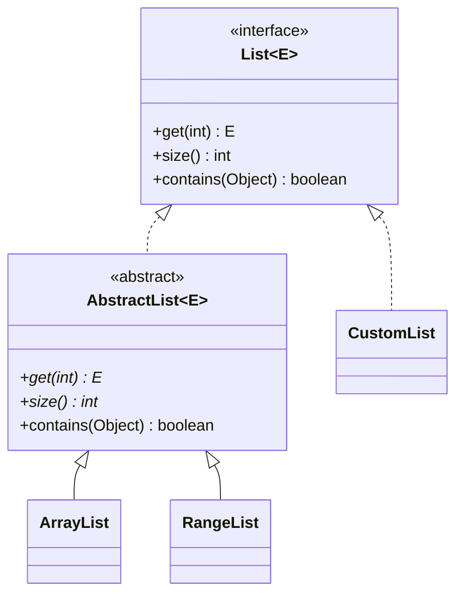

## Introduction

Suppose you are building an import feature that reads customer records from files. Today the files are CSV; next month a partner will send tab-separated files; later someone will want JSON lines. Every importer does the same things in the same order — skip blank lines, parse each line into fields, check the field count, save valid records, report a count — and differs in only two places: how a line is split into fields, and how many fields a valid record has.

You could write one complete class per format and copy the shared loop into each, but then a fix to the validation logic has to be made three times. You could write one class with a `format` field and `if` statements, but then every new format means editing that class. What you want is a class that contains the shared loop *and* says, in a way the compiler enforces, "every concrete importer must supply `parse` and `expectedFields`". And you want to stop anyone from creating an importer that has no format at all, because such an object would have nothing sensible to do when `parse` is called.

That is exactly what an **abstract class** is: a class marked `abstract` that **cannot be instantiated**, may contain **abstract methods** — methods declared without a body — and otherwise is an ordinary class with fields, constructors and fully written methods. Concrete subclasses extend it, inherit everything it implements, and are required to implement every abstract method. The abstract class is the partly built house; each subclass finishes the rooms that differ.

Abstract classes are everywhere in the Java Development Kit (JDK): `InputStream` and `OutputStream`, `Number`, `AbstractList` and `AbstractMap`, `HttpServlet`, and `java.util.TimerTask` are all abstract. Understanding them explains how those libraries are meant to be extended, and the question "abstract class or interface?" is one of the most common Java interview questions. This lesson answers it with concrete criteria in [[c1-abstract-vs-interface]].

## Before you start

You need:

- **Inheritance** — `extends`, overriding, constructor chaining with `super(...)`. See [[c1-inheritance]].
- **Polymorphism** — a superclass reference calling a subclass's override. See [[c1-polymorphism]].
- **Interfaces** — what a contract with `default` methods looks like. See [[c1-interfaces]].

## The intuition

Think of a tax form with some sections pre-filled by your employer and some left blank for you. The structure is fixed — which sections exist, in which order they are added up — and the shared figures are already there. You cannot submit the form as it is, because the blank sections make it incomplete. Once you fill every blank, it is a complete, valid form.

An abstract class is that form. The pre-filled sections are its concrete methods and fields. The blanks are its abstract methods. "You cannot submit it as is" is the rule that you cannot write `new` on an abstract class. A subclass that fills every blank is a **concrete class** and can be instantiated; a subclass that fills only some of them is still incomplete and must itself be declared `abstract`.

The analogy has one limit: an abstract class can also offer optional sections that are already filled in with sensible defaults, which a subclass may rewrite if it wants. These are ordinary overridable methods, often called **hooks**.

## Declaring an abstract class

You make a class abstract with the `abstract` modifier, and you make a method abstract by writing `abstract` and ending the declaration with a semicolon instead of a body:

```java
public abstract class Shape {
    private final String name;                 // abstract classes can hold state

    protected Shape(String name) {             // and have constructors
        this.name = name;
    }

    public abstract double area();             // no body: each subclass decides

    public String describe() {                 // a concrete method using the abstract one
        return name + " with area " + String.format("%.2f", area());
    }
}

public class Circle extends Shape {
    private final double radius;

    public Circle(double radius) {
        super("circle");
        this.radius = radius;
    }

    @Override
    public double area() { return Math.PI * radius * radius; }
}
```

`new Circle(1).describe()` returns `"circle with area 3.14"`. `describe()` is written once, in `Shape`, and calls `area()`, which at run time is `Circle`'s implementation — ordinary dynamic dispatch ([[c1-dynamic-binding]]).

Compare this with the inheritance lesson, where `Shape.area()` returned `0` as a placeholder. A placeholder body is a lie: it lets someone forget to override `area()` in a new subclass and silently get zero. An abstract method turns that mistake into a compile error.

### The rules, and the errors that enforce them

Each rule below has a reason, and javac reports a specific error when it is broken. The messages are from javac 26 compiling with `--release 21`.

**You cannot instantiate an abstract class.** `new Shape("x")` fails with "Shape is abstract; cannot be instantiated". An abstract class may have methods without bodies; if you could create one, calling such a method would have no code to run.

**A class with an abstract method must be declared abstract.** Writing `class Shape { abstract double area(); }` fails with "Shape is not abstract and does not override abstract method area() in Shape". The class would otherwise be instantiable while incomplete.

**A concrete subclass must implement every inherited abstract method.** If `Shape` declares `area()` and `name()` as abstract and `Square` implements only `area()`, javac reports "Square is not abstract and does not override abstract method name() in Shape". The fix is to implement `name()` or to declare `Square` abstract, deferring the obligation to *its* subclasses.

**Some modifiers cannot be combined with `abstract`.** Each combination is contradictory:

| Combination | javac message | Why it is contradictory |
|---|---|---|
| `private abstract` method | illegal combination of modifiers: abstract and private | A private method is invisible to subclasses, so no subclass could ever implement it |
| `static abstract` method | illegal combination of modifiers: abstract and static | Static methods are not overridden ([[c1-static-no-override]]), so there would be no way to supply the body |
| `final abstract` method | illegal combination of modifiers: abstract and final | `final` forbids the override that `abstract` requires |
| `abstract final` class | illegal combination of modifiers: abstract and final | An abstract class exists to be extended; a final class cannot be |

Some things that sound forbidden are allowed:

- **An abstract class with no abstract methods.** `abstract class Base { }` is legal. It is a way of saying "this class is only meaningful as a superclass", even though it has nothing left to implement.
- **Static methods, static fields and even `main`** in an abstract class. They belong to the class, not to an instance, so the class does not need to be instantiable.
- **Re-abstracting an inherited method.** An abstract class may override a concrete method with an abstract one, for example `public abstract String toString();`, forcing every concrete subclass to provide its own `toString`.
- **Implementing an interface without implementing its methods.** An abstract class that `implements Comparable<T>` may leave `compareTo` unimplemented; the obligation passes to concrete subclasses.
- **Abstract methods with any access except `private`**: `public`, `protected` or package-private. `protected abstract` is common for steps that subclasses supply but outside callers should not invoke directly.

### Constructors in a class you cannot instantiate

It surprises many people that an abstract class can, and usually should, have constructors. The constructor is not there so that someone can write `new Shape(...)`; it is there to initialise the abstract class's own fields when a subclass object is created. Every subclass constructor starts by calling a superclass constructor with `super(...)`, and that call runs the abstract class's constructor on the subclass object being built.

Declare these constructors `protected` (or package-private). A `public` constructor on an abstract class is harmless but misleading, because nobody outside the hierarchy can call it usefully.

The construction-order warning from [[c1-inheritance]] applies with extra force here. An abstract class's constructor runs before the subclass's fields are initialised, so if it calls one of its own abstract methods, the subclass implementation runs against a half-built object and sees `null` and `0` in the subclass's fields. Abstract classes are tempting places to do this — "call `validate()` in the constructor so every subclass is validated" — and it is a bug. Run such steps from a method called after construction, or from a static factory.

### Anonymous subclasses

You can create a one-off concrete subclass inline with an **anonymous class**. This does not instantiate the abstract class; it declares an unnamed subclass and instantiates that:

```java title="Reflect.java"
abstract class Shape {
    protected Shape() { }
    abstract double area();
}

sealed abstract class Account permits Checking, Savings {
    private final long cents;
    protected Account(long cents) { this.cents = cents; }
    long cents() { return cents; }
}
final class Checking extends Account { Checking(long c) { super(c); } }
final class Savings extends Account {
    final double rate;
    Savings(long c, double rate) { super(c); this.rate = rate; }
}

public class Reflect {
    static String label(Account a) {
        return switch (a) {
            case Checking c -> "checking " + c.cents();
            case Savings s -> "savings " + s.cents() + " at " + s.rate;
        };
    }

    public static void main(String[] args) throws Exception {
        Shape unit = new Shape() {                 // anonymous concrete subclass
            @Override double area() { return 1.0; }
        };
        System.out.println(unit.area() + " " + unit.getClass().getSuperclass().getSimpleName());

        try {
            Shape.class.getDeclaredConstructor().newInstance();
        } catch (InstantiationException e) {
            System.out.println("reflection: " + e.getClass().getSimpleName());
        }
        System.out.println(java.lang.reflect.Modifier.isAbstract(Shape.class.getModifiers()));
        System.out.println(label(new Checking(100)) + "; " + label(new Savings(200, 0.03)));
    }
}
```

```output
1.0 Shape
reflection: InstantiationException
true
checking 100; savings 200 at 0.03
```

The program shows four things. The anonymous class's superclass is `Shape`, confirming it is a subclass, not a `Shape` instance. Reflection cannot bypass the rule either: `Constructor.newInstance()` on an abstract class throws `InstantiationException`. The `abstract` modifier is recorded in the class file (as the `ACC_ABSTRACT` flag), which is what reflection and the JVM check. And the `Account` part, explained under "Sealed abstract classes" below, shows an abstract class whose subclasses are fixed.

Anonymous subclasses were common before Java 8. If the abstract type has exactly one abstract method and no state, an interface plus a lambda is usually cleaner — one of the reasons for the guidance in [[c1-abstract-vs-interface]].

## The template method pattern

The most important use of an abstract class is to fix the *structure* of an algorithm while letting subclasses supply some of its steps. The method that holds the structure is called the **template method**; it is usually `final` so that subclasses cannot reorder or skip steps. The steps come in two kinds: **abstract steps**, which every subclass must implement, and **hooks**, concrete methods with a default behaviour (often doing nothing) that subclasses may override.

Here is the importer from the introduction:

```java title="Importer.java"
import java.util.ArrayList;
import java.util.List;

abstract class RecordImporter {
    private final String source;                  // state shared by every importer
    private int imported;

    protected RecordImporter(String source) {     // only subclasses can call it
        this.source = source;
    }

    // The template method: the fixed algorithm. final, so no subclass can reorder it.
    public final int importAll(List<String> lines) {
        imported = 0;
        for (String line : lines) {
            if (line.isBlank() || skip(line)) continue;
            String[] fields = parse(line);
            if (fields.length != expectedFields()) {
                System.out.println("  [" + source + "] rejected: " + line);
                continue;
            }
            save(fields);
            imported++;
        }
        afterImport();
        return imported;
    }

    protected abstract String[] parse(String line);  // every format must define these
    protected abstract int expectedFields();

    protected boolean skip(String line) { return false; }   // hook: optional override
    protected void afterImport() {
        System.out.println("  [" + source + "] imported " + imported);
    }

    private void save(String[] fields) {             // private: not part of the contract
        System.out.println("  saved " + String.join(" | ", fields));
    }
}

class CsvImporter extends RecordImporter {
    CsvImporter() { super("csv"); }

    @Override protected String[] parse(String line) { return line.split(","); }
    @Override protected int expectedFields() { return 3; }
    @Override protected boolean skip(String line) { return line.startsWith("#"); }
}

class TsvImporter extends RecordImporter {
    TsvImporter() { super("tsv"); }

    @Override protected String[] parse(String line) { return line.split("\t"); }
    @Override protected int expectedFields() { return 2; }
}

public class Importer {
    public static void main(String[] args) {
        List<RecordImporter> importers = new ArrayList<>();
        importers.add(new CsvImporter());
        importers.add(new TsvImporter());

        System.out.println("CSV:");
        importers.get(0).importAll(List.of("# id,name,city", "1,Ana,Lisbon", "2,Bo", ""));
        System.out.println("TSV:");
        importers.get(1).importAll(List.of("7\tKiran", "8\tLea\textra"));
    }
}
```

```output
CSV:
  saved 1 | Ana | Lisbon
  [csv] rejected: 2,Bo
  [csv] imported 1
TSV:
  saved 7 | Kiran
  [tsv] rejected: 8	Lea	extra
  [tsv] imported 1
```

Each design decision in `RecordImporter` has a reason:

- **`importAll` is `public final`.** It is the one method callers use, and making it `final` guarantees that every importer validates field counts and reports a total. A subclass cannot "optimise" by skipping validation.
- **`parse` and `expectedFields` are `protected abstract`.** Every format must decide them, and the compiler will not let a new importer forget. They are `protected` because they are steps of the algorithm, not operations outside callers should invoke on their own.
- **`skip` and `afterImport` are hooks.** Most formats do not need comment lines, so `skip` defaults to `false`; `CsvImporter` overrides it to ignore lines starting with `#`. `TsvImporter` uses both defaults.
- **`save` is `private`.** It is an implementation detail; subclasses cannot see or override it, so `RecordImporter` can change how saving works later without breaking any subclass.
- **`source` and `imported` are private state in the abstract class.** This is something an interface cannot have. Each importer object carries its own counter, initialised by the abstract class's constructor.

Trace the CSV run. The `#` header line is skipped by the hook; `1,Ana,Lisbon` parses to three fields and is saved; `2,Bo` parses to two fields and is rejected; the blank line is skipped by the template itself. Then the default `afterImport` prints the count. Adding a JSON-lines importer next month means one new subclass with two methods, and the shared behaviour, including any later bug fixes, comes for free.

The pattern itself, including when to prefer the Strategy pattern instead, is covered in [[d2-template-method]].

> [!TIP] Abstract step or hook?
> Make a step abstract when there is no sensible default and forgetting it would be a bug (how to parse a line). Make it a hook when most subclasses are happy with a default (whether to skip a line). Too many abstract steps make subclasses tedious to write; too many hooks make the algorithm hard to understand.

## Skeletal implementations: AbstractList and friends

The JDK uses abstract classes for a second purpose: making interfaces easy to implement. The `List` interface has more than thirty methods. Writing all of them correctly for a new kind of list is a lot of work, and most of them — `contains`, `indexOf`, `iterator`, `equals`, `hashCode`, `toString`, `subList` — can be written in terms of a few basic ones. So the JDK provides `AbstractList`, a **skeletal implementation**: an abstract class that implements `List`, leaves only `get(int)` and `size()` abstract, and implements everything else on top of them.

```java title="RangeDemo.java"
import java.util.AbstractList;
import java.util.List;

// A read-only list of the integers start, start+step, ... without storing them.
class RangeList extends AbstractList<Integer> {
    private final int start, step, size;

    RangeList(int start, int step, int size) {
        this.start = start;
        this.step = step;
        this.size = size;
    }

    @Override
    public Integer get(int index) {
        if (index < 0 || index >= size) {
            throw new IndexOutOfBoundsException("Index: " + index + ", size: " + size);
        }
        return start + index * step;
    }

    @Override
    public int size() { return size; }
}

public class RangeDemo {
    public static void main(String[] args) {
        List<Integer> evens = new RangeList(0, 2, 6);
        System.out.println(evens);                     // toString from AbstractCollection
        System.out.println(evens.contains(8));         // contains via iterator()
        System.out.println(evens.indexOf(10));
        System.out.println(evens.subList(1, 4));
        System.out.println(evens.equals(List.of(0, 2, 4, 6, 8, 10)));
        int sum = 0;
        for (int n : evens) sum += n;                  // iterator() built on get/size
        System.out.println(sum);
        try {
            evens.add(12);                             // AbstractList.add throws by default
        } catch (UnsupportedOperationException e) {
            System.out.println("add: " + e.getClass().getSimpleName());
        }
    }
}
```

```output
[0, 2, 4, 6, 8, 10]
true
5
[2, 4, 6]
true
30
add: UnsupportedOperationException
```

Two methods, about fifteen lines, and `RangeList` is a full `List`: it prints, searches, compares equal to an ordinary list with the same elements, supports `for`-each loops and sub-lists, and stores no elements at all — each value is computed in `get`. The add operation throws `UnsupportedOperationException` because `AbstractList`'s documentation says a modifiable list must override `add(int, E)` (and `set`, `remove`) itself; the default makes an unmodifiable list correct with no extra work.

This is the pattern behind `AbstractCollection`, `AbstractSet`, `AbstractMap`, `AbstractQueue` and `AbstractSequentialList`. It is the clearest example of an interface and an abstract class working together: **callers depend on the interface** (`List<Integer> evens`), and **implementers extend the abstract class** to save work. Because the abstract class implements the interface, an implementer who cannot extend it — for example because their class already extends something else — can still implement `List` directly.

Skeletal implementations document which of their methods call which. `AbstractList`'s Javadoc states, for example, that its iterator is built on `get` and `size`. That documentation is essential: as [[c1-inheritance]] explains, a subclass that overrides one method of a class depends on how the class's other methods use it.

## How it works internally

To the JVM, an abstract class is an ordinary class with the `ACC_ABSTRACT` flag set in its class file, and an abstract method is a method entry with `ACC_ABSTRACT` set and no `Code` attribute (no bytecode). The `new` bytecode instruction checks the flag: if bytecode tried to instantiate an abstract class — which javac never produces, but a hand-written or mismatched class file could — the JVM throws `InstantiationError`. Reflection performs the same check and throws the checked `InstantiationException` you saw above.

Abstract methods occupy slots in the class's virtual method table like any other overridable method. In the abstract class's own table, the slot has no real implementation; in each concrete subclass's table it points to that subclass's code. A call such as `shape.area()` compiles to `invokevirtual Shape.area` and dispatches through the receiver's table exactly as for a concrete method, so abstract methods cost nothing extra at run time ([[c1-dynamic-binding]]).

The compiler's checks only cover classes compiled together. If you compile a subclass against version 1 of a library's abstract class, and version 2 adds a new abstract method, the old subclass's class file no longer implements everything. The JVM loads it anyway; the first call to the missing method throws `AbstractMethodError`. This is why library authors avoid adding abstract methods to published abstract classes, and add concrete methods with sensible defaults instead — the same problem that motivated `default` methods on interfaces.

## Sealed abstract classes

Since Java 17, an abstract class can be `sealed`, listing exactly which classes may extend it. In the `Reflect` program above, `Account` is `sealed abstract ... permits Checking, Savings`. The abstract class still holds shared state (`cents`) and a constructor, and the compiler knows that every `Account` is a `Checking` or a `Savings`, so the `switch` in `label` needs no `default` branch and will fail to compile if a third permitted subclass is added without a case.

This combination is useful for domain models where the variants are fixed and share state that records cannot express. Records cannot extend classes, so a sealed **interface** with record implementations is the lighter choice when no shared state or constructor logic is needed. See [[c1-sealed]] and [[c1-records]].

## Abstract Class vs Interface {#c1-abstract-vs-interface}

An **abstract class** and an **interface** both define a type that cannot be instantiated and that other classes complete, so both let callers program against a general type. The difference is what each can contain and how a class relates to it. An abstract class is a partial *implementation*: it can hold per-object state, constructors and code at any access level, and a class can extend only one. An interface is a *contract*: it declares what an implementing class can do, can supply helper code through `default`, `static` and `private` methods, holds no per-object state, and a class can implement any number of them.

### What each can contain (Java 21)

| | Abstract class | Interface |
|---|---|---|
| Instantiable with `new` | No | No |
| How many a class can have | One (`extends`) | Many (`implements A, B, C`) |
| Instance fields (per-object state) | Yes, any modifiers | No; fields are implicitly `public static final` constants |
| Constructors | Yes, run through `super(...)` | No |
| Abstract methods | Yes, any access except `private` | Yes, implicitly `public abstract` |
| Concrete instance methods | Yes, any access | `default` methods (always `public`) and `private` helpers (Java 9+) |
| Static methods | Yes, inherited by subclasses | Yes (Java 8+), **not** inherited by implementing classes |
| `protected` members | Yes | No |
| `final` methods | Yes | No; `default` methods can always be overridden |
| Can override `equals`/`hashCode`/`toString` | Yes | No; a `default` method may not override an `Object` method |
| Implemented by a lambda | No | Yes, if it is a functional interface (one abstract method) |
| Can be `sealed` (Java 17+) | Yes | Yes |

Before Java 8 the choice was simpler: interfaces could contain no code at all. Default methods (Java 8) and private interface methods (Java 9) narrowed the gap, so "interfaces have no implementation" is no longer a valid distinction. The differences that remain are structural, and each one has a practical consequence.

**State and constructors.** Only an abstract class can give each object fields and initialise them in a constructor. An interface's `default` methods can only call other methods; they cannot remember anything per object. In `RecordImporter`, the `imported` counter and the `source` name make an abstract class the natural choice.

**One superclass, many interfaces.** Extending an abstract class uses a class's single `extends` slot. A class that must also be a `Thread`, an `Exception` or a framework base class cannot extend yours. Interfaces never compete for that slot, which is why types that describe a *capability* — `Comparable`, `Closeable`, `Runnable`, `Serializable` — are interfaces: unrelated classes need to be able to have them all at once.

**Protected and final members.** An abstract class can keep template steps `protected` (visible to subclasses but not to callers) and the template method `final`. An interface's methods are all public, and a `default` method can always be overridden, so an interface cannot guarantee an algorithm's structure the way `importAll` does.

**`Object` methods.** An interface cannot provide a default `toString`, `equals` or `hashCode`; javac reports "default method toString in interface Named overrides a member of java.lang.Object". The reason is the rule that class methods always win over interface defaults: every class inherits these methods from `Object`, so such a default could never be chosen. An abstract class can implement them for all its subclasses.

**Lambdas.** A functional interface can be implemented with a lambda or method reference; an abstract class cannot, even if it has only one abstract method. For a single-behaviour type such as a comparator, a callback or a strategy, an interface is far more convenient for callers ([[c1-functional-interfaces]]).

**Evolution.** Adding a method to a published type is the hardest change in a library. Adding a concrete method to an abstract class is safe for existing subclasses, unless one happens to have a method with the same signature. Adding a `default` method to an interface is similarly mostly safe. Adding an *abstract* method to either breaks every existing implementation: source code stops compiling, and old compiled classes throw `AbstractMethodError` when the method is called.

### Choosing

A practical decision guide:

1. **Start with an interface for the type that callers depend on.** It is the most flexible: any class can implement it, tests can fake it, and lambdas can implement it if it has a single method.
2. **Add an abstract class when implementations genuinely share state or a fixed algorithm.** If several implementations would copy the same fields and constructor logic, or must follow the same sequence of steps, put that in an abstract class.
3. **Often, do both.** Declare the interface, then provide an abstract class that implements it as a skeletal implementation: `List` and `AbstractList`, `Map` and `AbstractMap`. Callers and fields use the interface type; implementers extend the abstract class when it helps, and implement the interface directly when they need their superclass slot for something else.
4. **Use an abstract class alone** when the type only makes sense as the root of one family, needs constructors that enforce invariants, or needs `protected`/`final` members to control subclasses — `InputStream` and `HttpServlet` are examples.

The relationship each creates is also a useful test, though not a rule: extending an abstract class says "is a kind of" (`FileInputStream` is a kind of `InputStream`); implementing an interface says "can do" (`String` can be compared, a `Socket` can be closed).



In the diagram, `ArrayList` and `RangeList` save work by extending `AbstractList`, while `CustomList` implements `List` directly. Code that holds a `List` works with all three.

> [!INTERVIEW] A strong comparison answer
> "Both define a type you can't instantiate. Use an interface for a contract or capability — a class can implement many, lambdas can implement functional ones, and callers stay decoupled. Use an abstract class when implementations share state or a fixed algorithm: it can have fields, constructors, protected steps and a final template method, but a class can extend only one. Since Java 8 interfaces can have default methods, but they still can't hold per-object state, have constructors, or override `equals`/`hashCode`/`toString`. In practice I often provide both, like `List` and `AbstractList`."

```quiz
Q: Several notification senders (email, SMS, push) must each track a retry count and a sender name set in a constructor, and must all follow the same send-log-retry sequence. Some sender classes already extend a framework base class. What design fits best?
- [ ] An interface with default methods that store the retry count
- [ ] An abstract class only, so every sender must extend it
- [x] A `NotificationSender` interface for callers plus an abstract class that implements it with the shared state and a final template method
- [ ] A concrete base class with empty methods that senders override
> Per-object state and constructors rule out putting the counter in an interface, and a final template method needs an abstract class. But senders that already extend a framework class cannot also extend the abstract class, so callers should depend on an interface that those senders can implement directly. The interface-plus-skeletal-class combination serves both; a concrete base class with empty bodies would let a sender forget a step silently.
```

## In real systems

**I/O streams.** `java.io.InputStream` is abstract with one abstract method, `read()`, which returns the next byte. Its concrete methods — `read(byte[])`, `readAllBytes()`, `transferTo(OutputStream)`, `skip` — are written on top of `read()`. A new stream type works after implementing one method; high-performance streams override the bulk methods too.

**Numbers.** `java.lang.Number` is abstract, with `intValue()`, `longValue()`, `floatValue()` and `doubleValue()` abstract. `Integer`, `Long`, `BigDecimal` and `AtomicInteger` extend it, which lets code accept "any number" and convert it.

**Web frameworks.** `HttpServlet` is abstract; its `service` method is a template that inspects the HTTP method and calls `doGet`, `doPost` and the others, whose defaults send an error response (405 Method Not Allowed for HTTP/1.1 requests). Your servlet overrides only the methods it supports. Spring offers similar abstract bases, such as `OncePerRequestFilter`, which guarantees a filter runs once per request and leaves `doFilterInternal` abstract.

**Testing and tooling.** Many libraries provide abstract test base classes that set up shared fixtures in their constructor or setup method and leave specific checks abstract, though modern JUnit 5 extensions often replace them with composition.

## Trade-offs and alternatives

| Option | Shares state | Fixes algorithm structure | Multiple per class | Lambda-friendly | Use when |
|---|---|---|---|---|---|
| Abstract class | Yes | Yes (`final` template) | No | No | A family shares fields, constructor logic or a fixed sequence |
| Interface with defaults | No | No (defaults overridable) | Yes | Yes, if functional | A capability or contract, possibly with convenience methods |
| Interface + skeletal abstract class | Yes, optional | Yes, optional | Interface: yes | Interface: yes | Public library types with many possible implementations |
| Composition with strategy objects | Yes, in the owner | Yes, in the owner | Yes | Yes | Steps should vary at run time or be combined freely ([[d2-strategy]]) |

The strength of an abstract class is that it can enforce structure and share state with very little code in each subclass. Its costs are the costs of inheritance: subclasses depend on the base class's implementation, the single superclass slot is spent, and a change to the base class can break subclasses (the fragile base class problem, see [[d1-composition-vs-inheritance]]). If the variable part is a single behaviour that might change at run time, passing in a strategy object is often simpler than subclassing.

## Common mistakes

> [!MISTAKE] Calling an abstract method from the abstract class's constructor
> The subclass's implementation runs before the subclass's fields are initialised and sees `null` and zero. Move the call out of the constructor — into the template method, an `init()` called by a factory, or the subclass's own constructor.

**Using a placeholder body instead of `abstract`.** A method that returns `0`, `null` or throws `UnsupportedOperationException` in the base class lets a new subclass forget it, and the bug appears at run time. If every subclass must provide it, make it abstract.

**Leaving the template method non-final.** A subclass can then override the whole algorithm and skip the steps you meant to guarantee. Make it `final`, and expose only the intended steps as `protected`.

**Exposing mutable `protected` fields.** Subclasses can then break the abstract class's invariants. Keep fields `private` and give subclasses `protected` accessor methods or constructor parameters.

**Choosing an abstract class when an interface would do.** If there is no shared state and no fixed algorithm, the abstract class only costs implementers their superclass slot and blocks lambdas.

**Believing "an abstract class must have an abstract method"** or "an abstract class cannot have a constructor". Both are false; see the rules above.

## Interview perspective

Interview questions on abstract classes mix rule recall with design judgement.

- **Can an abstract class have a constructor?** Yes; it runs when a subclass object is created, through `super(...)`, and initialises the abstract class's fields. Make it `protected`.
- **Can an abstract class be `final`? Can an abstract method be `private` or `static`?** No to all, with the reasons in the modifier table.
- **Can an abstract class have no abstract methods?** Yes; it just cannot be instantiated.
- **Can you instantiate an abstract class through an anonymous class?** You instantiate an anonymous *subclass*, not the abstract class.
- **What happens if a subclass does not implement every abstract method?** It must be declared abstract, or it does not compile.
- **Explain the template method pattern.** A `final` method in the abstract class fixes the algorithm and calls abstract steps and overridable hooks that subclasses supply.
- **Abstract class versus interface, especially after Java 8?** Use the comparison table: state, constructors, single versus multiple, `protected`/`final` members, `Object` methods, lambdas. Mention the interface-plus-skeletal-implementation combination.

A good follow-up answer to "what is `AbstractList` for?" explains skeletal implementations: implement `get` and `size` and inherit a complete, correct read-only `List`.

## Practice

1. **JSON lines importer.** Add a `JsonLinesImporter` to the importer example that treats each line as `{"id":..,"name":..}` (a simple split is fine), expects two fields, and overrides `afterImport` to also print the source name in upper case. Do not modify `RecordImporter`.
2. **Find the constructor bug.** Add a call to `expectedFields()` in `RecordImporter`'s constructor and a subclass whose `expectedFields()` returns a value from its own field. Explain the output, then fix it.
3. **A modifiable skeletal list.** Write a `FixedSizeList<E>` backed by an array that extends `AbstractList` and supports `set` but not `add` or `remove`. Check that `Collections.sort` works on it.
4. **InputStream from scratch.** Extend `InputStream` to produce the bytes of a `String` one at a time by implementing only `read()`. Then call `readAllBytes()` on it.
5. **Design choice.** For each of these, choose interface, abstract class, or both, and justify it: a `Discount` rule applied at checkout; a `Report` that always renders a header, body and footer; a `Cache<K, V>` with several eviction policies.

## Quick revision {#quick-revision}

- `abstract class`: cannot be instantiated; may have fields, constructors, concrete, static and abstract methods.
- Abstract method: no body, ends with `;`; cannot be `private`, `static` or `final`. A class with one must be abstract.
- Concrete subclass must implement every inherited abstract method; otherwise it must be abstract too.
- `abstract final` class is illegal. An abstract class may have zero abstract methods, a `main` method, and may re-abstract an inherited concrete method.
- Constructors are called through `super(...)` from subclasses; make them `protected`; never call abstract methods from them.
- Anonymous classes instantiate an unnamed subclass; reflection on an abstract class throws `InstantiationException`.
- Template method: `public final` algorithm + `protected abstract` steps + overridable hooks + `private` helpers.
- Skeletal implementation: `AbstractList` needs only `get` and `size`; pattern is interface for callers, abstract class for implementers.
- Internals: `ACC_ABSTRACT` flag, vtable dispatch as usual; old subclasses missing a newly added abstract method throw `AbstractMethodError`.
- Sealed abstract classes (Java 17+) fix the set of subclasses and enable exhaustive `switch`.
- Interface vs abstract class: interfaces have no per-object state, no constructors, no `protected`/`final` methods, cannot default `Object` methods, but allow multiple implementation and lambdas.

## Key takeaways {#key-takeaways}

- An abstract class is a partial implementation: it shares state and code across a family and declares the parts each member must supply.
- "Cannot be instantiated" does not mean "has no constructor"; its constructors initialise its own fields inside every subclass object.
- The template method pattern uses a `final` method to guarantee an algorithm's structure while subclasses fill in abstract steps and optional hooks.
- Skeletal implementations such as `AbstractList` show the best use of both tools together: callers depend on an interface, implementers extend an abstract class to save work.
- Since Java 8 the remaining differences from interfaces are structural: state, constructors, single inheritance, `protected` and `final` members, `Object` methods, and lambda support.
- Default to an interface for the type callers use, and add an abstract class when implementations genuinely share state or a fixed sequence of steps.
