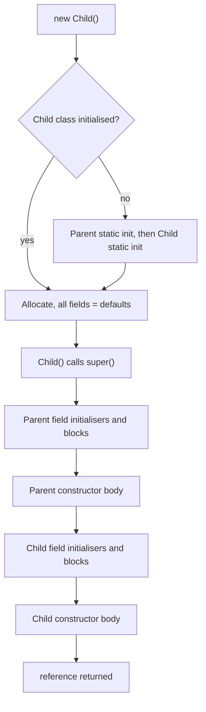

## Introduction

Every Java program you have written so far has lived inside a class — at least the one that holds `main`. So far, though, you have probably used classes only as containers for static methods. This lesson is about what classes are really for: describing **kinds of things** your program works with, such as books, bank accounts, HTTP requests or database connections, and then creating as many of those things as you need.

A **class** is that description. It says which data each object of that kind holds (its **fields**), how a new object is set up (its **constructors**), and what an object can do (its **methods**). An **interface** is a related but different tool: it describes *what* something can do without saying how, so that many unrelated classes can promise the same abilities and code can work with any of them.

These are the building blocks of everything that follows in Track C. The collections framework is a set of interfaces (`List`, `Map`) and classes (`ArrayList`, `HashMap`). A Spring application is a graph of classes wired together through interfaces. JPA maps classes to database tables. Understanding exactly how an object comes into existence, who can see each of its members, and how interfaces decouple code is what lets you read framework code without guessing and design your own types with confidence. The four nested topics — [[c1-constructors|constructors]], [[c1-this-keyword|the this keyword]], [[c1-access-modifiers|access modifiers]] and [[c1-interfaces|interfaces]] — each have their own section below.

## Before you start

You need:

- **Types and references** — primitives versus references, and that `new` gives you a reference to an object. See [[c1-types]] and [[c1-reference-types]].
- **Methods** — declaring methods, parameters, return values and overloading. See [[c1-methods]] and [[c1-method-overloading]].
- **The OOP big picture** — why we bundle state with behaviour. See [[c1-oop]].

Inheritance (`extends`) appears in a few examples to explain constructor chaining and `protected`. You only need the idea that a subclass is a specialised version of its superclass; the details are in [[c1-inheritance]].

## The intuition

Think of an architect's blueprint for a house. The blueprint says every house has a front door, three bedrooms and a kitchen, and where the wiring goes. It is not itself a house; you cannot live in it. A builder can use the same blueprint to build fifty houses on a street, and each house is separate: painting one house's door red does not change the others.

A class is the blueprint and objects are the houses. The blueprint is written once (in your source code); objects are created while the program runs, each with its own copy of the fields. The analogy breaks down in one useful way: houses built from a blueprint each get their own copy of everything, but objects share their methods. There is one copy of the code of each method, stored with the class, and when it runs it works on whichever object it was called on.

An interface is more like a building regulation: "every dwelling must have a smoke alarm and a fire exit". It does not design any house. It is a list of requirements, and any blueprint that meets them can be approved. An inspector who checks fire safety only needs the regulation, not each house's blueprint.

## Anatomy of a class

Here is a small class and a program that uses it:

```java title="Library.java"
class Book {
    // Fields: the state each Book object carries.
    String title;
    int pages;
    boolean checkedOut;

    // Method: behaviour that works on this object's fields.
    String summary() {
        return title + " (" + pages + " pages)" + (checkedOut ? " - out" : "");
    }
}

public class Library {
    public static void main(String[] args) {
        Book a = new Book();
        System.out.println(a.title + " " + a.pages + " " + a.checkedOut);  // defaults

        a.title = "Dune";
        a.pages = 412;

        Book b = new Book();
        b.title = "Emma";
        b.pages = 320;

        Book c = a;                          // copies the reference, not the object
        c.checkedOut = true;

        System.out.println(a.summary());
        System.out.println(b.summary());
        System.out.println(a == c);          // same object
        System.out.println(a == b);          // different objects
    }
}
```

```output
null 0 false
Dune (412 pages) - out
Emma (320 pages)
true
false
```

The class `Book` declares three **fields** — variables that belong to each object — and one **method**. `new Book()` creates an object and gives back a reference to it. Before any code sets them, fields hold **default values**: `0` for numbers, `false` for `boolean`, `'\u0000'` for `char`, and `null` for references. That is why the first line prints `null 0 false`. Local variables have no defaults and must be assigned before use, but fields always start at their default.

`a` and `b` refer to two separate objects, each with its own `title`, `pages` and `checkedOut`. The line `Book c = a` does **not** create a third book. It copies the reference, so `c` and `a` now point at the same object, and setting `c.checkedOut` is visible through `a`. The `==` operator on references compares identity: `a == c` is `true` because both refer to the same object.

Inside `summary()`, the names `title`, `pages` and `checkedOut` refer to the fields of the object the method was called on. `a.summary()` reads Dune's fields; `b.summary()` reads Emma's. That object is available explicitly as `this`, covered in [[c1-this-keyword]].

This version of `Book` leaves its fields open to any code in the package, so anyone can set `pages` to `-5`. Real classes make fields private and set them through constructors and methods that check the values; the sections on [[c1-constructors]] and [[c1-access-modifiers]] show how, and [[c1-encapsulation]] explains why.

A few structural rules about source files: a `.java` file may contain several top-level classes, but **at most one can be `public`**, and if there is one, the file must be named after it (`Library.java` for `public class Library`). Class names use `UpperCamelCase` by convention; fields and methods use `lowerCamelCase`. A class body can contain fields, methods, constructors, initializer blocks, and nested types (classes, interfaces, enums and records declared inside it), in any order — although the conventional order is fields, constructors, then methods.

## Instance members and static members

Every field and method in a class is either an **instance member** or a **static member**. An instance member belongs to each object: every object has its own copy of an instance field, and an instance method runs on a particular object. A **static** member belongs to the class itself: there is exactly one copy of a static field, shared by all objects (and existing even if no object has been created), and a static method runs without any object.

```java title="Tickets.java"
class Ticket {
    private static int nextNumber = 1;       // one copy, shared by the whole class
    private final int number;                // one copy per object
    private final String event;

    Ticket(String event) {
        this.event = event;
        this.number = nextNumber++;          // read and bump the shared counter
    }

    static int issuedSoFar() {               // no object needed
        return nextNumber - 1;
        // return number;  // would not compile: which ticket's number?
    }

    String label() { return event + " #" + number; }
}

public class Tickets {
    public static void main(String[] args) {
        System.out.println("issued: " + Ticket.issuedSoFar());
        Ticket t1 = new Ticket("Concert");
        Ticket t2 = new Ticket("Concert");
        Ticket t3 = new Ticket("Match");
        System.out.println(t1.label() + ", " + t2.label() + ", " + t3.label());
        System.out.println("issued: " + Ticket.issuedSoFar());
    }
}
```

```output
issued: 0
Concert #1, Concert #2, Match #3
issued: 3
```

Each ticket has its own `number`, but all of them share one `nextNumber`, which is why the numbers increase across objects. `issuedSoFar()` is static, so it is called on the class name, `Ticket.issuedSoFar()`, and it can be called before any ticket exists. Inside a static method there is no current object, so it cannot read instance fields such as `number` directly — the compiler would have no way to know which ticket you meant.

Use static members for things that genuinely belong to the class as a whole: constants (`static final double PI`), factory methods (`List.of(...)`), counters and caches shared across instances, and stateless utility methods (`Math.max`). Be careful with mutable static state such as `nextNumber`: it is effectively global, it is shared by all threads (this counter is not thread-safe), and it makes tests depend on each other because it persists between them. Also note that static methods are not overridden by subclasses, only hidden; see [[c1-static-no-override]].

## What happens when you write new

`new Ticket("Concert")` looks like one step but runs several, in a precise order. Knowing that order explains several bugs that otherwise seem impossible.

1. **Load and initialise the class, if this is its first use.** The JVM loads the class file, verifies it, and runs its **static initialisation**: static field initialisers and `static { ... }` blocks, top to bottom. This happens once per class, lazily, the first time the class is actively used (creating an instance, calling a static method, or reading a non-constant static field). A superclass is always initialised before its subclass.
2. **Allocate memory** on the heap for the object, enough for all its instance fields including inherited ones, and set every field to its default value (`0`, `false`, `null`).
3. **Run the constructor.** Its first action is to call a superclass constructor (explicitly with `super(...)`, or implicitly), which recursively sets up the parent part of the object, all the way up to `Object`.
4. **Run this class's instance field initialisers and instance initializer blocks** (`{ ... }` without `static`), in the order they appear in the source.
5. **Run the rest of the constructor body.**
6. **Return the reference** to the fully constructed object.

The program below prints a line at each stage, for a subclass whose parent also has static and instance initialisation:

```java title="InitOrder.java"
class Parent {
    static { System.out.println("1. Parent static block"); }
    private String p = log("3. Parent field initializer");
    { log("4. Parent instance block"); }

    Parent() { log("5. Parent constructor body"); }

    static String log(String s) { System.out.println(s); return s; }
}

class Child extends Parent {
    static { System.out.println("2. Child static block"); }
    private String c = log("6. Child field initializer");

    Child() {
        super();                                 // runs everything in Parent first
        log("7. Child constructor body");
    }
}

public class InitOrder {
    public static void main(String[] args) {
        System.out.println("-- first object --");
        new Child();
        System.out.println("-- second object --");
        new Child();
    }
}
```

```output
-- first object --
1. Parent static block
2. Child static block
3. Parent field initializer
4. Parent instance block
5. Parent constructor body
6. Child field initializer
7. Child constructor body
-- second object --
3. Parent field initializer
4. Parent instance block
5. Parent constructor body
6. Child field initializer
7. Child constructor body
```

Read the output against the steps. Static blocks run once, parent first, and do not run again for the second object. For each object, the parent part is fully built (fields, then constructor body) before any of the child's field initialisers run. The child's field initialiser `c = log(...)` appears *inside* the child's constructor in effect: the compiler copies field initialisers and instance blocks into each constructor, right after the `super(...)` call. In bytecode, the static part becomes a special method called `<clinit>` and each constructor becomes a method called `<init>` ([[c2-clinit]]).



## Kinds of classes

A class declaration can carry modifiers that change what can be done with it. The most important ones:

| Declaration | Meaning | Typical use |
|---|---|---|
| `class A` | Ordinary concrete class: can be instantiated and extended | Most classes |
| `final class A` | Cannot be extended | Immutable value types (`String`), utility classes |
| `abstract class A` | Cannot be instantiated; may declare `abstract` methods with no body | Partial implementations shared by subclasses ([[c1-abstract-classes]]) |
| `sealed class A permits B, C` | Only the listed classes may extend it (Java 17+) | Closed sets of variants for exhaustive `switch` ([[c1-sealed]]) |
| `record P(int x, int y)` | Immutable data carrier with generated constructor, accessors, `equals`, `hashCode`, `toString` (Java 16+) | DTOs, value objects ([[c1-records]]) |
| `enum Color { RED, GREEN }` | Fixed set of named instances | Constants with behaviour ([[c1-enums]]) |

Classes can also be declared inside other classes. A **static nested class** is an ordinary class that happens to live inside another for organisation ([[c1-static-nested]]). An **inner class** (a non-static nested class) is tied to an instance of the outer class and holds a hidden reference to it, which is convenient but can keep a large outer object alive longer than expected ([[c1-inner-classes]]). **Local** classes are declared inside a method, and **anonymous** classes are declared and instantiated in one expression ([[c1-anonymous-classes]]). When in doubt, make nested classes `static`.

## Constructors {#c1-constructors}

A **constructor** is a special block of code that runs exactly once for each new object, as part of `new`, to put the object into a valid starting state. It looks like a method but has two distinguishing features: its name is exactly the class name, and it has **no return type**, not even `void`. You cannot call a constructor on an existing object; it runs only during object creation (or when another constructor delegates to it).

The constructor's job is to make sure that no object ever exists in an invalid state. If a `Room` must have a name and a capacity of at least one, the constructor is where that is enforced: an object that fails the check is never handed to anyone, because the constructor throws and `new` never returns.

### The default constructor

If a class declares **no constructors at all**, the compiler adds one: a **default constructor** with no parameters, whose body only calls `super()`. It has the same access level as the class (so a `public` class gets a `public` default constructor). That is why `new Book()` worked above although `Book` declared no constructor.

The moment you write any constructor, the compiler stops adding the default one. If a class declares only `Room(String name, int capacity)`, then `new Room()` does not compile. That is usually what you want — it forces callers to supply the required values — but it surprises people when a framework such as JPA or Jackson needs a no-argument constructor and you have just removed the implicit one by adding another.

### Overloading and chaining with this(...)

A class can have several constructors with different parameter lists, exactly like overloaded methods. To avoid repeating the validation in each, one constructor should do the real work and the others should delegate to it by calling `this(...)`:

```java title="Rooms.java"
class Room {
    private final String name;
    private final int capacity;
    private final boolean hasProjector;

    // The one constructor that does the real work and validation.
    Room(String name, int capacity, boolean hasProjector) {
        if (name == null || name.isBlank()) throw new IllegalArgumentException("name");
        if (capacity < 1) throw new IllegalArgumentException("capacity must be >= 1");
        this.name = name;
        this.capacity = capacity;
        this.hasProjector = hasProjector;
    }

    // Convenience overloads delegate with this(...), so the checks live in one place.
    Room(String name, int capacity) { this(name, capacity, false); }
    Room(String name) { this(name, 4); }

    // Copy constructor: a new object with the same state.
    Room(Room other) { this(other.name, other.capacity, other.hasProjector); }

    @Override
    public String toString() {
        return name + "[" + capacity + (hasProjector ? ", projector" : "") + "]";
    }
}

public class Rooms {
    public static void main(String[] args) {
        System.out.println(new Room("Atlas", 12, true));
        System.out.println(new Room("Birch", 6));
        System.out.println(new Room("Cedar"));
        Room original = new Room("Delta", 8, true);
        Room copy = new Room(original);
        System.out.println(copy + " same object? " + (copy == original));
        try {
            new Room("Echo", 0);
        } catch (IllegalArgumentException e) {
            System.out.println("rejected: " + e.getMessage());
        }
    }
}
```

```output
Atlas[12, projector]
Birch[6]
Cedar[4]
Delta[8, projector] same object? false
rejected: capacity must be >= 1
```

`new Room("Cedar")` calls the one-argument constructor, which calls the two-argument one with a default capacity of 4, which calls the full constructor with `hasProjector = false`. All validation happens in one place, so a later rule change — say, a maximum capacity — needs editing only once. The fields are `final`, which means each must be assigned exactly once in every constructor path; the compiler checks this, and the delegating style satisfies it naturally.

The last constructor is a **copy constructor**: it takes another object of the same class and builds an independent copy. It is a clearer and safer alternative to `clone()`. Note that it reads `other.name`, a private field of another object; that is allowed because `private` is checked per class, not per object (see [[c1-access-modifiers]]).

A call to `this(...)` must be the first statement of a constructor (until Java 25, discussed below), and a constructor cannot both call `this(...)` and `super(...)`. When a constructor starts with `this(...)`, field initialisers do not run in it; they run in the constructor at the end of the chain that calls `super(...)`, so they still run exactly once.

### Calling the superclass constructor

Every constructor begins by running a superclass constructor, so that the parent's part of the object is set up first. You can call one explicitly with `super(arguments)`. If you write neither `super(...)` nor `this(...)`, the compiler inserts `super()` — a call to the parent's no-argument constructor. If the parent has no such constructor, the code does not compile:

```java title="Vehicle.java"
class Vehicle {
    private final String plate;
    Vehicle(String plate) { this.plate = plate; }
}

class Bike extends Vehicle {
    Bike() {
        // no explicit super(...): the compiler inserts super(), which does not exist
    }
}
```

```output
Vehicle.java:7: error: constructor Vehicle in class Vehicle cannot be applied to given types;
    Bike() {
           ^
  required: String
  found:    no arguments
  reason: actual and formal argument lists differ in length
1 error
```

The fix is to call the constructor that exists, for example `Bike(String plate) { super(plate); }`. The same error appears if `Bike` declares no constructor at all, because its default constructor also calls `super()`. Constructors are **not inherited**: `Bike` does not get a `Bike(String)` constructor just because `Vehicle` has one.

### Validation before super: flexible constructor bodies

Until Java 24, `super(...)` or `this(...)` had to be the very first statement, so you could not validate arguments before passing them up; the workaround was a static helper method called inside the argument list. **Java 25** finalised *flexible constructor bodies* (JEP 513, after previews in Java 22 to 24): statements may now appear before the explicit constructor call, as long as they do not use the object under construction — no reading its fields or calling its instance methods.

```java title="Flexible.java"
class Account {
    private final long balance;
    Account(long balance) { this.balance = balance; }
    long balance() { return balance; }
}

class PremiumAccount extends Account {
    PremiumAccount(long balance) {
        if (balance < 10_000) {                    // statement before super(...)
            throw new IllegalArgumentException("premium needs >= 10000");
        }
        super(balance);
    }
}

public class Flexible {
    public static void main(String[] args) {
        System.out.println(new PremiumAccount(25_000).balance());
        try { new PremiumAccount(5); } catch (IllegalArgumentException e) {
            System.out.println(e.getMessage());
        }
    }
}
```

```output
25000
premium needs >= 10000
```

Compiled with `--release 21`, this fails with "flexible constructors is not supported in -source 21"; it needs Java 25 or later. In Java 21 code, put the check in a static method and call `super(requirePremium(balance))`.

### Private constructors and static factories

A constructor can be `private`. Then only code inside the class can call it, which gives the class full control over how instances are created. Two common uses:

```java title="Utilities.java"
import java.util.HashMap;
import java.util.Map;

final class TextUtils {
    private TextUtils() {                       // no one can instantiate a utility class
        throw new AssertionError("no instances");
    }
    static boolean isBlank(String s) { return s == null || s.isBlank(); }
}

final class Color {
    private static final Map<String, Color> CACHE = new HashMap<>();
    private final int r, g, b;

    private Color(int r, int g, int b) { this.r = r; this.g = g; this.b = b; }

    // Static factories: named, can validate, can return cached instances.
    static Color rgb(int r, int g, int b) {
        for (int v : new int[] {r, g, b}) {
            if (v < 0 || v > 255) throw new IllegalArgumentException("0..255: " + v);
        }
        return CACHE.computeIfAbsent(r + "," + g + "," + b, k -> new Color(r, g, b));
    }

    static Color hex(String hex) {
        int v = Integer.parseInt(hex.substring(1), 16);
        return rgb(v >> 16 & 0xFF, v >> 8 & 0xFF, v & 0xFF);
    }

    @Override
    public String toString() { return "Color(" + r + "," + g + "," + b + ")"; }
}

public class Utilities {
    public static void main(String[] args) {
        System.out.println(TextUtils.isBlank("  "));
        Color a = Color.rgb(255, 128, 0);
        Color b = Color.hex("#FF8000");
        System.out.println(a + " " + b + " same instance? " + (a == b));
    }
}
```

```output
true
Color(255,128,0) Color(255,128,0) same instance? true
```

`TextUtils` is a **utility class**: only static methods, so creating an instance would be meaningless. The private constructor prevents it (and the `AssertionError` guards against the class itself calling it by mistake). `Color` uses **static factory methods** instead of public constructors. Factories have names that say what they do (`rgb`, `hex`), can have the same parameter types without clashing (two constructors taking one `String` each could not coexist), and can return an existing instance rather than a new one — here both calls return the same cached object. The JDK uses this pattern widely: `List.of`, `Integer.valueOf`, `LocalDate.of`, `Optional.empty`. This cache is not thread-safe; a real one would use a `ConcurrentHashMap`.

### Constructor pitfalls

**Calling overridable methods from a constructor.** When a parent constructor calls a method that a subclass overrides, the subclass's version runs *before the subclass's fields have been initialised* (step 4 for the child has not happened yet):

```java title="CtorTrap.java"
class Widget {
    Widget() {
        render();                         // calls the subclass override, too early
    }
    void render() { System.out.println("Widget"); }
}

class Label extends Widget {
    private String text = "Hello";
    private int width = 40;

    @Override
    void render() {
        System.out.println("Label text=" + text + ", width=" + width);
    }
}

public class CtorTrap {
    public static void main(String[] args) {
        Label l = new Label();
        l.render();
    }
}
```

```output
Label text=null, width=0
Label text=Hello, width=40
```

During construction, `Label.render()` saw the default values `null` and `0`. With a method call on `text` instead of string concatenation, this would be a `NullPointerException` thrown from a constructor. The rule: constructors should call only `private`, `static` or `final` methods, or the class should be `final`.

**A "constructor" with a return type is a method.** `public void Gadget(String name) { ... }` inside class `Gadget` compiles, but it is an ordinary method that happens to share the class name. `new Gadget("x")` will not compile, and `new Gadget()` uses the default constructor, leaving `name` as `null`. The compiler does not warn about this.

**Letting `this` escape.** If a constructor registers `this` with a listener list or starts a thread that uses it, other code can see the object before construction finishes, with fields still at their defaults, and with no visibility guarantees for other threads ([[c3-safe-publication]]). Register from a factory method after construction instead.

**Doing heavy work.** Constructors that open network connections or read files make objects hard to create in tests and give poor error handling. Keep constructors to validation and assignment; do I/O in methods or factories.

> [!INTERVIEW] "Can a constructor be private? Can it be final, static or abstract?"
> "Private, yes — for utility classes, singletons and static factories. Final, static and abstract, no: those modifiers make no sense for constructors because constructors are not inherited, not called without an object being created, and must have a body. Only access modifiers are allowed."

## this Keyword {#c1-this-keyword}

Inside an instance method or constructor, the keyword **`this`** is a reference to the current object — the object the method was called on, or the object being constructed. When you call `p.rename("Ana")`, then for the duration of that call `this` refers to the same object as `p`. Every instance method receives this reference implicitly; at the bytecode level it is passed as a hidden first parameter.

Most of the time you do not need to write `this`, because a bare field name already refers to the current object's field. You need it in five situations: when a parameter or local variable has the same name as a field, to call another constructor, to pass the current object to other code, to return the current object, and to reach an enclosing object from an inner class.

### Distinguishing fields from parameters

```java title="ThisBasics.java"
class Player {
    private String name;
    private int score;

    Player(String name) {
        name = name;                 // BUG: assigns the parameter to itself
    }

    void rename(String name) {
        this.name = name;            // this.name is the field, name is the parameter
    }

    Player addPoints(int points) {
        score += points;             // no clash, so "this." is optional here
        return this;                 // hand back the same object for chaining
    }

    boolean beats(Player other) {
        return this.score > other.score;   // this vs another object of the same class
    }

    String show() { return name + ":" + score; }
}

public class ThisBasics {
    public static void main(String[] args) {
        Player p = new Player("Ana");
        System.out.println(p.show());          // name was never set
        p.rename("Ana");
        p.addPoints(10).addPoints(5).addPoints(2);
        Player q = new Player("x").addPoints(12);
        System.out.println(p.show() + " beats q? " + p.beats(q));
    }
}
```

```output
null:0
Ana:17 beats q? true
```

When a parameter is named `name`, it **shadows** the field `name`: inside that method, the bare word `name` means the parameter. So `name = name;` in the constructor assigns the parameter to itself and leaves the field `null`, as the first output line shows. The compiler accepts it without complaint (many IDEs and linters flag it). `this.name = name;` in `rename` says explicitly "the field of this object gets the parameter's value". Naming constructor parameters after fields and writing `this.x = x` is the standard Java style.

### Returning and passing this

`addPoints` ends with `return this;`, so the caller gets back the same object and can call another method on it immediately: `p.addPoints(10).addPoints(5)`. This is called a **fluent interface** or method chaining, and it is how builders work (`new StringBuilder().append("a").append("b")`, `HttpRequest.newBuilder().uri(...).GET().build()`).

Passing `this` as an argument hands the current object to someone else, typically to register it:

```java title="ThisPassing.java"
import java.util.ArrayList;
import java.util.List;

class EventBus {
    private final List<Listener> listeners = new ArrayList<>();
    void register(Listener l) { listeners.add(l); }
    void publish(String event) { for (Listener l : listeners) l.onEvent(event); }
}

class Listener {
    private final String name;
    private int received = 0;

    Listener(String name) { this.name = name; }

    void subscribeTo(EventBus bus) {
        bus.register(this);               // pass the current object to someone else
    }

    void onEvent(String event) {
        received++;
        System.out.println(name + " got " + event + " (" + received + ")");
    }
}

public class ThisPassing {
    public static void main(String[] args) {
        EventBus bus = new EventBus();
        new Listener("audit").subscribeTo(bus);
        new Listener("email").subscribeTo(bus);
        bus.publish("order-created");
    }
}
```

```output
audit got order-created (1)
email got order-created (1)
```

Registration happens in a normal method, `subscribeTo`, after the listener is fully constructed. Doing `bus.register(this)` inside the constructor would let the bus see a half-built object, as described in the constructor pitfalls above.

### Calling another constructor with this(...)

Inside a constructor, `this(arguments)` (with parentheses) calls another constructor of the same class. It is a different use of the same keyword: not a reference to the object, but constructor delegation. The `Room` example in [[c1-constructors]] shows it. It must be the first statement in Java 21 (Java 25 allows statements before it that do not use the object), and a constructor cannot call both `this(...)` and `super(...)`.

### this in inner classes and lambdas

Inside an inner class, `this` refers to the inner object. To reach the enclosing object, write `OuterClassName.this`. Lambdas and anonymous classes differ here, which matters when you convert one into the other:

```java title="ThisScopes.java"
public class ThisScopes {
    private final String name = "outer";

    class Inner {
        private final String name = "inner";
        void show() {
            System.out.println(name);                  // nearest: Inner's field
            System.out.println(this.name);             // this = the Inner object
            System.out.println(ThisScopes.this.name);  // the enclosing ThisScopes object
        }
    }

    void compare() {
        Runnable anon = new Runnable() {
            public void run() {
                System.out.println("anonymous: " + this.getClass().getName());
            }
        };
        Runnable lambda = () ->
            System.out.println("lambda:    " + this.getClass().getName());
        anon.run();
        lambda.run();
    }

    public static void main(String[] args) {
        ThisScopes outer = new ThisScopes();
        outer.new Inner().show();
        outer.compare();
        // System.out.println(this.name);  // does not compile: no 'this' in a static method
    }
}
```

```output
inner
inner
outer
anonymous: ThisScopes$1
lambda:    ThisScopes
```

An anonymous class is a real class (the compiler names it `ThisScopes$1`), so inside it `this` is the anonymous object. A lambda does not create a new scope for `this`: inside a lambda, `this` means exactly what it means in the surrounding method — here the `ThisScopes` object. See [[c1-lambdas]].

### Where this does not exist

`this` is not available in static methods or static initializer blocks, because there is no current object; for the same reason a static nested class has no `Outer.this`. Writing `this` in `main` is a compile error ("non-static variable this cannot be referenced from a static context"). You also cannot assign to `this`; it is not a variable.

## Access Modifiers {#c1-access-modifiers}

An **access modifier** is a keyword on a class, field, method or constructor that controls which other code is allowed to use it. Java has four access levels. They let a class publish a small, deliberate set of members for others to use while keeping everything else private, which is the mechanism behind encapsulation ([[c1-encapsulation]]). Access is checked by the compiler, and checked again by the JVM when classes are linked.

### The four levels

From most to least restrictive:

| Modifier | Same class | Same package | Subclass in another package | Any other code |
|---|---|---|---|---|
| `private` | yes | no | no | no |
| *(none)* — package-private | yes | yes | no | no |
| `protected` | yes | yes | yes, with a restriction | no |
| `public` | yes | yes | yes | yes |

**Package-private** is what you get by writing no modifier at all; there is no keyword for it. It is a useful level in its own right: helper classes and methods that collaborate within a package but are not meant for outside users. The following classes demonstrate each level across two packages:

```java title="com/shop/core/Product.java"
package com.shop.core;

public class Product {
    private final String sku;          // only Product's own code
    String warehouseCode = "W1";       // package-private: com.shop.core only
    protected int stock;               // package + subclasses (with a restriction)
    public final String name;          // everyone

    public Product(String sku, String name, int stock) {
        this.sku = sku;
        this.name = name;
        this.stock = stock;
    }

    // private is per class, not per object: we can read another Product's sku.
    public boolean sameSku(Product other) { return this.sku.equals(other.sku); }
}
```

```java title="com/shop/core/Inventory.java"
package com.shop.core;

public class Inventory {
    public static String audit(Product p) {
        // Same package: package-private and protected members are visible.
        return p.name + " @" + p.warehouseCode + " stock=" + p.stock;
        // p.sku would not compile: private to Product
    }
}
```

```java title="Main.java"
import com.shop.core.Inventory;
import com.shop.core.Product;

public class Main {
    public static void main(String[] args) {
        Product a = new Product("SKU-1", "Lamp", 5);
        Product b = new Product("SKU-1", "Lamp (blue)", 2);
        System.out.println(Inventory.audit(a));
        System.out.println(a.sameSku(b));
        System.out.println(a.name);
        // a.warehouseCode, a.stock, a.sku: none compile from the default package
    }
}
```

```output
Lamp @W1 stock=5
true
Lamp
```

`Inventory` is in the same package as `Product`, so it can read the package-private `warehouseCode` and the `protected` `stock` (protected includes package access), but not the private `sku`. `Main` is in a different package and is not a subclass, so it sees only `public` members.

### private is per class, not per object

`sameSku` reads `other.sku`, a private field of a *different* `Product` object. This is allowed: access is checked by asking "is this code inside class `Product`?", not "is this the same object?". That is what makes `equals`, `compareTo` and copy constructors possible without public getters. Since Java 11, nested classes and their enclosing class are **nestmates** and can access each other's private members directly.

### protected and its restriction

`protected` gives access to the same package and to subclasses in other packages. The subclass part has a restriction that surprises people: code in a subclass in another package may access a protected member only **through a reference of its own type (or a subtype of it)**, not through a reference to the parent type.

```java title="com/shop/ext/DigitalProduct.java"
package com.shop.ext;

import com.shop.core.Product;

public class DigitalProduct extends Product {
    public DigitalProduct(String sku, String name) { super(sku, name, Integer.MAX_VALUE); }

    public int myStock() {
        return stock;                          // OK: inherited protected member, via this
    }

    public int otherStock(DigitalProduct d) {
        return d.stock;                        // OK: reference of our own type
    }

    public int anyStock(Product p) {
        return p.stock;                        // ERROR: a plain Product is not "ours"
    }
}
```

```output
com/shop/ext/DigitalProduct.java:17: error: stock has protected access in Product
        return p.stock;                        // ERROR: a plain Product is not "ours"
                ^
1 error
```

The reasoning: `protected` lets a subclass work with its *own* inherited state. Without the restriction, any class could read the protected internals of every `Product` in the system just by declaring `extends Product`. The parameter `p` might be some other subclass's object, whose protected state is none of `DigitalProduct`'s business.

### Top-level classes, overriding and interfaces

A **top-level** class (not nested in another) can only be `public` or package-private. `private` and `protected` apply to members, including nested classes. A useful pattern is a public interface with package-private implementation classes: users see only the interface and a public factory.

When overriding a method, you **cannot reduce its visibility**: an override of a `public` method must be `public`, and an override of a `protected` method must be `protected` or `public`. Otherwise code holding a parent-type reference could call a method the actual object has hidden. Interface methods are implicitly `public`, which is why `Circle.area()` in the OOP lesson had to be declared `public`.

### Choosing a level

The rule is: **give every member the narrowest access that works.** Start with `private`. Widen to package-private when another class in the package genuinely needs it, to `protected` only for deliberate extension points in a class designed for subclassing, and to `public` only for the API you are willing to support and keep stable. Every widening is a promise: anything `public` can be used by code you will never see, so changing it later breaks that code. Fields should almost always stay `private`; constants (`public static final`) are the common exception.

Above class-level access sits the module system: a public class in a package that its module does not export is still invisible to other modules ([[c1-modules]]).

```quiz
Q: Class `Child` in package `b` extends `Parent` in package `a`, which has `protected int x`. Which line inside `Child` does not compile?
- [ ] `int v = x;`
- [ ] `int v = this.x;`
- [ ] `int v = otherChild.x;` where `otherChild` is a `Child`
- [x] `int v = someParent.x;` where `someParent` is declared as `Parent`
> Outside the package, protected access from a subclass is allowed only through references whose type is the subclass or its subtypes. x and this.x are the inherited member of the current object; otherChild is a Child. A Parent reference might point to an unrelated subclass, so access is refused.
```

## Interfaces {#c1-interfaces}

An **interface** is a named contract: a list of method signatures that a class promises to provide. It says *what* an object can do — `Comparable` objects can be compared, `Runnable` objects can be run, a `List` supports `get`, `add` and `size` — without saying how. A class signs the contract with `implements`, and the compiler checks that it provides every required method.

Interfaces exist because code is easier to change when it depends on abilities rather than on concrete classes. A method that accepts a `List<String>` works with `ArrayList`, `LinkedList` or an immutable list from `List.of`; a method that accepts an `ArrayList<String>` works with only one. Interfaces also give Java multiple inheritance of *type*: a class can extend only one class, but it can implement any number of interfaces, so `String` can be `Comparable`, `CharSequence` and `Serializable` at once.

### Declaring and implementing an interface

```java title="Storage.java"
import java.util.HashMap;
import java.util.Map;
import java.util.Optional;

interface KeyValueStore {
    int MAX_KEY_LENGTH = 64;                       // implicitly public static final

    Optional<String> get(String key);              // implicitly public abstract
    void put(String key, String value);

    // Default method (Java 8+): implementors inherit it, and may override it.
    default String getOrDefault(String key, String fallback) {
        return get(key).orElse(fallback);
    }

    default void putAll(Map<String, String> entries) {
        entries.forEach((k, v) -> put(checkedKey(k), v));
    }

    // Private method (Java 9+): shared helper for the default methods.
    private String checkedKey(String key) {
        if (key.length() > MAX_KEY_LENGTH) throw new IllegalArgumentException("key too long");
        return key;
    }

    // Static method (Java 8+): called on the interface, never inherited.
    static KeyValueStore inMemory() { return new MemoryStore(); }
}

class MemoryStore implements KeyValueStore {
    private final Map<String, String> data = new HashMap<>();
    public Optional<String> get(String key) { return Optional.ofNullable(data.get(key)); }
    public void put(String key, String value) { data.put(key, value); }
}

class LoggingStore implements KeyValueStore {
    private final KeyValueStore inner;
    LoggingStore(KeyValueStore inner) { this.inner = inner; }
    public Optional<String> get(String key) {
        System.out.println("GET " + key);
        return inner.get(key);
    }
    public void put(String key, String value) {
        System.out.println("PUT " + key);
        inner.put(key, value);
    }
}

public class Storage {
    static void run(KeyValueStore store) {           // depends only on the contract
        store.putAll(Map.of("theme", "dark"));
        System.out.println(store.getOrDefault("theme", "light"));
        System.out.println(store.getOrDefault("lang", "en"));
    }

    public static void main(String[] args) {
        run(KeyValueStore.inMemory());
        System.out.println("--");
        run(new LoggingStore(KeyValueStore.inMemory()));
        System.out.println(KeyValueStore.MAX_KEY_LENGTH);
    }
}
```

```output
dark
en
--
PUT theme
GET theme
dark
GET lang
en
64
```

`KeyValueStore` declares two **abstract methods**, `get` and `put`, with no bodies. `MemoryStore` and `LoggingStore` implement them in completely different ways: one stores data in a map, the other adds logging around another store (it composes a store, as described in [[c1-aggregation]]). The method `run` is written only against the interface, so it works with both, and `LoggingStore` can wrap any implementation, including ones written later. Implementations must declare the methods `public`, because interface methods are implicitly public and an override cannot reduce visibility.

You cannot write `new KeyValueStore()` — an interface has no constructor and cannot be instantiated. You can declare variables, parameters and return types of interface type, and they hold references to objects of implementing classes.

### What an interface can contain

| Member | Since | Implicit modifiers | Notes |
|---|---|---|---|
| Abstract method | 1.0 | `public abstract` | Implementing classes must provide it (unless they are abstract) |
| Constant field | 1.0 | `public static final` | Must be initialised; no instance fields |
| `default` method | 8 | `public` | Has a body; inherited, may be overridden |
| `static` method | 8 | `public` unless `private` | Called as `Interface.method()`; not inherited by implementing classes |
| `private` method | 9 | — | Helper for default and static methods inside the interface |
| Nested types | 1.1 | `public static` | Classes, interfaces, enums, records |

What an interface cannot have: constructors, instance fields, instance initializer blocks, or `protected` members. It therefore cannot hold per-object state; all state lives in the implementing classes.

**Default methods** were added in Java 8 to solve a practical problem: the JDK wanted to add methods such as `stream()` and `forEach` to `Collection` and `Iterable`, but adding an abstract method to a published interface breaks every class that implements it. A default method comes with an implementation, so existing classes inherit it and keep compiling. `getOrDefault` above is written purely in terms of the abstract `get`, which is the typical shape: defaults build convenience on top of the required methods.

**Static methods** on interfaces hold helpers and factories that belong with the contract: `List.of`, `Comparator.comparing`, `KeyValueStore.inMemory()`. They are not inherited, so `MemoryStore.inMemory()` does not compile; always call them on the interface name.

**Private methods** (Java 9) let several default methods share code without exposing it, as `checkedKey` does.

### Resolving default method conflicts

Because a class can implement several interfaces, it can inherit two default methods with the same signature. Java resolves this with three rules, applied in order:

1. **Classes win.** A method declared in the class or inherited from a superclass takes priority over any interface default.
2. **The more specific interface wins.** If interface `B` extends interface `A` and both define the default, `B`'s version is used.
3. **Otherwise the class must choose.** If neither rule decides, the code does not compile until the class overrides the method. Inside the override it can call a specific parent's version with `InterfaceName.super.method()`.

```java title="Diamond.java"
interface Camera {
    default String describe() { return "camera"; }
}

interface Phone {
    default String describe() { return "phone"; }
}

// Two unrelated defaults with the same signature: the class MUST resolve it.
class SmartPhone implements Camera, Phone {
    @Override
    public String describe() {
        return Phone.super.describe() + " with " + Camera.super.describe();
    }
}

class Device {
    public String describe() { return "device (class)"; }
}

// Rule 1: a method from a superclass beats any interface default.
class Tablet extends Device implements Camera { }

interface Named { default String name() { return "named"; } }
interface Labelled extends Named { default String name() { return "labelled"; } }

// Rule 2: the more specific interface (the sub-interface) wins.
class Tag implements Named, Labelled { }

public class Diamond {
    public static void main(String[] args) {
        System.out.println(new SmartPhone().describe());
        System.out.println(new Tablet().describe());
        System.out.println(new Tag().name());
    }
}
```

```output
phone with camera
device (class)
labelled
```

Without the override in `SmartPhone`, the compiler reports "class SmartPhone inherits unrelated defaults for describe() from types Camera and Phone". This is how Java avoids the "diamond problem" of languages with multiple inheritance of implementation: ambiguity is never resolved silently. Interfaces still never contribute *state*, so there is no question of which parent's fields an object has. Default methods are covered further in [[c1-default-methods]].

### Programming to an interface

"Program to an interface, not an implementation" means declaring variables, parameters, fields and return types with the interface type wherever the specific class does not matter:

```java
List<String> names = new ArrayList<>();      // not ArrayList<String> names
Map<String, Integer> counts = new HashMap<>();
```

The concrete class appears only where the object is created. If you later need a `LinkedList` or a `TreeMap`, you change one line. The same idea applied to your own classes is the basis of dependency injection: a service declares that it needs a `PaymentGateway` (an interface) in its constructor, and production code passes a real gateway while tests pass a fake. Spring's entire wiring model is built on this ([[c5-di]]).

### Interface or abstract class?

Both let you define a type that cannot be instantiated and that other classes complete. They differ in what they can hold and how many a class can have:

| | Interface | Abstract class |
|---|---|---|
| A class can have | Many (`implements A, B, C`) | One (`extends A`) |
| Instance fields (state) | No, only constants | Yes |
| Constructors | No | Yes, run by subclass constructors |
| Method bodies | `default`, `static`, `private` methods | Any methods |
| Member access | Public (plus private helpers) | Any level |
| Best for | Capabilities and contracts between components | Sharing state and implementation among closely related classes |

A good default is to start with an interface for the type callers depend on, and add an abstract class only if several implementations genuinely share state or a fixed algorithm with variable steps (the template method pattern). Many JDK types do both: `List` is the interface and `AbstractList` is a skeleton implementation that makes writing a new list easier. The full comparison is in [[c1-abstract-vs-interface]].

### Special kinds of interface

- A **functional interface** has exactly one abstract method (`Runnable`, `Comparator`, `Function`). Lambdas and method references can implement it. The `@FunctionalInterface` annotation asks the compiler to check the single-method rule. See [[c1-functional-interfaces]].
- A **marker interface** has no methods at all and only tags a class: `Serializable`, `Cloneable`, `RandomAccess`. Code checks for it with `instanceof`. Annotations now cover many cases markers used to.
- A **sealed interface** (Java 17+) lists exactly which classes may implement it (`sealed interface Shape permits Circle, Square`), which lets `switch` check that every case is handled ([[c1-sealed]]).
- An interface can **extend** one or more other interfaces: `interface Deque<E> extends Queue<E>`.

> [!MISTAKE] Interfaces just for constants
> Declaring an interface full of constants and implementing it to use them unqualified (the "constant interface" pattern) leaks those constants into the class's public type forever. Put constants in a `final` class with a private constructor, or an `enum`, and use `import static`.

```quiz
Q: A class implements two interfaces that each declare `default void reset()`, and neither interface extends the other. The class does not declare `reset()`. What happens?
- [ ] The first interface listed in `implements` wins
- [ ] The JVM chooses one at random at run time
- [x] Compilation fails until the class overrides `reset()`
- [ ] Both defaults run, one after the other
> The rules are: class methods win, then the more specific interface wins. Here neither applies, so the compiler reports that the class inherits unrelated defaults. The class must override reset() and may call A.super.reset() or B.super.reset() inside. Java never resolves this silently by declaration order.

Q: Which statement about interfaces in Java 21 is true?
- [ ] Interfaces cannot contain any method bodies
- [ ] Interface fields can be changed by implementing classes
- [x] Static methods declared in an interface are not inherited by implementing classes
- [ ] A class can implement at most one interface
> Static interface methods must be called through the interface name. Interfaces can contain default, static and private methods with bodies; their fields are implicitly public static final, so they cannot be changed; and a class can implement any number of interfaces.
```

## How it works internally

When a class is first used, a **class loader** finds its `.class` file, and the JVM parses it into internal **class metadata** stored in a native memory area called **Metaspace** ([[c2-metaspace]]). That metadata holds the method bytecode, the field layout, the constant pool and the method tables used for dispatch. There is one copy per loaded class, no matter how many objects exist — which is why methods cost nothing per object. The JVM also creates a `java.lang.Class` object on the heap to represent the class to Java code; in HotSpot since Java 7, **static fields are stored with that `Class` object on the heap**, not in Metaspace.

Each object on the heap consists of a **header** followed by its instance fields. On 64-bit HotSpot the header is typically 12 bytes: an 8-byte *mark word* (used for the identity hash code, locking and garbage collector bookkeeping) and a 4-byte compressed pointer to the class metadata. Java 25 can shrink the header to 8 bytes with the optional compact object headers feature. Fields follow, laid out by the JVM (not necessarily in source order) to reduce padding, and the whole object is padded to a multiple of 8 bytes. So a `Book` with a reference, an `int` and a `boolean` takes about 24 bytes, plus whatever its `String` title occupies separately. See [[c2-object-header]] and [[c2-object-allocation]].

Instance method calls compile to `invokevirtual` (or `invokeinterface` when the declared type is an interface), and the JVM finds the implementation through the object's class pointer and that class's method tables. Static calls compile to `invokestatic` and constructors are invoked with `invokespecial`, both resolved without looking at an object's class at run time. The `this` reference is passed as local variable slot 0 of every instance method and constructor, which is why it exists in instance code and not in static code.

## In real systems

- **Spring beans** are ordinary classes with constructors that declare their dependencies, usually as interfaces. Spring calls the constructor for you; a class with a single constructor needs no annotation for this ([[c5-constructor-injection]]).
- **JPA entities** must have a no-argument constructor (it may be `protected`) because Hibernate instantiates them by reflection before filling fields from a database row ([[c8-entity-constructors]]). Domain code uses a separate constructor that enforces the rules.
- **Library APIs** are designed around access levels: a small set of `public` interfaces and factories, with implementation classes package-private so they can change between versions. The JDK's `List.of` returns instances of internal classes you can never name.
- **Builders** use `return this` for fluent construction of objects with many optional parameters, such as `HttpRequest.newBuilder()` and many test-data builders.
- **Records** have largely replaced hand-written classes for data transfer objects in modern Spring code, with compact constructors for validation.

## Trade-offs and alternatives

Classes give you a unit of encapsulation with a controlled entry point (the constructor), a place for behaviour next to its data, and a type the compiler checks everywhere. Interfaces add the ability to substitute implementations, which is what makes large systems testable and evolvable.

The costs are mostly in verbosity and in the temptation to over-engineer. A hand-written class for plain data needs fields, a constructor, accessors, `equals`, `hashCode` and `toString`; a `record` gives you all of that in one line, so use records for immutable data. Creating an interface for every class "in case" a second implementation appears adds a file and a level of indirection for no benefit; introduce an interface when there are two implementations, when you need a test double, or at a module boundary. Mutable static fields are convenient global state and cause trouble in tests and under concurrency. Inner classes are handy but keep a hidden reference to the outer object; prefer static nested classes unless you need that reference.

| Need | Reach for |
|---|---|
| Stateful object with rules | Class with private fields and validating constructor |
| Immutable data | `record` |
| Fixed set of instances | `enum` |
| Contract with several implementations | Interface |
| Shared state or algorithm across related subclasses | Abstract class |
| Controlled or cached creation | Private constructor + static factory |
| Many optional constructor parameters | Builder |

## Common mistakes

- **`name = name;` in a constructor.** The parameter shadows the field and is assigned to itself. Write `this.name = name;`.
- **Adding a constructor and losing the default one.** Frameworks or subclasses that relied on the implicit no-argument constructor stop compiling or fail at run time. Add the no-argument constructor explicitly if it is needed.
- **Forgetting that subclasses call `super()` implicitly.** If the parent has no no-argument constructor, every subclass constructor must call `super(...)` with arguments.
- **Writing a return type on a constructor.** `void Gadget()` is a method; the compiler will not warn.
- **Calling overridable methods from constructors.** The override sees uninitialised fields. Make the method `private` or `final`, or the class `final`.
- **Duplicating validation across overloaded constructors.** Delegate with `this(...)` to one constructor that validates.
- **Making fields `public` or `protected` for convenience.** Start private; widen methods, not fields.
- **Thinking `private` means "this object only".** Another instance of the same class can read it, which is intended.
- **Calling a static interface method through an implementing class**, or expecting it to be inherited. Call it on the interface.
- **Expecting interface method order to resolve default conflicts.** It never does; override and choose with `X.super.m()`.
- **Using `this` inside a lambda expecting the lambda object.** In a lambda, `this` is the enclosing instance.

## Interview perspective

Class and interface questions check that you know how objects come into existence and how types relate.

- **Class versus object?** A class is the compile-time description (fields, constructors, methods), loaded once into class metadata; an object is a run-time instance on the heap with its own field values, sharing the class's method code.
- **What happens on `new MyClass()`?** Class initialisation if first use (static initialisers, parent first), allocation with default values, constructor chain up to `Object`, then field initialisers and instance blocks in source order, then the constructor body, parent before child.
- **Static versus instance?** One copy per class versus one per object; static methods have no `this`, cannot use instance members directly, and are hidden rather than overridden.
- **What is the default constructor?** Added by the compiler only when no constructor is declared; no parameters; calls `super()`; same access as the class.
- **Why use `this`?** Disambiguate fields from parameters, chain constructors, pass or return the current object, reach `Outer.this`; not available in static context; means the enclosing instance inside a lambda.
- **Explain the four access levels and the `protected` restriction.** Private (class), package-private (package), protected (package plus subclasses, which outside the package may only use it through their own type), public (everyone).
- **Interface versus abstract class?** Many versus one; no state versus state and constructors; contract versus shared implementation. Since Java 8 interfaces can have default and static methods, and since Java 9 private methods.
- **Two interfaces, same default method?** Class wins, then more specific interface, else compile error and you must override, optionally delegating with `A.super.m()`.

A strong signal is mentioning the pitfalls without being asked: overridable calls in constructors, letting `this` escape, the inner-class hidden reference, and preferring records for data and interfaces at boundaries.

## Practice

1. **Initialisation order.** Add a static field initialiser and a second instance block to `InitOrder.java`. Predict the full output, then run it. Then add a `Grandparent` class above `Parent`.
2. **Constructor design.** Write `Rectangle` with constructors `Rectangle(double w, double h)`, `Rectangle(double side)` and a copy constructor, all delegating to one validating constructor that rejects non-positive sizes.
3. **Static factory.** Change `Room` so its constructors are private and expose `Room.small(name)`, `Room.withProjector(name, capacity)` and `Room.copyOf(room)`. What can a factory do here that a constructor cannot?
4. **this puzzle.** Write a class whose method parameter, local variable in an inner class, and field are all named `value`. Print each one from inside the inner class using the right expression.
5. **Access audit.** Take a class you have written and lower the access of every member as far as it will go while the program still compiles. Note which members turned out to need `public`.
6. **Interface evolution.** Add a `remove(String key)` abstract method to `KeyValueStore` and note what breaks. Then make it a `default` method that throws `UnsupportedOperationException`, and override it in `MemoryStore`. Discuss the trade-off.
7. **Default conflict.** Create interfaces `Flyer` and `Swimmer` with a default `move()`, and a class `Duck` implementing both that combines them.

## Quick revision {#quick-revision}

- Class = fields + constructors + methods (+ nested types); object = instance on the heap with its own field values; method code is shared.
- Fields get defaults (`0`, `false`, `'\u0000'`, `null`); locals do not. Assigning a reference copies the reference, not the object.
- One public top-level class per file, named after the file.
- Static members: one per class, no `this`, called via the class name; instance members: one per object. Mutable statics are global state.
- `new`: class init once (static initialisers, parent first) → allocate with defaults → constructor calls `super(...)` up to `Object` → field initialisers and instance blocks in source order → constructor body → reference returned.
- Constructors: class name, no return type, not inherited, only access modifiers allowed. Default constructor only if none declared; it calls `super()`.
- Chain with `this(...)` to one validating constructor; first statement in Java 21; Java 25 allows statements before `this(...)` / `super(...)` that do not touch the object.
- Implicit `super()` fails to compile if the parent lacks a no-arg constructor.
- Private constructors: utility classes, static factories (named, can cache, can validate), singletons.
- Do not call overridable methods from constructors (subclass sees default field values); do not let `this` escape; a method with a return type named like the class is not a constructor.
- `this` = current object: `this.x = x`, `this(...)`, `return this` (fluent), pass `this`, `Outer.this`; absent in static code; in lambdas it is the enclosing instance, in anonymous classes the anonymous object.
- Access: private (class) < package-private (no keyword, package) < protected (package + subclasses) < public. Top-level classes: public or package-private only.
- private is per class, not per object; nested classes are nestmates (Java 11).
- protected outside the package: only through references of the subclass's own type.
- Overrides cannot reduce visibility; interface methods are public.
- Interface: abstract methods (public abstract), constants (public static final), `default` and `static` (Java 8), `private` (Java 9); no constructors or instance state; class can implement many.
- Static interface methods are not inherited.
- Default conflicts: class wins → more specific interface wins → otherwise override, optionally `X.super.m()`.
- Interface for contracts and multiple types; abstract class for shared state and constructors.
- Functional (one abstract method), marker (no methods), sealed (Java 17, `permits`).
- Internals: class metadata and bytecode in Metaspace; static fields with the `Class` object on the heap (HotSpot, Java 7+); object header typically 12 bytes on 64-bit HotSpot.

## Key takeaways {#key-takeaways}

- A class is a blueprint loaded once; objects are separate instances that share method code but each carry their own fields.
- Object creation follows a fixed order — static init once, defaults, parent before child, field initialisers before constructor body — and most construction bugs come from code that runs before that order completes.
- Constructors exist to make invalid objects impossible: validate in one constructor, delegate to it with `this(...)`, and keep construction free of overridable calls and escaping `this`.
- `this` is simply the current object; you need to write it only to resolve a name clash, delegate a constructor, pass or return the object, or reach an enclosing instance.
- Give every member the narrowest access that works; every widening is a promise to code you will never see.
- Interfaces let code depend on abilities rather than classes; default methods let them evolve, and Java's conflict rules guarantee ambiguity is never resolved silently.
