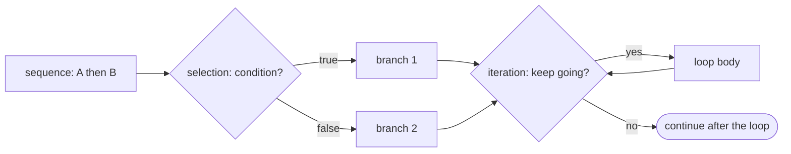

## Introduction

A program without control flow runs every statement once, top to bottom, and then stops. That is enough to add two numbers, but not enough for anything real. A checkout page must charge shipping only for small orders. A login service must lock the account after the fifth failed attempt. A log processor must look at every line of a file, skip the blank ones, and stop when it reaches the shutdown marker. Each of these needs the program to **choose** between paths, **repeat** work, or **leave** a repetition early.

**Control flow** is the order in which statements execute, and **control-flow statements** are the parts of the language that change it. Java has three families:

- **Selection** — `if`/`else` and `switch` choose which block runs.
- **Iteration** — `while`, `do`-`while`, `for` and the enhanced `for` repeat a block.
- **Jumps** — `break`, `continue`, `return` and `throw` transfer control somewhere else immediately.

The syntax of these statements takes an afternoon to learn. Using them well takes longer, because most control-flow bugs are not syntax errors: a condition checked in the wrong order, a missing `break` that lets one case run into the next, a loop that runs one time too many, a `continue` that skips the line that would have ended the loop. This lesson teaches each statement, the exact rules the compiler enforces, the bugs each one invites, and how to choose the clearest form.

Modern Java has changed this area noticeably. Switch expressions (Java 14) and pattern matching for `switch` (Java 21) let a `switch` produce a value and branch on the *type* of an object, with the compiler checking that every case is covered. Examples here use Java 21.

## Before you start

- **Operators** — relational and logical operators, short-circuit `&&` and `||`, and the ternary operator. Every condition in this lesson is built from them. See [[c1-operators]].
- **Types and variables** — `int`, `boolean`, `String`, and the rule that a local variable must be assigned before it is used. See [[c1-types]].
- **Program structure** — a class with a `main` method. See [[c1-syntax]].

Arrays appear in a few loop examples; you need only `a[i]` and `a.length`, which [[c1-arrays]] covers in full.

## The intuition

Picture the program as a path through a building. Normally you walk straight down a corridor, through each room in turn. A **selection** statement is a fork with a sign: "if the order total is under 50, go left to the shipping-fee room; otherwise go right". A **loop** is a corridor that leads back to its own start, with a door that opens only when a condition is false. A **jump** is a fire exit: `break` takes you out of the loop corridor, `continue` takes you straight back to the start of it, and `return` takes you out of the building.

Two ideas make every control-flow statement easier to read:

1. **A condition is a `boolean` expression.** Every fork and every loop door is controlled by a value that is exactly `true` or `false`. Java does not treat `0`, `null` or an empty string as false, as C, JavaScript and Python do.
2. **A statement controls one statement.** `if`, `while` and `for` each govern a single statement. Usually that statement is a **block** — statements grouped in `{ }` — and a block also limits **scope**: a variable declared inside it disappears at its closing brace.



## if / else {#c1-if-else}

The **`if` statement** runs a block only when a condition is `true`. Adding **`else`** gives a second block that runs when the condition is `false`, and chaining **`else if`** lets you test several conditions in order until one matches. It is the most basic decision in programming, and nearly every other control structure can be rewritten in terms of it.

### The forms

```java
if (condition) {
    // runs only when condition is true
}

if (condition) {
    // true branch
} else {
    // false branch
}

if (first) {
    // first is true
} else if (second) {
    // first is false, second is true
} else {
    // neither
}
```

Java evaluates the condition in parentheses, which must have type `boolean` (or `Boolean`, which is unboxed). If it is `true`, the first block runs and the `else` part is skipped; otherwise the `else` part runs. An `else if` is not a separate keyword: it is an `else` whose single statement happens to be another `if`. That is why a chain behaves the way it does — each `if` is only reached when every condition before it was `false`, and once one branch runs, the rest of the chain is skipped.

Here is a realistic chain, a shipping-fee rule:

```java title="Shipping.java"
public class Shipping {
    static String shippingFor(double total, boolean member) {
        if (total <= 0) {
            return "invalid order";
        } else if (member || total >= 50) {
            return "free";
        } else if (total >= 20) {
            return "standard: 4.99";
        } else {
            return "standard: 7.99";
        }
    }

    public static void main(String[] args) {
        System.out.println(shippingFor(0, false));
        System.out.println(shippingFor(12.50, true));
        System.out.println(shippingFor(64.00, false));
        System.out.println(shippingFor(25.00, false));
        System.out.println(shippingFor(9.99, false));
    }
}
```

```output
invalid order
free
free
standard: 4.99
standard: 7.99
```

Read the chain as a series of narrowing filters. By the time Java reaches `total >= 20`, it already knows the total is positive, the customer is not a member, and the total is under 50 — so that branch means "between 20 and 50" without saying so. The final `else` catches everything left over. Writing the chain so that every case falls into exactly one branch, including the invalid one, is what makes it correct.

### Order matters

Because the first matching branch wins, conditions must go from most specific to least specific. Reverse them and later branches become unreachable in practice:

```java title="OrderMatters.java"
public class OrderMatters {
    public static void main(String[] args) {
        int score = 95;
        if (score >= 60) {
            System.out.println("C");
        } else if (score >= 75) {
            System.out.println("B");
        } else if (score >= 90) {
            System.out.println("A");
        }
    }
}
```

```output
C
```

A score of 95 satisfies `score >= 60`, so the first branch runs and the chain ends. The compiler cannot warn about this; to it, the later conditions are still possible. Order the tests `>= 90`, `>= 75`, `>= 60`.

### Conditions must be boolean

Java rejects any condition that is not a `boolean`:

```java title="IntIf.java"
public class IntIf {
    public static void main(String[] args) {
        int count = 3;
        if (count) {
            System.out.println("non-zero");
        }
    }
}
```

```output
IntIf.java:4: error: incompatible types: int cannot be converted to boolean
        if (count) {
            ^
1 error
```

Write `if (count != 0)`. This rule also catches the C mistake of writing `=` instead of `==`: `if (x = 5)` is an `int` and does not compile. There is one hole. If the variable is itself a `boolean`, the assignment *is* a boolean expression:

```java title="AssignInIf.java"
public class AssignInIf {
    public static void main(String[] args) {
        boolean done = false;
        if (done = true) {
            System.out.println("this always runs");
        }
        System.out.println(done);
    }
}
```

```output
this always runs
true
```

`done = true` stores `true` and evaluates to `true`, so the branch always runs and the variable is overwritten. Never compare a boolean with `true` or `false`; write `if (done)` or `if (!done)`, which cannot be mistyped this way.

### Braces and the dangling else

The braces are optional when a branch is a single statement, and leaving them out invites a well-known bug. An `else` always belongs to the **nearest unmatched `if`**, whatever the indentation says:

```java title="Dangling.java"
public class Dangling {
    public static void main(String[] args) {
        int temperature = 5;
        boolean raining = false;
        if (temperature < 10)
            if (raining)
                System.out.println("Take an umbrella");
        else
            System.out.println("Warm day");
    }
}
```

```output
Warm day
```

The indentation suggests the `else` belongs to the temperature check, but Java attaches it to `if (raining)`. On a cold, dry day the program prints "Warm day". This is the **dangling else** problem. A related bug comes from adding a second line to a brace-less branch: only the first line is controlled by the `if`, and the second always runs. Both disappear if you **always use braces**, which is what every mainstream Java style guide requires.

### Definite assignment

The compiler tracks which paths through your code assign a variable, and refuses to let you read a local variable that might be unassigned on some path:

```java title="Definite.java"
public class Definite {
    public static void main(String[] args) {
        int hour = 14;
        String greeting;
        if (hour < 12) {
            greeting = "Good morning";
        } else if (hour < 18) {
            greeting = "Good afternoon";
        }
        System.out.println(greeting);
    }
}
```

```output
Definite.java:10: error: variable greeting might not have been initialized
        System.out.println(greeting);
                           ^
1 error
```

You can see that `hour` is 14, but the compiler reasons about every possible path, and if `hour` were 20 neither branch would assign `greeting`. Adding a final `else` fixes it. This check is a feature: it turns "forgot to handle a case" into a compile error instead of a wrong value at run time.

### Guard clauses and nesting

Deeply nested `if`s are hard to follow because the reader must remember every enclosing condition. A **guard clause** handles a special case first and leaves the method early, so the main logic stays at the left margin:

```java
// Nested: the real work is three levels deep
if (order != null) {
    if (order.isPaid()) {
        if (!order.isShipped()) {
            ship(order);
        }
    }
}

// Guard clauses: each rejection exits immediately
if (order == null) return;
if (!order.isPaid()) return;
if (order.isShipped()) return;
ship(order);
```

Both versions behave identically. The second reads as a checklist and is easier to extend. Guard clauses are especially common at the top of service methods for validating input.

For a choice between two *values*, the ternary operator `cond ? a : b` from [[c1-operators]] is often clearer than an `if`/`else` that assigns a variable in both branches. For many branches on one value, a `switch` is usually clearer than a long `else if` chain.

Since Java 16, `if` can also test a type and bind a variable in one step — `if (shape instanceof Circle c)` — which [[c1-pattern-matching]] explains. Within the true branch, `c` is already a `Circle`.

```quiz
Q: With `int x = 15;`, what does this print? `if (x > 10) System.out.println("big"); else if (x > 5) System.out.println("medium"); else System.out.println("small");`
- [x] `big`
- [ ] `big` then `medium`
- [ ] `medium`
- [ ] Nothing, because braces are missing
> The chain stops at the first true condition. 15 > 10 is true, so "big" prints and the remaining branches are skipped even though 15 > 5 is also true. Braces are optional for single statements, though recommended.

Q: Why does `if (flag = false) { ... }` compile when `flag` is a `boolean`, while `if (n = 0)` does not when `n` is an `int`?
- [ ] Java allows assignment in conditions only for booleans as a special rule
- [x] An assignment expression has the type of its variable, so `flag = false` is a boolean expression and `n = 0` is an int
- [ ] The compiler optimises the boolean version away
- [ ] Both compile; only the second throws at run time
> Assignment is an expression whose value and type are those of the assigned variable. A boolean assignment is therefore a legal condition, and here it always stores false and skips the branch. An int assignment has type int, which can never be a condition in Java. Writing `if (!flag)` avoids the trap.
```

## switch {#c1-switch}

The **`switch` statement** chooses one of several branches by comparing a single value — the **selector** — against a list of **case labels**. It replaces a long `else if` chain that keeps testing the same variable for equality, and modern Java extends it into an expression that produces a value and into a tool for branching on an object's type. Because Java now has several forms of `switch`, the first step is to recognise which form you are looking at.

### The classic switch statement

The original form, unchanged since Java 1.0, uses `case value:` labels:

```java title="ClassicSwitch.java"
public class ClassicSwitch {
    public static void main(String[] args) {
        int day = 3;
        switch (day) {
            case 1:
                System.out.println("Monday");
                break;
            case 2:
                System.out.println("Tuesday");
                break;
            case 3:
                System.out.println("Wednesday");
                break;
            default:
                System.out.println("Some other day");
        }

        // forgetting break: execution falls through into the next case
        int level = 2;
        switch (level) {
            case 1:
                System.out.println("level 1");
            case 2:
                System.out.println("level 2");
            case 3:
                System.out.println("level 3");
            default:
                System.out.println("default");
        }
    }
}
```

```output
Wednesday
level 2
level 3
default
```

Java evaluates the selector once, jumps to the matching label (or to `default` if none matches, or past the whole `switch` if there is no `default`), and then **runs statements from there downward until it reaches a `break` or the end of the `switch`**. The labels are only entry points; they do not end anything. This behaviour is called **fall-through**, and the second `switch` shows its danger: with no `break`s, entering at `case 2` runs the code for cases 2, 3 and `default`.

Fall-through is occasionally useful, most often to give several labels the same code:

```java
switch (month) {
    case 4: case 6: case 9: case 11:
        days = 30;
        break;
    case 2:
        days = leap ? 29 : 28;
        break;
    default:
        days = 31;
}
```

But an accidental missing `break` is one of the most common bugs in C-family languages, which is the main reason the newer arrow form exists.

### What a switch can switch on

The rules for the classic (constant-label) form are strict:

- The selector must be `char`, `byte`, `short`, `int`, their wrappers (`Character`, `Byte`, `Short`, `Integer`), `String` (since Java 7) or an `enum` type. **`long`, `float`, `double` and `boolean` are not allowed** in Java 21. (Primitive patterns that would allow them have been previewed since JDK 23 and are still a preview feature in JDK 26.)
- Each case label must be a **compile-time constant** — a literal, a `static final` constant initialised with a constant, or an enum constant — and no two labels may be equal. Both are checked by the compiler.
- For an `enum` selector, labels are written as the bare constant name: `case SATURDAY`, not `case DayOfWeek.SATURDAY` (Java 21 accepts the qualified name too, but the bare form is idiomatic).
- **A `null` selector throws `NullPointerException`**, unless the switch has a `case null` label (allowed since Java 21).

`String` switches compare with `equals`, not `==`, so they behave the way you expect for equal text. Internally the compiler switches on the string's `hashCode()` first, then confirms with `equals` — which is why a `null` string fails with a message about `hashCode`:

```java title="NullSwitch.java"
public class NullSwitch {
    public static void main(String[] args) {
        String status = null;
        switch (status) {
            case "OPEN" -> System.out.println("open");
            default -> System.out.println("other");
        }
    }
}
```

```output
Exception in thread "main" java.lang.NullPointerException: Cannot invoke "String.hashCode()" because "<local2>" is null
	at NullSwitch.main(NullSwitch.java:4)
```

Note that `default` does *not* catch `null`. (The `<local2>` in the message is a hidden temporary variable the compiler created; the exact wording of these "helpful" NullPointerException messages varies between JDK versions.)

### Arrow labels: no fall-through

Java 14 added **arrow labels**, `case X ->`. The code to the right of an arrow is a single expression, a block in braces, or a `throw`, and **when it finishes, the `switch` ends**. There is no fall-through and no `break` to forget. Several values can share one label, separated by commas:

```java title="FallThrough.java"
public class FallThrough {
    static int daysIn(int month, boolean leap) {
        int days;
        switch (month) {
            case 4: case 6: case 9: case 11:
                days = 30;
                break;
            case 2:
                days = leap ? 29 : 28;
                break;
            default:
                days = 31;
        }
        return days;
    }

    public static void main(String[] args) {
        System.out.println(daysIn(2, true) + " " + daysIn(6, false) + " " + daysIn(12, false));

        String command = "STOP";
        switch (command) {
            case "START" -> System.out.println("starting");
            case "STOP", "HALT" -> System.out.println("stopping");
            default -> System.out.println("unknown: " + command);
        }
    }
}
```

```output
29 30 31
stopping
```

You cannot mix the two label styles in one `switch`. In new code, prefer arrows: they say exactly what runs for each case and nothing else.

### Switch expressions

A **switch expression** produces a value, so it can sit on the right of an assignment, in a `return`, or as a method argument. It uses the same labels, but every branch must yield a value (or throw), and the compiler requires the expression to be **exhaustive** — to have a branch for every possible selector value:

```java title="SwitchExpr.java"
import java.time.DayOfWeek;

public class SwitchExpr {
    static String kind(DayOfWeek day) {
        return switch (day) {
            case SATURDAY, SUNDAY -> "weekend";
            case MONDAY, TUESDAY, WEDNESDAY, THURSDAY, FRIDAY -> "weekday";
        };
    }

    static int priority(String severity) {
        return switch (severity) {
            case "critical" -> 1;
            case "high" -> 2;
            case "medium", "low" -> {
                int base = 3;
                System.out.println("  (computing for " + severity + ")");
                yield severity.equals("medium") ? base : base + 1;
            }
            default -> throw new IllegalArgumentException("unknown severity: " + severity);
        };
    }

    public static void main(String[] args) {
        System.out.println(kind(DayOfWeek.SATURDAY));
        System.out.println(kind(DayOfWeek.TUESDAY));
        System.out.println(priority("high"));
        System.out.println(priority("low"));
        try {
            priority("urgent");
        } catch (IllegalArgumentException e) {
            System.out.println(e.getMessage());
        }
    }
}
```

```output
weekend
weekday
2
  (computing for low)
4
unknown severity: urgent
```

`kind` needs no `default` because its labels cover all seven `DayOfWeek` constants. If you delete `FRIDAY`, compilation fails with "the switch expression does not cover all possible input values" — the compiler has found the missing case for you. That is the real advantage of omitting `default` on an enum: when someone adds a constant later, every switch expression that ignores it stops compiling. (If an enum gains a constant and an old compiled class meets it at run time, the switch throws `MatchException` in Java 21.)

A `String` has infinitely many values, so `priority` must have a `default`; here it throws, which is often the right choice for input that should never occur. When a branch needs several statements, use a block and end it with **`yield`**, which supplies the block's value. `yield` is to a switch expression what `return` is to a method. A switch expression cannot be left with `break` or `return`. Switch expressions are covered further in [[c1-switch-expressions]].

### Pattern matching for switch (Java 21)

Java 21 lets a `switch` test the **type** of its selector with **type patterns**, and refine a match with a **guard** written `when`. The selector can then be any reference type:

```java title="PatternSwitch.java"
public class PatternSwitch {
    sealed interface Shape permits Circle, Rectangle, Square {}
    record Circle(double radius) implements Shape {}
    record Rectangle(double width, double height) implements Shape {}
    record Square(double side) implements Shape {}

    static double area(Shape shape) {
        return switch (shape) {
            case Circle c -> Math.PI * c.radius() * c.radius();
            case Rectangle r -> r.width() * r.height();
            case Square s -> s.side() * s.side();
        };
    }

    static String describe(Object value) {
        return switch (value) {
            case null -> "null";
            case Integer i when i < 0 -> "negative int " + i;
            case Integer i -> "int " + i;
            case String s when s.isBlank() -> "blank string";
            case String s -> "string of length " + s.length();
            default -> "something else: " + value.getClass().getSimpleName();
        };
    }

    public static void main(String[] args) {
        System.out.printf("%.2f%n", area(new Circle(1)));
        System.out.println(area(new Rectangle(2, 3)));
        System.out.println(describe(-4));
        System.out.println(describe(42));
        System.out.println(describe("  "));
        System.out.println(describe("hello"));
        System.out.println(describe(3.5));
        System.out.println(describe(null));
    }
}
```

```output
3.14
6.0
negative int -4
int 42
blank string
string of length 5
something else: Double
null
```

The example models shapes as **records** — compact classes whose only job is to hold the values in their header, with an accessor method per value such as `c.radius()` ([[c1-records]]). `case Circle c` matches when `shape` is a `Circle` and binds it to `c`, already cast. Because `Shape` is **sealed** — it lists every permitted implementation — the compiler knows these three cases are exhaustive and needs no `default` ([[c1-sealed]]). In `describe`, cases are tried **top to bottom**, so the guarded `Integer i when i < 0` must come before the plain `Integer i`; in the other order the compiler reports that the second label is **dominated** and can never match. `case null` handles `null` explicitly instead of throwing. Pattern-matching switches must be exhaustive even when used as statements. The full pattern syntax, including record deconstruction patterns, is in [[c1-pattern-matching]].

### Which form to use

| Form | Introduced | Fall-through | Must be exhaustive | Use for |
|---|---|---|---|---|
| `case X:` statement | Java 1.0 | yes, until `break` | no | Legacy code; deliberate fall-through |
| `case X ->` statement | Java 14 | no | no (yes if it uses patterns or `case null`) | Running different code per value |
| `switch` expression | Java 14 | no | yes | Computing a value from a selector |
| Pattern `switch` | Java 21 | no | yes | Branching on type, sealed hierarchies |

```quiz
Q: In a classic `switch` with `case 1:`, `case 2:` and `default:` and no `break` statements, what runs when the selector is 1?
- [ ] Only the code under `case 1`
- [x] The code under `case 1`, then `case 2`, then `default`
- [ ] Only the `default` code
- [ ] It does not compile without `break`
> Case labels are entry points, not boundaries. Execution starts at the matching label and continues downward until a break or the end of the switch. This fall-through compiles without warning by default, which is why arrow labels, which never fall through, are preferred.

Q: Why can a switch expression over an enum omit `default` when it lists every constant?
- [ ] Enums cannot be null
- [x] The compiler can verify exhaustiveness, so a default would only hide future missing cases
- [ ] Switch expressions never need a default
- [ ] The JVM adds a default that returns null
> An enum has a fixed set of constants known at compile time, so the compiler accepts a switch expression that covers them all. Leaving out default means adding a new constant later breaks compilation wherever it is not handled. A String switch expression, by contrast, must have a default.
```

## for / while / do-while {#c1-loops}

A **loop** repeats a block of code while a condition holds. Java has four loop statements: **`while`** checks the condition before each pass, **`do`-`while`** checks it after each pass so the body always runs at least once, the **`for`** loop packs a counter's setup, test and update into one line, and the **enhanced `for`** (for-each) visits every element of an array or collection. Each pass through the body is called an **iteration**. Choosing the right loop is mostly about making the reason for the repetition obvious to the reader.

### The four loops in one program

```java title="Loops.java"
import java.util.List;

public class Loops {
    public static void main(String[] args) {
        // while: repeat while a condition holds; we don't know the count in advance
        int balance = 1_000;
        int years = 0;
        while (balance < 2_000) {
            balance += balance * 7 / 100;   // 7% interest, integer arithmetic
            years++;
        }
        System.out.println("doubled after " + years + " years: " + balance);

        // do-while: the body always runs at least once
        int attempts = 0;
        do {
            attempts++;
            System.out.println("attempt " + attempts);
        } while (attempts < 0);

        // for: a counter with a known range
        int sum = 0;
        for (int i = 1; i <= 5; i++) {
            sum += i;
        }
        System.out.println("sum 1..5 = " + sum);

        // enhanced for: every element of an array or Iterable
        List<String> names = List.of("Ada", "Linus", "Grace");
        for (String name : names) {
            System.out.print(name.length() + " ");
        }
        System.out.println();

        // two variables in one for header
        int[] a = {1, 2, 3, 4, 5};
        for (int lo = 0, hi = a.length - 1; lo < hi; lo++, hi--) {
            int tmp = a[lo]; a[lo] = a[hi]; a[hi] = tmp;
        }
        System.out.println(java.util.Arrays.toString(a));
    }
}
```

```output
doubled after 11 years: 2098
attempt 1
sum 1..5 = 15
3 5 5 
[5, 4, 3, 2, 1]
```

**`while`** fits when you do not know in advance how many iterations are needed — here, how many years of interest it takes to double the balance. The condition is tested first, so if `balance` already started at 2,000 the body would run zero times. Something inside the body must eventually make the condition false (`balance` grows), or the loop never ends.

**`do`-`while`** tests its condition after the body. Even though `attempts < 0` is false from the start, the body runs once. It suits "do something, then decide whether to repeat" tasks, such as showing a menu and asking again until the user picks a valid option. Note the semicolon after `while (...)`; it is required.

**`for`** has three parts in its header, separated by semicolons. The **initialiser** (`int i = 1`) runs once. The **condition** (`i <= 5`) is tested before every iteration. The **update** (`i++`) runs after every iteration. A variable declared in the initialiser exists only inside the loop. The header can declare several variables of the same type and run several updates, separated by commas, as the array-reversing loop does with `lo` and `hi`. Any of the three parts may be empty: `for (;;)` is a loop with no condition, which runs until something inside it jumps out.

The **enhanced `for`**, `for (Type x : source)`, runs its body once per element of an array or of anything that implements `Iterable` (every `List`, `Set` and other collection). It has no index variable and no condition to get wrong, which makes it the safest choice whenever you need to visit every element in order.

### Execution order of a for loop

The order of the three header parts trips up beginners, so here is `for (int i = 1; i <= 3; i++) sum += i;` traced step by step:

| Step | Action | `i` | `sum` |
|---|---|---|---|
| 1 | initialise `i = 1` | 1 | 0 |
| 2 | test `1 <= 3`: true, run body | 1 | 1 |
| 3 | update `i++` | 2 | 1 |
| 4 | test `2 <= 3`: true, run body | 2 | 3 |
| 5 | update `i++` | 3 | 3 |
| 6 | test `3 <= 3`: true, run body | 3 | 6 |
| 7 | update `i++` | 4 | 6 |
| 8 | test `4 <= 3`: false, leave loop | 4 | 6 |

The condition is tested four times for three iterations, and the update runs after the last body. A `for` loop is exactly equivalent to this `while` loop, apart from the scope of `i` and the behaviour of `continue` covered later:

```java
{
    int i = 1;
    while (i <= 3) {
        sum += i;
        i++;
    }
}
```

### Choosing a loop

| Situation | Loop | Why |
|---|---|---|
| Visit every element of an array or collection | enhanced `for` | No index to get wrong |
| Need the index, step by more than one, go backwards, or walk two positions at once | `for` | Counter logic is all in the header |
| Repeat until something happens; count unknown | `while` | The condition states the reason to continue |
| Body must run at least once (prompt, retry) | `do`-`while` | Condition checked after the first pass |
| Run until an explicit exit (server loop, event loop) | `while (true)` with `break` or `return` | The exit points are inside the body |

Collections can also be processed with streams (`names.stream().filter(...).toList()`), which describe *what* to compute rather than *how* to loop; see [[c1-streams]]. Loops remain the clearest tool when the body has side effects, needs early exit, or updates several variables at once.

### Off-by-one errors and loop boundaries

An **off-by-one error** is a loop that runs one time too many or too few. The most common one in Java is writing `i <= a.length` instead of `i < a.length`. Array indices run from `0` to `length - 1`, so the last iteration reads `a[a.length]` and throws `ArrayIndexOutOfBoundsException`. The convention that prevents it is the **half-open range**: start at `0`, test with `<`, and the loop runs exactly `length` times. Whenever a loop has unusual bounds, check the first iteration, the last iteration, and the empty case (does it run zero times when it should?).

### The enhanced for gives you a copy of each element

The variable in an enhanced `for` is a fresh local variable that receives each element in turn. Assigning to it does not change the array or collection:

```java title="EnhancedCopy.java"
import java.util.Arrays;

public class EnhancedCopy {
    public static void main(String[] args) {
        int[] scores = {70, 80, 90};
        for (int s : scores) {
            s += 5;                   // changes the loop variable only
        }
        System.out.println(Arrays.toString(scores));

        for (int i = 0; i < scores.length; i++) {
            scores[i] += 5;           // writes back into the array
        }
        System.out.println(Arrays.toString(scores));
    }
}
```

```output
[70, 80, 90]
[75, 85, 95]
```

To modify elements in place, use an indexed `for`. (For an array of objects, calling a method on the loop variable *does* change the object, because the variable holds a reference to the same object; only reassigning the variable has no effect.)

### Do not change a collection while looping over it

An enhanced `for` over a collection uses an `Iterator` behind the scenes. Most standard collections detect structural changes made during iteration and throw rather than continue with corrupted state:

```java title="Cme.java"
import java.util.ArrayList;
import java.util.List;

public class Cme {
    public static void main(String[] args) {
        List<Integer> nums = new ArrayList<>(List.of(1, 2, 3, 4, 5, 6));
        try {
            for (Integer n : nums) {
                if (n % 2 == 0) nums.remove(n);
            }
        } catch (java.util.ConcurrentModificationException e) {
            System.out.println("ConcurrentModificationException");
        }

        List<Integer> skip = new ArrayList<>(List.of(2, 4, 5, 6));
        for (int i = 0; i < skip.size(); i++) {
            if (skip.get(i) % 2 == 0) skip.remove(i);   // shifts the next element into i
        }
        System.out.println(skip);

        List<Integer> fixed = new ArrayList<>(List.of(2, 4, 5, 6));
        fixed.removeIf(n -> n % 2 == 0);
        System.out.println(fixed);
    }
}
```

```output
ConcurrentModificationException
[4, 5]
[5]
```

The first loop throws `ConcurrentModificationException`. The name is misleading — there is only one thread — and the check is best-effort, not guaranteed (removing the second-to-last element, for example, ends the loop without an exception). The second loop avoids the exception but is still wrong: removing index 0 shifts `4` into index 0, then `i++` moves past it, so `4` is never examined. Use `removeIf`, an explicit `Iterator` with `iterator.remove()`, or loop backwards by index. See [[c1-iterator]] and [[c1-fail-fast]].

### Infinite loops, on purpose and by accident

`while (true)` and `for (;;)` are deliberate infinite loops, used for servers and event loops that run until a `break`, `return` or exception. The compiler understands them: any statement after a `while (true)` that contains no `break` is reported as an **unreachable statement**.

Accidental infinite loops usually come from a condition that can never become false. Two causes are subtle enough to show:

```java title="FloatLoop.java"
public class FloatLoop {
    public static void main(String[] args) {
        int iterations = 0;
        for (double x = 0.0; x != 1.0 && iterations < 15; x += 0.1) {
            iterations++;
        }
        System.out.println(iterations);

        for (int tenths = 0; tenths <= 10; tenths += 5) {
            System.out.println(tenths / 10.0);
        }
    }
}
```

```output
15
0.0
0.5
1.0
```

Adding `0.1` ten times gives `0.9999999999999999`, not `1.0`, so `x != 1.0` never becomes false; only the safety counter stopped this loop. **Never control a loop with a floating-point counter and `!=`**; count with an integer and compute the fractional value from it, as the second loop does.

The second cause is a counter too narrow for its bound. In `for (byte b = 0; b < 200; b++)`, `b` goes up to 127, then `b++` wraps to −128, which is still less than 200 — forever. Use an `int` counter.

### Loop variables and lambdas

A lambda can only capture a local variable that is **effectively final** — never reassigned after initialisation. The enhanced-`for` variable is a new variable on each iteration, so it qualifies. The classic `for` counter is modified by `i++`, so it does not:

```java title="Capture.java"
import java.util.ArrayList;
import java.util.List;

public class Capture {
    public static void main(String[] args) {
        List<Runnable> tasks = new ArrayList<>();
        for (String name : List.of("a", "b")) {
            tasks.add(() -> System.out.println(name));     // fine: fresh variable each time
        }
        for (int i = 0; i < 2; i++) {
            int copy = i;                                  // needed: i is modified by i++
            tasks.add(() -> System.out.println(copy));
        }
        tasks.forEach(Runnable::run);
    }
}
```

```output
a
b
0
1
```

Writing `System.out.println(i)` inside the lambda instead gives the compile error "local variables referenced from a lambda expression must be final or effectively final". Copying into a fresh variable inside the body is the standard fix. (JavaScript solves the same problem differently; compare [[b1-closures-in-loops]].)

### Nested loops and cost

A loop inside a loop multiplies the work: an outer loop of `n` iterations around an inner loop of `n` iterations runs the inner body n² times. That is fine for a 10 × 10 grid and far too slow for comparing every pair among a million records. Counting iterations like this is the basis of time complexity, covered in [[a1-time-complexity]].

```quiz
Q: How many times does the body of `for (int i = 10; i > 0; i -= 3) { ... }` run?
- [ ] 3
- [x] 4
- [ ] 10
- [ ] It never terminates
> i takes the values 10, 7, 4 and 1, and each passes the test i > 0, so the body runs four times. The next update makes i equal to -2, the test fails and the loop ends.

Q: What is the key behavioural difference between `while (cond) { body }` and `do { body } while (cond);`?
- [ ] `do-while` can only be used with counters
- [ ] `while` always runs at least once
- [x] `do-while` runs its body once before testing the condition, so the body runs at least once
- [ ] There is no difference; they compile to the same bytecode
> A while loop tests first and may run zero times. A do-while tests after each pass, so the first pass always happens. That is what makes do-while natural for prompts and retries.
```

## break & continue {#c1-break-continue}

**`break`** and **`continue`** are jump statements that change the normal flow of a loop from inside its body. `break` leaves the loop (or `switch`) immediately and continues with the first statement after it. `continue` abandons the current iteration and moves on to the next one. Both have a **labelled** form that targets an outer loop, which is the clean way to exit nested loops. Used well, they make a loop's exit conditions explicit; used carelessly, they create loops whose behaviour depends on lines the reader has to hunt for.

### Leaving early and skipping

```java title="BreakContinue.java"
public class BreakContinue {
    public static void main(String[] args) {
        int[] readings = {12, -1, 15, 0, 18, 999, 20};

        int sum = 0;
        for (int r : readings) {
            if (r == 999) {
                break;               // sentinel: stop reading entirely
            }
            if (r <= 0) {
                continue;            // invalid reading: skip to the next one
            }
            sum += r;
        }
        System.out.println("sum of valid readings: " + sum);
    }
}
```

```output
sum of valid readings: 45
```

Walk through the readings. `12` is added. `-1` triggers `continue`, so `sum += r` is skipped for it and the loop moves to `15`, which is added. `0` is skipped. `18` is added. `999` is a **sentinel** — a special value meaning "end of data" — so `break` leaves the loop and `20` is never looked at. The total is 12 + 15 + 18 = 45.

The two jumps express two different ideas. `continue` says "this element is not interesting; go to the next one", which keeps the main logic unindented instead of wrapping it in `if (r > 0) { ... }`. `break` says "the answer is known, or the input is over; stop". Searching is the classic use of `break`: once you find what you are looking for, every further iteration is wasted work.

### Where continue goes

`continue` jumps to the point where the loop decides whether to run again. In a `for` loop, that means **the update runs first**, then the condition. In a `while` or `do`-`while`, it goes straight to the condition — so if the update is at the bottom of the body, `continue` skips it:

```java title="WhileContinue.java"
public class WhileContinue {
    public static void main(String[] args) {
        int i = 0;
        int guard = 0;
        while (i < 5 && guard++ < 20) {
            if (i == 2) {
                continue;          // skips i++ below: i stays 2 forever
            }
            System.out.print(i + " ");
            i++;
        }
        System.out.println("| guard hit " + guard);

        for (int j = 0; j < 5; j++) {
            if (j == 2) continue;  // the update j++ still runs
            System.out.print(j + " ");
        }
        System.out.println();
    }
}
```

```output
0 1 | guard hit 21
0 1 3 4 
```

The `while` loop would spin forever at `i == 2` without the guard counter. The `for` loop with the same logic works, because `j++` is part of the header and runs on `continue`. This is the one place where a `for` loop and its "equivalent" `while` loop behave differently.

### break inside a switch inside a loop

A `break` exits the **innermost** enclosing loop *or* `switch`. Inside a classic `switch` that sits in a loop, `break` ends the `switch`, not the loop:

```java title="SwitchInLoop.java"
public class SwitchInLoop {
    public static void main(String[] args) {
        String[] commands = {"add", "add", "quit", "add"};
        int count = 0;
        for (String c : commands) {
            switch (c) {
                case "add":
                    count++;
                    break;           // exits the switch, not the loop
                case "quit":
                    break;           // also only exits the switch
            }
        }
        System.out.println(count);

        count = 0;
        loop:
        for (String c : commands) {
            switch (c) {
                case "add" -> count++;
                case "quit" -> { break loop; }
            }
        }
        System.out.println(count);
    }
}
```

```output
3
2
```

The first loop was meant to stop at `"quit"`, but its `break` only leaves the `switch`, so the fourth command is still counted. The second version labels the loop and uses `break loop`, which exits the loop itself. (Inside a switch *expression* you cannot use `break` or `continue` to jump out at all; switch expressions must complete with a value or an exception.)

### Labelled break and continue

Any statement can be given a **label** — an identifier followed by a colon — and `break label` or `continue label` then targets that statement instead of the innermost loop. Labels are mostly used with nested loops:

```java title="Labeled.java"
public class Labeled {
    public static void main(String[] args) {
        int[][] grid = {
            {3, 8, 1},
            {9, 4, 7},
            {2, 6, 5},
        };
        int target = 7;
        int foundRow = -1, foundCol = -1;

        search:
        for (int row = 0; row < grid.length; row++) {
            for (int col = 0; col < grid[row].length; col++) {
                if (grid[row][col] == target) {
                    foundRow = row;
                    foundCol = col;
                    break search;          // leaves both loops
                }
            }
        }
        System.out.println("found at " + foundRow + "," + foundCol);

        // continue with a label: skip the rest of this row, move to the next row
        rows:
        for (int row = 0; row < grid.length; row++) {
            for (int col = 0; col < grid[row].length; col++) {
                if (grid[row][col] > 8) {
                    System.out.println("row " + row + " has a value over 8, skipping");
                    continue rows;
                }
            }
            System.out.println("row " + row + " is fine");
        }
    }
}
```

```output
found at 1,2
row 0 is fine
row 1 has a value over 8, skipping
row 2 is fine
```

An unlabelled `break` at the point of discovery would leave only the inner loop, and the outer loop would carry on scanning rows 2 and beyond. `break search` leaves both. `continue rows` abandons the rest of the current row *and* the "is fine" line after the inner loop, and moves on to the next row.

Labelled jumps can only target an enclosing statement; you cannot jump sideways or into a block, so they are far more disciplined than the `goto` of older languages. Java reserves `goto` as a keyword but does not implement it.

Often an even clearer alternative to a labelled break is to **move the nested loops into a method and `return`** as soon as the answer is found. A method named `findPosition(grid, target)` documents its purpose, and `return` exits every loop at once.

### break, continue and finally

If a `break` or `continue` leaves a `try` block that has a `finally`, the `finally` block runs first:

```java title="FinallyBreak.java"
public class FinallyBreak {
    public static void main(String[] args) {
        for (int i = 0; i < 3; i++) {
            try {
                if (i == 1) break;
                System.out.println("working " + i);
            } finally {
                System.out.println("cleanup " + i);
            }
        }
    }
}
```

```output
working 0
cleanup 0
cleanup 1
```

This guarantee is what makes resource clean-up reliable however a loop is exited; see [[c1-try-catch-finally]].

```quiz
Q: In `for (int i = 0; i < 5; i++) { if (i % 2 == 0) continue; System.out.print(i); }`, what is printed?
- [ ] `024`
- [x] `13`
- [ ] `1`
- [ ] Nothing; the loop never ends
> For even i, continue skips the print. In a for loop, continue still runs the update i++, so the loop advances normally and prints the odd values 1 and 3.

Q: A `break` appears inside `case "quit":` of a classic switch, which is inside a `for` loop. What does it do?
- [ ] Exits the for loop
- [x] Exits only the switch; the loop continues with its next iteration
- [ ] Exits the method
- [ ] It is a compile error
> break targets the innermost enclosing loop or switch, which here is the switch. To leave the loop, label it and use `break label;`, or return from a method.
```

## How it works internally

The JVM has no `if`, `while` or `switch` instructions. All control flow compiles to **conditional jumps** (go to another instruction if a test holds), **unconditional jumps** (`goto`), and two special instructions for `switch`. You can see this with `javap -c`, the class-file disassembler, on a small class:

```java title="LoopBytecode.java"
public class LoopBytecode {
    static int sum(int n) {
        int total = 0;
        for (int i = 0; i < n; i++) {
            total += i;
        }
        return total;
    }
    static int dense(int x) {
        switch (x) {
            case 1: return 10;
            case 2: return 20;
            case 3: return 30;
            default: return 0;
        }
    }
    static int sparse(int x) {
        switch (x) {
            case 1: return 10;
            case 1000: return 20;
            case 1000000: return 30;
            default: return 0;
        }
    }
}
```

The `for` loop compiles to this (instruction offsets on the left):

```text
  static int sum(int);
         0: iconst_0
         1: istore_1          // total = 0
         2: iconst_0
         3: istore_2          // i = 0
         4: iload_2
         5: iload_0
         6: if_icmpge     19  // if i >= n, jump to 19 (leave the loop)
         9: iload_1
        10: iload_2
        11: iadd
        12: istore_1          // total = total + i
        13: iinc          2, 1  // i++
        16: goto          4   // back to the test
        19: iload_1
        20: ireturn
```

The comments were added for this lesson. Notice that the condition `i < n` is compiled as its opposite, `if_icmpge` ("if int compare greater-or-equal"): the jump *leaves* the loop when the condition fails, and otherwise execution falls through into the body. The body ends with `iinc` (the update) and `goto 4`, back to the test. A `break` would compile to a `goto 19`; a `continue` would compile to a `goto 13`, which is exactly why `continue` in a `for` loop still runs the update. An `if`/`else` compiles the same way: a conditional jump over the true branch, and a `goto` at the end of the true branch that skips the `else`.

The two switches compile differently:

```text
  static int dense(int);
         1: tableswitch   { // 1 to 3
                       1: 28
                       2: 31
                       3: 34
                 default: 37
            }

  static int sparse(int);
         1: lookupswitch  { // 3
                       1: 36
                    1000: 39
                 1000000: 42
                 default: 45
            }
```

When the case values are close together, `javac` emits a **`tableswitch`**: a jump table indexed by `x - 1`, so finding the target takes constant time however many cases there are. When the values are spread out, a table would be huge and mostly empty, so `javac` emits a **`lookupswitch`**: a sorted list of key/target pairs that the JVM can binary search. Either way, a `switch` on many constant values is usually faster than the equivalent chain of `if (x == ...)` tests, which checks each value in turn — though for a handful of cases the difference is negligible, and readability should decide.

A `String` switch is compiled in two stages: a `lookupswitch` on `hashCode()`, then `equals` to confirm the match (two different strings can share a hash code), then a second `switch` on the resulting position. That is why a `null` selector fails inside `hashCode()`. Pattern-matching switches compile to an `invokedynamic` call that the JVM links to a type-testing routine at run time.

At run time, the just-in-time (JIT) compiler watches which branches are actually taken and optimises the hot path: it can lay out the common branch first, unroll short loops, and hoist computations that do not change out of a loop. These optimisations never change what your program does; they are one reason to write the clearest control flow rather than trying to hand-optimise branches.

## Worked example: a log health report

This program combines every structure in the lesson. It uses an `enum` for the four log levels ([[c1-enums]]) and a record, `Entry`, to hold one parsed line; `ordinal()` gives an enum constant's position (0 for `DEBUG`), which serves as an index into the `counts` array. It reads log lines, skips blanks with `continue`, stops at a shutdown marker with `break`, classifies each line with a switch expression, counts levels in a loop, and chooses an overall status with an `if`/`else` chain.

```java title="LogReport.java"
import java.util.List;

public class LogReport {

    enum Level { DEBUG, INFO, WARN, ERROR }

    record Entry(Level level, String message) {}

    // Turns "WARN disk at 91%" into an Entry, or returns null for a malformed line.
    static Entry parse(String line) {
        int space = line.indexOf(' ');
        if (space < 0) {
            return null;
        }
        String levelText = line.substring(0, space);
        Level level = switch (levelText) {
            case "DEBUG" -> Level.DEBUG;
            case "INFO" -> Level.INFO;
            case "WARN", "WARNING" -> Level.WARN;
            case "ERROR" -> Level.ERROR;
            default -> null;
        };
        return level == null ? null : new Entry(level, line.substring(space + 1));
    }

    public static void main(String[] args) {
        List<String> lines = List.of(
            "INFO server started",
            "",
            "DEBUG cache warmed",
            "WARNING disk at 91%",
            "garbage",
            "ERROR payment service timeout",
            "INFO request served",
            "SHUTDOWN",
            "ERROR never reached");

        int[] counts = new int[Level.values().length];
        int skipped = 0;
        String firstError = null;

        for (String raw : lines) {
            String line = raw.strip();
            if (line.equals("SHUTDOWN")) {
                break;                              // nothing after shutdown counts
            }
            if (line.isEmpty()) {
                continue;                           // blank lines are not errors
            }
            Entry entry = parse(line);
            if (entry == null) {
                skipped++;
                continue;
            }
            counts[entry.level().ordinal()]++;
            if (entry.level() == Level.ERROR && firstError == null) {
                firstError = entry.message();
            }
        }

        for (Level level : Level.values()) {
            String bar = "#".repeat(counts[level.ordinal()]);
            System.out.printf("%-5s %d %s%n", level, counts[level.ordinal()], bar);
        }
        System.out.println("skipped: " + skipped);
        String verdict;
        if (counts[Level.ERROR.ordinal()] > 0) {
            verdict = "unhealthy, first error: " + firstError;
        } else if (counts[Level.WARN.ordinal()] > 0) {
            verdict = "degraded";
        } else {
            verdict = "healthy";
        }
        System.out.println("status: " + verdict);
    }
}
```

```output
DEBUG 1 #
INFO  2 ##
WARN  1 #
ERROR 1 #
skipped: 1
status: unhealthy, first error: payment service timeout
```

Follow the main loop through the nine lines:

| Line | What happens | Statement responsible |
|---|---|---|
| `INFO server started` | parsed, INFO count 1 | switch expression |
| `""` | skipped, not counted as malformed | `continue` |
| `DEBUG cache warmed` | DEBUG count 1 | switch expression |
| `WARNING disk at 91%` | mapped to WARN, count 1 | multi-value `case "WARN", "WARNING"` |
| `garbage` | no space, `parse` returns `null`, `skipped` 1 | guard clause, then `continue` |
| `ERROR payment service timeout` | ERROR count 1, `firstError` recorded | `if` with `&&` |
| `INFO request served` | INFO count 2 | switch expression |
| `SHUTDOWN` | loop ends | `break` |
| `ERROR never reached` | never examined | — |

A few design decisions are worth noticing. `parse` uses a **guard clause** to reject lines with no space before doing any work. The switch expression has a `default` because a `String` can be anything; it yields `null` here so the caller can count the line as malformed (in a larger program, an `Optional<Entry>` would make that possibility explicit in the type). The order of the two checks at the top of the loop matters: `SHUTDOWN` is tested before the empty check, but swapping them would also be correct because the two conditions cannot both be true — always ask whether the order of your checks changes the result. `firstError == null` makes sure only the *first* error is recorded, without needing a `break` that would stop the counting. The final `if`/`else` chain goes from most to least severe, so a log with both errors and warnings is reported as unhealthy. And the `verdict` variable is assigned on every branch, which the compiler verifies through definite assignment.

## In real systems

**Request handling.** Web controllers and service methods open with guard clauses that validate input and return early with an error response; the happy path follows at the left margin. Spring's own dispatching is, at heart, a sequence of such checks.

**State machines.** Order workflows, protocol parsers and game logic are commonly written as a `switch` over an enum of states, where each case decides the next state. Switch expressions with exhaustiveness checking make these safe to extend: add a state and the compiler lists every place that must handle it.

**Domain modelling with sealed types.** Modern Java code models alternatives as a sealed interface with record implementations (`PaymentResult` = `Approved | Declined | Pending`) and handles them with a pattern-matching `switch`, replacing chains of `instanceof` checks.

**Event and server loops.** A server thread typically runs `while (running) { accept(); handle(); }`, or `while (!Thread.currentThread().isInterrupted())`, exiting through a flag, an interrupt or an exception. Message consumers such as Kafka clients poll in the same kind of loop.

**Batch processing.** Jobs that read files or database rows loop over records, `continue` past invalid ones (often logging them), and `break` when a limit or deadline is reached. Retry logic uses a counted loop with a delay between attempts.

## Trade-offs and alternatives

| Choice | Strengths | Weaknesses |
|---|---|---|
| `if`/`else` chain | Any conditions, ranges, mixed variables | Long chains repeat the variable and hide missing cases |
| `switch` with arrows | One selector, many constant values; no fall-through | Only equality on supported types (or patterns) |
| Switch expression | Produces a value; exhaustiveness checked | Every branch must yield; cannot `break` out of it |
| Polymorphism (a method per subclass) | Behaviour lives with the data; open to new types | Logic spread across classes; harder to see all cases at once |
| Enhanced `for` | No index bugs | No index; cannot modify the collection structurally |
| Indexed `for` | Full control of position and step | Off-by-one risk |
| Streams | Declarative pipelines, easy filtering and mapping | Awkward for early exit, checked exceptions, and side effects |
| `break`/`continue` | Flat loop bodies, explicit early exit | Many exits make a loop hard to reason about |
| Extract method and `return` | Names the purpose; exits nested loops cleanly | One more method to read |

A recurring design question is **switch versus polymorphism**. If the set of types is fixed and you often add new *operations* (area, perimeter, render), a sealed hierarchy with pattern-matching switches keeps each operation in one place. If the set of operations is fixed and you often add new *types*, putting a method on each type avoids editing every switch. Both are legitimate; [[c1-polymorphism]] discusses the trade-off.

## Common mistakes

> [!MISTAKE] Forgetting break in a classic switch
> Without `break`, execution falls through into the next case's code. Use arrow labels (`case X ->`), which never fall through, and reserve the colon form for deliberate fall-through with a comment saying so.

**Ordering an `else if` chain from general to specific.** The first true condition wins, so a broad test such as `score >= 60` placed first swallows every higher score. Test the narrowest condition first.

**Leaving out braces.** A second statement added under a brace-less `if` always runs, and an `else` attaches to the nearest `if`. Always use braces.

**Comparing strings with `==` in a condition.** `if (command == "quit")` compares references and may be false for equal text. Use `"quit".equals(command)`, which is also null-safe, or a `switch`, which uses `equals`.

**Switching on a value that may be `null`.** A classic `switch` throws `NullPointerException`, and `default` does not catch it. Check for null first, or add `case null` in Java 21.

**Off-by-one loop bounds.** `i <= a.length` reads past the end. Use `i < a.length`, and check the first, last and empty cases.

**Updating a counter after `continue` in a `while` loop.** The update is skipped and the loop never ends. Put the update before the `continue`, or use a `for` loop.

**Removing from a collection inside an enhanced `for`.** It throws `ConcurrentModificationException` (usually). Use `removeIf` or an `Iterator`.

**Using a `double` loop counter with `!=`.** Rounding means the exact end value is never reached. Count with integers.

**Expecting `break` inside a switch to leave the loop.** It leaves the switch. Use a labelled `break` or `return`.

## Interview perspective

Control flow appears in interviews in two ways: as short trace questions ("what does this print?") and as the backbone of every coding problem, where interviewers watch for clean loop bounds and early exits. Narrating your loop invariant and your exit conditions is a strong signal.

> [!INTERVIEW] Explaining a loop you just wrote
> "The loop runs while `i < n`, so it visits indices 0 to n − 1. I break as soon as I find the target, because nothing after it can change the answer. If the loop finishes without breaking, the target isn't present, so I return −1 after it." Stating the range, the reason for each exit, and what is true after the loop covers what interviewers check.

Questions you should be able to answer:

- **What is fall-through, and how do you avoid it?** In a colon-style switch, execution continues past the next label until a `break`. Arrow labels never fall through.
- **What types can a switch use?** `char`, `byte`, `short`, `int` and their wrappers, `String`, enums, and — with pattern matching in Java 21 — any reference type. Not `long`, `float`, `double` or `boolean` in Java 21.
- **What is the difference between a switch statement and a switch expression?** An expression yields a value, must be exhaustive, and uses `yield` in block branches; a statement performs actions and, in its classic form, need not cover every value.
- **When would you use `do`-`while`?** When the body must run at least once, such as prompting for input and repeating until it is valid.
- **How do you exit two nested loops at once?** A labelled `break`, or move the loops into a method and `return`.
- **What does `continue` do in a `for` loop versus a `while` loop?** In `for`, it runs the update and then tests the condition; in `while`, it goes straight to the condition, skipping any update at the bottom of the body.
- **Why is `if (x = 5)` a compile error in Java but `if (flag = true)` is not?** Conditions must be `boolean`; an assignment has the type of its variable.

A typical follow-up after a loop-based solution is "what if the input is empty?". Check that your loop runs zero times and that the code after it returns the right value for that case.

## Practice

1. **FizzBuzz, three ways.** Print 1 to 30, replacing multiples of 3 with `Fizz`, of 5 with `Buzz`, and of both with `FizzBuzz`: first with an `if`/`else` chain (and explain why the order of the tests matters), then with a switch expression on `i % 15`, then without using `%` at all.
2. **Validated input.** Using `do`-`while` and a `Scanner` ([[c1-user-input]]), keep asking for a number between 1 and 10 until the user enters one.
3. **Prime check.** Write `isPrime(int n)` that loops only up to the square root of `n` and returns as soon as it finds a divisor. Handle `n < 2`.
4. **First repeated character.** Return the first character of a string that appears again later, using nested loops and a labelled `break`; then rewrite it with a method and `return`; then do it in one pass with a `boolean[]` or a `Set`.
5. **Vending machine.** Model states `IDLE`, `HAS_COIN`, `DISPENSING` as an enum and write `next(State, Event)` as a switch expression. Add a new state and see where the compiler complains.
6. **Spiral matrix.** Print an n × n matrix in spiral order using four boundary variables and a `while` loop. Trace it by hand for n = 3 before running it.

## Quick revision {#quick-revision}

- Conditions must be `boolean`; `if (count)` and `if (x = 5)` do not compile, but `if (flag = true)` does and always runs.
- In an `if`/`else if` chain, the first true condition wins; order from most to least specific. An `else` binds to the nearest `if`; always use braces.
- The compiler's definite-assignment check rejects reading a local variable that some path leaves unassigned.
- Classic `switch` (`case X:`) falls through until `break`; labels are entry points. Arrow labels (`case X ->`, Java 14) never fall through and allow `case A, B ->`.
- Switch selectors: `char`, `byte`, `short`, `int`, wrappers, `String`, enums, and any reference type with patterns (Java 21). Not `long`, `float`, `double`, `boolean`. Labels must be distinct compile-time constants.
- A `null` selector throws `NullPointerException` unless there is `case null` (Java 21); `default` does not catch null.
- Switch expressions yield a value, must be exhaustive, and use `yield` in block branches. Enum switch expressions covering every constant need no `default`.
- Pattern switch: `case Circle c ->`, guards with `when`, top-to-bottom matching, dominance checked, sealed types make it exhaustive.
- `while` tests first (0 or more runs); `do`-`while` tests last (1 or more); `for` runs init once, then test → body → update; enhanced `for` visits every element.
- The enhanced-`for` variable is a copy; assigning it does not change the array. Do not structurally modify a collection while iterating it; use `removeIf` or an `Iterator`.
- Avoid `double` loop counters with `!=`, and counters narrower than their bound.
- `break` leaves the innermost loop or switch; `continue` goes to the next iteration (running the update in a `for`, skipping it in a `while`). Labels target outer loops. `finally` runs on both.
- Bytecode: loops and `if`s are conditional jumps plus `goto`; dense switches use `tableswitch`, sparse ones `lookupswitch`.

## Key takeaways {#key-takeaways}

- Every control-flow statement is driven by a `boolean` condition, and Java's strict typing turns several classic C bugs into compile errors.
- In an `if`/`else` chain the first match wins, so order matters; braces and guard clauses keep decisions readable.
- Prefer arrow-form switches and switch expressions: they cannot fall through, and exhaustiveness checking makes the compiler find missing cases for you.
- Choose the loop that states your intent — enhanced `for` to visit everything, `for` for index arithmetic, `while` for an unknown count, `do`-`while` when the body must run once — and always check the first, last and empty cases.
- `break` and `continue` make exits explicit; label them (or return from a method) for nested loops, and remember that `continue` skips a `while` loop's bottom-of-body update.
- Under the hood, all of it is conditional jumps, which is why understanding the exact order of tests and updates lets you predict any loop's behaviour.
