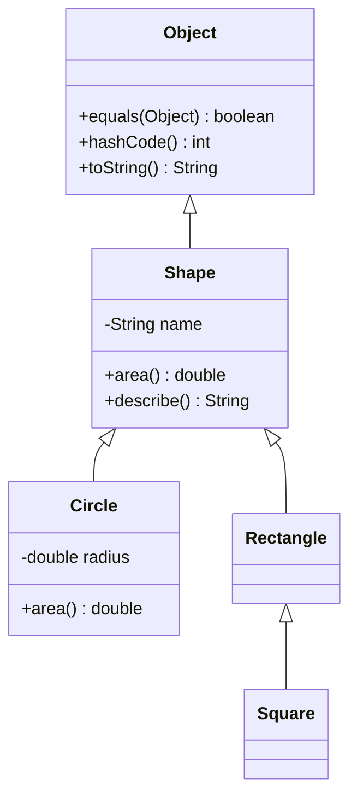
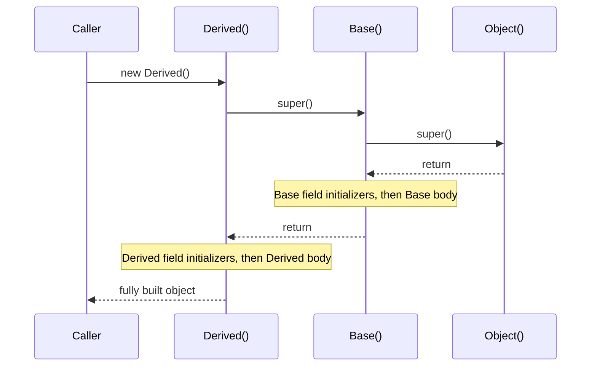

## Introduction

Imagine a payroll system with three kinds of staff: regular employees, managers and directors. All three have a name and a base salary, all three are paid at the end of the month, and all three appear in the same reports. The only real difference is how their bonus is calculated. If you write three unrelated classes, you copy the name, the salary, the pay calculation and the report formatting three times. When the company changes how pay is rounded, you have to find and fix all three copies, and the day someone forgets one, two kinds of employee are paid differently by accident.

**Inheritance** is Java's way of saying "this class is a more specific version of that one". You write the shared parts once, in a general class, and declare that the specific classes **extend** it. Each specific class automatically has the general class's fields and methods, adds whatever is new, and replaces only the behaviour that differs. A `Manager` is an `Employee` with a different bonus rule; you write the bonus rule and nothing else.

Inheritance does a second, equally important job: it creates a **type relationship**. Because a `Manager` is an `Employee`, any code written for `Employee` — a payroll loop, a report, a method parameter — accepts a `Manager` without change. That is what makes [[c1-polymorphism]] possible, and it is why the whole Java standard library is organised in hierarchies: every exception extends `Throwable`, every collection class sits under `Collection`, and every class of all extends `java.lang.Object`.

This lesson teaches inheritance as the Java language defines it: what `extends` gives you, the exact rules for overriding, the order in which a subclass object is constructed, the `super` keyword, and the root class `Object`. It ends with the judgement that matters most in practice — when inheritance is the wrong tool.

## Before you start

You need:

- **Classes and objects** — fields, methods, `new`, and what a reference holds. See [[c1-classes]] and [[c1-oop]].
- **Constructors** — what a constructor does and how `this(...)` chains them. See [[c1-constructors]].
- **Access modifiers** — `private`, package-private, `protected` and `public`, because they decide what a subclass can see. See [[c1-access-modifiers]].

The OOP lesson introduced inheritance as one of the four pillars with a short example. This lesson assumes nothing beyond that introduction and goes through the rules in full.

## The intuition

Think of a car manufacturer's platform. Engineers design one chassis — frame, steering, braking, wiring — and then build a hatchback, a saloon and an estate on top of it. Each model adds its own body and interior and may swap a component (a stiffer suspension for the estate), but none of them redesigns the brakes. A fix to the shared brake design reaches every model at once. And a mechanic trained on the platform can service all three, because they all have the platform's controls in the same places.

Inheritance gives you the same two things. The subclass reuses the parent's implementation (the chassis), and anyone who knows how to work with the parent type can work with the subclass (the mechanic). The analogy also shows the risk, which we return to at the end: if the platform team changes the chassis in a way one model was quietly relying on, that model breaks even though nobody touched it.

## Declaring a subclass

A class extends another with the `extends` keyword. The class being extended is the **superclass** (also called the parent or base class); the new class is the **subclass** (child or derived class).

```java title="Shapes.java"
class Shape {
    private final String name;

    Shape(String name) { this.name = name; }

    String name() { return name; }
    double area() { return 0; }
    String describe() { return name + " with area " + String.format("%.2f", area()); }
}

class Circle extends Shape {
    private final double radius;

    Circle(double radius) {
        super("circle");               // run Shape's constructor for the inherited part
        this.radius = radius;
    }

    @Override
    double area() { return Math.PI * radius * radius; }

    double diameter() { return 2 * radius; }   // new behaviour only circles have
}

public class Shapes {
    public static void main(String[] args) {
        Circle c = new Circle(1.5);
        System.out.println(c.describe());      // inherited method, overridden area()
        System.out.println(c.name());          // inherited method
        System.out.println(c.diameter());      // Circle's own method

        Shape s = c;                           // a Circle is a Shape
        System.out.println(s.describe());
    }
}
```

```output
circle with area 7.07
circle
3.0
circle with area 7.07
```

`Circle` declares only a radius, a constructor, an `area` override and one new method. It still answers `describe()` and `name()`, because it inherits them from `Shape`. Notice that `describe()` — written in `Shape`, with no knowledge that circles exist — calls `area()` and gets the circle's version. That is overriding at work, and it is the reason inheritance is more than copy-and-paste: parent code calls back into child behaviour.

The last two lines show the type relationship. `Shape s = c` needs no cast, because every `Circle` is a `Shape`. This is called an **upcast**, and it is always safe.

### What is inherited, and what is not

The Java Language Specification is precise about which **members** (fields, methods and nested types) a subclass inherits:

| Member in the superclass | Inherited by the subclass? |
|---|---|
| `public` and `protected` fields, methods and nested types | Yes |
| Package-private members | Only if the subclass is in the **same package** |
| `private` members | No — the subclass cannot name them |
| `static` fields and methods | Yes, as members (but static methods are hidden, never overridden) |
| Constructors | **No** — constructors are not members |
| Instance and static initializer blocks | No, but they still run when an object is built |

Two rows in that table cause most of the confusion.

**Private fields are not inherited, but they still exist.** `Circle` cannot write `name` — the compiler rejects it because `name` is private to `Shape`. Yet every `Circle` object holds a `name` value; `c.name()` returns it. The rule is about *visibility in source code*, not about memory. When the JVM allocates a `Circle`, it allocates one object with room for every instance field of every class in the chain: `Shape.name` and `Circle.radius` side by side. The subclass reaches the private parts only through methods the parent chooses to expose. That is encapsulation working across a hierarchy: `Shape` keeps the right to change how it stores its name.

**Constructors are not inherited.** `Shape(String)` does not give `Circle` a `Circle(String)` constructor. Each class declares its own constructors, and each one must start by running a superclass constructor — the subject of the `super` section below. The reasoning is sound: a parent constructor only knows how to initialise the parent's fields. If `new Circle("circle")` were allowed, `radius` would never be set.

The package-private row has a subtle consequence. If `Shape` lived in package `geo` and declared a package-private method `void reset()`, a subclass in package `app` that declares its own `void reset()` does not override it. The two methods merely share a name, and `Shape`'s code keeps calling its own `reset()`. Use `protected` for methods designed to be overridden from other packages.

### One superclass only

A Java class can extend **exactly one** class. If you write no `extends` clause, the compiler uses `extends Object`. So every class has exactly one direct superclass except `Object` itself, and the classes form a single tree rooted at `Object`.

Languages such as C++ allow a class to have several superclasses, and that brings a well-known ambiguity called the **diamond problem**: if `B` and `C` both extend `A` and both override `speak()`, and `D` extends both `B` and `C`, which `speak()` does `D` get, and does a `D` contain one copy of `A`'s fields or two? Java's designers avoided the question by allowing one superclass. A class may still **implement** any number of interfaces, because interfaces carry no instance state. Since Java 8, interfaces can carry method bodies (`default` methods), and Java resolves clashes between them with explicit rules rather than silently — see [[c1-interfaces]] and [[c1-default-methods]].



## Overriding methods

A subclass **overrides** an inherited instance method by declaring a method with the same name and the same parameter types. From then on, whenever that method is called on an object of the subclass — whatever the declared type of the reference — the subclass's version runs. The mechanism behind that run-time choice is [[c1-dynamic-binding]]; here we focus on the rules a valid override must follow.

### The @Override annotation

Put `@Override` on every method you intend as an override. It does nothing at run time; it asks the compiler to confirm that the method really overrides something. Without it, a small mistake creates a *new* method instead:

```java title="Rules.java"
class Reader {
    public String read() { return ""; }
}

class TypoReader extends Reader {
    @Override
    public String reed() { return "typo"; }
}
```

```output
Rules.java:6: error: reed() in TypoReader does not override or implement a method from a supertype
    @Override
    ^
1 error
```

Without the annotation this compiles, `TypoReader` gains a method nobody calls, and every `read()` call quietly runs the parent version. The same thing happens with a wrong parameter type, which is the classic `equals(Point)` bug described in [[c1-overload-vs-override]]. `@Override` turns a run-time mystery into a compile-time error, so treat it as mandatory.

### The rules a valid override must follow

An override is a promise: code that holds a `Reader` reference must be able to call `read()` on any subclass object and get something that honours `Reader`'s declaration. Every override rule exists to keep that promise.

| Rule | Allowed | Rejected | Why |
|---|---|---|---|
| Same name and parameter types | `read()` overrides `read()` | `read(int)` is an overload, not an override | Parameter types are part of the method's identity |
| Return type | Same type, or a subtype for reference types (**covariant return**, Java 5+) | An unrelated type; any change to a primitive return type | Callers expecting a `Shape` can use a `Circle` |
| Access | Same or wider (`protected` to `public`) | Narrower (`public` to package-private) | Callers with a parent reference must still be allowed to call it |
| Checked exceptions | Same, fewer, narrower, or none | New or broader checked exceptions | Callers only catch what the parent declared |
| Unchecked exceptions | Anything | — | The compiler does not track them |
| `final` in the parent | — | Any override | `final` means "this behaviour is fixed" |
| `static` in either class | — | Instance method overriding static, or the reverse | Static methods are hidden, never overridden ([[c1-static-no-override]]) |

Here is what the compiler says when the access or exception rule is broken. Both subclasses below try to override `public String read() throws IOException`:

```java title="Rules.java"
import java.io.IOException;

class Reader {
    public String read() throws IOException { return ""; }
}

class QuietReader extends Reader {
    @Override
    String read() { return "quiet"; }          // narrower access
}
```

```output
Rules.java:9: error: read() in QuietReader cannot override read() in Reader
    String read() { return "quiet"; }          // narrower access
           ^
  attempting to assign weaker access privileges; was public
1 error
```

With the same `Reader` class above it in the file:

```java title="Rules.java"
class AnyReader extends Reader {
    @Override
    public String read() throws Exception { return "any"; }   // broader checked exception
}
```

```output
Rules.java:9: error: read() in AnyReader cannot override read() in Reader
    public String read() throws Exception { return "any"; }   // broader checked exception
                  ^
  overridden method does not throw Exception
1 error
```

The reasoning behind both is the same. A caller wrote `try { reader.read(); } catch (IOException e) { ... }` against the `Reader` type. If a subclass could throw a checked `Exception` that is not an `IOException`, that caller's code would have an uncaught checked exception that the compiler never warned about. If a subclass could make `read()` package-private, code in another package holding a `Reader` would be calling a method it is not allowed to call.

The permitted direction is the opposite: an override may promise *more*. This override widens access, returns a narrower type and drops the checked exception, all of which are legal:

```java title="Covariant.java"
class Shape implements Cloneable {
    protected Shape copy() throws CloneNotSupportedException {
        return (Shape) clone();
    }
}

class Circle extends Shape {
    final double r;
    Circle(double r) { this.r = r; }

    @Override
    public Circle copy() {                     // wider access, narrower return, no checked exception
        return new Circle(r);
    }
}

public class Covariant {
    public static void main(String[] args) {
        Circle c = new Circle(2.0);
        Circle d = c.copy();                   // no cast needed thanks to the covariant return
        System.out.println(d.r + " " + (c != d));
    }
}
```

```output
2.0 true
```

Before Java 5, `copy()` in `Circle` had to return `Shape`, and every caller wrote `(Circle) c.copy()`. Covariant returns remove that cast without weakening anything: a `Circle` *is* a `Shape`, so code that expected a `Shape` still gets one.

### final methods and final classes

Marking a method `final` forbids overriding it; marking a class `final` forbids extending it.

```java title="Rules.java"
class Reader {
    public final String read() { return ""; }
}

class Sub extends Reader {
    public String read() { return "x"; }
}

final class Locked {}
class Breaker extends Locked {}
```

```output
Rules.java:10: error: cannot inherit from final Locked
class Breaker extends Locked {}
                      ^
Rules.java:6: error: read() in Sub cannot override read() in Reader
    public String read() { return "x"; }
                  ^
  overridden method is final
2 errors
```

`String`, `Integer` and the other wrapper classes are `final`. That is a security and correctness decision: if anyone could subclass `String`, a method receiving a "string" could be handed an object whose `equals` or `hashCode` lies, and code that relies on strings being immutable — class loading, file paths, map keys — could be fooled. A `final` method is the same decision on a smaller scale: a template method such as `importAll` in [[c1-abstract-classes]] is `final` so no subclass can skip its validation step.

Java 17 added a middle ground: a **sealed** class lists exactly which classes may extend it (`sealed class Shape permits Circle, Square`). Each permitted subclass must itself be `final`, `sealed` or `non-sealed`. Sealed hierarchies let `switch` check that every subtype is handled; see [[c1-sealed]].

## Fields are hidden, not overridden

Overriding applies to instance methods only. If a subclass declares a field with the same name as a superclass field, it does not replace it: the object now holds **two separate fields**, and which one an expression reads depends on the **declared type** of the reference, decided at compile time. This is called **field hiding**.

```java title="Hiding.java"
class Parent {
    String label = "parent-field";
    String label() { return "parent-method"; }
}

class Child extends Parent {
    String label = "child-field";             // hides Parent.label: a second field
    @Override
    String label() { return "child-method"; }

    void show() {
        System.out.println(label + " | " + super.label);
    }
}

public class Hiding {
    public static void main(String[] args) {
        Child c = new Child();
        Parent p = c;                          // same object, different declared type
        System.out.println(p.label + " | " + p.label());
        System.out.println(c.label + " | " + c.label());
        c.show();
    }
}
```

```output
parent-field | child-method
child-field | child-method
child-field | parent-field
```

`p` and `c` point to the same object, but `p.label` reads the `Parent` field and `c.label` reads the `Child` field. The method call `label()` gives `child-method` both times, because methods are chosen from the object. Inside `Child`, `super.label` reaches the hidden parent field.

Field hiding is almost always a mistake — usually someone added a field to a subclass without noticing the parent already had one with that name. Keep fields `private` and the problem cannot arise, because a private parent field is invisible to the subclass and there is nothing to hide.

## How a subclass object is built

When you write `new Derived()`, the JVM creates **one** object. There is no separate "parent object" inside it. In HotSpot (the standard JVM), the object's layout puts the superclass's fields first and the subclass's fields after them, so compiled code that reads a `Base` field finds it at the same offset in every subclass object. The object's header points to the class `Derived`, which is how the JVM later knows which overrides apply ([[c2-object-header]]).

What is layered is the **initialisation**. The parent's part must be valid before the child's constructor starts relying on it, so Java runs initialisation from the top of the hierarchy down. The full order is:

1. **Class initialisation, once per class**, the first time the class is used: the superclass's static initialisers and static field initialisers run before the subclass's ([[c2-clinit]]).
2. **Memory is allocated** for all instance fields of every class in the chain, and every field is set to its default value (`0`, `false`, `null`).
3. **The `Derived` constructor is invoked.** Its first action is to call a superclass constructor — explicitly with `super(...)`, or implicitly with `super()`.
4. That chain continues up to `Object()`. Then, on the way back down, **each class's instance field initialisers and instance initialiser blocks run, followed by the rest of that class's constructor body**: first `Base`, then `Derived`.

The program below prints each step. It also contains a deliberate trap: `Base`'s constructor calls `describe()`, which `Derived` overrides.

```java title="InitOrder.java"
class Base {
    static { System.out.println("1. Base static initializer"); }

    private final int baseId = log("3. Base field initializer", 7);

    Base() {
        System.out.println("4. Base constructor body");
        describe();                        // overridable call: runs Derived.describe()
    }

    void describe() { System.out.println("   Base.describe"); }

    static <T> T log(String msg, T value) {
        System.out.println(msg);
        return value;
    }
}

class Derived extends Base {
    static { System.out.println("2. Derived static initializer"); }

    private final String name = log("5. Derived field initializer", "widget");
    private int size = 10;

    Derived() {
        super();                           // the compiler inserts this if omitted
        System.out.println("6. Derived constructor body: name=" + name + ", size=" + size);
    }

    @Override
    void describe() {
        System.out.println("   Derived.describe: name=" + name + ", size=" + size);
    }
}

public class InitOrder {
    public static void main(String[] args) {
        new Derived();
        System.out.println("--- second object");
        new Derived();
    }
}
```

```output
1. Base static initializer
2. Derived static initializer
3. Base field initializer
4. Base constructor body
   Derived.describe: name=null, size=0
5. Derived field initializer
6. Derived constructor body: name=widget, size=10
--- second object
3. Base field initializer
4. Base constructor body
   Derived.describe: name=null, size=0
5. Derived field initializer
6. Derived constructor body: name=widget, size=10
```

Read it in order. The static initialisers ran once, parent first, and did not run again for the second object. For each object, `Base`'s field initialiser and constructor ran before anything in `Derived`. Then look at the indented line. `Base`'s constructor called `describe()`, and because the object is a `Derived`, `Derived.describe()` ran — **before `Derived`'s field initialisers had executed**. It saw `name` as `null` and `size` as `0`, the default values from step 2, even though `name` is declared `final` and initialised on the same line.

> [!WARNING] Never call an overridable method from a constructor
> A superclass constructor runs while the subclass's fields still hold default values. If it calls a method the subclass overrides, that override sees `null`s and zeros and can throw `NullPointerException` or record wrong state. Constructors should call only `private`, `static` or `final` methods. *Effective Java* states this as a rule for any class designed for inheritance.

One detail can make this bug harder to spot. If `name` were declared `private final String name = "widget";`, the early call would print `widget`, because a `final` field initialised with a compile-time constant is inlined by the compiler wherever it is read. Change the initialiser to `String.valueOf("widget")` and it prints `null` again. Do not rely on either behaviour; avoid the call.



## super Keyword {#c1-super-keyword}

The **`super` keyword** lets a subclass refer to the part of itself that it inherited from its direct superclass. It has two forms. `super(...)` calls a superclass **constructor**, and `super.member` reaches the superclass's version of a **method** or **field** when the subclass has overridden or hidden it. Both exist for the same reason: a subclass usually wants to *extend* its parent's behaviour, not throw it away, and it needs a way to say "do what my parent does, and then do this".

### Calling a superclass constructor: super(...)

Every constructor, except `Object()`, starts by running a constructor of its direct superclass, so that the inherited fields are initialised before the subclass touches them. You choose which one with `super(arguments)`. If a constructor begins with neither `super(...)` nor `this(...)`, the compiler inserts `super()` — a call to the superclass's no-argument constructor. If the superclass has no such constructor, compilation fails with "constructor ... cannot be applied to given types" ([[c1-constructors]] shows the full error).

```java
class Account {
    private final String owner;
    Account(String owner) { this.owner = owner; }
}

class SavingsAccount extends Account {
    private final double rate;

    SavingsAccount(String owner, double rate) {
        super(owner);          // Account sets up owner; SavingsAccount cannot, owner is private
        this.rate = rate;
    }
}
```

The call is not optional politeness. `owner` is private to `Account`, so `SavingsAccount` has no way to set it except by asking `Account`'s constructor to do so. This keeps `Account` in control of its own invariants: if its constructor rejects a blank owner, no subclass can create an account that skips the check.

The rules for `super(...)`:

- It may appear only in a constructor, and a constructor can call either `super(...)` or `this(...)`, not both. A constructor that starts with `this(...)` delegates the `super(...)` call to the constructor it chains to.
- Up to Java 24 it must be the **first statement**. Java 25 finalised *flexible constructor bodies* (JEP 513): statements may come before `super(...)` as long as they do not use the object being built — they can validate or compute arguments, but cannot read `this` fields or call instance methods. Compiling such code with `--release 21` fails with "flexible constructors is not supported in -source 21". The details are in [[c1-constructors]].
- Arguments to `super(...)` cannot refer to the object's own instance fields or methods, because the object is not initialised yet. Static methods and constructor parameters are fine, which is why helpers such as `super(validate(owner))` are written as `static`.

### Calling a superclass method: super.method()

Inside an instance method, `super.method(args)` calls the superclass's implementation of `method`, skipping any override in the current class. The most common use is an override that adds to the parent's behaviour:

```java title="SuperDemo.java"
class Employee {
    protected final String name;
    protected final int baseSalary;

    Employee(String name, int baseSalary) {
        this.name = name;
        this.baseSalary = baseSalary;
    }

    int pay() { return baseSalary + bonus(); }   // bonus() is dispatched on the real object
    int bonus() { return 0; }
    String describe() { return name + " earns " + pay(); }
}

class Manager extends Employee {
    private final int reports;

    Manager(String name, int baseSalary, int reports) {
        super(name, baseSalary);                  // parent initialises name and baseSalary
        this.reports = reports;
    }

    @Override
    int bonus() { return reports * 100; }

    @Override
    String describe() { return super.describe() + " and manages " + reports; }
}

class Director extends Manager {
    Director(String name, int baseSalary, int reports) {
        super(name, baseSalary, reports);
    }

    @Override
    int bonus() { return super.bonus() * 2; }    // extend, do not replace

    @Override
    String describe() { return "Director " + super.describe(); }
}

public class SuperDemo {
    public static void main(String[] args) {
        System.out.println(new Employee("Asha", 5000).describe());
        System.out.println(new Manager("Ben", 6000, 3).describe());
        System.out.println(new Director("Chen", 8000, 5).describe());
    }
}
```

```output
Asha earns 5000
Ben earns 6300 and manages 3
Director Chen earns 9000 and manages 5
```

Trace the director's line, because it shows the one thing about `super` that surprises people. `Director.describe()` calls `super.describe()`, which runs `Manager.describe()`. That calls `super.describe()` again, which runs `Employee.describe()`. Each `super` call moves exactly one level up, statically. But `Employee.describe()` then calls `pay()`, and `pay()` calls `bonus()` — and those are ordinary calls on `this`, and `this` is still the `Director` object. So `Director.bonus()` runs, which calls `super.bonus()` (`Manager`'s: 5 × 100 = 500) and doubles it to 1000. The pay is 8000 + 1000 = 9000.

The rule to remember: **`super.method()` chooses which code runs for that one call; it does not change what `this` is.** Any further overridable calls made inside the parent's code still dispatch on the real object. In bytecode, a `super.bonus()` call compiles to `invokespecial`, which names the exact method to run, while a plain `bonus()` compiles to `invokevirtual`, which looks at the object's class ([[c1-dynamic-binding]]).

### Reaching a hidden field: super.field

`super.label` reads the superclass's field when the subclass declares a field with the same name, as in the field-hiding example earlier. It works, but needing it is a design smell: rename the field or make the parent's field private.

### What super cannot do

`super` has deliberate limits:

- **No `super.super`.** A class can reach only its direct superclass. `super.super.hi()` is not valid syntax (javac reports "<identifier> expected"). This protects the middle class: if `Manager` adds a rule to `bonus()`, a `Director` should not be able to bypass it and call `Employee.bonus()` directly.
- **Not in static code.** `super`, like `this`, refers to the current object, and a static method has none. Using it there fails with "non-static variable super cannot be referenced from a static context".
- **Not to call private members.** `super.secret()` fails if `secret` is private in the parent, for the same reason the subclass cannot call it at all.
- **Not as a value.** You cannot write `Object o = super;`. There is no separate parent object to refer to; `super` is only a way to start a member lookup one level higher.

### Interface.super.method()

There is one more form, used with interfaces. When a class implements an interface with a `default` method and overrides it, it can still call the interface's version with `InterfaceName.super.method()`. This is how a class resolves two conflicting defaults from two interfaces:

```java
class SmartPhone implements Camera, Phone {
    @Override
    public String describe() {
        return Phone.super.describe() + " with " + Camera.super.describe();
    }
}
```

The interface named must be a direct superinterface of the class. The full rules for default-method conflicts are in [[c1-interfaces]].

```quiz
Q: `Director.describe()` calls `super.describe()`, which runs `Manager.describe()`. Inside `Manager.describe()`, the code calls `bonus()`. Whose `bonus()` runs when the object is a `Director`?
- [ ] `Manager.bonus()`, because the code is executing inside `Manager`
- [ ] `Employee.bonus()`, because `super` always reaches the top
- [x] `Director.bonus()`, because `super` only selects the code for one call and `this` is still the Director
- [ ] It does not compile, because `bonus()` is ambiguous
> A super call is resolved statically to the parent's method body, but it does not change the object. Plain calls inside that body, such as bonus(), are dispatched on the runtime class of this, which is Director. That is why the director earned 9000 in the example.
```

## java.lang.Object {#c1-object-class}

**`java.lang.Object`** is the class at the root of every Java class hierarchy. Any class that does not name a superclass extends `Object` implicitly, so every object you will ever create — your own classes, strings, arrays, lambdas' generated classes — is an `Object` and has `Object`'s methods. That shared root is what lets general-purpose code exist: a `HashMap` can store any key because it can call `equals` and `hashCode` on any object, and `System.out.println` can print any object because it can call `toString`.

Primitive values (`int`, `double`, `boolean` and the rest) are not objects and do not extend `Object`. When a primitive is used where an `Object` is required — adding an `int` to a `List<Object>` — Java converts it to its wrapper class through autoboxing ([[c1-autoboxing]]). Arrays, on the other hand, are objects: an `int[]` extends `Object` directly, which is why `Object o = new int[3];` compiles.

### The methods every class inherits

`Object` declares eleven methods (plus a public no-argument constructor). Running `javap java.lang.Object` on JDK 26 lists them:

| Method | What the inherited version does | Override it? |
|---|---|---|
| `boolean equals(Object o)` | Returns `this == o` — identity | For value-like classes; always together with `hashCode` |
| `int hashCode()` | An identity-based number, stable for the object's lifetime | Whenever you override `equals` |
| `String toString()` | `getClass().getName() + "@" + Integer.toHexString(hashCode())` | Almost always, for logs and debugging |
| `Class<?> getClass()` | The runtime class of the object | Cannot — it is `final` |
| `Object clone()` | `protected`; field-by-field shallow copy, only if the class implements `Cloneable` | Rarely; prefer copy constructors |
| `void wait()` (three overloads), `notify()`, `notifyAll()` | Low-level thread coordination on the object's monitor | Cannot — all `final` |
| `void finalize()` | Called by the garbage collector, maybe, before reclaiming the object | Never — deprecated for removal since Java 18 |

Here is what the inherited `equals`, `hashCode` and `toString` do for a class that does not override them:

```java title="ObjectDefaults.java"
import java.util.HashSet;
import java.util.Set;

class Point {
    final int x, y;
    Point(int x, int y) { this.x = x; this.y = y; }
}

public class ObjectDefaults {
    public static void main(String[] args) {
        Point a = new Point(1, 2);
        Point b = new Point(1, 2);

        System.out.println(a.toString().startsWith("Point@"));
        System.out.println(a.toString().equals(
                "Point@" + Integer.toHexString(a.hashCode())));
        System.out.println(a.equals(b));             // inherited: identity comparison
        System.out.println(a.equals(a));
        System.out.println(a.getClass().getName());

        Set<Point> set = new HashSet<>();
        set.add(a);
        System.out.println(set.contains(b));         // false: b is a different object

        Object o = new int[] {1, 2, 3};              // arrays are objects too
        System.out.println(o.getClass().getSimpleName() + " " + (o instanceof Object));
    }
}
```

```output
true
true
false
true
Point
false
int[] true
```

Printing `a` directly gives something like `Point@6d06d69c`; the hex digits are the identity hash code and differ between runs, which is why the program tests the format instead of printing it. The important line is `a.equals(b)` returning `false`: two points with the same coordinates are different objects, and the inherited `equals` compares identity. So a `HashSet` containing `a` does not contain `b`. For a class that represents a value — a point, a money amount, an email address — that is wrong, and you fix it by overriding.

### equals and hashCode: a contract, not two methods

`equals` and `hashCode` must be overridden **together**, because hash-based collections use both. A `HashMap` first uses `hashCode()` to find the bucket, then `equals()` to find the entry within it. The contract in `Object`'s documentation says, among other things, that **equal objects must have equal hash codes**. Override `equals` alone and two equal points will usually land in different buckets, so the map never even compares them.

```java title="ObjectOverrides.java"
import java.util.Arrays;
import java.util.HashSet;
import java.util.Objects;
import java.util.Set;

final class Point {
    private final int x, y;
    Point(int x, int y) { this.x = x; this.y = y; }

    @Override
    public boolean equals(Object o) {              // parameter must be Object
        if (this == o) return true;
        if (!(o instanceof Point other)) return false;
        return x == other.x && y == other.y;
    }

    @Override
    public int hashCode() { return Objects.hash(x, y); }   // equal objects, equal hashes

    @Override
    public String toString() { return "Point(" + x + ", " + y + ")"; }
}

class Scores implements Cloneable {
    int[] values = {90, 80};

    @Override
    public Scores clone() {
        try {
            return (Scores) super.clone();         // Object.clone: field-by-field copy
        } catch (CloneNotSupportedException e) {
            throw new AssertionError(e);           // cannot happen: we implement Cloneable
        }
    }
}

public class ObjectOverrides {
    public static void main(String[] args) {
        Point a = new Point(1, 2);
        Point b = new Point(1, 2);
        System.out.println(a + " equals " + b + ": " + a.equals(b));
        Set<Point> set = new HashSet<>(Set.of(a));
        System.out.println(set.contains(b));

        Scores original = new Scores();
        Scores copy = original.clone();
        copy.values[0] = 0;                        // both objects share one array
        System.out.println(Arrays.toString(original.values) + " " + (original != copy));
    }
}
```

```output
Point(1, 2) equals Point(1, 2): true
true
[0, 80] true
```

Three details in `Point` matter. The parameter of `equals` is `Object`, not `Point` — a `Point` parameter would *overload* `equals` instead of overriding it, and collections would never call it. The `instanceof` pattern (Java 16+) both checks the type and handles `null`, since `null instanceof Point` is `false`. And the class is `final`: an `instanceof`-based `equals` can break symmetry when a subclass adds a field of its own, which is a real reason to make value classes final or to use a `record`, which generates all three methods for you ([[c1-records]]). The complete rules are in [[c1-equals]] and [[c1-hashcode]].

### clone, and why it is avoided

`Object.clone()` makes a new object of the same class and copies each field's value. For a primitive field that is a real copy; for a reference field it copies the **reference**, so both objects share the referenced object. The `Scores` example shows the consequence: changing `copy.values[0]` changed `original.values[0]` too, because there is only one array. That is a **shallow copy**.

`clone` has other awkward properties. It is `protected` in `Object`, so you must override it as `public` to make it callable. It works only if the class implements the marker interface `Cloneable`; otherwise `Object.clone()` throws `CloneNotSupportedException`. It creates the object without running any constructor, so constructor validation is skipped. And it cannot assign `final` fields in the copy, which makes deep copies of immutable-style classes painful. Most modern code uses a **copy constructor** (`new Scores(original)`) or a static factory instead, where you decide explicitly which fields are copied deeply.

### getClass, wait/notify and finalize

`getClass()` returns the object's runtime class as a `Class` object — the entry point to reflection and the source of the class name in the default `toString`. It is `final`, so an object cannot lie about its class. Use it, rather than `instanceof`, only when you need an exact class match.

`wait()`, `notify()` and `notifyAll()` exist on `Object` because every object can serve as a lock (a monitor) in a `synchronized` block, and these methods let threads wait for and signal changes to the state that lock protects. They are `final`, must be called while holding the object's lock, and are covered in [[c3-wait-notify]]. Modern code usually prefers the higher-level tools in `java.util.concurrent`.

`finalize()` was meant as a clean-up hook run before garbage collection. It was never reliable — there is no guarantee when, or whether, it runs — and it slowed down garbage collection. It was deprecated in Java 9 and marked for removal in Java 18 (JEP 421). Use `try`-with-resources for deterministic clean-up and `java.lang.ref.Cleaner` as a safety net ([[c2-finalization-cleaner]]).

### Object and interfaces

An interface does not extend `Object` — interfaces are not classes. But the Java Language Specification says an interface with no superinterfaces implicitly declares every public method of `Object`, so you can call `toString()` or `equals()` on a reference of interface type such as `List<String>`. The other side of that rule is a restriction: an interface may not declare a `default` method that overrides `equals`, `hashCode` or `toString`. Those behaviours belong to classes, and since a class's method always wins over an interface default, such a default could never run anyway.

```quiz
Q: A class overrides `equals` so that two `Email` objects with the same address are equal, but does not override `hashCode`. What is the most likely result of `set.add(e1); set.contains(e2)` for a `HashSet` when `e1.equals(e2)` is true?
- [ ] `true`, because `HashSet` uses `equals`
- [x] Usually `false`, because the two objects have different identity hash codes and land in different buckets
- [ ] A compile error, because `equals` and `hashCode` must be overridden together
- [ ] A `ClassCastException`
> HashSet looks up the bucket from hashCode() first and only calls equals() on entries in that bucket. The inherited hashCode is identity-based, so equal emails almost always get different hash codes and equals is never called. The compiler does not enforce the pairing, which is why this bug survives into production.
```

## Is-a, substitutability, and when not to inherit

The compiler lets you extend any non-final class. Whether you *should* is a design question, and the simplest test is the **is-a test**: read the declaration aloud. "A `SavingsAccount` is an `Account`" is true. "A `Stack` is a `Vector`" — which is how `java.util.Stack` was written in Java 1.0 — is not: a stack should allow push and pop only, but because it extends `Vector` it also inherits `insertElementAt(obj, 0)`, which lets any caller corrupt the stack's order. The JDK cannot remove that method without breaking old code, so the mistake is permanent.

The precise version of the is-a test is the **Liskov Substitution Principle (LSP)**: an object of a subclass must be usable anywhere an object of the superclass is expected, without the caller noticing a broken promise. A subclass may add behaviour and may make promises stronger, but it must not throw where the parent did not, reject inputs the parent accepted, or return results the parent ruled out. The override rules above enforce the parts of LSP the compiler can check (types, access, checked exceptions); the rest is your responsibility. The principle and its classic counterexample, the square that extends a rectangle, are taught in [[d1-solid]].

Inheritance also couples the subclass to the parent's *implementation*, not just its public promises. If the parent's methods call each other internally and the subclass overrides one of them, the subclass now depends on that internal call pattern, and a harmless-looking change in the parent can break it. This is the **fragile base class problem**, demonstrated with a `HashSet` subclass in [[c1-oop]] and analysed fully in [[d1-composition-vs-inheritance]]. The usual cure is **composition**: hold an instance of the other class in a private field and forward calls to it.

A practical rule that follows from both problems: **design a class for inheritance or forbid it.** A class designed for extension documents which methods are meant to be overridden, which methods call which, and what a subclass must preserve. A class not designed for it should be `final`, or have only private constructors and static factories. Value classes and most service classes fall into the second group.

## Worked example: an exception hierarchy

Exceptions are one of the places where inheritance is unambiguously right, and every Java codebase uses it. A family of related failures gets a common superclass, so callers can handle the whole family in one place or pick out a specific case. The base class holds the shared state; subclasses add details and override only what differs.

```java title="Payments.java"
import java.util.List;

// Base type for every payment failure. Concrete, so code can also throw it directly.
class PaymentException extends RuntimeException {
    private final String orderId;

    PaymentException(String orderId, String message) {
        super(message);                            // Throwable stores the message
        this.orderId = orderId;
    }

    String orderId() { return orderId; }
    boolean retryable() { return false; }

    @Override
    public String toString() {                     // refine Throwable.toString()
        return getClass().getSimpleName() + "[order=" + orderId + "]: " + getMessage();
    }
}

class CardDeclinedException extends PaymentException {
    private final String reason;

    CardDeclinedException(String orderId, String reason) {
        super(orderId, "card declined (" + reason + ")");
        this.reason = reason;
    }

    String reason() { return reason; }
}

class GatewayTimeoutException extends PaymentException {
    GatewayTimeoutException(String orderId, int seconds) {
        super(orderId, "gateway did not answer in " + seconds + "s");
    }

    @Override
    boolean retryable() { return true; }           // the only behaviour that differs
}

public class Payments {
    static void charge(String orderId) {
        switch (orderId) {
            case "A-1" -> throw new CardDeclinedException(orderId, "insufficient funds");
            case "A-2" -> throw new GatewayTimeoutException(orderId, 30);
            case "A-3" -> throw new PaymentException(orderId, "unknown currency");
            default -> System.out.println(orderId + ": charged");
        }
    }

    public static void main(String[] args) {
        for (String id : List.of("A-0", "A-1", "A-2", "A-3")) {
            try {
                charge(id);
            } catch (PaymentException e) {         // one handler for the whole family
                System.out.println(e + " retryable=" + e.retryable());
                if (e instanceof CardDeclinedException d) {
                    System.out.println("  tell the customer: " + d.reason());
                }
            }
        }
    }
}
```

```output
A-0: charged
CardDeclinedException[order=A-1]: card declined (insufficient funds) retryable=false
  tell the customer: insufficient funds
GatewayTimeoutException[order=A-2]: gateway did not answer in 30s retryable=true
PaymentException[order=A-3]: unknown currency retryable=false
```

Walk through what each piece of inheritance is doing:

- **Constructor chaining.** `CardDeclinedException` calls `super(orderId, ...)`, which calls `super(message)` in `RuntimeException`, and so on up to `Throwable`, which stores the message. Each level initialises only its own state. `CardDeclinedException` adds `reason`; it never touches `orderId` directly because that field is private to `PaymentException`.
- **Overriding an `Object` method.** `PaymentException.toString()` replaces the version inherited from `Throwable` (which itself overrides `Object.toString()`). It uses `getClass().getSimpleName()`, so every subclass prints its own name without overriding anything.
- **Overriding one behaviour.** Only `GatewayTimeoutException` overrides `retryable()`. The retry logic in a caller asks `e.retryable()` and never needs to list exception types.
- **Substitutability.** The `catch (PaymentException e)` clause handles all three classes, because each is a `PaymentException`. When the caller needs a subclass-specific detail, the `instanceof` pattern checks and narrows the type in one step.

If a fourth failure type is added next month — say `FraudSuspectedException` — the catch block keeps working without change. That is the payoff of a good hierarchy: new variants plug into code written for the general type.

## In real systems

**The exception hierarchy.** `Throwable` splits into `Error` and `Exception`, and `Exception` into checked exceptions and `RuntimeException`. Spring's data-access layer translates every database driver's errors into its own `DataAccessException` hierarchy, so service code can catch `DuplicateKeyException` or `DataIntegrityViolationException` without knowing whether the database is PostgreSQL or MySQL ([[c1-custom-exceptions]]).

**Skeletal implementations in the JDK.** `AbstractList`, `AbstractMap` and `InputStream` are superclasses designed for extension: implement one or two methods and inherit dozens of correct ones. This is inheritance used deliberately, with the self-use documented ([[c1-abstract-classes]]).

**Framework extension points.** Servlet containers call `HttpServlet.service()`, which dispatches to `doGet` or `doPost` methods that your subclass overrides. Android's `Activity` lifecycle methods and many older frameworks follow the same pattern. Modern frameworks such as Spring prefer interfaces and composition, but you will meet these hierarchies in existing code.

**Final classes in the JDK.** `String`, `Integer`, `LocalDate` and every `record` are final. Immutable value types are a case where inheritance is ruled out on purpose, because a subclass could add mutable state and break the guarantees callers rely on.

## Trade-offs and alternatives

| Approach | Reuses implementation | Creates a subtype | Coupling | Best for |
|---|---|---|---|---|
| `extends` a class | Yes | Yes | High: depends on parent internals | Genuine is-a families; classes designed for extension |
| `implements` an interface | Only `default` methods | Yes | Low: depends on a contract | Capabilities shared by unrelated classes |
| Composition and delegation | Yes, by forwarding | No (unless you also implement an interface) | Low | Reusing behaviour without an is-a relationship |
| `sealed` hierarchy | Yes | Yes, closed set | Controlled | A fixed set of variants handled with `switch` |

Inheritance is the most concise way to share code among closely related classes, and parent code that calls overridable methods gives you powerful extension points. Its costs are that the subclass is tied to the parent's implementation, the single superclass slot is spent, and deep hierarchies become hard to read — to understand a call you may have to look through five classes. A reasonable default is to reach for an interface first, add an abstract base class when several implementations genuinely share state or an algorithm, and keep hierarchies shallow (two or three levels).

## Common mistakes

> [!MISTAKE] Forgetting @Override
> A misspelled name or a wrong parameter type silently creates a new method, and the parent's version keeps running. With `@Override`, the compiler reports "does not override or implement a method from a supertype". Put it on every override, including implementations of interface methods.

**Calling overridable methods from a constructor.** The subclass override runs before the subclass's fields are initialised and sees `null` and `0`. Call only `private`, `final` or `static` methods from constructors.

**Expecting the parent constructor to be inherited.** `new Circle("circle")` does not compile just because `Shape(String)` exists. Declare the constructor in the subclass and forward with `super(...)`.

**Redeclaring a parent's field in the subclass.** This creates a second field, and the one you read depends on the reference's declared type. Keep fields private and access them through methods.

**Overriding a package-private method from another package.** The subclass method does not override it; the parent's code keeps calling its own version. Make intended extension points `protected`.

**Overriding `equals` without `hashCode`**, or writing `equals(MyType)` instead of `equals(Object)`. Both break `HashMap` and `HashSet`. Override both, with an `Object` parameter, or use a record.

**Extending a class only to reuse a few methods.** If "X is a Y" is false, the subclass inherits a public API it should not have, as `Stack` did from `Vector`. Use composition.

## Interview perspective

Inheritance questions test whether you know the exact rules and whether you have the judgement to avoid inheritance when it does not fit.

> [!INTERVIEW] Construction order with a twist
> A favourite question prints from static blocks, field initialisers and constructors of a parent and child and asks for the output. State the order out loud: parent statics, child statics (once); then for each object, parent field initialisers and constructor body, then child field initialisers and constructor body. Then point out the trap: an overridable method called from the parent constructor runs the child's version and sees default field values.

Questions you should be able to answer:

- **Why does Java allow only one superclass?** To avoid ambiguity about which inherited implementation and which copy of inherited state an object has. Interfaces provide multiple inheritance of type; default-method conflicts must be resolved explicitly.
- **What happens if the parent has no no-argument constructor?** Every subclass constructor must call an existing parent constructor with `super(...)`; otherwise the implicit `super()` fails to compile.
- **Are private members inherited?** Not as members — the subclass cannot name them — but the fields exist in every subclass object and are reachable through inherited methods.
- **Can you override a static method?** No; a same-signature static method in the subclass hides the parent's, and the call is chosen from the declared type ([[c1-static-no-override]]).
- **Can an override throw a new exception?** Any unchecked exception, yes; a new or broader checked exception, no.
- **What does every class inherit from `Object`, and which should you override?** `equals`, `hashCode`, `toString`, `getClass`, `clone`, `wait`/`notify`/`notifyAll`, `finalize`. Override `toString` for diagnostics, and `equals` with `hashCode` for value semantics.
- **When would you not use inheritance?** When the is-a statement is false, when only a few methods are being reused, or when the parent was not designed for extension. Mention LSP and the fragile base class problem.

A strong follow-up answer to "how would you prevent subclasses from breaking your class?" covers `final` classes and methods, `sealed` hierarchies, private fields with protected accessor methods, and documenting self-use for classes meant to be extended.

## Practice

1. **Predict, then run.** Add a static field initialiser and an instance initializer block `{ ... }` to both `Base` and `Derived` in `InitOrder`, each printing a line. Write down the full output before running it.
2. **Fix the constructor trap.** Change `Base` so that it no longer calls `describe()` from its constructor but still logs a description of every new object. (Hint: a static factory method that constructs the object and then calls `describe()`.)
3. **Override rules.** Given `protected Number total() throws IOException` in a parent, write four overrides in subclasses — one each that changes the return type to `Integer`, widens access to `public`, removes the `throws` clause, and throws `UncheckedIOException` — and confirm all compile. Then write one that fails for each rule.
4. **Value class.** Write a `Money` class with currency and amount, overriding `equals`, `hashCode` and `toString`. Show that two equal amounts are found in a `HashSet`. Then rewrite it as a record and compare the code.
5. **Design review.** A colleague writes `class AdminUser extends ArrayList<Permission>` to "reuse list methods". Explain what is wrong in terms of the is-a test, and rewrite it with composition.

## Quick revision {#quick-revision}

- `class B extends A`: one superclass only; no `extends` means `extends Object`.
- Inherited: `public`/`protected` members, package-private members in the same package, static members. Not inherited: `private` members (but their fields still exist in the object), constructors, initializer blocks.
- Override = same name and parameter types. Return type same or covariant (reference types), access same or wider, checked exceptions same or narrower. Use `@Override` always.
- `final` method cannot be overridden; `final` class cannot be extended; `sealed` (Java 17) restricts subclasses to a list.
- Fields and static methods are **hidden**, not overridden: selected by declared type at compile time.
- Construction: parent statics, child statics (once per class); then per object, defaults, parent initialisers and constructor, child initialisers and constructor.
- Overridable method called from a parent constructor sees the child's fields at default values.
- `super(...)`: calls the parent constructor; implicit `super()` if omitted; first statement before Java 25 (flexible constructor bodies in Java 25).
- `super.m()`: runs the parent's `m` for that call only; `this` is unchanged, so calls inside still dispatch on the real object. No `super.super`, no `super` in static code.
- `Object` methods: `equals`/`hashCode` (override together), `toString` (default `Class@hexHash`), `getClass` (final), `clone` (protected, shallow, needs `Cloneable`), `wait`/`notify`/`notifyAll` (final), `finalize` (deprecated for removal).
- Use inheritance for true is-a relationships that satisfy LSP; otherwise prefer composition.

## Key takeaways {#key-takeaways}

- Inheritance does two jobs at once: it reuses the parent's implementation and it makes the subclass a subtype usable wherever the parent is expected.
- A subclass object is one object containing every inherited field, including private ones; visibility rules decide what the subclass's source code can name, not what memory exists.
- Every override rule protects callers who hold a parent-type reference: an override may promise more, never less.
- Initialisation runs from the top of the hierarchy down, so a parent constructor must never call a method the child overrides.
- `super` reaches one level up for one call; it does not change which object `this` refers to.
- Every class inherits `Object`'s methods; value-like classes must override `equals` and `hashCode` together, and almost every class benefits from a meaningful `toString`.
- Inherit only when "X is a Y" is true and substitutable; design a class for extension deliberately or make it `final`.
