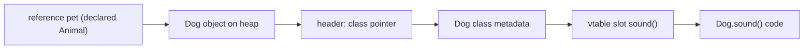

## Introduction

Picture a banking program written as one long list of procedures and global arrays: an array of owner names, an array of balances, and functions such as `withdraw(accountIndex, amount)` that check the rules and update the arrays. It works while the program is small. Then it grows. Ten other files now read and write the `balances` array directly. Someone writes `balances[i] -= fee` in a report generator and forgets the "no negative balance" rule. Someone else adds a savings account type and has to edit every function with an `if (type == SAVINGS)` branch. The rules about accounts are spread across the whole codebase, and nothing stops any line of code from breaking them.

**Object-oriented programming (OOP)** is a way of organising programs that attacks this problem directly. Instead of keeping data in one place and the rules about it in many others, you bundle them together into an **object**: a thing that holds some data (its **state**) and offers a set of operations on that data (its **behaviour**). An account object holds its balance *and* the `withdraw` operation, and it refuses to let anyone change the balance any other way. The rules live in one place, next to the data they protect.

Java is built around this idea. Every method you write lives inside a class, every library you use — collections, strings, HTTP clients, Spring beans — is a set of classes and interfaces, and job interviews for Java roles almost always include questions on OOP design. This lesson gives you the mental model that the rest of Track C builds on: what objects and classes are, what the four "pillars" of OOP mean in practice, how the Java Virtual Machine (JVM) picks which method to run, and how objects are combined into larger ones through aggregation and composition.

## Before you start

You need:

- **Java types** — the difference between a primitive and a reference, and what a reference variable holds. See [[c1-types]] and [[c1-reference-types]].
- **Methods** — declaring and calling methods, parameters and return values. See [[c1-methods]].
- **Arrays and lists** — used in several examples. See [[c1-arrays]].

You do not need to know the details of class syntax yet. This lesson uses classes informally; [[c1-classes]] teaches the syntax rule by rule, and [[c1-encapsulation]] goes deeper into protecting state.

## The intuition

Think of a coffee machine in an office. It has internal state — water level, bean supply, temperature — and a small panel of buttons: "espresso", "latte", "descale". You press a button and it does the work. You cannot reach in and set the water temperature to 300 degrees, because the only way in is the panel, and the machine decides what each button is allowed to do.

That is an object. The internal state is its fields, the buttons are its public methods, and the panel is its **interface**: the set of operations other code is allowed to use. Three useful consequences follow. Users of the machine do not need to know how it works inside. The manufacturer can replace the heating element without retraining anyone, because the buttons stay the same. And a different brand of machine with the same buttons can be swapped in without anyone changing how they order coffee.

Those three consequences are, roughly, encapsulation, abstraction and polymorphism. Where the analogy stops working: a real coffee machine is one physical thing, while in a program you create as many objects as you like from one description, and each has its own separate state. That description is the **class**.

## Objects and classes

A **class** is a description of a kind of object: which fields each object has and which methods it supports. An **object** (also called an **instance**) is one concrete thing created from that description at run time, with its own values in those fields. The class `BankAccount` is written once; the program might create a million `BankAccount` objects, each with a different owner and balance.

Here is the procedural design from the introduction, small enough to run:

```java title="ProceduralAccounts.java"
public class ProceduralAccounts {
    // Parallel arrays: index i describes one account across both arrays.
    static String[] owners = {"Asha", "Ben"};
    static int[] balances = {100, 50};

    static void withdraw(int account, int amount) {
        if (amount > balances[account]) {
            throw new IllegalArgumentException("Insufficient funds");
        }
        balances[account] -= amount;
    }

    public static void main(String[] args) {
        withdraw(0, 30);                 // goes through the rule
        balances[1] -= 500;              // any code can skip the rule
        for (int i = 0; i < owners.length; i++) {
            System.out.println(owners[i] + ": " + balances[i]);
        }
    }
}
```

```output
Asha: 70
Ben: -450
```

The `withdraw` function enforces the rule, but nothing forces anyone to call it. Ben's balance is now `-450`, and the bug could be in any file that can see `balances`. Now the object-oriented version:

```java title="Accounts.java"
class BankAccount {
    private final String owner;
    private int balance;                     // only this class can touch it

    BankAccount(String owner, int openingBalance) {
        if (openingBalance < 0) {
            throw new IllegalArgumentException("Opening balance cannot be negative");
        }
        this.owner = owner;
        this.balance = openingBalance;
    }

    void deposit(int amount) {
        if (amount <= 0) throw new IllegalArgumentException("Deposit must be positive");
        balance += amount;
    }

    void withdraw(int amount) {
        if (amount > balance) throw new IllegalArgumentException("Insufficient funds");
        balance -= amount;
    }

    int balance() { return balance; }
    String owner() { return owner; }
}

public class Accounts {
    public static void main(String[] args) {
        BankAccount asha = new BankAccount("Asha", 100);
        BankAccount ben = new BankAccount("Ben", 50);

        asha.withdraw(30);
        ben.deposit(25);
        System.out.println(asha.owner() + ": " + asha.balance());
        System.out.println(ben.owner() + ": " + ben.balance());

        try {
            ben.withdraw(500);
        } catch (IllegalArgumentException e) {
            System.out.println("Rejected: " + e.getMessage());
        }
        System.out.println(ben.owner() + ": " + ben.balance());
    }
}
```

```output
Asha: 70
Ben: 75
Rejected: Insufficient funds
Ben: 75
```

Walk through what changed. The fields `owner` and `balance` are marked `private`, so code outside `BankAccount` cannot read or write them — `ben.balance -= 500` would not compile. The **constructor** (the block named `BankAccount(...)`) runs once when each object is created with `new`, and it refuses to create an account with a negative opening balance. After that, the only ways to change the balance are `deposit` and `withdraw`, which both check their rules. So the statement "a `BankAccount` never has a negative balance" is now guaranteed by one class of about thirty lines, instead of depending on every line of the program.

Notice also that `asha` and `ben` are two separate objects. Calling `asha.withdraw(30)` changes Asha's balance and leaves Ben's untouched. Each object carries its own copy of the fields, while the code of the methods is shared: there is one `withdraw` method, and inside it `balance` means "the balance of the object this method was called on". That object is called the **receiver**, and in Java you can refer to it explicitly with the keyword `this` (see [[c1-this-keyword]]).

> [!NOTE] Is Java "purely" object-oriented?
> No. Java has eight primitive types (`int`, `double`, `boolean` and so on) whose values are not objects, and it has `static` methods and fields that belong to a class rather than to any object. These were deliberate choices for performance and convenience. Every class you write does, however, inherit from `java.lang.Object`, so every object has methods such as `equals`, `hashCode` and `toString` (see [[c1-object-class]]).

## The four pillars

OOP is usually described through four ideas, often called the four pillars. They are not four separate features you switch on; they are four ways of looking at the same design. Each one has concrete Java mechanisms behind it.

| Pillar | The idea in one sentence | Main Java mechanisms |
|---|---|---|
| Encapsulation | An object protects its own state and exposes only safe operations | `private` fields, methods that check rules, access modifiers |
| Abstraction | Callers depend on *what* an object does, not *how* it does it | interfaces, abstract classes, well-chosen public methods |
| Inheritance | A new type can be defined as a specialised version of an existing one | `extends`, `super`, `@Override` |
| Polymorphism | One piece of code works with many types that share a contract | method overriding, interfaces, dynamic dispatch |

### Encapsulation

**Encapsulation** means keeping an object's data and the code that manages it together, and hiding the data so it can only be changed through that code. You have already seen it: `BankAccount` makes `balance` private and exposes `deposit` and `withdraw`.

The point is not secrecy for its own sake. Encapsulation gives you two practical guarantees. First, **invariants** — facts that must always be true about an object, such as "balance is never negative" — are checked in one place. Second, the internal representation can change without breaking anyone: `BankAccount` could switch from storing an `int` balance to storing a list of transactions and computing the balance on demand, and every caller would keep working because they only ever called `balance()`. The full treatment, including defensive copies and immutability, is in [[c1-encapsulation]].

### Abstraction

**Abstraction** means presenting a simplified view of something that hides details the user does not need. A caller who wants the area of a shape should not need to know whether it is a circle or a rectangle, or which formula applies. In Java, the most direct tool for abstraction is an **interface**: a named list of methods that a type promises to provide, with no commitment about how.

```java title="Shapes.java"
import java.util.List;

interface Shape {
    double area();
    String name();
}

class Circle implements Shape {
    private final double radius;
    Circle(double radius) { this.radius = radius; }
    public double area() { return Math.PI * radius * radius; }
    public String name() { return "circle"; }
}

class Rectangle implements Shape {
    private final double width, height;
    Rectangle(double width, double height) { this.width = width; this.height = height; }
    public double area() { return width * height; }
    public String name() { return "rectangle"; }
}

public class Shapes {
    // Knows nothing about circles or rectangles: only the Shape contract.
    static double totalArea(List<Shape> shapes) {
        double total = 0;
        for (Shape s : shapes) {
            total += s.area();           // which area() runs is decided at run time
        }
        return total;
    }

    public static void main(String[] args) {
        List<Shape> shapes = List.of(new Circle(1), new Rectangle(2, 3), new Circle(0.5));
        for (Shape s : shapes) {
            System.out.printf("%-9s %.2f%n", s.name(), s.area());
        }
        System.out.printf("total     %.2f%n", totalArea(shapes));
    }
}
```

```output
circle    3.14
rectangle 6.00
circle    0.79
total     9.93
```

`totalArea` is written entirely in terms of `Shape`. It would keep working, unchanged, if someone added a `Triangle` class next year. That is what abstraction buys: code that depends on a small, stable contract instead of on a growing set of concrete classes. Interfaces are taught fully in [[c1-interfaces]].

People often confuse abstraction with encapsulation. A useful way to separate them: **abstraction decides what to show** (the `Shape` contract has `area()` and `name()`, nothing else), while **encapsulation enforces that the rest stays hidden** (`radius` is private, so no one can bypass the contract). Good designs use both.

### Inheritance

**Inheritance** lets you define a new class as an extension of an existing one. The new class, the **subclass**, automatically has the fields and methods of the **superclass**, and can add new ones or replace (override) existing methods. In Java you write `class SavingsAccount extends Account`. The relationship is called **is-a**: a savings account *is an* account, so anywhere an `Account` is expected, a `SavingsAccount` can be used.

```java title="Inherit.java"
class Account {
    protected int balance;
    Account(int balance) { this.balance = balance; }
    void endOfMonth() { }                         // plain accounts do nothing
    String describe() { return "Account with " + balance; }
}

class SavingsAccount extends Account {
    private final double rate;
    SavingsAccount(int balance, double rate) {
        super(balance);                           // let the parent set up its part
        this.rate = rate;
    }
    @Override
    void endOfMonth() { balance += (int) Math.round(balance * rate); }
    @Override
    String describe() { return "Savings " + super.describe(); }
}

public class Inherit {
    public static void main(String[] args) {
        Account[] accounts = { new Account(1000), new SavingsAccount(1000, 0.01) };
        for (Account a : accounts) {
            a.endOfMonth();
            System.out.println(a.describe());
        }
        Account a = new SavingsAccount(500, 0.02);
        System.out.println(a.getClass().getSimpleName());
        System.out.println(a instanceof SavingsAccount);
        System.out.println(a instanceof Account);
        System.out.println(a instanceof Object);
    }
}
```

```output
Account with 1000
Savings Account with 1010
SavingsAccount
true
true
true
```

`SavingsAccount` reuses `balance` and `describe` from `Account`, calls the parent constructor with `super(balance)`, and overrides `endOfMonth` to add interest. The `@Override` annotation asks the compiler to check that the method really does replace a superclass method; without it, a typo such as `endOfMonht` would silently create a new method instead. The last four lines show that the object is a `SavingsAccount`, and also an `Account`, and also an `Object`: every Java class sits in a single chain that ends at `Object`.

Java allows a class to extend **only one** class. That avoids the ambiguity of inheriting two different implementations of the same method from two parents. A class can, however, implement any number of interfaces, which is how Java offers "multiple inheritance of type" without multiple inheritance of state. Inheritance has costs that are easy to underestimate, covered in the composition section below and in depth in [[c1-inheritance]].

### Polymorphism

**Polymorphism** ("many forms") means one piece of code can operate on objects of different types, with each object responding in its own way. In both examples above, a loop calls the same method — `s.area()`, `a.endOfMonth()` — and different code runs depending on the object. The caller does not use `if` or `instanceof` to decide; the object decides.

This is the pillar that makes OOP designs extensible. Adding a new kind of shape or account means writing one new class. No existing caller changes, because callers only ever said "do your `area()`". Compare that to the procedural version, where every function that handles accounts would need a new `if (type == ...)` branch. Polymorphism is covered fully in [[c1-polymorphism]]; the mechanism behind it is the subject of the next section.

## How Java decides which method runs

When you write `pet.sound()`, two different types are involved, and confusing them causes many bugs and interview mistakes.

- The **declared type** (also called the static or compile-time type) is the type written in the variable declaration: in `Animal pet = new Dog();` it is `Animal`. The compiler only knows this type.
- The **runtime type** is the class of the object the reference actually points to at that moment: here, `Dog`. Only the running program knows it.

Java uses them for two different jobs. The **declared type decides what you are allowed to call**: the compiler checks that `Animal` has a `sound()` method, and rejects `pet.fetch()` even though the object is a `Dog`, because `Animal` has no `fetch()`. The **runtime type decides which implementation runs** for an overridden instance method. This run-time choice is called **dynamic dispatch** (or dynamic binding, see [[c1-dynamic-binding]]).

Overloading is different. When several methods share a name but take different parameter types, the compiler chooses between them using declared types only, at compile time. The next program shows both rules side by side:

```java title="Dispatch.java"
class Animal {
    String sound() { return "..."; }
}

class Dog extends Animal {
    @Override
    String sound() { return "Woof"; }
    String fetch() { return "fetching"; }
}

public class Dispatch {
    static String describe(Animal a) { return "an animal"; }
    static String describe(Dog d) { return "a dog"; }

    public static void main(String[] args) {
        Animal pet = new Dog();               // declared type Animal, object is a Dog
        System.out.println(pet.sound());      // overriding: chosen from the object
        System.out.println(describe(pet));    // overloading: chosen from the declared type
        // pet.fetch();                       // does not compile: Animal has no fetch()
        if (pet instanceof Dog d) {
            System.out.println(d.fetch());
        }
    }
}
```

```output
Woof
an animal
fetching
```

`pet.sound()` prints `Woof`: the object is a `Dog`, so `Dog.sound()` runs. But `describe(pet)` prints `an animal`, even though the object is a dog, because the compiler chose `describe(Animal)` from the declared type of `pet` before the program ever ran. To use `fetch()` you must first establish that the object is a `Dog`; the `instanceof` pattern (Java 16+) both tests and gives you a variable `d` of type `Dog`. The precise comparison is in [[c1-overload-vs-override]].

> [!INTERVIEW] "What happens when you call `obj.method()`?"
> A strong answer separates the two phases: "At compile time, javac looks at the declared type of `obj`, checks a matching method exists and is accessible, and picks the overload from the declared argument types. At run time, for an overridable instance method, the JVM looks at the object's actual class and runs the most specific override. Static, private and final methods are not dispatched dynamically."

### What the JVM does underneath

Each object on the heap starts with a small **header**. Part of that header is a pointer to the object's class metadata, which the JVM keeps outside the heap in an area called Metaspace. The class metadata holds, among other things, the code of every method and a table used for dispatch, often called the **virtual method table** (vtable). Each overridable method has a fixed slot in that table; a subclass's table copies the parent's slots and replaces the entries it overrides.

A call such as `pet.sound()` compiles to a bytecode instruction called `invokevirtual`, which names `Animal.sound`. At run time, the JVM follows the object's header to its class (`Dog`), looks up the `sound` slot in `Dog`'s table, and jumps to `Dog.sound`. Calls through an interface type compile to `invokeinterface` and use a similar per-class table for interface methods. Static methods compile to `invokestatic` and need no lookup at all, which is why they cannot be overridden.

This lookup sounds slow, but in practice the Just-In-Time (JIT) compiler watches which classes actually appear at each call site. If a call site has only ever seen one class, it can call that method directly or inline it, keeping a cheap check in case a different class turns up later. So in typical modern Java code, small polymorphic calls cost very little. The internals are covered in [[c2-object-header]] and [[c2-inlining]].



## Aggregation & Composition {#c1-aggregation}

Objects rarely work alone. An order has order lines, a department has professors, a car has an engine. When one object holds references to other objects as part of its state, the two are related, and OOP design distinguishes three strengths of that relationship. Getting the distinction right tells you who creates the parts, who may share them, and what happens to them when the whole goes away.

**Association** is the general term: one object knows about another and can use it. A `Teacher` that is handed a `Student` in a method call is associated with it, even if it keeps no reference afterwards.

**Aggregation** is a "has-a" association in which the whole holds references to parts that **exist independently** of it. The parts are usually created elsewhere and passed in, they can belong to several wholes at once, and they carry on existing when the whole is discarded. A department has professors, but a professor can teach in two departments and does not cease to exist when a department is closed.

**Composition** is a stronger "has-a" in which the whole **owns** its parts. The whole creates them (or receives them and takes exclusive ownership), does not share them, and the parts' lifetime ends with the whole's. An order owns its order lines: a line has no meaning outside its order, and no other object should hold on to it.

Java has no keyword for any of these. The difference is expressed entirely through how you write the code: who calls `new`, whether references to the parts are accepted from or handed to outsiders, and whether the part types are even visible outside the whole. In Unified Modeling Language (UML) class diagrams, aggregation is drawn with a hollow diamond on the whole's side and composition with a filled diamond.

```mermaid title="Aggregation (hollow diamond) and composition (filled diamond)"
classDiagram
    Department o-- Professor : employs
    Order *-- OrderLine : owns
    class Department {
        -List~Professor~ members
        +hire(Professor p)
    }
    class Order {
        -List~OrderLine~ lines
        +addLine(sku, qty, price)
    }
```

### Aggregation in code

```java title="University.java"
import java.util.ArrayList;
import java.util.List;

class Professor {
    private final String name;
    Professor(String name) { this.name = name; }
    String name() { return name; }
}

// Aggregation: a department refers to professors that exist independently.
class Department {
    private final String title;
    private final List<Professor> members = new ArrayList<>();

    Department(String title) { this.title = title; }

    void hire(Professor p) { members.add(p); }      // created elsewhere, passed in

    String roster() {
        List<String> names = new ArrayList<>();
        for (Professor p : members) names.add(p.name());
        return title + " " + names;
    }
}

public class University {
    public static void main(String[] args) {
        Professor lin = new Professor("Lin");
        Professor okafor = new Professor("Okafor");

        Department cs = new Department("CS");
        Department maths = new Department("Maths");
        cs.hire(lin);
        cs.hire(okafor);
        maths.hire(lin);                     // the same professor in two departments

        System.out.println(cs.roster());
        System.out.println(maths.roster());

        cs = null;                           // the CS department is now unreachable...
        System.out.println(lin.name() + " still exists");  // ...its members are not
    }
}
```

```output
CS [Lin, Okafor]
Maths [Lin]
Lin still exists
```

The professors are created in `main`, outside any department, and `hire` receives them. The same `Professor` object, `lin`, is referenced from two departments. When `cs` is set to `null`, the CS `Department` object becomes unreachable and the garbage collector may reclaim it, but `lin` is still referenced from `main` and from the maths department, so it survives. That is aggregation: shared, independent parts.

### Composition in code

```java title="Orders.java"
import java.util.ArrayList;
import java.util.List;

// Composition: an Order creates and owns its lines; nobody else holds them.
class Order {
    private final String id;
    private final List<Line> lines = new ArrayList<>();

    // The part type is private and nested: it cannot exist outside an Order.
    private record Line(String sku, int quantity, long unitPriceCents) {
        long total() { return quantity * unitPriceCents; }
    }

    Order(String id) { this.id = id; }

    void addLine(String sku, int quantity, long unitPriceCents) {
        if (quantity <= 0) throw new IllegalArgumentException("quantity must be positive");
        lines.add(new Line(sku, quantity, unitPriceCents));   // the whole creates the part
    }

    long totalCents() {
        long sum = 0;
        for (Line l : lines) sum += l.total();
        return sum;
    }

    int lineCount() { return lines.size(); }
    String id() { return id; }
}

public class Orders {
    public static void main(String[] args) {
        Order order = new Order("A-17");
        order.addLine("BOOK-1", 2, 1_250);
        order.addLine("PEN-9", 3, 199);
        System.out.println(order.id() + ": " + order.lineCount() + " lines, "
                + order.totalCents() + " cents");
    }
}
```

```output
A-17: 2 lines, 3097 cents
```

Here callers never see a `Line` object. They pass raw values to `addLine`, the `Order` validates them and creates the line itself, and the `Line` type is a private nested record, so no other class can even name it. No outside reference to a line can exist, which means that when the order becomes unreachable, its lines do too. Because the order controls every line, it can also guarantee rules across them, such as "quantity is always positive" or "an order has at most 100 lines".

In real code, composition does not always mean a private nested type. A `Car` might accept an `Engine` in its constructor; it is still composition if the car treats the engine as exclusively its own — never hands it out, never lets two cars share it. In garbage-collected Java, "the part dies with the whole" really means "nothing outside the whole keeps a reference", so composition is a discipline you maintain, not something the JVM enforces. If a getter returned the internal `lines` list, outsiders could keep and modify it, and composition would quietly decay into sharing. That is why composition goes hand in hand with defensive copying ([[c1-defensive-copies]]).

| | Association | Aggregation | Composition |
|---|---|---|---|
| Relationship | uses / knows about | has-a (shared) | has-a (owned) |
| Who creates the part | anyone | usually outside the whole | usually the whole |
| Can the part be shared | yes | yes | no |
| Part outlives the whole | yes | yes | no (no outside references remain) |
| Example | `Teacher` grades a `Student` | `Department` and `Professor` | `Order` and its lines |

### Composition over inheritance

"Favour composition over inheritance" is one of the most repeated pieces of design advice in Java, popularised by Joshua Bloch's *Effective Java*. Here "composition" is used broadly: instead of *being* a kind of X (extending it), a class *has* an X (a field) and forwards calls to it. The reason is a real failure mode called the **fragile base class problem**: a subclass depends on implementation details of its superclass that the superclass never promised to keep.

The classic demonstration counts how many elements have been added to a set. The first version extends `HashSet`; the second wraps a `Set`.

```java title="FragileBase.java"
import java.util.Collection;
import java.util.HashSet;
import java.util.List;
import java.util.Set;

// Inheritance: reuse HashSet by extending it.
class CountingHashSet<E> extends HashSet<E> {
    private int addAttempts = 0;

    @Override
    public boolean add(E e) {
        addAttempts++;
        return super.add(e);
    }

    @Override
    public boolean addAll(Collection<? extends E> c) {
        addAttempts += c.size();
        return super.addAll(c);              // the inherited addAll calls add() per element
    }

    int addAttempts() { return addAttempts; }
}

// Composition: hold a Set and forward to it.
class CountingSet<E> {
    private final Set<E> inner;
    private int addAttempts = 0;

    CountingSet(Set<E> inner) { this.inner = inner; }

    boolean add(E e) {
        addAttempts++;
        return inner.add(e);
    }

    boolean addAll(Collection<? extends E> c) {
        addAttempts += c.size();
        return inner.addAll(c);              // inner's add() is not ours, no double count
    }

    int size() { return inner.size(); }
    int addAttempts() { return addAttempts; }
}

public class FragileBase {
    public static void main(String[] args) {
        CountingHashSet<String> extended = new CountingHashSet<>();
        extended.addAll(List.of("a", "b", "c"));
        System.out.println("extends:  " + extended.addAttempts());

        CountingSet<String> composed = new CountingSet<>(new HashSet<>());
        composed.addAll(List.of("a", "b", "c"));
        System.out.println("composes: " + composed.addAttempts());
    }
}
```

```output
extends:  6
composes: 3
```

Three elements were added, but the inheriting version reports six. `HashSet` inherits `addAll` from `AbstractCollection`, whose implementation loops and calls `add` for each element. Because `CountingHashSet` overrides `add`, those internal calls land in the subclass's `add` and are counted a second time. The subclass broke because of *how* its parent implemented a method — a detail that could change in a future JDK release, which would silently change the subclass's behaviour in the other direction.

The composing version cannot have this problem. Its `inner` set calls *its own* `add`, which knows nothing about the counter. The wrapper also works with any `Set` implementation — `HashSet`, `TreeSet`, a concurrent set — chosen at construction time, which inheritance cannot offer. The cost is writing forwarding methods for every operation you want to expose.

Use inheritance when there is a genuine is-a relationship, the subclass can be used anywhere the superclass is expected without surprising anyone (the **Liskov Substitution Principle**), and the superclass was designed and documented for extension. Use composition for everything else, and especially for reusing code from a class you do not control.

```quiz
Q: A `Playlist` holds references to `Song` objects that live in a shared music library, and the same song can appear in many playlists. Which relationship is this?
- [ ] Composition, because the playlist contains songs
- [x] Aggregation, because songs exist independently and are shared
- [ ] Inheritance, because a playlist is a list of songs
- [ ] No relationship, because songs are created elsewhere
> The songs are created outside the playlist, shared between playlists, and survive when a playlist is deleted: that is aggregation. "Contains" alone does not make it composition; composition requires exclusive ownership and a part lifetime bound to the whole.

Q: Why does `CountingHashSet` report 6 after `addAll` of three elements?
- [ ] `HashSet` stores each element twice
- [ ] `List.of` creates duplicates
- [x] The inherited `addAll` calls the overridden `add`, so each element is counted in both methods
- [ ] `addAttempts` is static and shared
> AbstractCollection.addAll is implemented by calling add for each element. Dynamic dispatch sends those calls to the subclass override, which increments the counter again. The subclass depended on an implementation detail of its parent.
```

## Worked example: an alert service

This example uses all four pillars and composition together. An `AlertService` sends alerts through some notification channel, and must never send more than a fixed number of alerts per run. In production it should send email or SMS; in a test it should record what would have been sent.

```java title="Alerts.java"
import java.util.ArrayList;
import java.util.List;

// Abstraction: what a notifier can do, not how.
interface Notifier {
    void send(String recipient, String message);
}

// Polymorphism: two interchangeable implementations.
class EmailNotifier implements Notifier {
    public void send(String recipient, String message) {
        System.out.println("EMAIL to " + recipient + ": " + message);
    }
}

class SmsNotifier implements Notifier {
    public void send(String recipient, String message) {
        String shortText = message.length() > 20 ? message.substring(0, 20) + "..." : message;
        System.out.println("SMS to " + recipient + ": " + shortText);
    }
}

// A test double: records instead of sending.
class RecordingNotifier implements Notifier {
    final List<String> sent = new ArrayList<>();
    public void send(String recipient, String message) { sent.add(recipient + "|" + message); }
}

// Composition + encapsulation: AlertService has a Notifier and guards its own rule.
class AlertService {
    private final Notifier notifier;
    private final int maxAlertsPerRun;
    private int sentThisRun = 0;

    AlertService(Notifier notifier, int maxAlertsPerRun) {
        this.notifier = notifier;
        this.maxAlertsPerRun = maxAlertsPerRun;
    }

    boolean alert(String recipient, String message) {
        if (sentThisRun >= maxAlertsPerRun) {
            return false;                       // rule enforced in exactly one place
        }
        notifier.send(recipient, message);      // dynamic dispatch to whichever notifier
        sentThisRun++;
        return true;
    }
}

public class Alerts {
    public static void main(String[] args) {
        AlertService email = new AlertService(new EmailNotifier(), 5);
        AlertService sms = new AlertService(new SmsNotifier(), 1);

        email.alert("ops@example.com", "Disk usage above 90% on db-1");
        sms.alert("+15550100", "Disk usage above 90% on db-1");
        System.out.println("second SMS sent? " + sms.alert("+15550100", "Still high"));

        RecordingNotifier fake = new RecordingNotifier();
        AlertService underTest = new AlertService(fake, 2);
        underTest.alert("a", "one");
        underTest.alert("b", "two");
        underTest.alert("c", "three");
        System.out.println("recorded: " + fake.sent);
    }
}
```

```output
EMAIL to ops@example.com: Disk usage above 90% on db-1
SMS to +15550100: Disk usage above 90%...
second SMS sent? false
recorded: [a|one, b|two]
```

Trace the design decisions. `Notifier` is the **abstraction**: `AlertService` needs "something that can send a message" and nothing more. `EmailNotifier`, `SmsNotifier` and `RecordingNotifier` are three implementations, and `notifier.send(...)` reaches the right one through **polymorphism**. `AlertService` **composes** a notifier instead of extending one, so the same service class works with any channel chosen when it is constructed. The limit counter is private and changed only inside `alert`, so the rule "at most N alerts per run" is **encapsulated** and cannot be bypassed. The test at the end proves it: three alerts were requested with a limit of two, and only two were recorded.

Passing the dependency in through the constructor, rather than having `AlertService` create its own `EmailNotifier`, is called **dependency injection**. It is the idea Spring is built on ([[c5-di]]), and it is why interface-based designs are so easy to test.

## In real systems

Almost all production Java is organised along OOP lines, but not always in the textbook style of deep class hierarchies.

- **Spring applications** are graphs of objects composed through constructor injection: a controller has a service, a service has repositories and clients. Most of these depend on interfaces, so tests can substitute fakes. Inheritance appears mostly in framework extension points.
- **The JDK collections** show abstraction at scale. Code is written against `List`, `Map` and `Set`, and the implementation (`ArrayList`, `HashMap`, `TreeSet`) is chosen at one creation point.
- **Domain models** use encapsulated entities — an `Order` that validates its own state transitions — and composition for parts like line items and addresses. JPA entities ([[c8-entities]]) are classes whose fields the framework maps to database columns.
- **Modern Java data modelling** combines OOP with ideas from functional programming: immutable `record` types for plain data ([[c1-records]]) and `sealed` hierarchies ([[c1-sealed]]) that let a `switch` handle every subtype, with the compiler checking nothing is missed.

The last style is worth seeing, because it is a deliberate alternative to putting every operation inside the classes:

```java title="Payments.java"
sealed interface Payment permits Card, BankTransfer, Voucher {}
record Card(String last4, long cents) implements Payment {}
record BankTransfer(String iban, long cents) implements Payment {}
record Voucher(String code) implements Payment {}

public class Payments {
    // The operation lives outside the types; the compiler checks every case is handled.
    static String describe(Payment p) {
        return switch (p) {
            case Card c -> "card ending " + c.last4() + " for " + c.cents();
            case BankTransfer t -> "transfer of " + t.cents();
            case Voucher v -> "voucher " + v.code();
        };
    }

    public static void main(String[] args) {
        System.out.println(describe(new Card("4242", 1999)));
        System.out.println(describe(new Voucher("WELCOME10")));
    }
}
```

```output
card ending 4242 for 1999
voucher WELCOME10
```

This needs Java 21 for pattern matching in `switch`. Classic polymorphism makes it easy to add new *types* (write a new class) but adding a new *operation* means editing every class. The sealed-and-switch style is the reverse: adding an operation is one new method, while adding a type forces you to update every switch — and the compiler lists them for you. Neither is always better; choose by which kind of change you expect more often.

## Trade-offs and alternatives

OOP's strengths are real: it keeps rules next to the data they protect, lets you replace implementations behind stable contracts, and maps naturally onto domains full of interacting entities (orders, accounts, users). Interfaces make code testable by letting you substitute fakes.

Its costs show up when it is applied mechanically. Deep inheritance hierarchies become rigid: a change to a base class ripples into every subclass, and understanding one class requires reading all its ancestors. Over-abstraction — an interface and a factory for every class, even where there will only ever be one implementation — adds files and indirection without adding flexibility. Mutable objects shared between many parts of a program are hard to reason about, especially across threads. And "god classes" that accumulate every responsibility undo the benefit of encapsulation by making one object the place where everything changes.

The alternatives are not rivals so much as tools to mix in. Plain functions over immutable data (records, streams, lambdas) suit transformations with no long-lived state. Small procedural scripts do not need classes beyond `main`. In performance-critical loops, allocating many small objects can matter, although escape analysis in the JIT often removes short-lived allocations ([[c2-escape-analysis]]).

| Prefer | When |
|---|---|
| Encapsulated classes | State with rules: accounts, orders, sessions, caches |
| Interfaces + composition | Swappable behaviour, dependencies you want to fake in tests |
| Inheritance | A true is-a relationship with a base class designed for extension |
| Records + sealed types | Plain data and closed sets of variants handled by `switch` |
| Static functions | Stateless helpers such as `Math.max` or formatting utilities |

## Common mistakes

- **Using inheritance only to reuse code.** Extending `ArrayList` to get a list with an extra method ties you to every detail of `ArrayList`, as the counting-set example showed. Hold a list in a field and expose only the operations you need.
- **Subclasses that break the parent's promises.** If code that works with an `Account` misbehaves when given a `SavingsAccount` — say the subclass throws from a method the parent documents as always succeeding — the hierarchy violates the Liskov Substitution Principle. Redesign rather than patch callers with `instanceof` checks.
- **Public fields "for convenience".** Once a field is public, every reader and writer anywhere is part of your contract, and invariants cannot be enforced. Start private.
- **Thinking encapsulation means a getter and setter for every field.** A setter that accepts anything is a public field with extra typing. Expose operations that make sense for the domain (`withdraw`, `ship`, `cancel`).
- **Expecting overloads to dispatch on the runtime type.** `describe(pet)` chose `describe(Animal)` because overload selection uses declared types. Only overriding is dynamic.
- **Leaking internal parts.** Returning an internal mutable list turns composition into sharing and lets callers bypass validation. Return copies or unmodifiable views.
- **Forgetting `equals` and `hashCode` for value-like objects** used as `HashMap` keys or in `HashSet`. The defaults compare identity, so two objects with equal fields are treated as different keys. See [[c1-equals]] and [[c1-hashcode]].

## Interview perspective

OOP questions test whether you can connect vocabulary to concrete design decisions.

- **What are the four pillars?** Name them, and for each give the Java mechanism and the benefit: encapsulation (private state, invariants in one place), abstraction (interfaces, depend on what not how), inheritance (`extends`, reuse and is-a), polymorphism (overriding and dynamic dispatch, extensibility without changing callers).
- **Abstraction versus encapsulation?** Abstraction chooses the simplified view to present; encapsulation hides and protects everything else so the view cannot be bypassed.
- **Composition versus inheritance?** Has-a versus is-a. Prefer composition for flexibility (swap implementations at run time), looser coupling and immunity to the fragile base class problem; use inheritance for genuine is-a relationships with a base designed for it.
- **Aggregation versus composition?** Both are has-a. Aggregated parts exist independently and may be shared; composed parts are owned exclusively and do not outlive the whole. Give a department/professor and order/line example.
- **How does Java support multiple inheritance?** Multiple inheritance of type through interfaces (a class can implement many), but only one superclass, so state and constructors come from a single chain. Since Java 8, interfaces can carry `default` methods, with explicit rules for conflicts ([[c1-default-methods]]).
- **Overloading versus overriding?** Overloading is resolved at compile time from declared argument types; overriding at run time from the receiver's actual class.

A strong signal is naming trade-offs unprompted: mentioning the Liskov Substitution Principle when discussing inheritance, saying when a record or a plain function is simpler than a class hierarchy, and explaining dispatch in terms of declared versus runtime type.

## Practice

1. **Refactor procedural code.** Take the `ProceduralAccounts` program and convert it to objects. Then add an overdraft limit per account and confirm the rule cannot be bypassed from `main`.
2. **Add a shape.** Add `Triangle` to `Shapes.java` without changing `totalArea`. Explain which pillar made that possible.
3. **Predict dispatch.** Add `static String describe(Object o)` to `Dispatch.java` and predict what `describe(pet)`, `describe(new Dog())` and `describe("hi")` print. Run it to check.
4. **Classify relationships.** For each pair, say association, aggregation or composition and justify: `Car`/`Wheel` in a car factory simulation, `Car`/`Driver`, `Invoice`/`InvoiceLine`, `Team`/`Player`, `HttpClient`/`ConnectionPool`.
5. **Fix the fragile subclass.** Change `CountingHashSet` so it counts correctly while still extending `HashSet`, then explain why your fix is still fragile.
6. **Two styles.** Model `Payment` once with an abstract method `fee()` overridden in each class and once with a sealed interface and a `switch`. Add a fourth payment type to each and compare what you had to edit.

## Quick revision {#quick-revision}

- OOP bundles state (fields) and behaviour (methods) into objects so rules live next to the data they protect.
- Class = description written once; object = instance created with `new`, each with its own field values; method code is shared and acts on the receiver (`this`).
- Encapsulation: private state, changes only through methods that enforce invariants; lets the representation change without breaking callers.
- Abstraction: callers depend on a contract (interface) rather than an implementation.
- Inheritance: `extends`, is-a, single superclass, every class ends at `Object`; `@Override` makes the compiler check overrides.
- Polymorphism: one call, many implementations, chosen by the object at run time.
- Declared type decides what may be called and which overload; runtime type decides which override runs (dynamic dispatch via `invokevirtual` / `invokeinterface` and per-class method tables; static, private and final methods are not dispatched).
- Association = knows about; aggregation = has-a, shared, independent parts (hollow diamond); composition = has-a, owned parts that do not outlive the whole (filled diamond).
- Java expresses aggregation versus composition through who creates the parts and whether references escape; no keyword.
- Prefer composition over inheritance: the fragile base class problem (`CountingHashSet` counts 6 for 3) cannot happen when you forward to a held object.
- Java is not purely OO: primitives and static members exist.
- Records + sealed interfaces + pattern `switch` (Java 21) are the data-oriented alternative for closed sets of variants.

## Key takeaways {#key-takeaways}

- OOP exists to keep each set of rules in one place: an object owns its data and is the only code allowed to change it.
- The four pillars are four views of one design — protect state, expose a small contract, specialise where there is a true is-a relationship, and let objects choose their own behaviour.
- Always separate the declared type from the runtime type: the first controls what compiles and which overload is chosen, the second controls which override runs.
- Aggregation and composition are both has-a; the difference is ownership and lifetime, which in Java you enforce by not letting references to owned parts escape.
- Reach for composition and interfaces first; inheritance couples you to a parent's implementation details.
- Mix styles deliberately: classes for stateful entities, records and sealed types for data, plain functions for stateless transformations.
