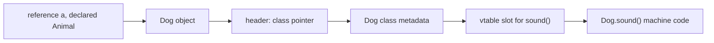

## Introduction

Suppose an online shop accepts cards, bank transfers and gift cards. Each has its own fee rule. The first version of the checkout code might look like this:

```java
long fee;
if (method.type.equals("CARD")) fee = 30 + amount * 29 / 1000;
else if (method.type.equals("BANK")) fee = 50;
else if (method.type.equals("GIFT")) fee = 0;
else throw new IllegalStateException();
```

The same chain of `if`s reappears wherever the type matters: computing fees, printing receipts, deciding whether refunds are allowed. When the shop adds a fourth payment method, a developer has to find every chain and add a branch. Missing one is a bug that the compiler cannot detect, because the type is just a string.

**Polymorphism** — Greek for "many forms" — removes those chains. Instead of the caller asking "what kind of thing are you?" and deciding what to do, each kind of object carries its own behaviour, and the caller asks every object the same question: `method.feeCents(amount)`. A card computes a card fee; a bank transfer computes a transfer fee. The checkout code is written once against a general type and never mentions a concrete class. Adding a fourth payment method means writing one new class. No existing code changes.

That property — code that stays closed to modification while remaining open to new types — is why polymorphism is the mechanism behind almost every extensible design in Java: collections (`List` works the same whether it is an `ArrayList` or a `LinkedList`), dependency injection in Spring, JDBC drivers, logging back ends, and every plugin system. This lesson explains how Java decides what code to run for a call, which is the single most useful mental model in object-oriented Java, and then covers the three nested topics that interviews test hardest: [[c1-overload-vs-override|overloading versus overriding]], [[c1-dynamic-binding|dynamic versus static binding]], and [[c1-static-no-override|why static methods are not overridden]].

## Before you start

You need:

- **Inheritance** — `extends`, overriding, `@Override` and `super`. See [[c1-inheritance]].
- **Interfaces** — declaring and implementing a contract. See [[c1-interfaces]].
- **Method overloading** — several methods with the same name and different parameter lists. See [[c1-method-overloading]].

The OOP lesson ([[c1-oop]]) gave a first look at how Java picks a method. This lesson goes through it completely.

## The intuition

Think of a universal remote control. It has a fixed set of buttons — power, volume, input — printed on it. Point it at a television and "power" turns the television on; point it at a sound bar and the same button turns the sound bar on. The remote decides *which buttons exist*; the device decides *what pressing one does*.

In Java, the remote is the **declared type** of a reference, and the device is the **object** it points to. `PaymentMethod m` gives you the buttons `name()` and `feeCents(...)`. Whether pressing `feeCents` runs card logic or transfer logic depends on which object `m` points to at that moment. The analogy has one limit worth noting: a real remote sends the same signal and the device interprets it, while Java actually selects a different method body to run. The effect for the caller is the same.

## Declared type and runtime type

Every expression that refers to an object has two types, and keeping them apart is the key to this whole lesson.

- The **declared type** (also called the static or compile-time type) is the type the compiler sees: the type written in the variable, field or parameter declaration, or the return type of the method that produced the value. In `PaymentMethod m = new Card();` it is `PaymentMethod`.
- The **runtime type** is the class of the object actually in memory: here, `Card`. It is fixed when the object is created with `new` and never changes. The compiler generally does not know it; the running program does.

Java gives the two types different jobs:

1. **The declared type decides what you may call.** The compiler checks every call against the declared type. If `PaymentMethod` has no `remainingBalance()` method, `m.remainingBalance()` does not compile, even when `m` happens to point to a gift card.
2. **The runtime type decides which overriding method runs.** For an instance method that subclasses can override, the JVM looks at the object's actual class when the call executes and runs that class's version.

Everything else in this lesson — overloading, static methods, fields, casting — is a consequence of applying those two rules carefully.

### A polymorphic checkout

```java title="Checkout.java"
import java.util.List;

interface PaymentMethod {
    String name();
    long feeCents(long amountCents);

    default String receipt(long amountCents) {   // shared code, still polymorphic
        return name() + ": amount " + amountCents + ", fee " + feeCents(amountCents);
    }
}

class Card implements PaymentMethod {
    public String name() { return "Card"; }
    public long feeCents(long amount) { return 30 + amount * 29 / 1000; }  // 30c + 2.9%
}

class BankTransfer implements PaymentMethod {
    public String name() { return "Bank transfer"; }
    public long feeCents(long amount) { return 50; }
}

class GiftCard implements PaymentMethod {
    public String name() { return "Gift card"; }
    public long feeCents(long amount) { return 0; }
    public long remainingBalance() { return 2_500; }
}

public class Checkout {
    // Written once against the interface; never mentions a concrete class.
    static void printReceipts(List<PaymentMethod> methods, long amountCents) {
        for (PaymentMethod m : methods) {
            System.out.println(m.receipt(amountCents));
        }
    }

    public static void main(String[] args) {
        List<PaymentMethod> methods = List.of(new Card(), new BankTransfer(), new GiftCard());
        printReceipts(methods, 10_000);

        PaymentMethod chosen = methods.get(2);      // upcast: declared type PaymentMethod
        // chosen.remainingBalance();               // does not compile
        if (chosen instanceof GiftCard g) {         // check and downcast in one step
            System.out.println("Gift card balance: " + g.remainingBalance());
        }

        PaymentMethod other = methods.get(0);
        GiftCard wrong = (GiftCard) other;          // compiles, fails at run time
    }
}
```

```output
Card: amount 10000, fee 320
Bank transfer: amount 10000, fee 50
Gift card: amount 10000, fee 0
Gift card balance: 2500
Exception in thread "main" java.lang.ClassCastException: class Card cannot be cast to class GiftCard (Card and GiftCard are in unnamed module of loader 'app')
	at Checkout.main(Checkout.java:47)
```

Take the program apart piece by piece.

`printReceipts` knows only `PaymentMethod`. In the loop, `m.receipt(...)` runs the interface's `default` method, and inside it `name()` and `feeCents(...)` are called on `this` — which is a `Card` on the first iteration, a `BankTransfer` on the second, and a `GiftCard` on the third. Each call runs the implementation of the object's own class. No `if`, no type check. Notice also that polymorphism here comes from an **interface**, not from a shared superclass: the three classes have no common parent except `Object`. Inheritance is one way to get a common type, not a requirement.

`chosen` points to a `GiftCard`, but its declared type is `PaymentMethod`, so `chosen.remainingBalance()` is rejected by the compiler. The compiler is not being obtuse: in general it cannot know what a `PaymentMethod` variable will hold at run time, so it only allows calls that are valid for *every* `PaymentMethod`.

### Upcasting and downcasting

Assigning a `GiftCard` to a `PaymentMethod` variable is an **upcast** — moving up the type hierarchy. It is implicit and always safe, because a gift card is a payment method.

Going the other way is a **downcast**: `(GiftCard) other`. The compiler allows it because a `PaymentMethod` *might* be a gift card. But the JVM checks every downcast when it executes, and if the object is not actually of that class (or a subclass of it) it throws `ClassCastException`, as the last line of the output shows. A cast never converts an object into something else; it only asks "please treat this reference as the narrower type, and check that it really is one".

Because an unchecked downcast is a run-time failure waiting to happen, guard it. Since Java 16, the **`instanceof` pattern** does the test and the cast in one step: `if (chosen instanceof GiftCard g)` is true only when the object is a `GiftCard`, and inside the `if`, `g` is a `GiftCard`-typed variable. `null instanceof X` is always `false`, so the pattern also protects against `NullPointerException`.

> [!TIP] A downcast is a design signal
> Occasional `instanceof` checks are fine at boundaries — `equals` methods, deserialisation, error handling. But if you find yourself writing `if (x instanceof A) ... else if (x instanceof B) ...` in business logic, ask whether the behaviour should be a method on the type instead. That is exactly the type-switch polymorphism was meant to remove — unless the set of types is deliberately closed, as discussed in "Open and closed polymorphism" below.

## Kinds of polymorphism

"Polymorphism" names several related ideas. Interviewers often ask for "compile-time and runtime polymorphism", so it helps to know the precise terms:

| Kind | Java mechanism | Resolved | Example |
|---|---|---|---|
| **Subtype polymorphism** | Overriding methods of a superclass or interface | Run time (dynamic dispatch) | `m.feeCents(x)` runs `Card` or `BankTransfer` code |
| **Ad-hoc polymorphism** | Method overloading | Compile time | `println(int)` versus `println(String)` |
| **Parametric polymorphism** | Generics | Compile time (type-checked), erased at run time | `List<T>` works for any `T` |

When people say "polymorphism" in Java without qualification, they almost always mean subtype polymorphism — one call, many implementations, chosen at run time. Overloading is called "compile-time polymorphism" in many textbooks; it is better understood as a naming convenience, because the compiler picks one specific method before the program runs and nothing polymorphic happens at run time. The difference between the two is the subject of the next section.

Generics get their own lesson ([[c1-generics]]). One interaction with overloading is worth knowing here: because generic type arguments are erased at run time ([[c1-type-erasure]]), you cannot overload on them.

```java title="Report.java"
import java.util.List;

class Report {
    void print(List<String> lines) {}
    void print(List<Integer> numbers) {}
}
```

```output
Report.java:5: error: name clash: print(List<Integer>) and print(List<String>) have the same erasure
    void print(List<Integer> numbers) {}
         ^
1 error
```

## Overloading vs Overriding {#c1-overload-vs-override}

**Overloading** and **overriding** both involve several methods with the same name, which is why they are confused, but they solve different problems and are resolved at different times. **Overloading** means one class offers several methods with the same name and *different parameter lists* — `print(int)`, `print(String)` — and the **compiler** picks one based on the declared types of the arguments. **Overriding** means a subclass provides a new implementation of an inherited method with the *same signature*, and the **JVM** picks which implementation runs based on the runtime type of the object the method is called on.

A one-line summary that holds up: *overloading chooses the method signature at compile time; overriding chooses the implementation of that signature at run time.*

### Side by side

| | Overloading | Overriding |
|---|---|---|
| Where | Usually in the same class (also across a hierarchy) | Subclass redefines an inherited method |
| Name | Same | Same |
| Parameter types | **Must differ** in number, type or order | **Must be the same** (after erasure) |
| Return type | Anything; return type alone cannot distinguish overloads | Same, or a subtype for reference types (covariant) |
| Access modifier | Anything | Same or wider |
| Checked exceptions | Anything | Same, narrower or none |
| `static`, `private`, `final` methods | Can be overloaded | Cannot be overridden |
| Decided by | Compiler, using declared types of the arguments | JVM, using runtime type of the receiver object |
| `@Override` | Not applicable — using it is a compile error | Recommended on every override |
| Purpose | Convenience: one name for one operation on different inputs | Specialisation: different behaviour for different subtypes |

The two combine. A single call `a.meet(b)` involves both decisions: first the compiler picks which *overload* of `meet` (based on the declared type of `b`), then the JVM picks which *override* of that overload (based on the runtime type of `a`).

### A worked puzzle

```java title="Puzzle.java"
class Animal {
    String meet(Animal other) { return "Animal meets Animal"; }
    String meet(Dog other)    { return "Animal meets Dog"; }
}

class Dog extends Animal {
    @Override String meet(Animal other) { return "Dog meets Animal"; }
    @Override String meet(Dog other)    { return "Dog meets Dog"; }
}

public class Puzzle {
    public static void main(String[] args) {
        Animal a = new Dog();     // declared Animal, really a Dog
        Animal b = new Dog();     // declared Animal, really a Dog
        Dog d = new Dog();

        System.out.println(a.meet(b));   // overload chosen from b's declared type
        System.out.println(a.meet(d));
        System.out.println(new Animal().meet(a));
    }
}
```

```output
Dog meets Animal
Dog meets Dog
Animal meets Animal
```

Work through each line with the two-step rule.

`a.meet(b)`: the compiler sees `a` declared as `Animal` and `b` declared as `Animal`. Of `Animal`'s two overloads, only `meet(Animal)` accepts an `Animal` argument, so the call is fixed to the signature `meet(Animal)`. At run time, `a` is a `Dog`, so `Dog`'s override of `meet(Animal)` runs: "Dog meets Animal". The fact that `b` is *really* a dog does not matter — argument types are never inspected at run time for overload selection.

`a.meet(d)`: now the argument is declared `Dog`, so the compiler picks the more specific overload `meet(Dog)`. At run time `a` is a `Dog`, so `Dog.meet(Dog)` runs.

`new Animal().meet(a)`: the argument `a` is declared `Animal`, so `meet(Animal)` is chosen; the receiver is a plain `Animal`, so `Animal.meet(Animal)` runs.

This asymmetry has a name. Java is **single dispatch**: the run-time choice depends on the type of one object only — the receiver before the dot. Choosing behaviour based on the run-time types of *two* objects (double dispatch) needs a design pattern such as the Visitor ([[d2-visitor]]) or a `switch` with patterns over both values.

### The most expensive overloading bug: equals(MyType)

The classic real-world consequence is an `equals` method with the wrong parameter type:

```java title="EqualsTrap.java"
import java.util.HashSet;
import java.util.List;
import java.util.Objects;
import java.util.Set;

class Money {
    final String currency;
    final long cents;
    Money(String currency, long cents) { this.currency = currency; this.cents = cents; }

    // Looks like equals, but the parameter type is Money, not Object:
    // this OVERLOADS Object.equals instead of overriding it.
    public boolean equals(Money other) {
        return currency.equals(other.currency) && cents == other.cents;
    }

    @Override
    public int hashCode() { return Objects.hash(currency, cents); }
}

public class EqualsTrap {
    public static void main(String[] args) {
        Money a = new Money("EUR", 500);
        Money b = new Money("EUR", 500);

        System.out.println(a.equals(b));            // compiler picks equals(Money)
        Object asObject = b;
        System.out.println(a.equals(asObject));     // compiler picks equals(Object)
        System.out.println(List.of(a).contains(b)); // List calls equals(Object)
        Set<Money> set = new HashSet<>();
        set.add(a);
        System.out.println(set.contains(b));        // HashSet calls equals(Object)
    }
}
```

```output
true
false
false
false
```

`Money` now has *two* `equals` methods: its own `equals(Money)` and the inherited `Object.equals(Object)`, which compares identity. Your own direct test, `a.equals(b)`, passes — the compiler sees two `Money` arguments and picks the overload you wrote. That is exactly why the bug survives code review and unit tests. But `List.contains` and `HashSet.contains` are library code written against `Object`; they call `equals(Object)`, which was never overridden. Every collection lookup fails.

The fix is to declare `public boolean equals(Object o)` with `@Override`. Had the original author written `@Override` on `equals(Money)`, the compiler would have rejected it immediately with "method does not override or implement a method from a supertype".

### How the compiler chooses an overload

When several overloads could accept the arguments, the compiler picks the **most specific** one, in three phases (Java Language Specification §15.12.2): first it looks for a match without boxing or varargs, then allowing boxing and unboxing, then allowing varargs. So `print(5)` prefers `print(long)` (a widening conversion) over `print(Integer)` (boxing), and both over `print(int...)`. If two candidates are equally specific, the call is ambiguous and fails to compile — `print(null)` with overloads `print(String)` and `print(Integer)` is the common example. The details, including the `List.remove(int)` versus `remove(Object)` trap, are in [[c1-method-overloading]].

> [!INTERVIEW] "Is overloading polymorphism?"
> A precise answer: "It's often called compile-time or static polymorphism, but the compiler resolves it to one specific method before the program runs, using only declared types. True run-time polymorphism in Java is overriding: the JVM picks the implementation from the receiver's actual class. That's why passing a `Dog` through an `Animal` variable selects the `Animal` overload but the `Dog` override."

```quiz
Q: `class Shape { void draw(Shape s) {...} void draw(Circle c) {...} }` and `Circle extends Shape` overrides both. Given `Shape x = new Circle(); Shape y = new Circle();`, which method runs for `x.draw(y)`?
- [ ] `Circle.draw(Circle)`, because both objects are circles
- [x] `Circle.draw(Shape)`, because the overload is chosen from y's declared type and the override from x's runtime type
- [ ] `Shape.draw(Shape)`, because both references are declared as Shape
- [ ] `Shape.draw(Circle)`
> The compiler selects the overload from declared argument types: y is declared Shape, so the signature draw(Shape) is fixed. At run time the JVM picks the override of draw(Shape) from x's actual class, Circle. Argument runtime types never affect overload choice; Java dispatches on the receiver only.
```

## Dynamic vs Static Binding {#c1-dynamic-binding}

**Binding** is the step that connects a method call in your source code to the actual method body that will execute. **Static binding** (early binding) means that connection is fixed at compile time: the compiler knows exactly which method runs, and nothing about the object at run time can change it. **Dynamic binding** (late binding, or dynamic dispatch) means the compiler fixes only *which method signature* is being called, and the JVM chooses the implementation when the call executes, by looking at the class of the receiver object. Dynamic binding is what makes overriding — and therefore subtype polymorphism — work.

### What is bound how

| Element | Binding | Chosen from |
|---|---|---|
| Overridable instance method (not `private`, `static` or `final`) | **Dynamic** | Runtime class of the receiver |
| Interface method call | **Dynamic** | Runtime class of the receiver |
| `static` method | Static | Declared type (or the class name written) |
| `private` method | Static | The class that declares it — private methods are never overridden |
| `final` method | Effectively static: one possible target | The declaring class |
| `super.method()` call | Static | The direct superclass's implementation |
| Constructor call | Static | The class named after `new` |
| Field access (instance or static) | Static | Declared type of the reference |
| Choice among overloads | Static | Declared types of the arguments |

The pattern behind the table: dynamic binding is used exactly where a subclass could have supplied a different implementation. Wherever overriding is impossible — static, private, final, constructors — or wherever Java deliberately does not look at the object — fields, overload selection — the binding is static.

Fields are the case that surprises people most. Accessing `p.label` reads the field declared in `p`'s declared type, even if the object's class declares a field with the same name (field hiding, demonstrated in [[c1-inheritance]]). Fields are data, not behaviour; Java only dispatches behaviour.

### What the bytecode says

You can see the binding decisions in the compiled class file. The compiler emits different **invoke instructions** depending on the kind of call:

```java title="Calls.java"
import java.util.ArrayList;
import java.util.List;

class Animal {
    String sound() { return "..."; }
    final String kingdom() { return "Animalia"; }
    static Animal create() { return new Animal(); }
    private String secret() { return "s"; }

    String all() { return secret(); }
}

class Dog extends Animal {
    @Override String sound() { return "Woof " + super.sound(); }
}

public class Calls {
    public static void main(String[] args) {
        Animal a = Animal.create();      // invokestatic
        a.sound();                       // invokevirtual
        a.kingdom();                     // invokevirtual, but cannot be overridden
        List<String> list = new ArrayList<>();   // invokespecial for the constructor
        list.add("x");                   // invokeinterface
    }
}
```

Compiling with javac 26 (`--release 21`) and running `javap -c` on the three classes shows the following (trimmed to the invoke lines, with spacing condensed and a heading per method added):

```output
Calls.main:
   0: invokestatic  #7      // Method Animal.create:()LAnimal;
   5: invokevirtual #13     // Method Animal.sound:()Ljava/lang/String;
  10: invokevirtual #17     // Method Animal.kingdom:()Ljava/lang/String;
  18: invokespecial #22     // Method java/util/ArrayList."<init>":()V
  25: invokeinterface #25,2 // InterfaceMethod java/util/List.add:(Ljava/lang/Object;)Z
Dog.sound:
   1: invokespecial #7      // Method Animal.sound:()Ljava/lang/String;
Animal.all:
   1: invokevirtual #16     // Method secret:()Ljava/lang/String;
```

Each instruction tells the JVM how to find the code:

- **`invokestatic`** names a class and method; there is no receiver object to consult. Static binding.
- **`invokespecial`** is used for constructors and `super.method()` calls. It names the exact method to run and skips override lookup — which is why `super.sound()` in `Dog` always reaches `Animal.sound()`.
- **`invokevirtual`** names a method *signature* in the declared class (`Animal.sound`). At run time the JVM takes the receiver's actual class and selects the most specific override of that signature. Dynamic binding.
- **`invokeinterface`** does the same for a method declared in an interface.

Two lines need a comment. `a.kingdom()` is compiled to `invokevirtual` even though `kingdom` is `final`; the binding is still effectively static because no subclass can provide another body, and the JIT compiler uses that fact to call it directly. And the call to the private `secret()` also appears as `invokevirtual`. Before Java 11, javac used `invokespecial` for private calls; since Java 11's nest-based access control (JEP 181), javac emits `invokevirtual`, and the JVM specification states that when the resolved method is private, it is the method invoked — no override lookup happens. The observable rule has not changed: **private methods are never overridden**.

### How the JVM makes dynamic dispatch fast

A naive implementation of `invokevirtual` would search the receiver's class for a matching method, then its superclass, and so on. HotSpot avoids that search with a per-class **virtual method table (vtable)**. Every overridable method gets a fixed slot number; a subclass's vtable starts as a copy of its parent's and overwrites the slots it overrides, then appends slots for new methods. Because `Animal.sound` has the same slot number in every subclass's table, a virtual call reduces to: read the object's class pointer from its header, index the vtable at that slot, jump. Interface calls use an **itable**, because a class's interface methods cannot share a single fixed numbering across unrelated classes; the lookup is slightly more involved.



The Just-In-Time (JIT) compiler goes further. While the program runs, it records which receiver classes actually appear at each call site. A call site that has only ever seen one class is **monomorphic**; HotSpot can then inline that class's method directly into the caller, guarded by a cheap class check, and fall back (deoptimise) if a new class ever appears. With two observed classes (**bimorphic**) it can inline both behind a type test. Only call sites that see many classes (**megamorphic**) pay for a real table lookup on every call. In practice this means polymorphic Java code is usually as fast as a direct call; see [[c2-inlining]] and [[c2-deoptimization]].

> [!NOTE] Binding versus dispatch
> "Dynamic binding", "late binding", "dynamic dispatch" and "virtual method invocation" are used interchangeably in Java discussions. All mean the same thing: the implementation of an overridable instance method is chosen from the receiver's runtime class.

```quiz
Q: Which of these calls is bound dynamically in Java?
- [ ] A call to a `private` method from inside its class
- [ ] `super.toString()` inside an override of `toString()`
- [x] `shape.area()` where `area` is a public instance method that subclasses override
- [ ] A call to a `static` method through an instance reference
> Only overridable instance methods (and interface methods) are dispatched on the receiver's runtime class. Private methods cannot be overridden; super calls compile to invokespecial and name the exact parent method; static methods are bound from the declared type even when called through an instance.
```

## Why static Methods Are Not Overridden {#c1-static-no-override}

A **static method** belongs to a class, not to any object. When a subclass declares a static method with the same signature as a static method in its superclass, it does not override it — it **hides** it. Both methods continue to exist, and which one a call runs is decided by the compiler from the **class named in the call**, or from the declared type of the reference if you call it through a variable. The object, if any, is never consulted. That is the whole reason static methods cannot be overridden: overriding means "chosen from the runtime object", and a static call has no runtime object to choose from.

### Hiding in action

```java title="StaticHiding.java"
class Logger {
    static String create() { return "plain Logger"; }
    String level() { return "INFO"; }

    // Parent code that calls the static method by its simple name.
    String describe() { return create() + " at " + level(); }
}

class JsonLogger extends Logger {
    static String create() { return "JSON logger"; }    // hides Logger.create()
    @Override
    String level() { return "DEBUG"; }                   // overrides Logger.level()
}

public class StaticHiding {
    public static void main(String[] args) {
        Logger log = new JsonLogger();

        System.out.println(log.level());       // overriding: runtime type wins
        System.out.println(log.create());      // hiding: declared type wins
        System.out.println(log.describe());
        System.out.println(JsonLogger.create());

        Logger nothing = null;
        System.out.println(nothing.create());  // no object needed at all
    }
}
```

```output
DEBUG
plain Logger
plain Logger at DEBUG
JSON logger
plain Logger
```

Line by line:

- `log.level()` is an instance method that `JsonLogger` overrides, so the `JsonLogger` object's version runs: `DEBUG`.
- `log.create()` *looks* like an instance call, but `create` is static. The compiler replaces it with `Logger.create()`, because `log` is declared `Logger`. The object is ignored: `plain Logger`.
- `log.describe()` shows the consequence inside a hierarchy. `Logger.describe()` calls `create()` and `level()`. The `level()` call is dynamic and runs the `JsonLogger` override, but the `create()` call was bound to `Logger.create()` when `Logger` was compiled, so the result mixes the two: `plain Logger at DEBUG`. A subclass cannot change the behaviour of its parent's code by "overriding" a static method.
- `JsonLogger.create()` names the subclass explicitly, so the subclass's static method runs.
- `nothing.create()` calls a static method through a `null` reference and does **not** throw `NullPointerException`. This is the clearest proof that no object is involved: the compiler turned it into `Logger.create()` and never evaluated anything that needs an object.

Compiling with `-Xlint:static` makes javac warn about the misleading form: "static method should be qualified by type name, Logger, instead of by an expression". Always call static methods through the class name; then hiding can never surprise anyone reading the code.

### What the compiler refuses

Java forbids mixing the two kinds of method under one signature, and it rejects `@Override` on a static method:

| Code in the subclass | Superclass method | Result (javac message) |
|---|---|---|
| `@Override static void hello()` | `static void hello()` | Error; javac 26 says "static method hello() in B cannot be annotated with @Override" (older versions report "does not override or implement a method from a supertype") |
| `void hello()` (instance) | `static void hello()` | Error: "overridden method is static" |
| `static void hello()` | `void hello()` (instance) | Error: "overriding method is static" |
| `static void hello()` | `static void hello()` | Allowed: hiding |

The rules for hiding mirror the override rules — a hiding method cannot have weaker access, an incompatible return type or broader checked exceptions, and it cannot hide a `final` static method — so that calling through the subclass name stays safe.

### Why Java was designed this way

Overriding exists so that code written against a supertype can be handed a subtype and get the subtype's behaviour. That requires an object at the moment of the call, because the object is what carries its class. A static method is called through the class itself — `Math.max(a, b)` — and the compiler resolves it to `invokestatic Math.max`, a direct jump with no lookup. Allowing static methods to be overridden would require an object to look at, at which point the method would be an instance method. The design keeps static methods cheap, predictable and resolvable at compile time, which is exactly what utility functions and factories need.

The same reasoning explains why interfaces' static methods are not even inherited by implementing classes: `List.of(...)` must be called as `List.of`, never through an `ArrayList`.

> [!WARNING] Static factories and "polymorphic" construction
> A common design mistake is expecting `Parent.create()` to return a subclass instance because a subclass declared its own `create()`. It will not. If you need the kind of object created to vary, pass in a factory object (an interface such as `Supplier<Logger>`) and call its instance method, which is dispatched dynamically.

```quiz
Q: `class A { static String id() { return "A"; } }` and `class B extends A { static String id() { return "B"; } }`. What does `A ref = new B(); System.out.println(ref.id());` print?
- [x] `A`, because static methods are bound from the declared type of `ref`
- [ ] `B`, because the object is a B
- [ ] It does not compile, because static methods cannot be called through a reference
- [ ] It throws `NullPointerException`
> B.id() hides A.id(); it does not override it. The compiler resolves ref.id() to A.id() from ref's declared type, A, and the object is never examined. Calling a static method through a reference compiles (with a lint warning), and would even work if ref were null.
```

## Open and closed polymorphism

Overriding gives you **open** polymorphism: anyone can add a new implementation of `PaymentMethod` later, in another module, without touching existing code. That is ideal for plugins, drivers and framework extension points. Its weakness is the other direction: adding a new *operation* — say, `refundPolicy()` — means editing every implementing class.

Java 17 and 21 added a complementary tool for **closed** sets of types. A **sealed** interface lists every permitted implementation, and a `switch` with type patterns over it is checked for exhaustiveness by the compiler.

```java title="Shapes.java"
sealed interface Shape permits Circle, Rect, Triangle {}
record Circle(double r) implements Shape {}
record Rect(double w, double h) implements Shape {}
record Triangle(double base, double height) implements Shape {}

public class Shapes {
    static double area(Shape s) {
        return switch (s) {                      // exhaustive: no default needed
            case Circle c -> Math.PI * c.r() * c.r();
            case Rect(double w, double h) -> w * h;
            case Triangle t -> 0.5 * t.base() * t.height();
        };
    }

    public static void main(String[] args) {
        for (Shape s : new Shape[] { new Circle(1), new Rect(2, 3), new Triangle(4, 5) }) {
            System.out.printf("%s -> %.2f%n", s, area(s));
        }
    }
}
```

```output
Circle[r=1.0] -> 3.14
Rect[w=2.0, h=3.0] -> 6.00
Triangle[base=4.0, height=5.0] -> 10.00
```

Delete the `Triangle` case and javac (Java 21) reports "the switch expression does not cover all possible input values". So when a new permitted type is added, the compiler lists every `switch` that must handle it — the guarantee the string-based `if` chain in the introduction never had. `case Rect(double w, double h)` is a record pattern (Java 21), which deconstructs the record into its components.

Neither style is better in general. Use overriding when the set of types is open and the operations are stable (payment providers, storage back ends). Use sealed types with `switch` when the set of types is fixed and the operations keep growing (an expression tree, the states of an order, the shapes of a parsed message). This trade-off is sometimes called the **expression problem**. See [[c1-sealed]] and [[c1-pattern-matching]].

## Substitutability: the contract behind polymorphism

Polymorphic code is only correct if every implementation honours the supertype's contract. `printReceipts` assumes `feeCents` returns a non-negative fee and does not throw for ordinary amounts. If a new implementation threw `UnsupportedOperationException` for amounts over 1,000, every caller written against `PaymentMethod` would break, even though the code compiles. The **Liskov Substitution Principle** states the requirement: a subtype must be usable wherever its supertype is expected without surprising the caller. The compiler enforces the type-level part (override rules); behaviour is your responsibility. See [[d1-solid]] for the principle with examples.

## In real systems

**Collections.** Code declares `List<Order> orders` and `Map<String, Customer> byId`; the concrete `ArrayList` or `HashMap` appears once, at construction. `Collections.sort`, streams and `for` loops call interface methods, dispatched to whichever implementation is present.

**Dependency injection.** A Spring service asks for a `PaymentGateway` in its constructor. In production Spring passes a real gateway bean; in tests you pass a fake. The service's code is identical in both cases — that is polymorphism through an interface ([[c5-di]]). Spring's own proxies for `@Transactional` work the same way: you receive an object that implements your interface (or subclasses your class) and wraps your methods.

**Drivers and providers.** JDBC code calls `Connection`, `PreparedStatement` and `ResultSet` interfaces; the PostgreSQL or MySQL driver supplies the classes. SLF4J's `Logger` interface is backed by Logback or Log4j. Adding support for a new database or logger never touches application code.

**Strategy objects.** A `Comparator<T>` passed to `sort`, a `RetryPolicy`, a pricing rule — each is a small polymorphic object, often a lambda implementing a functional interface ([[d2-strategy]]).

## Trade-offs and alternatives

| Approach | Adding a new type | Adding a new operation | Compiler checks all cases | Best for |
|---|---|---|---|---|
| Overriding through an interface or superclass | One new class | Edit every class | No | Open sets: plugins, providers, strategies |
| Sealed type + pattern `switch` | Edit every `switch` (compiler lists them) | One new method | Yes | Closed sets: domain variants, ASTs, states |
| `if`/`instanceof` chains on an open type | Edit every chain, unchecked | One new method | No | Rarely; boundaries only |
| Visitor pattern | Edit every visitor | One new visitor class | Yes | Double dispatch on a stable hierarchy |

Polymorphism costs little at run time thanks to the JIT, but it has a reading cost: to know what `m.feeCents(x)` does, you need to know which implementations exist, which an IDE's "go to implementations" shows. Too many tiny abstractions make simple, linear logic hard to follow. Introduce a polymorphic type when there are, or clearly will be, several implementations; not speculatively.

## Common mistakes

> [!MISTAKE] Expecting the argument's runtime type to pick the overload
> `describe(Animal)` and `describe(Dog)` are overloads; `describe(pet)` with `Animal pet = new Dog()` calls `describe(Animal)`. The compiler chooses overloads from declared types only. If behaviour must depend on the argument's runtime type, make it an overridden method on that argument, or use a pattern `switch`.

**Writing `equals(MyType)`.** It overloads instead of overriding, so collections never call it. Use `equals(Object)` with `@Override`.

**Downcasting without checking.** `(GiftCard) method` throws `ClassCastException` for any other implementation. Use `instanceof` patterns, or better, add the needed behaviour to the supertype.

**Calling static methods through instances.** `obj.staticMethod()` suggests dynamic dispatch that does not happen. Call static methods through the class name and enable `-Xlint:static`.

**Expecting fields to be polymorphic.** `p.name` reads the field of `p`'s declared type. Use methods (getters) when behaviour should vary by subclass.

**Breaking the supertype's contract.** An implementation that throws, returns `null` or ignores inputs the interface promised to handle breaks every polymorphic caller. Read the interface's documentation as part of its contract.

## Interview perspective

Interviewers use polymorphism to check whether you can predict what code does, not whether you can recite "many forms".

> [!INTERVIEW] The two-phase answer
> "For `obj.method(arg)`, the compiler looks at the declared type of `obj`, checks the method exists and is accessible, and chooses the overload from the declared type of `arg`. At run time, if the method is an overridable instance method, the JVM uses the class of the object `obj` actually points to and runs the most specific override. Static, private and final methods, constructors, super calls and fields are all resolved at compile time."

Questions you should be ready for:

- **Compile-time versus run-time polymorphism?** Overloading versus overriding, with the puzzle above as evidence.
- **Can you override a static method? A private one? A final one?** No to all three; static methods are hidden, private methods are invisible to subclasses, final methods are fixed.
- **Why does `nullRef.staticMethod()` not throw?** The call is compiled to `invokestatic` on the declared class; no object is used.
- **How does the JVM implement virtual calls?** Class pointer in the object header, vtable slot per overridable method, itables for interfaces, and JIT inlining for monomorphic and bimorphic sites.
- **Polymorphism without inheritance?** Yes, through interfaces (and lambdas implementing functional interfaces).
- **When would you use a `switch` over types instead of polymorphism?** When the set of types is closed and sealed, so the compiler checks exhaustiveness; mention Java 21 pattern matching.

A common follow-up is "how would you add behaviour that depends on two objects' types?", where the expected answer names double dispatch, the Visitor pattern, or a pattern `switch` over a pair of sealed types.

## Practice

1. **Predict the puzzle.** Add `String meet(Object other)` to `Animal` only, and predict the output of `a.meet("cat")`, `a.meet((Object) d)` and `a.meet(d)`. Run it to check.
2. **Refactor an `if` chain.** Rewrite the string-based fee calculation in the introduction as an interface with three implementations, then add a fourth (`Crypto`, 1% fee) without editing any existing class.
3. **Fix `Money`.** Correct the `equals` in `EqualsTrap` so all four lines print `true`, and explain why `@Override` would have caught the bug.
4. **Static versus instance.** Turn `Logger.create()` into a design where the created logger type can vary at run time, using `Supplier<Logger>`.
5. **Closed hierarchy.** Model order states (`Pending`, `Paid`, `Shipped`, `Cancelled`) as a sealed interface of records, and write a pattern `switch` that computes whether an order can be cancelled. Add a `Refunded` state and observe the compiler errors.

## Quick revision {#quick-revision}

- Declared type decides **what you may call**; runtime type decides **which override runs**.
- Upcast: implicit and safe. Downcast: explicit, checked at run time, `ClassCastException` if wrong; guard with `instanceof` patterns (Java 16+).
- Polymorphism works through interfaces as well as superclasses.
- Overloading: same name, different parameters, chosen by the compiler from declared argument types. Overriding: same signature, chosen by the JVM from the receiver's runtime class.
- Java is single dispatch: only the receiver's runtime type matters; double dispatch needs Visitor or pattern matching.
- `equals(MyType)` overloads instead of overriding — collections ignore it.
- Static binding: static, private, final, constructors, `super.m()`, fields, overload selection. Dynamic binding: overridable instance and interface methods.
- Bytecodes: `invokestatic`, `invokespecial` (constructors, super calls), `invokevirtual`, `invokeinterface`. Since Java 11, private calls may compile to `invokevirtual` but are never overridden.
- HotSpot: vtables and itables; JIT inlines monomorphic and bimorphic call sites.
- Static methods are **hidden**: chosen from the declared type; `@Override` on them is an error; calling through `null` works.
- Open polymorphism (overriding) for open sets of types; sealed types with exhaustive `switch` (Java 21) for closed sets.

## Key takeaways {#key-takeaways}

- Polymorphism replaces type checks in callers with behaviour inside each type, so new types can be added without editing existing code.
- Always separate the declared type of a reference from the runtime type of the object; the first governs compilation, the second governs which override runs.
- Overloading is resolved once, by the compiler, from declared types; overriding is resolved on every call, by the JVM, from the receiver's class.
- Static methods, private methods, fields and super calls are bound statically; only overridable instance methods are dispatched dynamically.
- Static methods are hidden, not overridden, because there is no object to dispatch on; call them through the class name.
- Virtual calls are cheap in practice because the JIT inlines call sites that see one or two classes.
- Choose open polymorphism for extensible sets of types and sealed hierarchies with pattern `switch` for closed ones.
