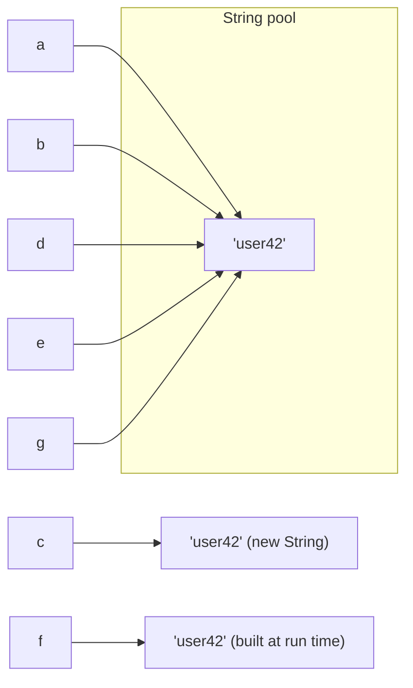

## Introduction

Almost every program handles text. Usernames, email addresses, JSON request bodies, SQL queries, log lines, file paths, error messages and HTML pages are all text. In Java, a piece of text is an object of the class `java.lang.String`: a sequence of characters such as `"Ada"`, `"order-1042"` or `""` (the empty string).

`String` looks like a primitive because the language gives it special syntax — you can write `"hello"` without `new`, and join strings with `+` — but it is an ordinary class with methods, and a `String` variable holds a reference like any other object. On top of that, `String` has three properties that shape how you use it and that interviewers love to ask about. Strings are **immutable**: once created, a string's characters never change. Identical string literals are **shared** through a pool maintained by the JVM. And because of both, comparing strings with `==` gives answers that look right in small tests and fail in production.

This lesson teaches `String` from its everyday API down to how the JVM stores it, then covers three topics in depth: the string pool, `StringBuilder` and `StringBuffer` for building text efficiently, and the difference between `==` and `equals()` on strings.

## Before you start

You need:

- **Reference types** — what a reference variable holds and what `==` compares on objects. See [[c1-reference-types]].
- **Methods** — calling instance methods and using return values. See [[c1-methods]].
- **Arrays** — indexing from 0 and half-open ranges. See [[c1-arrays]].
- **`char`** — a single UTF-16 code unit, stored as a number. See [[c1-primitives]].

If you are preparing for coding interviews, [[a1-strings-stringbuilder]] applies the same material to algorithm problems such as anagrams and palindromes.

## The intuition

Think of a `String` as a printed label. Once printed, the label cannot be edited. If you want different text, you print a new label; the old one stays exactly as it was, and anyone still holding it still sees the old text. That is why many people can safely share the same label: nobody can change it under them.

A `StringBuilder`, by contrast, is a whiteboard. You can write, erase and insert as much as you like, cheaply, in place. When you are finished, you print a label from the whiteboard — `toString()` — and hand that out.

The string pool is a shared box of labels the JVM keeps for literal text that appears in your code. When two parts of your program both contain the literal `"OK"`, they receive the *same* label from the box rather than two printed copies. Where the analogy needs care: the pool only holds literals and strings you explicitly add; text read from a file or built at run time gets a fresh label every time.

## Creating strings

There are several ways to obtain a `String`:

- A **literal** in double quotes, `"hello"`. Literals are the most common source, and they come from the string pool.
- **Concatenation** with `+`, as in `"order-" + id`.
- **Conversion**: `String.valueOf(42)`, `Integer.toString(42)`, or any object's `toString()`.
- **Construction** from other data: `new String(charArray)`, `new String(bytes, StandardCharsets.UTF_8)`, or `sb.toString()` from a builder.
- **Text blocks** (Java 15+), which write multi-line text between `"""` delimiters; see [[c1-text-blocks]].

`new String("hello")` is also legal, but it is almost never what you want: it copies an existing string into a new, separate object with the same characters. The pool section explains why that matters.

## Strings are immutable

A `String` object never changes after it is created. No method modifies it. Methods that sound like they change a string — `toUpperCase`, `trim`, `replace`, `concat` — all **return a new string** and leave the original untouched.

```java title="Immutable.java"
public class Immutable {
    public static void main(String[] args) {
        String name = "  Ada Lovelace  ";
        name.trim();                              // result discarded: name is unchanged
        name.toUpperCase();
        System.out.println("[" + name + "]");

        String cleaned = name.strip().toUpperCase();   // keep the new string
        System.out.println("[" + cleaned + "]");

        String a = "data";
        String b = a;                             // two references, one object
        a = a + "base";                           // a now refers to a NEW string
        System.out.println(a + " " + b);
    }
}
```

```output
[  Ada Lovelace  ]
[ADA LOVELACE]
database data
```

The first two calls compute new strings and throw them away, so `name` still has its spaces and lower-case letters. This is the most common string bug for beginners, and the compiler does not warn about it. The fix is to use the return value, as `cleaned` does — and calls can be chained, because each returns a `String`.

The last block shows what "changing" a string variable really means. `a = a + "base"` does not alter the `"data"` object. It builds a new `"database"` object and points `a` at it. `b` still refers to the original `"data"`, which nobody can modify.

### Why Java made strings immutable

Immutability was a deliberate design decision, and each benefit explains something you will rely on:

- **Safe sharing.** Because nobody can change a string, any number of variables, objects and threads can hold the same one without copying it and without locks. Strings are automatically **thread-safe**.
- **Security.** Strings carry file paths, class names, URLs and database credentials. If a method validated a path and the caller could then change the characters before the file was opened, the check would be worthless. With immutable strings, what was checked is what gets used.
- **Hashing.** `String` caches its hash code after the first computation. That is only valid because the characters can never change, and it makes strings fast `HashMap` keys. A mutable key whose hash changed after insertion would be lost inside the map.
- **The pool.** Sharing one object among all uses of a literal is only possible if no user can modify it.

The cost is that every "modification" allocates a new object. For a few operations that is negligible; for text built piece by piece in a loop it is a serious performance problem, which is exactly what `StringBuilder` solves.

## The core String API

`String` has more than a hundred methods. A small set covers most daily work, and the details at their edges are where bugs come from.

```java title="Api.java"
import java.util.Arrays;

public class Api {
    public static void main(String[] args) {
        String s = "Hello, World";
        System.out.println(s.length());                 // 12
        System.out.println(s.charAt(7));                // W
        System.out.println(s.indexOf('o'));             // first o
        System.out.println(s.lastIndexOf('o'));
        System.out.println(s.indexOf("xyz"));           // -1 when absent
        System.out.println(s.substring(7));             // from 7 to end
        System.out.println(s.substring(0, 5));          // [0, 5)
        System.out.println(s.contains("World") + " " + s.startsWith("Hell") + " " + s.endsWith("!"));
        System.out.println(s.toLowerCase() + " | " + s.replace('l', 'L'));
        System.out.println("a-b-c".replace("-", "+"));  // literal text
        System.out.println("a.b.c".replaceAll(".", "#"));   // regex: . matches anything
        System.out.println("a.b.c".replace(".", "#"));
        System.out.println(Arrays.toString("2026-10-25".split("-")));
        System.out.println(Arrays.toString("a.b.c".split(".")));      // regex trap
        System.out.println(Arrays.toString("a.b.c".split("\\.")));
        System.out.println(Arrays.toString("a,b,,c,,".split(",")));   // trailing empties dropped
        System.out.println(Arrays.toString("a,b,,c,,".split(",", -1)));
        System.out.println("   ".isEmpty() + " " + "   ".isBlank());
        System.out.println(String.join(" / ", "x", "y", "z"));
        System.out.println("ab".repeat(3));
        System.out.println("apple".compareTo("banana") + " " + "b".compareTo("a") + " " + "Zoo".compareTo("apple"));
        System.out.println("%s has %d items".formatted("cart", 3));
    }
}
```

```output
12
W
4
8
-1
World
Hello
true true false
hello, world | HeLLo, WorLd
a+b+c
#####
a#b#c
[2026, 10, 25]
[]
[a, b, c]
[a, b, , c]
[a, b, , c, , ]
false true
x / y / z
ababab
-1 1 -7
cart has 3 items
```

**Indexing** works like arrays: characters are numbered from `0` to `length() - 1`, and `charAt` with an index outside that range throws `StringIndexOutOfBoundsException`. Unlike arrays, length is a method: `s.length()`.

**Searching** with `indexOf` returns the position of the first match or `-1` if there is none, so always check for `-1` before using the result as an index. `contains`, `startsWith` and `endsWith` answer yes-or-no questions.

**`substring(begin, end)`** uses a **half-open range**: it includes `begin` and excludes `end`, so `substring(0, 5)` is the five characters at indices 0 to 4, and the length of the result is always `end - begin`. The one-argument form runs to the end. This is the same convention as `Arrays.copyOfRange`, and it makes splitting a string at index `i` clean: `s.substring(0, i)` and `s.substring(i)`.

**`replace` versus `replaceAll`** is a classic trap. `replace` replaces literal text (every occurrence, despite its name). `replaceAll` and `replaceFirst` interpret their first argument as a **regular expression**, where `.` means "any character" — so `"a.b.c".replaceAll(".", "#")` replaces all five characters. Use `replace` unless you need a pattern.

**`split`** also takes a regular expression, which is why `split(".")` returns an empty array: every character is a separator, every piece is empty, and trailing empty strings are removed. Escape special characters (`split("\\.")`, `split("\\|")`) or use `Pattern.quote`. Notice also that `split(",")` silently drops *trailing* empty strings; pass a negative limit, `split(",", -1)`, when empty fields at the end are meaningful, as they are in CSV data.

**Whitespace**: `trim()` removes characters with codes up to `U+0020` (space and control characters) from both ends. `strip()` (Java 11) uses Unicode's definition of whitespace, so it also removes characters such as the em space; prefer it in new code. `isEmpty()` is true only for `""`, while `isBlank()` (Java 11) is also true for strings containing only whitespace — usually the right check for form input.

**`compareTo`** orders strings lexicographically by comparing `char` values one by one. It returns a negative number, zero or a positive number — the exact magnitude is not meaningful, only the sign. Because the comparison uses character codes, all upper-case letters sort before all lower-case ones: `"Zoo".compareTo("apple")` is negative. For human-facing sorting use `compareToIgnoreCase`, `String.CASE_INSENSITIVE_ORDER`, or a locale-aware `java.text.Collator`.

**Building formatted text**: `String.format(pattern, args...)` and its instance form `pattern.formatted(args...)` (Java 15) fill placeholders such as `%s`, `%d` and `%.2f`. `String.join(separator, parts...)` glues parts together, and `repeat(n)` (Java 11) repeats a string.

> [!WARNING] Case conversion depends on the default locale
> `toLowerCase()` and `toUpperCase()` with no argument use the JVM's default locale. In a Turkish locale, `"TITLE".toLowerCase()` produces a dotless `ı`, so `"TITLE".toLowerCase().equals("title")` is false. For identifiers, keys and protocol text, use `toLowerCase(Locale.ROOT)`; reserve the default for text shown to the user.

### Concatenation with +

The `+` operator joins strings, and if either operand is a `String`, the other is converted to text first. Evaluation runs left to right, which produces results that surprise people:

```java title="Concat.java"
public class Concat {
    public static void main(String[] args) {
        System.out.println("Total: " + 1 + 2);       // left to right: string first
        System.out.println(1 + 2 + " total");        // 3, then the string
        System.out.println("Total: " + (1 + 2));
        String missing = null;
        System.out.println("Value: " + missing);     // null becomes "null"
        char c = 'A';
        System.out.println(c + 1);                   // char + int is arithmetic
        System.out.println("" + c + 1);
    }
}
```

```output
Total: 12
3 total
Total: 3
Value: null
66
A1
```

In `"Total: " + 1 + 2`, the first `+` produces the string `"Total: 1"`, and the second appends `"2"`. In `1 + 2 + " total"`, the first `+` adds two numbers. Parentheses make the intent explicit. Concatenating `null` produces the four characters `"null"` rather than an exception, which is convenient for logging and dangerous for anything stored or displayed. And `char` is a numeric type, so `'A' + 1` is the number 66; only when a `String` is already on the left does the `char` become text. These promotion rules are covered in [[c1-operators]].

### Characters, code points and Unicode

A Java `char` is a 16-bit **UTF-16 code unit**, not necessarily a whole character. Most characters in everyday text fit in one `char`, but many — including emoji and some Chinese, Japanese and Korean characters — need two, called a **surrogate pair**. `length()` counts `char`s, not characters as a person would count them.

```java title="Unicode.java"
public class Unicode {
    public static void main(String[] args) {
        String word = "naïve";
        String emoji = "hi 👋";
        System.out.println(word.length());
        System.out.println(emoji.length());                          // 👋 needs two chars
        System.out.println(emoji.codePointCount(0, emoji.length()));
        System.out.println((int) emoji.charAt(3));                   // half of a surrogate pair
        emoji.codePoints().forEach(cp -> System.out.print(Integer.toHexString(cp) + " "));
        System.out.println();
    }
}
```

```output
5
5
4
55357
68 69 20 1f44b
```

`"hi 👋"` looks like four characters, but `length()` is 5 because the waving hand, code point `U+1F44B`, is stored as two `char`s, and `charAt(3)` returns only the first half (55357 is `0xD83D`). When you process text that may contain such characters — reversing it, truncating it to a maximum length, counting characters for a user — work with **code points** through `codePoints()`, `codePointAt` and `codePointCount`, or you may cut a character in half and produce garbage.

## How strings work internally

Since Java 9, a `String` object holds its text in a private `byte[]` field called `value`, plus a one-byte `coder` field that says how the bytes are encoded. If every character fits in one byte (Latin-1, which covers English and most Western European text), each character takes one byte. Otherwise the string uses UTF-16 with two bytes per `char`. This optimisation, called **compact strings** (JEP 254), roughly halves the memory used by typical strings compared with the `char[]` used up to Java 8, without changing the API. `String` also has an `int` field caching the hash code, computed the first time `hashCode()` is called.

Because the backing array is private and no method writes to it after construction, the object is immutable. `String` is also declared `final`, so no subclass can add mutable behaviour. Since Java 7 update 6, `substring` copies the characters it needs into a new array; earlier versions shared the original array, which could keep a huge string alive through a tiny substring.

The `+` operator compiles to different code depending on the Java version. Up to Java 8, `javac` translated `"Hello, " + name` into a chain of `StringBuilder.append` calls. Since Java 9 (JEP 280), it emits a single `invokedynamic` instruction that hands the whole expression to `StringConcatFactory`, which generates an optimised concatenation at run time:

```java title="Greet.java"
public class Greet {
    static String greet(String name, int count) {
        return "Hello, " + name + "! You have " + count + " messages.";
    }
}
```

```output
  static java.lang.String greet(java.lang.String, int);
    Code:
         0: aload_0
         1: iload_1
         2: invokedynamic #7,  0              // InvokeDynamic #0:makeConcatWithConstants:(Ljava/lang/String;I)Ljava/lang/String;
         7: areturn
```

This `javap -c` output shows that the whole expression is one call. The constant parts are passed as a recipe, `"Hello, \u0001! You have \u0001 messages."`, where each `\u0001` marks a slot for an argument. The JVM can size the result exactly and copy each piece once. So a single concatenation expression is efficient, and rewriting it by hand with a `StringBuilder` gains nothing. What it cannot optimise is concatenation spread across loop iterations, as the `StringBuilder` section shows.

## String Pool {#c1-string-pool}

The **string pool** (also called the string intern pool or string constant pool) is a table inside the JVM that holds one shared `String` object for each distinct literal text. When your code contains the literal `"OK"` in fifty places, across many classes, the JVM creates a single `"OK"` object, and every one of those places refers to it.

The pool exists to save memory and allocation. Programs repeat the same literals constantly — keys, column names, status values, log messages — and because strings are immutable, sharing one copy is completely safe. Since Java 7 the pool's strings live in the ordinary heap, where pooled strings that nothing references any more are garbage-collected along with other objects; before Java 7 they lived in a fixed-size area called PermGen, and heavy use of `intern()` could exhaust it and cause out-of-memory errors.

### Which strings are pooled

The rules are precise, and the program below exercises each of them by comparing references with `==`. Remember that `==` on objects asks "same object?", so here it tells us whether two expressions produced the same pooled instance.

```java title="Pool.java"
public class Pool {
    static final String PREFIX = "user";            // compile-time constant

    public static void main(String[] args) {
        String a = "user42";
        String b = "user42";                          // same literal: same pooled object
        String c = new String("user42");              // new forces a fresh object
        String d = "user" + "42";                     // constant expression, folded by javac
        String e = PREFIX + "42";                     // still a constant expression
        String suffix = "42";
        String f = "user" + suffix;                   // computed at run time: new object
        String g = f.intern();                        // pooled copy of f's text

        System.out.println("a == b: " + (a == b));
        System.out.println("a == c: " + (a == c));
        System.out.println("a == d: " + (a == d));
        System.out.println("a == e: " + (a == e));
        System.out.println("a == f: " + (a == f));
        System.out.println("a == g: " + (a == g));
        System.out.println("all equal: " + (a.equals(c) && a.equals(f)));
    }
}
```

```output
a == b: true
a == c: false
a == d: true
a == e: true
a == f: false
a == g: true
all equal: true
```

Take the results one at a time.

- **`a == b`**: both are the literal `"user42"`, so both refer to the single pooled object.
- **`a == c`**: `new` always allocates a new object. `c` has the same characters but is a different object on the heap.
- **`a == d`**: `"user" + "42"` is a **constant expression** — every part is known at compile time — so `javac` folds it into the single literal `"user42"` in the class file. At run time there is no concatenation at all.
- **`a == e`**: `PREFIX` is a `static final String` initialised with a literal, which makes it a compile-time constant, so this is also folded. If `PREFIX` were not `final`, or were initialised from a method call, the result would be `false`.
- **`a == f`**: `suffix` is an ordinary variable, so the concatenation happens at run time and produces a new object. Strings created at run time — by concatenation with variables, `substring`, `StringBuilder.toString()`, reading a file, parsing a request — are **not** pooled.
- **`a == g`**: `intern()` looks up the text in the pool. If an equal string is already there, it returns that pooled object; otherwise it adds this string to the pool and returns it. Either way, the result is the canonical pooled instance.

The final line is the point of the whole section: all of these strings are **equal** as text, whatever their identity. Whether two equal strings are the same object depends on how each was produced, which is why identity must never be used to compare text.



### How literals reach the pool

Every class file has a **constant pool** — a table of the literals, class names and method references the class uses ([[c2-constant-pool]]). A string literal is stored there as text. The first time the bytecode instruction that loads that literal (`ldc`) executes, the JVM resolves it: it looks the text up in the global string pool, adds a new `String` if none exists, and from then on that instruction always yields the same object. So literals from different classes still end up sharing one instance.

Internally, HotSpot implements the pool as a hash table of references called the `StringTable`, whose size can be tuned with `-XX:StringTableSize`. You almost never need to change it.

### intern() in practice

`intern()` can reduce memory when a program holds millions of copies of a small set of distinct values read at run time — country codes parsed from a large file, for example. In modern applications it is rarely the right tool. Each call costs a hash table lookup, the pool is global to the JVM, and a better design is usually an `enum` or your own `HashMap`-based cache for that one data set. Never call `intern()` so that you can compare strings with `==`; that trades a correct, fast `equals` call for a fragile optimisation.

The garbage collectors offer a different, automatic mechanism: **string deduplication** (`-XX:+UseStringDeduplication`). It does not touch the pool or object identity; instead, when the collector finds long-lived strings with identical contents, it makes them share one backing `byte[]`. It began as a G1 feature and has been available in the other HotSpot collectors since JDK 18.

> [!INTERVIEW] How many objects does `new String("hello")` create?
> "Up to two. The literal `"hello"` is a pooled object, created when that literal is first resolved if no equal string was pooled already. Then `new` always creates one more, separate `String` object on the heap with the same contents. Running the line again creates only the one new object each time, because the literal is already pooled."

```quiz
Q: Which comparison prints `true`?
- [ ] `new String("hi") == "hi"`
- [ ] `String s = "h"; (s + "i") == "hi"`
- [x] `("h" + "i") == "hi"`
- [ ] `new StringBuilder("hi").toString() == "hi"`
> `"h" + "i"` consists only of literals, so javac folds it into the literal `"hi"`, which refers to the same pooled object. Concatenation involving a non-final variable happens at run time and creates a new object, as do `new String` and `StringBuilder.toString()`.

Q: What does `s.intern()` return?
- [ ] A copy of `s` that is guaranteed to be a new object
- [x] The pooled `String` with the same contents as `s`, adding `s` to the pool if none exists yet
- [ ] `s` converted to lower case
- [ ] `true` if `s` is already in the pool
> `intern` returns the canonical instance for that text, so `a.intern() == b.intern()` is true exactly when `a.equals(b)`. It is a memory tool, not a substitute for `equals`.
```

## StringBuilder / StringBuffer {#c1-stringbuilder}

A **`StringBuilder`** is a mutable sequence of characters: a resizable buffer you can append to, insert into, delete from and reverse, all in place, without creating a new object for each change. When the text is complete, `toString()` produces an ordinary immutable `String`. It exists because building a string from many pieces with immutable `String` objects is wasteful, and in loops dramatically so.

### Why += in a loop is quadratic

Each `s += piece` creates a brand-new string and copies *all* of the existing characters into it, then adds the piece. Building a string of `n` characters one character at a time therefore copies 1 + 2 + 3 + … + n characters, which is about n²/2 — **O(n²)** time. The compiler's `invokedynamic` optimisation does not help, because it optimises one expression, and the problem is the loop around it.

```java title="LoopCost.java"
public class LoopCost {
    public static void main(String[] args) {
        int n = 100_000;

        long t0 = System.nanoTime();
        String s = "";
        for (int i = 0; i < n; i++) {
            s += "x";                       // copies the whole string every time
        }
        long t1 = System.nanoTime();

        StringBuilder sb = new StringBuilder();
        for (int i = 0; i < n; i++) {
            sb.append("x");                 // amortised O(1) append
        }
        String built = sb.toString();
        long t2 = System.nanoTime();

        System.out.println(s.length() + " chars with +=            in " + (t1 - t0) / 1_000_000 + " ms");
        System.out.println(built.length() + " chars with StringBuilder in " + (t2 - t1) / 1_000_000 + " ms");
    }
}
```

```output
100000 chars with +=            in 439 ms
100000 chars with StringBuilder in 4 ms
```

The timings vary from machine to machine and run to run (this is a crude measurement, not a proper benchmark), but the gap of about a hundred times is consistent, and it widens as `n` grows: doubling `n` roughly quadruples the `+=` time while only doubling the builder's. The builder appends into spare capacity at the end of its buffer, so most appends copy only the new characters.

### The StringBuilder API

```java title="Builder.java"
public class Builder {
    public static void main(String[] args) {
        StringBuilder sb = new StringBuilder();
        System.out.println("capacity " + sb.capacity() + ", length " + sb.length());
        sb.append("Hello").append(' ').append(2026).append(true);
        System.out.println(sb + " | capacity " + sb.capacity() + ", length " + sb.length());
        sb.append(" and some more text");
        System.out.println("capacity " + sb.capacity() + ", length " + sb.length());

        StringBuilder edit = new StringBuilder("Java is fun");
        edit.insert(0, ">> ");             // ">> Java is fun"
        edit.replace(3, 7, "Kotlin");      // ">> Kotlin is fun"
        edit.delete(edit.length() - 4, edit.length());   // ">> Kotlin is"
        edit.setCharAt(0, '<');            // "<> Kotlin is"
        edit.deleteCharAt(1);              // "< Kotlin is"
        System.out.println(edit);
        System.out.println(new StringBuilder("stressed").reverse());
        edit.setLength(0);                 // clear for reuse
        System.out.println("[" + edit + "]");

        StringBuilder x = new StringBuilder("abc");
        StringBuilder y = new StringBuilder("abc");
        System.out.println(x.equals(y));                          // identity!
        System.out.println(x.toString().equals(y.toString()));
        System.out.println(x.compareTo(y) == 0);                  // Java 11+
        System.out.println("abc".contentEquals(x));
    }
}
```

```output
capacity 16, length 0
Hello 2026true | capacity 16, length 14
capacity 34, length 33
< Kotlin is
desserts
[]
false
true
true
true
```

A builder has a **length** (characters in use) and a **capacity** (size of the internal buffer). A new, empty builder starts with capacity 16. When an append needs more room, OpenJDK allocates a larger buffer — twice the old capacity plus two, or the required length if that is larger — and copies the contents across. Here the length jumped to 33, beyond 16, so the capacity became 2 × 16 + 2 = 34. Because capacity grows by a constant factor, the copies are rare and appending is **amortised O(1)**, the same argument as for `ArrayList`. If you know roughly how long the result will be, `new StringBuilder(expectedLength)` avoids the resizes entirely.

`append` is overloaded for every primitive type, `String`, `char[]`, `CharSequence` and `Object`, and it returns the builder itself, which is what allows **method chaining**: `sb.append("Hello").append(' ').append(2026)`. The editing methods use the same index conventions as `String`: `replace(3, 7, …)` and `delete(start, end)` take half-open ranges. `setLength(0)` empties the builder while keeping its buffer, which is useful when reusing one builder across loop iterations.

The last four lines show a trap: **`StringBuilder` does not override `equals`**, so `x.equals(y)` is an identity test and returns `false` for equal contents. Compare contents with `x.toString().equals(y.toString())`, `x.compareTo(y) == 0` (`StringBuilder` implements `Comparable` since Java 11), or `String.contentEquals`. For the same reason, never use a builder as a `HashMap` key.

### Joining with separators

Joining a list of values with separators is a frequent task with a classic off-by-one: an extra separator at the start or end. The standard library offers three tools besides a hand-written loop.

```java title="Join.java"
import java.util.List;
import java.util.StringJoiner;
import java.util.stream.Collectors;

public class Join {
    static String csvLine(List<String> fields) {
        StringBuilder sb = new StringBuilder();
        for (int i = 0; i < fields.size(); i++) {
            if (i > 0) sb.append(',');                 // separator only between fields
            sb.append(fields.get(i));
        }
        return sb.toString();
    }

    public static void main(String[] args) {
        List<String> fields = List.of("id", "name", "email");
        System.out.println(csvLine(fields));
        System.out.println(String.join(",", fields));
        StringJoiner j = new StringJoiner(", ", "[", "]");
        fields.forEach(j::add);
        System.out.println(j);
        System.out.println(fields.stream().map(String::toUpperCase).collect(Collectors.joining("|")));
    }
}
```

```output
id,name,email
id,name,email
[id, name, email]
ID|NAME|EMAIL
```

The manual loop writes the separator *before* every element except the first, which avoids a trailing comma. `String.join` does exactly that for any `Iterable` of strings. `StringJoiner` adds an optional prefix and suffix, and `Collectors.joining` does the same at the end of a stream pipeline. Prefer these over the hand-written loop when the input is already a collection.

### StringBuffer: the synchronised legacy version

**`StringBuffer`** has the same API as `StringBuilder` but every method is `synchronized`, so a single instance can be used by several threads without corrupting its internal state. It dates from Java 1.0; `StringBuilder` was added in Java 5 as an unsynchronised drop-in replacement, because in practice builders are almost always used by one thread, inside one method, and paying for locking on every append was wasted.

Use `StringBuilder` by default. `StringBuffer` remains only in old APIs (for example some methods of `java.util.regex.Matcher` before Java 9 accepted only a `StringBuffer`). Even when threads are involved, a synchronised buffer rarely helps: each append is atomic, but a sequence of appends from two threads still interleaves unpredictably. It is better for each thread to build its own text and combine the results. See [[c3-thread-safety]].

| | `String` | `StringBuilder` | `StringBuffer` |
|---|---|---|---|
| Mutable | No | Yes | Yes |
| Thread-safe | Yes, by immutability | No | Yes, synchronised methods |
| `equals` compares contents | Yes | No (identity) | No (identity) |
| Typical use | Values, keys, anything shared or stored | Building text in a method or loop | Legacy code |
| Since | Java 1.0 | Java 5 | Java 1.0 |

```quiz
Q: Why is `result += word;` inside a loop over `n` words slow for large `n`?
- [ ] `+=` is not allowed on strings, so Java converts the loop to recursion
- [x] Each iteration creates a new string and copies all characters built so far, giving O(n²) total copying
- [ ] Strings are stored on disk
- [ ] The compiler turns it into `StringBuffer`, whose locking is slow
> Strings are immutable, so every `+=` allocates a new string containing the old text plus the new word. The total copied grows quadratically. A `StringBuilder` appends into spare buffer capacity, making each append amortised O(1).

Q: `new StringBuilder("ok").equals(new StringBuilder("ok"))` returns:
- [ ] `true`, because the contents are equal
- [x] `false`, because `StringBuilder` inherits `equals` from `Object`, which compares identity
- [ ] It does not compile
- [ ] It throws `UnsupportedOperationException`
> Mutable builders do not define content equality. Compare `toString()` results, use `compareTo` (Java 11+), or `"ok".contentEquals(builder)`.
```

## == vs equals() on Strings {#c1-string-equals}

There are two ways to ask whether two strings are "the same", and they ask different questions. The `==` operator compares **references**: it is `true` only if both sides refer to the very same `String` object in memory. The `equals()` method compares **contents**: it is `true` if both strings contain the same characters in the same order, regardless of which objects hold them. When you compare text, you almost always mean the second question, so the rule is short: **compare strings with `equals`, never with `==`.**

The reason this needs a whole section is that `==` *appears* to work. As the pool section showed, two identical literals are the same object, so `"stop" == "stop"` is `true`, and a quick test with hard-coded strings passes. Then the same code receives text from a user, a file or an HTTP request — strings created at run time — and the comparison silently fails.

```java title="Equality.java"
import java.util.Objects;

public class Equality {
    static String readCommand() {
        // Stands in for text from a file, a request or the keyboard:
        // built at run time, so it is a new String object.
        return new StringBuilder("stop").toString();
    }

    public static void main(String[] args) {
        String command = readCommand();
        System.out.println(command == "stop");          // false: different objects
        System.out.println(command.equals("stop"));     // true: same characters

        String full = "stop-now";
        String part = full.substring(0, 4);             // "stop", but a new object
        System.out.println(part == "stop");
        System.out.println(part.equals("stop"));

        System.out.println("STOP".equalsIgnoreCase(command));

        String maybeNull = null;
        System.out.println("stop".equals(maybeNull));   // literal first: no exception
        System.out.println(Objects.equals(maybeNull, null));
        try {
            System.out.println(maybeNull.equals("stop"));
        } catch (NullPointerException e) {
            System.out.println("NullPointerException");
        }

        switch (command) {                               // switch uses equals, not ==
            case "start" -> System.out.println("starting");
            case "stop" -> System.out.println("stopping");
            default -> System.out.println("unknown");
        }
    }
}
```

```output
false
true
false
true
true
false
true
NullPointerException
stopping
```

`command` holds the text `"stop"`, but it was built at run time, so it is a different object from the pooled literal and `==` is `false`. `equals` compares the characters and gives the right answer. `substring` behaves the same way: the result has the right text, in a new object. Code that reads a command with `Scanner`, gets a header from a request, or loads a value from a database is in exactly this situation.

### How String.equals works

`String.equals(Object other)` first checks `this == other` as a shortcut (the same object is certainly equal), then checks that `other` is a `String`, then compares lengths and finally the characters. It returns `false` rather than throwing for a `null` argument or an argument of another type, so `"5".equals(5)` is simply `false` — a frequent bug when an `Integer` is compared with a `String`, and one the compiler cannot catch because `equals` accepts any `Object`.

`equals` is case-sensitive. `equalsIgnoreCase` treats upper- and lower-case letters as equal, which suits commands, HTTP header names and file extensions. `contentEquals(CharSequence)` compares a string with any character sequence, such as a `StringBuilder`.

### Null-safe comparisons

Calling `equals` on a `null` reference throws `NullPointerException`, because there is no object to call the method on. Two idioms avoid it. Putting the known non-null value first — `"stop".equals(input)` — returns `false` when `input` is `null`. And `Objects.equals(a, b)` handles `null` on either side, returning `true` if both are `null`. Which to use depends on intent: if `null` is a bug in your program, calling `input.equals(...)` and letting it fail fast can be the better choice.

### Where Java compares with equals for you

Several language and library features compare strings by content internally, so they are safe:

- **`switch` on strings** (Java 7+) computes the string's `hashCode()` to jump to candidate cases and then confirms with `equals`. A `switch` never uses identity.
- **Collections** — `HashMap.get`, `HashSet.contains`, `List.contains`, `List.indexOf` — all use `equals` (and, for hash-based ones, `hashCode`). A string key built at run time finds an entry inserted with a literal.
- **`Objects.equals`**, `Arrays.equals` on `String[]`, and records containing string fields all compare with `equals`.

Hash-based collections depend on the **`equals`/`hashCode` contract**: equal objects must have equal hash codes. `String` computes its hash from its characters, so equal strings always hash the same. The reverse is not true: different strings can share a hash code, such as `"Aa"` and `"BB"` (both 2112), which is why a `HashMap` checks `equals` after matching the hash. The contract is covered in [[c1-equals]] and [[c1-hashcode]].

### Ordering is a different question

`equals` answers "same text?" `compareTo` answers "which comes first?" and returns zero for equal strings. Use `compareTo` (or a `Comparator`) for sorting and range checks, and `equals` for equality; `a.compareTo(b) == 0` gives the same answer as `a.equals(b)` for strings, but reads as an ordering question and throws on `null`. See [[c1-comparable-comparator]].

> [!MISTAKE] "== worked in my test"
> Tests that compare against literals pass with `==` because both sides come from the pool. Production text is created at run time and is never pooled unless someone calls `intern()`. Static analysis tools (and IntelliJ's inspections) flag `==` between strings for this reason; treat that warning as an error.

```quiz
Q: A user types `yes` into a `Scanner`, and the code checks `if (answer == "yes")`. What happens?
- [ ] The condition is true, because the text matches
- [x] The condition is false, because the scanned string is a new object, not the pooled literal
- [ ] It throws `NullPointerException`
- [ ] It does not compile
> `==` compares references. Text read at run time is a new `String`, so it is never the same object as the literal. Use `"yes".equals(answer)` or `answer.equalsIgnoreCase("yes")`.

Q: Which comparison is safe when `input` may be `null` and should simply count as "not equal"?
- [ ] `input.equals("admin")`
- [x] `"admin".equals(input)`
- [ ] `input == "admin"`
- [ ] `input.compareTo("admin") == 0`
> Calling a method on a `null` reference throws, so the non-null literal must be the receiver. `String.equals` returns `false` for a `null` argument. `==` does not throw but compares identity, which is wrong for text.
```

## Worked example: URL slugs

Blogs and shops turn titles into **slugs** for URLs: `"Hello, World! Java 21"` becomes `hello-world-java-21`. The program below builds slugs and makes each one unique, using a `StringBuilder`, character tests, and `equals`-based lookups.

```java title="Slugs.java"
import java.util.ArrayList;
import java.util.List;

public class Slugs {
    /** "  Hello, World! Java 21 " -> "hello-world-java-21" */
    static String slugify(String title) {
        StringBuilder sb = new StringBuilder(title.length());
        boolean pendingDash = false;
        for (int i = 0; i < title.length(); i++) {
            char c = title.charAt(i);
            if (Character.isLetterOrDigit(c)) {
                if (pendingDash && sb.length() > 0) {
                    sb.append('-');                 // one dash per run of separators
                }
                sb.append(Character.toLowerCase(c));
                pendingDash = false;
            } else {
                pendingDash = true;                 // remember, but do not write yet
            }
        }
        return sb.toString();
    }

    /** Adds -2, -3, ... until the slug is not already taken. */
    static String uniqueSlug(String title, List<String> taken) {
        String base = slugify(title);
        String candidate = base;
        int n = 2;
        while (taken.contains(candidate)) {         // contains uses equals
            candidate = base + "-" + n++;
        }
        taken.add(candidate);
        return candidate;
    }

    public static void main(String[] args) {
        List<String> taken = new ArrayList<>();
        String[] titles = {
            "  Hello, World! Java 21 ",
            "Hello World: Java 21",
            "--Strings & StringBuilder--",
            "hello world java 21",
            "!!!"
        };
        for (String t : titles) {
            System.out.println("\"" + t + "\" -> \"" + uniqueSlug(t, taken) + "\"");
        }
    }
}
```

```output
"  Hello, World! Java 21 " -> "hello-world-java-21"
"Hello World: Java 21" -> "hello-world-java-21-2"
"--Strings & StringBuilder--" -> "strings-stringbuilder"
"hello world java 21" -> "hello-world-java-21-3"
"!!!" -> ""
```

`slugify` makes one pass over the title and builds the result in a `StringBuilder` pre-sized to the title's length, so there are no resizes and no intermediate strings. The interesting logic is the `pendingDash` flag. Instead of writing a dash when it sees a separator, it *remembers* that one is needed and writes it only before the next letter or digit, and only if something has already been written. That one decision handles every awkward case: runs of punctuation and spaces collapse into a single dash (`", "` between "Hello" and "World"), leading separators produce nothing (`sb.length() > 0` is false), and trailing separators never get written because no letter follows them.

`uniqueSlug` relies on `List.contains`, which compares with `equals`. That is essential: the candidate strings are built at run time, so an identity check would never find a match and every title would receive the same slug. The loop appends `-2`, `-3` and so on until the slug is free. In a real application `taken` would be a `HashSet` or a database unique index, so the lookup is O(1) rather than O(n).

The last input exposes an edge case: a title with no letters or digits produces an empty slug. A production version would fall back to something like `"untitled"`. Another limitation worth knowing is that `Character.isLetterOrDigit` accepts letters from every script, so `"Café"` becomes `café` with an accented letter, which browsers handle but some systems do not; stripping accents needs `java.text.Normalizer`.

## In real systems

**Web and API code is string-heavy.** Request paths, headers, query parameters and JSON bodies arrive as text. Frameworks such as Spring convert them to typed values for you, but validation, normalisation (`strip`, `toLowerCase(Locale.ROOT)`) and comparison (`equalsIgnoreCase` for header names) remain everyday string work.

**Logging.** Logging frameworks take a format string with placeholders — `log.info("Order {} shipped to {}", id, city)` — rather than concatenated text, so the message is only built if that log level is enabled. Concatenating inside a debug log call builds strings that are immediately discarded when debug logging is off.

**SQL and injection.** Building SQL by concatenating user input (`"... WHERE name = '" + name + "'"`) lets an attacker change the query. Production code uses parameterised queries, where the text and the values travel separately. This is one of the most important security rules involving strings; see [[c9-sql-injection]].

**Secrets.** Because strings are immutable and may be pooled, a password held in a `String` stays in memory until garbage collection, and may appear in heap dumps. Security-sensitive APIs such as `JPasswordField.getPassword()` and `KeyStore` therefore use `char[]`, which can be overwritten with zeros after use.

**Memory.** In typical Java services, strings are among the largest consumers of heap. Compact strings, string deduplication and avoiding needless copies (such as repeated `substring` and `toLowerCase` calls on large inputs) are real tuning levers, visible in heap dumps ([[c2-heap-dumps]]).

## Trade-offs and alternatives

| Task | Best tool | Why |
|---|---|---|
| Store, share, compare or use text as a key | `String` | Immutable, thread-safe, cached hash |
| Join a few values in one expression | `+` | Compiled to an optimised single concatenation |
| Build text in a loop or across methods | `StringBuilder` | Amortised O(1) appends, no intermediate strings |
| Join a collection with separators | `String.join`, `Collectors.joining`, `StringJoiner` | No separator off-by-one |
| Formatted output | `String.format` / `formatted` | Readable placeholders, number formatting |
| Multi-line literals | Text blocks | No escape sequences or `\n` concatenation |
| A fixed set of known values | `enum` | Type-safe, compared with `==` correctly, no typos |
| Sensitive data such as passwords | `char[]` | Can be wiped after use |

Using strings for values that have a fixed set of options — `"PENDING"`, `"SHIPPED"` — is a common design smell called *stringly typed* code. A typo compiles and fails at run time, while an `enum` makes the compiler check every value ([[c1-enums]]).

## Common mistakes

**Discarding the result.** `s.trim();`, `s.replace("a", "b");` and `s.toUpperCase();` do nothing on their own. Assign the result: `s = s.trim();`.

> [!MISTAKE] Comparing text with ==
> `if (role == "ADMIN")` works with literals and fails with real input. Use `"ADMIN".equals(role)`, or better, an enum. The same applies to `!=`: write `!a.equals(b)`.

**Forgetting `split` and `replaceAll` take regular expressions.** `split(".")`, `split("|")` and `replaceAll("$", …)` misbehave because `.`, `|` and `$` are regex metacharacters. Escape them, use `Pattern.quote`, or use `replace` for literal replacement.

**Off-by-one with `substring`.** The end index is exclusive. `s.substring(0, s.length())` is the whole string; `s.substring(0, s.length() - 1)` drops the last character; `substring(i, i)` is empty. An end index greater than `length()` throws.

**Not checking `indexOf` for -1.** `s.substring(s.indexOf(':') + 1)` returns the whole string if there is no colon (because `-1 + 1 == 0`), which hides the problem; `s.substring(0, s.indexOf(':'))` throws. Check the index first.

**Concatenation in loops.** Use `StringBuilder` or a joining helper whenever text grows across iterations.

**Locale-sensitive case conversion.** `toLowerCase()` without a locale breaks on Turkish systems; use `Locale.ROOT` for anything that is not user-facing text.

**Treating `length()` as a character count.** Emoji and other supplementary characters use two `char`s. Use code-point methods for user-visible lengths and truncation.

**Calling `equals` on a possibly null reference.** Put the literal first or use `Objects.equals`.

## Interview perspective

String questions are among the most frequent in Java interviews because they test immutability, memory and equality in one topic.

> [!INTERVIEW] Why is String immutable in Java?
> "So it can be shared safely: across variables, across threads without locking, and through the string pool. It also matters for security — a validated file path or class name can't be changed after the check — and for hashing, because String caches its hash code, which makes it a reliable, fast HashMap key. The trade-off is that every modification allocates a new string, which is why we use StringBuilder for building text."

Questions to prepare:

- **`==` versus `equals` on strings?** Identity versus content; explain why literals make `==` look correct and why runtime strings break it.
- **What is the string pool, and where does it live?** A JVM-wide table of canonical strings for literals and interned strings; in the heap since Java 7.
- **What does `intern()` do?** Returns the canonical pooled instance for the text, adding it if absent.
- **`String` versus `StringBuilder` versus `StringBuffer`?** Immutable; mutable and unsynchronised; mutable and synchronised (legacy). Default to `StringBuilder` for building text.
- **Is `"a" + "b" + "c"` inefficient?** No — it is a constant expression folded at compile time. Runtime concatenation in a single expression is also optimised (`invokedynamic` since Java 9); loops are the problem.
- **How is a String stored internally?** Since Java 9, a `byte[]` plus a coder flag (Latin-1 or UTF-16), with a cached hash.
- **Why prefer `char[]` for passwords?** A `char[]` can be wiped; a `String` cannot and may linger in memory or heap dumps.

Common coding follow-ups include reversing a string (mention surrogate pairs), checking for palindromes and anagrams, counting character frequencies with an `int[26]` or a map, and compressing runs (`"aaabb"` to `"a3b2"`) with a `StringBuilder`.

## Practice

1. **Predict, then run.** For each pair, predict `==` and `equals`: two literals; a literal and `new String`; a literal and a concatenation with a `final` local variable; a literal and a concatenation with a non-final variable; a literal and `intern()` of a runtime string.
2. **Word count.** Count the words in a sentence that may have leading, trailing and repeated spaces. Compare `split(" ")` with `strip().split("\\s+")`, and handle the empty string.
3. **Capitalise words.** Turn `"the quick  brown fox"` into `"The Quick  Brown Fox"` with a single `StringBuilder` pass, preserving the original spacing.
4. **Safe truncate.** Write `truncate(String s, int maxCodePoints)` that never splits a surrogate pair and appends `"…"` when it shortens the text.
5. **CSV parsing.** Split `"a,b,,d,"` into exactly five fields, then explain why `split(",")` returns four.
6. **Performance experiment.** Build a 200,000-character string with `+=` and with `StringBuilder`, doubling `n` a few times, and observe how each time grows.

## Quick revision {#quick-revision}

- `String` is a final, immutable class; every "modifying" method returns a new string. Use the return value.
- Immutability gives safe sharing, thread safety, security for validated values, cached hash codes and the pool; the cost is allocation per change.
- Indices `0` to `length() - 1`; `substring(begin, end)` excludes `end`; `indexOf` returns `-1` when absent.
- `replace` is literal; `replaceAll`, `replaceFirst` and `split` take regex. `split` drops trailing empty strings unless the limit is negative.
- `strip`, `isBlank`, `repeat`, `lines` are Java 11; `formatted` is Java 15. Use `toLowerCase(Locale.ROOT)` for non-user text.
- `+` is left to right; `null` becomes `"null"`; `char + int` is arithmetic. Single expressions compile to `invokedynamic` (Java 9+).
- Since Java 9, strings store a `byte[]` with a Latin-1 or UTF-16 coder (compact strings). `length()` counts UTF-16 units; use code points for emoji.
- String pool: one canonical object per literal; compile-time constant expressions are folded and pooled; runtime-built strings are not; `intern()` returns the pooled instance. Pool is in the heap since Java 7.
- `new String("x")` creates up to two objects (pooled literal plus a new copy).
- `StringBuilder`: mutable, unsynchronised, default capacity 16, grows to `2 × old + 2`, amortised O(1) append, chaining, no content `equals`.
- `StringBuffer`: same API, synchronised, legacy.
- Compare text with `equals` / `equalsIgnoreCase`; null-safe with `"literal".equals(x)` or `Objects.equals`. `switch` and collections use `equals`.

## Key takeaways {#key-takeaways}

- A `String` never changes; code that seems to modify one actually creates a new object, so always keep the returned value.
- Immutability is what makes strings safe to share, safe as `HashMap` keys and safe to pool.
- The pool shares literals and compile-time constants only; any string built at run time is a separate object, which is exactly why `==` on strings is unreliable.
- Compare text with `equals` (or its case-insensitive and null-safe variants) every time; identity is an implementation detail.
- Use `StringBuilder` when text grows across loop iterations or method calls, and joining helpers when combining collections; one-off concatenation with `+` is already efficient.
- Know the edges of the API — half-open `substring`, regex in `split` and `replaceAll`, locale-sensitive case conversion and surrogate pairs — because that is where string bugs live.
