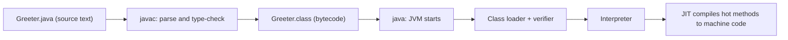

## Introduction

When you write a Java program you are writing a text file. A computer cannot run text; its processor runs machine instructions specific to its hardware. Something has to bridge that gap, and Java bridges it in two steps. First, a **compiler** called `javac` checks your text against the rules of the language and translates it into **bytecode** — a compact instruction set designed for an imaginary machine. Second, the **Java Virtual Machine (JVM)** — a program installed on the real computer — reads that bytecode and executes it, translating the busiest parts into native machine code as it goes.

This two-step design is why the same compiled Java program runs on Windows, macOS and Linux without being rebuilt, and it explains much of what you see as a beginner. Some mistakes are caught by `javac` before your program ever runs (a missing semicolon, a misspelt variable). Others only show up when the JVM is running it (dividing by zero, reading past the end of an array). Knowing which stage is complaining tells you where to look.

This lesson covers the ground every other Java topic stands on:

- the **syntax** rules a source file must follow — how statements, blocks and names are written;
- the **compilation** pipeline from `.java` file to running process;
- **comments**, including the Javadoc comments that generate API documentation;
- the **`main` method**, where every standalone program begins;
- **packages**, which give classes unique names and organise large codebases.

You will use every one of these in the first five minutes of any real Java project, and interviewers expect you to explain them precisely — "why is `main` static?" is a classic opening question.

## Before you start

You need very little:

- **A JDK installed.** The Java Development Kit (JDK) contains `javac`, `java` and the other tools used here. Any JDK 21 or later works for this lesson. What the JDK, the runtime and the JVM each are is covered in [[c2-jvm-jdk-jre]]; for now, "the JDK gives you `javac` and `java`" is enough.
- **A terminal.** You will type a few commands. If you normally use an IDE such as IntelliJ IDEA, it runs these same commands for you when you press Run.

If you have written code in another language, the C-style punctuation (braces, semicolons, `//` comments) will look familiar. If you have not, every rule is explained as it appears.

## The intuition

Think of writing Java like writing a recipe for a cook who speaks a different language, using a translator.

You write the recipe in English (your `.java` source file). A strict translator (`javac`) reads it first. The translator refuses to work with sentences that break grammar rules — a missing full stop, an ingredient that was never introduced — and hands back a list of complaints. If the recipe is grammatically fine, the translator produces a version in a universal kitchen language (bytecode in a `.class` file). Any kitchen in the world that has a cook trained in that universal language (a JVM for that operating system) can then follow it.

The analogy has a limit worth knowing: the translator only checks grammar and consistency, not whether the recipe makes sense. "Divide the cake into zero slices" passes translation and fails in the kitchen. That is the difference between a **compile-time error** and a **runtime error**.

## From source file to running program

Here is a complete program. Save it in a file called `Greeter.java`.

```java title="Greeter.java"
public class Greeter {
    public static void main(String[] args) {
        String name = "Ada";
        int year = 1843;
        System.out.println("Hello, " + name);
        System.out.println(name + " published her notes in " + year);
    }
}
```

Compile it, list the directory, and run it:

```bash
javac Greeter.java
ls
java Greeter
```

```output
Greeter.class
Greeter.java
Hello, Ada
Ada published her notes in 1843
```

Two commands, two different tools, two different stages.

`javac Greeter.java` runs the **compiler**. It reads the source text, splits it into tokens (keywords, names, literals, punctuation), checks the grammar, checks types (is `year` really an `int`? does `System.out.println` exist?), and writes `Greeter.class`. One class file is produced for each class, so a source file declaring three classes produces three class files.

`java Greeter` starts the **JVM** and asks it to run the class named `Greeter` — note there is no `.class` extension, because you are naming a class, not a file. The JVM then:

1. **Loads** `Greeter.class` using a class loader, which finds the file on the **classpath** (by default, the current directory).
2. **Verifies** the bytecode, checking that it is well-formed and cannot corrupt memory — a safety step, because class files can come from anywhere.
3. **Initialises** the class and calls its `main` method.
4. **Executes** the bytecode, first with an interpreter. Methods that run often are compiled to native machine code by the **Just-In-Time (JIT) compiler**, which is why long-running Java services get faster after warming up.

Classes the program uses, such as `String` and `System`, are loaded the same way from the JDK's own libraries, on demand, the first time they are needed. The full story of loading is in [[c2-class-loading]], and the JIT in [[c2-jit]].



### What bytecode looks like

Bytecode is not mysterious; the JDK ships a disassembler, `javap`, that prints it. Take this small class:

```java title="Adder.java"
public class Adder {
    static int add(int a, int b) {
        return a + b;
    }

    public static void main(String[] args) {
        System.out.println(add(2, 3));
    }
}
```

After `javac Adder.java`, running `javap -c Adder` shows the instructions for `add` and `main` (the default constructor `javac` generated is also listed; it is omitted here):

```text
  static int add(int, int);
    Code:
         0: iload_0
         1: iload_1
         2: iadd
         3: ireturn

  public static void main(java.lang.String[]);
    Code:
         0: getstatic     #7                  // Field java/lang/System.out:Ljava/io/PrintStream;
         3: iconst_2
         4: iconst_3
         5: invokestatic  #13                 // Method add:(II)I
         8: invokevirtual #19                 // Method java/io/PrintStream.println:(I)V
        11: return
```

The JVM is a **stack machine**: `iload_0` and `iload_1` push the two `int` arguments onto an operand stack, `iadd` pops both and pushes their sum, and `ireturn` returns the top of the stack. You never need to write bytecode, but seeing it once makes "Java compiles to bytecode" concrete. The class-file format and `javap` are explored further in [[c2-bytecode]].

### Running a single file without javac

Since Java 11 you can skip the explicit compile step for a program that fits in one file:

```bash
java Greeter.java
```

The launcher compiles the file in memory and runs it; no `.class` file is written. Since Java 22 this also works when the main file refers to other source files in the same directory. It is convenient for scripts and experiments. Real projects still compile ahead of time, usually through a build tool such as Maven or Gradle, which calls `javac` with the right options for hundreds of files.

For trying out a single expression, the JDK also includes `jshell` (since Java 9), an interactive shell where you type Java statements and see results immediately.

### Compile-time errors versus runtime errors

Remove the semicolon from a statement and `javac` refuses to produce a class file:

```java title="Missing.java"
public class Missing {
    public static void main(String[] args) {
        int total = 5
        System.out.println(total);
    }
}
```

```output
Missing.java:3: error: ';' expected
        int total = 5
                     ^
1 error
```

The message gives the file, the line number, a description and a caret pointing at the spot. Read compiler errors from the *first* one down: one missing brace can cause a cascade of later errors that disappear once the first is fixed.

A **runtime error** is different. The program compiles, starts, and then fails while running — for example `Integer.parseInt("abc")` throws a `NumberFormatException`. The JVM prints the exception and a **stack trace** listing the method calls that led to it. You will see one in the `main` section below. Java's design pushes as many mistakes as possible to compile time — type errors, misspelt names, missing methods — because a bug caught by the compiler never reaches a user.

## The building blocks of Java syntax

Every Java source file is built from the same few pieces.

**Classes.** All code in Java lives inside a class (or a related type such as an interface, enum or record). `public class Greeter { ... }` declares a class named `Greeter`. Methods and fields go between its braces. Classes are covered properly in [[c1-classes]]; for now treat the class as the container that holds your program.

**Methods.** A method is a named block of code that can be called. `main` is a method; so is `add` in `Adder`. Methods are covered in [[c1-methods]].

**Statements.** A statement is one instruction: declare a variable, assign a value, call a method, return. Simple statements end with a **semicolon**. The semicolon is a terminator, not a separator — it is required after the last statement too.

**Blocks.** A pair of braces `{ }` groups statements into a block. Blocks form the body of classes, methods, loops and `if` branches, and they define **scope**: a variable declared inside a block exists only until the closing brace.

**Expressions.** An expression produces a value: `2 + 3`, `name.length()`, `"Hello, " + name`. Statements are often built from expressions — `int sum = a + b;` is a declaration statement whose initial value is the expression `a + b`.

### Rules for writing the text

Java is **case-sensitive**. `main`, `Main` and `MAIN` are three different names, and `System` must be written with a capital `S`. Most beginner "cannot find symbol" errors are capitalisation mistakes.

**Whitespace is mostly insignificant.** Spaces, tabs and line breaks separate tokens but otherwise do not matter, so a statement can span several lines and indentation has no effect on meaning (unlike Python). Indentation is still essential for humans; the community convention is four spaces per level.

**Identifiers** are the names you choose for classes, methods and variables. An identifier may contain letters, digits, `_` and `$`, must not start with a digit, and must not be a reserved keyword. `totalPrice`, `_count` and `item2` are legal; `2items`, `class` and `my-name` are not. The `$` is legal but by convention reserved for compiler-generated names (you will see it in class files of inner classes, such as `Outer$Inner.class`). Since Java 9 a lone underscore `_` cannot be used as a name; since Java 22 it has a special meaning as an **unnamed variable** for values you deliberately ignore.

**Keywords** are words with fixed meaning that cannot be used as identifiers: `class`, `public`, `static`, `void`, `int`, `if`, `for`, `return`, `new` and around fifty others. `true`, `false` and `null` are technically literals rather than keywords, but they are reserved in the same way. Newer Java versions added **contextual keywords** — `var`, `record`, `yield`, `sealed`, `permits` — that only have special meaning in particular positions. Making them contextual meant old code that used, say, `record` as a variable name kept compiling.

### Naming conventions

The compiler does not enforce these, but every Java codebase and interviewer expects them:

| Kind of name | Convention | Example |
|---|---|---|
| Class, interface, enum, record | `PascalCase`, a noun | `OrderService`, `Greeter` |
| Method | `camelCase`, usually a verb | `calculateTotal`, `isEmpty` |
| Variable, parameter, field | `camelCase` | `unitPrice`, `retryCount` |
| Constant (`static final`) | `UPPER_SNAKE_CASE` | `MAX_RETRIES` |
| Package | all lowercase, reverse domain | `com.careerduo.shop` |

Following conventions lets readers tell at a glance that `Order` is a type, `order` is a variable and `ORDER_LIMIT` is a constant.

### One public class per file

A source file may declare several top-level classes, but **at most one of them may be `public`, and that class's name must match the file name** exactly, including case. This rule lets the compiler find a public class's source from its name alone.

```java title="Mismatch.java"
public class Greeting {
}
```

```output
Mismatch.java:1: error: class Greeting is public, should be declared in a file named Greeting.java
public class Greeting {
       ^
1 error
```

In practice, almost every Java file contains exactly one top-level class with the same name as the file.

## Comments {#c1-comments}

A **comment** is text in a source file that the compiler ignores. Comments exist for human readers: to explain why code is written a certain way, to document how a class or method should be used, or to mark work still to do. Java has three forms.

**Line comments** start with `//` and run to the end of the line. They are the everyday choice for short explanations, either on their own line or after code.

**Block comments** start with `/*` and end with `*/`. They can span many lines and are used for longer explanations or for temporarily disabling a chunk of code.

**Documentation comments**, or **Javadoc comments**, start with `/**` and end with `*/`. They are placed directly before a class, method, field or constructor, and the `javadoc` tool turns them into the HTML API documentation you see for the JDK itself. IDEs also show them in tooltips when you hover over a method call, which is why well-documented public methods are so valuable to a team.

```java title="PriceCalculator.java"
/**
 * Calculates order totals for the checkout page.
 * All amounts are in cents to avoid floating-point rounding errors.
 */
public class PriceCalculator {

    /** Sales tax rate applied to every order, as a percentage. */
    static final int TAX_PERCENT = 8;

    /**
     * Returns the total price including tax.
     *
     * @param subtotalCents the sum of item prices in cents; must not be negative
     * @return the subtotal plus tax, rounded down to the nearest cent
     * @throws IllegalArgumentException if {@code subtotalCents} is negative
     */
    static long totalWithTax(long subtotalCents) {
        if (subtotalCents < 0) {
            throw new IllegalArgumentException("negative subtotal: " + subtotalCents);
        }
        // Integer arithmetic truncates, which matches the finance team's rounding rule.
        return subtotalCents + subtotalCents * TAX_PERCENT / 100;
    }

    public static void main(String[] args) {
        /*
         * A quick manual check. 2,499 cents of goods plus 8% tax is
         * 2,499 + 199.92, and the fraction of a cent is dropped.
         */
        System.out.println(totalWithTax(2_499));
    }
}
```

```output
2698
```

The **Javadoc tags** inside the doc comment are what make it useful. `@param` describes each parameter, `@return` describes the result and `@throws` lists exceptions a caller should expect. `{@code ...}` formats text as code. Other common tags are `@see` (a cross-reference), `@since` (the version that introduced something) and `@deprecated` (with advice on what to use instead). The first sentence of a doc comment becomes the summary shown in method lists, so make it a complete description on its own. Running `javadoc -d docs PriceCalculator.java` generates browsable HTML in a `docs` folder.

Since Java 23, documentation comments can also be written as consecutive lines starting with `///`, using Markdown instead of HTML for formatting. Both styles produce the same documentation; most existing code uses `/** */`.

### What makes a good comment

Code says *what* happens; a good comment says *why*. Compare these:

```java
i++; // increment i
```

```java
retries++; // the payment gateway drops about 1% of first attempts, so we retry once
```

The first comment repeats the code and adds nothing. The second records a fact the code cannot express. If a comment is needed to explain *what* a block does, that is often a sign the code should be clearer — a well-named method or variable usually does the job better, and unlike a comment, it cannot silently go out of date when the code changes.

### Two rules that surprise people

**Block comments do not nest.** The first `*/` ends the comment, no matter how many `/*` came before it. Commenting out code that already contains a block comment therefore breaks:

```java
/*
   int a = 1; /* the original comment */
   int b = 2;
*/
```

The comment ends after `original comment`, so `int b = 2;` is live code and the final `*/` is a syntax error. Use line comments (IDEs toggle them on a selection with one shortcut) to disable code.

**Unicode escapes are processed before comments.** Java converts sequences like `A` into characters *before* it looks for comments. `\u000a` is the escape for a line break, so it ends a line comment early:

```java title="Unicode.java"
public class Unicode {
    public static void main(String[] args) {
        int x = 1;
        // The next comment ends early: \u000a x = 2;
        System.out.println(x);
    }
}
```

```output
2
```

The compiler sees a line comment that ends after `early:`, followed by the real statement `x = 2;`. This is a puzzle rather than something you will write, but it shows that comments are removed at an early stage of compilation — and it occasionally appears as an interview trick question.

> [!TIP] Comment markers inside strings
> `//` and `/*` inside a string literal are just characters. `String url = "https://example.com";` contains no comment.

## main() & Program Entry {#c1-main-method}

When you type `java Greeter`, the JVM needs to know where to start. The convention is fixed: it looks in the named class for a method called **`main`** with a specific signature, and calls it. That method is the program's **entry point**; when it returns (and no other non-daemon threads are running), the program ends.

The classic signature, which every Java version accepts, is:

```java
public static void main(String[] args)
```

Each word has a reason.

**`public`** — the JVM launcher calls `main` from outside your class, so the method must be accessible to it. Access levels are covered in [[c1-access-modifiers]].

**`static`** — a static method belongs to the class itself rather than to an object of the class. When the program starts, no objects of your class exist yet. If `main` were an ordinary instance method, the JVM would first have to create an object — which would mean choosing a constructor and deciding what arguments to pass. Making `main` static avoids the question: the JVM can call `Greeter.main(...)` directly.

**`void`** — `main` returns nothing. A program reports success or failure to the operating system through an **exit code**, which Java sets with `System.exit(code)` rather than through a return value.

**`main`** — the name the launcher searches for. It is not a keyword; you can have other methods called `main` with different parameters, and only the one with the right signature is the entry point.

**`String[] args`** — the **command-line arguments**, as an array of strings. The parameter name is a convention; `String[] arguments` works the same. `String... args` (varargs) is also accepted, because a varargs parameter is an array underneath.

### Command-line arguments

Words typed after the class name are split on spaces and passed in `args`. Quotes group words into one argument.

```java title="Args.java"
public class Args {
    public static void main(String[] args) {
        System.out.println("Received " + args.length + " argument(s)");
        for (int i = 0; i < args.length; i++) {
            System.out.println(i + ": " + args[i]);
        }
    }
}
```

```bash
java Args report "monthly sales" 2026
```

```output
Received 3 argument(s)
0: report
1: monthly sales
2: 2026
```

Run with no arguments and `args` is an **empty array** (length 0), never `null`, so `args.length` is always safe to check. Notice that `2026` arrives as the string `"2026"`: every argument is a `String`, and turning it into a number is your job, with `Integer.parseInt`. In a real service, configuration usually comes from environment variables or configuration files instead, but command-line arguments remain the norm for tools and scripts. Reading input *while* a program runs is a separate mechanism, covered in [[c1-user-input]].

### Exit codes and uncaught exceptions

The operating system receives a number when a process ends. By convention `0` means success and anything else means failure, and shell scripts and CI pipelines rely on it to decide whether to continue.

```java title="Doubler.java"
public class Doubler {
    public static void main(String[] args) {
        if (args.length == 0) {
            System.err.println("usage: java Doubler <number>");
            System.exit(2);
        }
        int n = Integer.parseInt(args[0]);
        System.out.println("Doubled: " + (n * 2));
    }
}
```

Running it three ways and printing the exit code each time with `echo $?` (macOS and Linux shells):

```text
$ java Doubler 21
Doubled: 42
$ echo $?
0
$ java Doubler
usage: java Doubler <number>
$ echo $?
2
$ java Doubler abc
Exception in thread "main" java.lang.NumberFormatException: For input string: "abc"
	...
	at Doubler.main(Doubler.java:7)
$ echo $?
1
```

Three behaviours to remember. When `main` returns normally, the exit code is `0`. `System.exit(n)` stops the JVM immediately with code `n`; the usage message goes to `System.err`, the standard error stream, so it is not mixed into normal output that might be redirected to a file. When an exception escapes `main` uncaught, the JVM prints it with a stack trace (the lines between the first and last were JDK-internal frames, omitted here because they vary between JDK versions), and the exit code is `1`. The last frame, `Doubler.main(Doubler.java:7)`, points at the exact line in your code — read stack traces from the top to find what went wrong and scan down for the first line in your own code.

`System.exit` is a blunt tool: it skips any remaining code in `main` and in other threads. Use it in command-line programs to signal failure; avoid it inside libraries and server applications, where it would kill the whole process.

### What happens when main is wrong

`main` is found by name and signature at run time, not at compile time. A class whose `main` is missing or misdeclared still compiles; the failure comes from `java`. On Java 21 (and earlier), declaring it `static void main(String[] args)` without `public` produces:

```text
Error: Main method not found in class NoMain, please define the main method as:
   public static void main(String[] args)
or a JavaFX application class must extend javafx.application.Application
```

The same message appears if you misspell `main` or write `string` instead of `String`.

### Compact source files and instance main methods (Java 25)

Java 25 finalised a simpler entry point for small programs and teaching (JDK Enhancement Proposal 512, after previews in Java 21 to 24). A source file may contain methods with no enclosing class declaration — a **compact source file** — and `main` may be an instance method with no parameters:

```java title="Hello.java"
void main() {
    IO.println("Hello from a compact source file");
}
```

```output
Hello from a compact source file
```

The compiler wraps the file in an implicitly declared class. `IO` is a class added to `java.lang` in Java 25 with simple `println`, `print` and `readln` methods. Under the new launch protocol, `main` may be non-private and need not be static; if the chosen `main` is an instance method, the launcher creates an object using the class's no-argument constructor first. If a class has both a `main(String[])` and a `main()`, the one taking `String[]` is chosen.

This is a convenience for scripts and beginners, not a replacement. Compiling the file above with `--release 21` fails with "implicitly declared classes are not supported in -source 21". Production code, frameworks and the rest of this course use the classic `public static void main(String[] args)`, and it is the form interviewers expect you to explain.

### Where main sits in a real application

In a large application there is still exactly one `main` that starts things. In a Spring Boot service, for example, `main` is a single line, `SpringApplication.run(App.class, args)`, which starts the framework, which then creates all the application's objects and starts a web server on its own threads. A JAR file can record which class holds `main` in its manifest (the `Main-Class` entry), so it can be started with `java -jar app.jar`. Several classes in a project may each have a `main` — handy for small utilities — and you choose which to run by naming the class.

## Packages {#c1-packages}

A **package** is a named group of related classes. Packages solve two problems that appear as soon as a project grows beyond a handful of files.

The first is **name clashes**. Java's standard library alone has a `java.util.Date` and a `java.sql.Date`, and your project might add its own `Date` too. If classes had only short names, these would collide. With packages, each class has a **fully qualified name** — package name plus class name — that is unique: `java.util.Date` and `java.sql.Date` are different classes.

The second is **organisation and access control**. Packages group classes by feature or layer (`com.example.billing`, `com.example.shipping`), and Java's default access level, **package-private**, lets classes in the same package share members that code elsewhere cannot touch.

### Declaring a package

The first statement in a source file (only comments may come before it) declares the package:

```java title="src/com/careerduo/shop/model/Product.java"
package com.careerduo.shop.model;

public class Product {
    private final String name;
    private final long priceInCents;

    public Product(String name, long priceInCents) {
        this.name = name;
        this.priceInCents = priceInCents;
    }

    public String name() { return name; }

    public long priceInCents() { return priceInCents; }

    String internalCode() { return "SKU-" + name.toUpperCase(); }  // package-private
}
```

The class's fully qualified name is now `com.careerduo.shop.model.Product`.

Package names follow the **reverse domain convention**: an organisation that owns `careerduo.com` starts its packages with `com.careerduo`, which makes names globally unique without a central registry. Names are all lowercase. Note that packages are **not nested** in the language's eyes: `com.careerduo.shop` and `com.careerduo.shop.model` are two unrelated packages that happen to share a prefix. Importing one does not import the other, and package-private access does not cross between them.

The **directory structure must mirror the package name**. The JVM finds `com.careerduo.shop.model.Product` by looking for `com/careerduo/shop/model/Product.class` relative to each classpath entry. Source files are conventionally laid out the same way, and Maven and Gradle expect exactly this layout under `src/main/java`.

A file with no `package` statement belongs to the **unnamed (default) package**. That is fine for a one-file experiment, but classes in named packages cannot import classes from the unnamed package at all, so every real project puts all its code in named packages.

### Importing

Code in another package can always use a class by its fully qualified name, but writing `com.careerduo.shop.model.Product` everywhere is tiresome. An **import declaration** lets you use the short name instead. Imports go after the `package` statement and before the class.

```java title="src/com/careerduo/shop/app/ShopApp.java"
package com.careerduo.shop.app;

import com.careerduo.shop.model.Product;
import java.util.List;

import static java.lang.Math.max;

public class ShopApp {
    public static void main(String[] args) {
        List<Product> cart = List.of(new Product("Kettle", 2_499), new Product("Mug", 899));
        long mostExpensive = 0;
        for (Product p : cart) {
            mostExpensive = max(mostExpensive, p.priceInCents());
        }
        System.out.println(cart.size() + " products, most expensive: " + mostExpensive);
        System.out.println(ShopApp.class.getName());
    }
}
```

There are four forms of import to know:

| Form | Example | Effect |
|---|---|---|
| Single-type import | `import java.util.List;` | Makes one class available by its short name |
| On-demand (wildcard) import | `import java.util.*;` | Makes every public class *in that one package* available; not sub-packages |
| Static import | `import static java.lang.Math.max;` | Makes a static member usable without its class name: `max(a, b)` |
| Module import (Java 25) | `import module java.base;` | Imports all packages exported by a module |

Three facts matter in practice. First, an import is only a naming shortcut for the compiler. It does not load, copy or include code, and a wildcard import does not make the program bigger or slower; the class file records fully qualified names either way. Second, **`java.lang` is imported automatically**, which is why `String`, `System`, `Math` and `Integer` need no import. Third, the classes of your own package are visible without importing.

Wildcards can cause ambiguity. Both `java.util` and `java.sql` contain a class called `Date`:

```java title="Collide.java"
import java.util.*;
import java.sql.*;

public class Collide {
    public static void main(String[] args) {
        Date d = null;
    }
}
```

```output
Collide.java:6: error: reference to Date is ambiguous
        Date d = null;
        ^
  both class java.sql.Date in java.sql and class java.util.Date in java.util match
1 error
```

Adding a single-type import, `import java.util.Date;`, resolves it, because single-type imports take priority over wildcards. If you genuinely need both classes in one file, import one and write the other's fully qualified name. Many teams prefer single-type imports throughout (IDEs manage them automatically) so that every dependency of a file is visible at the top.

Static imports are best kept for a few heavily used members — `Math.max`, or assertion methods in tests such as `assertEquals`. Overused, they make it hard to tell where a method comes from.

### Compiling and running a multi-package program

With the two files above in `src/`, compile both and send the class files to an `out` directory with `-d`:

```bash
javac -d out src/com/careerduo/shop/model/Product.java src/com/careerduo/shop/app/ShopApp.java
java -cp out com.careerduo.shop.app.ShopApp
```

```output
2 products, most expensive: 2499
com.careerduo.shop.app.ShopApp
```

`-d out` tells `javac` to create the package directories itself, producing `out/com/careerduo/shop/model/Product.class` and `out/com/careerduo/shop/app/ShopApp.class`. `-cp out` (short for `-classpath`) tells the JVM where the root of the package tree is, and the class must be named by its **fully qualified name**. Running `java -cp out ShopApp` fails with `ClassNotFoundException: ShopApp`, because no class has that name — the class's name includes its package.

### Packages and access

Packages are also a boundary for visibility. A member declared with no access modifier is **package-private**: visible to every class in the same package and to nothing outside it. `internalCode()` in `Product` is package-private, so adding `cart.get(0).internalCode()` to `ShopApp`, which is in a different package, fails to compile:

```output
src/com/careerduo/shop/app/ShopApp.java:17: error: internalCode() is not public in Product; cannot be accessed from outside package
        System.out.println(cart.get(0).internalCode());
                                      ^
1 error
```

This lets a package expose a small public surface while sharing helpers internally. The full set of access levels is in [[c1-access-modifiers]]. For an even stronger boundary — controlling which *packages* other libraries may use at all — Java 9 added modules, covered in [[c1-modules]].

### How real projects use packages

Two layouts are common. **Package by layer** groups classes by technical role: `controller`, `service`, `repository`, `model`. **Package by feature** groups by business area: `orders`, `payments`, `customers`, each containing its own controller, service and repository. Package by feature tends to scale better in large codebases, because a change to one feature touches one package and package-private access can hide that feature's internals from the rest of the system. Spring Boot additionally uses the package of the main application class as the root for scanning components, so classes outside that package tree are not found automatically.

```quiz
Q: You run `javac Report.java` successfully and then `java Report`. Which component checks that the bytecode is well-formed before it runs?
- [ ] `javac`, while writing the class file
- [x] The JVM, when it loads the class
- [ ] The operating system, when it starts the process
- [ ] Nothing checks it; bytecode is trusted
> The JVM verifies bytecode as part of loading a class, because class files can come from anywhere — not only from a trusted javac. javac checks your source code, but the JVM cannot assume a class file was produced by it.

Q: Why is `main` declared `static`?
- [ ] So that it runs faster than instance methods
- [ ] Because static methods cannot throw exceptions
- [x] So the JVM can call it without first creating an object of the class
- [ ] Because only static methods can receive arrays
> When the program starts no objects of your class exist, and the JVM would not know which constructor to call or with what arguments. A static method belongs to the class, so the launcher calls it directly. Java 25 relaxed this for compact programs by using the no-argument constructor, but the classic form remains standard.

Q: A file contains `import java.util.*;`. Which statement is true?
- [ ] It makes the compiled program larger because every class in `java.util` is included
- [ ] It also imports `java.util.concurrent`
- [x] It only lets you refer to classes in `java.util` by their short names
- [ ] It is required before you can use `String`
> Imports are compile-time naming shortcuts; nothing is copied into the class file. Packages are not nested, so java.util.concurrent is a separate package needing its own import, and java.lang (which contains String) is imported automatically.

Q: Inside `main`, the single line `System.out.println(1); // done \u000a System.out.println(2);` is compiled and run. What is printed?
- [ ] `1` only, because everything after `//` is a comment
- [x] `1` and then `2` on separate lines
- [ ] Nothing — it does not compile
- [ ] `1` followed by the literal text of the comment
> Unicode escapes are translated before comments are recognised, and \u000a is a line break. The line comment therefore ends after "done", and the second println is ordinary code.
```

## In real systems

**Build tools run the compiler for you.** Maven and Gradle call `javac` with the source layout `src/main/java/<package path>`, put class files in `target/classes` or `build/classes`, and package them into a JAR (a zip file of class files plus a manifest). Knowing what `-d`, `-cp` and fully qualified names mean is what lets you debug "class not found" problems that the build tool's output only hints at.

**The `main` method starts frameworks.** In Spring Boot, `main` calls `SpringApplication.run`, and everything else — creating services, connecting to databases, serving HTTP — happens inside the framework. Containerised services typically run `java -jar app.jar`, and the container orchestrator watches the exit code to decide whether to restart the process.

**Javadoc is the contract.** The JDK's own API documentation is generated from doc comments, as is the documentation of most open-source libraries. Teams commonly require doc comments on public methods of shared modules and run `javadoc` (or a linter) in CI to catch broken `@param` names.

**Package structure reflects architecture.** Large codebases enforce rules such as "the `domain` package must not depend on the `web` package", using package boundaries, modules, or tools such as ArchUnit that inspect dependencies between packages in tests.

## Trade-offs and alternatives

Compiling to bytecode and running on a JVM is a deliberate trade-off.

| Approach | Example languages | Strengths | Costs |
|---|---|---|---|
| Ahead-of-time to native code | C, C++, Rust, Go | Fast start-up, no runtime needed | Rebuild per platform; fewer runtime optimisations based on real behaviour |
| Bytecode + JVM with JIT | Java, Kotlin, Scala | One build runs everywhere; JIT optimises using real run-time behaviour; safety checks | Slower start-up and warm-up; the JVM uses memory itself |
| Interpreted from source | Python, Ruby | No compile step; quick to experiment | Slower execution; many errors found only at run time |

Java's compile step catches type errors before the program runs, which is one reason it is popular for large, long-lived backend systems where many developers change the same code. The JVM's start-up cost matters less for servers that run for weeks than for short command-line tools; for those cases, GraalVM Native Image can compile Java ahead of time into a native executable, at the cost of longer builds and restrictions on dynamic features such as reflection.

On comments, the trade-off is maintenance: every comment is text that must be kept accurate when code changes. Prefer clear names and small methods, keep comments for intent and non-obvious constraints, and invest in Javadoc where other people will call your code.

## Common mistakes

> [!MISTAKE] Running the file instead of the class
> `java Greeter.class` fails with "Could not find or load main class Greeter.class". After compiling, run `java Greeter` — the argument is a class name. (`java Greeter.java`, with the source extension, is the single-file launch mode and compiles the source again.)

**File name and public class name differ.** `public class OrderService` must live in `OrderService.java`, including capitalisation. On case-insensitive file systems such as the macOS default, `orderservice.java` may appear to work locally and then fail on a Linux build server.

**Using the short name with a package.** For a class in `com.example.app`, run `java -cp out com.example.app.Main`, from the directory that contains `out`. Running `java Main` from inside `out/com/example/app` also fails, because the JVM looks for `com/example/app/Main.class` relative to the classpath.

**A misdeclared `main`.** `public void main(String[] args)` (missing `static`) or `public static void main(string[] args)` (lowercase `string`) compiles but cannot be launched on Java 21. The launcher's error message tells you the expected signature.

**Treating `args` as possibly `null`.** It is an empty array when no arguments are given. Check `args.length`, and validate before indexing — `args[0]` on an empty array throws `ArrayIndexOutOfBoundsException`.

**Expecting a wildcard to include sub-packages.** `import java.util.*;` does not import `java.util.function.Function`. Each package needs its own import.

**Comments that describe what, not why.** `// loop over orders` above a `for` loop over `orders` adds noise. Write the reason the code exists or the constraint it respects.

**Leaving code commented out.** Version control already remembers old code. Large blocks of commented-out code confuse readers about what is live; delete them.

## Interview perspective

Questions on this topic usually open a Java interview and test whether your mental model is precise.

> [!INTERVIEW] Explain public static void main(String[] args)
> "It's the entry point the launcher looks for. `public` so the launcher can call it from outside the class, `static` so it can be called before any object exists, `void` because the exit status goes through `System.exit` rather than a return value, and `String[] args` carries the command-line arguments — empty, never null, when there are none. Since Java 25, compact source files can use an instance `void main()`, but the classic form is what frameworks use."

Other questions you should be ready for:

- **What is the difference between the JDK, the JRE and the JVM?** The JVM executes bytecode; the runtime is the JVM plus the standard class libraries; the JDK adds development tools such as `javac`, `javap` and `jshell`. Oracle stopped shipping a separate JRE with Java 11 (some vendors still package one), and `jlink` can build a trimmed runtime for an application. See [[c2-jvm-jdk-jre]].
- **Why is Java called platform-independent?** Bytecode is the same on every platform; each operating system has its own JVM that runs it. The JVM itself is platform-specific.
- **Is Java compiled or interpreted?** Both: compiled to bytecode ahead of time, then interpreted and JIT-compiled to machine code at run time.
- **Can a program have more than one `main`?** Yes — any class can have one, and overloaded `main` methods with other parameter lists are allowed. Only the one matching the entry-point signature in the class you launch is called.
- **Can `main` be `final`, or `synchronized`?** Yes; those modifiers do not affect the launcher. Removing `static` or `public` is what breaks the classic launch on Java 21.
- **What is the default package, and why avoid it?** The package of files with no `package` statement; classes in named packages cannot import from it.
- **What does `import` actually do at run time?** Nothing — it is a compile-time naming shortcut.

## Practice

1. **Break it on purpose.** Take `Greeter.java` and, one at a time: remove a semicolon, rename the class without renaming the file, change `String` to `string`, remove `static` from `main`. For each, note whether `javac` or `java` reports the problem, and what the message says.
2. **Argument calculator.** Write `Sum.java` that adds all its command-line arguments as integers and prints the total. Exit with code `2` and a usage message on `System.err` if no arguments are given. What happens if an argument is `"ten"`? Check the exit code.
3. **Document it.** Add Javadoc to a method that divides two integers, including `@param`, `@return` and `@throws` for division by zero. Generate HTML with `javadoc -d docs` and open `docs/index.html`.
4. **Package it.** Create a `com.example.util.TextUtils` class with a public `reverse(String)` method and a package-private helper, and a `com.example.app.Main` that uses `reverse`. Compile with `-d out`, run with `-cp out`, then try calling the helper from `Main` and read the error.
5. **Inspect bytecode.** Compile a method that multiplies two `long` values and look at it with `javap -c`. Which instruction replaced `iadd`?

## Quick revision {#quick-revision}

- `javac` turns `.java` source into `.class` bytecode (one class file per class); `java ClassName` starts the JVM, which loads, verifies, interprets and JIT-compiles it.
- Compile-time errors (syntax, types, missing names) stop `javac`; runtime errors (exceptions) happen while the JVM runs the program.
- `java File.java` runs a single source file without a separate compile (Java 11+; multi-file since Java 22). `jshell` is the interactive shell (Java 9+).
- Java is case-sensitive; statements end with `;`; braces form blocks and scopes; whitespace does not affect meaning.
- Identifiers: letters, digits, `_`, `$`; not starting with a digit; not a keyword. Contextual keywords: `var`, `record`, `yield`, `sealed`, `permits`.
- At most one `public` top-level class per file, and its name must equal the file name.
- Comments: `//` line, `/* */` block (does not nest), `/** */` Javadoc with `@param`, `@return`, `@throws`; `///` Markdown doc comments since Java 23. Unicode escapes are processed before comments.
- Entry point: `public static void main(String[] args)`; `args` is empty, never null; normal return gives exit code 0, uncaught exception gives 1, `System.exit(n)` gives n.
- Java 25 compact source files allow `void main()` without a class declaration; not available on Java 21 without preview.
- `package` must be the first statement; directories mirror package names; fully qualified name = package + class.
- Imports are compile-time shortcuts; `java.lang` is automatic; wildcards cover one package only; single-type imports beat wildcards in ambiguities.
- Compile with `javac -d out ...`, run with `java -cp out com.example.Main`.
- No modifier means package-private: visible only inside the same package.

## Key takeaways {#key-takeaways}

- Java runs in two stages: `javac` checks and translates source into portable bytecode, and the JVM loads, verifies and executes that bytecode, compiling hot code to machine code at run time.
- The compiler catches as many mistakes as possible before the program runs; read its errors from the first one down.
- Comments should explain why code exists; Javadoc comments on public methods form the documentation other developers rely on.
- `main` is `public` and `static` so the launcher can call it before any object exists; it communicates failure through exit codes, not return values.
- Packages give every class a unique fully qualified name, mirror the directory layout, and define the package-private access boundary.
- Most "class not found" problems come from a mismatch between package names, directories and the classpath — fix them by reasoning about fully qualified names.
