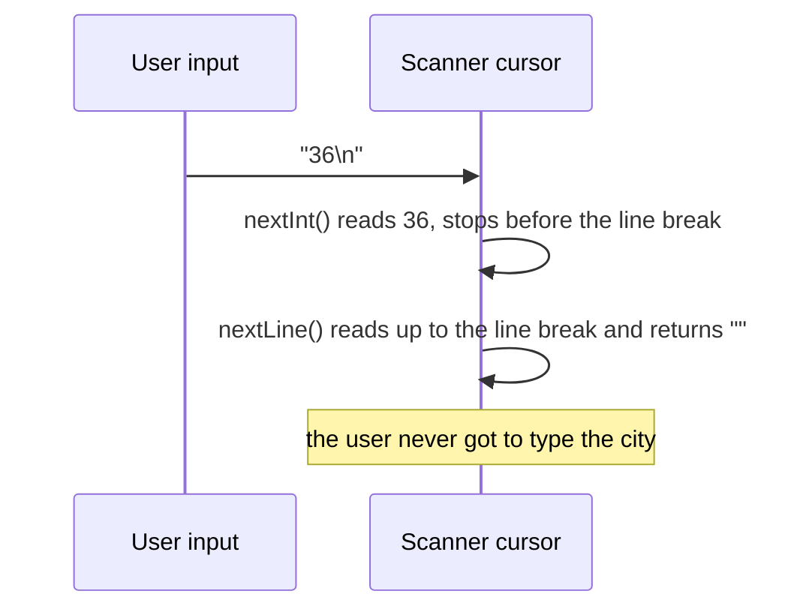
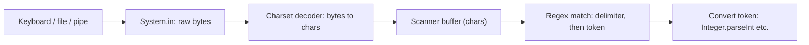

## Introduction

Most programs you write at first have their data built in: `int age = 36;`. Real programs get data from outside — from files, databases, network requests, and, for command-line tools, from a person typing at a keyboard. This lesson covers the last of these: reading what the user types while the program is running.

When a Java program starts, the operating system connects it to three **standard streams**. `System.out` is standard output, where `println` writes. `System.err` is standard error, for diagnostics. And **`System.in`** is standard input: by default, the keyboard in the terminal where you started the program. It can also be redirected to read from a file (`java App < data.txt`) or from another program's output (`cat data.txt | java App`), and the program cannot tell the difference.

`System.in` is low-level. It is an `InputStream` that delivers raw **bytes**: type `42` and press Enter, and the program receives the bytes for `'4'`, `'2'` and a line break. It does not know what a number or a line is. Something has to decode those bytes into characters, split them into meaningful pieces, and convert `"42"` into the `int` 42. In Java, the standard tool for that job is **`java.util.Scanner`**.

Scanner is the first input tool most Java developers learn. It appears in exercises, coding-interview platforms that read from standard input, and small command-line utilities. It also has two well-known traps — lost lines when mixing `nextInt` and `nextLine`, and crashes on unexpected input — that this lesson explains from the inside, so you can avoid them deliberately rather than by memorising rules.

## Before you start

- **Program structure and `main`** — compiling and running a class from the terminal. See [[c1-syntax]].
- **Types and parsing** — what an `int`, `long` and `double` are, and that `Integer.parseInt` converts text to a number. See [[c1-types]].
- **Loops** — `while` loops, used to keep asking until input is valid. See [[c1-control-flow]].
- **Exceptions, roughly** — that a method can *throw* an exception and `try`/`catch` can handle it. The details are in [[c1-exceptions]]; this lesson explains each use as it appears.

## The intuition

Imagine reading a long handwritten list aloud to someone, with your finger on the page marking your place. When they ask for "the next word", you skip any spaces, read the word, and move your finger to just after it. When they ask for "the next number", you do the same, but you only answer if the word really is a number. When they ask for "the rest of the line", you read everything from your finger to the end of the current line and move your finger to the start of the next line.

That finger is Scanner's **cursor**, and those three requests are its three families of methods. Scanner divides input into **tokens** — chunks of text separated by a **delimiter**, which is whitespace (spaces, tabs and line breaks) by default. Token methods such as `next()` and `nextInt()` skip delimiters, read one token, and stop immediately after it. The line method `nextLine()` reads everything up to the next line break, consumes that line break, and returns the text without it.

Almost every Scanner surprise comes from forgetting exactly where the finger stops.

## Your first input program

```java title="Greet.java"
import java.util.Scanner;

public class Greet {
    public static void main(String[] args) {
        Scanner in = new Scanner(System.in);

        System.out.print("Your name: ");
        String name = in.nextLine();

        System.out.print("Your age: ");
        int age = in.nextInt();

        System.out.println("Hello, " + name + ". Next year you will be " + (age + 1) + ".");
    }
}
```

Running it in a terminal, with the user's typing shown after each prompt:

```text
$ java Greet
Your name: Ada Lovelace
Your age: 36
Hello, Ada Lovelace. Next year you will be 37.
```

Line by line:

- `import java.util.Scanner;` — Scanner is not in `java.lang`, so it must be imported.
- `new Scanner(System.in)` wraps the standard input stream. Create it **once**, at the start, and reuse it.
- `System.out.print` (not `println`) leaves the cursor on the same line as the prompt, so the user types next to it.
- `in.nextLine()` reads the whole line, including the space in "Ada Lovelace". `next()` would have returned only `"Ada"`.
- `in.nextInt()` reads one token and converts it to an `int`.

Note what happens while the program waits. The call `in.nextLine()` **blocks** — the program pauses — until there is a complete line to read. The terminal itself holds what you type until you press Enter, which is why you can use Backspace to correct a mistake before the program sees anything.

## Scanner's reading methods

| Method | Reads | Returns | Stops |
|---|---|---|---|
| `next()` | One token | `String` | Right after the token |
| `nextInt()`, `nextLong()`, `nextShort()`, `nextByte()` | One token, parsed as an integer | `int`, `long`, ... | Right after the token |
| `nextDouble()`, `nextFloat()` | One token, parsed as a decimal | `double`, `float` | Right after the token |
| `nextBoolean()` | One token, `true` or `false` (any case) | `boolean` | Right after the token |
| `nextBigInteger()`, `nextBigDecimal()` | One token, arbitrary size | `BigInteger`, `BigDecimal` | Right after the token |
| `nextLine()` | The rest of the current line | `String` without the line break | After consuming the line break |

Each `nextX()` has a matching `hasNextX()` — `hasNext()`, `hasNextInt()`, `hasNextLine()` and so on — that returns `true` if the next read would succeed, **without consuming anything**. They are how you look before you leap, and they are used heavily below.

A Scanner can read from a `String` as well as from a stream, which makes its behaviour easy to observe without typing:

```java title="Tokens.java"
import java.util.Locale;
import java.util.Scanner;

public class Tokens {
    public static void main(String[] args) {
        Scanner in = new Scanner("  42   3.5\n\n  hello world  \nlast line").useLocale(Locale.US);
        System.out.println(in.nextInt());
        System.out.println(in.nextDouble());
        System.out.println(in.next());
        System.out.println("[" + in.nextLine() + "]");
        System.out.println("[" + in.nextLine() + "]");
        System.out.println(in.hasNextLine());
    }
}
```

```output
42
3.5
hello
[ world  ]
[last line]
false
```

Trace the cursor. `nextInt()` skips the leading spaces, reads `42`, and stops just after it. `nextDouble()` skips three spaces and reads `3.5`, stopping before the line break. `next()` skips *all* whitespace, including the line break and the blank line, and reads `hello`. Then `nextLine()` returns the rest of that line — `" world  "`, with its spaces — because a line read does not skip or trim anything. The next `nextLine()` reads `last line`, and since the input ends there, `hasNextLine()` is `false`.

Two lessons follow. Token methods treat line breaks as ordinary whitespace, so they happily skip blank lines and read across lines. Line reads return exactly what is on the line, so you will usually want `strip()` to remove surrounding spaces. (`useLocale(Locale.US)` fixes the decimal separator; the locale section below explains why.)

## The nextInt-then-nextLine trap

This is the most common Scanner bug, and the trace above already contains its explanation.

```java title="Bug.java"
import java.util.Scanner;

public class Bug {
    public static void main(String[] args) {
        Scanner in = new Scanner(System.in);

        System.out.print("Age: ");
        int age = in.nextInt();

        System.out.print("City: ");
        String city = in.nextLine();          // returns the rest of the age line

        System.out.println("age=" + age + ", city=[" + city + "]");
    }
}
```

The user types `36`, presses Enter, and the program does not wait for a city at all:

```text
$ java Bug
Age: 36
City: age=36, city=[]
```

After the user presses Enter, the input contains `36\n`. `nextInt()` reads `36` and stops right after it — **the line break is still unread**. `nextLine()` then does exactly its job: it returns everything up to the next line break, which is the empty string, and consumes the `\n`. The city line the user would have typed has not been read; the program has already moved on.



There are two fixes.

**Fix 1: consume the leftover line break.** Call `in.nextLine();` once after `nextInt()` and discard the result, before reading the real line. This works, but it is fragile: if the user types `36 years`, the discarded line silently swallows `" years"`.

**Fix 2 (recommended): read every line with `nextLine()` and parse it yourself.** Treat input as a series of lines, which is how users think about it, and convert with `Integer.parseInt(line.strip())`. Each answer is then exactly one line, the cursor always ends at the start of the next line, and a bad value becomes a `NumberFormatException` you can catch and report — as the next section shows.

> [!MISTAKE] Mixing token and line reads
> After `nextInt()`, `nextDouble()` or `next()`, the line break that ended the user's answer is still in the input. A following `nextLine()` returns an empty string. Either read everything with `nextLine()` and parse it, or consume the remainder of the line before the next line read.

## When input is wrong

Users type unexpected things. Scanner's typed methods respond with exceptions:

```java title="Quantity.java"
import java.util.Scanner;

public class Quantity {
    public static void main(String[] args) {
        Scanner in = new Scanner(System.in);
        System.out.print("Quantity: ");
        int qty = in.nextInt();
        System.out.println("Ordered " + qty);
    }
}
```

Typing `two` crashes the program:

```text
Quantity: two
Exception in thread "main" java.util.InputMismatchException
	at java.base/java.util.Scanner.throwFor(Scanner.java:...)
	...
```

An **`InputMismatchException`** means a token exists but is not the requested type. Importantly, the bad token is **not consumed**: it stays in the input, so calling `nextInt()` again would fail again on the same `two`.

A different exception appears when there is no input left at all: **`NoSuchElementException`**. That happens when input was redirected from a file and the file ended, or when the user signals **end of input** — Ctrl+D at the start of a line on macOS and Linux, or Ctrl+Z followed by Enter on Windows. A program that reads from standard input must expect the input to end, because in scripts and automated tests it always eventually does.

Both are **unchecked exceptions**, so the compiler does not force you to handle them — which is exactly why so many beginner programs crash on the first typo.

### A robust read-validate-retry loop

The pattern below reads a whole line, checks for end of input first, parses the text, checks the range, and asks again until it gets a valid answer.

```java title="AskInt.java"
import java.util.Scanner;

public class AskInt {
    static int readIntInRange(Scanner in, String prompt, int min, int max) {
        while (true) {
            System.out.print(prompt);
            if (!in.hasNextLine()) {
                throw new IllegalStateException("input ended before a valid number was entered");
            }
            String line = in.nextLine().strip();
            try {
                int value = Integer.parseInt(line);
                if (value >= min && value <= max) {
                    return value;
                }
                System.out.println("Please enter a number from " + min + " to " + max + ".");
            } catch (NumberFormatException e) {
                System.out.println("'" + line + "' is not a whole number.");
            }
        }
    }

    public static void main(String[] args) {
        Scanner in = new Scanner(System.in);
        int qty = readIntInRange(in, "Quantity (1-10): ", 1, 10);
        System.out.print("Gift message: ");
        String message = in.hasNextLine() ? in.nextLine() : "";
        System.out.println("Ordered " + qty + " with message \"" + message + "\"");
    }
}
```

```text
$ java AskInt
Quantity (1-10): two
'two' is not a whole number.
Quantity (1-10): 42
Please enter a number from 1 to 10.
Quantity (1-10):  3
Gift message: Happy birthday, Sam
Ordered 3 with message "Happy birthday, Sam"
```

Why each piece is there:

- **`hasNextLine()` before `nextLine()`.** If the input has ended, `nextLine()` would throw `NoSuchElementException` with a vague message. Checking first lets the method fail with a clear one — or, in another program, exit cleanly.
- **`strip()`** removes the leading space the user typed before `3`. `Integer.parseInt(" 3")` would otherwise throw.
- **`try`/`catch (NumberFormatException e)`.** `parseInt` throws this when the text is not an integer. Catching it turns a crash into a helpful message and another attempt.
- **The range check** turns a syntactically valid but meaningless value (42 items, when the maximum is 10) into another retry.
- **Line-based reading** means the gift message afterwards is read correctly: the quantity line was consumed in full, so there is no leftover line break.

Wrapping this in a method keeps `main` readable and makes the rule "how do we ask for a number?" consistent across a program.

### Validating tokens with hasNextInt

When input is a stream of tokens rather than question-and-answer lines — a list of numbers in a file, say — the `hasNextX` methods let you inspect each token before reading it:

```java title="SumInts.java"
import java.util.Scanner;

public class SumInts {
    public static void main(String[] args) {
        Scanner in = new Scanner(System.in);
        int sum = 0;
        int skipped = 0;
        while (in.hasNext()) {
            if (in.hasNextInt()) {
                sum += in.nextInt();
            } else {
                in.next();          // discard the bad token, or the loop never advances
                skipped++;
            }
        }
        System.out.println("sum=" + sum + ", skipped=" + skipped);
    }
}
```

With input from a file (`java SumInts < numbers.txt`) containing `10 20 abc` on one line and `30 4.5 -5` on the next:

```output
sum=55, skipped=2
```

The loop reads until input ends, because `hasNext()` returns `false` only when no tokens remain. The `else` branch is essential: `hasNextInt()` never consumes anything, so without `in.next()` the scanner would look at `abc` forever — a classic infinite loop. Note that `4.5` is skipped too, because it is not an integer token.

## Locale, delimiters and other sources

### Number formats depend on the locale

Scanner's numeric methods interpret tokens using a **locale** — the language and country settings that decide, among other things, whether the decimal separator is `.` or `,`. By default Scanner uses the computer's default locale. On a machine set to German, `nextDouble()` expects `3,5` and throws `InputMismatchException` for `3.5`; on a US machine it is the reverse. The same program can therefore pass on your laptop and fail on a colleague's or on a server.

```java
new Scanner("3,5").useLocale(Locale.GERMANY).nextDouble();  // 3.5
new Scanner("3.5").useLocale(Locale.US).nextDouble();       // 3.5
new Scanner("1,234").useLocale(Locale.US).nextInt();        // 1234: group separator accepted
```

When input has a fixed format — data files, judge systems, machine-generated text — set the locale explicitly with `useLocale(Locale.US)` or `useLocale(Locale.ROOT)`, or read lines and parse with `Double.parseDouble`, which always uses `.` regardless of locale. The last example also shows that integer methods accept locale-specific digit grouping, which may or may not be what you want.

### Changing the delimiter

`useDelimiter` replaces the whitespace delimiter with any regular expression. Splitting simple comma-separated text on commas and line breaks:

```java title="CsvTokens.java"
import java.util.Scanner;

public class CsvTokens {
    public static void main(String[] args) {
        Scanner csv = new Scanner("alice,30,London\nbob,25,Paris").useDelimiter("[,\\n]");
        while (csv.hasNext()) {
            System.out.print("[" + csv.next() + "]");
        }
        System.out.println();
    }
}
```

```output
[alice][30][London][bob][25][Paris]
```

This is fine for simple, trusted data. Real CSV has quoted fields containing commas and line breaks, and needs a proper CSV library.

### Other sources

Scanner reads from anything that produces text: `new Scanner(String)`, `new Scanner(Path)` for a file (which throws `IOException` if the file cannot be opened), `new Scanner(File)`, or any `InputStream` or `Reader`. The methods are identical, which makes it easy to test input-handling code by feeding it a string instead of the keyboard. File handling in general is covered in [[c1-io-files]].

## One Scanner per stream, and do not close System.in

Two rules about Scanner's lifetime prevent baffling bugs.

**Create only one Scanner for `System.in`.** It is tempting to create a new Scanner inside every method that needs input. The problem is that Scanner reads ahead: to find one token, it reads a whole chunk of input into its own **buffer**, which may contain several lines. A second Scanner on the same stream cannot see what the first one has already buffered:

```java title="TwoScanners.java"
import java.util.Scanner;

public class TwoScanners {
    public static void main(String[] args) {
        Scanner a = new Scanner(System.in);
        System.out.println("a read: " + a.nextLine());
        Scanner b = new Scanner(System.in);
        System.out.println("b has a line: " + b.hasNextLine());
        System.out.println("a read: " + a.nextLine());
    }
}
```

With two lines, `Ada` and `London`, piped in:

```output
a read: Ada
b has a line: false
a read: London
```

Scanner `a` took both lines into its buffer when it read the first one, so `b` finds the stream empty. When a human types slowly at a terminal the bug may not appear, because only one line is available at a time — and then it appears as soon as input is pasted or redirected from a file. Create one Scanner in `main` and pass it to methods that need it.

**Do not close a Scanner that wraps `System.in`.** Closing a Scanner closes its underlying stream. For a file, that is correct and necessary — use try-with-resources (see [[c1-try-with-resources]]). For `System.in`, closing it means no part of the program can ever read standard input again, and you cannot reopen it:

```java title="Closed.java"
import java.util.Scanner;

public class Closed {
    static String askName() {
        try (Scanner in = new Scanner(System.in)) {   // closes System.in on exit
            System.out.print("Name: ");
            return in.nextLine();
        }
    }

    static String askCity() {
        Scanner in = new Scanner(System.in);
        System.out.print("City: ");
        return in.nextLine();
    }

    public static void main(String[] args) {
        String name = askName();
        String city = askCity();
        System.out.println(name + " from " + city);
    }
}
```

```text
Name: City: Exception in thread "main" java.util.NoSuchElementException: No line found
	at java.base/java.util.Scanner.nextLine(Scanner.java:...)
	at Closed.askCity(Closed.java:14)
	...
```

IDEs often warn "resource leak: `in` is never closed" for a Scanner on `System.in`. For standard input specifically, the warning is safe to ignore: the JVM releases the stream when the program exits.

## How it works internally

Scanner sits on top of two layers, each solving one problem:



First, bytes are decoded into characters using a **charset** (UTF-8 by default since Java 18, the platform's default encoding before that). Next, Scanner keeps a character buffer — 1,024 characters initially, growing as needed — and refills it from the source when it runs out. Each read uses **regular expressions**: one to skip the delimiter, another to match a token, and, for `nextInt()`, a pattern describing a valid integer in the current locale. Only if the pattern matches does Scanner convert the text and move the cursor past it; otherwise it throws `InputMismatchException` and leaves the cursor where it was.

This design explains the behaviour seen throughout the lesson:

- `hasNextInt()` can answer without consuming anything because it only runs the pattern against the buffer.
- A second Scanner loses data because the first has already moved characters from the stream into its private buffer.
- Scanner is relatively slow, because every token involves regular-expression matching and possibly locale handling. That does not matter for a person typing a few answers, but it does for a program reading a million numbers.
- Scanner methods do not throw `IOException`. If the underlying stream fails, Scanner treats it as end of input, and `in.ioException()` returns the swallowed exception. That keeps beginner code simple and can hide real I/O errors in production code.

A Scanner is also **not thread-safe**: two threads reading from one Scanner without synchronisation can corrupt its cursor and buffer.

## Worked example: a small command-line tool

The program below reads commands until the user types `quit` or input ends. It combines line-based reading, splitting a line into words, validation with helpful messages, and clean handling of end of input.

```java title="ExpenseTracker.java"
import java.util.ArrayList;
import java.util.List;
import java.util.Scanner;

public class ExpenseTracker {

    record Expense(String category, long cents) {}

    public static void main(String[] args) {
        Scanner in = new Scanner(System.in);
        List<Expense> expenses = new ArrayList<>();

        System.out.println("Commands: add <category> <amount>, total, quit");
        while (true) {
            System.out.print("> ");
            if (!in.hasNextLine()) {
                break;                                   // end of input: stop cleanly
            }
            String line = in.nextLine().strip();
            if (line.isEmpty()) {
                continue;
            }
            String[] parts = line.split("\\s+");
            String command = parts[0].toLowerCase();

            switch (command) {
                case "add" -> {
                    if (parts.length != 3) {
                        System.out.println("usage: add <category> <amount>");
                        continue;
                    }
                    Long cents = parseCents(parts[2]);
                    if (cents == null) {
                        System.out.println("'" + parts[2] + "' is not an amount like 12.50");
                        continue;
                    }
                    expenses.add(new Expense(parts[1], cents));
                    System.out.println("added " + parts[1]);
                }
                case "total" -> {
                    long sum = 0;
                    for (Expense e : expenses) {
                        sum += e.cents();
                    }
                    System.out.printf("%d expense(s), total %d.%02d%n",
                            expenses.size(), sum / 100, sum % 100);
                }
                case "quit" -> {
                    System.out.println("bye");
                    return;
                }
                default -> System.out.println("unknown command: " + command);
            }
        }
        System.out.println();
        System.out.println("input ended");
    }

    /** Parses "12", "12.5" or "12.50" into cents; returns null if the text is not valid. */
    static Long parseCents(String text) {
        if (!text.matches("\\d+(\\.\\d{1,2})?")) {
            return null;
        }
        String[] pieces = text.split("\\.");
        long whole = Long.parseLong(pieces[0]);
        long fraction = 0;
        if (pieces.length == 2) {
            fraction = Long.parseLong(pieces[1].length() == 1 ? pieces[1] + "0" : pieces[1]);
        }
        return whole * 100 + fraction;
    }
}
```

A session at the terminal:

```text
$ java ExpenseTracker
Commands: add <category> <amount>, total, quit
> add food 12.50
added food
> add travel 3.5
added travel
> add rent abc
'abc' is not an amount like 12.50
> spend 5
unknown command: spend
>
> total
2 expense(s), total 16.00
> add books
usage: add <category> <amount>
> quit
bye
```

How it works:

1. **One Scanner, created once**, used for the whole session.
2. **`hasNextLine()` guards every read.** If the user presses Ctrl+D, or the input file ends, the loop breaks and the program prints `input ended` instead of crashing. This also makes the tool usable in scripts: `java ExpenseTracker < commands.txt`.
3. **Each command is one line**, split on runs of whitespace with `split("\\s+")`, so `add   food   12.50` with extra spaces works too. Blank lines are skipped.
4. **Amounts are validated with a regular expression** (`digits`, optionally a dot and one or two digits) before parsing, and stored as `long` cents to avoid floating-point rounding — the same reasoning as in [[c1-types]]. `parseCents` returns `null` for invalid text, and the caller turns that into a message.
5. **Every error path prints a message and continues**, so a typo never loses the user's earlier entries.

Edge cases worth checking yourself: an amount like `5.` or `.5` (both rejected by the pattern), a category with spaces (it becomes extra words, so the usage message appears), and a very long amount that overflows `long` (`Long.parseLong` would throw `NumberFormatException`; a production version would limit the number of digits).

## Alternatives to Scanner

### BufferedReader for speed

`java.io.BufferedReader` reads text line by line, with no token parsing and no regular expressions. You split and parse the lines yourself, and in exchange it is many times faster than Scanner on large inputs. Programs on judge systems that read hundreds of thousands of numbers use it routinely:

```java title="FastSum.java"
import java.io.BufferedReader;
import java.io.IOException;
import java.io.InputStreamReader;
import java.util.StringTokenizer;

public class FastSum {
    public static void main(String[] args) throws IOException {
        BufferedReader reader = new BufferedReader(new InputStreamReader(System.in));
        int n = Integer.parseInt(reader.readLine().strip());
        StringTokenizer tokens = new StringTokenizer(reader.readLine());
        long sum = 0;
        for (int i = 0; i < n; i++) {
            sum += Long.parseLong(tokens.nextToken());
        }
        System.out.println(sum);
    }
}
```

Given the input `5` on the first line and `3 1000000000 7 -2 1000000000` on the second:

```output
2000000008
```

`InputStreamReader` decodes bytes to characters, and `BufferedReader` reads them in large blocks. `readLine()` returns `null` at end of input instead of throwing, and it declares `IOException`, a **checked exception**, which is why `main` says `throws IOException`. `StringTokenizer` is an old but fast way to split a line on whitespace. Note the `long` sum: two values of one billion overflow `int`. Buffered I/O is covered further in [[c1-buffered-io]], and fast input templates for competitive programming in [[a1-java-syntax-competitive]].

### Console for passwords

`System.console()` returns a `java.io.Console` with `readLine(prompt)` and `readPassword(prompt)`. `readPassword` does not echo what the user types and returns a `char[]`, which can be overwritten after use rather than lingering in memory as an immutable `String`. Console may be unavailable — `System.console()` can return `null`, for example in some IDE run windows or when input is redirected — so always check before using it.

### IO.readln in Java 25

Java 25 added a `java.lang.IO` class for simple programs, with `IO.readln(prompt)`, which prints a prompt and returns one line (or `null` at end of input). It is designed for beginners and compact source files and avoids the token/line trap entirely, because it only reads lines. It is not available on Java 21.

### Command-line arguments and configuration

Not every input needs to be interactive. Values known when the program starts are better passed as command-line arguments (`args` in `main`, see [[c1-main-method]]), environment variables, or configuration files, which work unattended in scripts and servers.

## In real systems

Interactive Scanner input is uncommon in production backend code: web services receive input as HTTP requests, message-queue events and database rows, not from a keyboard. The skills from this lesson still transfer directly. **Never trust input** — validate format and range at the boundary, report errors clearly, and keep running. **Expect input to end or fail**, as networks and files do. **Parse explicitly with a known format** rather than relying on machine defaults such as locale and charset.

Where standard input does appear is in command-line tools and in pipelines: Unix-style programs read data from standard input, write results to standard output and diagnostics to standard error, so they can be chained together (`cat orders.csv | java Summarise | sort`). Coding-interview platforms and online judges also feed test data through standard input, which is why fast input reading matters there.

## Trade-offs and alternatives

| Tool | Strengths | Weaknesses | Use it for |
|---|---|---|---|
| `Scanner` | Easy token and typed reads; `hasNextX` checks; reads strings, files, streams | Slow on large input; locale-dependent numbers; hides `IOException`; token/line trap | Exercises, small interactive tools, quick parsing |
| `BufferedReader` | Fast; simple line model; reports I/O errors | You split and parse yourself; checked exceptions | Large inputs, judges, production file reading |
| `Console` | Hides password input | May be `null` when there is no terminal | Passwords and secrets in CLI tools |
| `IO.readln` (Java 25) | Simplest line reading | Java 25+ only; lines only | Teaching and compact scripts |
| Arguments / env vars / config | Unattended, scriptable | Not interactive | Values known at start-up |

## Common mistakes

**Reading a line after a token.** `nextInt()` followed by `nextLine()` returns an empty string because the line break is still unread. Read everything with `nextLine()` and parse it.

**Assuming input is valid.** `nextInt()` throws `InputMismatchException` on `two`, and `Integer.parseInt` throws `NumberFormatException` on `" 3"` unless you strip it. Validate in a loop and give the user another chance.

**Looping on `hasNextInt()` without consuming.** `while (!in.hasNextInt()) { System.out.println("try again"); }` never ends, because the bad token is never removed. Call `in.next()` (or `nextLine()`) to discard it.

**Ignoring end of input.** Calling `nextLine()` when input has ended throws `NoSuchElementException`. Guard with `hasNextLine()` and decide what end of input means for your program.

**Creating a Scanner per method.** The first Scanner's buffer swallows input the others never see. Create one and pass it around.

**Closing a Scanner on `System.in`.** It closes standard input for the rest of the program. Close Scanners on files; leave the `System.in` one open.

**Comparing input with `==`.** `if (answer == "yes")` compares references and is almost always `false` for text read from input. Use `answer.equals("yes")` or `equalsIgnoreCase`. See [[c1-string-equals]].

**Depending on the default locale.** `nextDouble()` behaves differently on machines with different regional settings. Set the locale explicitly for machine-formatted input.

## Interview perspective

Scanner rarely gets its own interview question, but it shows up in two ways: in coding rounds on platforms that read standard input, and as a probe of how well you understand streams, buffering and input validation.

> [!INTERVIEW] Why does nextLine() return an empty string after nextInt()?
> "`nextInt()` reads only the digits and leaves the cursor before the line break the user typed. `nextLine()` reads up to the next line break, so it returns the empty remainder of that same line. I'd fix it by reading every answer with `nextLine()` and parsing it with `Integer.parseInt`, which also gives me a single place to validate."

Other questions to prepare:

- **Scanner or BufferedReader for a million integers?** BufferedReader with manual tokenising, because Scanner's regex-based parsing is much slower; Scanner is fine for small interactive input.
- **What happens if you close a Scanner wrapping `System.in`?** Standard input is closed and cannot be reopened; later reads fail with `NoSuchElementException`.
- **Why might two Scanners on `System.in` lose data?** Each buffers ahead; data read into one Scanner's buffer is invisible to the other.
- **How do you read until end of input?** `while (in.hasNextLine())` with Scanner, or `while ((line = reader.readLine()) != null)` with BufferedReader.
- **How would you read a password?** `System.console().readPassword()`, after checking `System.console()` is not `null`, and clear the returned `char[]` after use.

```quiz
Q: The user types `25` and presses Enter, then the program runs `int n = in.nextInt(); String s = in.nextLine();`. What is `s`?
- [ ] `"25"`
- [x] `""`, the empty rest of the line containing 25
- [ ] The next line the user types
- [ ] `null`
> nextInt() stops right after the digits, leaving the line break unread. nextLine() returns everything up to that line break — nothing — and consumes it, so it never waits for the user to type another line.

Q: What does `in.hasNextInt()` do when the next token is `abc`?
- [x] Returns false and leaves `abc` in the input
- [ ] Returns false and skips past `abc`
- [ ] Throws InputMismatchException
- [ ] Waits until the user types a number
> The hasNextX methods only look ahead; they never consume. That is why a validation loop must call next() or nextLine() to discard the bad token, or it will examine the same token forever.

Q: A helper method creates `new Scanner(System.in)` inside try-with-resources and returns one line. Later, `main` creates another Scanner on `System.in` and calls `nextLine()`. What happens?
- [ ] It works, because each Scanner is independent
- [ ] It returns the same line again
- [x] It throws NoSuchElementException, because closing the first Scanner closed System.in
- [ ] It blocks forever
> Closing a Scanner closes the stream it wraps. Once System.in is closed it cannot be reopened, so the new Scanner finds no input. Keep one Scanner for System.in for the whole program and do not close it.

Q: A program must read 500,000 integers from standard input quickly. Which approach is most appropriate?
- [ ] One `new Scanner(System.in)` per number
- [ ] Scanner with `nextInt()` in a loop
- [x] BufferedReader reading lines, split with StringTokenizer and parsed with Integer.parseInt
- [ ] System.console().readLine() in a loop
> BufferedReader reads large blocks and does no regex matching, so it is far faster than Scanner on big inputs. Many Scanners would lose buffered data, and Console may be null when input is piped from a file.
```

## Practice

1. **Fix the trap.** Write a program that asks for an age with `nextInt()` and then a full name with `nextLine()`. Observe the bug, then fix it both ways and explain why the line-based fix is more robust.
2. **Safe double.** Write `readDouble(Scanner in, String prompt)` that keeps asking until the user enters a valid decimal, accepting only `.` as the separator regardless of the machine's locale.
3. **Statistics until EOF.** Read numbers (one or more per line) until end of input, skipping invalid tokens, and print the count, minimum, maximum and average. Test it with input redirected from a file.
4. **Menu.** Build a menu-driven temperature converter (`1` Celsius to Fahrenheit, `2` the reverse, `3` quit) that never crashes on bad input and exits cleanly on Ctrl+D.
5. **Speed test.** Generate a file with one million random integers. Sum them with Scanner and with BufferedReader, and time both with `System.nanoTime()`.

## Quick revision {#quick-revision}

- `System.in` is a raw byte stream; `Scanner` decodes it, splits it into tokens (whitespace-delimited by default) and parses them.
- Token methods (`next`, `nextInt`, `nextDouble`, ...) skip delimiters, read one token and stop right after it; `nextLine()` returns the rest of the current line and consumes the line break.
- After a token read, the line break remains: a following `nextLine()` returns `""`. Prefer reading lines and parsing them.
- `hasNextX()` checks without consuming; discard bad tokens with `next()` to avoid infinite loops.
- Exceptions: `InputMismatchException` (wrong type; token not consumed), `NoSuchElementException` (no input left), `NumberFormatException` (from `Integer.parseInt`).
- End of input: Ctrl+D (macOS/Linux), Ctrl+Z then Enter (Windows), or end of a redirected file. Guard with `hasNextLine()`.
- Numeric parsing uses the default locale; call `useLocale(Locale.US)` or parse with `Double.parseDouble` for fixed formats.
- One Scanner per stream (it buffers ahead); do not close the one wrapping `System.in`.
- Scanner is regex-based and slow on large input, swallows `IOException`, and is not thread-safe.
- `BufferedReader.readLine()` is fast, returns `null` at end of input, and throws checked `IOException`; pair it with `StringTokenizer` or `split`.
- `Console.readPassword()` hides input (check for `null` console); `IO.readln` exists from Java 25.

## Key takeaways {#key-takeaways}

- Scanner moves a cursor through buffered input: token methods stop right after the token, and `nextLine()` reads to the end of the line — knowing where the cursor stops explains the classic empty-line bug.
- Treat input as untrusted: read a line, strip it, parse it, check the range, and ask again on failure.
- Always plan for input ending; check `hasNextLine()` rather than letting `NoSuchElementException` crash the program.
- Use one Scanner for `System.in`, pass it around, and never close it.
- Make number formats explicit instead of relying on the machine's locale.
- For large inputs, use `BufferedReader`; for passwords, use `Console`; for values known at start-up, use arguments or configuration.
