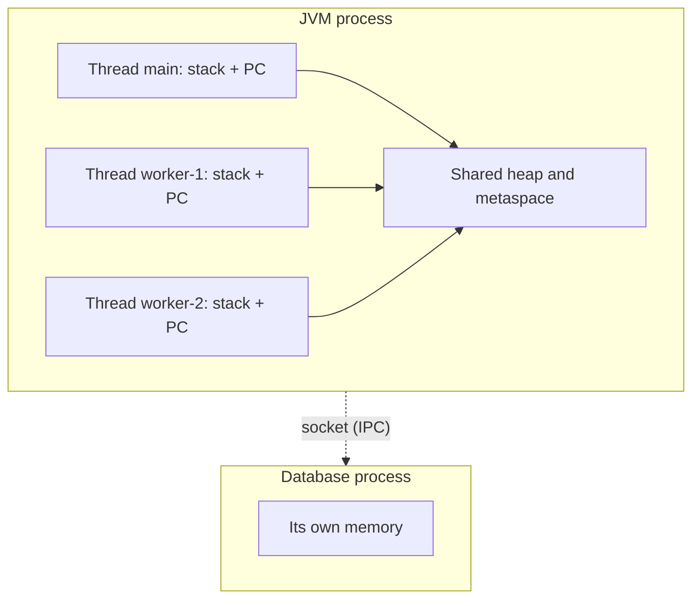
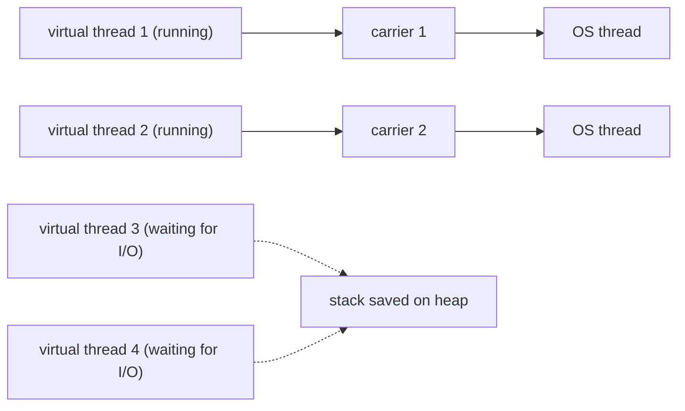

## Introduction

A web server receives a thousand requests per second. Most of each request's life is spent waiting: for the database to answer, for another service to reply, for bytes to arrive over the network. If the server could only do one thing at a time, every request would queue behind the slowest one, and the CPU would sit idle during all that waiting. The server needs a way to have many pieces of work *in progress* at once.

Operating systems offer two building blocks for this. A **process** is a running program with its own private memory. A **thread** is a single sequence of instructions being executed *inside* a process; a process can contain many threads, and they all see the same memory. Running every request in its own process would give strong isolation but be expensive and make sharing data awkward. Running every request on its own thread inside one process is cheaper and makes sharing trivial — which is exactly what makes threads both powerful and dangerous.

Every Java program you have written already uses both. Launching `java Main` starts one operating-system process: the Java Virtual Machine (JVM). Inside it, your `main` method runs on a thread called `main`, and the JVM quietly starts a dozen or more other threads for garbage collection, just-in-time compilation and housekeeping. When you use Spring Boot, Tomcat runs each incoming HTTP request on a thread from a pool. When you call `parallelStream()`, the work is split across threads of the `ForkJoinPool`. Understanding what a thread is — what it owns, what it shares, and what it costs — is the foundation for everything else in Java concurrency.

This lesson covers three ideas. First, the difference between processes and threads. Second, the difference between **concurrency** and **parallelism**, two words that are often used interchangeably but mean different things. Third, the two kinds of thread that Java 21 gives you: **platform threads** and **virtual threads**.

## Before you start

- **JVM memory areas** — the difference between the heap (objects) and the stack (method frames and local variables). See [[c2-stack-vs-heap]] and [[c2-runtime-data-areas]].
- **Lambdas and functional interfaces** — the examples pass a `Runnable` as a lambda. See [[c1-lambdas]].
- **Exceptions** — `InterruptedException` appears in several examples. See [[c1-checked-unchecked]].

You do not need any prior knowledge of operating-system internals; the lesson explains the parts that matter.

## The intuition

Picture a restaurant kitchen. The kitchen is a **process**: it has its own space, its own fridge, its own equipment, and its own front door. A second restaurant across the street is a different process. Its cooks cannot open your fridge; if its kitchen catches fire, yours is unaffected. If the two restaurants want to exchange ingredients, someone has to carry them across the street — a deliberate, relatively slow act.

The cooks inside one kitchen are **threads**. Each cook has a personal notepad listing the steps of the dish they are working on and where they are up to. But they all share the fridge, the counters and the stove. Sharing is fast — a cook can grab what another cook just put down — but it also means two cooks can reach for the last egg at the same moment, or one can move a pan another was about to use. Nothing in the kitchen prevents that; the cooks have to coordinate.

The analogy maps closely onto the real thing: the notepad is the thread's **stack** and **program counter**, the shared fridge is the **heap**. Where it stops working is cost: hiring a cook (creating a thread) is far cheaper than building a restaurant (creating a process), but it is not free, and a kitchen with ten thousand cooks would spend more time squeezing past each other than cooking. That limit is what virtual threads address, later in this lesson.

## What a process owns

When the operating system starts a program, it creates a process and gives it a set of resources that belong to that process alone:

- A **virtual address space** — the range of memory addresses the program can use. Address `0x7f00_1000` in one process and the same address in another process refer to completely different physical memory. The CPU's memory-management unit enforces this: a process cannot read or write another process's memory, by accident or on purpose.
- **Open files and sockets**, tracked in a per-process table of file descriptors (Unix) or handles (Windows).
- **Security identity** — the user it runs as and the permissions that come with it.
- **At least one thread**, which starts executing the program's entry point.

That isolation is the defining property of a process. If a C program in one process writes through a bad pointer, it crashes that process only. If one process is compromised, it cannot read secrets from another process's memory. This is why browsers run each tab in a separate process, and why a database server and the application that uses it are separate processes.

The price of isolation is that processes cannot simply share data. To communicate they need **inter-process communication (IPC)**: pipes, sockets, files, shared-memory segments set up explicitly, or a network protocol such as HTTP. Each of these involves the operating system and usually copying or serialising data.

Java can start and talk to other processes through `ProcessBuilder`. The program below launches a child process, reads what it writes to its standard output through a pipe, and waits for it to exit:

```java title="SpawnChild.java"
import java.io.IOException;

public class SpawnChild {
    public static void main(String[] args) throws IOException, InterruptedException {
        Process child = new ProcessBuilder("echo", "hello from a separate process")
                .redirectErrorStream(true)
                .start();

        // The only way to get data out of the child is through a pipe (IPC).
        String output = new String(child.getInputStream().readAllBytes()).trim();
        int exitCode = child.waitFor();

        System.out.println("child said: " + output);
        System.out.println("child exit code: " + exitCode);
        System.out.println("different pid: " + (child.pid() != ProcessHandle.current().pid()));
    }
}
```

```output
child said: hello from a separate process
child exit code: 0
different pid: true
```

The example runs on Linux and macOS, where `echo` is a program. Notice how indirect the communication is: the child cannot hand the parent a Java object; it can only write bytes, which the parent reads and decodes. The two processes have different process ids (pids) and entirely separate memory.

## What a thread owns, and what it shares

A **thread** is one independent flow of execution inside a process. The operating system's **scheduler** decides which threads run on which CPU cores at each moment, and it schedules threads, not processes — a process with eight threads can use eight cores at once.

Each thread needs its own record of *where it is* in the program. So every thread owns:

- A **program counter** — the address of the instruction it will execute next.
- A **stack** — one frame per method call in progress, holding that method's local variables, parameters and intermediate values. When a method returns, its frame is popped.
- A saved copy of the CPU **registers**, so that when the scheduler pauses the thread and later resumes it, it continues exactly where it left off.

Everything else belongs to the process and is shared by all its threads. In a JVM that means:

| Area | Owned by | Holds |
|---|---|---|
| Heap | Process (shared) | Every object and array created with `new` |
| Metaspace | Process (shared) | Class metadata; static fields live with their class |
| Code cache | Process (shared) | Machine code produced by the JIT compiler |
| JVM stack | One per thread | Frames with local variables and operand stacks |
| PC register | One per thread | The current bytecode instruction |
| Native stack | One per thread | Frames for native (C/C++) code called through JNI |

The consequence is the single most important fact in this module: **local variables are private to a thread, but objects are shared.** A local `int` lives in a stack frame that no other thread can see. A local *reference* also lives in the stack frame, but the object it points to lives on the heap — and if any other thread obtains a reference to that object, it can read and modify it.

```java title="SharedHeap.java"
import java.util.Arrays;

public class SharedHeap {
    // One array object on the heap, reachable from every thread.
    static final int[] results = new int[2];

    public static void main(String[] args) throws InterruptedException {
        Runnable task = () -> {
            int local = 0;                       // in this thread's own stack frame
            for (int i = 0; i < 1_000; i++) {
                local++;
            }
            int slot = Thread.currentThread().getName().equals("A") ? 0 : 1;
            results[slot] = local;               // write to the shared heap object
        };

        Thread a = new Thread(task, "A");
        Thread b = new Thread(task, "B");
        a.start();
        b.start();
        a.join();                                // wait for both to finish
        b.join();

        System.out.println(Arrays.toString(results));
    }
}
```

```output
[1000, 1000]
```

Both threads run the same lambda, yet each gets its own `local`, because each call to `run()` gets a fresh stack frame on that thread's stack. Neither thread disturbs the other's counter. The `results` array, by contrast, is one object on the heap that both threads write to. This program is correct only because each thread writes a *different* slot and `main` reads the array after `join()`, which guarantees it sees the writes. If both threads incremented the same slot, updates would be lost — that problem is the subject of [[c3-thread-safety]].

## How Java threads map onto the operating system

On mainstream JVMs (HotSpot, OpenJ9), every classic `java.lang.Thread` is backed by exactly one operating-system thread for its whole life. Java 21 names these **platform threads**. When you call `start()`, the JVM asks the operating system to create a native thread (with `pthread_create` on Linux and macOS), allocates its stack, and the native thread then calls your `run()` method. The operating system's scheduler — not the JVM — decides when it runs, on which core, and for how long.

On Linux there is an instructive detail: the kernel uses one structure, a *task*, for both processes and threads. A thread is created with the `clone()` system call and told to share the parent's address space, open files and signal handlers; a new process is created with `fork()` and gets copies instead. In other words, the difference between a process and a thread is not two different kinds of object — it is a difference in **what is shared**.

Three costs follow from the one-to-one mapping.

**Stack memory.** Each platform thread reserves a fixed-size stack. On 64-bit Linux and macOS the default is 1 MB, configurable with `-Xss` (for example `-Xss512k`) or per thread through a `Thread` constructor. The reservation is of *virtual* address space; physical memory is committed only as the stack actually grows. Even so, ten thousand threads reserve about 10 GB of address space, and operating systems cap the number of threads per process and per user.

**Creation cost.** Creating a platform thread is a system call plus memory setup — far more expensive than allocating an object, which is why production code reuses threads through pools ([[c3-thread-pools]]) rather than calling `new Thread()` per request.

**Context switches.** When the scheduler stops one thread and starts another on the same core, it saves the first thread's registers and loads the second's. This **context switch** takes on the order of microseconds, and it also leaves the CPU caches full of the previous thread's data. Switching between two threads of the *same* process is cheaper than switching between processes, because the address space stays the same and the memory-mapping tables do not have to be swapped. With hundreds of busy threads per core, the time lost to switching becomes noticeable.



## Comparing processes and threads

| Aspect | Process | Thread (platform) |
|---|---|---|
| Memory | Own virtual address space | Shares the process's heap; own stack |
| Creation cost | High: new address space; for Java, a whole JVM start-up | Lower: one system call and a stack |
| Communication | IPC: pipes, sockets, files, HTTP | Direct reads and writes of shared objects |
| Coordination needed | Little — no shared memory by default | Essential — shared objects need synchronisation |
| Failure isolation | Strong: a crash stays inside the process | Weak: a crash or memory exhaustion affects every thread |
| Java API | `ProcessBuilder`, `ProcessHandle` | `Thread`, `ExecutorService`, virtual threads |

The failure row deserves precision, because it is often stated wrongly. In Java, an exception that escapes a thread's `run()` method ends **only that thread**; the JVM prints the stack trace (or passes it to an [[c3-uncaught-handler|uncaught exception handler]]) and every other thread carries on. What threads do *not* protect you from is damage to shared state: a thread that dies halfway through updating a shared object leaves it half-updated for everyone; a thread that leaks memory causes an `OutOfMemoryError` that any thread may hit; and a crash in native code, or a call to `System.exit`, ends the whole process. If you need one task's failure to be truly unable to affect another, you need separate processes.

> [!NOTE] Processes in modern Java systems
> You rarely spawn processes from Java code, but you design with them constantly. Each microservice is a separate process; each container usually runs one JVM process; a Kubernetes deployment scales by running more processes. Inside each process, threads do the concurrent work. The "process vs thread" decision is often really "one bigger service vs several smaller ones".

## Concurrency vs Parallelism {#c3-concurrency-vs-parallelism}

**Concurrency** and **parallelism** both involve "doing several things", which is why they are confused. The distinction is about *structure* versus *execution*.

**Concurrency** means a program is structured as several tasks whose lifetimes **overlap**: a second task starts before the first has finished. Whether any two of them are executing at the very same instant does not matter. **Parallelism** means two or more computations are literally **executing at the same instant**, on different CPU cores. Rob Pike's summary is a good one to remember: concurrency is about *dealing with* lots of things at once; parallelism is about *doing* lots of things at once.

A single-core machine shows that the two are independent. It can run a hundred threads concurrently — the scheduler gives each a slice of time, a few milliseconds long, and switches between them so quickly that they all make progress — yet at any instant only one instruction stream is executing. That is concurrency without parallelism. Conversely, a loop that the CPU executes with vector instructions, adding eight numbers per instruction, is parallel at the hardware level without any concurrency in the program's structure.

| | Not parallel | Parallel |
|---|---|---|
| **Not concurrent** | One thread doing one task | One task split by hardware (vector instructions) |
| **Concurrent** | Many tasks interleaved on one core | Many tasks running on many cores at once |

### Why the distinction matters: I/O-bound vs CPU-bound work

The distinction matters because it tells you what extra threads can and cannot buy you.

A task is **I/O-bound** when it spends most of its time waiting for something outside the CPU — a database query, a network call, a disk read. A waiting thread uses no CPU at all; the operating system parks it until the data arrives. So if you have many I/O-bound tasks, running them *concurrently* lets their waiting periods overlap, and total time drops dramatically — even on one core. You need concurrency, not parallelism.

A task is **CPU-bound** when it spends its time computing — compressing a file, resizing an image, calculating a hash. A CPU-bound task finishes sooner only if more cores work on it at the same time. Here you need parallelism, and the useful number of threads is roughly the number of cores. Adding more threads than cores does not add computing power; it only adds context switches.

The program below runs four tasks that each "wait" for one second — `Thread.sleep` stands in for a network call. First it runs them one after another, then concurrently on four threads.

```java title="OverlapDemo.java"
import java.util.concurrent.ExecutorService;
import java.util.concurrent.Executors;

public class OverlapDemo {

    static void fakeNetworkCall() {
        try {
            Thread.sleep(1_000);          // waiting, not computing: uses no CPU
        } catch (InterruptedException e) {
            Thread.currentThread().interrupt();
        }
    }

    static long secondsSince(long start) {
        return Math.round((System.nanoTime() - start) / 1e9);
    }

    public static void main(String[] args) {
        long start = System.nanoTime();
        for (int i = 0; i < 4; i++) {
            fakeNetworkCall();
        }
        System.out.println("sequential: ~" + secondsSince(start) + " s");

        start = System.nanoTime();
        try (ExecutorService pool = Executors.newFixedThreadPool(4)) {
            for (int i = 0; i < 4; i++) {
                pool.submit(OverlapDemo::fakeNetworkCall);
            }
        } // close() waits for every submitted task to finish (Java 19+)
        System.out.println("concurrent: ~" + secondsSince(start) + " s");
    }
}
```

```output
sequential: ~4 s
concurrent: ~1 s
```

The concurrent version is four times faster, and it would be four times faster on a single-core machine too, because the threads spend their time asleep rather than competing for the CPU. If `fakeNetworkCall` were instead a one-second calculation, the concurrent version on one core would still take about four seconds — the scheduler would interleave the four calculations, but there would be only one core doing the arithmetic.

### The limit on parallel speed-up

Even CPU-bound work rarely speeds up in proportion to cores, because some part of almost every job is sequential — reading the input, combining the results, updating a shared counter under a lock. **Amdahl's law** puts a number on this. If a fraction `p` of the work can run in parallel and the rest cannot, the best possible speed-up on `n` cores is:

```text
speed-up(n) = 1 / ((1 - p) + p / n)
```

With `p = 0.9` (90% parallelisable) and `n = 8` cores, the speed-up is `1 / (0.1 + 0.1125) ≈ 4.7` — not 8. And no matter how many cores you add, it can never exceed `1 / 0.1 = 10`, because the sequential 10% still takes the same time. The practical lesson is that the sequential part, and especially contention on shared locks, often limits performance more than the number of cores does.

### How many cores does the JVM think it has?

`Runtime.getRuntime().availableProcessors()` reports how many processors the JVM may use, and pool sizes are often derived from it (the `ForkJoinPool` common pool, for example, uses one fewer than this number). Since JDK 10 (and 8u191) the JVM is container-aware: in a Docker container limited to two CPUs on a 64-core host, it reports 2, not 64. Sizing pools from this value rather than a hard-coded number keeps behaviour sensible across laptops, servers and containers. Pool sizing for each kind of work is taught in [[c3-pool-sizing]].

> [!MISTAKE] "More threads means faster"
> Threads add speed only when there is something to overlap (waiting) or spare cores to use (computing). Two hundred threads doing CPU-bound work on an eight-core machine finish no sooner than eight would, and usually later, because of context switching and cache thrashing.

## Platform vs Virtual Threads {#c3-platform-vs-virtual-overview}

Java 21 introduced a second kind of thread. Both kinds are instances of `java.lang.Thread`, run the same code and obey the same rules, but they are implemented very differently.

A **platform thread** is the classic Java thread: a thin wrapper around one operating-system thread, for its entire life. It has a large fixed-size stack, it is scheduled by the operating system, and it is expensive enough that you can realistically have thousands, not millions.

A **virtual thread** (finalised in Java 21 by JEP 444) is a thread implemented by the JVM itself. It is not tied to an operating-system thread. Instead, the JVM runs virtual threads on a small pool of platform threads called **carrier threads** — by default a `ForkJoinPool` with as many carriers as there are available processors. When a virtual thread is ready to run, the JVM **mounts** it on a free carrier, and the carrier executes its code. When the virtual thread performs a blocking operation — reading from a socket, `Thread.sleep`, waiting on a `BlockingQueue` or a `ReentrantLock` — the JVM **unmounts** it: its stack frames are saved as an ordinary object on the heap, and the carrier is immediately free to run another virtual thread. When the operation completes, the virtual thread is mounted again, possibly on a different carrier, and continues exactly where it was.



Because a blocked virtual thread holds no operating-system thread, and because its stack is a heap object that grows from a few hundred bytes rather than a 1 MB reservation, a JVM can run **millions** of virtual threads. That changes how server code can be written. With platform threads, a server that wants to handle 10,000 simultaneous slow requests either needs 10,000 expensive threads or must switch to an asynchronous, callback-based style ([[c3-completablefuture]], reactive frameworks). With virtual threads, it can keep the simple style of one thread per request, writing ordinary blocking code, and still scale.

```java title="TenThousandSleepers.java"
import java.time.Duration;
import java.util.concurrent.ExecutorService;
import java.util.concurrent.Executors;
import java.util.stream.IntStream;

public class TenThousandSleepers {
    public static void main(String[] args) {
        long start = System.nanoTime();
        // One new virtual thread per submitted task; no pool to size.
        try (ExecutorService exec = Executors.newVirtualThreadPerTaskExecutor()) {
            IntStream.range(0, 10_000).forEach(i -> exec.submit(() -> {
                Thread.sleep(Duration.ofSeconds(1));   // stands in for a slow I/O call
                return i;
            }));
        } // waits for all 10,000 tasks
        long seconds = Math.round((System.nanoTime() - start) / 1e9);
        System.out.println("10000 tasks finished in ~" + seconds + " s");
    }
}
```

```output
10000 tasks finished in ~1 s
```

Ten thousand tasks, each blocking for one second, finish in about one second on an ordinary laptop. With `Executors.newFixedThreadPool(200)` the same program would take about 50 seconds, because only 200 tasks could wait at a time; with 10,000 platform threads it would work on most machines but reserve gigabytes of stack address space.

Creating each kind directly uses the thread builders added in Java 21:

```java title="Builders.java"
public class Builders {
    public static void main(String[] args) throws InterruptedException {
        Thread platform = Thread.ofPlatform().name("platform-1").unstarted(() -> {});
        Thread virtual = Thread.ofVirtual().name("virtual-1").unstarted(() -> {});

        System.out.println(platform.getName() + " virtual=" + platform.isVirtual()
                + " daemon=" + platform.isDaemon());
        System.out.println(virtual.getName() + " virtual=" + virtual.isVirtual()
                + " daemon=" + virtual.isDaemon());

        Thread started = Thread.startVirtualThread(() -> System.out.println("hello from a virtual thread"));
        started.join();
    }
}
```

```output
platform-1 virtual=false daemon=false
virtual-1 virtual=true daemon=true
hello from a virtual thread
```

Virtual threads are always **daemon** threads (they never keep the JVM alive on their own — see [[c3-daemon-threads]]), and their priority is fixed; calls to change it are ignored.

### What virtual threads do not do

Virtual threads remove the cost of *waiting*. They do not make computation faster. A virtual thread doing CPU-bound work occupies its carrier the whole time, and there are only as many carriers as cores, so a million CPU-bound virtual threads run no faster than a fixed pool sized to the cores ([[c3-vt-cpu-bound]]).

They are also not meant to be pooled. A virtual thread is cheap enough to create one per task and throw it away; putting them in a fixed-size pool brings back the very limit they remove. If you need to limit how many tasks hit a database at once, use a `Semaphore` instead of a small pool ([[c3-vt-semaphore]]).

Finally, a virtual thread can sometimes **pin** its carrier: it blocks while remaining mounted, so the carrier cannot run anything else. In JDK 21 to 23 this happens when a virtual thread blocks inside a `synchronized` block or method, and when it blocks inside a native method. JDK 24 (JEP 491) removed the `synchronized` case, so on JDK 24 and later only native and foreign-function frames still pin. On JDK 21, the usual advice is to use `ReentrantLock` instead of `synchronized` around code that performs blocking I/O. The details are in [[c3-vt-pinning]].

| | Platform thread | Virtual thread |
|---|---|---|
| Backed by | One OS thread for its whole life | Mounted on a carrier (an OS thread) only while running |
| Scheduled by | Operating system | JVM (`ForkJoinPool` scheduler) |
| Stack | Fixed reservation, 1 MB by default | Heap object that grows and shrinks as needed |
| Realistic count | Thousands | Millions |
| Creation cost | System call | Similar to allocating an object |
| Best for | CPU-bound work, long-lived background tasks | Many concurrent tasks that mostly wait on I/O |
| Pool them? | Yes — reuse via thread pools | No — one per task |
| Daemon / priority | Configurable | Always daemon; priority fixed |
| Available since | Java 1.0 | Java 21 (preview in 19 and 20) |

The full mechanics — mounting, scheduling, observability with thread dumps and Java Flight Recorder (JFR) — are taught in [[c3-virtual-threads]].

## In real systems

**Servlet containers.** Spring MVC on Tomcat handles each HTTP request on a thread from a pool, 200 threads by default (`server.tomcat.threads.max`). Every request handler, service and repository call for that request runs on the same thread, which is why request-scoped data can be kept in a `ThreadLocal` ([[c3-threadlocal]]). Since Spring Boot 3.2, setting `spring.threads.virtual.enabled=true` makes Tomcat run each request on a new virtual thread instead.

**Thread dumps.** When a production service hangs, the first diagnostic step is a thread dump (`jcmd <pid> Thread.print` or `jstack <pid>`), which lists every thread in the process with its state and stack. Reading one requires exactly the model from this lesson: one process, many threads, each with its own stack. See [[c2-thread-dumps]].

**Isolation by process.** Systems that run untrusted or unreliable code — browser tabs, build workers, plugin hosts, job runners — put it in separate processes or containers so a crash or a leak cannot take down the host. Within a single JVM, Java offers no way to forcibly isolate one thread's memory from another's.

**Mixed designs.** A typical backend is several processes (services, a database, a cache, a message broker) communicating over the network, each internally using many threads. Scaling out means more processes; making one process handle more load means better use of its threads.

## Trade-offs and alternatives

Threads are the right tool when tasks inside one service need to share data cheaply and fail together acceptably — which describes most request handling. Their cost is that shared memory must be coordinated, and platform threads are a limited resource.

Separate processes are the right tool when you need isolation: a failure, leak or security breach in one must not affect the others, or the parts are written in different languages, or they need to be deployed and scaled independently. Their cost is IPC — serialisation, network latency, and partial failures to handle.

Within one process, there are three ways to handle many concurrent I/O-bound tasks. A **bounded pool of platform threads** is simple and predictable but caps concurrency at the pool size. **Asynchronous code** (`CompletableFuture`, reactive libraries, an event loop as in Node.js or Netty) handles huge concurrency with few threads, but the code becomes a chain of callbacks that is harder to write, debug and read in a stack trace. **Virtual threads** keep the simple blocking style with the scalability of asynchronous code, at the price of needing Java 21 and attention to pinning and to libraries that were written assuming few threads.

## Common mistakes

**Believing each thread has its own heap.** Threads share the heap. Only stack contents — primitive locals and the reference variables themselves — are private. An object reachable from two threads is shared, whether or not you intended it.

**Creating a new platform thread per request.** `new Thread(handler).start()` for each incoming request works in a demo and fails under load: thousands of threads exhaust memory or hit the operating-system limit (`OutOfMemoryError: unable to create native thread`). Use a bounded pool, or virtual threads on Java 21+.

**Sizing CPU-bound pools far above the core count.** Extra threads add context switches and contention, not throughput. Start near `availableProcessors()` for CPU-bound work.

**Expecting thread-level fault isolation.** A misbehaving thread can corrupt shared objects, exhaust the heap or deadlock other threads. Real isolation requires separate processes.

**Pooling virtual threads or using them for CPU work.** Both throw away their advantage. Create one virtual thread per task and use them where tasks mostly wait.

## Interview perspective

"What is the difference between a process and a thread?" is one of the most common opening questions in backend interviews. A weak answer stops at "a thread is a lightweight process". A strong answer explains *what is shared and what is not*, and draws the consequence.

> [!INTERVIEW] What a strong answer sounds like
> "A process has its own address space, so processes are isolated and must use IPC to communicate. Threads live inside a process and share its heap, but each has its own stack and program counter. In Java that means local variables are thread-private but any object reachable from two threads is shared, which is why shared mutable state needs synchronisation. Platform threads map one-to-one to OS threads, so they're relatively expensive; Java 21's virtual threads are scheduled by the JVM onto a few carrier threads, so you can have millions for I/O-bound work."

Questions to be ready for:

- **What do threads in the same JVM share?** The heap (all objects), class metadata and static fields. Not stacks, local variables or program counters.
- **Concurrency vs parallelism?** Overlapping lifetimes vs simultaneous execution; a single core can be concurrent but not parallel. I/O-bound work needs concurrency; CPU-bound work needs parallelism.
- **Why not one platform thread per request?** Stack memory, creation cost, OS thread limits and context-switch overhead; use pools or virtual threads.
- **When do virtual threads help?** Many concurrent tasks that block on I/O. Not CPU-bound work, and they should not be pooled.
- **What is pinning?** A virtual thread blocking while it cannot unmount, holding its carrier; caused by `synchronized` on JDK 21–23 and by native frames on all versions.
- **Follow-up: how would you size a thread pool?** About the core count for CPU-bound work; larger for I/O-bound work in proportion to wait time — see [[c3-pool-sizing]].

## Practice

1. Run `SharedHeap` with both threads writing to `results[0]` and incrementing it (`results[0]++` inside the loop) 1,000,000 times each. Run it several times and record the results. Explain why the total is not always 2,000,000.
2. Change `fakeNetworkCall` in `OverlapDemo` to a CPU-bound loop that takes about one second on your machine. Compare the sequential and concurrent times with pool sizes 1, 4 and the value of `availableProcessors()`.
3. Using Amdahl's law, calculate the maximum speed-up on 16 cores for a job that is 75% parallelisable. What is the limit as cores grow without bound?
4. Rewrite `TenThousandSleepers` to use `Executors.newFixedThreadPool(100)`. Predict the run time before running it.
5. Start any Java application and take a thread dump with `jcmd <pid> Thread.print`. Identify the `main` thread and at least three JVM-internal threads, and note which are daemon threads.

```quiz
Q: Two threads in the same JVM each call a method that declares `List<String> names = new ArrayList<>();`. Which statement is true?
- [ ] Both threads share one list, because lists live on the heap
- [x] Each call creates its own list; each thread's `names` variable is on its own stack and points to a different object
- [ ] Each thread has its own heap, so the lists cannot interfere
- [ ] The second thread waits until the first thread's method returns
> Each call executes `new ArrayList<>()`, creating a separate heap object, and stores the reference in a local variable on that thread's stack. The objects are on the shared heap, but only one thread holds a reference to each, so they do not interfere. Threads never have separate heaps; sharing happens only when a reference to the same object reaches both threads.

Q: A service makes 500 concurrent calls to a slow external API, each taking about 2 seconds of waiting. It runs on a 4-core machine. What will reduce total time the most?
- [ ] Using exactly 4 threads, one per core
- [x] Running the calls concurrently on many threads (or virtual threads), so their waiting overlaps
- [ ] Running the calls sequentially to avoid context switches
- [ ] Nothing — the work is limited by the 4 cores
> The calls are I/O-bound: threads waiting on the network use no CPU. Overlapping the waits is what matters, so concurrency beyond the core count helps enormously. Four threads would take about 250 seconds; 500 virtual threads would take about 2 seconds.

Q: A job is 80% parallelisable. According to Amdahl's law, what is the maximum speed-up with unlimited cores?
- [ ] 80x
- [ ] Unlimited
- [x] 5x
- [ ] 1.25x
> The sequential 20% always takes the same time, so the best possible is 1 / 0.2 = 5. With 8 cores the bound is 1 / (0.2 + 0.1) ≈ 3.3.

Q: On JDK 21, a virtual thread performs a blocking JDBC call while inside a `synchronized` block. What happens?
- [ ] The virtual thread unmounts and the carrier runs other virtual threads
- [x] The virtual thread is pinned: its carrier stays occupied until the call returns
- [ ] An `IllegalStateException` is thrown
- [ ] The JVM converts it into a platform thread permanently
> On JDK 21 to 23 a virtual thread cannot unmount while holding a monitor, so blocking inside `synchronized` pins the carrier. With few carriers, a handful of pinned threads can stall all other virtual threads. JDK 24 (JEP 491) lifted this restriction; on 21 use `ReentrantLock` around blocking calls.
```

## Quick revision {#quick-revision}

- Process: own virtual address space, files, identity; isolated; communicates by IPC (pipes, sockets, HTTP).
- Thread: execution path inside a process; own stack, program counter, registers; shares heap, metaspace, statics.
- Locals are thread-private; any object reachable from two threads is shared and needs coordination.
- Linux: threads and processes are both tasks; the difference is what they share (`clone` vs `fork`).
- Platform thread = one OS thread; ~1 MB default stack reservation (`-Xss`); thousands, not millions.
- Thread switches are cheaper than process switches (same address space), but still cost microseconds plus cache effects.
- Uncaught exception ends only its thread; crashes, `System.exit` and heap exhaustion affect the whole process.
- Concurrency = overlapping lifetimes (structure); parallelism = simultaneous execution (hardware). One core: concurrent, not parallel.
- I/O-bound work benefits from concurrency; CPU-bound work needs cores, about one thread per core.
- Amdahl: speed-up ≤ 1 / ((1 − p) + p / n); capped at 1 / (1 − p).
- `availableProcessors()` is container-aware since JDK 10.
- Virtual threads (Java 21): JVM-scheduled, mounted on carrier platform threads, unmount on blocking; millions possible; always daemon.
- Do not pool virtual threads; they do not speed up CPU work; pinning on `synchronized` in JDK 21–23, native frames always.

## Key takeaways {#key-takeaways}

- A process is an isolation boundary; a thread is a unit of scheduling that shares its process's memory.
- In Java, stacks are private and the heap is shared — every concurrency bug in later lessons follows from that one fact.
- Concurrency lets waiting overlap; parallelism adds computing power. Know which one your workload needs before adding threads.
- Platform threads are a scarce resource to be pooled; virtual threads are cheap enough to create one per task.
- Virtual threads make blocking cheap, not computation fast.
- When failures must not spread, use separate processes, not more threads.
