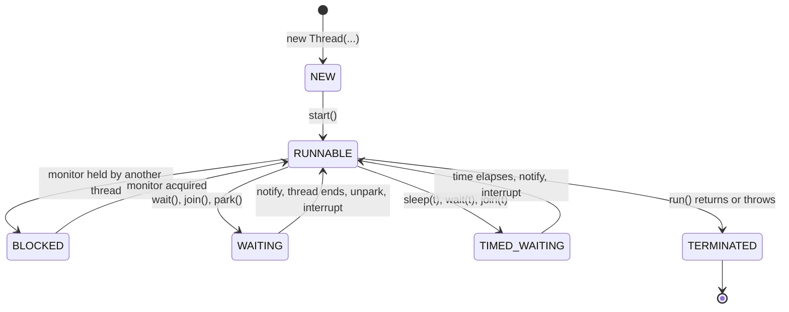

## Introduction

A production service stops responding. You take a thread dump and see two hundred request threads, most of them marked `WAITING`, a few `BLOCKED`, one `RUNNABLE`. What does each state mean? Which threads are stuck, which are idle, and which one is holding everyone else up? Or a different service: during shutdown it hangs for minutes, because some background thread refuses to stop. Or a third: after a deployment, users occasionally see *someone else's* account data, because a value stored for one request was still attached to the thread when it served the next.

All three problems come down to the **lifecycle of a thread** — the states it moves through from creation to termination, and the operations that move it between them. The `java.lang.Thread` class is small, but each of its methods has precise rules: `start()` may be called once; `sleep()` keeps locks while `wait()` releases them; `interrupt()` asks a thread to stop but cannot force it; a thread marked as a daemon is abandoned when the JVM exits; an exception that escapes `run()` kills only its own thread; and a `ThreadLocal` value lives as long as the thread does, which in a pool means forever.

In modern code you rarely create raw `Thread` objects — you submit tasks to an `ExecutorService` or run them on virtual threads. But those tools are built from exactly the pieces in this lesson, and every thread they create obeys the same lifecycle. When an executor will not shut down, a task cannot be cancelled, or a thread dump needs reading, this is the knowledge you use.

## Before you start

- **Processes vs threads** — what a thread is, and that threads share the heap but have private stacks. See [[c3-processes-vs-threads]].
- **Thread safety** — why shared mutable state needs coordination. See [[c3-thread-safety]].
- **Checked exceptions** — `InterruptedException` is checked and appears throughout. See [[c1-checked-unchecked]].
- **Lambdas** — tasks are written as `Runnable` and `Callable` lambdas. See [[c1-lambdas]] and [[c1-functional-interfaces]].

Monitors (`synchronized`) and `wait()` / `notify()` appear here only as far as they affect thread states; they are taught fully in [[c3-synchronization]] and [[c3-wait-notify]].

## The intuition

Think of a thread as a worker in an office. When hired, the worker exists but has not started (**NEW**). Once told to begin, they are either working or ready to work the moment a desk is free (**RUNNABLE**). Sometimes they need a meeting room that someone else is using and stand outside the door until it is free (**BLOCKED**). Sometimes they wait for a colleague to call them back, with no time limit (**WAITING**), or set an alarm and nap for twenty minutes (**TIMED_WAITING**). When the job is done, or they quit because something went badly wrong, they leave and never come back (**TERMINATED**) — you cannot rehire the same worker; you hire a new one.

The rest of the API maps onto this office too. A manager can tap a worker on the shoulder and say "please stop when you can" (**interrupt**) — the worker decides how and when to respond. Some workers are contractors who simply go home when all the permanent staff leave (**daemon threads**). If a worker collapses, someone is notified (**uncaught exception handler**). And each worker may keep a personal drawer of notes (**ThreadLocal**) — which, if the worker's desk is reused for the next job without clearing the drawer, hands the next job someone else's notes.

## The lifecycle at a glance



A thread's state is reported by `getState()`, which returns a value of the enum `Thread.State`. The diagram is slightly simplified: a thread woken from `wait()` must first re-acquire the monitor, so it may pass through `BLOCKED` on its way back to `RUNNABLE`. Each state, and what puts a thread into it, is explained next.

## NEW, RUNNABLE, BLOCKED, WAITING & TERMINATED {#c3-thread-states}

The `Thread.State` enum defines exactly **six states** — the heading names five, and the sixth, `TIMED_WAITING`, is the timed variant of `WAITING`. At any moment a thread is in exactly one of them. These are *JVM* states, reported by `Thread.getState()` and shown in thread dumps; they are not the same as the operating system's view of the thread, and the difference matters when you read a dump.

### The six states

**`NEW`** — the `Thread` object has been constructed but `start()` has not been called. No operating-system thread exists yet; it is just an object on the heap.

**`RUNNABLE`** — the thread has been started and is not waiting on any Java-level synchronisation. Crucially, this covers *both* a thread that is executing on a CPU core *and* a thread that is ready to run but waiting for the operating-system scheduler to give it a core. Java does not distinguish the two, because the JVM does not control that scheduling. It also covers a platform thread that is blocked inside the operating system on I/O — reading from a socket, for example — because from the JVM's point of view the thread is executing a native call.

**`BLOCKED`** — the thread is waiting to acquire a **monitor lock**: it is trying to enter a `synchronized` block or method whose lock another thread holds, or to re-enter one after returning from `wait()`. `BLOCKED` applies *only* to `synchronized` monitors.

**`WAITING`** — the thread is waiting, with no time limit, for another thread to do something. It got there by calling `Object.wait()` (waiting to be notified), `Thread.join()` (waiting for another thread to terminate) or `LockSupport.park()`. `park()` matters more than it looks: `ReentrantLock`, `CountDownLatch`, `BlockingQueue.take()` and most other `java.util.concurrent` tools are built on it, so a thread waiting for a `ReentrantLock` shows as `WAITING`, not `BLOCKED`.

**`TIMED_WAITING`** — the same as `WAITING`, but with a time limit: `Thread.sleep(ms)`, `Object.wait(ms)`, `Thread.join(ms)`, `LockSupport.parkNanos` or `parkUntil`, and the timed methods built on them such as `BlockingQueue.poll(timeout, unit)`.

**`TERMINATED`** — `run()` has finished, either by returning normally or by throwing an exception. A terminated thread can never be started again.

| State | Typical causes | Leaves the state when | Uses CPU? |
|---|---|---|---|
| `NEW` | `new Thread(...)` | `start()` is called | No |
| `RUNNABLE` | Executing, ready to execute, or in native I/O | It blocks, waits or finishes | Possibly |
| `BLOCKED` | Entering a `synchronized` block whose monitor is held | The monitor becomes free and it wins it | No |
| `WAITING` | `wait()`, `join()`, `park()` (locks, latches, queues) | Notified, joined thread ends, unparked, or interrupted | No |
| `TIMED_WAITING` | `sleep(t)`, `wait(t)`, `join(t)`, `parkNanos` | The above, or the timeout elapses | No |
| `TERMINATED` | `run()` returned or threw | Never | No |

### Watching a thread move through the states

The program below drives one thread through every state and prints each one. It uses a helper that polls `getState()` until the expected state appears, because a thread's state can change at any instant — `getState()` is meant for monitoring, never for coordinating threads.

```java title="StateTour.java"
public class StateTour {
    private static final Object lock = new Object();
    private static boolean released = false;          // guarded by lock

    public static void main(String[] args) throws InterruptedException {
        Thread t = new Thread(() -> {
            System.out.println("inside run(): " + Thread.currentThread().getState());
            synchronized (lock) {                     // BLOCKED while main holds lock
                while (!released) {
                    try {
                        lock.wait();                  // WAITING: releases lock until notified
                    } catch (InterruptedException e) {
                        return;
                    }
                }
            }
            try {
                Thread.sleep(500);                    // TIMED_WAITING
            } catch (InterruptedException e) {
                Thread.currentThread().interrupt();
            }
        }, "tour");

        System.out.println("after new:      " + t.getState());
        synchronized (lock) {
            t.start();
            awaitState(t, Thread.State.BLOCKED);
            System.out.println("lock held:      " + t.getState());
        }
        awaitState(t, Thread.State.WAITING);
        System.out.println("in wait():      " + t.getState());

        synchronized (lock) {
            released = true;
            lock.notifyAll();
        }
        awaitState(t, Thread.State.TIMED_WAITING);
        System.out.println("in sleep():     " + t.getState());

        t.join();
        System.out.println("after run():    " + t.getState());
    }

    // Monitoring only: polls until the thread reaches the given state.
    static void awaitState(Thread t, Thread.State s) throws InterruptedException {
        while (t.getState() != s) {
            Thread.sleep(1);
        }
    }
}
```

```output
after new:      NEW
inside run(): RUNNABLE
lock held:      BLOCKED
in wait():      WAITING
in sleep():     TIMED_WAITING
after run():    TERMINATED
```

Walk through it. Before `start()`, the thread is `NEW`. `main` then takes the lock and starts the thread; the thread prints its own state — always `RUNNABLE`, since a thread that is executing code is by definition runnable — and tries to enter `synchronized (lock)`. `main` holds that monitor, so the thread becomes `BLOCKED`. When `main` leaves its `synchronized` block, the thread acquires the monitor, sees `released` is false, and calls `wait()`, which releases the monitor and parks it in `WAITING`. `main` sets the flag and calls `notifyAll()`; the thread wakes, re-acquires the monitor (briefly `BLOCKED` again if `main` still holds it), leaves the loop, and goes to sleep in `TIMED_WAITING`. Finally `run()` returns and the thread is `TERMINATED`. The `while (!released)` loop around `wait()` is not decoration: `wait()` can return without a notification (a *spurious wakeup*), so the condition must always be rechecked — see [[c3-spurious-wakeup]].

### Reading states in a thread dump

A thread dump (`jcmd <pid> Thread.print` or `jstack <pid>`) shows the state of every thread together with its stack, and the stack tells you *why* it is in that state:

```text
"http-nio-8080-exec-7" #42 daemon prio=5 os_prio=31 tid=0x... nid=0x... waiting for monitor entry
   java.lang.Thread.State: BLOCKED (on object monitor)
        at com.example.InventoryService.reserve(InventoryService.java:58)
        - waiting to lock <0x000000071ab2c3d0> (a java.lang.Object)
```

A few rules of thumb make dumps readable. Many threads `BLOCKED` on the same monitor means contention on one `synchronized` lock — find the thread that holds it (`- locked <0x...>`). Pool threads `WAITING` in `LinkedBlockingQueue.take()` are idle, waiting for work, which is normal. Threads `RUNNABLE` in `SocketInputStream.read` or `socketRead0` are usually waiting for a slow remote system, not burning CPU. Two threads each `BLOCKED` waiting for a lock the other holds is a deadlock, which the JVM detects and reports at the end of the dump. See [[c2-thread-dumps]] and [[c3-deadlock-detection]].

Virtual threads use the same six states. A virtual thread that is blocked on I/O has been unmounted from its carrier and parked, so it usually reports `WAITING` rather than `RUNNABLE`. Virtual threads are not listed by the classic `jstack` format; use `jcmd <pid> Thread.dump_to_file -format=json <file>` to include them ([[c3-vt-observability]]).

> [!MISTAKE] "RUNNABLE means it is using the CPU"
> `RUNNABLE` only means the JVM is not holding the thread back. It may be waiting for a core, or sitting in a blocking socket read. To know whether threads are actually consuming CPU, compare two dumps a few seconds apart or use a profiler.

## Thread, Runnable & Callable {#c3-thread-vs-runnable}

Java separates **the work to be done** from **the thread that does it**. The work is described by a task object — a `Runnable` or a `Callable` — and a `Thread` (or a thread pool) is the machinery that executes it. Keeping the two apart is what lets the same task run on a new thread, a pooled thread or a virtual thread without changing it.

### The three types

**`Runnable`** is the original task interface, from Java 1.0:

```java
@FunctionalInterface
public interface Runnable {
    void run();
}
```

It returns nothing and cannot throw checked exceptions. If the work produces a result, the task must store it somewhere, and if it fails with a checked exception, it must catch it.

**`Callable<V>`**, added in Java 5 with `java.util.concurrent`, fixes both limitations:

```java
@FunctionalInterface
public interface Callable<V> {
    V call() throws Exception;
}
```

It returns a value of type `V` and may throw any exception. A `Thread` cannot run a `Callable` directly — `Thread` only knows how to call `run()` — so callables are submitted to an `ExecutorService`, which returns a `Future<V>`, or wrapped in a `FutureTask<V>`, which implements both `Runnable` and `Future<V>`.

**`Thread`** is the class that represents a thread of execution. It *implements* `Runnable` itself: its `run()` method calls the `Runnable` passed to its constructor, if there was one. That is why there are two ways to give a thread its work — pass a `Runnable` to the constructor, or subclass `Thread` and override `run()`.

### Four ways to run a task

```java title="FourWays.java"
import java.io.IOException;
import java.util.concurrent.Callable;
import java.util.concurrent.ExecutionException;
import java.util.concurrent.ExecutorService;
import java.util.concurrent.Executors;
import java.util.concurrent.Future;
import java.util.concurrent.FutureTask;

public class FourWays {

    // 1. Subclass Thread: the task and the thread are one object.
    static class Greeter extends Thread {
        Greeter() { super("greeter"); }

        @Override
        public void run() {
            System.out.println("1. Thread subclass runs on " + getName());
        }
    }

    public static void main(String[] args) throws Exception {
        Thread t1 = new Greeter();
        t1.start();
        t1.join();

        // 2. Pass a Runnable: the task is separate from the thread.
        Runnable task = () -> System.out.println("2. Runnable runs on " + Thread.currentThread().getName());
        Thread t2 = new Thread(task, "runner");
        t2.start();
        t2.join();

        // 3. Wrap a Callable in a FutureTask so a plain Thread can run it.
        Callable<Integer> sum = () -> {
            int s = 0;
            for (int i = 1; i <= 100; i++) s += i;
            return s;
        };
        FutureTask<Integer> futureTask = new FutureTask<>(sum);
        new Thread(futureTask, "caller").start();
        System.out.println("3. Callable returned " + futureTask.get());   // waits for the result

        // 4. Submit to an executor: the usual way in real code.
        try (ExecutorService pool = Executors.newFixedThreadPool(2)) {
            Future<Integer> result = pool.submit(sum);
            System.out.println("4. Executor returned " + result.get());

            Callable<Integer> failing = () -> { throw new IOException("disk unavailable"); };
            try {
                pool.submit(failing).get();
            } catch (ExecutionException e) {
                System.out.println("   failure cause: " + e.getCause());
            }
        }
    }
}
```

```output
1. Thread subclass runs on greeter
2. Runnable runs on runner
3. Callable returned 5050
4. Executor returned 5050
   failure cause: java.io.IOException: disk unavailable
```

Notice how a `Callable`'s exception reaches the caller: it is captured inside the `Future` and rethrown by `get()` wrapped in an `ExecutionException`, with the original exception as its cause. Nothing is printed and no handler runs when the task fails — the failure stays in the `Future` until someone calls `get()`. A `Runnable` run directly on a thread has no such channel; an exception escaping it ends the thread and goes to the [[c3-uncaught-handler|uncaught exception handler]].

### Why prefer Runnable or Callable over subclassing Thread

Subclassing `Thread` works, but it is rarely the right design:

- **It ties the task to one way of running it.** A `Greeter` can only ever run as its own new platform thread. A `Runnable` can run on a new thread, an executor, a virtual thread, or be called directly in a unit test.
- **It uses up inheritance.** Java has single class inheritance; a task that extends `Thread` cannot extend anything else.
- **It exposes the whole `Thread` API.** Code holding a `Greeter` can call `setPriority`, `setDaemon` or `interrupt` on what is conceptually just a piece of work.
- **Thread objects are not reusable.** A task object can be submitted many times; a `Thread` can be started only once.

So the rule is: model work as a `Runnable` (no result) or `Callable` (result or checked exception), and decide separately how to run it — almost always through an `ExecutorService` ([[c3-executors]]) or virtual threads.

### Creating threads in Java 21

Java 21 added **thread builders**, which make the platform/virtual choice explicit and set common properties in one expression:

```java
Thread worker = Thread.ofPlatform()
        .name("importer-", 0)      // importer-0, importer-1, ... for each thread built
        .daemon(true)
        .start(task);

Thread light = Thread.ofVirtual().name("request-handler").start(task);
Thread quick = Thread.startVirtualThread(task);
```

A builder can also produce a `ThreadFactory` (`Thread.ofVirtual().factory()`) to hand to an executor. Every one of these threads still takes its work as a `Runnable`.

| | `Runnable` | `Callable<V>` | `Thread` subclass |
|---|---|---|---|
| Returns a value | No | Yes | No |
| Can throw checked exceptions | No | Yes | No |
| Runs on a plain `Thread` | Yes | Only via `FutureTask` | It is the thread |
| Submitted to an executor | `execute` or `submit` | `submit` | Possible but pointless |
| Reusable | Yes | Yes | No — one `start()` |

## start() vs run() {#c3-start-vs-run}

`start()` and `run()` sound similar, but only one of them creates a thread. **`start()`** asks the JVM to create a new thread of execution; that new thread then calls `run()`. **`run()`** is an ordinary method: calling it directly executes the task *on the calling thread*, just like any other method call, and no new thread is created.

```java title="StartVsRun.java"
public class StartVsRun {
    public static void main(String[] args) throws InterruptedException {
        Runnable task = () ->
                System.out.println("task runs on: " + Thread.currentThread().getName());

        Thread t = new Thread(task, "worker");

        t.run();      // plain method call: runs on main, t is still NEW
        System.out.println("after run(), t is " + t.getState());

        t.start();    // creates a new thread, which calls run()
        t.join();

        try {
            t.start();  // a thread can be started only once
        } catch (IllegalThreadStateException e) {
            System.out.println("second start(): " + e.getClass().getSimpleName());
        }
    }
}
```

```output
task runs on: main
after run(), t is NEW
task runs on: worker
second start(): IllegalThreadStateException
```

The first line is the trap: `t.run()` printed `main`. The code compiled, ran and produced the right output — just on the wrong thread, sequentially, with no concurrency at all. In a real program this bug shows up as "the parallel version is no faster than the sequential one" or "the UI freezes while the background task runs", because the "background" task was run in the foreground.

### What start() actually does

When you call `start()`, the JVM checks that the thread is still `NEW` (otherwise it throws `IllegalThreadStateException`), marks it as started, and — for a platform thread — asks the operating system to create a native thread with its own stack. `start()` then returns immediately to the caller; it does not wait for `run()` to begin. Some time later, when the scheduler gives the new thread a core, it begins executing `run()`. After `start()` returns, the order in which the two threads execute is up to the scheduler, which is why output from a freshly started thread can appear before or after the caller's next line.

`start()` also creates a **happens-before** relationship ([[c3-happens-before]]): everything the starting thread did before calling `start()` is guaranteed to be visible to the new thread. You can safely prepare data, then start a thread that reads it, without any other synchronisation. The matching guarantee at the other end is `join()`, covered next.

### Why a thread cannot be restarted

A `Thread` object represents one execution, from `NEW` to `TERMINATED`. Its stack, its native thread and its state history belong to that single run. Calling `start()` a second time — whether the thread is still running or already finished — throws `IllegalThreadStateException`. To run the same work again, create a new `Thread` with the same `Runnable`, or better, submit the `Runnable` to an executor, which reuses its threads for you.

> [!WARNING] Overriding start()
> If you subclass `Thread`, override `run()`, never `start()`. An overridden `start()` that does not call `super.start()` creates no thread at all, and one that does adds nothing but confusion.

## sleep(), yield() & join() {#c3-sleep-yield-join}

These three static and instance methods are the simplest controls over *when* a thread runs. **`sleep()`** pauses the current thread for a period of time. **`yield()`** hints that the current thread is willing to give up its core. **`join()`** makes the current thread wait until another thread has terminated. Each has rules about locks, interruption and precision that are easy to get wrong.

### Thread.sleep

`Thread.sleep(long millis)` (and, since Java 19, `Thread.sleep(Duration)`) moves the *current* thread into `TIMED_WAITING` for at least the given time. It is static: `someOtherThread.sleep(1000)` compiles, but it puts the *calling* thread to sleep, not `someOtherThread`. A sleeping thread uses no CPU.

Three properties matter:

- **Precision.** The thread sleeps *at least* the requested time, subject to the precision of operating-system timers and the scheduler. Afterwards it becomes `RUNNABLE` but may wait a little longer for a core. Never use `sleep` to coordinate threads ("sleep 100 ms and the other thread will be done by then") — it makes code slow when the guess is too long and wrong when it is too short. Use `join`, latches or futures instead.
- **Locks are kept.** A thread sleeping inside a `synchronized` block still holds the monitor, so every other thread needing that lock stays `BLOCKED` for the whole sleep. This is the key difference from `wait()`.
- **Interruptible.** If the thread is interrupted while sleeping, `sleep` throws `InterruptedException` immediately. That is why it is a checked exception you must handle — see [[c3-interruption]].

| | `Thread.sleep(t)` | `Object.wait(t)` |
|---|---|---|
| Defined on | `Thread` (static) | `Object` (instance) |
| Must hold the monitor | No | Yes, or `IllegalMonitorStateException` |
| Releases the monitor | No | Yes, re-acquires it before returning |
| Woken by | Timeout or interrupt | `notify`/`notifyAll`, timeout, interrupt, or spuriously |
| Purpose | Pause for a time | Wait for a condition another thread will signal |

### Thread.yield

`Thread.yield()` tells the scheduler that the current thread is willing to let another runnable thread use its core. It is only a hint: the scheduler may ignore it, and on an idle machine the thread usually continues immediately. The thread stays `RUNNABLE` throughout. `yield()` gives no ordering or visibility guarantees and is almost never the right tool in application code — loops that call `yield()` while waiting for a condition waste CPU and should be replaced by a proper blocking mechanism. In a tight spin-wait loop, `Thread.onSpinWait()` (Java 9) is the correct hint to the CPU. For a virtual thread, `yield()` asks the JVM scheduler to let another virtual thread use the carrier.

### join

`t.join()` makes the calling thread wait until thread `t` is `TERMINATED`. While waiting, the caller is `WAITING`; with a timeout, `TIMED_WAITING`. If `t` has already finished, `join()` returns immediately.

`join()` provides the second half of the visibility guarantee that `start()` began: **everything thread `t` did happens-before `join()` returns**. So after `join()`, the caller is guaranteed to see every write `t` made, with no `volatile` or locks needed.

The timed forms are `join(long millis)`, which returns nothing, and `join(Duration)` (Java 19+), which returns `true` if the thread terminated within the time. After a timed join you must check whether the thread actually finished — a timeout does not stop the thread.

```java title="JoinDemo.java"
import java.time.Duration;

public class JoinDemo {
    static long sum(long from, long to) {
        long s = 0;
        for (long i = from; i <= to; i++) s += i;
        return s;
    }

    public static void main(String[] args) throws InterruptedException {
        long[] partial = new long[2];
        Thread left = new Thread(() -> partial[0] = sum(1, 500_000));
        Thread right = new Thread(() -> partial[1] = sum(500_001, 1_000_000));
        left.start();
        right.start();
        left.join();              // waits for TERMINATED, and makes partial[0] visible
        right.join();
        System.out.println("total = " + (partial[0] + partial[1]));

        Thread slow = new Thread(() -> {
            try {
                Thread.sleep(5_000);
            } catch (InterruptedException e) {
                System.out.println("slow task cancelled");
            }
        });
        slow.start();
        boolean finished = slow.join(Duration.ofMillis(200));
        System.out.println("finished within 200 ms? " + finished);
        slow.interrupt();         // the timeout did not stop it; ask it to stop
        slow.join();
        System.out.println("slow is now " + slow.getState());
    }
}
```

```output
total = 500000500000
finished within 200 ms? false
slow task cancelled
slow is now TERMINATED
```

The first half shows the classic fork–join pattern by hand: split the work, start a thread per part, `join` them all, then combine. Reading `partial[0]` after `left.join()` is safe precisely because of the happens-before guarantee. The second half shows a bounded wait: `join(Duration)` gives up after 200 ms and reports `false`, the thread keeps running until it is interrupted, and only then does it terminate.

Internally, platform-thread `join()` is implemented with `wait()` on the `Thread` object itself, and the JVM calls `notifyAll()` on it when the thread ends. The documentation therefore advises never to use `Thread` instances as locks with your own `wait`/`notify`, since your code and `join` would interfere.

In application code, an `ExecutorService` with `Future.get()`, `invokeAll`, or `CompletableFuture.allOf(...).join()` usually replaces manual `join` calls, but they rely on the same idea.

## Interruption & Cooperative Cancellation {#c3-interruption}

Java has no safe way to forcibly stop a thread. Instead it offers **interruption**: one thread sets a flag on another, asking it to stop what it is doing. The interrupted thread decides when and how to respond — at a point where its data is consistent and its resources can be released. This is **cooperative cancellation**, and every well-behaved long-running task must take part in it.

### Why there is no "kill"

Early Java had `Thread.stop()`, which threw an error into the target thread at whatever instruction it happened to be executing. That could happen halfway through updating a shared object — after the first of two related fields was written, say — and `stop()` released all of the thread's monitors as the error propagated, so other threads immediately saw the half-finished state. There is no way to write code that is safe against an exception that can appear at *any* instruction. `stop()` was deprecated in Java 1.2, and since JDK 20 it throws `UnsupportedOperationException`.

### What interrupt() does

Each thread has a boolean **interrupt status**. Calling `t.interrupt()` does the following:

- If `t` is blocked in `Object.wait()`, `Thread.sleep()` or `Thread.join()` (or their timed forms), it is woken up, its interrupt status is **cleared**, and the blocking method throws `InterruptedException`.
- If `t` is blocked in an operation on an interruptible NIO channel, the channel is closed, the status is set, and the operation throws `ClosedByInterruptException`. If it is blocked in a `Selector`, the selection returns immediately with the status set.
- Otherwise — the thread is computing, or blocked in something not interruptible — the status is simply **set**. Nothing else happens until the thread looks at it.

Methods in `java.util.concurrent` that block, such as `BlockingQueue.take()`, `CountDownLatch.await()`, `Future.get()` and `Lock.lockInterruptibly()`, also respond by throwing `InterruptedException`. Two things do *not* respond: waiting to enter a `synchronized` block, and `Lock.lock()`. A thread `BLOCKED` on a monitor stays blocked until it gets the lock, however many times it is interrupted.

A thread checks its status in one of two ways. `Thread.currentThread().isInterrupted()` reads the status and leaves it unchanged. The static `Thread.interrupted()` reads the status of the current thread **and clears it** — its name is easy to misread as a plain query.

```java title="InterruptDemo.java"
public class InterruptDemo {
    public static void main(String[] args) throws InterruptedException {
        // A blocked thread: interruption arrives as an exception.
        Thread sleeper = new Thread(() -> {
            try {
                System.out.println("sleeper: waiting for work");
                Thread.sleep(60_000);
            } catch (InterruptedException e) {
                System.out.println("sleeper: interrupted, flag is now "
                        + Thread.currentThread().isInterrupted());
            }
            System.out.println("sleeper: cleaned up and exiting");
        });
        sleeper.start();
        while (sleeper.getState() != Thread.State.TIMED_WAITING) Thread.sleep(1);
        sleeper.interrupt();
        sleeper.join();

        // A computing thread: it must poll the flag itself.
        Thread cruncher = new Thread(() -> {
            long n = 0;
            while (!Thread.currentThread().isInterrupted()) {
                n++;                              // stand-in for a unit of CPU work
            }
            System.out.println("cruncher: saw the flag and stopped");
        });
        cruncher.start();
        Thread.sleep(100);
        cruncher.interrupt();
        cruncher.join();
        System.out.println("both threads: " + sleeper.getState() + ", " + cruncher.getState());
    }
}
```

```output
sleeper: waiting for work
sleeper: interrupted, flag is now false
sleeper: cleaned up and exiting
cruncher: saw the flag and stopped
both threads: TERMINATED, TERMINATED
```

Look at the second line: inside the `catch`, the flag is `false`. Throwing `InterruptedException` *consumes* the interrupt. If the code catching it does nothing, the request to stop is lost — which leads to the most important rule of interruption.

### Never swallow InterruptedException

When you catch `InterruptedException`, the thread's owner (an executor, a framework, your own shutdown code) has asked it to stop, and the status that recorded the request has been cleared. You have two correct options.

**Propagate it.** If your method can declare `throws InterruptedException`, do so and let it travel up to code that knows what cancellation means for this thread. This is the default choice for library and service methods.

```java
public Order nextOrder() throws InterruptedException {
    return queue.take();      // cancellation flows to the caller
}
```

**Restore the flag.** If you cannot rethrow — inside `Runnable.run()`, or an interface method that does not declare it — call `Thread.currentThread().interrupt()` to set the status again, then stop the current work promptly. Code further up the stack, or the executor that owns the thread, can then see that cancellation was requested.

```java
public void run() {
    try {
        while (!Thread.currentThread().isInterrupted()) {
            Order order = queue.take();
            process(order);
        }
    } catch (InterruptedException e) {
        Thread.currentThread().interrupt();   // preserve the request for whoever owns this thread
    } finally {
        releaseResources();
    }
}
```

What you must not do is catch the exception, log it, and carry on looping as if nothing happened. That thread can now never be stopped by interruption, so `executor.shutdownNow()` will not end it and the application will hang on shutdown. Wrapping it in an unchecked exception without restoring the flag loses the information in the same way.

The example from this topic's original notes, which waits for a worker with a timeout and then interrupts it, is correct in spirit but needs two fixes to compile: `Thread` has no `join(long, TimeUnit)` method, and the `catch (InterruptedException e)` only compiles if something inside the `try` can throw it. A version that compiles, for Java 19+:

```java
Thread worker = new Thread(() -> {
    try {
        while (!Thread.currentThread().isInterrupted()) {
            doWork();                                    // declared: throws InterruptedException
        }
    } catch (InterruptedException e) {
        Thread.currentThread().interrupt();              // restore, then fall through and exit
    }
});
worker.start();
if (!worker.join(Duration.ofSeconds(5))) {               // join(Duration) returns false on timeout
    worker.interrupt();
}
```

### Where interruption is used

Interruption is the standard cancellation signal across the JDK. `ExecutorService.shutdownNow()` interrupts every worker thread; `Future.cancel(true)` interrupts the thread running the task; `CompletableFuture.cancel` does *not* interrupt anything ([[c3-cf-cancellation]]); `invokeAny` interrupts the losers. All of these only work if the tasks themselves respond. See [[c3-future-cancellation]] and [[c3-graceful-shutdown]].

> [!TIP] Make cancellation points explicit
> A task that does long CPU work without blocking must check `isInterrupted()` at regular points — once per item processed, once per chunk of a loop. A task that blocks gets the check for free from `InterruptedException`, as long as it does not swallow it.

## Daemon Threads {#c3-daemon-threads}

A **daemon thread** is a background thread that does not keep the JVM alive. The JVM exits when every **non-daemon** (user) thread has terminated, even if daemon threads are still running — they are simply abandoned. The thread that runs `main` is a non-daemon thread, as are threads created by it unless marked otherwise.

### The exit rule

The JVM shuts down in an orderly way when either the last non-daemon thread terminates, or some thread calls `System.exit` (or the process receives a termination signal such as `SIGTERM`). At that point, shutdown hooks run, and then the JVM stops. Any daemon threads still running are not interrupted, not unwound and not given a chance to clean up: their `finally` blocks do not execute.

```java title="DaemonDemo.java"
public class DaemonDemo {
    public static void main(String[] args) throws InterruptedException {
        Thread housekeeper = new Thread(() -> {
            System.out.println("daemon: started");
            try {
                Thread.sleep(10_000);
                System.out.println("daemon: finished its work");    // never printed
            } catch (InterruptedException e) {
                Thread.currentThread().interrupt();
            } finally {
                System.out.println("daemon: finally block");        // never printed either
            }
        });
        housekeeper.setDaemon(true);          // must be set before start()
        housekeeper.start();

        while (housekeeper.getState() != Thread.State.TIMED_WAITING) Thread.sleep(1);
        System.out.println("main: done, JVM exits now");
    }
}
```

```output
daemon: started
main: done, JVM exits now
```

`main` returns while the daemon is still sleeping. Because no non-daemon threads remain, the JVM exits at once; the daemon's remaining code, including its `finally` block, never runs. Remove the `setDaemon(true)` line and the program instead waits the full ten seconds and prints both remaining lines.

### Rules

- **Set it before starting.** `setDaemon(true)` on a thread that has already been started throws `IllegalThreadStateException`.
- **It is inherited.** A new thread starts with the daemon status of the thread that created it. A thread created by a daemon thread is a daemon unless told otherwise.
- **Virtual threads are always daemons.** `setDaemon(false)` on a virtual thread throws `IllegalArgumentException`. Programs that start virtual threads must wait for them explicitly (for example by closing their executor), or `main` may return and the JVM exit with work unfinished.

### Daemons in practice

Many JVM-internal threads are daemons: the Reference Handler, Finalizer, Signal Dispatcher and Common-Cleaner threads, for example. So are the worker threads of the `ForkJoinPool` common pool — which means that a `CompletableFuture.runAsync(...)` task started from `main` without waiting can be cut off when `main` returns.

The opposite surprise is just as common. `Executors.newFixedThreadPool` and its siblings use `Executors.defaultThreadFactory()`, which creates **non-daemon** threads. A program that creates a pool and never calls `shutdown()` (or `close()` in Java 19+) does not exit when `main` finishes, because the idle pool threads keep the JVM alive. The right fix is to shut the pool down, not to make its threads daemons.

Use daemon threads only for work that is safe to abandon at any instant: cache refreshers, metrics samplers, heartbeat senders, watchdog timers. Never use them for work that writes files, commits transactions or sends messages, because an abandoned daemon can leave that work half done. For anything that must finish, use a non-daemon thread or executor and shut it down gracefully ([[c3-graceful-shutdown]]).

## UncaughtExceptionHandler {#c3-uncaught-handler}

When an exception escapes a thread's `run()` method, the thread terminates. Before it does, the JVM passes the thread and the exception to an **`UncaughtExceptionHandler`** — a callback that decides what to do with failures nobody caught. By default it prints the familiar `Exception in thread "..."` message and stack trace to standard error. Installing your own handler lets you log the failure properly, record a metric, or alert someone.

```java
@FunctionalInterface
public interface UncaughtExceptionHandler {   // nested in Thread
    void uncaughtException(Thread t, Throwable e);
}
```

### How the handler is chosen

When a thread dies from an uncaught exception, the JVM calls `t.getUncaughtExceptionHandler().uncaughtException(t, e)`, and the lookup goes in this order:

1. The thread's **own handler**, if one was set with `t.setUncaughtExceptionHandler(...)`.
2. Otherwise, the thread's **`ThreadGroup`**, which itself implements the interface. By default it passes the exception to its parent group, and the top-level group consults the next step.
3. The JVM-wide **default handler**, set with the static `Thread.setDefaultUncaughtExceptionHandler(...)`.
4. If there is no default handler, the message and stack trace are printed to `System.err`.

```java title="HandlerDemo.java"
public class HandlerDemo {
    public static void main(String[] args) throws InterruptedException {
        Thread.setDefaultUncaughtExceptionHandler((t, e) ->
                System.out.println("default handler: " + t.getName() + " died with " + e));

        Thread plain = new Thread(() -> {
            throw new IllegalStateException("boom");
        }, "plain");

        Thread custom = new Thread(() -> {
            throw new IllegalArgumentException("bad input");
        }, "custom");
        custom.setUncaughtExceptionHandler((t, e) ->
                System.out.println("own handler: " + t.getName() + " died with " + e.getMessage()));

        plain.start();
        plain.join();
        custom.start();
        custom.join();
        System.out.println("main still running; plain is " + plain.getState());
    }
}
```

```output
default handler: plain died with java.lang.IllegalStateException: boom
own handler: custom died with bad input
main still running; plain is TERMINATED
```

The `plain` thread has no handler of its own, so its failure falls through to the default handler; `custom` has one, so the default is never consulted. In both cases the thread is already doomed — the handler cannot catch, retry or resurrect anything; it is a notification. The handler runs *on the dying thread*, just before it terminates. Any exception the handler itself throws is ignored by the JVM. And `main` keeps running: an uncaught exception ends only its own thread.

### The executor trap

Handlers interact with thread pools in a way that surprises almost everyone:

| How the task was given to the pool | What happens to its exception |
|---|---|
| `execute(Runnable)` on a `ThreadPoolExecutor` | Propagates out of the worker thread: the handler runs, the worker dies and the pool starts a replacement |
| `submit(...)` (any task type) | Caught and stored in the returned `Future`; **no handler runs**. It is seen only if someone calls `get()` |
| Any task on a `ScheduledThreadPoolExecutor` | Stored in its `Future`; a failing periodic task is **silently cancelled** and never runs again |
| `CompletableFuture.runAsync` / `supplyAsync` | Stored in the `CompletableFuture`; handled with `exceptionally`, `handle` or `whenComplete` |

So a task submitted with `submit()` whose `Future` is never read can fail with no trace at all. The fixes are to call `get()` (or chain error handling on a `CompletableFuture`), to catch and log exceptions inside the task itself, or to override `ThreadPoolExecutor.afterExecute` to inspect results. Setting a handler through a `ThreadFactory` only helps for `execute()`. See [[c3-future-get-timeout]] and [[c3-threadfactory]].

> [!TIP] Install a default handler at start-up
> A JVM-wide default handler that logs through your logging framework, with the thread name, turns invisible background-thread deaths into searchable log entries. Most frameworks do not install one for you.

## ThreadLocal & Cleanup {#c3-threadlocal}

A **`ThreadLocal<T>`** is a variable for which every thread has its own independent value. One thread's `set` is invisible to all other threads; each thread's `get` returns the value that thread set (or an initial value). It is a form of thread confinement ([[c3-thread-confinement]]): the value is mutable, but only ever touched by its own thread, so it needs no synchronisation.

### Why it exists

Some data belongs to "whatever this thread is currently doing" — the user making the current request, the open database transaction, a trace id for logging — and is needed deep in the call stack. Passing it as a parameter through every method is noisy and sometimes impossible (it must cross framework code you do not control). Since a web server handles each request on one thread from start to finish, attaching the data to the *thread* makes it available everywhere along that request's path. This is exactly how Spring's `SecurityContextHolder` (current authentication), `TransactionSynchronizationManager` (current transaction) and SLF4J's `MDC` (logging context) work.

The other classic use is giving each thread its own instance of an expensive object that is not thread-safe, such as a `MessageDigest` or a reusable buffer, instead of creating one per call or sharing one with locks:

```java
private static final ThreadLocal<MessageDigest> SHA256 = ThreadLocal.withInitial(() -> {
    try {
        return MessageDigest.getInstance("SHA-256");
    } catch (NoSuchAlgorithmException e) {
        throw new IllegalStateException(e);
    }
});
// each thread: SHA256.get().digest(bytes)
```

`withInitial` supplies the value the first time a thread calls `get()` without having called `set()`. (The old example of a per-thread `SimpleDateFormat` is obsolete: `DateTimeFormatter` is immutable and can simply be shared.)

### How it works internally

The values are not stored in the `ThreadLocal` object. Each `Thread` has a field, `threadLocals`, holding a small hash map (`ThreadLocalMap`) whose keys are `ThreadLocal` objects and whose values are that thread's values. `tl.get()` means "look up `tl` in the *current thread's* map". That is why access needs no locking — each thread only ever touches its own map.

In that map the key is held through a **weak reference**, so a `ThreadLocal` object that the program no longer references can be garbage-collected; but the **value is held strongly**, and stale entries are cleaned up only opportunistically when the map is later accessed. The consequence: **a value lives as long as its thread, unless you remove it.**

### The thread-pool problem

With a thread created per task, that is harmless — the thread dies and its map goes with it. With a **thread pool**, threads live for the lifetime of the application and run thousands of unrelated tasks. A value set by one task and not removed is still there when the same thread runs the next task. That causes two distinct bugs:

- **Data leaking between tasks.** The next request on that thread sees the previous request's user, tenant or transaction — a correctness and security bug.
- **Memory leaks.** Large values (buffers, caches, objects referencing a whole web application's class loader) stay reachable for as long as the pool lives. On application servers this is a classic cause of `OutOfMemoryError: Metaspace` after repeated redeployments ([[c2-retention-leaks]]).

```java title="ThreadLocalLeak.java"
import java.util.concurrent.ExecutorService;
import java.util.concurrent.Executors;

public class ThreadLocalLeak {
    static final ThreadLocal<String> CURRENT_USER = new ThreadLocal<>();

    static void handleLeaky(String user) {
        CURRENT_USER.set(user);
        System.out.println("handling request for " + CURRENT_USER.get());
    }

    static void handleClean(String user) {
        CURRENT_USER.set(user);
        try {
            System.out.println("handling request for " + CURRENT_USER.get());
        } finally {
            CURRENT_USER.remove();               // always clear before the thread is reused
        }
    }

    static void nextRequest() {
        System.out.println("next request on same thread sees user = " + CURRENT_USER.get());
    }

    public static void main(String[] args) throws Exception {
        // One pooled thread, so every task runs on the same thread.
        try (ExecutorService pool = Executors.newSingleThreadExecutor()) {
            pool.submit(() -> handleLeaky("alice")).get();
            pool.submit(ThreadLocalLeak::nextRequest).get();
            pool.submit(() -> handleClean("bob")).get();
            pool.submit(ThreadLocalLeak::nextRequest).get();
        }
    }
}
```

```output
handling request for alice
next request on same thread sees user = alice
handling request for bob
next request on same thread sees user = null
```

The second request was never told who its user was, yet it saw `alice`, because the pooled thread still carried the first request's value. The clean version puts `remove()` in a `finally` block, so the value is cleared even if the request throws. **Every `set()` on a pooled thread needs a matching `remove()` in a `finally`.** Frameworks do this for their own thread-locals (Spring clears the security context at the end of each request, for example); your own thread-locals are your responsibility. Calling `set(null)` is not equivalent — it leaves the map entry in place.

### Inheritance and context propagation

A plain `ThreadLocal` value is *not* visible to threads that the current thread starts or hands work to. `InheritableThreadLocal` copies the parent's values into a child thread **at the moment the child is created**. That helps for threads created per task, but not for pools: pool threads are created once, so they inherit whatever happened to be set when the pool started, not the context of the task being submitted. Passing context into executors and `CompletableFuture` chains requires capturing it at submission time and restoring it in the task — typically through a wrapping executor or a library such as Micrometer Context Propagation. See [[c3-cf-context]].

### ThreadLocal with virtual threads

`ThreadLocal` works with virtual threads, and since each virtual thread runs one task and then terminates, the pool leak does not arise. The concern is cost instead: with a million virtual threads, a thread-local cache of a large object means a million copies. Thread-locals designed to *reuse* an expensive object across tasks stop working, because nothing is reused. For passing immutable request context, Java offers **`ScopedValue`** (finalised in JDK 25 by JEP 506, preview in JDK 21–24), which binds a value for the duration of a method call, is inherited by structured subtasks, and cannot leak because the binding ends when the call returns. See [[c3-vt-threadlocal]] and [[c3-scoped-vs-threadlocal]].

## Worked example: a cancellable background worker

The pieces above combine into a small but realistic component: a background worker that processes jobs from a queue, has a recognisable name, reports crashes, can be stopped promptly, and keeps per-job context without leaking it.

```java title="JobWorker.java"
import java.util.concurrent.BlockingQueue;
import java.util.concurrent.LinkedBlockingQueue;

public class JobWorker {
    private static final ThreadLocal<String> JOB_ID = new ThreadLocal<>();

    private final BlockingQueue<String> jobs = new LinkedBlockingQueue<>();
    private final Thread thread;

    JobWorker() {
        thread = Thread.ofPlatform()
                .name("job-worker")
                .uncaughtExceptionHandler((t, e) ->
                        System.out.println(t.getName() + " crashed: " + e))
                .unstarted(this::loop);             // the task is a method, not a subclass
    }

    void start() { thread.start(); }
    void submit(String job) { jobs.add(job); }

    void stop() throws InterruptedException {
        thread.interrupt();                         // ask, don't force
        thread.join();                              // wait for clean exit
    }

    private void loop() {
        try {
            while (!Thread.currentThread().isInterrupted()) {
                String job = jobs.take();           // WAITING while idle; interruptible
                JOB_ID.set(job);
                try {
                    System.out.println("[" + JOB_ID.get() + "] processed");
                } finally {
                    JOB_ID.remove();                // no context leaks into the next job
                }
            }
        } catch (InterruptedException e) {
            Thread.currentThread().interrupt();     // preserve the request, then exit
        }
        System.out.println("worker stopped cleanly");
    }

    public static void main(String[] args) throws InterruptedException {
        JobWorker worker = new JobWorker();
        worker.start();
        worker.submit("job-1");
        worker.submit("job-2");
        while (!worker.jobs.isEmpty() || worker.thread.getState() != Thread.State.WAITING) {
            Thread.sleep(1);                        // demo only: wait until the queue is drained
        }
        worker.stop();
        System.out.println("worker state: " + worker.thread.getState());
    }
}
```

```output
[job-1] processed
[job-2] processed
worker stopped cleanly
worker state: TERMINATED
```

Follow the thread's life. It is built `NEW` with a name, so it is easy to find in a thread dump, and with its own uncaught-exception handler. `start()` makes it `RUNNABLE`; it processes both jobs, then calls `take()` on an empty queue and parks in `WAITING`. `stop()` interrupts it: `take()` throws `InterruptedException`, the handler restores the flag, the loop ends, and `run()` returns — `TERMINATED`. `join()` in `stop()` makes the caller wait for that clean exit. Each job's id is set and removed inside `try`/`finally`, so nothing survives from one job to the next. The thread is non-daemon, so if `stop()` were never called, the JVM would not exit — the right default for a worker whose jobs must not be abandoned.

In production you would replace the hand-built thread with a single-thread `ExecutorService` and stop it with `shutdownNow()`, which interrupts the worker in exactly the same way.

## In real systems

**Thread dumps in incident response.** The six states are the vocabulary of every thread dump. A request pool full of `BLOCKED` threads points to lock contention; full of `WAITING` threads in a connection-pool `getConnection` points to an exhausted database pool; full of `RUNNABLE` threads in socket reads points to a slow downstream service.

**Executors build on the lifecycle.** `ThreadPoolExecutor` starts worker threads lazily, parks idle ones in `WAITING` on its queue, replaces workers killed by uncaught exceptions, and cancels with interruption. `shutdown()` stops accepting tasks and lets queued ones finish; `shutdownNow()` interrupts workers. Knowing the lifecycle explains every one of those behaviours ([[c3-threadpoolexecutor]]).

**Graceful shutdown.** Spring Boot's graceful shutdown, Kubernetes' `SIGTERM` handling and JVM shutdown hooks all rely on interruption and on non-daemon threads finishing their work. Tasks that swallow `InterruptedException` are the usual reason a pod has to be killed after its termination grace period.

**Request context.** Spring Security, Spring's transaction management, SLF4J/Logback `MDC`, and tracing libraries all keep per-request state in thread-locals and clear it at the end of each request. Asynchronous code that hops threads must propagate that context explicitly.

**Naming threads.** Production code names its threads (`order-consumer-3`, `http-nio-8080-exec-7`) through a `ThreadFactory` or builder, because unnamed `Thread-17` entries make dumps and logs nearly useless.

## Trade-offs and alternatives

Creating and managing raw `Thread` objects gives full control over a thread's name, daemon status, handler and lifetime, which is appropriate for one or two long-lived infrastructure threads. For anything resembling "run these tasks", it is the wrong level: there is no reuse, no bound on how many threads exist, no queueing and no standard shutdown. `ExecutorService` provides all of those; virtual threads remove the need for reuse altogether in I/O-heavy code; `CompletableFuture` and structured concurrency ([[c3-structured-concurrency]]) handle composing results and failures.

Interruption is cooperative, which is its strength and its weakness: tasks always stop at a safe point, but a task that ignores the flag, or is stuck in a non-interruptible call such as entering a `synchronized` block, cannot be stopped at all. For code that must be cancellable, prefer interruptible blocking methods (`lockInterruptibly`, timed `poll`) and check the flag in long loops.

`ThreadLocal` trades explicitness for convenience: hidden context is easy to use and easy to leak. Where you control the code, passing a context object explicitly is clearer; where you need implicit context, `ScopedValue` on modern JDKs gives bounded lifetimes.

## Common mistakes

**Calling `run()` instead of `start()`.** The task runs synchronously on the caller's thread; no concurrency happens and no error is reported.

**Starting a thread twice.** `start()` on a started or terminated thread throws `IllegalThreadStateException`. Create a new thread, or use an executor.

> [!MISTAKE] Swallowing InterruptedException
> `catch (InterruptedException e) { log.warn("interrupted"); }` inside a loop makes the thread impossible to cancel, so shutdowns hang. Either declare `throws InterruptedException` or call `Thread.currentThread().interrupt()` and stop.

**Believing `sleep()` releases locks.** It does not. Sleeping inside `synchronized` keeps every other thread needing the lock `BLOCKED` for the whole sleep. Use `wait()` (or a `Condition`) when you need to wait for something while letting others use the lock.

**Coordinating with `sleep()`.** "Sleep long enough for the other thread to finish" is slow at best and flaky at worst. Use `join()`, `CountDownLatch`, `Future.get()` or similar ([[c3-no-sleep-tests]]).

**Using `Thread.interrupted()` as a query.** It clears the flag. Use `isInterrupted()` to check without side effects.

**Calling `setDaemon` after `start()`.** It throws. Also, do not make worker threads daemons to "fix" a program that will not exit — shut down the executor instead.

**Losing exceptions from `submit()`.** An exception in a task submitted with `submit()` is stored in the `Future`; if no one calls `get()`, it vanishes. Uncaught-exception handlers do not see it.

**`ThreadLocal.set()` without `remove()` in pooled threads.** The value leaks into the next task on that thread and stays in memory. Always pair them in `try`/`finally`.

## Interview perspective

Thread-lifecycle questions are a staple of Java interviews because they reveal whether a candidate has actually debugged concurrent code. Interviewers listen for precision: `BLOCKED` versus `WAITING`, `sleep` versus `wait`, and what interruption really does.

> [!INTERVIEW] What a strong answer sounds like
> "There are six states. `RUNNABLE` covers both running and ready-to-run, and also native I/O. `BLOCKED` is only for waiting on a `synchronized` monitor; `WAITING` and `TIMED_WAITING` come from `wait`, `join`, `sleep` and `park`, which is why a thread waiting on a `ReentrantLock` shows as `WAITING`. Interruption is cooperative: `interrupt()` sets a flag and wakes blocking calls with `InterruptedException`, which clears the flag, so I either propagate the exception or restore the flag."

Questions to be ready for:

- **What are the thread states?** `NEW`, `RUNNABLE`, `BLOCKED`, `WAITING`, `TIMED_WAITING`, `TERMINATED`, with the call that causes each.
- **`start()` vs `run()`?** `start()` creates a thread that calls `run()`; calling `run()` executes on the current thread. `start()` twice throws.
- **`sleep()` vs `wait()`?** `sleep` is static, keeps locks, needs no monitor; `wait` must hold the monitor, releases it, and is woken by `notify`. Both are interruptible.
- **`Runnable` vs `Callable`?** `Callable` returns a value and can throw checked exceptions; it needs an executor or `FutureTask`.
- **How do you stop a thread?** Cooperatively: interrupt it, and have it check `isInterrupted()` or respond to `InterruptedException`. `Thread.stop` is unsafe and no longer works on JDK 20+.
- **What happens when a thread throws an uncaught exception?** The thread ends, its handler (own → group → default → `System.err`) is notified, other threads continue. With `submit()`, the exception is stored in the `Future` instead.
- **Daemon vs user thread?** The JVM exits when only daemon threads remain; daemons are abandoned without running `finally`. Status must be set before `start()`; virtual threads are always daemon.
- **Why can `ThreadLocal` leak?** Values are strongly held in the thread's map; pooled threads live forever; call `remove()` in `finally`.
- **Follow-up: what does `join()` guarantee besides waiting?** All of the joined thread's writes happen-before `join()` returns, so they are visible.

## Practice

1. Extend `StateTour` so the thread also passes through `TIMED_WAITING` via `lock.wait(1000)` rather than `sleep`. Predict whether the thread will appear `BLOCKED` when it wakes.
2. Write a task that copies a large file in chunks and can be cancelled by interruption between chunks. Make sure a cancelled copy deletes its partial output file.
3. Find the bug: a `Runnable` that calls `Thread.sleep` in a loop and catches `InterruptedException` with `e.printStackTrace()`. Show what happens when an executor running it is shut down with `shutdownNow()`, then fix it two ways.
4. Create a fixed thread pool, submit a task that throws, and observe that nothing is printed. Then make the failure visible three ways: `Future.get()`, a try/catch inside the task, and `execute()` with a `ThreadFactory` that installs a handler.
5. Write a program that never exits because of a forgotten executor. Fix it properly, then explain why making the pool's threads daemons would be the wrong fix.
6. Add a request-scoped `ThreadLocal<String> TENANT` to a small simulated server running on a two-thread pool, deliberately omit `remove()`, and write a test that detects the leak.

```quiz
Q: A thread is trying to enter a `synchronized` method whose monitor another thread holds. What does `getState()` report?
- [ ] WAITING
- [x] BLOCKED
- [ ] TIMED_WAITING
- [ ] RUNNABLE
> BLOCKED is reserved for threads waiting to acquire (or re-acquire after `wait()`) an intrinsic monitor. WAITING is for `wait()`, `join()` and `park()` — so a thread waiting for a `ReentrantLock`, which parks, would show WAITING instead.

Q: What does this print? `Thread t = new Thread(() -> System.out.print(Thread.currentThread().getName()), "w"); t.run();`
- [ ] w
- [x] main
- [ ] Nothing, because the thread was never started
- [ ] It throws IllegalThreadStateException
> `run()` is an ordinary method call, so the lambda executes on the calling thread, which is `main`. No new thread is created and `t` stays NEW. Only `start()` creates a thread named `w` that would call `run()`.

Q: A thread is sleeping inside a `synchronized (lock)` block. Another thread tries to enter `synchronized (lock)`. What happens?
- [ ] The second thread enters, because sleeping releases the lock
- [x] The second thread stays BLOCKED until the sleeper wakes and leaves the block
- [ ] The sleeper is woken up so the second thread can proceed
- [ ] An IllegalMonitorStateException is thrown
> `sleep()` never releases monitors. Only `wait()` releases the monitor it is called on. This is why sleeping while holding a lock stalls every other thread that needs it.

Q: Inside `run()`, you catch `InterruptedException` from `queue.take()`. What should you do?
- [ ] Log it and continue the loop
- [ ] Throw a `RuntimeException` and nothing else
- [x] Call `Thread.currentThread().interrupt()` and stop processing
- [ ] Call `Thread.interrupted()` to reset the state
> Throwing InterruptedException cleared the interrupt status, so the cancellation request would be lost if ignored. `run()` cannot rethrow a checked exception, so restore the flag and exit. Logging and continuing makes the thread uncancellable; `Thread.interrupted()` would clear the flag again.

Q: `main` starts a daemon thread that writes a report file in a `try`/`finally`, then `main` returns. What happens to the daemon?
- [ ] The JVM waits for it to finish because it has a `finally` block
- [ ] It is interrupted and its `finally` block runs
- [x] The JVM exits without waiting; the daemon is abandoned and its `finally` block does not run
- [ ] It becomes a user thread when `main` ends
> The JVM exits when no non-daemon threads remain. Daemon threads are not interrupted or unwound, so the report may be left half written. Work that must complete belongs on a non-daemon thread that is shut down gracefully.

Q: A task submitted with `executor.submit(task)` throws a `NullPointerException`, and nobody calls `get()` on the returned `Future`. What is printed?
- [ ] The default "Exception in thread" stack trace
- [ ] Whatever the default uncaught exception handler prints
- [x] Nothing — the exception is stored in the Future
- [ ] The executor shuts down and prints the exception
> `submit()` wraps the task in a `FutureTask`, which catches the exception and stores it for `get()` to rethrow as an `ExecutionException`. The worker thread does not die, so no uncaught-exception handler runs. Use `get()`, catch inside the task, or use `execute()`.
```

## Quick revision {#quick-revision}

- Six states: `NEW` → `RUNNABLE` → (`BLOCKED` | `WAITING` | `TIMED_WAITING`) → `TERMINATED`.
- `RUNNABLE` = running, ready, or in native I/O. `BLOCKED` = only `synchronized` monitors. `WAITING` = `wait()`, `join()`, `park()` (so `ReentrantLock`, latches, queues). `TIMED_WAITING` = timed versions and `sleep`.
- `getState()` is for monitoring, not coordination. Virtual threads blocked on I/O usually show `WAITING`.
- `Runnable`: no result, no checked exceptions. `Callable<V>`: result and checked exceptions, via executor or `FutureTask`; failures arrive as `ExecutionException`.
- Prefer tasks over `Thread` subclasses; Java 21 builders: `Thread.ofPlatform()`, `Thread.ofVirtual()`.
- `start()` creates a thread that calls `run()`; `run()` directly runs on the caller. `start()` twice → `IllegalThreadStateException`.
- `start()` and `join()` give happens-before edges: writes before start are visible to the thread; the thread's writes are visible after join.
- `sleep`: static, at least the given time, keeps locks, interruptible. `yield`: a hint, rarely useful. `join(Duration)` returns `false` on timeout and does not stop the thread.
- `interrupt()` sets a flag; blocking methods throw `InterruptedException` and clear it. `isInterrupted()` reads; `Thread.interrupted()` reads and clears.
- On `InterruptedException`: propagate, or restore with `Thread.currentThread().interrupt()` and exit. Never swallow. `synchronized` entry and `lock()` are not interruptible. `Thread.stop` throws since JDK 20.
- JVM exits when only daemon threads remain; daemons are abandoned, `finally` not run. `setDaemon` before `start`; inherited; virtual threads always daemon. Default pool threads are non-daemon — shut pools down.
- Uncaught exception: thread ends; handler lookup own → `ThreadGroup` → default → `System.err`. Runs on the dying thread; other threads continue.
- `submit()` stores exceptions in the `Future` (no handler); `execute()` reaches the handler; scheduled periodic tasks stop silently on failure.
- `ThreadLocal`: values in each thread's `ThreadLocalMap` (weak keys, strong values). In pools, `set` must be paired with `remove()` in `finally`, or data and memory leak.
- `InheritableThreadLocal` copies at thread creation only; `ScopedValue` is final in JDK 25.

## Key takeaways {#key-takeaways}

- A thread's state tells you what it is waiting for, and thread dumps are read by matching states to stacks.
- `BLOCKED` means a `synchronized` monitor; most `java.util.concurrent` waiting shows as `WAITING` because it parks.
- Describe work as `Runnable` or `Callable` and let `start()`, an executor or a virtual thread run it; calling `run()` creates no thread.
- `sleep` keeps locks and is not a coordination tool; `join` both waits and guarantees visibility of the thread's results.
- Interruption is the only safe cancellation mechanism, and it works only if every task propagates or restores the interrupt.
- Daemon threads are abandoned at exit, so they suit only work that is safe to lose.
- Exceptions in raw threads go to the uncaught-exception handler; exceptions in submitted tasks hide in their `Future`.
- `ThreadLocal` values live as long as the thread, so on pooled threads every `set` needs a `remove` in `finally`.
