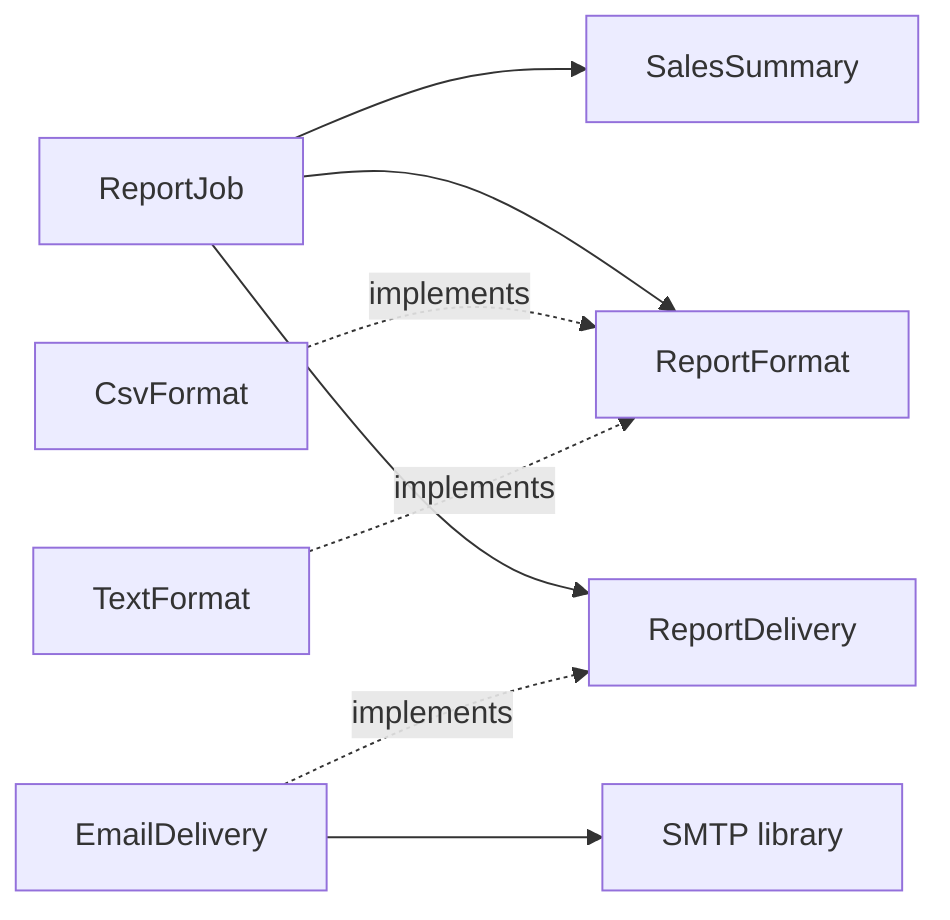

## Introduction

You rename one column in the `customers` table, and forty files fail to compile. Or worse, they compile, and three services fail in production because each of them ran its own SQL against that table. You open the `Utils` class to fix a date-formatting bug and find it also contains password hashing, CSV parsing and a function that sends Slack messages; your change to dates forces a redeploy of every service that imported `Utils` for any reason.

Both stories describe the same underlying problem, viewed from two sides. In the first, modules are too **coupled**: they depend on each other's details, so a change in one spreads to many. In the second, a module has low **cohesion**: it contains things that do not belong together, so a change to one part disturbs the unrelated parts.

These two ideas were introduced in the 1970s by Larry Constantine and colleagues as part of structured design, long before object-oriented programming was common, and they remain the most useful pair of words for judging a design:

- **Coupling** is the degree to which one module depends on other modules. Low coupling means a module can be understood, changed, tested and deployed with little knowledge of the others.
- **Cohesion** is the degree to which the elements inside one module belong together. High cohesion means everything in the module serves one clear purpose.

The goal is usually summarised as **high cohesion, low coupling**: modules that are focused inside and connected through narrow, explicit interfaces outside. "Module" here means any unit with a boundary — a method, a class, a package, a library, a service. The vocabulary works at every scale, which is why it appears both in low-level design interviews and in microservices discussions.

## Before you start

- [[d1-encapsulation]] and [[d1-abstraction]] — encapsulation and abstraction are the main tools for reducing coupling.
- [[d1-solid]] — the Single Responsibility Principle is cohesion seen from the "reason to change" angle, and Dependency Inversion is a tool for controlling coupling.
- **Java interfaces and records** are used in the examples; see [[c1-interfaces]] and [[c1-records]].

## The intuition

Think about how a well-run company is organised. The payroll team works closely together: they share data, tools and deadlines, and all of their work serves one purpose. That is high cohesion. When the marketing team needs something from payroll, they do not walk in and edit the spreadsheet; they send a request through an agreed form and get back exactly what they asked for. That is low coupling.

Now picture the opposite. A "general operations" team handles payroll, the office coffee order and the company website — low cohesion, so nobody can tell what the team is for, and a website emergency delays salaries. And every team keeps a copy of the payroll spreadsheet and edits it directly — high coupling, so when payroll adds a column, every other team's formulas break.

The two properties are connected. When related things are scattered across modules (low cohesion), those modules must constantly talk to each other (high coupling). Putting things that change together into the same module usually reduces the coupling between modules at the same time.

## Cohesion: does this module have one purpose?

Cohesion asks whether a module's parts belong together. A quick practical test is to describe the module in one sentence without using "and" or "or". "Calculates the price of an order, including tax and discounts" passes. "Formats dates and hashes passwords and parses CSV" does not.

The classic classification ranks cohesion from worst to best. You do not need to memorise the names, but recognising the patterns helps you explain *why* a class feels wrong.

| Kind | Elements are grouped because… | Example | Quality |
|---|---|---|---|
| Coincidental | No real reason — they had to go somewhere | `Utils` with date, crypto and Slack helpers | Worst |
| Logical | They are the same *category* of thing, chosen by a flag | `handle(type, data)` that does input, output or logging depending on `type` | Poor |
| Temporal | They happen at the same *time* | `StartupTasks` that warms a cache, checks a licence and sends a metric | Weak |
| Procedural | They run in a fixed *order*, but on unrelated data | A method that validates a form, then rotates log files | Weak |
| Communicational | They work on the same *data* | A class that both prints and saves a customer record | Acceptable |
| Sequential | The output of one is the input of the next | Parse → validate → normalise an import row | Good |
| Functional | Every part contributes to *one well-defined task* | `TaxCalculator`, `PasswordHasher` | Best |

Most real low-cohesion code is coincidental, logical or temporal. A `helpers` or `common` package is usually coincidental. A method with a `mode` parameter that selects completely different behaviours is logical cohesion, and it also creates control coupling for its callers (below). A class named after a moment rather than a purpose — `OnStartup`, `NightlyJob` — tends to be temporal; each task inside it changes for its own reasons.

The connection to the Single Responsibility Principle is direct: a functionally cohesive module has one reason to change. Low cohesion shows up in practice as classes that are hard to name, hard to test without setting up unrelated things, and edited by many people for unrelated reasons.

> [!TIP] Cohesion is not size
> A 400-line `PricingEngine` where everything serves pricing can be highly cohesive. A 40-line class with four unrelated methods is not. Split by purpose, not by line count, and do not split a cohesive concept into five classes just because it got long.

## Coupling: how much does this module know about others?

Coupling is unavoidable — modules that never talk to each other cannot form a program. The question is not whether modules are coupled but **how**: through what, and to what. The classic classification ranks coupling from tightest to loosest.

| Kind | One module depends on another's… | Example | Fix |
|---|---|---|---|
| Content | Internals directly | Reading or writing another class's fields, or via reflection | Encapsulate behind methods |
| Common | Shared global state | A static mutable `Config` or singleton cache everyone writes | Pass state explicitly; isolate it |
| External | Externally imposed format or protocol | Several modules parsing the same file layout or calling the same device API | Put the format behind one adapter |
| Control | Decision logic, passed as a flag | `render(report, true)` where `true` means CSV | Separate methods or polymorphism |
| Stamp | Whole data structure, of which it uses a part | Passing a `Customer` to a method that needs only the email | Pass only what is needed |
| Data | Simple parameters it actually uses | `sendReceipt(email, summary)` | The normal, healthy case |
| Message | Messages or events, with no direct call | Publishing `OrderPlaced` to a queue | Use where independence matters |

### Control coupling

```java
String render(List<Row> rows, boolean asCsv) {
    if (asCsv) { /* build CSV */ }
    else       { /* build plain text */ }
}
```

The caller is not asking for a result; it is telling `render` *which branch to take*. The caller must know that `render` has two internal modes, and every new format adds another flag or turns the boolean into a string. Call sites such as `render(rows, true)` are also unreadable without opening the method. The fix is to give each behaviour its own method (`renderCsv`, `renderText`) or, if the choice is made at runtime, its own implementation of an interface — which is exactly what the worked example below does.

### Stamp coupling

```java
void sendReceipt(Customer customer, Order order) {
    mailer.send(customer.getEmail(), "Thanks! Total: " + order.totalCents());
}
```

The method uses one field of `Customer` and one of `Order`, but it depends on both entire types. Any change to `Customer` may affect it; testing it requires building a full `Customer` and `Order`; and it cannot be reused for someone who is not a `Customer`. Passing `sendReceipt(String email, long totalCents)` — or a small purpose-built record — reduces the dependency to what is used. The trade-off is that long parameter lists are their own smell; when a method needs many related values, a small dedicated type is better than either the whole entity or seven loose parameters.

### Common and content coupling

Global mutable state couples every module that touches it, invisibly: a test that changes a static `FeatureFlags` value can break an unrelated test that runs later. Content coupling — reaching into another object's fields — is the tightest form, because it depends on representation, the most volatile thing of all. Both are fixed by the same move: make the state belong to one owner and expose operations instead of data, as in [[d1-encapsulation]].

```quiz
Q: A class `AppHelpers` contains `formatDate`, `hashPassword`, `parseCsvLine` and `postToSlack`. What kind of cohesion does it have?
- [x] Coincidental — the methods have no real relationship
- [ ] Functional — every method is a helper
- [ ] Sequential — they could be called one after another
- [ ] Communicational — they all take strings
> The only thing these methods share is that they did not have an obvious home. "Being a helper" or "taking a String" is not a shared purpose. A change to date formatting forces everyone who imported AppHelpers for any reason to rebuild and retest.

Q: `void notify(User user)` uses only `user.getPhoneNumber()`. Which kind of coupling is this, and what is the usual fix?
- [ ] Content coupling; make the fields public
- [x] Stamp coupling; pass only the phone number (or a small type that holds it)
- [ ] Control coupling; add a boolean parameter
- [ ] Message coupling; publish an event instead
> The method depends on the whole User type but uses one field, so changes to User can affect it and tests must construct a full User. Passing just what it needs reduces the dependency. Control coupling would involve a flag that selects behaviour.
```

## Worked example: splitting a report service

Here is a realistic class with several coupling and cohesion problems at once. It is shown as an outline, because the point is its shape.

```java
public class ReportService {
    public void sendSalesReport(Customer customer, boolean asCsv) throws SQLException {
        Connection db = DriverManager.getConnection(GlobalConfig.DB_URL);  // common + external
        ResultSet rs = db.createStatement()
                .executeQuery("SELECT region, amount_cents FROM sales");    // knows the schema
        Map<String, Long> totals = new TreeMap<>();
        while (rs.next()) { /* aggregate by region */ }
        String body = asCsv ? /* build CSV */ : /* build text */;          // control coupling
        SmtpMailer.send(customer.getEmail(), body);                         // stamp coupling
    }
}
```

One method fetches data with hand-written SQL, aggregates it, formats it two ways and delivers it. That is low cohesion — four reasons to change, owned by different people. It reads global configuration (common coupling), knows the database schema (so a column rename breaks reporting), takes a flag that selects a code path (control coupling), takes a whole `Customer` to use one field (stamp coupling) and calls a static mailer it cannot swap (so it cannot be tested without SMTP).

The refactoring separates each responsibility and connects them through narrow interfaces:

```java title="CohesiveReports.java"
import java.util.ArrayList;
import java.util.List;
import java.util.Locale;
import java.util.Map;
import java.util.TreeMap;

public class CohesiveReports {

    record Sale(String region, long amountCents) {}
    record RegionTotal(String region, long totalCents) {}

    // Functional cohesion: this class only aggregates. It knows nothing about SQL or email.
    static final class SalesSummary {
        static List<RegionTotal> byRegion(List<Sale> sales) {
            Map<String, Long> totals = new TreeMap<>();
            for (Sale sale : sales) totals.merge(sale.region(), sale.amountCents(), Long::sum);
            List<RegionTotal> result = new ArrayList<>();
            totals.forEach((region, total) -> result.add(new RegionTotal(region, total)));
            return result;
        }
    }

    // Replaces the boolean flag: each format is its own implementation.
    interface ReportFormat {
        String render(List<RegionTotal> rows);
    }

    static final class CsvFormat implements ReportFormat {
        public String render(List<RegionTotal> rows) {
            StringBuilder out = new StringBuilder("region,total_cents\n");
            for (RegionTotal row : rows) {
                out.append(row.region()).append(',').append(row.totalCents()).append('\n');
            }
            return out.toString();
        }
    }

    static final class TextFormat implements ReportFormat {
        public String render(List<RegionTotal> rows) {
            StringBuilder out = new StringBuilder();
            for (RegionTotal row : rows) {
                out.append(row.region()).append(": ").append(dollars(row.totalCents())).append('\n');
            }
            return out.toString();
        }

        private static String dollars(long cents) {
            return String.format(Locale.ROOT, "$%d.%02d", cents / 100, cents % 100);
        }
    }

    // Data coupling: delivery receives an address and a body, not a Customer.
    interface ReportDelivery {
        void deliver(String recipientEmail, String body);
    }

    static final class ConsoleDelivery implements ReportDelivery {
        public void deliver(String recipientEmail, String body) {
            System.out.println("to: " + recipientEmail);
            System.out.print(body);
        }
    }

    // A thin orchestrator coupled only to two small interfaces and a pure function.
    static final class ReportJob {
        private final ReportFormat format;
        private final ReportDelivery delivery;

        ReportJob(ReportFormat format, ReportDelivery delivery) {
            this.format = format;
            this.delivery = delivery;
        }

        void run(List<Sale> sales, String recipientEmail) {
            delivery.deliver(recipientEmail, format.render(SalesSummary.byRegion(sales)));
        }
    }

    public static void main(String[] args) {
        List<Sale> sales = List.of(
                new Sale("west", 12000), new Sale("east", 7550),
                new Sale("west", 3025), new Sale("north", 999));

        new ReportJob(new CsvFormat(), new ConsoleDelivery()).run(sales, "finance@example.com");
        new ReportJob(new TextFormat(), new ConsoleDelivery()).run(sales, "ceo@example.com");
    }
}
```

```output
to: finance@example.com
region,total_cents
east,7550
north,999
west,15025
to: ceo@example.com
east: $75.50
north: $9.99
west: $150.25
```

Walk through what changed and why each change matters.

`SalesSummary.byRegion` is now a pure function from sales to totals. Its cohesion is functional, and its only coupling is to two small records. It can be tested with a three-line list and no database. The `TreeMap` keeps regions sorted, which is why the output lists east, north, west; west's two sales are merged into 12,000 + 3,025 = 15,025 cents.

The boolean flag became the `ReportFormat` interface. The caller now chooses a format by passing an object, and adding a PDF format is a new class rather than an edit to a shared `if`. The text format uses `Locale.ROOT` so that the output does not change on machines with a different default locale — a small example of removing an *external* dependency that would otherwise make the output environment-dependent.

`ReportDelivery` takes a string address, so it is no longer stamp-coupled to `Customer`. In production it would be implemented by an email adapter; here, by the console.

In a real system, data access would get the same treatment: a `SalesRepository` interface returning `List<Sale>`, implemented in the infrastructure layer, so that only one class knows the `sales` table's columns. A column rename then changes one adapter instead of every report.



Only `EmailDelivery` touches the SMTP library, and nothing depends on `EmailDelivery` except the code that wires the application together. A change to the mail provider is now contained in one class.

## Direction and stability

Coupling is not only about *how much* modules depend on each other but also about *which way* the dependencies point. Two simple counts help:

- **Afferent coupling (Ca)** — how many other modules depend on this one (incoming).
- **Efferent coupling (Ce)** — how many other modules this one depends on (outgoing).

Robert C. Martin combined them into **instability**, `I = Ce / (Ca + Ce)`, which ranges from 0 (many dependents, depends on nothing: hard to change, so it had better be stable) to 1 (depends on many, nothing depends on it: easy to change). The guideline that follows, the **Stable Dependencies Principle**, is to depend in the direction of stability: volatile modules — UI, adapters, vendor integrations — should depend on stable ones — domain types and interfaces — and not the other way round. This is the same idea as Dependency Inversion, seen as a property of the whole graph.

A related danger is the **dependency cycle**: package A depends on B, B on C, C back on A. A cycle turns three modules into one in practice — none can be built, tested or released without the others. Breaking a cycle usually means extracting the shared concept into its own module or inverting one dependency with an interface. Spring reports circular bean dependencies for the same reason; see [[c5-circular-dependencies]].

You do not have to compute these by hand. Java's `jdeps` tool lists dependencies between packages and modules, and libraries such as ArchUnit let you write tests that fail the build when, for example, the domain package imports the web package. Version-control history is another powerful source: files that keep changing in the same commits are coupled, whether or not the code shows it.

## Coupling between services

The same vocabulary describes distributed systems, where coupling is more expensive because every dependency crosses a network.

**Shared databases.** Two services that read and write the same tables are content-coupled at the data level: either team changing a column can break the other, and neither can change its schema independently. Splitting a monolith into services that still share tables gives you the costs of distribution with none of the independence. Each service should own its data and expose it through an API or events. See [[d7-microservices]].

**Synchronous call chains.** If the order service calls inventory, which calls pricing, which calls tax, then all four must be running for one order to succeed. This dependency on *runtime availability* is often called temporal coupling in system design — not to be confused with temporal *cohesion* above. Timeouts, retries, caching and asynchronous messaging reduce it.

**Events and hidden coupling.** Publishing events instead of calling services is message coupling, the loosest kind: the publisher does not know who listens. But the coupling does not disappear; it moves into the event's format. If consumers depend on a field named by a magic string, removing it breaks them silently. Versioned, documented event schemas keep this coupling explicit. See [[d7-event-driven]].

**Modular monoliths.** A single deployable application with strict, enforced module boundaries — each module owning its tables and exposing a small API to the others — gets much of the benefit of low coupling without the operational cost of many services, and is often the better first step. See [[d7-monolith-modular-monolith]].

## In real systems

**Layered and hexagonal architectures** are coupling rules made explicit: web code may depend on application services, application services on domain types and on interfaces they own, and infrastructure implements those interfaces. Teams enforce the rules with package conventions, Java modules or ArchUnit tests in continuous integration.

**Incident blast radius.** Coupling becomes visible during outages. A tightly coupled system fails widely — one slow dependency takes down everything that calls it synchronously. A loosely coupled one degrades in part. Post-incident reviews often end with a coupling fix: adding a timeout and fallback, caching a dependency's data, or moving a call to a queue.

**Team structure.** Conway's law observes that systems tend to mirror the communication structure of the organisation that builds them. High-cohesion, low-coupling modules let teams own areas end to end and release without coordinating with five other teams; that organisational effect is a major reason companies care about these properties.

## Trade-offs and alternatives

Low coupling lets modules be changed, tested and deployed independently, and high cohesion makes each one understandable on its own. But both can be pushed too far.

**Zero coupling is impossible and undesirable.** Modules must collaborate. Aim for coupling that is *explicit* (visible in signatures, not hidden in globals or shared tables), *narrow* (small interfaces) and *directed towards stable things*.

**Indirection has a cost.** Every interface and event adds a hop when reading or debugging. Event-driven designs in particular trade compile-time visibility for runtime independence; following a business flow through five asynchronous consumers is much harder than reading one method.

**Premature splitting lowers cohesion across files.** Breaking a 200-line feature into eight classes in six packages can make each class "cohesive" while the feature as a whole is scattered, and every change now touches many files. Split when you can name the separate reasons to change.

**Data coupling is fine.** Passing simple values that a function genuinely uses is the healthy baseline, not something to eliminate.

## Common mistakes

**Assuming microservices mean low coupling.** Services that share a database, call each other synchronously for every request, or must be deployed together are a distributed monolith — tightly coupled and harder to operate.

**`Utils` and `common` packages that grow forever.** They start as a convenience and become a module that everything depends on and that contains nothing coherent. Move each helper next to the code that uses it, or into a small, well-named module.

> [!MISTAKE] Passing a giant DTO everywhere
> A 40-field `OrderDto` passed through every layer makes every method stamp-coupled to every field. Adding a field forces you to check all of them, and tests need fully populated objects. Give each boundary a type shaped for what it needs.

**Boolean parameters that select behaviour.** `process(order, true, false)` is control coupling and unreadable at the call site. Split the method or pass a strategy object.

**Confusing cohesion with performance.** Cohesion is about how easy a module is to understand and change, not how fast it runs. Grouping code to save a method call is not a cohesion argument.

## Interview perspective

> [!INTERVIEW] A crisp definition with a consequence
> "Cohesion is how strongly the things inside a module belong together; coupling is how much a module depends on others. I want high cohesion so each module has one reason to change, and low, explicit coupling so a change in one module doesn't ripple into others. SRP is my tool for cohesion; interfaces and dependency inversion are my tools for coupling."

Questions to prepare:

- **What is high cohesion? Give an example.** A `TaxCalculator` where every method contributes to computing tax, versus a `Utils` class.
- **What kinds of coupling are there, and which is worst?** Content (tightest) through common, external, control, stamp and data to message (loosest). Give the flag and whole-object examples with fixes.
- **How do you reduce coupling between services?** Each service owns its data; communicate through versioned APIs or events; avoid long synchronous chains; add timeouts and fallbacks.
- **How does Dependency Inversion reduce coupling?** The consumer depends on an interface it owns, so implementations can change without touching it, and dependencies point towards stable code.
- **Is zero coupling possible?** No; modules must collaborate. The aim is explicit, narrow coupling to stable abstractions.
- **How would you detect coupling problems in a monolith?** Dependency graphs (`jdeps`), architecture tests, cycles between packages, files that always change together in version control, and features that require edits in many packages.

## Practice

1. **Classify.** For each, name the kind of coupling and propose a fix: a method `save(Order o, boolean isDraft)`; a static `CurrentUser.get()` used in twenty classes; two services that each parse the same partner's fixed-width file; a function that takes a `Customer` but reads only `customer.getAddress().getCountry()`.
2. **Split a class.** Take a class you know that has more than one reason to change. Write its one-sentence description; every "and" is a candidate split. Draw the dependencies after splitting.
3. **Break a cycle.** Packages `orders` and `billing` depend on each other: orders creates invoices, and billing reads order totals. Propose two different ways to break the cycle and the trade-off of each.
4. **Extend the example.** Add a `SalesRepository` to the worked example with an in-memory implementation, and write down which class would change if the `sales` table renamed `amount_cents` to `amount_minor`.

## Quick revision {#quick-revision}

- Cohesion = how well a module's parts belong together (inside). Coupling = how much a module depends on others (between).
- Target: high cohesion, low and explicit coupling, dependencies pointing towards stable modules.
- Cohesion, worst → best: coincidental, logical, temporal, procedural, communicational, sequential, functional.
- Coupling, tightest → loosest: content, common, external, control, stamp, data, message.
- Control coupling: flags choosing behaviour → separate methods or polymorphism.
- Stamp coupling: whole object for one field → pass what is needed or a small purpose-built type.
- Instability `I = Ce / (Ca + Ce)`; depend in the direction of stability; break cycles with extraction or inversion.
- Services: shared databases and synchronous chains are hidden tight coupling; events move coupling into schemas.
- SRP improves cohesion; interfaces and DIP reduce coupling. Modular monolith before microservices.

## Key takeaways {#key-takeaways}

- Coupling and cohesion describe how far a change spreads: across modules (coupling) and within one (cohesion).
- A module that can be described in one sentence without "and" is usually cohesive; a `Utils` class almost never is.
- Flags that select behaviour and whole objects passed for one field are the most common, most fixable forms of unnecessary coupling.
- Coupling should be explicit, narrow and directed towards stable code; hidden coupling through globals, shared tables or magic strings is the most dangerous kind.
- The same reasoning scales from classes to packages to services, where shared databases and synchronous call chains are the coupling to watch.
- Do not chase zero coupling or maximum splitting; indirection and scattered features have real costs.
