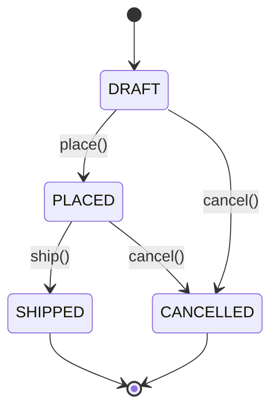

## Introduction

Here is a bank account class that a beginner might write:

```java
public class BankAccount {
    public String owner;
    public long balanceCents;
}
```

It works. Any code that needs to withdraw money writes `account.balanceCents -= 5000;`. The trouble starts when the codebase grows. The withdrawal logic now lives in a checkout service, a refund job, an admin tool and a mobile API controller. One of them forgets to check that the balance is large enough, and an account goes to minus fifty dollars. Another one writes the balance without recording an audit entry. A third reads the balance, decides to withdraw, and writes it back while a second thread is doing the same thing, so one withdrawal disappears. Every one of these bugs is possible because **every caller can change the data directly**, so the rule "a balance is never negative" has to be re-implemented, correctly, everywhere.

**Encapsulation** is the design principle that fixes this. An encapsulated object keeps its data private and offers a small set of operations — `deposit`, `withdraw` — that are the *only* way to change it. Each operation checks the rules before changing anything. Because there is no other door into the data, the rules hold no matter who calls the object or how many callers there are.

That is the core idea of the whole lesson: encapsulation exists to protect **invariants**. An invariant is a statement about an object's state that must always be true from the outside — "balance is never negative", "an order that has shipped cannot be cancelled", "the number of seats sold never exceeds the capacity". If the data can be changed only through methods that preserve the invariant, the invariant cannot be broken.

You will meet encapsulation in every object-oriented codebase, in every low-level design interview (parking lot, ATM, booking system), and at much larger scales too: a package that exposes a few public classes, a microservice that exposes an API instead of its database, and a library that exposes an interface instead of its internals are all applying the same principle.

## Before you start

- **Java classes and access modifiers** — what `private`, package-private, `protected` and `public` mean to the compiler. The language mechanics are taught in [[c1-encapsulation]] and [[c1-access-modifiers]]; this lesson is about using them to design good objects.
- **Classes, constructors and methods** — see [[c1-classes]] and [[c1-constructors]].
- **Records and enums** are used in the examples. A quick look at [[c1-records]] and [[c1-enums]] is enough.

## The intuition

Think of a vending machine. Inside there is a coin box, a stock of cans and a motor that pushes a can out. You never touch any of those. You use a small panel: insert coins, press a button, take a can. The machine checks that you paid enough before releasing anything, and it never lets you take two cans for the price of one. The panel is the **public interface**; the coin box and stock are the **private state**; the checks that run before anything moves are the machine **enforcing its invariants**.

Two things make the vending machine trustworthy. First, the panel is *the only way in* — if there were an unlocked side door to the stock, the payment checks would be pointless. Second, the panel offers *meaningful operations* ("buy a cola"), not raw access ("set number of colas to 11"). Both halves matter in software too, and most encapsulation bugs come from forgetting one of them.

The analogy stops working in one place: a vending machine is physically locked, while a `private` field is only a compiler rule. Code inside the same application can still reach private fields through reflection. Encapsulation is a design boundary that keeps honest code correct; it is not a security mechanism. We return to this below.

## What encapsulation actually is

Encapsulation combines two ideas that are worth separating.

**Bundling** means putting the data and the code that operates on that data in the same unit. The withdrawal rule belongs in `BankAccount`, next to the balance, not in a `PaymentUtils` class three packages away. When data and rules live together, anyone reading the class sees the complete truth about what a valid account is.

**Information hiding** means that the outside world sees only what it needs, and the representation behind it stays private. The term comes from David Parnas's 1972 paper on decomposing systems into modules: hide the decisions that are likely to change, so that changing them affects one module instead of many. Whether a balance is stored as a `long` number of cents or a `BigDecimal` is exactly such a decision.

Put together, an encapsulated class has three properties:

1. Its fields are not directly writable from outside (normally `private`).
2. Every public method that changes state leaves the object valid — it checks its inputs and the current state first, and refuses the change if it would break an invariant.
3. Nothing it returns lets a caller change its internals behind its back.

Here is the bank account rewritten with those properties:

```java title="BankAccount.java"
public class BankAccount {
    private final String owner;
    private long balanceCents;          // invariant: balanceCents >= 0

    public BankAccount(String owner, long openingCents) {
        if (owner == null || owner.isBlank()) {
            throw new IllegalArgumentException("owner is required");
        }
        if (openingCents < 0) {
            throw new IllegalArgumentException("opening balance cannot be negative");
        }
        this.owner = owner;
        this.balanceCents = openingCents;
    }

    public void deposit(long cents) {
        if (cents <= 0) throw new IllegalArgumentException("deposit must be positive");
        balanceCents += cents;
    }

    public void withdraw(long cents) {
        if (cents <= 0) throw new IllegalArgumentException("withdrawal must be positive");
        if (cents > balanceCents) throw new IllegalStateException("insufficient funds");
        balanceCents -= cents;
    }

    public long balanceCents() { return balanceCents; }
    public String owner() { return owner; }
}
```

Notice where the checks are. The constructor is the first door — an invariant that is not established at construction can never be relied on, so the constructor validates too. Each mutating method checks *before* changing the field, so a rejected call leaves the object exactly as it was. And there is no `setBalanceCents` method at all, because "set the balance to an arbitrary number" is not an operation a bank account supports. Removing that method is as much a part of the design as writing the others.

> [!IMPORTANT] The test for encapsulation
> Ask: "Is there any sequence of public calls that leaves this object in a state that breaks its rules?" If the answer is no, the class is encapsulated. If the answer is "only if callers remember to check first", it is not.

## Access modifiers are the tool, not the goal

It is common to define encapsulation as "make fields private and add getters and setters". That definition misses the point. Look at this class:

```java
public class Order {
    private String status;
    public String getStatus() { return status; }
    public void setStatus(String status) { this.status = status; }
}
```

The field is private, but any caller can still set the status to `"SHIPPED"` on an order that was never paid, or to `"banana"`. The setter is a public field with extra typing. Nothing is protected, because the class has no rules in it.

The difference between encapsulated and not is whether **the object decides**. Compare:

```java
public class Order {
    private OrderStatus status = OrderStatus.PENDING_PAYMENT;

    public void markPaid() {
        if (status != OrderStatus.PENDING_PAYMENT) {
            throw new IllegalStateException("cannot pay an order that is " + status);
        }
        status = OrderStatus.PAID;
    }
    public OrderStatus status() { return status; }
}
```

Now the only way to reach `PAID` is through `markPaid`, and the only way to call it successfully is from `PENDING_PAYMENT`. The status field went from a value anyone can write to a small state machine the object controls. The enum type also removes the "banana" problem at compile time.

Getters are less dangerous than setters, but they deserve thought too. Each getter is a promise that the information will keep being available in that form. If you expose `getBalanceCents()` today, you cannot later store the balance differently without either keeping that method working or breaking callers. Expose what callers genuinely need, not every field by reflex.

### Why not public fields in a small class?

A fair question: if a class has no rules, are getters better than public fields? In Java, accessor methods keep one door open that public fields close forever — you can later add validation, compute the value instead of storing it, or change the field's type, without changing callers. For a pure data carrier with no rules, a **record** gives you that for free: `record Point(int x, int y) {}` has private final fields and generated accessors, and its compact constructor can validate. The point is not "never public fields" but "decide deliberately what the outside can see and change".

## Tell, don't ask

When the logic lives outside the object, callers *ask* for the data, make a decision, and write the result back:

```java
// Asking: the rule lives in the caller
if (account.getBalanceCents() >= amount) {
    account.setBalanceCents(account.getBalanceCents() - amount);
}
```

When the logic lives inside the object, callers *tell* it what they want and let it decide:

```java
// Telling: the rule lives in the object
account.withdraw(amount);
```

This guideline is called **tell, don't ask**. The asking version has three problems. The rule is duplicated in every caller that withdraws. The check and the update are two separate steps, so under concurrency another thread can change the balance between them (a check-then-act race). And the class cannot evolve — if withdrawals later need a daily limit, every caller has to change. The telling version has none of these problems: one place to change, one place to add locking if needed, and callers that read like the business language ("withdraw", "cancel", "ship").

Tell, don't ask is a guideline, not a law. Reading data to display it, to serialise it, or to make a decision that genuinely belongs to the caller (a report that sums balances) is fine. The smell is reading an object's state *in order to change that same object's state according to its own rules*.

## Anemic and rich domain models

When a codebase ignores tell, don't ask everywhere, you get what Martin Fowler named an **anemic domain model**: entity classes that are bags of getters and setters, plus "service" classes that hold all the rules.

```java
// Anemic: Order has no behaviour; the rules live in OrderService
public void cancel(Order order) {
    if (order.getStatus() == OrderStatus.SHIPPED) {
        throw new IllegalStateException("already shipped");
    }
    order.setStatus(OrderStatus.CANCELLED);
    order.setCancelledAt(Instant.now());
}
```

This looks organised, but `Order` itself guarantees nothing. A second service — say, a batch job that cancels stale orders — can call `setStatus(CANCELLED)` directly and skip both the shipped check and the timestamp. Every rule is only as strong as the most careless caller.

A **rich domain model** moves the rule into the entity: `order.cancel(clock)` checks the state, sets the status and records the time, and there is no public `setStatus`. Services still exist, but they orchestrate — load the order, call `cancel`, save it, publish an event — instead of reimplementing the order's rules.

Anemic models are not always wrong. An object that only carries data across a boundary — a request body, a JSON response, a database row mapped for a report — has no rules to protect, and a record or plain DTO (Data Transfer Object) is the right choice. The anemic model becomes a problem when objects that *do* have rules, such as orders, accounts and bookings, are designed as if they did not.

## How internals leak

The most common way encapsulation fails is not a missing `private`. It is a method that hands out a reference to something mutable inside the object. In Java, objects are passed by reference, so returning a field that holds a list returns the *same* list, not a copy.

```java
public class Course {
    private final List<String> students = new ArrayList<>();
    private final int capacity = 2;

    public void enrol(String name) {
        if (students.size() >= capacity) throw new IllegalStateException("course full");
        students.add(name);
    }

    public List<String> getStudents() { return students; }   // leak
}
```

`enrol` carefully enforces the capacity, but any caller can write `course.getStudents().add("Mallory")` and skip the check entirely. The `private` modifier protected the *variable*; it did nothing to protect the *object the variable points to*.

There are two standard fixes, and they behave differently:

```java title="ViewVsCopy.java"
import java.util.ArrayList;
import java.util.Collections;
import java.util.List;

public class ViewVsCopy {
    public static void main(String[] args) {
        List<String> internal = new ArrayList<>(List.of("Ana"));

        List<String> view = Collections.unmodifiableList(internal);
        List<String> copy = List.copyOf(internal);

        internal.add("Bo");                  // the owner changes its own list
        System.out.println("view: " + view);
        System.out.println("copy: " + copy);

        try {
            view.add("Mallory");
        } catch (UnsupportedOperationException e) {
            System.out.println("view rejects writes");
        }
    }
}
```

```output
view: [Ana, Bo]
copy: [Ana]
view rejects writes
```

`Collections.unmodifiableList` returns a **read-only view**: callers cannot change it, but it is a window onto the live internal list, so it reflects later changes the owner makes. `List.copyOf` (Java 10+) returns an **unmodifiable snapshot**: it will never change. Choose the view when callers should see current state cheaply; choose the copy when callers need a stable value, or will hold on to it while the object keeps changing. Note that `List.copyOf` throws `NullPointerException` if the list contains `null`, and that neither option protects the *elements* — if the list held mutable objects, callers could still change those.

The same leak happens with mutable values such as `java.util.Date` and arrays. Returning a `Date` field lets callers call `setTime` on it. The modern fix is to use immutable types — `Instant`, `LocalDate` — so there is nothing to leak. Copying data on the way in and out is called making **defensive copies**; it is covered in detail in [[c1-defensive-copies]].

Leaks also happen on the way *in*. If a constructor stores a list the caller passed without copying it, the caller still holds a reference and can change the object's internals later. Copy mutable arguments when you store them.

## Worked example: an order that protects itself

The following program puts the ideas together: validated construction of line items, a status that only moves through legal transitions, and a read-only view of the lines.

```java title="OrderDemo.java"
import java.util.ArrayList;
import java.util.Collections;
import java.util.List;

public class OrderDemo {

    enum Status { DRAFT, PLACED, SHIPPED, CANCELLED }

    // A record validates in its compact constructor, so an invalid line cannot exist.
    record LineItem(String sku, int quantity, long unitPriceCents) {
        LineItem {
            if (quantity <= 0) throw new IllegalArgumentException("quantity must be positive");
            if (unitPriceCents < 0) throw new IllegalArgumentException("price cannot be negative");
        }
        long totalCents() { return quantity * unitPriceCents; }
    }

    static final class Order {
        private final List<LineItem> lines = new ArrayList<>();
        private Status status = Status.DRAFT;

        void addLine(LineItem line) {
            requireStatus(Status.DRAFT, "add lines");
            lines.add(line);
        }

        void place() {
            requireStatus(Status.DRAFT, "place");
            if (lines.isEmpty()) throw new IllegalStateException("cannot place an empty order");
            status = Status.PLACED;
        }

        void ship() {
            requireStatus(Status.PLACED, "ship");
            status = Status.SHIPPED;
        }

        void cancel() {
            if (status == Status.SHIPPED) {
                throw new IllegalStateException("cannot cancel a shipped order");
            }
            status = Status.CANCELLED;
        }

        long totalCents() {
            long sum = 0;
            for (LineItem line : lines) sum += line.totalCents();
            return sum;
        }

        List<LineItem> lines() { return Collections.unmodifiableList(lines); }
        Status status() { return status; }

        private void requireStatus(Status expected, String action) {
            if (status != expected) {
                throw new IllegalStateException("cannot " + action + " when order is " + status);
            }
        }
    }

    public static void main(String[] args) {
        Order order = new Order();
        order.addLine(new LineItem("BOOK-1", 2, 1_250));
        order.addLine(new LineItem("PEN-7", 3, 199));
        order.place();
        System.out.println(order.status() + " total=" + order.totalCents());

        try {
            order.addLine(new LineItem("MUG-3", 1, 899));
        } catch (IllegalStateException e) {
            System.out.println("rejected: " + e.getMessage());
        }

        try {
            order.lines().clear();
        } catch (UnsupportedOperationException e) {
            System.out.println("rejected: lines are read-only");
        }

        order.ship();
        try {
            order.cancel();
        } catch (IllegalStateException e) {
            System.out.println("rejected: " + e.getMessage());
        }
        System.out.println(order.status() + " lines=" + order.lines().size());
    }
}
```

```output
PLACED total=3097
rejected: cannot add lines when order is PLACED
rejected: lines are read-only
rejected: cannot cancel a shipped order
SHIPPED lines=2
```

Walk through what each piece protects. `LineItem` is a record whose compact constructor runs on every construction, so a line with zero quantity or a negative price cannot exist anywhere in the program — callers do not need to check. `Order` keeps `lines` and `status` private and offers only domain operations. `requireStatus` centralises the transition rule, so "lines can only be added to a draft" is written once. The total is computed from the lines rather than stored, which removes a whole class of bug (a stored total drifting out of sync with the lines). Finally, `lines()` returns a view, so the attempt to `clear()` from outside fails instead of silently emptying a placed order.

If you deleted `requireStatus(Status.DRAFT, "add lines")`, the program would still compile, and a placed order would quietly accept new lines after the customer paid. That is the kind of bug encapsulation is designed to make impossible, and it shows that the protection lives in the *methods*, not in the `private` keyword.

The lifecycle the class enforces is easier to see as a diagram:



Any arrow not drawn here is rejected by the class. When an interviewer asks you to design an order, booking or ticket, drawing this diagram and then showing which method guards each arrow is a strong way to demonstrate encapsulation.

```quiz
Q: A class has only private fields, and a public getter and setter for each one. No method contains any checks. Is it well encapsulated?
- [ ] Yes, because all fields are private
- [x] No, because any caller can still put the object into any state through the setters
- [ ] Yes, as long as it is not used by multiple threads
- [ ] No, because Java requires final fields for encapsulation
> Encapsulation is measured by whether the object can protect its invariants. Unchecked setters let callers write any value, so the private modifier protects nothing; the class behaves like one with public fields. Final fields are about immutability, which is a different (stronger) property.

Q: A method returns `Collections.unmodifiableList(items)`. Later the owning object adds an item to `items`. What does a caller holding the returned list see?
- [x] The new item, because the returned list is a read-only view of the live list
- [ ] The old contents, because the list was copied
- [ ] An exception on the next read
- [ ] It depends on the garbage collector
> `unmodifiableList` wraps the original list; writes through the wrapper are rejected, but changes made by the owner are visible through it. Use `List.copyOf` if the caller needs a snapshot that never changes.
```

## Encapsulation at larger scales

The same principle applies above the level of a single class, and recognising it helps in system design.

**Package level.** In Java, a class or method with no modifier is **package-private**: visible inside its package and nowhere else. A package can expose one public class — say `OrderService` — and keep its repository, mappers and helpers package-private, so other packages cannot depend on them. This is a cheap, underused form of encapsulation that keeps the public surface of a feature small.

**Module level.** The Java Platform Module System (Java 9+) lets a module declare which packages it `exports`; everything else is inaccessible to other modules even if it is `public`. Since Java 16 and 17 the JDK uses this to strongly encapsulate its own internals, which is why old code that used deep reflection into JDK classes — calling `setAccessible(true)` on private fields of `java.lang` or `java.util` types — started failing. See [[c1-modules]].

**Service level.** A microservice that owns its database and exposes only an API is encapsulating its data. When two services read and write the same tables, that boundary is gone: either team changing a column breaks the other, exactly like two classes sharing public fields. See [[d7-microservices]].

**Other languages.** In TypeScript, the `private` keyword is checked only by the compiler and disappears in the emitted JavaScript, so other code can still read the property at runtime. JavaScript's own `#field` syntax (ES2022) is enforced by the runtime: the property is not reachable from outside the class at all.

```typescript title="cart.ts"
class Cart {
  #items: { sku: string; priceCents: number }[] = []

  add(sku: string, priceCents: number): void {
    if (priceCents < 0) throw new Error('price cannot be negative')
    this.#items.push({ sku, priceCents })
  }

  totalCents(): number {
    return this.#items.reduce((sum, item) => sum + item.priceCents, 0)
  }
}

const cart = new Cart()
cart.add('BOOK-1', 1250)
cart.add('PEN-7', 199)
console.log(cart.totalCents())
```

```output
1449
```

## In real systems

**Domain entities in a Spring application.** Production codebases that take encapsulation seriously give entities like `Order`, `Booking` and `Account` methods named after business actions, and keep setters off them. JPA (Java Persistence API) requires a no-argument constructor, but it may be `protected`, and Hibernate can read and write private fields directly when you annotate fields, so the persistence framework does not force public setters on you. The trade-offs of mutable entities versus immutable domain models are discussed in [[c8-entity-immutability]].

**Validation at the right layer.** Validating a form in the browser is good for user experience, but it is not encapsulation: anyone can call the HTTP API directly with any payload. The rules that keep data correct must live on the server, ideally in the domain objects themselves, so that every path — the API, a batch job, an admin script — goes through them.

**Client wrappers.** A well-designed wrapper around an external API encapsulates the messy parts: authentication tokens, retry counters, idempotency keys and rate-limit state live inside the wrapper, and the rest of the codebase calls `payments.charge(order)`. When the provider changes its retry rules, one class changes.

**Concurrency.** Encapsulation is what makes thread safety manageable. If all access to a piece of state goes through a few methods, you can make those methods `synchronized` (or use a lock) and know the state is protected. If the state is reachable directly from twenty places, there is no single place to put the lock. See [[c3-shared-mutable-state]].

## Trade-offs and alternatives

| Choice | Benefit | Cost | Use when |
|---|---|---|---|
| Rich object with domain methods | Rules enforced in one place; callers read like business language | More design effort; rules must be found and named | Entities with real invariants (orders, accounts, bookings) |
| Record or DTO with no behaviour | Minimal code; ideal for serialisation | Protects nothing beyond construction checks | Data crossing a boundary: requests, responses, events |
| Getters and setters with no rules | Familiar; frameworks handle it easily | Gives a false sense of protection | Rarely the best choice; prefer one of the two above |
| Immutable value object | Nothing to protect after construction; safe to share | New object for every change | Small values: money, dates, addresses — see [[d1-immutability]] |

Encapsulation also has real costs. It takes thought to find the right operations; a class whose only methods are `doEverything()` is not better than one with setters. Over-encapsulation can hide operations callers legitimately need, pushing them to work around the class — for example, offering only `addItem` when callers routinely need to add a hundred items atomically. And when a codebase is a short script with a single author, the ceremony may not pay for itself. The benefit grows with the number of callers and the lifetime of the code.

## Common mistakes

**Generating getters and setters for every field.** IDEs and Lombok make this a single click, and it produces classes with no protection at all. Start from the operations the object must support, and add accessors only for information callers genuinely need.

**Returning mutable internals.** Returning an internal `List`, `Map`, array or `Date` lets callers bypass every check. Return an unmodifiable view, an immutable copy, or an immutable type.

**Storing mutable arguments without copying.** A constructor that stores the caller's `List` directly lets the caller change the object later. Copy with `List.copyOf` (or a new `ArrayList` if the object needs to mutate it internally).

**Validating in only one entry point.** If the constructor validates but a `setEmail` method does not, the invariant is not an invariant. Every path that changes the state must enforce it — which is another reason to have few such paths.

> [!MISTAKE] Treating private as a security boundary
> `private` stops other classes from compiling code that touches the field. It does not encrypt or hide anything at runtime: reflection, serialisation libraries, debuggers and heap dumps can all see private fields. Never rely on encapsulation to protect secrets; keep tokens out of objects that get logged or serialised, and do not expose them through getters.

**Confusing encapsulation with abstraction.** Encapsulation hides an object's *state* and guards it; abstraction hides *how* a capability is provided behind a simpler model. They usually appear together, but a class can be well encapsulated with no abstraction at all. The distinction is developed in [[d1-abstraction]].

## Interview perspective

Interviewers ask about encapsulation directly in object-oriented design rounds, and they judge it indirectly in every low-level design question by looking at whether your classes have setters for everything.

> [!INTERVIEW] A strong definition
> "Encapsulation means an object owns its data and the rules about it. Fields are private, the only way to change state is through methods that check the rules, and nothing it returns lets a caller bypass those methods. For example, `Account.withdraw` checks funds itself, instead of callers reading the balance and setting it."

Questions to be ready for:

- **What is the difference between encapsulation and data hiding?** Data hiding — making fields inaccessible — is the mechanism. Encapsulation is the broader design: bundling data with behaviour and exposing operations that preserve invariants.
- **Why not make all fields public in a small class?** Because you lose the ability to add validation, change the representation or add synchronisation later without breaking every caller. For pure data, use a record instead.
- **What is an anemic domain model, and is it always bad?** Entities with only accessors and logic in services. It is a problem for objects with rules; it is fine for DTOs that only carry data.
- **When would you return a defensive copy?** Whenever a getter would otherwise expose a mutable internal object, such as a list or a `Date`.
- **How does encapsulation help testing?** Tests exercise behaviour through the public methods and do not depend on field layout, so refactoring internals does not break them; and invariants checked in one place need testing in one place.
- **Encapsulation versus immutability?** Immutability is the strongest form: if state can never change, there is nothing to guard after construction. Encapsulation also covers objects that must change, by controlling *how* they change.

A good follow-up answer: if asked how you would encapsulate a class that must be updated by many threads, say that you would first make all state changes go through a few methods, and then make those methods atomic (synchronisation, a lock, or atomic variables) — encapsulation gives you the single place to do it.

## Practice

1. **Fix the leak.** Take the `Course` class from the "How internals leak" section and change it so that the capacity cannot be bypassed. Then decide whether `getStudents` should return a view or a copy, and justify the choice.
2. **Remove the setters.** Design a `Ticket` class for a support desk with states `OPEN`, `IN_PROGRESS`, `RESOLVED` and `CLOSED`. A resolved ticket may be reopened; a closed one may not. Write it with no public setters and draw its state diagram first.
3. **Spot the anemic model.** Given a `BookingService` that checks `booking.getSeats() <= show.getAvailableSeats()` and then calls `show.setAvailableSeats(...)`, move the rule into the domain objects. What happens to the race condition between check and update?
4. **Constructor validation.** Write an `EmailAddress` record that rejects values without exactly one `@`. Explain why every method that accepts an `EmailAddress` no longer needs to validate.

## Quick revision {#quick-revision}

- Encapsulation = bundle data with the rules about it + hide the representation; its purpose is protecting **invariants**.
- An invariant is a fact about state that must always hold from the outside (balance ≥ 0, shipped orders cannot be cancelled).
- Validate in the constructor and in every mutating method, *before* changing state.
- Unchecked getters and setters are not encapsulation; prefer domain methods (`withdraw`, `cancel`, `ship`).
- Tell, don't ask: call behaviour on the object instead of reading its state and writing it back.
- Anemic model: entities without behaviour, rules in services — a smell for objects with rules, fine for DTOs.
- Leaks: returned mutable collections, arrays, `Date`; stored mutable arguments. Fix with `List.copyOf`, unmodifiable views, immutable types.
- `Collections.unmodifiableList` = live read-only view; `List.copyOf` = unmodifiable snapshot.
- Scales up: package-private classes, JPMS `exports`, services owning their data.
- `private` is a compile-time design boundary, not security; TypeScript `private` is compile-time only, `#field` is runtime-enforced.

## Key takeaways {#key-takeaways}

- Encapsulation exists so that an object's rules hold no matter who calls it; access modifiers are only the mechanism.
- Design classes around the operations they support, not around their fields, and leave out operations that would let callers break the rules.
- Every path into an object's state — constructor, methods, returned references, stored arguments — must be guarded, or the invariant is not real.
- Tell, don't ask keeps rules in one place and removes check-then-act races between reading and writing state.
- Pure data carriers do not need behaviour; objects with business rules do.
- The same principle governs packages, modules and services: expose a small surface and keep the decisions likely to change behind it.
