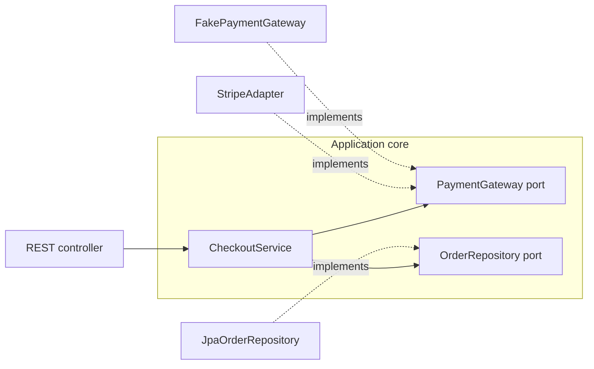

## Introduction

Your checkout code calls Stripe's Java library directly in eleven places. Then the company expands to a country where a different provider, Adyen, is required. Every one of those eleven places has to change, each one slightly differently, and every unit test that touches checkout needs network access to Stripe's test servers, so the tests are slow and fail when the network does. The code never stated *what* it needed from a payment provider; it only showed *how* one particular provider is called.

An **interface**, in the design sense, is that missing statement. It is an explicit contract that says what a component can do for its callers — "charge this amount to this card, and tell me whether it was approved" — without saying how. Checkout depends on the contract; a Stripe adapter and an Adyen adapter each fulfil it; tests use a small in-memory fake that fulfils it too.

In Java the contract is usually written with the `interface` keyword, but this lesson is about the design idea, which exists in every language: TypeScript and Go interfaces, Python protocols, a REST API's documented endpoints and a Kafka event schema are all interfaces in this sense. The language mechanics are covered in [[c1-interfaces]]; here we focus on the decisions that make a contract good: what goes in it, who owns it, how narrow it is, how it evolves, and when not to create one.

Interfaces sit at the centre of the previous lessons. They are the main tool of [[d1-abstraction]], the seam that Dependency Inversion and Interface Segregation in [[d1-solid]] are about, and the way composition ([[d1-composition-vs-inheritance]]) stays loosely coupled.

## Before you start

- **Java interface syntax** — `interface`, `implements`, default methods. See [[c1-interfaces]] and [[c1-default-methods]].
- **Abstract classes** and how they differ from interfaces at the language level — see [[c1-abstract-vs-interface]].
- [[d1-abstraction]] and [[d1-solid]] — this lesson applies their ideas to concrete interface design.
- **Sealed types and records** appear in the worked example; see [[c1-sealed]] and [[c1-records]].

## The intuition

A wall socket is an interface. The socket standard specifies the shape of the plug, the voltage and the frequency. The kettle's designer does not know which power station supplies the electricity, and the power company does not know what appliances people own. Each side depends only on the standard. That is why you can buy a kettle from any manufacturer and plug it into any house in the country.

Three details of the analogy carry over directly. The standard is more than a shape: a plug that fits but delivers the wrong voltage destroys the kettle, so a contract must specify *behaviour*, not just the signature. The standard is defined around what appliances need, not around how a particular power station works. And once millions of devices depend on it, changing the standard is extremely expensive — so it must be designed carefully and evolved slowly.

The analogy breaks in one place: sockets are standardised by committees in advance, while most software interfaces should be designed *from the needs of their callers*, often discovered as the code is written. We come back to this below.

## A contract is more than signatures

Here is a method signature:

```java
ChargeResult charge(String idempotencyKey, Money amount, String cardToken);
```

The compiler checks that callers pass three arguments of the right types and that implementations return a `ChargeResult`. It checks nothing else. Yet a caller needs answers to many more questions before it can use this method safely:

- **Preconditions** — what must be true of the inputs? Can the amount be zero? Must the currency be supported?
- **Postconditions** — what is guaranteed afterwards? If it returns `Approved`, has money definitely moved?
- **Failure behaviour** — is a declined card a return value or an exception? What does an exception mean: "definitely failed" or "outcome unknown"?
- **Repeated calls** — if the network drops and the caller retries, could the customer be charged twice?
- **Nulls** — may any argument be `null`? Can the result be `null`?
- **Threads and timing** — is it safe to call from several threads? Can it block for thirty seconds?

These answers are part of the interface even though no compiler checks them. A contract that leaves them unstated forces every caller to guess, and every implementation to guess differently. Write them in the Javadoc, encode as many as possible in **types** (a `Money` type that cannot be negative, a sealed `ChargeResult` instead of a nullable string), and check them with tests that every implementation must pass.

There is also an uncomfortable truth here, known as **Hyrum's Law**: with enough callers, every observable behaviour of an implementation will be depended on by somebody, whether or not the contract promises it — the order of results, the exact wording of an error message, the speed of a call. You cannot prevent this entirely, but you can reduce it by keeping the interface small and by documenting clearly what is promised and what is not.

## Design the interface from the client's side

The most common way to create an interface is to take an existing class and extract all its public methods. The result is called a **header interface**: it mirrors one implementation, including its accidental details, and every client depends on all of it.

The better approach is to start from a client and ask what *it* needs. The result is a **role interface**: small, named after the role it plays for that client, and expressed in the client's vocabulary.

```java
// Header interface: extracted from a class, mirrors everything it does
interface UserService {
    User create(SignupForm form);
    void delete(long id);
    void resetPassword(String email);
    List<User> search(String query, int page);
    byte[] exportCsv();
    void sendNewsletter(String subject, String body);
    // ...twenty more
}

// Role interfaces: each shaped for one kind of client
interface UserLookup   { Optional<User> findById(UserId id); }
interface PasswordReset { void requestReset(EmailAddress email); }
```

A controller that displays a profile now depends on `UserLookup` only. Its test fake is one method. A change to newsletter sending does not touch it. This is the Interface Segregation Principle applied deliberately — see [[d1-solid]].

Good role interfaces share some habits:

- **Domain verbs and nouns.** `charge`, `refund`, `findById`, `requestReset` — not `executeRequest` or `processData`.
- **Domain types in signatures.** `Money` instead of `long`, `EmailAddress` instead of `String` where validation matters, `Optional<User>` instead of a possibly-null `User`.
- **No infrastructure types.** A repository interface that throws `SQLException` or returns a JDBC `ResultSet` ties every caller to relational databases. Translate inside the implementation.
- **Names by capability.** Java convention does not use an `I` prefix. Name the interface after what it does (`PaymentGateway`, `Clock`, `IdGenerator`) and the implementation after how (`StripePaymentGateway`, `SystemClock`). If you find yourself writing `PaymentGatewayImpl`, ask whether the interface has a reason to exist.

## Who owns the interface? Ports and adapters

Where an interface *lives* matters as much as what it says. Consider an `OrderRepository` interface. If it sits in the persistence package next to its JPA implementation, the business code must import from the persistence package to use it, and the interface tends to grow persistence-flavoured methods. If it sits in the business (application or domain) package, defined in the business code's terms, the persistence package must import from the business package to implement it. The dependency now points from the detail to the policy — the Dependency Inversion Principle.

Alistair Cockburn named this arrangement **ports and adapters** (also called hexagonal architecture). The application core declares **ports**: interfaces for everything it needs from the outside world (store orders, charge payments, send emails, read the time). **Adapters** in the infrastructure layer implement those ports with real technology. Adapters can also drive the application from outside — a REST controller or a Kafka consumer calls into the core through its own ports.



The payoff is that the core can be compiled and tested with no infrastructure at all — fakes implement the ports — and an adapter can be replaced without touching the core.

## Worked example: a payment port with a fake

The program below defines a payment port whose contract includes idempotency and a clear distinction between "declined" and "failed", implements it with an in-memory fake, and uses it from a checkout service.

```java title="PaymentPortDemo.java"
import java.util.HashMap;
import java.util.Map;

public class PaymentPortDemo {

    record Money(long cents, String currency) {
        Money {
            if (cents <= 0) throw new IllegalArgumentException("amount must be positive");
        }
    }

    // A closed set of outcomes: callers must handle both, and the compiler checks it.
    sealed interface ChargeResult permits Approved, Declined {}
    record Approved(String chargeId) implements ChargeResult {}
    record Declined(String reason) implements ChargeResult {}

    /**
     * Port owned by checkout.
     * Contract: calls with the same idempotencyKey never charge twice; a repeat returns
     * the original result. A decline is a normal result. An exception means the outcome
     * is unknown and the caller may retry with the same key.
     */
    interface PaymentGateway {
        ChargeResult charge(String idempotencyKey, Money amount, String cardToken);
    }

    /** In-memory fake that honours the same contract as the real adapter. */
    static final class FakePaymentGateway implements PaymentGateway {
        private final Map<String, ChargeResult> resultsByKey = new HashMap<>();
        private int nextId = 1;

        public ChargeResult charge(String idempotencyKey, Money amount, String cardToken) {
            return resultsByKey.computeIfAbsent(idempotencyKey, key ->
                    cardToken.equals("tok_declined")
                            ? new Declined("card declined")
                            : new Approved("ch_" + nextId++));
        }
    }

    static final class CheckoutService {
        private final PaymentGateway payments;

        CheckoutService(PaymentGateway payments) { this.payments = payments; }

        String pay(String orderId, Money total, String cardToken) {
            ChargeResult result = payments.charge("order-" + orderId, total, cardToken);
            return switch (result) {
                case Approved a -> "order " + orderId + " paid (" + a.chargeId() + ")";
                case Declined d -> "order " + orderId + " not paid: " + d.reason();
            };
        }
    }

    public static void main(String[] args) {
        CheckoutService checkout = new CheckoutService(new FakePaymentGateway());
        Money total = new Money(4_999, "EUR");

        System.out.println(checkout.pay("A1", total, "tok_visa"));
        System.out.println(checkout.pay("A1", total, "tok_visa"));      // a retry
        System.out.println(checkout.pay("B2", total, "tok_declined"));
        System.out.println(checkout.pay("C3", total, "tok_visa"));
    }
}
```

```output
order A1 paid (ch_1)
order A1 paid (ch_1)
order B2 not paid: card declined
order C3 paid (ch_2)
```

Look at how much of the contract is carried by types. `Money` cannot be constructed with a zero or negative amount, so no implementation has to defend against it. `ChargeResult` is a sealed interface with exactly two records, so `CheckoutService` uses a `switch` with no `default` branch (Java 21 pattern matching), and if someone later adds a third outcome such as `RequiresAuthentication`, the compiler flags every `switch` that does not handle it. A decline is a value, not an exception, because declines are a normal business outcome that every caller must handle.

The rest of the contract — idempotency — is in the Javadoc and in the fake's behaviour. The second call for order `A1` reuses the key `order-A1`, so the fake returns the original `ch_1` instead of creating a new charge. That is the behaviour the real Stripe or Adyen adapter must also provide (both providers support idempotency keys for this reason). Order `C3` gets `ch_2` because the declined charge for `B2` never consumed an ID.

The checkout service has no idea whether it is talking to a fake or a real provider, and it does not need to. In production, the composition root passes a `StripePaymentGateway`; in tests, the fake. The tests run in milliseconds and never touch a network.

### Keeping the fake honest: contract tests

A fake is only useful if it behaves like the real thing. If the fake allows double charges and the real adapter does not (or the reverse), tests pass while production fails. The fix is a **contract test**: one suite of tests describing the port's contract, run against every implementation.

```java title="PaymentGatewayContract.java"
import static org.junit.jupiter.api.Assertions.assertEquals;
import static org.junit.jupiter.api.Assertions.assertInstanceOf;

import org.junit.jupiter.api.Test;

abstract class PaymentGatewayContract {

    protected abstract PaymentGateway gateway();

    @Test
    void retryWithSameKeyReturnsOriginalResult() {
        Money amount = new Money(1_000, "EUR");
        ChargeResult first = gateway().charge("k-1", amount, "tok_visa");
        ChargeResult second = gateway().charge("k-1", amount, "tok_visa");
        assertEquals(first, second);
    }

    @Test
    void declinedCardIsAResultNotAnException() {
        ChargeResult result = gateway().charge("k-2", new Money(1_000, "EUR"), "tok_declined");
        assertInstanceOf(Declined.class, result);
    }
}

class FakePaymentGatewayTest extends PaymentGatewayContract {
    private final PaymentGateway fake = new FakePaymentGateway();
    @Override protected PaymentGateway gateway() { return fake; }
}
```

This sketch assumes the types are top-level classes in the same package. A `StripePaymentGatewayTest` would extend the same abstract class, pointed at the provider's sandbox, and run less often. Notice that this is a legitimate use of inheritance: a base class designed for extension, with one documented hook. Testing with fakes and mocks is covered in more depth in [[c13-stubs-mocks-fakes]].

```quiz
Q: In the ports-and-adapters style, where should the `OrderRepository` interface live?
- [ ] In the persistence package, next to `JpaOrderRepository`
- [x] In the application or domain package, defined in the terms the business code needs
- [ ] In a shared `common` package used by every module
- [ ] It does not matter, as long as it is an interface
> When the business code owns the port, the persistence adapter depends on the business code rather than the reverse, and the interface stays free of persistence concepts. An interface in the persistence package makes business code import infrastructure, which is the dependency DIP tells us to invert.

Q: A payment port returns `null` for a declined card and throws `RuntimeException` for network errors. What is the main improvement the worked example makes?
- [ ] It removes all exceptions from the system
- [x] It models declines as an explicit result type, so callers are forced to handle them, and reserves exceptions for "outcome unknown"
- [ ] It makes the method static so it is faster
- [ ] It returns a String so any provider can fill it in
> A null return is easy to forget and says nothing about why. A sealed result type makes "declined" a visible, compiler-checked case. Network failures are different: the charge may or may not have happened, which is why the contract pairs exceptions with idempotent retries.
```

## Interface, abstract class or function?

Java offers three ways to express a contract, and they suit different situations.

| | Interface | Abstract class | Functional interface (lambda) |
|---|---|---|---|
| Purpose | Pure contract, possibly with helper defaults | Shared state and code for closely related implementations | A single operation |
| Instance fields | No (constants only) | Yes | No |
| Constructors | No | Yes | No |
| A class can have | Many | One | Many |
| Method bodies | `default`, `static` (Java 8+), `private` (Java 9+) | Any | `default` and `static` only; one abstract method |
| Typical use | Ports, roles, capabilities | Template Method, skeletal implementations | Strategies, callbacks, small policies |

Prefer an **interface** for contracts across boundaries: it imposes nothing on implementers, and a class can implement several. Use an **abstract class** when implementations genuinely share state or a fixed algorithm, and you are prepared to design it for extension (see [[d1-composition-vs-inheritance]]); it is often paired with an interface, as `AbstractList` is with `List`. Use a **functional interface** when the contract is a single operation: callers can then pass a lambda or a method reference, and you avoid naming a class for three lines of behaviour. `java.util.function` already provides common shapes (`Supplier`, `Function`, `Predicate`); define your own when a domain name makes the code clearer, as in `DiscountRule` or `RetryPolicy`.

## Evolving an interface

Interfaces are cheap to create and expensive to change, because every implementation and every caller depends on them. Adding an abstract method breaks every existing implementation; changing a parameter breaks every caller.

Java 8 added **default methods** largely to solve this problem for the JDK itself: the `Collection` interface needed a new `stream()` method, and adding it as abstract would have broken every collection class ever written outside the JDK. A default method gives new behaviour with a body built from the existing abstract methods, so old implementations keep compiling.

```java title="EvolvingInterface.java"
import java.util.List;

public class EvolvingInterface {

    interface Notifier {
        void send(String to, String message);

        // Added later; existing implementations and lambdas keep working.
        default void sendAll(List<String> recipients, String message) {
            for (String to : recipients) send(to, message);
        }
    }

    public static void main(String[] args) {
        Notifier console = (to, message) -> System.out.println(to + " <- " + message);
        console.sendAll(List.of("ana", "bo"), "deploy finished");
    }
}
```

```output
ana <- deploy finished
bo <- deploy finished
```

`Notifier` still has one abstract method, so it remains usable as a lambda, and any implementation that can send in bulk more efficiently can override `sendAll`. Defaults have limits: they cannot use instance state, and a default that cannot be implemented well in terms of existing methods is a sign that the change really is breaking.

When a change is genuinely breaking, the standard techniques are to add the new method alongside the old one, mark the old one `@Deprecated` with a pointer to its replacement, migrate callers, and remove it in a later major version. For network interfaces the same discipline applies with API versions and schema evolution rules. Designing interfaces small in the first place is the best protection: a three-method interface has far fewer ways to need breaking changes than a thirty-method one.

## Interfaces without a keyword: structural typing

In Java, a class satisfies an interface only if it declares `implements`. This is **nominal typing**. TypeScript and Go use **structural typing** instead: any value with the right shape satisfies the interface, with no declaration needed.

```typescript title="clock.ts"
interface Clock {
  now(): Date
}

// No "implements" needed: anything with a matching now() is a Clock.
class SystemClock {
  now(): Date { return new Date() }
}

function isExpired(expiresAt: Date, clock: Clock): boolean {
  return clock.now().getTime() > expiresAt.getTime()
}

const real: Clock = new SystemClock()
const fixed: Clock = { now: () => new Date('2026-01-01T00:00:00Z') }
console.log(isExpired(new Date('2025-12-31T00:00:00Z'), fixed))
```

```output
true
```

Structural typing makes it easy for the *consumer* to define the interface it needs — the ports-and-adapters idea — even for classes written by someone else who never heard of your interface. The trade-off is that accidental matches are possible: two unrelated types with a `now()` method are interchangeable to the compiler. See [[b2-structural-typing]].

The `Clock` example also shows one of the most valuable small interfaces in any codebase. Code that calls the system time directly cannot be tested deterministically. In Java, `java.time.Clock` (an abstract class) plays this role: inject a `Clock`, call `Instant.now(clock)`, and pass `Clock.fixed(...)` in tests. See [[c13-clock-time]].

## When not to create an interface

An interface is worth its cost when it marks a real boundary. Good reasons are:

- **An external system** — database, payment provider, email, file storage, another service. Even with one implementation today, the boundary is real and the tests need a substitute.
- **More than one implementation** — now, not hypothetically.
- **A test seam** for something slow or non-deterministic — time, randomness, network.
- **A module or team boundary** where a stable contract lets two groups work independently.

Poor reasons are "every class should have an interface", or "we might need another implementation someday". An internal class with one caller, a pure calculation such as a `PriceCalculator` with no external dependencies, or a data carrier such as a DTO or record has no boundary to protect. An interface in front of it doubles the number of files a reader must open and adds nothing. If the need appears later, modern IDEs extract an interface in seconds.

## In real systems

**Spring applications** are wired through interfaces at boundaries. Spring Data repository interfaces are a special case: you declare the interface and Spring generates the implementation at runtime. Services usually depend on interfaces only for external systems and remain concrete otherwise.

**The JDK** is full of interface design lessons. `List`, `Map` and `Set` let code be written once for many implementations. JDBC's `Connection` and `PreparedStatement` let vendors supply drivers. The "optional operations" in the Collections interfaces (an unmodifiable list throws on `add`) show the cost of an interface that tried to cover too many kinds of implementation with one contract.

**Service APIs and events** are interfaces at system scale. The same rules apply — design from consumer needs, use domain vocabulary, document behaviour, evolve compatibly — and they are enforced with OpenAPI or AsyncAPI schemas and consumer-driven contract tests. See [[d6-api-foundations]] and [[c13-consumer-driven-contracts]].

## Trade-offs and alternatives

Interfaces give substitutability (swap providers, environments, test doubles), explicit documentation of a module's contract, and decoupling that lets teams and modules evolve separately. They cost extra types and indirection, a contract that becomes hard to change once many depend on it, and the risk of interfaces that exist only to be mocked and never vary in production.

Alternatives include a function parameter or lambda for single-operation contracts, an abstract class when implementations share real code, plain module exports in languages such as JavaScript where structural typing makes formal declarations optional, and simply a concrete class when there is no boundary.

## Common mistakes

**A fat interface.** `UserService` with thirty methods forces every client to depend on all of them and every implementation to implement all of them — often with stubs that throw.

> [!MISTAKE] Implementers that throw UnsupportedOperationException
> If an implementation cannot sensibly perform some of an interface's methods, the interface is serving several roles at once. Split it into role interfaces so each implementation implements only what it can honour; callers then depend only on what they use.

**Leaking infrastructure through the contract.** `SQLException`, JPA entities, HTTP status codes or AWS SDK types in a port's signature tie the business code to the technology. Translate inside the adapter.

**Mirroring a class one-to-one.** An interface generated from a class's public methods adds a file without adding a boundary. Design from the client.

**Unstated behaviour.** A contract that does not say whether calls are idempotent, what errors mean or whether nulls are allowed will be implemented inconsistently. State it, encode it in types where possible, and enforce it with contract tests.

**Mocks that drift.** Mocking every interaction with a mocking library can produce tests that pass against behaviour no real implementation has. For ports such as repositories, a fake implementation verified by a contract test is usually more trustworthy.

## Interview perspective

> [!INTERVIEW] Why an interface with only one implementation?
> "Only at a real boundary. If it's an external system like the database or a payment provider, I define a port in the business layer even with one implementation, because the boundary is real, it keeps infrastructure types out of my domain, and tests can use a fake. For an internal class with one caller and no I/O, I keep it concrete and extract an interface if a second need appears."

Questions to prepare:

- **What is the purpose of an interface in design?** A contract that lets callers depend on what, not how: substitution, test seams, decoupling and documentation.
- **Interface or abstract class?** Interface for a pure contract and multiple roles; abstract class for shared state or a fixed algorithm designed for extension.
- **Where should a repository interface live?** In the domain or application layer, owned by its consumer; the persistence adapter implements it.
- **Give an example of Interface Segregation.** Splitting a document interface so a printer does not have to implement `save`; or `UserLookup` versus a fat `UserService`.
- **What do default methods solve, and what are their limits?** Evolving an interface without breaking implementers; they cannot hold state and should only express behaviour derivable from existing methods.
- **What belongs in a contract besides signatures?** Preconditions, postconditions, error semantics, idempotency, nullability, thread safety and performance expectations.

## Practice

1. **Write the contract.** For a `FileStorage` port with `put`, `get` and `delete`, write Javadoc that answers: what happens on `get` of a missing key, on `put` of an existing key, on `delete` of a missing key, and what an exception means. Then encode as much as possible in types.
2. **Find the roles.** Take a large interface from a codebase you know, list its callers and the methods each uses, and propose role interfaces.
3. **Add a contract test.** Extend the payment example with a `refund(chargeId, Money)` operation. Write contract tests for refunding more than was charged and for refunding twice with the same key, and make the fake pass them.
4. **Make time testable.** Write a `SubscriptionService.isActive(subscription)` that depends on `java.time.Clock`, and test it at the exact moment of expiry using `Clock.fixed`.

## Quick revision {#quick-revision}

- An interface is a contract: what a component does, not how. Signatures are checked by the compiler; behaviour (pre/postconditions, errors, idempotency, nulls, threads) must be documented, typed and tested.
- Hyrum's Law: with enough users, every observable behaviour becomes depended on — keep interfaces small and promises explicit.
- Design role interfaces from client needs; avoid header interfaces that mirror one class.
- Domain verbs and types in signatures; no infrastructure types; name by capability, no `I` prefix.
- Ports and adapters: the core owns the port; infrastructure adapters implement it (DIP).
- Fakes plus shared contract tests keep test doubles honest.
- Interface = contract, many per class; abstract class = shared state/skeleton, one per class; functional interface = one operation, lambdas.
- Default methods (Java 8) let interfaces evolve without breaking implementers; deprecate, migrate, then remove for breaking changes.
- Structural typing (TypeScript, Go): shape, not declaration, satisfies an interface.
- Create interfaces at real boundaries: external systems, multiple implementations, test seams, team boundaries.

## Key takeaways {#key-takeaways}

- An interface's value is the contract it states, and most of that contract is behaviour the compiler cannot check.
- Design interfaces from what their clients need, in domain language, and keep them narrow.
- The consumer should own the interface, so dependencies point from infrastructure towards business code.
- Encode as much of the contract as possible in types, and verify the rest with contract tests run against every implementation, fakes included.
- Interfaces are expensive to change once widely used; keep them small and evolve them compatibly.
- Add an interface where there is a real boundary, not by reflex in front of every class.
