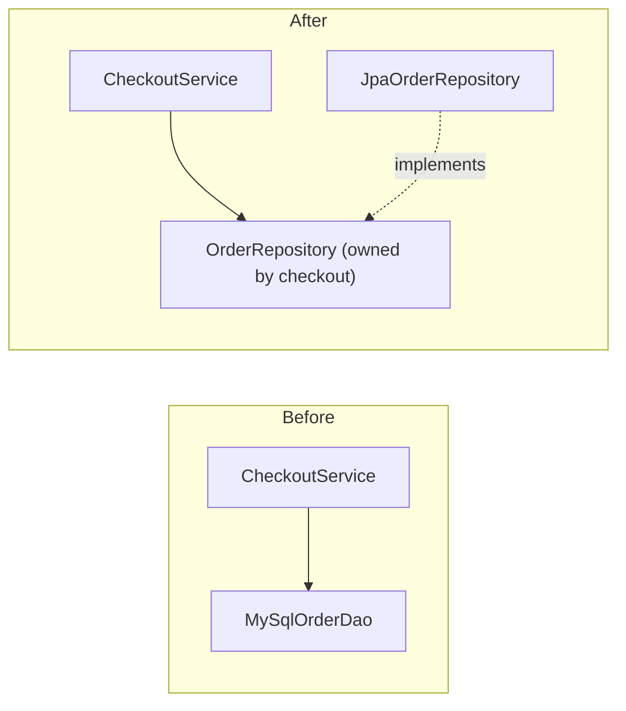
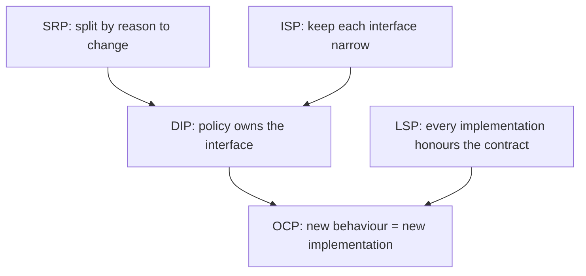

## Introduction

Picture an `OrderService` that started as fifty sensible lines and is now eight hundred. It validates the cart, computes discounts with a long `switch` on the customer type, builds SQL strings to save the order, formats a confirmation email, sends it through an SMTP library it creates itself, and writes metrics. Every change touches it. Adding a new discount means editing the `switch` and retesting email sending. Moving from MySQL to PostgreSQL means editing the same file as the marketing team's discount change, so the two pull requests conflict. Writing a unit test means starting a database and an SMTP server, so nobody writes unit tests. A bug in the email template ships alongside a pricing change and takes down checkout.

None of this is caused by bad intentions. It is what happens when code does not have a structure that keeps different kinds of change apart. **SOLID** is a set of five principles that describe such a structure:

| Letter | Principle | One-line rule | Typical violation |
|---|---|---|---|
| S | Single Responsibility | A module should have one reason to change | A god class mixing pricing, persistence and email |
| O | Open/Closed | Add new behaviour by adding code, not by editing working code | A `switch` on type that grows with every new variant |
| L | Liskov Substitution | A subtype must work anywhere its parent type is expected | `Square extends Rectangle` breaking code that sets width and height |
| I | Interface Segregation | Clients should not depend on methods they do not use | An interface whose implementers throw `UnsupportedOperationException` |
| D | Dependency Inversion | Business policy depends on abstractions, not on technical details | `new MySqlOrderDao()` inside a service |

The principles were gathered by Robert C. Martin in the early 2000s, drawing on earlier work — the Open/Closed Principle comes from Bertrand Meyer (1988) and the Liskov Substitution Principle from Barbara Liskov (1987) — and the acronym was suggested by Michael Feathers. They are not laws, and they are not specific to Java. They are a vocabulary for talking about why a design is hard to change, and a set of moves for making it easier.

You will be asked to name and illustrate them in object-oriented design interviews, and you will use them constantly when reviewing code: "this class has two reasons to change" or "this subclass breaks the parent's contract" are precise, useful comments.

## Before you start

- [[d1-encapsulation]], [[d1-abstraction]] and [[d1-composition-vs-inheritance]] — SOLID builds directly on them.
- **Java interfaces, inheritance and polymorphism** — see [[c1-interfaces]] and [[c1-polymorphism]].
- **Records and lambdas** appear in the examples; [[c1-records]] and [[c1-lambdas]] cover them.

## The intuition

Every principle in SOLID is about one question: *when something changes, how much else has to change with it?*

Think of a well-organised kitchen. The person who changes the dessert menu does not need to touch the grill station. A new oven can be installed without retraining the waiters, because waiters only care that food arrives. A new chef can replace an old one without anyone noticing, as long as they cook the same dishes to the same standard. Nobody hands the dishwasher a forty-page manual that covers the cash register. And the head chef decides *what* is cooked; the suppliers fit into the chef's requirements, not the other way round.

Those five sentences map onto the five principles: separate reasons to change (S), extend without disturbing (O), substitutes must honour the role (L), small role-specific contracts (I), and policy owns the contract while details plug into it (D). Keep the kitchen in mind; each section below makes one of these precise.

## S — Single Responsibility Principle

The **Single Responsibility Principle (SRP)** is usually stated as "a class should have only one reason to change". The common misreading is "a class should do only one thing" or "have one method", which leads to hundreds of tiny classes. Martin later restated it more usefully: a module should be responsible to **one actor** — one group of people whose requests cause it to change.

Here is a class with three actors:

```java
public class Invoice {
    public long totalCents() { /* pricing rules: owned by the finance team */ }
    public String toEmailHtml() { /* layout and wording: owned by marketing */ }
    public void saveTo(Connection db) { /* SQL: owned by the platform team */ }
}
```

Each method is reasonable on its own. The problem is that three groups will change this one file for unrelated reasons. A marketing change to the email layout risks breaking pricing; a schema migration lands in the same file as a tax change; and anything that depends on `Invoice` gets recompiled and retested for all three. Worse, the methods are tempted to share private helpers — say, a rounding function — so a change made for one actor silently changes behaviour for another.

The fix is to split along the lines of change: `Invoice` (or a `PriceCalculator`) owns pricing, an `InvoiceEmailRenderer` owns presentation, and an `InvoiceRepository` owns persistence. Each class now changes for one reason, and a change to one cannot break the others.

How do you find the axes of change in practice? Ask "who would request a change to this code?" and "which parts change together?". Code that always changes together belongs together, even if it is several methods. Code that changes for different reasons, on different schedules, at different people's request, belongs apart. This is the same idea as **cohesion**, covered in [[d1-coupling-cohesion]].

> [!NOTE] SRP is not "one method per class"
> A `PriceCalculator` with methods for subtotal, tax and discounts has one responsibility — pricing — even though it does several things. Splitting it into `SubtotalCalculator`, `TaxCalculator` and `DiscountCalculator` only helps if those really change for different reasons.

## O — Open/Closed Principle

The **Open/Closed Principle (OCP)** says software entities should be *open for extension but closed for modification*: you should be able to add new behaviour without editing code that already works.

The classic violation is a conditional on type that grows with every new variant:

```java
long shippingCents(Order order) {
    switch (order.shippingMethod()) {
        case "standard": return 500;
        case "express":  return order.weightGrams() > 5_000 ? 2_500 : 1_500;
        case "pickup":   return 0;
        default: throw new IllegalArgumentException("unknown method");
    }
}
```

Adding "same-day" delivery means editing this method, retesting every existing branch, and — usually — finding the other three places in the codebase that switch on `shippingMethod` and editing those too. Each edit risks breaking a variant that was working.

The OCP refactoring introduces an abstraction for the thing that varies and makes each variant a class:

```java
interface ShippingRule {
    long costCents(Order order);
}

final class StandardShipping implements ShippingRule {
    public long costCents(Order order) { return 500; }
}

final class ExpressShipping implements ShippingRule {
    public long costCents(Order order) { return order.weightGrams() > 5_000 ? 2_500 : 1_500; }
}
```

Now "same-day" is a new class, `SameDayShipping`, registered where rules are wired together. The checkout code that calls `rule.costCents(order)` does not change, and nothing that already works is edited. This is the **Strategy** pattern ([[d2-strategy]]), and it is the most common way OCP shows up.

Two cautions keep OCP honest. First, **no code is closed against every change**. You choose which kinds of change to make cheap — here, new shipping methods — based on what actually varies. If the business has had one shipping method for five years, the `switch` is fine. Second, the alternative direction is sometimes better. If new *operations* on a fixed set of types are more common than new types, a `sealed` interface with a `switch` expression (Java 21 pattern matching) is easier to extend, and the compiler tells you every place that must handle a new variant. Polymorphism makes adding types cheap; exhaustive `switch` makes adding operations cheap. Choose the one that matches how your code changes.

## L — Liskov Substitution Principle

The **Liskov Substitution Principle (LSP)** says that if code works with a type `T`, it must keep working when given any subtype of `T`. A subtype may *add* behaviour, but it must not break the promises the parent makes. Barbara Liskov introduced the idea in 1987, and she and Jeannette Wing formalised it in 1994.

The standard example is real, runnable and worth seeing fail:

```java title="LiskovDemo.java"
public class LiskovDemo {

    static class Rectangle {
        protected int width;
        protected int height;

        void setWidth(int w) { width = w; }
        void setHeight(int h) { height = h; }
        int area() { return width * height; }
    }

    // Geometrically a square is a rectangle, so inheritance looks natural.
    static class Square extends Rectangle {
        @Override void setWidth(int w) { width = w; height = w; }
        @Override void setHeight(int h) { width = h; height = h; }
    }

    static void stretch(Rectangle r) {
        r.setWidth(5);
        r.setHeight(4);
        System.out.println(r.getClass().getSimpleName() + ": expected 20, got " + r.area());
    }

    public static void main(String[] args) {
        stretch(new Rectangle());
        stretch(new Square());
    }
}
```

```output
Rectangle: expected 20, got 20
Square: expected 20, got 16
```

`stretch` relies on something every `Rectangle` promises: setting the height does not change the width. `Square` cannot keep that promise, so code written correctly against `Rectangle` breaks when handed a `Square`. The compiler is perfectly happy — LSP is about **behaviour**, not types. "A square is a rectangle" is true in geometry but false for *mutable* objects whose width and height can be set independently.

The precise rules a subtype must follow are:

- **Preconditions cannot be strengthened.** If the parent accepts any positive amount, the subtype cannot demand amounts over 100.
- **Postconditions cannot be weakened.** If the parent guarantees a non-null result, the subtype cannot return `null`.
- **Invariants must be preserved.** Whatever the parent promises is always true must stay true.
- **No new kinds of failure.** If callers of the parent do not expect an exception, the subtype should not throw one — the most common form is overriding a method to throw `UnsupportedOperationException`.
- **History constraint.** A subtype must not allow state changes the parent forbids; an "immutable point" cannot have a mutable subclass.

The fixes all remove the false promise. Make the shapes immutable, so there is no `setWidth` to break: `record Rectangle(int width, int height)` and `record Square(int side)`, both implementing a `Shape` interface with `area()`. Or stop relating them by inheritance at all. What you should not do is add `if (r instanceof Square)` to `stretch` — that pushes knowledge of every subtype into every caller, which is exactly the coupling polymorphism was meant to remove.

> [!NOTE] The JDK's documented exception
> `List.of(...)` returns a `List` whose `add` throws `UnsupportedOperationException`. The Collections framework handles this by documenting `add`, `remove` and similar methods as *optional operations* in the `List` contract, so the behaviour is technically within the promise. It is a deliberate trade-off, and it is why code that receives a `List` it did not create should not assume it can modify it.

## I — Interface Segregation Principle

The **Interface Segregation Principle (ISP)** says that no client should be forced to depend on methods it does not use. Large, general-purpose interfaces should be split into smaller ones shaped around what each client needs.

```java
// A fat interface
interface OfficeMachine {
    void print(Document d);
    void scan(Document d);
    void fax(Document d);
}

final class BasicPrinter implements OfficeMachine {
    public void print(Document d) { /* prints */ }
    public void scan(Document d) { throw new UnsupportedOperationException(); }
    public void fax(Document d)  { throw new UnsupportedOperationException(); }
}
```

`BasicPrinter` is forced to implement operations it cannot perform, so it throws — an LSP violation created by the interface. Code that only prints still depends on `scan` and `fax`; if the fax signature changes, the printing code is recompiled and its test doubles must be updated, for no reason.

Split the interface by role:

```java
interface Printer { void print(Document d); }
interface Scanner { void scan(Document d); }
interface Fax     { void fax(Document d); }

final class BasicPrinter implements Printer { public void print(Document d) { /* prints */ } }
final class OfficeHub implements Printer, Scanner, Fax { /* all three */ }
```

Now a `ReportPrinter` depends only on `Printer`, any object that can print satisfies it, and a test double needs one method. Interfaces like these are called **role interfaces**: each describes one role a client needs, rather than everything one class can do.

ISP and SRP are related but look from different sides. SRP is about the *implementation*: does this class change for one reason? ISP is about the *client*: does this caller depend on more than it uses? A class can implement several small interfaces and still have one responsibility, and a single-responsibility class can still publish one interface that is too broad for its clients. Interface design is developed further in [[d1-interfaces]].

## D — Dependency Inversion Principle

The **Dependency Inversion Principle (DIP)** has two parts:

1. High-level modules should not depend on low-level modules. Both should depend on abstractions.
2. Abstractions should not depend on details. Details should depend on abstractions.

"High-level" means the business policy — checkout, pricing, booking rules. "Low-level" means the mechanisms — the database, the email provider, the HTTP client. In a naive design, dependencies point from policy to mechanism:

```java
public class CheckoutService {
    private final MySqlOrderDao dao = new MySqlOrderDao();     // depends on a detail
    private final SmtpMailer mailer = new SmtpMailer("smtp.example.com");
}
```

`CheckoutService` cannot be compiled, tested or reused without MySQL and SMTP. Changing the database means editing the business code. The most important code in the system depends on the most volatile code.

DIP inverts this. The high-level module declares the abstractions it needs, in its own terms, and the low-level modules implement them:



The arrow from the database code now points *towards* the business code, because the database module implements an interface the business module owns. That is the inversion: source-code dependencies point from details to policy, even though at runtime the policy still calls the details. The interface is named and shaped for checkout's needs (`save(Order)`), not for MySQL's (`executeInsert(String sql)`). If the interface lived in the database package and mirrored its methods, the business code would still depend on database thinking — part 2 of the principle.

### DIP, Dependency Injection and Inversion of Control

These three terms are often mixed up:

| Term | What it is | Example |
|---|---|---|
| Dependency Inversion (DIP) | A design principle about the *direction* of source-code dependencies | `CheckoutService` depends on its own `OrderRepository` interface |
| Dependency Injection (DI) | A technique: an object receives its collaborators instead of creating them | The repository is passed into the constructor |
| Inversion of Control (IoC) | A broader idea: a framework calls your code rather than your code calling it | Spring creates beans and wires them together |

DI is the usual way to *achieve* DIP — if `CheckoutService` constructed `new JpaOrderRepository()` itself, depending on an interface would gain little. But DI does not require a framework: passing objects into constructors in `main` is DI. The place where concrete classes are chosen and wired together is called the **composition root**, and it should be at the edge of the application. Spring's container is one way to implement a composition root; see [[c5-ioc-vs-di]] and [[c5-constructor-injection]].

```quiz
Q: A `PaymentGateway` interface is declared inside the `stripe` package and has methods named after Stripe's API. `CheckoutService` depends on it. Which part of DIP is violated?
- [ ] None — CheckoutService depends on an interface
- [x] Abstractions should not depend on details: the interface is shaped and owned by the low-level module
- [ ] High-level modules may never call low-level modules at runtime
- [ ] Interfaces must have more than one implementation
> Depending on an interface is not enough if the interface mirrors one vendor. The abstraction should be owned by the checkout module and expressed in its terms (charge, refund), so a second provider can implement it without Stripe concepts leaking into checkout. At runtime the high-level code still calls the low-level code; DIP is about source dependencies.

Q: A `Bird` base class has `fly()`. `Penguin extends Bird` overrides `fly()` to throw `UnsupportedOperationException`. Which principle does this most directly violate?
- [ ] Single Responsibility
- [ ] Open/Closed
- [x] Liskov Substitution
- [ ] Dependency Inversion
> Code that works with any Bird and calls fly() breaks when given a Penguin. A subtype must not introduce failures its parent does not allow. The usual fix is to split capabilities — for example a separate FlyingBird role — which is also Interface Segregation at work.
```

## Worked example: a checkout built on SOLID

The program below applies all five principles to a small checkout. Read it with the principle labels in mind, then read the walkthrough.

```java title="SolidCheckout.java"
import java.util.ArrayList;
import java.util.List;

public class SolidCheckout {

    record Item(String name, long priceCents, int quantity) {
        long subtotalCents() { return priceCents * quantity; }
    }

    record Order(String customer, List<Item> items, long totalCents) {}

    // O: each discount is a separate class; adding one never edits existing code.
    interface DiscountRule {
        long discountCents(List<Item> items, long subtotalCents);
    }

    static final class BulkDiscount implements DiscountRule {
        public long discountCents(List<Item> items, long subtotalCents) {
            int units = items.stream().mapToInt(Item::quantity).sum();
            return units >= 10 ? subtotalCents / 10 : 0;          // 10% off 10+ units
        }
    }

    static final class CouponDiscount implements DiscountRule {
        private final long amountCents;

        CouponDiscount(long amountCents) { this.amountCents = amountCents; }

        public long discountCents(List<Item> items, long subtotalCents) {
            return Math.min(amountCents, subtotalCents);
        }
    }

    // S: pricing is one responsibility with one owner.
    static final class PriceCalculator {
        private final List<DiscountRule> rules;

        PriceCalculator(List<DiscountRule> rules) { this.rules = List.copyOf(rules); }

        long totalCents(List<Item> items) {
            long subtotal = items.stream().mapToLong(Item::subtotalCents).sum();
            long discount = 0;
            for (DiscountRule rule : rules) discount += rule.discountCents(items, subtotal);
            return Math.max(0, subtotal - discount);              // never charge below zero
        }
    }

    // I + D: checkout owns two small interfaces; infrastructure implements them.
    interface OrderRepository { void save(Order order); }
    interface CustomerNotifier { void orderPlaced(Order order); }

    static final class CheckoutService {
        private final PriceCalculator pricing;
        private final OrderRepository orders;
        private final CustomerNotifier notifier;

        CheckoutService(PriceCalculator pricing, OrderRepository orders, CustomerNotifier notifier) {
            this.pricing = pricing;
            this.orders = orders;
            this.notifier = notifier;
        }

        Order checkout(String customer, List<Item> items) {
            if (items.isEmpty()) throw new IllegalArgumentException("cart is empty");
            Order order = new Order(customer, List.copyOf(items), pricing.totalCents(items));
            orders.save(order);
            notifier.orderPlaced(order);
            return order;
        }
    }

    // Low-level details. L: any implementation can stand in for the interface.
    static final class InMemoryOrderRepository implements OrderRepository {
        final List<Order> saved = new ArrayList<>();
        public void save(Order order) { saved.add(order); }
    }

    static final class ConsoleNotifier implements CustomerNotifier {
        public void orderPlaced(Order order) {
            System.out.println("notify " + order.customer() + ": total " + order.totalCents() + " cents");
        }
    }

    // The composition root: the only place that names concrete classes.
    public static void main(String[] args) {
        InMemoryOrderRepository repo = new InMemoryOrderRepository();
        PriceCalculator pricing = new PriceCalculator(
                List.of(new BulkDiscount(), new CouponDiscount(500)));
        CheckoutService checkout = new CheckoutService(pricing, repo, new ConsoleNotifier());

        checkout.checkout("ana", List.of(new Item("pen", 150, 10), new Item("pad", 400, 2)));
        checkout.checkout("bo", List.of(new Item("mug", 899, 1)));
        System.out.println("orders saved: " + repo.saved.size());
    }
}
```

```output
notify ana: total 1570 cents
notify bo: total 399 cents
orders saved: 2
```

Check the arithmetic for Ana's order first, because examples should be verifiable. Pens cost 150 × 10 = 1,500 cents and pads 400 × 2 = 800, so the subtotal is 2,300. She bought 12 units, so the bulk rule gives 10%, which is 230. The coupon gives 500. The total is 2,300 − 730 = 1,570. Bo's single mug is 899 with no bulk discount and a 500 coupon, so 399.

Now map the code to the principles:

- **S.** `PriceCalculator` changes when pricing rules change. `CheckoutService` changes when the checkout *process* changes (say, adding a fraud check). The repository changes when storage changes. Each has one reason to change.
- **O.** A new "loyalty" discount is a new `DiscountRule` class added to the list in `main`. `PriceCalculator` and `CheckoutService` are untouched.
- **L.** `CheckoutService` works identically with `InMemoryOrderRepository` here and with a JPA repository in production, because both honour the `save` contract. If a repository silently dropped orders, it would break that contract and the checkout with it.
- **I.** The notifier interface has exactly the one method checkout needs. Checkout does not depend on an `EmailService` with twenty methods for newsletters and password resets.
- **D.** `CheckoutService` names no concrete infrastructure class. Only `main`, the composition root, chooses implementations.

Notice what we did *not* do. There is no `PriceCalculatorFactory`, no interface for `PriceCalculator` (it has one implementation and no external dependency), and no abstraction over `List`. SOLID was applied where change is expected — discounts, storage, notification — and nowhere else.

## How the principles fit together

The five principles are not independent rules; they reinforce each other. SRP decides where the seams go. DIP decides which direction dependencies cross those seams. ISP keeps each seam narrow. OCP is what you get when variation is behind a seam: new behaviour is a new implementation. LSP is the condition that makes plugging in implementations safe.



## In real systems

**Spring applications** are built around DIP and DI: services receive repositories and clients through constructors, interfaces such as Spring Data repositories are declared in the application's own terms, and configuration chooses implementations per environment. Constructor injection also makes plain unit tests possible without starting the container — see [[c5-plain-unit-constructor]].

**Plugin points** are OCP in practice. JDBC is a good example of DIP as well: `java.sql.Connection` and friends are interfaces owned by the JDK, your code depends on them, and each database vendor's driver implements them. Switching from PostgreSQL to MySQL changes the driver and the URL, not your code that uses `Connection`. Servlet filters, Spring `HandlerInterceptor`s and Kafka serializers follow the same shape.

**Payment, shipping and notification integrations** are where SOLID earns its keep in business code: several providers, frequent additions, external systems that must be faked in tests.

**Team boundaries.** When modules follow SRP and depend on narrow abstractions, teams can work in parallel with fewer merge conflicts and fewer surprise breakages. This organisational benefit is often the strongest argument for SOLID in a large company.

## Trade-offs and alternatives

SOLID's benefits are real: localised changes, easier unit testing through injected test doubles, new features as new classes, and clearer ownership. Its costs are also real. Every abstraction is an extra file and an extra hop when reading code. Applied everywhere, SOLID produces what developers call "interface explosion": an interface for every class, factories for objects that never vary, and call chains that are hard to follow.

The principle that balances SOLID is **YAGNI** — "you aren't gonna need it". Apply a SOLID refactoring when there is *change pressure*: a second implementation, a test that needs a fake, a `switch` that has grown three times, a class that two teams keep editing. In a short script, a prototype or a stable algorithm with no variation, the simpler concrete code is the better design.

Other paradigms reach the same goals by different means. In functional code, passing a function as a parameter gives you OCP and DIP without interfaces; modules with small exported surfaces give you ISP. The underlying ideas — separate reasons to change, depend on stable contracts, keep contracts small — transfer even when the vocabulary does not.

## Common mistakes

**Reading SRP as "one method per class".** It is one *reason to change*. Over-splitting scatters a single concept across many files and makes the code harder to follow.

**Abstracting everything for OCP.** You cannot be closed against every change. Abstract the axis that actually varies, when you have evidence that it varies.

> [!MISTAKE] Fixing an LSP violation with instanceof
> Adding `if (shape instanceof Square)` to callers hides the broken subtype instead of fixing it, and every new subtype will need another check. Fix the hierarchy: make the types immutable, split the capability into a separate interface, or stop using inheritance for that relationship.

**Equating DIP with "use Spring".** DIP is about which way source dependencies point. You can satisfy it with plain constructors in `main`, and you can violate it inside a Spring application by injecting concrete infrastructure classes everywhere.

**Interfaces owned by the wrong side.** An interface that lives in the infrastructure package and mirrors one implementation still couples the business code to that technology.

**Service locators.** Calling a global registry (`ServiceLocator.get(OrderRepository.class)`, or Spring's `getBean` from business code) hides dependencies inside methods. Constructor parameters make them visible and testable. See [[c5-ioc-vs-service-locator]].

## Interview perspective

Interviewers expect you to name all five principles, give a concrete example of each, and — the part that separates strong candidates — say when you would *not* apply them.

> [!INTERVIEW] Linking principles to change
> "I think of SOLID as protection against specific kinds of change. SRP stops one team's change breaking another's code. OCP lets me add a payment provider as a new class. LSP makes sure that provider can be dropped in safely. ISP keeps clients from depending on methods they don't use. DIP keeps business rules independent of the database and vendors, which is also what makes them unit-testable. I apply them where I see that change pressure, not everywhere."

Questions to prepare:

- **What is the Open/Closed Principle? Give an example.** Payment or shipping strategies behind an interface; adding one does not edit checkout.
- **Show an LSP violation and fix it.** Rectangle and square, or a subclass that throws on an inherited method. Fix with immutability or separate types.
- **ISP versus SRP?** ISP is about what clients depend on; SRP is about why an implementation changes.
- **DIP versus Dependency Injection?** DIP is the principle about dependency direction; DI is a technique for supplying dependencies, commonly used to achieve DIP.
- **Refactor a god class.** Identify the actors, extract a class per reason to change, define interfaces for infrastructure owned by the business side, inject them, and leave the original class as a thin orchestrator.
- **When would you deliberately not follow SOLID?** Prototypes, scripts, stable code with one implementation, and hot paths where profiling proves the indirection matters (rare).

## Practice

1. **Find the actors.** List every reason the 800-line `OrderService` from the introduction might change, group them by who requests them, and propose the classes you would extract.
2. **Replace a switch.** Rewrite the `shippingCents` method using a `ShippingRule` interface. Then write the same logic as a `sealed` interface with records and a `switch` expression, and explain which version is easier to extend with a new shipping method and which with a new operation such as `estimatedDays`.
3. **Make it substitutable.** Redesign `Rectangle` and `Square` so that no caller can be surprised. Show that a list of shapes can be summed by area.
4. **Segregate.** Take an interface with eight methods from a codebase you know, list which callers use which methods, and propose role interfaces.
5. **Invert a dependency.** Change `CheckoutService` in the worked example to also record an audit entry. Where does the new interface live, who owns its method names, and what changes in `main`?

## Quick revision {#quick-revision}

- **S** — one reason to change = responsible to one actor. Split by axis of change, not by method count.
- **O** — add behaviour by adding classes (Strategy), not editing working code. Choose which variation to make cheap; sealed types + `switch` suit new operations better.
- **L** — subtypes must honour the parent's contract: no stronger preconditions, no weaker postconditions, preserved invariants, no new failures. Rectangle/square; methods that throw `UnsupportedOperationException`.
- **I** — clients depend only on methods they use; role interfaces over fat ones.
- **D** — business policy and details both depend on abstractions owned by the policy side; wire concretions at the composition root.
- DIP is a principle; DI is a technique; IoC is a framework calling your code.
- Principles reinforce each other: SRP finds seams, DIP orients them, ISP narrows them, OCP extends through them, LSP makes them safe.
- Balance with YAGNI: apply where change pressure exists.

## Key takeaways {#key-takeaways}

- Each SOLID principle protects against a particular kind of change spreading through a codebase.
- SRP and ISP decide where boundaries go and how narrow they are; DIP decides which way dependencies cross them.
- OCP is achieved by putting variation behind an abstraction, and LSP is what makes implementations safely interchangeable.
- Liskov violations are behavioural, so the compiler will not catch them; check every override against the parent's promises.
- Dependency Inversion is about ownership and direction of dependencies, not about using a DI framework.
- Apply the principles where there is evidence of change; elsewhere, simple concrete code is the better design.
