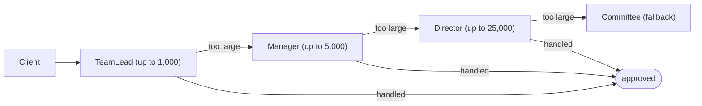

## Introduction

A company's expense system has an approval rule: a team lead can approve expenses up to 1,000 euros, a manager up to 5,000, a director up to 25,000, and anything larger goes to the finance committee. The obvious implementation is one method with an `if`/`else if` ladder that checks the amount and routes the claim. It works — until the rules change. A new "department head" level appears between manager and director; one region has different limits; travel expenses skip the team lead. The ladder grows, every change touches the same method, and the code that submits expenses has to know the whole approval hierarchy.

The **Chain of Responsibility** pattern replaces the ladder with a line of objects. Each approver is a **handler** that looks at the request and either deals with it or passes it to the next handler in line. The code that submits an expense hands it to the *first* handler and does not know, or care, how many handlers follow or which one will finally approve it. The *Design Patterns* book (Gamma, Helm, Johnson and Vlissides, 1994, the "Gang of Four" or GoF) describes the pattern as avoiding coupling the sender of a request to its receiver by giving more than one object a chance to handle the request, chaining the receiving objects and passing the request along the chain until an object handles it.

The pattern has a second, even more common form in web software. Every HTTP request to a Java web application passes through a chain of **servlet filters**; with Spring Security, through a dozen or so security filters — authentication, CSRF protection, authorisation — before it reaches your controller. Express and Koa middleware in Node.js work the same way. In this form, each handler usually does some work and passes the request on, and any handler can stop it. Understanding the chain is what lets you reason about questions like "why did this request get a 403 before my controller ran?".

## Before you start

- **Interfaces and polymorphism** — every handler implements the same interface, so each can call the next without knowing its class. See [[c1-interfaces]] and [[c1-polymorphism]].
- **Open/Closed and Single Responsibility** from [[d1-solid]] — each handler does one job, and new handlers are added without editing existing ones.
- **Decorator** — the pipeline form looks similar, and the comparison is a common interview question. See [[d2-decorator]].
- **Servlet filters** — helpful for the real-systems section. See [[c6-filters]].

## The intuition

Think of calling a customer-support line. The first-level agent answers and handles password resets and billing questions. If your problem is beyond them, they pass you to a second-level technician, who can fix configuration problems; anything they cannot solve goes to an engineer. You dialled one number. You did not choose who would help you, and the support company can add a new level or change who handles what without changing the phone number.

That is the classic form: each handler decides "can I deal with this?" and either handles it or passes it on, and **one** handler ends up responsible.

Now think of airport security. Your passport is checked, then your boarding pass, then your bag is scanned, then you walk through the metal detector. Every passenger goes through every checkpoint, and each checkpoint does its own work — but any checkpoint can stop you, and the later ones never see you. That is the pipeline form: **many** handlers each do a part, and any one can end the journey.

Both are Chain of Responsibility. What they share is the essential idea: the sender talks to the start of the line, each handler knows only the next one, and the request moves along until something stops it.

## The structure



There are three roles:

- The **handler interface** declares the method that receives a request, such as `approve(expense)`. In many implementations an abstract base class also holds the reference to the next handler and provides a helper to forward to it.
- **Concrete handlers** implement the method. Each decides whether to handle the request, pass it on, or both.
- The **client** builds the chain (or receives it already built) and sends requests to the first handler.

The structure is a singly linked list of objects. That is the source of both the flexibility — handlers can be added, removed and reordered by relinking — and the main risk: if no handler deals with a request, it falls off the end of the list. A well-designed chain always ends with a **terminal handler** that deals with whatever reaches it, even if "dealing with it" means rejecting it explicitly.

## The classic form: expense approval

```java title="ExpenseChain.java"
public class ExpenseChain {

    record Expense(String employee, long euros) {}

    /** Base handler: holds the link and the forwarding logic. */
    static abstract class Approver {
        private Approver next;

        /** Links the next handler and returns it, so chains read left to right. */
        Approver linkWith(Approver next) {
            this.next = next;
            return next;
        }

        final String approve(Expense e) {
            if (canApprove(e)) {
                return name() + " approved " + e.euros() + " for " + e.employee();
            }
            if (next == null) {
                return "no one could approve " + e.euros();   // fell off the end
            }
            return next.approve(e);
        }

        protected abstract boolean canApprove(Expense e);
        protected abstract String name();
    }

    static final class Limit extends Approver {
        private final String role;
        private final long maxEuros;

        Limit(String role, long maxEuros) {
            this.role = role;
            this.maxEuros = maxEuros;
        }

        protected boolean canApprove(Expense e) { return e.euros() <= maxEuros; }
        protected String name() { return role; }
    }

    /** Terminal handler: accepts everything, so no request is ever lost. */
    static final class Committee extends Approver {
        protected boolean canApprove(Expense e) { return true; }
        protected String name() { return "finance committee (review queued)"; }
    }

    public static void main(String[] args) {
        Approver chain = new Limit("team lead", 1_000);
        chain.linkWith(new Limit("manager", 5_000))
             .linkWith(new Limit("director", 25_000))
             .linkWith(new Committee());

        for (long amount : new long[] {300, 4_200, 18_000, 60_000}) {
            System.out.println(chain.approve(new Expense("dana", amount)));
        }

        Approver incomplete = new Limit("team lead", 1_000);
        incomplete.linkWith(new Limit("manager", 5_000));          // no terminal handler
        System.out.println(incomplete.approve(new Expense("eli", 9_000)));
    }
}
```

```output
team lead approved 300 for dana
manager approved 4200 for dana
director approved 18000 for dana
finance committee (review queued) approved 60000 for dana
no one could approve 9000
```

Follow the 18,000-euro claim. The client calls `approve` on the first handler, the team lead. `canApprove` is false (18,000 > 1,000), so the base class forwards to `next` — the manager — whose limit is also too low, so it forwards again. The director's limit is 25,000, so the director handles it and returns a result. The committee is never consulted. The return value travels back through the earlier handlers to the client, which never learns how many hops it took.

The `linkWith` method returns the handler it was given, which lets the chain be built in one readable expression: team lead, then manager, then director, then committee. Adding a "department head" level at 10,000 is a single `.linkWith(new Limit("department head", 10_000))` in the right position. No existing handler changes, and neither does the code that submits expenses.

The last two lines show why the terminal handler matters. The incomplete chain has no committee, so a 9,000-euro claim passes the team lead and manager and falls off the end. Here the base class at least returns a clear message; in many real implementations, a request that falls off the end is silently ignored — no error, no log, nothing.

Notice also that `approve` is `final` and the forwarding logic lives in the base class. Concrete handlers implement only the decision, `canApprove`. That is the Template Method pattern helping Chain of Responsibility: the "handle or forward" rule is written once and no handler can forget to forward. See [[d2-template-method]].

```quiz
Q: In the expense chain, a new rule says claims under 50 euros are approved automatically without involving anyone. Where should the new handler go, and why?
- [ ] At the end, after the committee, so existing handlers are not disturbed
- [x] At the front, before the team lead, because the first handler that can approve a request handles it
- [ ] Anywhere — order does not affect the outcome in Chain of Responsibility
- [ ] It cannot be added without changing the `Approver` base class
> In the classic form, the first capable handler wins. The team lead can approve anything up to 1,000, so an auto-approver placed after it would never see a 30-euro claim. Placed after the committee, it would never be reached at all, because the committee accepts everything. Order is part of the design.
```

## The pipeline form: filters and middleware

In the classic form, one handler takes responsibility and the request stops there. In the **pipeline form**, every handler does its own piece of work and then, usually, passes the request on. Any handler can **short-circuit** the chain by not passing it on — for example, rejecting an unauthenticated request so that later handlers never see it.

The usual implementation differs in one important detail. Instead of each handler holding a `next` field, a **chain object** holds the list of handlers and a position, and each handler is given the chain and calls `chain.next(...)` when it wants processing to continue. This is how the Java Servlet API's `FilterChain` works, and Express's `next()` function is the same idea.

```java title="FilterPipeline.java"
import java.util.HashMap;
import java.util.List;
import java.util.Map;

public class FilterPipeline {

    static final class Request {
        final String path;
        final Map<String, String> headers;
        final Map<String, String> attributes = new HashMap<>();
        Request(String path, Map<String, String> headers) {
            this.path = path;
            this.headers = headers;
        }
    }

    static final class Response {
        int status = 200;
        String body = "";
    }

    interface Filter {
        void doFilter(Request req, Response res, Chain chain);
    }

    interface Handler {
        void handle(Request req, Response res);
    }

    /** Holds the filters and the position; each call to next() moves one step on. */
    static final class Chain {
        private final List<Filter> filters;
        private final Handler endpoint;
        private int position = 0;

        Chain(List<Filter> filters, Handler endpoint) {
            this.filters = filters;
            this.endpoint = endpoint;
        }

        void next(Request req, Response res) {
            if (position < filters.size()) {
                filters.get(position++).doFilter(req, res, this);
            } else {
                endpoint.handle(req, res);              // end of the chain
            }
        }
    }

    static final class Logging implements Filter {
        public void doFilter(Request req, Response res, Chain chain) {
            System.out.println("  -> " + req.path);
            chain.next(req, res);                       // work before...
            System.out.println("  <- " + res.status);   // ...and after the rest of the chain
        }
    }

    static final class Authentication implements Filter {
        public void doFilter(Request req, Response res, Chain chain) {
            String token = req.headers.get("Authorization");
            if (token == null || !token.startsWith("Bearer ")) {
                res.status = 401;
                res.body = "missing or invalid token";
                return;                                 // short-circuit: next() not called
            }
            req.attributes.put("user", token.substring("Bearer ".length()));
            chain.next(req, res);
        }
    }

    static final class Audit implements Filter {
        public void doFilter(Request req, Response res, Chain chain) {
            System.out.println("  audit: " + req.attributes.get("user") + " " + req.path);
            chain.next(req, res);
        }
    }

    static void serve(Request req) {
        Handler orders = (rq, rs) -> rs.body = "orders for " + rq.attributes.get("user");
        Response res = new Response();
        new Chain(List.of(new Logging(), new Authentication(), new Audit()), orders).next(req, res);
        System.out.println("  response: " + res.status + " " + res.body);
    }

    public static void main(String[] args) {
        System.out.println("with token:");
        serve(new Request("/orders", Map.of("Authorization", "Bearer alice")));
        System.out.println("without token:");
        serve(new Request("/orders", Map.of()));
    }
}
```

```output
with token:
  -> /orders
  audit: alice /orders
  <- 200
  response: 200 orders for alice
without token:
  -> /orders
  <- 401
  response: 401 missing or invalid token
```

Trace the first request. `serve` creates a chain of three filters and an endpoint, and calls `next`. Position 0 is `Logging`, which prints the path and calls `chain.next`. Position 1 is `Authentication`, which finds a valid token, stores the user name in the request's attributes for later handlers, and calls `chain.next`. Position 2 is `Audit`, which logs the user and calls `chain.next`. The position is now past the last filter, so the chain calls the endpoint, which builds the response body. Then the calls *return*, in reverse: `Audit` returns, `Authentication` returns, and control comes back to `Logging` after its `chain.next` call, so it prints the final status.

The second request has no token. `Authentication` sets status 401 and returns *without* calling `chain.next`. `Audit` and the endpoint never run — the short-circuit. But `Logging` still prints `<- 401`, because it was earlier in the chain: its `chain.next` call has returned, and it continues with the code after it.

This "in and back out" shape is the most important thing to understand about filter chains:

```mermaid title="Each filter can act before and after the rest of the chain"
sequenceDiagram
    participant L as Logging
    participant A as Authentication
    participant U as Audit
    participant E as Endpoint
    L->>A: chain.next()
    A->>U: chain.next()
    U->>E: chain.next()
    E-->>U: return
    U-->>A: return
    A-->>L: return
    Note over L: prints the final status
```

Code before `chain.next` runs on the way in, in filter order. Code after it runs on the way out, in reverse order. That is why a timing or logging filter is placed early: it wraps everything after it. It is also why the order of filters is a correctness question, not a style choice — authentication must come before anything that reads the user or returns data.

```quiz
Q: In `FilterPipeline`, a request without a token is rejected by `Authentication`. Why does `Logging` still print `<- 401`?
- [ ] Because `Authentication` calls `Logging` again after rejecting the request
- [ ] Because the endpoint runs anyway and returns 401
- [x] Because `Logging` ran earlier in the chain, and its code after `chain.next(...)` executes when that call returns
- [ ] Because short-circuiting restarts the chain from the beginning
> Each filter's call to `chain.next` returns once everything after it has finished — or stopped. `Authentication` returned without calling `next`, so `Audit` and the endpoint never ran, but control still came back to `Logging`, which continued with the line after its own `chain.next` call.
```

## How servlet filters and Spring Security use it

In a Java web application, the servlet container (Tomcat, Jetty or Undertow inside Spring Boot) builds a `FilterChain` for each request from the filters registered for that URL, followed by the target servlet — in Spring MVC, the `DispatcherServlet`. Each `jakarta.servlet.Filter` implements `doFilter(request, response, chain)` and calls `chain.doFilter(request, response)` to continue, exactly as in the example. Tomcat's `ApplicationFilterChain` holds an array of filters and a position counter, the same design as `Chain` above. Spring Boot orders filters by their `@Order` value or `FilterRegistrationBean` order. See [[c6-filters]], [[c6-filter-registration]] and [[c6-once-per-request-filter]].

Spring Security adds a chain inside the chain. It registers one servlet filter, which delegates to a `FilterChainProxy`. The proxy picks the first `SecurityFilterChain` whose request matcher matches the URL — itself a small first-match-wins chain — and runs that chain's security filters in a fixed order — among them security-context setup, CORS, CSRF protection, logout, authentication filters such as the bearer-token filter, anonymous authentication, exception translation, and finally the authorisation filter. Any of them can short-circuit: an invalid token produces a 401 before your controller is ever invoked. When a request is rejected unexpectedly, setting the `org.springframework.security` logger to `TRACE` prints the filters each request passed through, which is usually the fastest way to see which one stopped it. See [[c9-security-filter-chain]] and [[c9-multiple-filter-chains]].

Filters can also replace the request or response objects they pass on — for example, wrapping the request so its body can be read twice. Because each filter passes objects to the next explicitly, a filter can hand later filters something different from what it received. See [[c6-request-wrappers]].

## Building and configuring chains

There are two common ways to represent a chain, each with trade-offs:

| | Linked handlers (`next` field) | Chain object over a list |
|---|---|---|
| Example | `linkWith` in the expense chain | `Chain` in the filter pipeline, servlet `FilterChain` |
| Handler knows | The next handler | Only the chain it was passed |
| Reordering | Relink objects | Reorder the list |
| Same handler in many chains | Hard — it has one `next` field | Easy — handlers are stateless and shared |
| Work after the rest of the chain | Possible | Natural, and the usual design |

For anything configured at startup — middleware, filters, validation pipelines — the list-based form is usually better. Handlers stay stateless and can be shared across chains and threads, and the order is visible in one place: the list. The linked form suits small, domain-specific chains such as approval hierarchies, especially when the chain is built from data (for example, approval limits loaded from a database).

Whichever form you use, keep three rules:

- **Build the chain in one place.** Order is behaviour. Assembling it in one configuration class, with a comment explaining why each handler sits where it does, prevents "someone registered a filter with the wrong priority" bugs.
- **Make the end explicit.** End a classic chain with a terminal handler; end a pipeline with the real endpoint, or a handler that returns 404 or an error.
- **Make chains immutable after construction.** Relinking handlers while requests flow through them creates race conditions. Build a new chain instead.

## In real systems

**Web request processing.** Servlet filters, Spring Security, Spring MVC `HandlerInterceptor`s, Express and Koa middleware, ASP.NET Core middleware, and API gateways' plugin chains (authentication, rate limiting, transformation) all use the pipeline form. See [[c6-interceptors]] and [[c6-filter-vs-interceptor]].

**Network frameworks.** Netty's `ChannelPipeline` passes inbound bytes through a list of handlers — decoding, decompressing, parsing, business logic — and outbound responses back through encoders. Each handler forwards explicitly with `ctx.fireChannelRead(...)`.

**Browser events.** When you click a button inside a `div` inside a `form`, the click event *bubbles* from the button up through its ancestors. Each element's listeners get a chance to handle it, and any listener can call `stopPropagation()` to end the journey. This is Chain of Responsibility along the Document Object Model (DOM) tree. See [[b4-event-bubbling]] and [[b4-stop-propagation]].

**Exception handling.** An exception thrown deep in a call stack travels up through the callers until a `catch` block that matches it handles it — a first-match chain built by the language. Spring's `HandlerExceptionResolver`s are tried in order until one produces an error response.

**Approval and escalation workflows.** Expense approval, loan underwriting tiers, support ticket escalation and fraud-check cascades (cheap rules first, expensive machine-learning models only for what remains) use the classic form.

**Logging.** Logging frameworks pass each log event through filters that can accept, deny or stay neutral, and a logger forwards events to its parent's appenders unless additivity is turned off. See [[d3-logging-framework]].

## Chain of Responsibility compared with similar patterns

| Pattern | Who handles the request | Can processing stop early? | Typical use |
|---|---|---|---|
| Chain of Responsibility (classic) | The first handler that can | Yes — it stops at the handler | Approval tiers, escalation |
| Chain of Responsibility (pipeline) | Each handler does part, in order | Yes — any handler can short-circuit | Filters, middleware |
| [[d2-decorator]] | Every layer, around the core object | Not normally — each layer wraps the call | Caching, logging, retries |
| [[d2-observer]] | Every subscriber, independently | No — all are notified | Event notification |
| [[d2-command]] | The command's receiver | — | Queuing, undo; often the request passed along a chain |

**Chain versus Decorator** is the comparison interviewers like most, because the pipeline form and a stack of decorators look almost identical in code: both wrap something and do work before and after calling the next layer. The difference is intent. A decorator *enhances* an object and keeps its interface — every call goes through every layer and reaches the core. A chain *routes* a request — handlers expect that the request may stop with them, and stopping is a normal outcome rather than an error. Servlet filters sit on the boundary, which is why both names are used for them.

**Chain versus Observer**: in a chain, handlers are ordered and each decides whether the next one runs. In Observer, all subscribers receive the event, in no guaranteed order, and none can prevent the others from receiving it.

## Trade-offs and alternatives

Chain of Responsibility decouples senders from handlers, lets you add, remove and reorder handlers without touching the sender or the other handlers, gives each handler a single responsibility, and allows chains to be assembled from configuration at runtime.

The costs: there is no compile-time guarantee that a request is handled — a missing terminal handler or a broken link drops requests silently; behaviour depends on order, which is easy to get wrong and hard to see from any single handler; debugging requires following a request through many objects; and long chains add per-request overhead, which matters in hot paths.

Alternatives:

- **A lookup table** when exactly one handler is always responsible and can be chosen directly from a key — a `Map<RequestType, Handler>` is clearer and faster than walking a chain. If the handler is chosen by the client, that is closer to Strategy. See [[d2-strategy]].
- **An explicit loop over a list of rules** (`for (Rule r : rules) if (r.matches(x)) return r.apply(x);`) gives the classic form's behaviour with less ceremony when handlers do not need to wrap one another.
- **Events** when many parties should react and none should be able to stop the others. See [[d2-observer]].
- **A workflow engine** when the chain represents a long-running business process with waiting, retries and human steps.

## Common mistakes

> [!MISTAKE] Forgetting to call the next handler
> A filter that does its work and returns without calling `chain.doFilter(...)` stops every request at that point. In a servlet container the client receives an empty `200 OK` response, because nothing wrote a body — a confusing symptom that is easy to misdiagnose. Every path through a pipeline handler must either call the next handler or deliberately produce a response.

**Calling the next handler twice.** A filter that calls `chain.next` in a `try` block and again in a `catch` block runs the rest of the chain, including the endpoint, twice — duplicating side effects such as payments or writes. Call it exactly once.

**Wrong order.** Business logic before authentication, logging after the filter that might short-circuit (so rejected requests are never logged), or a caching filter before authorisation. Decide the order deliberately and test the whole chain with an integration test.

**No terminal handler.** Requests that no handler accepts fall off the end silently. End every chain with a handler that deals with — or explicitly rejects — anything that reaches it.

**Swallowing exceptions.** A handler that catches an exception from later in the chain and does not rethrow it or produce an error response hides failures from everything earlier in the chain, including logging and error-handling filters.

**Shared mutable state in handlers.** Handlers in a filter chain are typically singletons used by many threads at once. Storing per-request data in a handler's fields causes data from one request to leak into another. Keep per-request data on the request object.

**Cycles.** Relinking handlers carelessly can make a handler's `next` point back to an earlier handler, sending requests round in an infinite loop.

## Interview perspective

Common prompts are "explain Chain of Responsibility with an example", "how does a servlet filter chain or Spring Security work?", and "Chain versus Decorator?". In low-level design problems, the pattern fits [[d3-atm]] (a cash dispenser that pays out with 100s, then 50s, then 20s, each handler taking what it can and passing the remainder on), [[d3-logging-framework]] (log levels and handlers), [[d3-vending-machine]] (coin validation) and request-validation pipelines in [[d3-rate-limiter-lld]].

> [!INTERVIEW] Explaining both forms
> "Chain of Responsibility links handlers so a request goes to the first one, and each either handles it or passes it on; the sender doesn't know who will deal with it. In the classic form the first capable handler wins — like approval limits. In the pipeline form, used by servlet filters and Spring Security, every filter does its part and calls `chain.doFilter`, and any filter can short-circuit, like authentication returning 401. Order is part of the design, and I always add a terminal handler so nothing falls off the end. It differs from Decorator in intent: a decorator always forwards to enhance an object; a chain may legitimately stop."

Questions to prepare:

- **What happens if no handler processes the request?** Without a terminal handler it is dropped, often silently; add a fallback that handles or explicitly rejects it.
- **How does a servlet filter run code after the controller?** Code after `chain.doFilter(...)` runs as the call returns, in reverse filter order.
- **Chain versus Decorator?** Same wrapping shape; a decorator enhances and always forwards, a chain routes and may stop.
- **Why might a request get 401 before the controller runs?** An authentication filter earlier in the chain short-circuited it.
- **Linked handlers or a list?** A list for configured pipelines (shared, stateless handlers, visible order); links for small domain chains.
- **Implement an ATM dispenser.** Handlers for each note denomination take as many notes as possible and pass the remainder on; a final check rejects amounts that cannot be made.

## Practice

1. **Department head.** Add a 10,000-euro "department head" approver to `ExpenseChain` and verify that the 18,000-euro claim still reaches the director.
2. **Rate limiting.** Add a `RateLimit` filter to `FilterPipeline` that allows two requests per user and returns 429 for the third. Where must it sit relative to `Authentication`, and why?
3. **Timing filter.** Add a filter that measures how long the rest of the chain takes. Place it first and then last, and explain what each position measures.
4. **ATM dispenser.** Implement a chain of note dispensers (100, 50, 20, 10) that dispenses an amount using as few notes as possible and rejects amounts that are not multiples of 10.
5. **Find the bug.** A colleague's filter calls `chain.next` inside a `try` and again inside the `catch` "to make sure the request continues". Describe what happens when the endpoint throws.

## Quick revision {#quick-revision}

- Chain of Responsibility: handlers in a line; each handles the request or passes it on; the sender knows only the first handler.
- Classic form: the first capable handler takes responsibility (approval tiers, escalation, exception `catch` matching).
- Pipeline form: every handler does part of the work and calls next; any handler can short-circuit (servlet filters, Spring Security, middleware, Netty).
- Code before `chain.next` runs on the way in; code after runs on the way out, in reverse order.
- Representations: linked `next` fields vs a chain object over a list with a position (servlet `FilterChain`, Express `next()`).
- Order is behaviour: authentication before business logic and caching; logging early to see rejected requests.
- Always end with a terminal handler; build chains in one place; keep handlers stateless and chains immutable.
- Bugs: forgetting next (empty 200), calling next twice, wrong order, no terminal handler, swallowed exceptions, per-request state in shared handlers, cycles.
- vs Decorator (enhances and always forwards), Observer (all subscribers notified, none can stop others), lookup table (one known handler).

## Key takeaways {#key-takeaways}

- Chain of Responsibility decouples who sends a request from who handles it, so handlers can be added and reordered without touching senders.
- There are two forms — first capable handler wins, and pipelines where each handler contributes and any can stop — and real systems use both.
- In pipelines, each handler wraps the rest of the chain, which explains both short-circuiting and "after" logic in filters.
- The order of handlers and the presence of a terminal handler are design decisions that determine correctness and security.
- Servlet filters, Spring Security, middleware and DOM event bubbling are all this pattern, so understanding it explains a great deal of everyday request handling.
