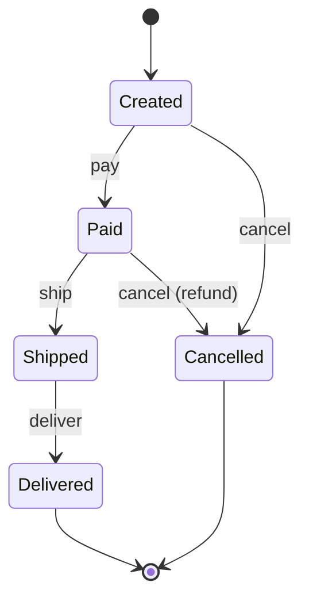

## Introduction

An online order moves through a lifecycle: it is **created**, then **paid**, then **shipped**, then **delivered**. It can be **cancelled** before it ships, and cancelling a paid order must refund the customer. Shipping an unpaid order must be impossible. Delivering an order that was never shipped must be impossible.

The usual first implementation stores a `status` field and checks it in every method:

```java
public void ship() {
    switch (status) {
        case PAID -> { createLabel(); status = SHIPPED; }
        case CREATED -> throw new IllegalStateException("not paid");
        case SHIPPED, DELIVERED -> throw new IllegalStateException("already shipped");
        case CANCELLED -> throw new IllegalStateException("cancelled");
    }
}
```

Now write `pay`, `cancel`, `deliver` and `refund` the same way. Every method has a switch over every status, so the rules for any one status — "what can a paid order do?" — are scattered across five methods. Adding a status such as `ON_HOLD` means editing every switch, and missing one creates a hole: an on-hold order that can still be shipped.

The **State** pattern reorganises this code around the statuses instead of the actions. Each status becomes a class that implements every action *for that status*. The order holds a reference to its current state object and forwards each call to it; when a transition happens, the order swaps in a different state object. The *Design Patterns* book (Gamma, Helm, Johnson and Vlissides, 1994, the "Gang of Four" or GoF) describes State as allowing an object to alter its behaviour when its internal state changes, so that the object will appear to change its class.

That last phrase is the key idea. From the outside, calling `ship()` on a paid order and on a cancelled order looks like calling the same method on objects of two different classes, because internally it is: the call goes to a `PaidState` or a `CancelledState`.

State machines are everywhere in backend and frontend systems: orders and payments, TCP connections, circuit breakers, thread lifecycles, document approval workflows, vending machines and the loading, success and error states of a UI screen. Low-level design interviews use them constantly.

## Before you start

- **Interfaces and polymorphism** — each state class implements the same interface, and the context calls it without knowing which one it holds. See [[c1-interfaces]] and [[c1-polymorphism]].
- **Enums** — Java enums can carry behaviour, which gives a compact form of the pattern. See [[c1-enums]].
- **Switch expressions and sealed types** help for the alternatives section. See [[c1-switch-expressions]] and [[c1-sealed]].
- **Strategy** — State has the same structure, and the difference is a classic interview question. See [[d2-strategy]].

## The intuition

Think of a vending machine with one button. When the machine is waiting for money, pressing the button does nothing (or shows "insert coins"). When enough money has been inserted, pressing it dispenses a drink. While it is dispensing, pressing it is ignored. When it is out of stock, pressing it returns your money. Same button, four behaviours — the button's meaning depends on the machine's **mode**.

A **finite state machine** (FSM) is the precise form of this idea. It has:

- a finite set of **states** (waiting, has money, dispensing, sold out),
- a set of **events** or actions (insert coin, press button, refill),
- **transitions**: for each state and event, what happens and which state comes next.

Drawing the machine before writing code is the single most useful habit for this pattern. For the order lifecycle:



Every arrow is an allowed transition. Every *missing* arrow — `ship` from `Created`, `cancel` from `Shipped` — is an illegal one that the code must reject. The State pattern is a way of turning this diagram into code so that each box becomes one class containing exactly its outgoing arrows.

## The structure

```mermaid title="State: the context delegates to its current state object"
classDiagram
  class Order {
    -state: OrderState
    +pay()
    +ship()
    +deliver()
    +cancel()
  }
  class OrderState {
    <<interface>>
    +pay(order) OrderState
    +ship(order) OrderState
    +deliver(order) OrderState
    +cancel(order) OrderState
  }
  class Created
  class Paid
  class Shipped
  class Delivered
  class Cancelled
  Order --> OrderState : current
  OrderState <|.. Created
  OrderState <|.. Paid
  OrderState <|.. Shipped
  OrderState <|.. Delivered
  OrderState <|.. Cancelled
```

There are three roles:

- The **context** (`Order`) is the object clients use. It holds the current state and forwards each action to it. Its public methods look the same in every state.
- The **state interface** (`OrderState`) declares one method per action.
- **Concrete states** implement the actions for one state: perform the work if the action is allowed, decide the next state, or reject the action if it is illegal.

Someone has to decide *which* state comes next. In the version below, each state's method returns the next state and the context stores it. That keeps the transition rules inside the states — the arrows of each box live in that box's class — and keeps the context's job trivial.

## An order lifecycle, step by step

```java title="OrderStates.java"
public class OrderStates {

    /** One method per action. Defaults reject the action; states override what they allow. */
    interface OrderState {
        default OrderState pay(Order o)     { throw illegal("pay"); }
        default OrderState ship(Order o)    { throw illegal("ship"); }
        default OrderState deliver(Order o) { throw illegal("deliver"); }
        default OrderState cancel(Order o)  { throw illegal("cancel"); }

        String name();

        private IllegalStateException illegal(String action) {
            return new IllegalStateException("cannot " + action + " an order that is " + name());
        }
    }

    // Stateless state objects: one shared instance of each is enough.
    static final OrderState CREATED = new OrderState() {
        public OrderState pay(Order o)    { o.log("payment captured"); return PAID; }
        public OrderState cancel(Order o) { return CANCELLED; }
        public String name() { return "CREATED"; }
    };

    static final OrderState PAID = new OrderState() {
        public OrderState ship(Order o)   { o.log("label printed"); return SHIPPED; }
        public OrderState cancel(Order o) { o.log("refund issued"); return CANCELLED; }
        public String name() { return "PAID"; }
    };

    static final OrderState SHIPPED = new OrderState() {
        public OrderState deliver(Order o) { o.log("delivery confirmed"); return DELIVERED; }
        public String name() { return "SHIPPED"; }
    };

    static final OrderState DELIVERED = () -> "DELIVERED";   // no actions allowed
    static final OrderState CANCELLED = () -> "CANCELLED";   // no actions allowed

    /** The context: forwards every action to the current state and stores the next one. */
    static final class Order {
        private final String id;
        private OrderState state = CREATED;

        Order(String id) { this.id = id; }

        void pay()     { state = state.pay(this); }
        void ship()    { state = state.ship(this); }
        void deliver() { state = state.deliver(this); }
        void cancel()  { state = state.cancel(this); }

        String status() { return state.name(); }
        void log(String event) { System.out.println("  " + id + ": " + event); }
    }

    static void attempt(Order order, String label, Runnable action) {
        try {
            action.run();
            System.out.println(label + " -> " + order.status());
        } catch (IllegalStateException e) {
            System.out.println(label + " rejected: " + e.getMessage());
        }
    }

    public static void main(String[] args) {
        Order a = new Order("A-1");
        attempt(a, "ship A-1", a::ship);
        attempt(a, "pay A-1", a::pay);
        attempt(a, "ship A-1", a::ship);
        attempt(a, "cancel A-1", a::cancel);
        attempt(a, "deliver A-1", a::deliver);

        Order b = new Order("B-2");
        attempt(b, "pay B-2", b::pay);
        attempt(b, "cancel B-2", b::cancel);
        attempt(b, "pay B-2", b::pay);
    }
}
```

```output
ship A-1 rejected: cannot ship an order that is CREATED
  A-1: payment captured
pay A-1 -> PAID
  A-1: label printed
ship A-1 -> SHIPPED
cancel A-1 rejected: cannot cancel an order that is SHIPPED
  A-1: delivery confirmed
deliver A-1 -> DELIVERED
  B-2: payment captured
pay B-2 -> PAID
  B-2: refund issued
cancel B-2 -> CANCELLED
pay B-2 rejected: cannot pay an order that is CANCELLED
```

Walk through order A-1. It starts in `CREATED`. The first `ship()` call is forwarded to `CREATED.ship(...)`; `CREATED` does not override `ship`, so the interface's default throws, and the order stays as it was. `pay()` goes to `CREATED.pay(...)`, which captures the payment and returns `PAID`; the context stores it. Now `ship()` goes to `PAID.ship(...)`, which prints a label and returns `SHIPPED`. Cancelling a shipped order is rejected by the default, and `deliver()` moves it to `DELIVERED`.

Order B-2 shows the same action behaving differently in different states. `cancel()` on a paid order runs `PAID.cancel`, which issues a refund; `cancel()` on a created order (not shown) would run `CREATED.cancel`, which has nothing to refund. The context's `cancel` method is identical in both cases — one line — while the behaviour lives in the state.

Several design choices are worth noticing:

- **Illegal transitions are the default.** The interface's default methods throw, so each state overrides *only* the arrows leaving it in the diagram. A new action added to the interface is illegal everywhere until a state opts in, which is the safe direction to fail.
- **The context never checks the status.** There is no `switch` and no `if (state == ...)` anywhere in `Order`. Adding an `ON_HOLD` state means writing one new state object and changing the states that can transition into it — no edits to `Order`'s methods.
- **State objects are stateless and shared.** None of them has fields, so one instance of each serves every order. Per-order data (the ID, the items, the payment reference) lives in the context, and states receive the context as a parameter when they need it. Two of the states have no actions at all, so a lambda supplying the `name()` method is a complete implementation.
- **A failed action leaves the state unchanged.** If `PAID.ship(...)` threw while printing the label, the assignment `state = ...` would never happen and the order would stay `PAID`. Returning the next state rather than setting it first is what gives this guarantee.

```quiz
Q: In `OrderStates`, a new action `hold()` is added to the `OrderState` interface as a default method that throws. Which states can be put on hold immediately after the change?
- [ ] All of them, because every state inherits the new method
- [x] None of them, until a state overrides `hold()` to allow it
- [ ] Only `CREATED`, because it is the initial state
- [ ] The code no longer compiles until every state implements `hold()`
> Every state inherits the default, and the default rejects the action. That is the safe failure mode: a new action is illegal everywhere until you decide which states allow it. Because it is a default method, existing states still compile without changes.
```

## Where should transitions live?

The example lets each state decide its successor. That is one of three reasonable choices, and the choice affects how readable and changeable the machine is.

**States decide (as above).** Each state class contains its outgoing transitions. Reading one class tells you everything about that state. The cost is that the *whole* machine is spread across many classes; to see every path an order can take, you have to read all of them.

**The context decides.** States perform the behaviour but the context chooses the next state, for example from a lookup. This keeps the complete transition logic in one place but makes the context aware of every state again — partially undoing the pattern.

**A transition table decides.** The transitions are data — a map from (state, event) to next state — and code only performs side effects. This is the most compact form for machines with many states and simple behaviour, and the table can be printed, validated and even turned into the diagram automatically. The next section shows it.

A useful rule: if states have substantial, different *behaviour*, keep transitions in the state classes. If states are mostly labels and the interesting part is *which transitions are allowed*, use a table.

## Lighter forms: enums and transition tables

Not every lifecycle needs a class per state. Java offers two lighter forms.

**Enums with behaviour.** An enum constant can override methods, so each constant can act as a state object. This keeps the whole machine in one file, gives you `values()`, `valueOf()` and `name()` for free, and maps directly to a database column.

```java title="TrafficLight.java"
public class TrafficLight {

    enum Light {
        RED    { Light next() { return GREEN; }  int seconds() { return 30; } },
        GREEN  { Light next() { return YELLOW; } int seconds() { return 25; } },
        YELLOW { Light next() { return RED; }    int seconds() { return 5; } };

        abstract Light next();
        abstract int seconds();
    }

    public static void main(String[] args) {
        Light light = Light.RED;
        for (int i = 0; i < 4; i++) {
            System.out.println(light + " for " + light.seconds() + "s");
            light = light.next();
        }
    }
}
```

```output
RED for 30s
GREEN for 25s
YELLOW for 5s
RED for 30s
```

Each constant is effectively an instance of its own anonymous subclass of `Light`, overriding `next()` and `seconds()`. This is the State pattern with the state classes declared inline. It works well when states have small amounts of behaviour and no per-state fields beyond constants. It becomes awkward when a state's behaviour needs many collaborators (an enum constant cannot have dependencies injected), or when the machine grows to dozens of methods.

**Transition tables.** When the behaviour per state is small and the important information is which transitions are allowed, put the transitions in a map.

```java title="DocumentWorkflow.java"
import java.util.EnumMap;
import java.util.Map;

public class DocumentWorkflow {

    enum Status { DRAFT, IN_REVIEW, PUBLISHED, ARCHIVED }
    enum Event  { SUBMIT, APPROVE, REJECT, ARCHIVE }

    static final Map<Status, Map<Event, Status>> TRANSITIONS = new EnumMap<>(Map.of(
            Status.DRAFT,     Map.of(Event.SUBMIT, Status.IN_REVIEW),
            Status.IN_REVIEW, Map.of(Event.APPROVE, Status.PUBLISHED,
                                     Event.REJECT,  Status.DRAFT),
            Status.PUBLISHED, Map.of(Event.ARCHIVE, Status.ARCHIVED),
            Status.ARCHIVED,  Map.of()));

    static Status fire(Status current, Event event) {
        Status next = TRANSITIONS.get(current).get(event);
        if (next == null) {
            throw new IllegalStateException(event + " is not allowed in " + current);
        }
        return next;
    }

    public static void main(String[] args) {
        Status s = Status.DRAFT;
        for (Event e : new Event[] {Event.SUBMIT, Event.REJECT, Event.SUBMIT,
                                    Event.APPROVE, Event.SUBMIT}) {
            try {
                Status next = fire(s, e);
                System.out.println(s + " --" + e + "--> " + next);
                s = next;
            } catch (IllegalStateException ex) {
                System.out.println("rejected: " + ex.getMessage());
            }
        }
    }
}
```

```output
DRAFT --SUBMIT--> IN_REVIEW
IN_REVIEW --REJECT--> DRAFT
DRAFT --SUBMIT--> IN_REVIEW
IN_REVIEW --APPROVE--> PUBLISHED
rejected: SUBMIT is not allowed in PUBLISHED
```

The whole workflow is visible in the `TRANSITIONS` declaration, which reads almost like the diagram. Adding a transition is one map entry. Side effects (sending a notification on `APPROVE`) can be attached with a second map from transition to action, or handled by listeners. Libraries such as Spring Statemachine build on this idea with configuration for states, events, guards and actions, which is worth considering for complex workflows — at the cost of a framework to learn.

**A Java 21 alternative.** For a closed set of states that carry different *data* — a `Paid` state with a payment ID, a `Shipped` state with a tracking number — sealed interfaces with record implementations and pattern-matching `switch` are another option. The compiler checks that every `switch` covers every state, which brings back the "edit every switch" structure of the naive approach but makes forgetting one a compile error rather than a bug.

| Approach | Best when | Weak when |
|---|---|---|
| State classes | Behaviour differs substantially per state; states need collaborators | Many states with trivial behaviour (lots of boilerplate) |
| Enum with behaviour | Small machines, constant data per state, one file | States need injected dependencies or per-instance data |
| Transition table | Many states and events, behaviour mostly in side effects, want to inspect or visualise rules | Each state has complex, different logic |
| Sealed types + `switch` | States carry different data; exhaustive checks wanted | New actions are added often (every switch changes) |

## Persisting state and handling concurrency

In-memory state objects disappear when the process restarts. A real order lives in a database row, and the state must survive. The standard approach is simple: **store a status identifier** — usually the enum name in a `status` column — and **rebuild the state object** from it when the order is loaded. With stateless state objects or enums, that is a lookup: `OrderState state = STATES.get(row.status())`. Never serialise state objects themselves.

Concurrency is the harder problem. Suppose a customer clicks "cancel" at the same moment the warehouse clicks "ship". Two application threads each load the order, both see `PAID`, both decide their action is legal, and both save. One write overwrites the other, and you may refund an order that has just been shipped. The in-memory checks were correct individually; the problem is that the state changed between reading it and writing it.

The fix is to make the database enforce the transition. A **conditional update** includes the expected current state in the `WHERE` clause:

```sql title="ship_order.sql"
UPDATE orders
SET    status = 'SHIPPED', version = version + 1
WHERE  id = 42
  AND  status = 'PAID'
  AND  version = 7;
```

If another transaction has already moved the order out of `PAID` (or changed its version), the `WHERE` clause matches no rows and the update affects zero rows. The application checks the affected-row count and treats zero as "the state changed underneath me" — reload and re-evaluate, or report a conflict to the user. This is **optimistic locking**; JPA automates the `version` part with a `@Version` field and throws `OptimisticLockException` on conflict. The alternative is pessimistic locking — `SELECT ... FOR UPDATE` to lock the row while deciding — which avoids conflicts at the cost of blocking. See [[c8-optimistic-locking]], [[c8-version-column]] and [[c8-pessimistic-locking]].

Two more production habits pay off. **Record transitions**: an `order_status_history` table (or log line) with old state, new state, event, actor and time makes support questions such as "who cancelled this and when?" answerable, and lets you measure how long orders spend in each state. And keep **side effects consistent with the transition**: if moving to `SHIPPED` must also send an email, write the state change and an outbox record in the same transaction rather than sending the email before the update commits. See [[c11-transactional-outbox]].

## State versus Strategy

The class diagrams of State and Strategy are almost identical: a context holds a reference to an interface and delegates to it. The difference is who changes the reference and why.

| | State | Strategy |
|---|---|---|
| What the object represents | The context's current condition in a lifecycle | An algorithm the context uses |
| Who changes it | Usually the states themselves, as a result of actions | Usually the client, by configuration |
| How often | Often — every transition | Rarely — typically once, at construction |
| Do implementations know each other? | Yes — a state knows which states come next | No — strategies are independent |
| Example | `PAID` becomes `SHIPPED` after `ship()` | Choosing a `TaxCalculation` per country |

A quick test: if the object swaps its own delegate as it is used, it is State. If someone outside picks the delegate and it stays put, it is Strategy. See [[d2-strategy]].

```quiz
Q: A `Checkout` object holds a `TaxCalculation` chosen from the customer's country when the checkout is created, and it never changes. An `Order` object holds an `OrderState` that becomes `Paid` after `pay()` and `Shipped` after `ship()`. Which is which?
- [ ] Both are State, because both hold an interface and delegate to it
- [ ] Both are Strategy, because both are interchangeable implementations
- [x] `TaxCalculation` is Strategy and `OrderState` is State
- [ ] `TaxCalculation` is State and `OrderState` is Strategy
> The structures are identical, so the difference is behaviour over time. The tax calculation is chosen from outside and stays put — Strategy. The order's delegate changes itself as actions happen, and each state knows which states can follow — State.
```

## In real systems

**Orders, payments and bookings.** E-commerce orders, payment intents (requires payment method → processing → succeeded or failed) and ticket reservations (held → confirmed → expired) are state machines whose transitions are guarded in the database as shown above. See [[d3-movie-ticket-booking]].

**Network protocols.** The GoF book's own example is a TCP connection, whose real specification defines states such as `LISTEN`, `SYN-SENT`, `ESTABLISHED` and `TIME-WAIT`, with each incoming packet handled differently in each state.

**Circuit breakers.** A circuit breaker is a three-state machine: closed (calls pass through and failures are counted), open (calls fail fast), and half-open (a few trial calls decide whether to close again). Resilience4j implements each as a state object. See [[c12-breaker-states]].

**Threads.** A Java thread moves through `NEW`, `RUNNABLE`, `BLOCKED`, `WAITING`, `TIMED_WAITING` and `TERMINATED`, and which operations are legal depends on the state — calling `start()` twice throws `IllegalThreadStateException`. See [[c3-thread-states]].

**User interfaces.** A screen that loads data is in one of idle, loading, success or error, and modelling it as a single state value — in TypeScript, a discriminated union such as `{ status: 'loading' } | { status: 'error', message: string }` — prevents impossible combinations such as "loading and error at the same time" that separate boolean flags allow.

**Workflow engines.** Document approval, insurance claims and onboarding flows that span days are modelled as state machines in workflow engines, which persist the current state and handle timers and retries. See [[d4-workflow-engines]].

## Trade-offs and alternatives

The State pattern removes status conditionals from the context, gathers each state's behaviour and transitions into one place, makes illegal transitions explicit and safe by default, and makes new states cheap to add without editing existing actions.

Its costs: one class per state, which is a lot of ceremony for a three-state machine; the full set of transitions is spread over many files, so the overall picture needs a diagram to understand; adding a new *action* means touching every state (or relying on a rejecting default); and state objects that hold references back to the context can make object graphs and testing more tangled.

Choose by size and shape. Two states and one action: a boolean and an `if`. A handful of states with simple rules: an enum or a transition table. Several states with genuinely different behaviour: the State pattern. Long-running, persisted, multi-party workflows: a state machine library or workflow engine.

## Common mistakes

> [!MISTAKE] Letting anyone set the state
> A public `setState(...)` or `setStatus(...)` on the context lets callers jump directly from `CREATED` to `DELIVERED`, bypassing every rule the states enforce. Keep state changes inside the context and its states, and expose only actions such as `pay()` and `ship()`.

**Checking and writing state without a guard.** Reading the status, deciding in application code, and writing the new status unconditionally races with concurrent requests. Use a conditional update, a version column or a row lock.

**Storing per-entity data in shared state objects.** If state objects are shared singletons, a field such as `trackingNumber` on `SHIPPED` would be shared by every shipped order. Keep per-entity data in the context, or create a new state instance per transition when states must carry data.

**Setting the new state before the work succeeds.** Assigning `state = SHIPPED` and then printing the label means a printing failure leaves an order marked shipped with no label. Perform the work, then switch state.

**Using the pattern for trivial machines.** Five classes to model "enabled/disabled" makes code harder to read, not easier.

**Not drawing the machine.** Most state bugs are missing or extra transitions. A diagram — even a quick `stateDiagram-v2` in the design document — makes them visible before they are coded.

## Interview perspective

State is central to low-level design rounds: [[d3-vending-machine]], [[d3-elevator]], [[d3-atm]], [[d3-parking-lot]] (spot and ticket lifecycles) and order or booking systems all expect a state machine. Interviewers look for a drawn diagram, explicit handling of illegal transitions, a clean context with no status switches, and an answer to "what happens with concurrent requests?".

> [!INTERVIEW] A strong answer for a vending machine
> "I'd draw the states first — idle, has money, dispensing, sold out — and the events: insert coin, select item, dispense, refill. Then each state becomes a class implementing the same interface, and the machine forwards to its current state. Illegal actions throw or return an error by default, so each state only implements its own arrows. The current state is stored as an enum so it survives restarts, and transitions on shared data are guarded with a version check so two requests can't both move the same machine from 'has money'. If the states had almost no behaviour, I'd use an enum transition table instead of classes."

Questions to prepare:

- **State versus Strategy?** Same structure; states change themselves as a result of actions and know their successors, strategies are chosen from outside and are independent.
- **Who decides the next state?** The current state (rules local to each state), the context (rules in one place), or a table (rules as data) — and why you chose one.
- **How do you handle an illegal transition?** Reject it explicitly — throw, or return an error result — and leave the state unchanged.
- **How do you persist state?** Store the state's identifier and rebuild the state object on load.
- **Two requests transition the same order at once — what happens?** Use a conditional update or optimistic locking so the second one affects zero rows and is retried or rejected.
- **When is the pattern overkill?** Few states with little behaviour; use an enum or a table.

## Practice

1. **On hold.** Add an `ON_HOLD` state to `OrderStates`: paid orders can be put on hold and released back to `PAID`, and held orders can be cancelled with a refund. Update the diagram first.
2. **Vending machine.** Implement a vending machine with idle, has-money, dispensing and sold-out states, where pressing the button behaves differently in each.
3. **Table version.** Rewrite the order lifecycle as a transition table with an `EnumMap`, and attach side effects (payment, refund, label) as a second map keyed by transition. Compare the two versions for readability.
4. **Concurrency.** Using JDBC or a simple in-memory simulation with a version number, show two threads attempting `cancel` and `ship` on the same paid order, and make exactly one of them succeed.
5. **State history.** Extend `Order` to record every transition (from, to, action, time) and print how long the order spent in each state.

## Quick revision {#quick-revision}

- State: an object delegates its actions to a current state object and swaps it on transitions, so it appears to change class.
- FSM vocabulary: states, events/actions, transitions; draw the diagram first — missing arrows are illegal transitions.
- Roles: context (holds current state, forwards actions, no status switches), state interface (one method per action), concrete states.
- Design: default methods reject actions; each state overrides only its outgoing transitions; return the next state after the work succeeds; stateless states can be shared singletons.
- Transition ownership: states (local rules), context (central rules), or a transition table (rules as data).
- Lighter forms: enum constants with bodies; `EnumMap` transition tables; sealed interfaces + records + exhaustive `switch` when states carry data.
- Persistence: store the state identifier, rebuild the state object on load; record transition history.
- Concurrency: conditional `UPDATE ... WHERE status = ? AND version = ?`; zero rows affected means conflict; JPA `@Version`; or `SELECT ... FOR UPDATE`.
- vs Strategy: state changes itself and knows successors; strategy is chosen externally and stays put.
- Real examples: orders and payments, TCP, circuit breakers (closed/open/half-open), thread states, UI loading/success/error.

## Key takeaways {#key-takeaways}

- The State pattern organises code by state instead of by action, so each state's behaviour and allowed transitions live together.
- Making illegal transitions the default, and switching state only after the work succeeds, keeps the object consistent.
- Enums and transition tables are often better than a class per state when states have little behaviour.
- In production, the database must guard transitions with conditional updates or locks, because in-memory checks cannot see concurrent requests.
- State and Strategy share a structure but differ in who changes the delegate and why — the most common interview distinction for this pattern.
