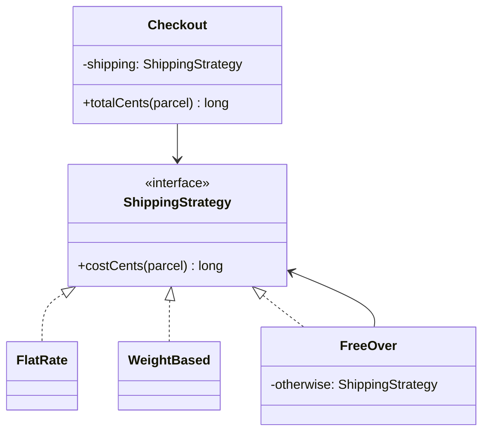

## Introduction

An online shop starts with one shipping rule: every parcel costs $4.99. Six months later marketing wants weight-based pricing. Then free shipping over $50. Then an express option, a different rule for one country, and an A/B test that tries two prices at once. If all of these live in one `calculateShipping` method, that method becomes a long `switch` that everyone edits, every change risks breaking a rule nobody touched, and testing one rule means reading all of them.

The **Strategy** pattern solves this by giving each rule its own class behind a shared interface. The checkout code no longer knows *how* shipping is priced; it holds a reference to "something that can price shipping" and asks it. Adding a rule means writing a new class, not editing checkout. In the words of the *Design Patterns* book (Gamma, Helm, Johnson and Vlissides, 1994, often called the Gang of Four or GoF book), Strategy defines a family of algorithms, encapsulates each one, and makes them interchangeable.

You already use Strategy, probably without the name. Every time you pass a `Comparator` to `List.sort`, you are handing the sort algorithm a strategy for comparing two elements. The sort stays the same; the comparison varies. Pricing rules, tax calculation, retry back-off policies, compression formats, fraud-scoring models and authentication methods are all common production examples.

Strategy is the first pattern in this module because it is the simplest expression of an idea that runs through all the others: **find what varies, put it behind an interface, and compose it in** rather than branching on it or inheriting it.

## Before you start

- **Interfaces and polymorphism** — calling a method through an interface type and getting the implementation's behaviour. See [[c1-interfaces]] and [[c1-polymorphism]].
- **Composition over inheritance** — holding a collaborator instead of extending a base class. See [[d1-composition-vs-inheritance]].
- **The Open/Closed principle** from [[d1-solid]] — code open for extension but closed for modification. Strategy is one of the main ways to achieve it.
- **Lambdas and functional interfaces** are used in the later sections. See [[c1-lambdas]] and [[c1-functional-interfaces]].

## The intuition

Think of a navigation app. You type a destination, and it asks: by car, by bike, on foot or by public transport? The rest of the app — the map, the search box, the turn-by-turn display — is identical whichever you choose. Only one step changes: how the route is computed. The app does not contain one giant "compute route" function full of `if (mode == BIKE)` checks; it has separate routing engines that all answer the same question, "give me a route from A to B", and the app plugs in the one you picked.

That is the whole shape of Strategy:

- The **strategy interface** is the question every variant answers: "route from A to B", "shipping cost for this parcel", "which of these two orders comes first".
- Each **concrete strategy** is one answer: car routing, bike routing.
- The **context** is the code that needs an answer but does not care which variant gives it: the navigation app, the checkout, the sort method.

The analogy has a limit worth noticing. In the app, the *user* picks the strategy. In code, the choice is usually made by configuration, by the user's account tier or by whoever constructs the context — and *where* that choice happens turns out to be one of the most important design decisions, covered later in this lesson.

## The problem in code

Here is the shipping logic written the direct way. It works, and for two rules it would be fine.

```java title="ShippingBefore.java"
public class ShippingBefore {

    record Parcel(double weightKg, long subtotalCents) {}

    // Every new rule means editing this method and retesting all the old branches.
    static long shippingCents(String method, Parcel p) {
        switch (method) {
            case "flat":
                return 499;
            case "weight":
                return 300 + (long) Math.ceil(p.weightKg()) * 150;
            case "free-over-50":
                if (p.subtotalCents() >= 5_000) return 0;
                return 300 + (long) Math.ceil(p.weightKg()) * 150;
            default:
                throw new IllegalArgumentException("Unknown method: " + method);
        }
    }

    public static void main(String[] args) {
        Parcel p = new Parcel(2.4, 4_200);
        System.out.println(shippingCents("flat", p));
        System.out.println(shippingCents("weight", p));
        System.out.println(shippingCents("free-over-50", p));
    }
}
```

```output
499
750
750
```

Money is stored as `long` cents rather than `double` dollars, because binary floating point cannot represent most decimal fractions exactly and rounding errors in prices are real bugs.

Look at what is already going wrong. The weight formula appears twice, so a change to carrier rates must be made in two places. Every rule shares one method, so a unit test for "free over $50" has to call the same function as every other rule, and a careless edit to one `case` can break another. And the method has more than one reason to change — marketing promotions, carrier contracts and new countries all land here. That is the symptom that [[d1-solid]] calls a violation of the Single Responsibility and Open/Closed principles: adding behaviour requires modifying tested code.

A single `switch` is not wrong in itself. The warning sign is a switch on a *type or mode* that keeps growing, especially when the same switch appears in several places (one for cost, one for delivery estimate, one for label printing).

## The pattern: interface, strategies, context

The refactoring has three steps. First, name the varying step as an interface with exactly the inputs it needs. Second, move each branch into its own class implementing that interface. Third, make the code that used to switch hold a reference to the interface and call it.



Here is the complete program.

```java title="ShippingDemo.java"
import java.util.List;
import java.util.Objects;

public class ShippingDemo {

    record Parcel(double weightKg, long subtotalCents) {}

    /** The strategy: one varying step, behind one small interface. */
    interface ShippingStrategy {
        long costCents(Parcel parcel);
    }

    static final class FlatRate implements ShippingStrategy {
        private final long cents;
        FlatRate(long cents) { this.cents = cents; }
        @Override public long costCents(Parcel parcel) { return cents; }
    }

    static final class WeightBased implements ShippingStrategy {
        private final long baseCents;
        private final long perKgCents;
        WeightBased(long baseCents, long perKgCents) {
            this.baseCents = baseCents;
            this.perKgCents = perKgCents;
        }
        @Override public long costCents(Parcel parcel) {
            // Carriers bill per started kilogram, so round the weight up.
            return baseCents + (long) Math.ceil(parcel.weightKg()) * perKgCents;
        }
    }

    /** Free above a threshold, otherwise defer to another strategy. */
    static final class FreeOver implements ShippingStrategy {
        private final long thresholdCents;
        private final ShippingStrategy otherwise;
        FreeOver(long thresholdCents, ShippingStrategy otherwise) {
            this.thresholdCents = thresholdCents;
            this.otherwise = otherwise;
        }
        @Override public long costCents(Parcel parcel) {
            return parcel.subtotalCents() >= thresholdCents ? 0 : otherwise.costCents(parcel);
        }
    }

    /** The context: stable workflow, delegates the varying step. */
    static final class Checkout {
        private final ShippingStrategy shipping;
        Checkout(ShippingStrategy shipping) {
            this.shipping = Objects.requireNonNull(shipping);
        }
        long totalCents(Parcel parcel) {
            return parcel.subtotalCents() + shipping.costCents(parcel);
        }
    }

    static String money(long cents) {
        return String.format("$%d.%02d", cents / 100, cents % 100);
    }

    public static void main(String[] args) {
        ShippingStrategy weight = new WeightBased(300, 150);
        List<ShippingStrategy> options = List.of(
                new FlatRate(499), weight, new FreeOver(5_000, weight));

        Parcel small = new Parcel(2.4, 4_200);
        Parcel big = new Parcel(2.4, 6_000);
        for (ShippingStrategy s : options) {
            Checkout checkout = new Checkout(s);
            System.out.printf("%-12s small=%s big=%s%n", s.getClass().getSimpleName(),
                    money(checkout.totalCents(small)), money(checkout.totalCents(big)));
        }
    }
}
```

```output
FlatRate     small=$46.99 big=$64.99
WeightBased  small=$49.50 big=$67.50
FreeOver     small=$49.50 big=$60.00
```

Walk through the decisions, because each one is deliberate.

**The interface is narrow.** `ShippingStrategy` has one method, and it receives a `Parcel` — exactly the data a rule needs. If the interface also had `estimateDays()` and `printLabel()`, a flat-rate rule that does not care about labels would be forced to implement them. Keep the strategy interface to the one decision that varies.

**Strategies carry their own configuration.** `FlatRate(499)` and `WeightBased(300, 150)` take their numbers through the constructor instead of hard-coding them. The same class can serve several price points, and the numbers can come from configuration or a database at start-up.

**Strategies can compose.** `FreeOver` does not duplicate the weight formula; it holds another strategy and defers to it below the threshold. The duplicated code from the `switch` version is gone, and "free over $50, otherwise express pricing" is now `new FreeOver(5_000, express)` with no new class.

**The context does not know the concrete classes.** `Checkout` mentions only `ShippingStrategy`. It would compile and work unchanged if a `DroneDelivery` class were added next year. This is what "closed for modification, open for extension" means in practice: the extension is a new class; the tested context is untouched.

**The context rejects `null`.** `Objects.requireNonNull` makes a missing strategy fail at construction time, with a clear stack trace, instead of as a `NullPointerException` in the middle of a customer's checkout.

Each strategy can now be unit tested in isolation: construct `new WeightBased(300, 150)`, pass a parcel, assert the result. The context can be tested with a trivial fake strategy such as `p -> 0`, so checkout tests no longer depend on carrier rates.

## Choosing the strategy

Strategy moves the conditional, it does not delete it. Somewhere, code still decides *which* strategy a given checkout uses. The quality of a Strategy design depends heavily on where that decision lives.

### Constructor injection at the edge

The most common and usually best option is to pass the strategy into the context's constructor, as `Checkout` does, and make the choice in the code that wires the application together. That place is called the **composition root**: `main`, a Spring `@Configuration` class, or a dependency-injection container. The domain code never sees the decision. In Spring, a strategy is typically a bean injected through the constructor; see [[c5-constructor-injection]].

The benefit is that the context is fixed for its lifetime, has no setter, and can be shared safely between threads if the strategy is stateless.

### A registry keyed by configuration

When the choice depends on data — a value in a config file, a column on the customer's account, a field in the request — the usual tool is a map from key to strategy, often called a **registry**:

```java title="LambdaStrategies.java"
import java.util.Map;

public class LambdaStrategies {

    record Parcel(double weightKg, long subtotalCents) {}

    @FunctionalInterface
    interface ShippingStrategy {
        long costCents(Parcel parcel);
    }

    // A registry: configuration keys map to strategies. Stateless, so shared safely.
    static final Map<String, ShippingStrategy> STRATEGIES = Map.of(
            "flat", p -> 499,
            "weight", p -> 300 + (long) Math.ceil(p.weightKg()) * 150,
            "express", p -> 1_500 + (long) Math.ceil(p.weightKg()) * 250);

    static ShippingStrategy forKey(String key) {
        ShippingStrategy s = STRATEGIES.get(key);
        if (s == null) {
            // Fail loudly: silently charging the wrong price is worse than an error.
            throw new IllegalArgumentException("Unknown shipping method: " + key);
        }
        return s;
    }

    public static void main(String[] args) {
        Parcel p = new Parcel(2.4, 4_200);
        for (String key : new String[] {"flat", "weight", "express", "drone"}) {
            try {
                System.out.println(key + " -> " + forKey(key).costCents(p));
            } catch (IllegalArgumentException e) {
                System.out.println(key + " -> " + e.getMessage());
            }
        }
    }
}
```

```output
flat -> 499
weight -> 750
express -> 2250
drone -> Unknown shipping method: drone
```

Two things deserve attention. First, the unknown key `"drone"` is handled explicitly. A registry turns a compile-time `switch` into a runtime lookup, so a typo in a config file is no longer caught by the compiler; the lookup must either throw, as here, or fall back to a documented default strategy and log that it did so. Which is right depends on the domain — a missing pricing rule should usually fail, while a missing recommendation algorithm can safely fall back. Better still, validate every configured key when the application starts, so the error appears at deployment and not on the first unlucky request.

Second, the strategies are created once and reused. A stateless strategy has no fields that change, so one instance can serve every request on every thread. Creating a new strategy object per call is harmless but wasteful.

Choosing from a registry is closely related to the Factory pattern — the map is a factory that returns a strategy for a key. See [[d2-factory]].

### Swapping at runtime

The GoF description gives the context a setter so the strategy can change after construction: a game switching an enemy's AI when it is low on health, or a compression stage switching algorithm based on measured bandwidth. This is legitimate, but it makes the context **mutable**. If one `Checkout` instance is shared by many request threads — common for singleton beans in Spring — and one request calls `setStrategy` for a premium user, every other in-flight request silently gets premium pricing. That is a real and common bug.

The safer designs are to choose the strategy per call (pass it as a method parameter, or look it up per request) or to create a context per user or per request. If a shared context genuinely needs a swappable strategy, store it in a `volatile` field or an `AtomicReference` so the change is visible to other threads, and accept that requests in flight may still use the old one. See [[c3-thread-safety]].

> [!NOTE] Compile-time choice is still Strategy
> Strategy does not require the algorithm to change while the program runs. Injecting `new WeightBased(...)` once at start-up and never changing it is a perfectly good use of the pattern; the value is that the context does not depend on the concrete rule, which also makes it easy to test with a fake.

## Strategies as lambdas

In Java 8 and later, an interface with exactly one abstract method is a **functional interface**, and any lambda with a matching signature implements it. That is why the registry above could write `p -> 499` instead of `new FlatRate(499)`. Many strategy interfaces are naturally functional, and the JDK's `Comparator`, `Function`, `Predicate` and `Supplier` are all strategy interfaces in this sense.

So when should a strategy be a lambda and when a named class? A useful rule:

| Use a lambda when | Use a named class when |
|---|---|
| The rule is a line or two | The rule has real logic, branches or helper methods |
| It needs no configuration beyond captured constants | It has constructor parameters or dependencies (a rate table, a client) |
| It is used in one place | It is reused, logged by name or appears in error messages |
| It does not need its own tests | It deserves focused unit tests |

The output of `ShippingDemo` printed the class names `FlatRate`, `WeightBased` and `FreeOver`. A lambda's class name is a synthetic string such as `LambdaStrategies$$Lambda/0x00003fe001040418` (the exact format varies between JDK versions), which is useless in logs and audit trails. For pricing, fraud or anything someone may later ask "which rule produced this number?", named classes, or at least a `name()` method on the interface, pay for themselves.

The same idea exists outside Java. In JavaScript and TypeScript, where functions are values, a strategy is often a plain function passed as an argument or stored in an object keyed by name; `array.sort((a, b) => a.price - b.price)` is Strategy in its lightest form.

## A strategy you already use: Comparator

`List.sort` implements a sorting algorithm (in OpenJDK, a merge sort variant called TimSort) and asks a `Comparator` to decide the order of any two elements. The algorithm is the context; the comparator is the strategy.

```java title="SortStrategies.java"
import java.util.ArrayList;
import java.util.Comparator;
import java.util.List;

public class SortStrategies {

    record Order(String id, long totalCents, int priority) {}

    public static void main(String[] args) {
        List<Order> orders = new ArrayList<>(List.of(
                new Order("A", 2_500, 2),
                new Order("B", 9_900, 1),
                new Order("C", 2_500, 1)));

        // Same sort algorithm, three different comparison strategies.
        orders.sort(Comparator.comparingLong(Order::totalCents));
        System.out.println(orders.stream().map(Order::id).toList());

        orders.sort(Comparator.comparingLong(Order::totalCents).reversed());
        System.out.println(orders.stream().map(Order::id).toList());

        orders.sort(Comparator.comparingInt(Order::priority)
                .thenComparing(Order::totalCents, Comparator.reverseOrder()));
        System.out.println(orders.stream().map(Order::id).toList());
    }
}
```

```output
[A, C, B]
[B, A, C]
[B, C, A]
```

In the first sort, `A` and `C` both cost $25.00, and they stay in their original relative order because `List.sort` is **stable** — it never reorders equal elements. The second sort reverses the comparison, and the tie between `A` and `C` is again preserved. The third builds a combined strategy from two smaller ones with `thenComparing`: by priority first, then by total, highest first. This combinator style — building new strategies out of existing ones — is the same idea as `FreeOver` wrapping another shipping strategy. Comparators are covered in depth in [[c1-comparable-comparator]].

```quiz
Q: In `orders.sort(Comparator.comparingLong(Order::totalCents))`, which role does each part play in the Strategy pattern?
- [ ] `Order` is the strategy and `List.sort` is the concrete strategy
- [x] The sort algorithm inside `List.sort` is the context and the `Comparator` is the strategy
- [ ] `Comparator` is the context and `Order::totalCents` is the interface
- [ ] It is not Strategy, because no class implements an interface explicitly
> The sort algorithm is fixed and delegates one varying step — comparing two elements — to whatever `Comparator` it is given. A method reference or lambda is still an implementation of the `Comparator` functional interface, so the absence of a named class does not change the pattern.
```

## Strategy, State and Template Method

Three patterns are regularly confused with Strategy because their class diagrams look alike. The difference is in *who decides* and *what varies*.

**State** ([[d2-state]]) also has a context delegating to an interface with several implementations. But in State, the implementations represent the *lifecycle stage* of the context — an order that is `Pending`, `Paid`, `Shipped` — and the state objects themselves usually trigger transitions: calling `ship()` on a `Paid` state replaces it with a `Shipped` state. The client does not pick the state; it emerges from what has happened to the object. In Strategy, the client or configuration picks the algorithm, and strategies normally know nothing about one another.

**Template Method** ([[d2-template-method]]) solves a similar problem with inheritance instead of composition. A base class defines the fixed skeleton of an algorithm — validate, compute, format, save — and subclasses override one or more steps. The variation is chosen when you pick a subclass, at compile time, and cannot change without creating a different object. Strategy varies a step by plugging in an object, which can be chosen from configuration, combined with other strategies and tested alone.

| | Strategy | State | Template Method |
|---|---|---|---|
| Mechanism | Composition: context holds an interface | Composition: context holds current state | Inheritance: subclass overrides steps |
| Who chooses the variant | Client, configuration or DI | The states themselves, through transitions | Whoever picks the subclass |
| Variants know about each other | Usually no | Yes, they trigger transitions | No |
| Typical example | Pricing rule, comparator | Order lifecycle, TCP connection | Framework hook such as a test base class |

**Chain of Responsibility** ([[d2-chain-of-responsibility]]) is also related: there, several handlers are tried in sequence until one handles the request, whereas Strategy uses exactly one chosen algorithm.

## In real systems

**Pricing, tax and promotions.** E-commerce platforms usually model each promotion type or tax regime as a strategy, selected by region or campaign configuration. Because the strategy is a named class, the order record can store which strategy priced it — invaluable when a customer disputes a charge.

**Retry and back-off policies.** HTTP clients and job runners take a retry policy: fixed delay, exponential back-off, exponential with jitter. Resilience libraries such as Resilience4j expose these as interchangeable configuration objects, and Spring Retry has `BackOffPolicy` implementations. The job runner stays the same; the policy varies. See [[d7-retry-strategies]].

**Authentication.** Spring Security's `AuthenticationProvider` is a strategy interface: password, LDAP and token authentication are separate providers, and the framework's `ProviderManager` asks each registered provider that supports the incoming credential type until one succeeds.

**Frameworks and libraries.** `Comparator` for sorting, `java.util.concurrent.RejectedExecutionHandler` for what a thread pool does when it is full, and the `ThreadPoolExecutor` policies (`AbortPolicy`, `CallerRunsPolicy`, and so on) are textbook strategies in the JDK.

**Observability.** Because the choice of strategy affects money or security in many of these cases, production systems often log which strategy ran for each decision. That turns "why was this customer charged $67.50?" from an investigation into a lookup.

## Trade-offs and alternatives

Strategy's advantages are concrete. Growing conditionals disappear from the context. Each variant can be read, changed and tested on its own. New variants are new classes, so existing tested code stays untouched. The variant can be chosen from configuration without recompiling.

The costs are equally concrete. There are more types to navigate, and for two trivial branches that is overhead with no pay-off. Somebody still has to choose the strategy, and that selection code — the registry, the factory, the DI wiring — is new code that can be wrong. Strategies that need different inputs strain the single interface: if one rule needs the customer's loyalty tier and another needs the destination's tax zone, the interface either grows a wide parameter object or the strategies start reaching into global state.

Alternatives worth knowing:

- **A plain `if` or `switch`** when there are two or three stable branches. A sealed interface with an exhaustive `switch` (Java 21) is a good middle ground when the set of variants is closed and owned by you; the compiler then reports every switch that misses a new case.
- **A map of functions** when the variants are small and data-driven, as in the registry above. This is Strategy with less ceremony.
- **A rule engine or a domain-specific language** when there are many combinable rules, non-developers need to edit them, or they must change without a deployment. The cost is a new system to learn, test and operate.
- **Template Method** when the skeleton is fixed and only one step varies per subclass, and runtime flexibility is not needed.

## Common mistakes

> [!MISTAKE] Strategy for a one-off boolean
> Creating `DiscountStrategy`, `NoDiscountStrategy` and a factory for a single `if (isEmployee)` check adds three types and no flexibility. Wait until a second axis of variation or a third variant appears, or until the same condition is repeated in several places.

**A fat strategy interface.** If implementations throw `UnsupportedOperationException` or return dummy values for some methods, the interface is serving several decisions at once. Split it so each strategy interface has one job — this is the Interface Segregation principle from [[d1-solid]].

**Selecting the strategy deep in the domain.** If `Checkout.totalCents` reads a feature flag and constructs a strategy inside itself, the context depends on every concrete class again and the conditional has moved, not disappeared. Make the choice at the edge — the composition root, a factory, or request handling — and pass the chosen strategy in.

**Mutable strategy on a shared context.** Calling `setStrategy` on a singleton service changes behaviour for every concurrent request. Prefer immutable contexts, per-call strategies, or a thread-safe reference if swapping is genuinely needed.

**Stateful strategies shared as singletons.** A strategy that caches the last parcel in a field, or accumulates a running total, is no longer safe to share between threads. Keep strategies stateless, or create one per use.

**Silent fallback on unknown keys.** Returning a default strategy when the config says `"expres"` hides a typo and charges the wrong price. Fail fast at start-up, or fall back only when the default is genuinely safe and log the fallback.

## Interview perspective

Strategy appears in two ways in interviews: as a direct question ("what is Strategy, when would you use it?") and, more often, as an expected move inside a low-level design problem. In [[d3-parking-lot]], pricing by vehicle type or time of day is a strategy; in [[d3-rate-limiter-lld]], token bucket versus sliding window is a strategy; in [[d3-elevator]], the dispatch algorithm is a strategy. Interviewers look for whether you isolate the part that is likely to change.

> [!INTERVIEW] Refactoring a switch out loud
> "This `switch` on the shipping method is going to grow with every promotion, so I'll extract a `ShippingStrategy` interface with one method, `costCents(Parcel)`. Each case becomes a class. `Checkout` takes the strategy in its constructor, so it never changes when we add a rule, and I can test it with a fake. The choice moves to a registry keyed by the config value, and I validate the keys at start-up so a typo fails the deployment, not a customer's order."

Questions you should be ready for:

- **Strategy versus if/else — when do you switch?** When the branching is on a type or mode, grows over time, is duplicated in several places, or when each branch needs separate tests. Not for two stable branches.
- **Strategy versus Template Method?** Composition versus inheritance; runtime choice versus subclass choice; whole step plugged in versus hooks in a fixed skeleton.
- **Strategy versus State?** Who chooses: the client picks a strategy, while states replace one another through transitions.
- **How do strategies share dependencies such as a rate table?** Inject the shared dependency into each strategy's constructor; do not make strategies reach into globals.
- **Strategy without classes?** Pass functions or lambdas; Java's functional interfaces and JavaScript's first-class functions make this natural.
- **Design a payment retry with fixed versus exponential back-off.** A `RetryPolicy` interface returning the next delay (or "stop") for an attempt number, two implementations, injected into the job runner.
- **When is a rule engine better?** Many combinable rules, edits by non-developers, or hot reload without deployment.

## Practice

1. **Tax strategies.** Write a `TaxStrategy` for three regions: a flat percentage, a tiered rate (0% up to $10, 8% above), and "no tax". Inject one into an `Invoice` class and test each strategy without the invoice.
2. **Remove a duplicated switch.** Given a class with `switch (vehicleType)` in both `fee()` and `maxStayHours()`, decide whether one strategy interface with two methods or two separate interfaces is better, and justify the choice.
3. **Registry with start-up validation.** Load a list of shipping keys from a configuration list and verify, before serving any request, that every key exists in the registry. Print all unknown keys at once rather than failing on the first.
4. **Thread-safety bug.** Write a shared `Checkout` with `setStrategy` and two threads that each set a strategy and then compute a total. Explain why the output can be wrong, then fix it two ways.
5. **Combinators.** Add a `capAt(long maxCents)` method to `ShippingStrategy` as a `default` method that returns a new strategy limiting the cost, modelled on `Comparator.reversed()`.

## Quick revision {#quick-revision}

- Strategy: a family of interchangeable algorithms behind one interface; the context delegates the varying step to the strategy it holds.
- Roles: strategy interface (the question), concrete strategies (the answers), context (the stable code that asks).
- Refactor: name the varying step, move each branch into a class, make the context hold the interface.
- Choose at the edge: constructor injection at the composition root, or a registry keyed by configuration; validate keys at start-up.
- Unknown key: throw, or fall back to a safe documented default and log it.
- Stateless strategies can be shared singletons; a mutable `setStrategy` on a shared context is a concurrency bug.
- Lambdas suit tiny, local strategies; named classes suit configurable, reused, logged or tested ones.
- JDK examples: `Comparator`, `RejectedExecutionHandler`; Spring: `AuthenticationProvider`, retry back-off policies.
- vs State: states drive their own transitions; vs Template Method: inheritance and fixed skeleton; vs Chain of Responsibility: many handlers tried in turn.
- Do not use for one-off booleans or two stable branches.

## Key takeaways {#key-takeaways}

- Strategy isolates the part of an algorithm that varies behind a narrow interface, so the code using it stays unchanged when variants are added.
- The conditional does not vanish; it moves to where strategies are chosen, which should be the edge of the system, not the domain logic.
- Keep strategy interfaces to one decision, keep strategies stateless where possible, and fail clearly on unknown configuration.
- In modern Java and JavaScript a strategy is often a plain function, but named classes are better when the choice must be logged, configured or tested.
- Distinguish Strategy from State (who chooses) and Template Method (composition versus inheritance) by asking who picks the variant and how it is plugged in.
