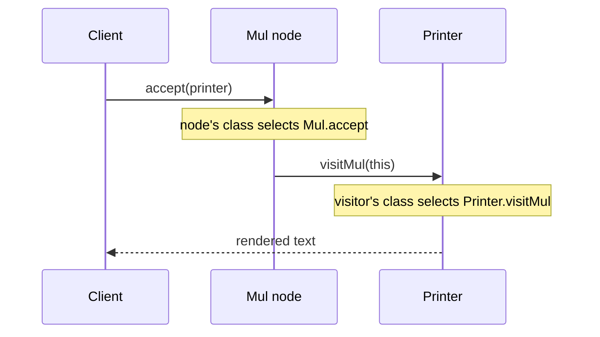
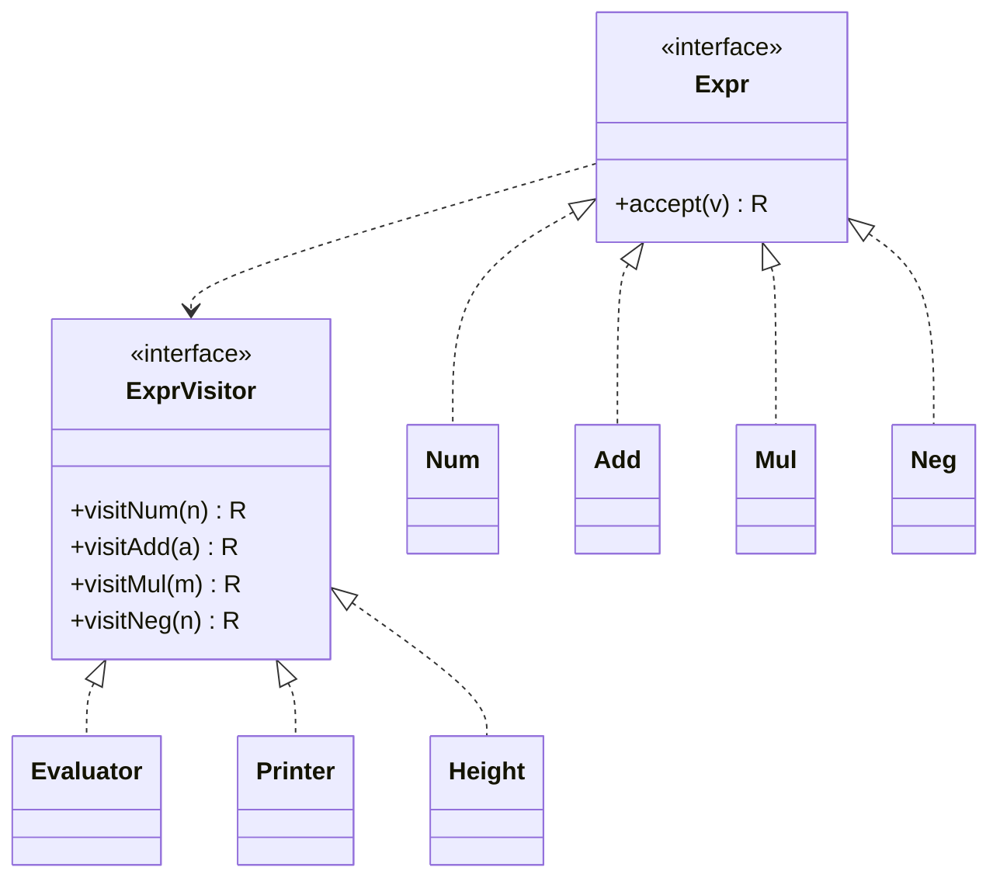

## Introduction

A calculator app represents the expression `(2 + 3) * -4` as a tree: a multiplication node whose left child is an addition node and whose right child is a negation node. The first feature is evaluation, so each node class gets an `evaluate()` method. Then the product team asks for pretty-printing, so every node class gets a `print()` method. Then a "simplify" button, a validator that rejects division by zero, an exporter to LaTeX, and a step-by-step explanation mode. Each feature is one more method added to *every* node class. After a year, the `Add` class contains six unrelated features, and anyone adding a seventh has to edit, retest and understand all the node classes at once.

The **Visitor** pattern moves each of those operations out of the node classes and into its own class, called a **visitor**. The nodes keep only their data and one small method, `accept`, that hands the node to whichever visitor arrives. A new feature becomes a new visitor class; the node classes are not touched. The *Design Patterns* book (Gamma, Helm, Johnson and Vlissides, 1994, the "Gang of Four" or GoF book) describes the intent as defining new operations over an object structure without changing the classes of the elements it contains.

The trick that makes this work is called **double dispatch**: the method that runs depends on the run-time types of *two* objects — the node and the visitor — even though Java normally chooses a method based on only one. Understanding why that is needed, and what it costs, is most of what there is to learn about Visitor.

Visitor is less common in everyday application code than [[d2-strategy]] or [[d2-observer]], but it is the backbone of compilers, linters, code formatters, annotation processors and document exporters — anywhere a tree of a few stable node types is walked by many different operations.

## Before you start

- **Polymorphism and dynamic binding** — calling `shape.area()` runs the method of the object's actual class. See [[c1-polymorphism]] and [[c1-dynamic-binding]].
- **Method overloading** — several methods with the same name and different parameter types, chosen at compile time. See [[c1-method-overloading]] and [[c1-overload-vs-override]]; this lesson depends on the difference.
- **Generics** — the visitor below is `ExprVisitor<R>`, where `R` is the result type. See [[c1-generics]].
- **Trees and recursion** — the examples walk a binary tree recursively. See [[a6-binary-trees]] and [[c1-recursion-java]].
- **The Open/Closed principle** from [[d1-solid]]. Visitor makes a structure open for new operations, at the price of being closed to new types.
- The comparison at the end uses **records**, **sealed interfaces** and **pattern matching for `switch`**: [[c1-records]], [[c1-sealed]], [[c1-pattern-matching]] and [[c1-switch-expressions]].

## The intuition

Think of a building with several kinds of room: kitchens, bathrooms, offices. Over the years, different inspectors visit — a fire inspector, an electrical inspector, an accessibility auditor. Each has a different checklist for each kind of room: the fire inspector checks the kitchen's extinguisher and the office's exit signs; the electrical inspector checks the bathroom's sockets.

It would be absurd to rebuild every room each time a new kind of inspection is invented. Instead, each room does one thing: when an inspector arrives at the door, the room says "I am a kitchen — inspect me as a kitchen." The inspector then applies its own kitchen checklist. The rooms know nothing about fire codes; the inspectors know nothing about how rooms are built beyond what they can see. A new kind of inspection means training a new inspector, not renovating the building.

That handshake has two steps, and each answers a different question. The room answers "what kind of room is this?" The inspector answers "what does *this* inspection do with that kind of room?" Together they select one checklist out of a grid of inspector × room type. That grid is the essence of Visitor.

The analogy also shows the pattern's weakness. If the architect adds a new kind of room — a server room — *every* inspector needs a new checklist before they can do their job. Visitor makes new operations cheap and new element types expensive. Keep that trade in mind; the rest of the lesson keeps returning to it.

## The problem in code

Here are two direct ways to give an expression tree several operations, and why each struggles.

**Methods on every node.** Put `evaluate()`, `print()` and `height()` in the `Expr` interface and implement them in `Num`, `Add`, `Mul` and `Neg`. This is ordinary polymorphism and it works well while the list of operations is short and stable. But each operation is now scattered across four files, the node classes accumulate dependencies of every feature (a LaTeX exporter drags formatting code into `Add`), and the node classes may not even be yours to edit — they might come from a library or a generated parser.

**A type check outside the nodes.** Keep the nodes as plain data and write each operation as a function that inspects the type:

```java title="Fragment: an instanceof chain"
static int evaluate(Expr e) {
    if (e instanceof Num n) return n.value();
    if (e instanceof Add a) return evaluate(a.left()) + evaluate(a.right());
    if (e instanceof Mul m) return evaluate(m.left()) * evaluate(m.right());
    if (e instanceof Neg n) return -evaluate(n.operand());
    throw new IllegalArgumentException("Unknown node: " + e);
}
```

This keeps each operation in one place, which is what we want. The problem is what happens when someone adds a `Div` node: this method still compiles, and the mistake surfaces only at run time, as an exception on the first expression that contains a division. With ten operations written this way, there are ten such traps and nothing pointing to them. (Java 21 changes this picture with exhaustive `switch`; that is covered near the end, because it is the main modern alternative to Visitor.)

What we would like is the best of both: each operation in its own class, *and* a compile-time guarantee that every operation handles every node type.

## Why overloading is not enough

A natural first attempt is an operation class with one overloaded method per node type. Java will surely pick the right one?

```java title="OverloadTrap.java"
public class OverloadTrap {

    interface Expr {}
    record Num(int value) implements Expr {}
    record Add(Expr left, Expr right) implements Expr {}

    static final class Printer {
        String print(Num n) { return Integer.toString(n.value()); }
        String print(Add a) { return "(" + print(a.left()) + " + " + print(a.right()) + ")"; }
        // Needed because a.left() has static type Expr. It is the only one that ever runs
        // for the children, so the "specific" overloads above are skipped.
        String print(Expr e) { return "<some Expr: " + e.getClass().getSimpleName() + ">"; }
    }

    public static void main(String[] args) {
        Printer p = new Printer();
        Add sum = new Add(new Num(2), new Num(3));
        System.out.println(p.print(sum));     // static type Add  -> print(Add)

        Expr same = sum;
        System.out.println(p.print(same));    // static type Expr -> print(Expr)
    }
}
```

```output
(<some Expr: Num> + <some Expr: Num>)
<some Expr: Add>
```

The children were `Num` objects, yet `print(Num)` never ran. The reason is how Java chooses methods. **Overload resolution happens at compile time**, using the *declared* (static) types of the arguments. `a.left()` is declared to return `Expr`, so the compiler binds the call to `print(Expr)` and that decision is baked into the bytecode. Without the `print(Expr)` overload, the code would not compile at all.

The only run-time choice Java makes is on the **receiver** — the object before the dot. `shape.area()` runs `Circle.area` or `Square.area` depending on what `shape` really is. This is called **single dispatch**: one object's run-time type picks the method. We need two objects' run-time types to pick the method — which operation, and which node — and Java offers only one per call.

The fix is to make *two* calls, each of which uses Java's single dispatch once.

## Double dispatch: accept and visit {#double-dispatch}

The Visitor pattern adds one method to every node, conventionally called `accept`, and one interface with a method per node type, conventionally `visitX`:

1. The client calls `node.accept(visitor)`. Because `node` is the receiver, Java dispatches on the node's run-time class — `Mul.accept` runs. **First dispatch: which node?**
2. Inside `Mul.accept`, the code is `return visitor.visitMul(this);`. Here `this` has static type `Mul`, so the compiler already knows to call `visitMul`. And `visitor` is now the receiver, so Java dispatches on the visitor's run-time class — `Printer.visitMul` runs. **Second dispatch: which operation?**



Every `accept` method looks almost identical — one line calling the matching `visit` method — and that is the point. Each node class answers exactly one question, "which kind of node am I?", by choosing which `visit` method to call. It never needs to change again, however many operations are added.

The roles have standard names:

| Role | In the example | Responsibility |
|---|---|---|
| **Element** | `Expr` interface | Declares `accept(visitor)` |
| **Concrete element** | `Num`, `Add`, `Mul`, `Neg` | Holds data; `accept` calls its own `visitX(this)` |
| **Visitor** | `ExprVisitor<R>` interface | Declares one `visitX` per concrete element |
| **Concrete visitor** | `Evaluator`, `Printer`, `Height` | Implements one operation for every element type |
| **Object structure** | The expression tree | The collection of elements being visited, often a [[a6-binary-trees\|tree]] or a Composite |



Notice the dependency arrow from `Expr` to `ExprVisitor`, and that `ExprVisitor` names every concrete element. The element side and the visitor side know about each other. That mutual dependency is what gives the compile-time safety, and also what makes new element types expensive.

## Worked example: an expression tree with three operations

Here is the complete program. The visitor is generic in its result type `R`, so an evaluator can return `Integer` and a printer can return `String` through the same interface.

```java title="ExprVisitorDemo.java"
public class ExprVisitorDemo {

    /** One method per concrete element type. R is what the operation produces. */
    interface ExprVisitor<R> {
        R visitNum(Num n);
        R visitAdd(Add a);
        R visitMul(Mul m);
        R visitNeg(Neg n);
    }

    /** The element interface: every node can accept any visitor. */
    interface Expr {
        <R> R accept(ExprVisitor<R> visitor);
    }

    // Inside each accept, `this` has the precise static type, so the right visit method
    // is chosen at compile time. Which object `visitor` is gets decided at run time.
    record Num(int value) implements Expr {
        public <R> R accept(ExprVisitor<R> v) { return v.visitNum(this); }
    }
    record Add(Expr left, Expr right) implements Expr {
        public <R> R accept(ExprVisitor<R> v) { return v.visitAdd(this); }
    }
    record Mul(Expr left, Expr right) implements Expr {
        public <R> R accept(ExprVisitor<R> v) { return v.visitMul(this); }
    }
    record Neg(Expr operand) implements Expr {
        public <R> R accept(ExprVisitor<R> v) { return v.visitNeg(this); }
    }

    /** Operation 1: compute the value. */
    static final class Evaluator implements ExprVisitor<Integer> {
        public Integer visitNum(Num n) { return n.value(); }
        public Integer visitAdd(Add a) {
            return a.left().accept(this) + a.right().accept(this);
        }
        public Integer visitMul(Mul m) {
            return m.left().accept(this) * m.right().accept(this);
        }
        public Integer visitNeg(Neg n) { return -n.operand().accept(this); }
    }

    /** Operation 2: render as fully parenthesised text. */
    static final class Printer implements ExprVisitor<String> {
        public String visitNum(Num n) { return Integer.toString(n.value()); }
        public String visitAdd(Add a) { return binary(a.left(), "+", a.right()); }
        public String visitMul(Mul m) { return binary(m.left(), "*", m.right()); }
        public String visitNeg(Neg n) { return "-" + n.operand().accept(this); }

        private String binary(Expr l, String op, Expr r) {
            return "(" + l.accept(this) + " " + op + " " + r.accept(this) + ")";
        }
    }

    /** Operation 3: height of the tree, counting nodes on the longest path. */
    static final class Height implements ExprVisitor<Integer> {
        public Integer visitNum(Num n) { return 1; }
        public Integer visitAdd(Add a) { return 1 + taller(a.left(), a.right()); }
        public Integer visitMul(Mul m) { return 1 + taller(m.left(), m.right()); }
        public Integer visitNeg(Neg n) { return 1 + n.operand().accept(this); }

        private int taller(Expr l, Expr r) {
            return Math.max(l.accept(this), r.accept(this));
        }
    }

    public static void main(String[] args) {
        // (2 + 3) * -4
        Expr expr = new Mul(new Add(new Num(2), new Num(3)), new Neg(new Num(4)));

        System.out.println(expr.accept(new Printer()));
        System.out.println(expr.accept(new Evaluator()));
        System.out.println(expr.accept(new Height()));
    }
}
```

```output
((2 + 3) * -4)
-20
3
```

Walk through what happens when `main` evaluates the tree. `expr.accept(new Evaluator())` runs `Mul.accept`, which calls `evaluator.visitMul(thisMul)`. `visitMul` needs the values of both children, so it calls `left.accept(this)` — that is `Add.accept`, which calls `visitAdd`, which in turn calls `accept` on `Num(2)` and `Num(3)`, getting `2` and `3` back and returning `5`. The right child `Neg(Num(4))` goes through `visitNeg` and returns `-4`. Finally `visitMul` returns `5 * -4 = -20`. Every step is two calls: an `accept` that picks the node type and a `visit` that runs the operation.

A few design decisions are worth naming.

**The visitor drives the recursion.** Each `visit` method decides whether and in what order to visit the children. `Printer` needs in-order output (left, operator, right); a code generator for a stack machine would need post-order (both children, then the operator). Putting traversal in the visitor gives each operation that freedom. The alternative — `accept` visiting the children itself — fixes one order for every operation.

**The result type is a type parameter.** Older visitor examples return `void` and store results in fields of the visitor, which makes the visitor stateful and awkward to combine. `ExprVisitor<R>` lets each `visit` return its result directly, so the recursion reads like ordinary recursive code. Note that `R` must be a reference type, so `Integer` is used instead of `int`, and values are autoboxed (see [[c1-autoboxing]]).

**Distinct method names.** The methods are `visitNum`, `visitAdd` and so on rather than four overloads called `visit`. Overloading would also work here — inside `Num.accept`, `this` is statically a `Num` — but the distinct names make every call site self-explanatory and avoid any confusion with the overload trap shown earlier. Both styles appear in real code: the JDK's compiler API uses distinct names, many textbooks use overloads.

**Records hold the data.** The nodes are immutable records. Visitors only read them, so one tree can be visited by several operations, even concurrently, without defensive copying. See [[d1-immutability]].

```quiz
Q: In `expr.accept(new Printer())`, where `expr` is a `Mul`, how does Java end up running `Printer.visitMul`?
- [ ] The compiler sees that `expr` is a `Mul` and calls `visitMul` directly
- [x] `accept` is dispatched on the node's run-time class, and inside `Mul.accept` the call `v.visitMul(this)` is dispatched on the visitor's run-time class
- [ ] Java picks the most specific overload of `visit` at run time based on the argument's actual class
- [ ] `Printer` checks `instanceof Mul` and calls its own method
> Two ordinary virtual calls each make one run-time decision: first which node class, then which visitor class. The tempting third answer is exactly what Java does *not* do — overload resolution uses static types at compile time, which is why the pattern needs `accept` at all.
```

## Adding an operation, and adding a type

The payoff of the pattern is that a new operation is a new class. Suppose we want to count how many numeric literals appear in the expression:

```java title="Fragment: a fourth operation, added without editing any node"
static final class LiteralCount implements ExprVisitor<Integer> {
    public Integer visitNum(Num n) { return 1; }
    public Integer visitAdd(Add a) { return both(a.left(), a.right()); }
    public Integer visitMul(Mul m) { return both(m.left(), m.right()); }
    public Integer visitNeg(Neg n) { return n.operand().accept(this); }

    private int both(Expr l, Expr r) { return l.accept(this) + r.accept(this); }
}
```

Added to `ExprVisitorDemo`, `expr.accept(new LiteralCount())` returns `3`. `Num`, `Add`, `Mul` and `Neg` were not opened. If they lived in a library, or were generated from a grammar, this would still work.

Now try the other direction and add a variable node, `Var`. That means a new record whose `accept` calls `v.visitVar(this)`, and a new method `R visitVar(Var v)` in `ExprVisitor`. Compile the program and javac refuses:

```output
ExprVisitorDemo.java:37: error: Evaluator is not abstract and does not override abstract method visitVar(Var) in ExprVisitor
    static final class Evaluator implements ExprVisitor<Integer> {
                 ^
ExprVisitorDemo.java:49: error: Printer is not abstract and does not override abstract method visitVar(Var) in ExprVisitor
    static final class Printer implements ExprVisitor<String> {
                 ^
ExprVisitorDemo.java:61: error: Height is not abstract and does not override abstract method visitVar(Var) in ExprVisitor
    static final class Height implements ExprVisitor<Integer> {
                 ^
3 errors
```

(These are the real messages from `ExprVisitorDemo.java` with the `Var` record and `visitVar` method added and nothing else changed.) Every existing visitor must be updated before anything compiles. That is a real cost — with thirty visitors, adding one node type touches thirty classes, some possibly owned by other teams. But notice that the compiler *lists* them. Compare this with the `instanceof` chain, which would have compiled silently and failed in production. Visitor turns "forgot to handle the new type" from a run-time bug into a compile-time error.

This two-way tension has a name: the **expression problem**, a term popularised by Philip Wadler in 1998. You can lay out a program's behaviour as a grid of types × operations:

| | Add a new **operation** | Add a new **type** |
|---|---|---|
| Methods on each class (ordinary OOP) | Edit every class | One new class |
| Visitor | One new visitor class | Edit the visitor interface and every visitor |

Ordinary polymorphism makes new types cheap; Visitor makes new operations cheap. Neither makes both cheap. So the deciding question for Visitor is simple: **which will change more often, the set of types or the set of operations?** A programming language's syntax tree has a node set that changes once a year at most, while compilers, linters and IDEs keep adding analyses — a perfect fit. A payment system whose product team adds a new payment type every month is a poor fit.

```quiz
Q: A team's syntax tree has 12 node types that have not changed in two years, and they add a new analysis pass most months. Another team's billing model gains a new invoice type every few weeks but has only two operations, `total()` and `render()`. Where does Visitor fit?
- [x] The syntax tree: stable types and growing operations is exactly what Visitor makes cheap
- [ ] The billing model: frequent new types are what Visitor makes cheap
- [ ] Both equally, because Visitor makes new types and new operations cheap
- [ ] Neither, because Visitor only works on binary trees
> Visitor turns each new operation into one new class, but each new element type forces a change to every visitor. The billing model has the opposite profile, so methods on each invoice class suit it better. Visitor works on any object structure, not only binary trees.
```

## Who walks the tree: default visitors

When a structure has thirty node types and an operation cares about only one of them — "collect every variable name" — writing thirty `visit` methods, twenty-nine of which only recurse into children, is tedious and error-prone. Real visitor APIs solve this with a **base visitor class** that implements every `visit` method with a default behaviour, usually "visit all children and combine their results". Concrete visitors extend it and override only what they care about.

```java title="ScannerDemo.java"
import java.util.Map;
import java.util.Set;
import java.util.TreeSet;

public class ScannerDemo {

    interface ExprVisitor<R> {
        R visitNum(Num n);
        R visitVar(Var v);
        R visitAdd(Add a);
        R visitMul(Mul m);
    }

    interface Expr { <R> R accept(ExprVisitor<R> v); }

    record Num(int value) implements Expr {
        public <R> R accept(ExprVisitor<R> v) { return v.visitNum(this); }
    }
    record Var(String name) implements Expr {
        public <R> R accept(ExprVisitor<R> v) { return v.visitVar(this); }
    }
    record Add(Expr left, Expr right) implements Expr {
        public <R> R accept(ExprVisitor<R> v) { return v.visitAdd(this); }
    }
    record Mul(Expr left, Expr right) implements Expr {
        public <R> R accept(ExprVisitor<R> v) { return v.visitMul(this); }
    }

    /** Default traversal: leaves give empty(), parents combine their children's results. */
    abstract static class ExprScanner<R> implements ExprVisitor<R> {
        protected abstract R empty();
        protected abstract R combine(R left, R right);

        public R visitNum(Num n) { return empty(); }
        public R visitVar(Var v) { return empty(); }
        public R visitAdd(Add a) { return children(a.left(), a.right()); }
        public R visitMul(Mul m) { return children(m.left(), m.right()); }

        private R children(Expr l, Expr r) { return combine(l.accept(this), r.accept(this)); }
    }

    /** Only variables matter here, so only visitVar is overridden. */
    static final class VariableNames extends ExprScanner<Set<String>> {
        protected Set<String> empty() { return Set.of(); }
        protected Set<String> combine(Set<String> l, Set<String> r) {
            Set<String> all = new TreeSet<>(l);   // sorted, so output order is stable
            all.addAll(r);
            return all;
        }
        @Override public Set<String> visitVar(Var v) { return Set.of(v.name()); }
    }

    /** Evaluation needs every case, so it implements the interface directly. */
    static final class Evaluator implements ExprVisitor<Integer> {
        private final Map<String, Integer> env;
        Evaluator(Map<String, Integer> env) { this.env = env; }

        public Integer visitNum(Num n) { return n.value(); }
        public Integer visitVar(Var v) {
            Integer value = env.get(v.name());
            if (value == null) {
                throw new IllegalStateException("Unbound variable: " + v.name());
            }
            return value;
        }
        public Integer visitAdd(Add a) {
            return a.left().accept(this) + a.right().accept(this);
        }
        public Integer visitMul(Mul m) {
            return m.left().accept(this) * m.right().accept(this);
        }
    }

    public static void main(String[] args) {
        // price * qty + price * 2
        Expr expr = new Add(new Mul(new Var("price"), new Var("qty")),
                            new Mul(new Var("price"), new Num(2)));

        System.out.println(expr.accept(new VariableNames()));
        System.out.println(expr.accept(new Evaluator(Map.of("price", 7, "qty", 3))));
        try {
            expr.accept(new Evaluator(Map.of("price", 7)));
        } catch (IllegalStateException e) {
            System.out.println(e.getMessage());
        }
    }
}
```

```output
[price, qty]
35
Unbound variable: qty
```

`VariableNames` is five lines of real logic, however many node types exist. That is how the JDK's own compiler API works: `com.sun.source.util.TreeScanner` visits every child of every node and combines results with an overridable `reduce` method, and `SimpleTreeVisitor` sends every node to a single `defaultAction` unless a specific method is overridden.

`Evaluator`, on the other hand, deliberately implements `ExprVisitor` directly. That choice matters. A visitor that extends a base class inherits a default for every node type, *including types added later*, so it will compile without complaint after a new node type appears — and silently do the default thing for it. For an operation where every node type must be handled correctly (evaluation, code generation, security checks), implementing the interface directly keeps the compiler on your side. Use base classes for operations where "ignore what I do not care about" is genuinely correct.

> [!NOTE] Visitors can carry context
> The Evaluator above holds its environment in a field. Another common variation passes context as a second argument: the JDK's `TreeVisitor<R, P>` declares methods such as `visitBinary(BinaryTree node, P p)`, and nodes expose `accept(visitor, p)`. That keeps the visitor itself stateless and reusable across traversals.

## How it works internally

At the bytecode level there is nothing special about Visitor. `node.accept(v)` compiles to an `invokeinterface` instruction on `Expr.accept`; at run time the JVM finds the `accept` implementation of the node's actual class, just as it does for any interface call. Inside that method, `v.visitMul(this)` compiles to another `invokeinterface`, this time on `ExprVisitor.visitMul`, and the JVM finds the implementation in the visitor's actual class. Two virtual calls, each resolved using the receiver's class. The pattern is a disciplined way of using single dispatch twice.

The overhead is therefore two virtual calls per node. In most programs that is small next to the work the `visit` methods do, and the Just-In-Time (JIT) compiler can inline calls at sites that only ever see one or two receiver classes. Measure before assuming that a visitor or an `instanceof` chain is faster for your workload.

The recursion has a real cost, though: each level of the tree adds at least two stack frames (`accept` plus `visit`). Expression trees from human-written code are shallow, but machine-generated input can be very deep — a generated SQL query with thousands of chained `OR` conditions, or a parser fed a long left-associative chain. In a test with a default-configured OpenJDK, a left-deep chain of 10,000 nested additions evaluated fine and a chain of 100,000 threw `StackOverflowError`. The exact limit depends on the thread stack size (`-Xss`), the JIT and the frame size, so treat those numbers as an order of magnitude. Production tools that must accept untrusted input either limit nesting depth in the parser or convert the hot visitors into iterative traversals with an explicit stack (see [[a5-stack]] and [[c2-stackoverflow]]).

## Visitor and the modern alternative: sealed types with pattern matching

Visitor exists largely because, until recently, Java had no safe way to write "switch on the kind of node and be told if I missed one". Since Java 21, it does. **Sealed interfaces** (final in Java 17) restrict which classes may implement an interface, and **pattern matching for `switch`** with **record patterns** (both final in Java 21) can deconstruct records and check that a `switch` covers every permitted subtype.

```java title="SealedDemo.java"
import java.util.Map;

public class SealedDemo {

    // The compiler knows these five records are the only possible Exprs.
    sealed interface Expr permits Num, Var, Add, Mul, Neg {}
    record Num(int value) implements Expr {}
    record Var(String name) implements Expr {}
    record Add(Expr left, Expr right) implements Expr {}
    record Mul(Expr left, Expr right) implements Expr {}
    record Neg(Expr operand) implements Expr {}

    // No default branch: if a sixth record is added to `permits`, this stops compiling.
    static int eval(Expr e, Map<String, Integer> env) {
        return switch (e) {
            case Num(int v) -> v;
            case Var(String name) -> env.getOrDefault(name, 0);
            case Add(Expr l, Expr r) -> eval(l, env) + eval(r, env);
            case Mul(Expr l, Expr r) -> eval(l, env) * eval(r, env);
            case Neg(Expr x) -> -eval(x, env);
        };
    }

    static String show(Expr e) {
        return switch (e) {
            case Num(int v) -> Integer.toString(v);
            case Var(String name) -> name;
            case Add(Expr l, Expr r) -> "(" + show(l) + " + " + show(r) + ")";
            case Mul(Expr l, Expr r) -> "(" + show(l) + " * " + show(r) + ")";
            case Neg(Expr x) -> "-" + show(x);
        };
    }

    public static void main(String[] args) {
        Expr expr = new Mul(new Add(new Var("x"), new Num(3)), new Neg(new Num(4)));
        System.out.println(show(expr));
        System.out.println(eval(expr, Map.of("x", 2)));
    }
}
```

```output
((x + 3) * -4)
-20
```

There is no `accept`, no visitor interface, and each operation is a single static method that reads top to bottom. If you delete the `Neg` case from `eval`, javac reports `the switch expression does not cover all possible input values` — the same compile-time safety Visitor gave, without the double-dispatch machinery. (Here `getOrDefault` treats an unknown variable as `0` to keep the example short; real code should fail as the earlier `Evaluator` did.)

So when should you still write a visitor in Java 21 or later?

| Situation | Better fit |
|---|---|
| You own all the node types and they can be in one sealed hierarchy | Sealed interface + pattern-matching `switch` |
| The node types belong to a library that already offers `accept` (javac Tree API, ANTLR parse trees, ASM) | Visitor — use the API you are given |
| The hierarchy cannot be sealed (open for extension by other modules) | Visitor, or a type-keyed map of handlers |
| You need reusable default traversal ("visit everything, override one case") | Visitor with a base scanner class |
| Code must run on Java versions before 21 | Visitor |
| The node set changes often and the operations are few | Neither — put methods on the classes |

Both approaches sit on the same side of the expression problem: operations are cheap to add, types are expensive. Pattern matching is simply the lighter syntax for it when you control the hierarchy. The same idea appears in TypeScript as switching over a [[b2-discriminated-unions|discriminated union]], with a `never` check standing in for Java's exhaustiveness check.

## Related patterns

**Strategy** ([[d2-strategy]]) is the pattern most often confused with Visitor, because both put an algorithm in its own object. The difference is what the algorithm varies over. A strategy is one algorithm with one entry point, swapped into one context — "how to price shipping for this parcel". A visitor is one operation with a *separate method per element type*, applied across a structure of mixed types — "how to print a `Num`, how to print an `Add`, how to print a `Mul`". If your "strategy" interface has one method per subclass of something, you are writing a visitor.

**Composite** is the structure Visitor usually walks: a tree where containers and leaves share an interface (an expression, a document of sections and paragraphs, a file system). Composite provides the shape; Visitor provides the operations over it.

**Iterator** ([[c1-iterator]]) visits each element in turn but treats them all the same way. Visitor is needed when the operation differs by element type. The two combine: an iterator can produce elements, and a visitor can process each one.

**Interpreter** (another GoF pattern) puts an `interpret` method on each grammar node — the "methods on each class" side of the expression problem. Many interpreters start that way and switch to visitors once they need several passes (type checking, optimisation, code generation).

## In real systems

**Compilers and the JDK's language model.** The javac Tree API (`com.sun.source.tree`) gives every syntax node an `accept(TreeVisitor<R, P>, P)` method, with `TreeScanner` and `SimpleTreeVisitor` as base classes; static-analysis tools built on javac write their checks as scanners. Annotation processors inspect classes, methods and fields through `javax.lang.model.element.ElementVisitor<R, P>`. The documentation of that interface warns that methods may be added to it as the Java language gains new constructs, so classes implementing it directly may stop compiling on a future JDK; it recommends extending the provided utility visitor classes instead, and includes a `visitUnknown` method as a fallback. That warning is the expression problem written into an API contract.

**Bytecode tools.** ASM, the bytecode library used by many frameworks, reads a class file and calls `visitField`, `visitMethod` and similar methods on a `ClassVisitor`. It is visitor-shaped but event-driven: the reader streams events rather than nodes calling `accept`, which lets ASM process a class without building a full tree in memory.

**Parser generators.** ANTLR 4 can generate a visitor interface and a base visitor class from a grammar, one `visit` method per grammar rule, so you write interpreters and translators as visitors over the parse tree.

**Dynamic languages.** Python's `ast.NodeVisitor` dispatches by looking up a method named `visit_` plus the node's class name, falling back to `generic_visit`. JavaScript tools such as Babel plugins and ESLint rules supply an object whose keys are node type names (`CallExpression`, `Identifier`) and whose values are handler functions. These keep the *idea* of Visitor — operations defined outside the nodes, organised per node type — but replace the double-dispatch mechanics with a lookup by name, because those languages make such lookups easy.

**File system walking.** `java.nio.file.Files.walkFileTree` calls `preVisitDirectory`, `visitFile` and `postVisitDirectory` on a `FileVisitor`. This is a callback interface with visitor naming rather than true double dispatch — the walker, not the file, decides which method to call — but it is used the same way: one class per operation, such as deleting a tree or summing sizes.

**Document exporters.** A document model of headings, paragraphs, tables and images, exported to HTML, Markdown and PDF, is a classic fit: the element types rarely change, and each export format — or each version of a format — becomes one visitor.

## Trade-offs and alternatives

The advantages are concrete. Each operation lives in one class, so it can be read, tested and reviewed on its own. New operations do not touch the element classes, which matters when those classes are shared, generated or owned by a library. Related logic for one operation (all the printing rules) stays together, instead of being scattered across every node. And with an interface-implementing visitor, the compiler checks that every operation handles every element type.

The costs are just as concrete:

- **New element types are expensive.** Every visitor must change, and in a published API that is a breaking change for everyone who implemented the interface.
- **Encapsulation weakens.** Visitors live outside the nodes, so the nodes must expose whatever the visitors need — usually public accessors for all their fields. Records make this natural, but for classes with real invariants it means revealing internals.
- **Indirection.** Following `accept` → `visitMul` → `accept` → `visitAdd` is harder for a newcomer than reading one recursive method. For a small hierarchy with two operations, the pattern is overhead.
- **A dependency cycle.** The element interface mentions the visitor interface, and the visitor interface mentions every concrete element. Keep them in the same package or module; across module boundaries the cycle becomes a build problem. Robert C. Martin's **Acyclic Visitor** variant breaks it by giving each element type its own small visitor interface and having `accept` check, with a cast, whether the visitor supports that type — trading compile-time completeness for looser coupling.
- **Deep recursion** can overflow the stack on very deep, machine-generated trees.

Alternatives, in rough order of weight: methods on each class when operations are few and types change often; a sealed interface with pattern-matching `switch` in Java 21+ when you own the hierarchy; a `Map<Class<?>, Function<...>>` of handlers when node types are registered at run time by plugins, accepting that completeness is no longer checked by the compiler.

## Common mistakes

> [!MISTAKE] Casting instead of dispatching
> Writing `if (node instanceof Add) visitor.visitAdd((Add) node)` inside a visitor, or a central `dispatch` method full of casts, rebuilds the fragile `instanceof` chain the pattern was meant to replace. Always go through `node.accept(this)`; the node knows its own type.

> [!MISTAKE] Calling an overloaded visit with a supertype
> In a visitor that uses overloads named `visit`, writing `visit(add.left())` instead of `add.left().accept(this)` selects the overload for the *static* type `Expr` — or fails to compile. Children must always be visited through `accept`.

**Using a base visitor where every case matters.** A code generator that extends a "visit children, return null" base class will compile after a new node type is added and silently emit nothing for it. Implement the visitor interface directly for operations that must handle every type, and reserve base classes for operations that genuinely ignore most nodes.

**Choosing Visitor for an unstable hierarchy.** If new element types arrive every sprint, each one touches every visitor. Put behaviour on the classes, or reconsider whether the variation is really by type.

**Stateful visitors shared between traversals or threads.** A visitor that accumulates results in a field (a counter, a `StringBuilder`) gives wrong answers if it is reused without being reset, and races if two threads share it. Create a new visitor per traversal, or return results from `visit` methods as the examples here do.

**Forgetting to recurse.** A `visitAdd` that handles the node itself but never calls `accept` on its children quietly skips whole subtrees. Unit-test each visitor on a tree with every node type at more than one depth.

## Interview perspective

Visitor is a less frequent interview pattern than Strategy, Observer or Factory, but it tests something interviewers value: whether you understand how method dispatch actually works in Java. The questions usually come in this order.

**"What is the Visitor pattern and when would you use it?"** A strong answer names the problem and the condition together: "It lets you add operations to a fixed set of element types without editing them. Each element has `accept(visitor)` that calls the visitor's method for its own type. I'd use it when the types are stable and the operations keep growing — a compiler's syntax tree is the classic case."

**"What is double dispatch, and why does Java need the `accept` method?"** Explain that Java chooses overloads at compile time from static types and dispatches at run time only on the receiver. `accept` uses the first dispatch to discover the element's type; the `visitX(this)` call inside it uses the second to discover the operation. Showing the overload trap from this lesson is a strong signal.

> [!INTERVIEW] The trade-off answer
> "Visitor makes new operations cheap and new element types expensive — every visitor has to implement the new method. That's the expression problem. In Java 21, if I own the hierarchy, I'd often prefer a sealed interface with an exhaustive pattern-matching switch: same compile-time safety, less code. I'd still use Visitor when a library hands me `accept`, when I can't seal the hierarchy, or when I want base classes for default traversal."

**"How is Visitor different from Strategy?"** Strategy swaps one algorithm into one context; Visitor provides one operation with a method per element type, applied across a structure of mixed types. Calling them the same thing is a common misconception.

**Follow-ups to expect:** how to avoid writing thirty `visit` methods (a base scanner class, and the risk that brings); what happens to visitors when a new node type is added (compile errors, which are good, or silent defaults, which are bad); how to handle very deep trees (depth limits or iterative traversal); and, in low-level design problems such as [[d3-library]] or a document editor, whether reports and exports over the domain objects should be visitors. The honest answer there is often "only if the domain types are stable" — interviewers reward knowing when *not* to use a pattern.

## Practice

1. **Simplifier.** Add a visitor `ExprVisitor<Expr>` to `ScannerDemo` that returns a new, simplified tree: fold `Add` and `Mul` of two `Num`s into one `Num`, turn `x * 1` and `x + 0` into `x`, and `x * 0` into `0`. Check that the original tree is unchanged afterwards.
2. **Add a node type.** Add `Div(Expr left, Expr right)` to `ExprVisitorDemo`. Fix every compile error, and decide what `Evaluator` should do on division by zero. Count how many classes you edited, then do the same in `SealedDemo` and compare.
3. **Find the trap.** Rewrite `Printer` with overloaded `visit` methods and introduce the bug of calling `visit(a.left())` directly. Explain the compiler error or wrong output you get.
4. **Document export.** Model a document as `Heading`, `Paragraph` and `BulletList` elements. Write `HtmlExporter` and `MarkdownExporter` visitors, and a `WordCount` visitor built on a base class that ignores formatting.
5. **Iterative evaluation.** Rewrite `Evaluator` so it uses an explicit `ArrayDeque` instead of recursion, and confirm that it handles a left-deep chain of 1,000,000 additions.

## Quick revision {#quick-revision}

- Visitor: operations over a structure of element types live in visitor classes; elements only implement `accept(visitor)`.
- Roles: element interface, concrete elements, visitor interface (one `visitX` per concrete element), concrete visitors (one per operation), object structure.
- Java is single dispatch: overloads are chosen at compile time from static types; only the receiver is chosen at run time.
- Double dispatch = two virtual calls: `node.accept(v)` picks the element type, `v.visitX(this)` picks the operation.
- Generic visitors (`ExprVisitor<R>`) return results directly and avoid mutable visitor state.
- New operation = one new class. New element type = change the visitor interface and every visitor (compile errors list them).
- Expression problem: OOP methods make types cheap; Visitor makes operations cheap; neither makes both cheap.
- Base scanner classes give default traversal; they also silently accept new types, so use the interface directly when every case matters.
- Costs: weaker encapsulation, indirection, element–visitor dependency cycle (Acyclic Visitor breaks it), stack depth on deep trees.
- Java 21: sealed interface + record patterns + exhaustive `switch` gives the same safety with less code when you own the hierarchy.
- Real uses: javac `TreeVisitor`/`TreeScanner`, `ElementVisitor` in annotation processors, ASM `ClassVisitor`, ANTLR visitors, Python `ast.NodeVisitor`, Babel/ESLint visitors (by type name), document exporters.
- Not Strategy: Strategy is one algorithm swapped into one context; Visitor is one method per element type.

## Key takeaways {#key-takeaways}

- Visitor separates operations from the objects they operate on, so a stable set of element types can gain new operations without being edited.
- It works through double dispatch: `accept` lets the element reveal its type, and the `visitX(this)` call lets the visitor's class choose the operation — necessary because Java overloads are resolved from static types.
- Use it when element types are stable and operations multiply, as in compilers, analysers and exporters; avoid it when new types arrive often.
- Implementing the visitor interface directly gives compile-time proof that every type is handled; base visitor classes trade that safety for convenience.
- In Java 21 and later, a sealed hierarchy with exhaustive pattern-matching `switch` is often the simpler choice when you own the types; Visitor remains the right tool for library APIs, unsealable hierarchies and reusable traversals.
