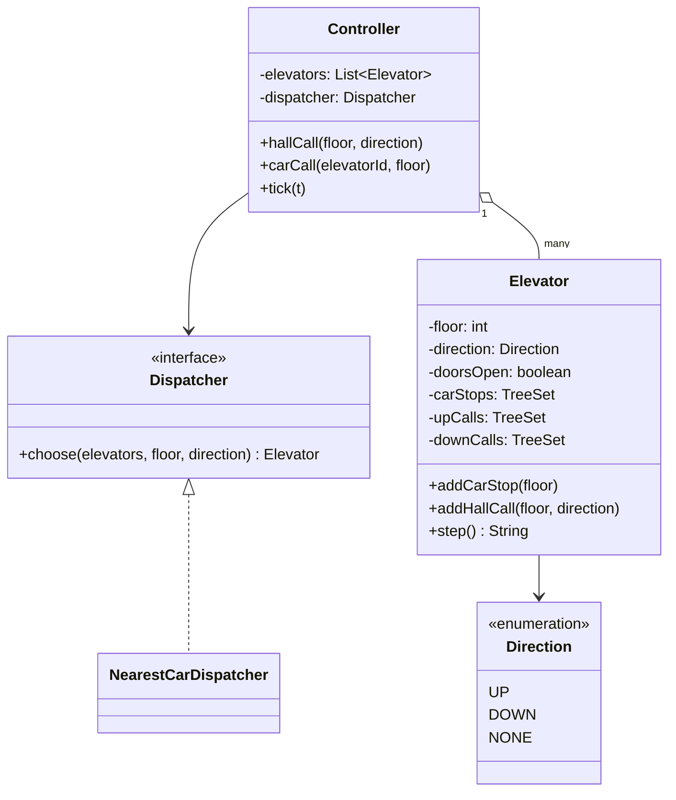
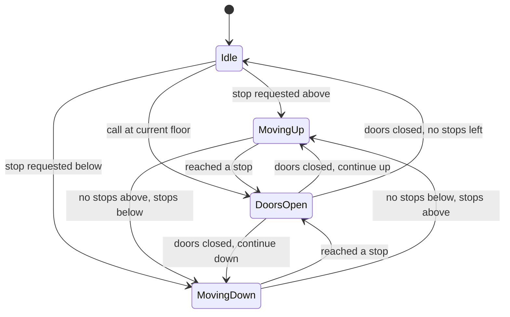

## Introduction

Press the call button in a lobby and something has to decide which of the building's elevators comes for you. Step inside and press 7, and something has to decide whether the car goes to 7 now or first stops at 4 for someone else. Those two decisions — **which car** answers a call, and **in what order** a car visits its floors — are what the elevator design problem is about.

In a low-level design (LLD) interview the elevator tests different skills from the [[d3-parking-lot]]. The parking lot is mostly about entities and responsibilities. The elevator is about **behaviour over time**: the car is always in some state (idle, moving up, moving down, doors open), requests arrive while it is moving, and a decision that was right a second ago may be wrong now. You need a state machine, a scheduling rule, and a way to simulate time so that you can show the design working.

These skills transfer well beyond buildings. Disk schedulers order read requests on a spinning disk with the same "sweep in one direction" rule — the disk algorithm is literally called the *elevator algorithm*. Job schedulers, ride-hailing dispatch and warehouse robots all assign work to a pool of moving resources using a cost function, which is what an elevator dispatcher does.

## Before you start

- **The LLD method** — clarify, identify entities, assign responsibilities, walk the flows, code, extend. It is taught step by step in [[d3-parking-lot]].
- **State machines and the State pattern** — the elevator's behaviour depends on its current state. See [[d2-state]].
- **Strategy pattern** — the dispatching rule is a strategy. See [[d2-strategy]].
- **`TreeSet`** — ordered sets with `higher`, `lower`, `first` and `last` make "next stop above me" an O(log n) query. See [[c1-treeset]].
- **Thread basics** — for the concurrency section, the idea that one thread should own mutable state. See [[c3-thread-confinement]] and [[c3-blockingqueue]].

## The intuition

Picture one elevator in a ten-floor building, currently at floor 5 and travelling up. Requests are waiting at floors 8, 2, 9, 1 and 7, in the order they were made.

The most obvious rule is to serve them **in the order they arrived**: 5 → 8 → 2 → 9 → 1 → 7. The car zig-zags across the building and travels 3 + 6 + 7 + 8 + 6 = 30 floors. Every passenger waits longer than necessary because the car keeps reversing past people it could have picked up.

A human operator would do something different: keep going up, stopping at 7, 8 and 9 on the way, then turn around and come down for 2 and 1. That is 4 floors up and 8 floors down — 12 floors in total, less than half the distance. This rule, "keep going in your current direction while there is work ahead, then reverse", is the core of every practical elevator scheduler. It is called **LOOK** (the car *looks* ahead and turns around at the last request), and a close cousin that always travels to the top or bottom floor before turning is called **SCAN**.

The picture to hold in your head is a car sweeping back and forth like a windscreen wiper, collecting requests that lie in its path. The rest of the design is about making that rule precise — and handling the people outside who want to go the *other* way.

## Step 1: Clarify the requirements

| Question | Assumed answer | Why it matters |
|---|---|---|
| How many elevators and floors? | Several cars, roughly 10–50 floors | More than one car means a dispatcher is needed |
| What buttons exist? | UP/DOWN buttons on each floor; floor buttons inside each car | Two kinds of request with different rules |
| What must be optimised? | Average waiting time, without anyone waiting forever | Rules out pure first-come-first-served and naive nearest-first |
| Capacity? | A weight limit per car | Full cars should not stop for more passengers |
| Doors? | Doors open on arrival, stay open briefly, then close; reopen if obstructed | The car must never move with doors open |
| Special modes? | Maintenance (car out of service) and fire emergency | States that override normal scheduling |
| Real-time or simulation? | Simulation in discrete ticks, so behaviour can be shown and tested | Determines how time is modelled |

The last answer deserves a comment. Real elevator controllers react to sensors in real time, but in an interview you need something you can run and reason about. A **discrete simulation** advances time in fixed ticks — one tick to move a floor, one tick with the doors open — so every run is deterministic. It also makes the design testable: a test can say "after 7 ticks, car A is at floor 5 with its doors open".

## Step 2: Two kinds of request

The most important domain insight in this problem is that requests come from two places and carry different information.

A **hall call** is a button press on a floor: "I am on floor 4 and I want to go DOWN." It has a floor *and a direction*, but no destination — the elevator does not yet know where this person is going. Any car can answer it, so the building must decide which one.

A **car call** is a button press inside a car: "take me to floor 9." It has a destination but no meaningful direction, and it belongs to *that* car — the passenger is already inside.

The direction of a hall call matters for when a car should stop. If car A is travelling down from 9 to 1 and someone on floor 5 has pressed UP, stopping at 5 is pointless: the passenger wants to go up, the car is going down, and they would either not board or ride all the way to the bottom first. So the car records hall calls by direction and stops for a hall call only when it is moving the way the passenger wants — with one exception: at the end of a sweep, the car may stop for an opposite-direction call because it is about to turn around anyway.

This is why the notes for this topic say "separate up and down stop sets". A single set of floors loses the direction and makes the car stop for people it cannot usefully carry.

> [!IMPORTANT] Hall calls are assigned; car calls are not
> A hall call is a question to the whole building ("which car will come?"). A car call is an instruction to one car. Mixing them up — for example, letting the dispatcher move a car call to another car — produces designs that cannot work, because the passenger is physically inside the first car.

## Step 3: Entities and responsibilities

From the requirements, the nouns are building, floor, elevator (car), button, request, door, controller and scheduler. Applying the rule "the class with the data owns the decision" gives:

- **Elevator** — owns its current floor, direction, door state and its own stop sets. It decides *the order in which it visits its stops* (the LOOK rule), because only it knows where it is and where it is going.
- **Dispatcher** — decides *which elevator* answers a hall call. It reads elevator positions and directions but owns no state of its own. It is an interface, because the rule is the part most likely to change.
- **Controller** — the entry point for button presses. It routes hall calls through the dispatcher and car calls directly to the right elevator, and it drives the clock.
- **Direction** — an enum: `UP`, `DOWN`, `NONE` (idle).

*Floor* and *button* turn out not to need classes: a floor is an integer, and a button press becomes a method call on the controller. *Door* could be its own class with its own small state machine (opening, open, closing, closed) — a reasonable extension — but a boolean is enough for the core.



## Step 4: The elevator as a state machine

An elevator is always in exactly one of a few states, and which actions are legal depends on the state. Drawing it first prevents the most dangerous bug in the problem — moving with the doors open.



The rule that makes this safe is that there is **no arrow from `DoorsOpen` straight to a move**: the doors must close first. In the code below, closing the doors takes a whole tick and the method returns immediately afterwards, so it is structurally impossible for one tick to both close the doors and move.

Notice also that the state is really two pieces of information: the **direction** the car is committed to (up, down, none) and the **door state**. While its doors are open at floor 5 on the way up, the car must remember it is going up, so that it continues upward when they close. That is why the implementation stores `direction` and `doorsOpen` separately instead of one enum with a `DOORS_OPEN` value that would forget the direction.

## Step 5: The scheduling rule, precisely

The LOOK rule needs three questions the car can answer quickly:

- Is there any stop **above** me? Any stop **below** me?
- Should I **stop here**?
- Which **direction** should I take next?

Storing stops in `TreeSet<Integer>` makes the first question cheap: `set.higher(floor)` returns the smallest element strictly greater than `floor`, or `null`, in O(log n). The car keeps three sets — car stops, up hall calls, down hall calls — so it can apply the direction rule from Step 2.

**Should I stop here?** Always, if a passenger inside asked for this floor. Otherwise, if moving up: stop for an UP hall call here, or for a DOWN hall call here *if there is nothing further up* (this is the turnaround). Moving down is the mirror image. When idle, stop for any hall call here.

**Which direction next?** Keep the current direction while there are stops ahead in that direction. Otherwise reverse if there are stops behind. Otherwise become idle.

That is the entire algorithm. It is short because the stop sets do the bookkeeping.

## The implementation

The program is one file, `ElevatorDemo.java`, compiled and run on Java 21. It is shown in three parts; together they form the body of `public class ElevatorDemo`, which imports `ArrayList`, `Comparator`, `List`, `Map`, `TreeMap` and `TreeSet` from `java.util`.

### The elevator

```java title="ElevatorDemo.java (part 1: the elevator)"
enum Direction { UP, DOWN, NONE }

static final class Elevator {
    private final String id;
    private int floor;
    private Direction direction = Direction.NONE;
    private boolean doorsOpen;
    // Car calls: a passenger inside pressed a floor. Hall calls: someone outside
    // pressed UP or DOWN on a floor; direction matters for those.
    private final TreeSet<Integer> carStops = new TreeSet<>();
    private final TreeSet<Integer> upCalls = new TreeSet<>();
    private final TreeSet<Integer> downCalls = new TreeSet<>();

    Elevator(String id, int startFloor) { this.id = id; this.floor = startFloor; }

    void addCarStop(int f) { carStops.add(f); }

    void addHallCall(int f, Direction d) {
        if (d == Direction.UP) upCalls.add(f); else downCalls.add(f);
    }

    boolean hasStopsAbove() {
        return carStops.higher(floor) != null || upCalls.higher(floor) != null
                || downCalls.higher(floor) != null;
    }

    boolean hasStopsBelow() {
        return carStops.lower(floor) != null || upCalls.lower(floor) != null
                || downCalls.lower(floor) != null;
    }

    boolean hasAnyStop() {
        return !carStops.isEmpty() || !upCalls.isEmpty() || !downCalls.isEmpty();
    }

    /** LOOK rule: stop for car calls, and for hall calls going our way. */
    private boolean shouldStopHere() {
        if (carStops.contains(floor)) return true;
        return switch (direction) {
            case UP -> upCalls.contains(floor)
                    || (downCalls.contains(floor) && !hasStopsAbove()); // turnaround
            case DOWN -> downCalls.contains(floor)
                    || (upCalls.contains(floor) && !hasStopsBelow());   // turnaround
            case NONE -> upCalls.contains(floor) || downCalls.contains(floor);
        };
    }

    private void serveCurrentFloor() {
        carStops.remove(floor);
        switch (direction) {
            case UP -> {
                upCalls.remove(floor);
                if (!hasStopsAbove() && downCalls.remove(floor)) direction = Direction.DOWN;
            }
            case DOWN -> {
                downCalls.remove(floor);
                if (!hasStopsBelow() && upCalls.remove(floor)) direction = Direction.UP;
            }
            case NONE -> {
                if (upCalls.remove(floor)) direction = Direction.UP;
                else if (downCalls.remove(floor)) direction = Direction.DOWN;
            }
        }
    }

    /** Keep going while there is work ahead; otherwise reverse or go idle. */
    private void chooseDirection() {
        boolean above = hasStopsAbove(), below = hasStopsBelow();
        direction = switch (direction) {
            case UP -> above ? Direction.UP : below ? Direction.DOWN : Direction.NONE;
            case DOWN -> below ? Direction.DOWN : above ? Direction.UP : Direction.NONE;
            case NONE -> above ? Direction.UP : below ? Direction.DOWN : Direction.NONE;
        };
    }

    /** One tick of simulated time: close doors, or open them, or move one floor. */
    String step() {
        if (doorsOpen) {
            doorsOpen = false;                      // never move in the same tick
            if (!hasAnyStop()) direction = Direction.NONE;
            return "doors close";
        }
        if (shouldStopHere()) {
            serveCurrentFloor();
            doorsOpen = true;
            return "doors open at " + floor;
        }
        chooseDirection();
        switch (direction) {
            case UP -> floor++;
            case DOWN -> floor--;
            case NONE -> { return "idle"; }
        }
        return "move to " + floor;
    }

    /** Floor where the car would turn around if no new calls arrived. */
    int turnaroundFloor() {
        List<TreeSet<Integer>> all = List.of(carStops, upCalls, downCalls);
        int turn = floor;
        for (TreeSet<Integer> s : all) {
            if (s.isEmpty()) continue;
            if (direction == Direction.UP) turn = Math.max(turn, s.last());
            if (direction == Direction.DOWN) turn = Math.min(turn, s.first());
        }
        return turn;
    }

    String id() { return id; }
    int floor() { return floor; }
    Direction direction() { return direction; }
}
```

`step()` is the heart of the class, and its order of checks is deliberate. **Doors first**: if they are open, the only legal action is to close them, and the method returns, so movement cannot happen in the same tick. **Stop check second**: the car checks whether the current floor needs service *before* reconsidering direction. If the order were reversed, a car arriving at floor 5 with an UP call there and other work below could flip to `DOWN` first and then skip the passenger it came for. **Move last**: only when there is nothing to do here does the car pick a direction and move.

`serveCurrentFloor()` clears exactly the requests this stop satisfies. Moving up, it clears the UP call but leaves a DOWN call at the same floor alone — unless this is the turnaround, in which case it clears the DOWN call and flips direction, because the passenger it is picking up wants to go down. Leaving the right requests in place is what makes the direction rule work.

`turnaroundFloor()` is not used by the car itself; it answers a question the dispatcher needs — "how far will you travel before you can come back?" — using `first()` and `last()` of the sorted sets.

### The dispatcher and controller

```java title="ElevatorDemo.java (part 2: dispatcher and controller)"
interface Dispatcher {
    Elevator choose(List<Elevator> elevators, int floor, Direction wanted);
}

/** Nearest-car: estimated floors travelled before the car can serve the call. */
static final class NearestCarDispatcher implements Dispatcher {
    public Elevator choose(List<Elevator> elevators, int floor, Direction wanted) {
        return elevators.stream()
                .min(Comparator.comparingInt((Elevator e) -> cost(e, floor, wanted))
                               .thenComparing(Elevator::id))
                .orElseThrow();
    }

    static int cost(Elevator e, int floor, Direction wanted) {
        int here = e.floor();
        Direction d = e.direction();
        if (d == Direction.NONE) return Math.abs(here - floor);
        boolean onTheWay = (d == Direction.UP && wanted == Direction.UP && floor >= here)
                || (d == Direction.DOWN && wanted == Direction.DOWN && floor <= here);
        if (onTheWay) return Math.abs(floor - here);
        int turn = e.turnaroundFloor();     // finish the current sweep, then come back
        return Math.abs(turn - here) + Math.abs(turn - floor);
    }
}

static final class Controller {
    private final List<Elevator> elevators;
    private final Dispatcher dispatcher;

    Controller(List<Elevator> elevators, Dispatcher dispatcher) {
        this.elevators = elevators; this.dispatcher = dispatcher;
    }

    void hallCall(int floor, Direction wanted) {
        Elevator e = dispatcher.choose(elevators, floor, wanted);
        e.addHallCall(floor, wanted);
        System.out.println("      hall call " + floor + " " + wanted + " -> " + e.id());
    }

    void carCall(String elevatorId, int floor) {
        elevators.stream().filter(e -> e.id().equals(elevatorId)).findFirst()
                 .orElseThrow().addCarStop(floor);
        System.out.println("      car call " + floor + " inside " + elevatorId);
    }

    void tick(int t) {
        StringBuilder line = new StringBuilder(String.format("t=%02d", t));
        for (Elevator e : elevators) {
            line.append(String.format("  %s: %-16s", e.id(), e.step()));
        }
        System.out.println(line.toString().stripTrailing());
    }
}
```

The dispatcher's cost function estimates **how many floors the car must travel before it can serve this call**. An idle car simply drives there. A car already heading toward the floor in the direction the passenger wants will pass it anyway, so its cost is the plain distance. Any other car must finish its current sweep — travel to its turnaround floor — and then come back, so its cost is the distance to the turnaround plus the distance from there to the call. Ties go to the car with the smaller ID so the result is deterministic.

This is a heuristic, not an optimum. It ignores how many stops a car already has (each costs door time), how full it is, and calls that will arrive later. Those are exactly the refinements an interviewer may ask about, and because the rule sits behind `Dispatcher`, each refinement is a new class rather than an edit to `Controller` or `Elevator`.

### Running a scenario

```java title="ElevatorDemo.java (part 3: a scripted scenario)"
public static void main(String[] args) {
    Elevator a = new Elevator("A", 0);
    Elevator b = new Elevator("B", 9);
    Controller c = new Controller(List.of(a, b), new NearestCarDispatcher());

    Map<Integer, List<Runnable>> script = new TreeMap<>();
    at(script, 0, () -> c.hallCall(3, Direction.UP));
    at(script, 0, () -> c.hallCall(7, Direction.DOWN));
    at(script, 3, () -> c.carCall("B", 1));      // passenger who boarded at 7
    at(script, 4, () -> c.carCall("A", 8));      // passenger who boarded at 3
    at(script, 5, () -> c.hallCall(5, Direction.UP));
    at(script, 5, () -> c.hallCall(4, Direction.DOWN));
    at(script, 6, () -> c.hallCall(2, Direction.UP));

    for (int t = 0; t <= 15; t++) {
        script.getOrDefault(t, List.of()).forEach(Runnable::run);
        c.tick(t);
    }
}

static void at(Map<Integer, List<Runnable>> script, int tick, Runnable event) {
    script.computeIfAbsent(tick, k -> new ArrayList<>()).add(event);
}
```

```output
      hall call 3 UP -> A
      hall call 7 DOWN -> B
t=00  A: move to 1         B: move to 8
t=01  A: move to 2         B: move to 7
t=02  A: move to 3         B: doors open at 7
      car call 1 inside B
t=03  A: doors open at 3   B: doors close
      car call 8 inside A
t=04  A: doors close       B: move to 6
      hall call 5 UP -> A
      hall call 4 DOWN -> B
t=05  A: move to 4         B: move to 5
      hall call 2 UP -> B
t=06  A: move to 5         B: move to 4
t=07  A: doors open at 5   B: doors open at 4
t=08  A: doors close       B: doors close
t=09  A: move to 6         B: move to 3
t=10  A: move to 7         B: move to 2
t=11  A: move to 8         B: move to 1
t=12  A: doors open at 8   B: doors open at 1
t=13  A: doors close       B: doors close
t=14  A: idle              B: move to 2
t=15  A: idle              B: doors open at 2
```

The script is a timeline: a `TreeMap` from tick number to the button presses that happen just before that tick. Because there are no threads and no real clock, every run prints exactly the same lines, which is what makes the simulation a useful test harness.

## Dry run: reading the timeline

Car A starts at floor 0 and car B at floor 9, both idle.

**Tick 0 — first assignments.** The UP call at floor 3 costs A three floors (idle, distance 3) and B six; A wins. The DOWN call at 7 costs B two floors and A seven; B wins.

**Ticks 2–4 — boarding.** B opens at 7, and the boarding passenger presses 1. A opens at 3, and its passenger presses 8. Each closes its doors in the following tick. B is now committed to `DOWN` with a car stop at 1; A is committed to `UP` with a car stop at 8.

**Before tick 5 — two calls, evaluated with the cost function.**

| Call | Car A (floor 3, going up, turnaround 8) | Car B (floor 6, going down, turnaround 1) | Winner |
|---|---|---|---|
| Floor 5, UP | on the way: 5 − 3 = 2 | must finish sweep: (6 − 1) + (5 − 1) = 9 | A |
| Floor 4, DOWN | must finish sweep: (8 − 3) + (8 − 4) = 9 | on the way: 6 − 4 = 2 | B |

Both calls go to the car already passing in the right direction. A naive "nearest car by distance" rule would have given the floor-5 UP call to B, which was one floor closer at that moment — and B would have reached floor 5 going *down*, the wrong way.

**Before tick 6 — an UP call at floor 2.** A is at 4 going up toward 8, so its cost is (8 − 4) + (8 − 2) = 10. B is at 5 going down toward 1, so its cost is (5 − 1) + (2 − 1) = 5. B gets it.

**Ticks 9–15 — the direction rule in action.** At tick 11, B is at floor 2, where the UP call is waiting. B is moving down and still has a car stop at 1 below it, so `shouldStopHere()` says no: the passenger wants to go up and B is going down. B continues to 1, lets its passenger out, closes, sees the only remaining request is above, reverses, and opens at 2 going up at tick 15. Meanwhile A finished its sweep at 8 and became idle.

```quiz
Q: Car B is at floor 2 moving down, with a car stop at floor 1 and an UP hall call at floor 2. What does the LOOK rule do at floor 2?
- [ ] Stops at 2, because there is a request at the current floor
- [x] Passes 2, serves 1, then reverses and stops at 2 on the way up
- [ ] Reassigns the UP call to another car
- [ ] Ignores the UP call permanently
> The UP passenger wants to travel up, and B still has work below (the car stop at 1), so stopping now would only make them ride down and back. The turnaround exception applies only when there is nothing further in the current direction. After serving floor 1, B reverses and picks the passenger up going the right way.
```

## Scheduling algorithms compared

The single-car ordering rule has a long history in operating systems, where a disk head moving across tracks faces the same problem as a car moving across floors. Using the intuition example (car at floor 5 going up, requests at 8, 2, 9, 1, 7, floors 0–10):

| Algorithm | Rule | Order served | Floors travelled | Weakness |
|---|---|---|---|---|
| First-come-first-served (FCFS) | In arrival order | 8, 2, 9, 1, 7 | 30 | Zig-zags; long waits for everyone |
| Shortest seek first (SSTF) | Always the nearest request | 7, 8, 9, 2, 1 | 12 | **Starvation**: a far floor can wait forever if nearer calls keep arriving |
| SCAN | Sweep to the end of the building, then reverse | 7, 8, 9, (10), 2, 1 | 14 | Travels to the top even when nobody is there |
| LOOK | Sweep only as far as the last request, then reverse | 7, 8, 9, 2, 1 | 12 | Floors at the ends wait a little longer than middle floors |

SSTF matches LOOK on this input but is the dangerous one. Suppose the car is near the middle of a busy office and requests keep arriving at floors 4–8. Someone on floor 20 is never the nearest request, so with SSTF they wait indefinitely. LOOK cannot starve anyone: every request ahead of the car is served during the current sweep, and every request behind it during the next one, so the worst-case wait is bounded by about two full sweeps of the building.

That bound is the strongest argument in an interview: **LOOK gives good average travel and a guaranteed worst case**; SSTF gives good average travel and no guarantee.

## Dispatching across many cars

With several cars, the single-car rule decides the order *within* a car, and the dispatcher decides *which* car gets each hall call. Common dispatching strategies:

- **Nearest car with direction awareness** — the cost function in the demo. Simple, explainable and good for small groups of cars.
- **Least-loaded** — prefer cars with fewer pending stops, even if slightly farther, because each stop costs door time. A cost function can combine distance and stop count: `cost = floors + 3 × stops`, with weights tuned by simulation.
- **Zoning** — divide floors among cars (cars A and B serve floors 1–20, C and D serve 21–40). Fewer stops per trip, at the cost of idle cars in a quiet zone.
- **Traffic modes** — in the morning, most trips start in the lobby, so idle cars are sent back to the lobby ("up-peak" mode). In the evening, trips end there, so idle cars wait on upper floors.
- **Destination dispatch** — passengers enter their destination floor on a keypad in the lobby instead of pressing UP, and the system tells them which car to take. Because the system knows destinations *before* assigning cars, it can group people going to nearby floors into the same car. Major manufacturers sell these systems for busy towers.

Destination dispatch is worth mentioning because it changes the model, not just the algorithm: a hall call now carries a destination, so the distinction between hall calls and car calls blurs. A design with `Dispatcher` as an interface and requests as their own types adapts to that without rewriting the elevator's movement logic.

Real dispatchers also **reassign** calls. A call assigned to car B may be moved to car A if B is delayed by a stuck door. The demo assigns once and never revisits; adding reassignment means storing hall calls centrally and having each tick re-run the dispatcher for calls not yet served.

## Concurrency: buttons press while cars move

In a real system, button presses arrive at any moment from many places, while each car's control loop is reading and modifying its stop sets. If a button-press thread calls `upCalls.add(5)` while the control thread is iterating `upCalls`, a `TreeSet` (which is not thread-safe) can be corrupted or throw `ConcurrentModificationException`.

The cleanest fix is not to sprinkle locks over the elevator but to give each car's state a **single owner**. Each car runs one control thread. Button presses never touch the car's fields; they become messages placed on a thread-safe queue, and the control thread drains that queue at the start of each tick:

```java
// One per car. Producers (buttons, dispatcher) call submit from any thread.
final class ElevatorLoop implements Runnable {
    private final BlockingQueue<Integer> pendingCarCalls = new LinkedBlockingQueue<>();
    private final Elevator car;                       // touched only by this thread

    ElevatorLoop(Elevator car) { this.car = car; }

    void submit(int floor) { pendingCarCalls.add(floor); }

    @Override public void run() {
        while (!Thread.currentThread().isInterrupted()) {
            Integer f;
            while ((f = pendingCarCalls.poll()) != null) car.addCarStop(f);
            car.step();
            try { Thread.sleep(1_000); } catch (InterruptedException e) { return; }
        }
    }
}
```

This is **thread confinement**: the `Elevator` and its `TreeSet`s are only ever used by one thread, so they need no locks at all, and the only shared object is a `LinkedBlockingQueue`, which is designed for exactly this hand-off. The dispatcher reads car positions to compute costs; those reads should use a snapshot the car publishes (for example an immutable record in a `volatile` field) rather than reaching into the car's live sets. Fixed sleeps are fine for a sketch; a real loop would react to sensor events instead. See [[c3-thread-confinement]] and [[c3-blockingqueue]].

## Capacity, doors and special modes

**Capacity.** A load sensor reports the car's weight. When the car is nearly full, it should skip hall calls (passengers could not board anyway) while still honouring car calls so people can get out. In the design this is one more condition in `shouldStopHere()` for hall calls, and one more term in the dispatcher's cost function so it stops assigning calls to full cars. Treat the load as data the car reads from a sensor interface, which also makes it easy to fake in tests.

**Door behaviour.** Real doors have their own small state machine — closed, opening, open, closing — with a timer for how long they stay open and a sensor that reopens them if something is in the way. The safety rule is that **the motor may run only when the doors are confirmed closed and locked**. Modelling `Door` as its own class with its own states keeps that rule in one place; the elevator asks `door.isClosedAndLocked()` before moving. The classic race is "close command issued, obstruction detected, move command issued": if moving checks a stale flag rather than the confirmed sensor state, the car could move while the doors reopen.

**Maintenance mode.** A car taken out of service must stop accepting hall calls, and the dispatcher must skip it. Adding a `mode` (normal, maintenance, emergency) to the car and having the dispatcher filter on it is enough.

**Fire emergency.** Building codes require elevators to return to a designated floor and open their doors when fire alarms trigger, after which only firefighters can operate them. This mode overrides every pending request: the car clears its stops, travels to the recall floor and stays there. In the state diagram it is a state reachable from every other state — a good illustration of why the State pattern helps when modes multiply.

> [!WARNING] Software models are not safety systems
> Real elevators enforce door interlocks, overspeed protection and emergency braking in certified hardware and safety controllers governed by standards such as EN 81-20 in Europe and ASME A17.1 in North America. The design in this lesson models scheduling. In an interview, saying that safety-critical behaviour belongs in independent, verified hardware is a sign of maturity, not a dodge.

## In real systems

Modern elevator groups are controlled by a **group controller** — the dispatcher — connected to one controller per car. Each car controller runs the motion profile (acceleration, speed, levelling at the floor) and the door logic; the group controller only decides assignments. That split matches the class design: `Elevator` owns motion and stops, `Dispatcher` owns assignment.

Group controllers use cost functions that combine estimated waiting time, estimated travel time and energy use, and they learn traffic patterns over the day — in high-rise offices the morning up-peak is the hardest load to serve. Destination dispatch is now common in large towers.

The same structure appears in software you are more likely to build. A ride-hailing dispatcher assigns trip requests to moving drivers with a cost function of estimated pickup time. A job scheduler assigns tasks to worker machines based on their current load. A warehouse system assigns picking tasks to robots already travelling through the right aisle. In each case, separating "what each worker does next" from "which worker gets the new job" is the elevator's `Elevator`/`Dispatcher` split.

## Trade-offs and alternatives

| Decision | Choice here | Alternative | When the alternative wins |
|---|---|---|---|
| Stop storage | Three `TreeSet`s (car, up, down) | One set of floors | Never for hall calls — direction is lost |
| Single-car order | LOOK | SCAN, SSTF, FCFS | SCAN when uniform waits at the end floors matter more than travel |
| Multi-car assignment | Direction-aware nearest car | Least-loaded, zoning, destination dispatch | Large groups and busy buildings |
| Time model | Discrete ticks | Real-time events from sensors | A real controller, not a design exercise |
| Concurrency | One thread per car, queue for input | Locks around every method | Never preferable; locks spread and invite deadlock |
| State representation | `direction` + `doorsOpen` fields | Full State-pattern classes per state | Many modes (maintenance, fire, independent service) with different rules |

The design's main limitation is the dispatcher's myopia: it assigns each call when it arrives, using a crude estimate, and never revisits. That is acceptable for an interview and for small buildings. Production systems re-evaluate assignments continuously and simulate several possible futures before committing.

## Common mistakes

**One queue of floors for everything.** A single list or set loses the difference between "someone inside wants floor 5" and "someone on floor 5 wants to go up". The car then stops for passengers going the other way. Keep car calls and directional hall calls separate.

**First-come-first-served order.** Serving requests in arrival order looks fair but makes everyone wait longer, because the car keeps reversing past people it could pick up.

**Nearest-request-first with no guarantee.** Always serving the nearest request starves distant floors under load. Prefer LOOK, and be able to explain the bounded worst case.

**Moving with the doors open.** If closing the doors and starting to move happen in the same step, any bug in the sequencing becomes a safety bug. Make "doors confirmed closed" a precondition for movement, as `step()` does by returning after closing.

**Ignoring direction when dispatching.** Choosing the car with the smallest `|car floor − call floor|` sends cars that are passing the floor in the wrong direction. Include direction and the remaining sweep in the cost.

> [!MISTAKE] Letting several threads mutate the elevator directly
> Button handlers calling `elevator.addStop()` while the control loop iterates the stop set causes intermittent corruption that tests rarely catch. Funnel all input through a thread-safe queue owned by the car's control thread.

## Interview perspective

A strong elevator answer has a recognisable shape: requirements with scale (cars, floors), the hall-call versus car-call distinction stated early, a state diagram, the `Elevator`/`Dispatcher`/`Controller` split, a `step()` method that implements LOOK, and a discussion of algorithms and extensions. You rarely have time to code the dispatcher and the elevator in full; code `step()` and describe the dispatcher's cost function.

> [!INTERVIEW] What a strong answer sounds like
> "Each car keeps three sorted sets: car stops, up calls and down calls. It continues in its direction while there's work ahead and reverses otherwise — that's LOOK, which bounds the worst-case wait to about two sweeps, unlike nearest-first which can starve a floor. A separate dispatcher assigns each hall call by estimated travel: plain distance if the car is already coming the right way, otherwise distance to its turnaround and back."

Questions to expect:

- **What states does an elevator have?** Idle, moving up, moving down, doors open — plus maintenance and emergency modes. Explain why direction is remembered while doors are open.
- **Explain SCAN versus LOOK.** SCAN always travels to the end floor; LOOK turns at the last request. LOOK saves travel; both avoid starvation.
- **How would you minimise waiting time?** Better cost function (pending stops, load), reassigning calls, traffic-pattern modes, destination dispatch.
- **How is the request handling made thread-safe?** One control thread per car, input through a `BlockingQueue`, dispatcher reads published snapshots.
- **What if a car is full?** Skip hall calls, keep car calls, and stop assigning it new hall calls.
- **What about a fire alarm?** An emergency mode that clears requests, recalls cars to a designated floor and disables normal calls.
- **How would you test it?** The tick-based simulation is deterministic: script button presses and assert positions and door states at given ticks, plus property tests such as "a car never moves while its doors are open".

## Practice

1. **SCAN variant.** Change `chooseDirection()` so the car always travels to the top or bottom floor before reversing. Rerun the scenario and compare when each passenger is picked up.
2. **Load-aware dispatcher.** Give each car a pending-stop count and implement a dispatcher whose cost is `floors + 3 × pendingStops`. Construct a scenario where it chooses a different car from `NearestCarDispatcher`.
3. **Capacity.** Add a passenger count and a capacity of 8. A full car must skip hall calls. Which methods change?
4. **Door class.** Extract the door into its own class with states CLOSED, OPENING, OPEN and CLOSING, a dwell time of two ticks, and an `obstruct()` method that reopens it. Prove (by a test) that the car never moves unless the door is CLOSED.
5. **Maintenance mode.** Add a way to take a car out of service. What happens to the hall calls already assigned to it?
6. **Starvation test.** Write a scenario that starves floor 20 under a shortest-seek-first rule, and show that LOOK serves it within two sweeps.

## Quick revision {#quick-revision}

- Hall call = floor + direction, assigned by the dispatcher to some car. Car call = destination floor, belongs to that car.
- Car state = committed direction (UP, DOWN, NONE) + door state. Never move in the same step that closes the doors.
- Store stops in three `TreeSet`s: car stops, up calls, down calls; `higher`/`lower` answer "work above/below?" in O(log n).
- LOOK: stop for car calls and same-direction hall calls; at the end of a sweep, also for opposite calls; reverse when nothing is ahead.
- `step()` order: close doors → serve current floor → choose direction → move.
- FCFS zig-zags; SSTF starves; SCAN goes to the ends; LOOK turns at the last request and bounds waits.
- Dispatcher cost: idle → distance; on the way in the right direction → distance; otherwise → distance to turnaround + back.
- Strategies: nearest car, least-loaded, zoning, peak modes, destination dispatch; real systems reassign calls.
- Concurrency: one control thread per car, input through a `BlockingQueue`, snapshots for the dispatcher.
- Extensions: load limit skips hall calls; door sub-state machine; maintenance and fire recall modes.

## Key takeaways {#key-takeaways}

- The elevator problem is a state machine plus two scheduling decisions: the order a car visits its stops, and which car answers each hall call.
- Hall calls carry a direction and must be stored by direction; a single set of floors makes cars stop for passengers going the other way.
- LOOK — continue while there is work ahead, then reverse — gives short travel and a bounded worst-case wait, which nearest-first cannot promise.
- Separate the elevator's movement logic from the dispatcher behind an interface, so assignment rules can evolve independently.
- A discrete tick-based simulation makes the design deterministic, demonstrable and testable.
- Give each car's state a single owning thread and feed it through a queue rather than locking shared mutable state.
