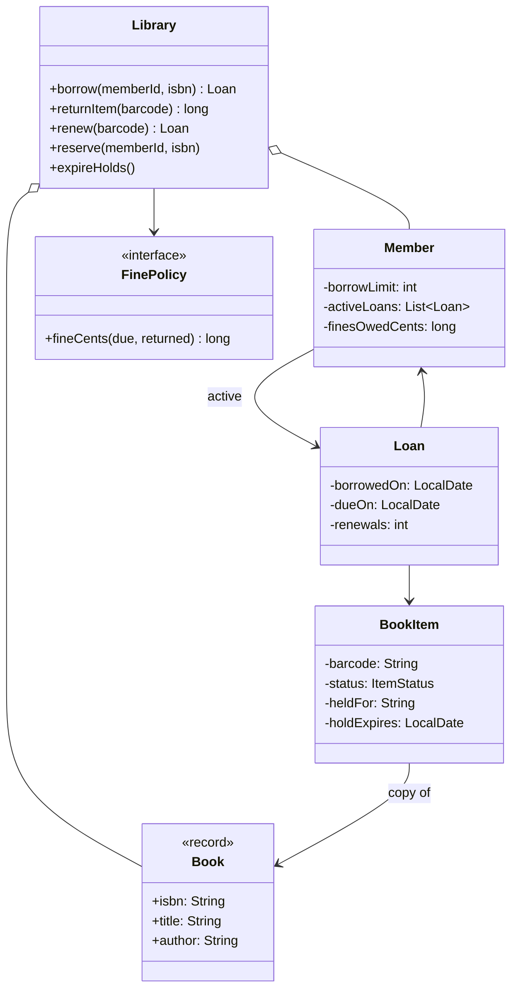
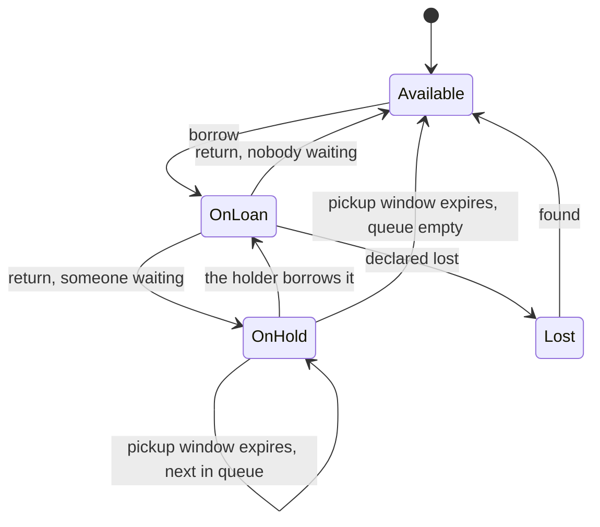
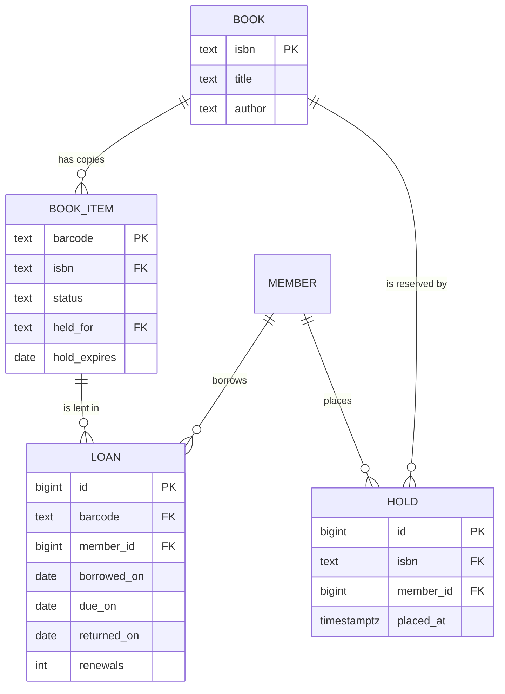

## Introduction

A city library owns three copies of a popular novel. All three are out. A fourth member wants it, so she places a reservation. When the first copy comes back — two days late — the library must charge the borrower a fine, set the copy aside for the member at the front of the waiting list, notify her, and give it to the next person if she does not collect it within a few days. Meanwhile the member who has the second copy tries to renew it, and must be told no, because people are waiting.

None of that is algorithmically hard. What makes the library a valuable low-level design (LLD) exercise is that it is **all rules**: borrowing limits, due dates, renewal limits, fines, reservations, expiry. The question an interviewer is really asking is whether you can put each rule in a sensible place, so that the system stays correct and changeable as rules are added.

The library also contains the single most useful modelling lesson in this module. "Book" means two different things: the *title* ("Clean Code, ISBN 978-0132350884") and the *physical object* on the shelf with barcode `CC-1`. Members search for titles but borrow objects. Designs that use one `Book` class for both fall apart as soon as a library owns more than one copy — which is always.

The same shape appears in many domains you will build for: a car-rental company has car *models* and individual *cars*; a hotel has room *types* and *rooms*; a shop has *products* and *stock units*; a streaming service has *films* and *licences*. Learning to separate the description from the thing here makes all of those designs easier.

## Before you start

- **The LLD method** — clarify, identify entities, assign responsibilities, walk the flows, code, extend. It is taught step by step in [[d3-parking-lot]].
- **Enums and records** — item statuses are an enum; catalogue entries are records. See [[c1-enums]] and [[c1-records]].
- **Queues** — the reservation list is a first-in-first-out queue backed by `ArrayDeque`. See [[a5-queue]].
- **Strategy and State** — fines are a strategy; a copy's status is a small state machine. See [[d2-strategy]] and [[d2-state]].
- **Transactions and row locks** — for the "last copy" race in the database section. See [[c7-transactions]] and [[c7-row-locks]].

## The intuition

Walk into a library and look at what the staff actually track. At the front desk there is a **catalogue**: one entry per title, with the author, ISBN and subject. On the shelves are **copies**, each with a barcode sticker. When you borrow, the librarian scans *your card* and *a copy's barcode* and the system creates a **loan** with a due date. When you return, they scan the barcode, the loan closes, and the copy goes back on the shelf — or onto the "reserved" trolley if someone is waiting for that title.

That walkthrough already contains the design: catalogue entries, copies, members, loans and a waiting list, plus a handful of rules applied at the desk. The classes are the things the staff scan or write down; the rules are what the librarian checks before saying yes.

One question shapes everything that follows: **what does each rule need to know?** "You may not borrow more than five books" needs the member's active loans. "This copy is reserved for someone else" needs the copy's status. "Renewal refused because people are waiting" needs the title's waiting list. Each rule should live where its information lives.

## Step 1: Clarify the requirements

| Question | Assumed answer | Effect on the design |
|---|---|---|
| Physical books only, or e-books too? | Physical first; e-books as an extension | Copies have a location and a status |
| Several copies per title? | Yes | Title and copy are separate entities |
| Borrowing limit? | A maximum number of active loans per member, possibly by membership type | Member holds a limit |
| Loan period and renewals? | 14 days; renewable up to twice; not if overdue or if others are waiting | Loan stores due date and renewal count |
| Fines? | Per day late, capped; members owing too much cannot borrow | Fine policy is replaceable |
| Reservations? | A member can reserve a title; the first returned copy is held for the first person in the queue for a few days | Queue per title; copies can be "on hold" |
| Search? | By title and author | A catalogue index |
| Many branches? | One branch first; branches as an extension | Copies may later carry a branch |
| Lost or damaged items? | A copy can be declared lost | A `LOST` status |

The answers separate into **policies that will change** — loan period, renewal limit, fine amounts, pickup window — and **structure that will not** — members borrow copies of titles. Policies go into configuration objects and strategy interfaces; structure goes into the core classes. That split is how the design stays stable while the library committee keeps changing the rules.

## Step 2: Title versus copy

This is the decision interviewers listen for, so it deserves its own step.

A **`Book`** is the catalogue record: ISBN, title, author. There is exactly one per title, and it never changes when someone borrows. A **`BookItem`** is a physical copy: a barcode, a status (available, on loan, on hold, lost), and a reference to its `Book`. A library with three copies of a novel has one `Book` and three `BookItem`s.

What goes wrong if they are merged into one `Book` class with a `status` field? You need three objects to represent three copies, so the title and author are duplicated three times and can drift apart when someone corrects a typo. "Is this title available?" becomes "is *any* of these three separately stored records available?", with nothing in the model saying they are the same title. And a loan cannot say *which* copy was borrowed, so when a damaged copy comes back you cannot tell which one it is.

With the split, every question has one natural home:

| Question | Answered by |
|---|---|
| Who wrote it? What is it about? | `Book` |
| Is a copy on the shelf right now? | The `BookItem`s for that `Book` |
| Who has copy `CC-1`, and when is it due? | The `Loan` for that `BookItem` |
| Who is waiting for this title? | The hold queue for that `Book`'s ISBN |

Notice the last row. People reserve a **title**, not a copy — "I want *Clean Code*", not "I want the copy with barcode `CC-1`". So the waiting list belongs to the title, and the first copy of that title to come back is the one that gets held.

## Step 3: Entities and responsibilities

- **Book** — immutable catalogue data. A record.
- **BookItem** — a copy's barcode, status, and (while on hold) who it is held for and until when.
- **Member** — identity, borrowing limit, active loans and fines owed.
- **Loan** — which member has which copy, when it was borrowed, when it is due, how many times it has been renewed. This is the record of a borrowing *event*, and it is what the fine is computed from.
- **Hold queue** — per ISBN, the members waiting, in order.
- **FinePolicy** — turns a due date and a return date into an amount.
- **LendingRules** — the configurable numbers: loan days, maximum renewals, pickup days, maximum fines before borrowing is blocked.
- **Library** — the service the front desk calls: `borrow`, `returnItem`, `renew`, `reserve`, and a daily `expireHolds` job.



Why does the `Library` service hold the operations instead of, say, `Member.borrow(book)`? Because borrowing touches several objects at once — the member's limit and fines, a copy's status, the title's hold queue, and a new loan — and those changes must succeed or fail together. A method on `Member` would have to reach into copies and queues it does not own. One service method that coordinates the change, while each object guards its own data, is easier to make atomic (one lock here, one database transaction in production). This style, where a service orchestrates and entities hold state, is common in backend code; the trade-off with putting more behaviour on entities is discussed in [[c8-transaction-script-vs-rich-domain]].

## Step 4: The life of a copy

A copy's status decides which operations are legal, so draw it as a state machine before writing code.



Two arrows deserve attention. **A return does not always make a copy available**: if anyone is waiting for the title, the copy goes straight to `OnHold` for the first person in the queue, so nobody browsing the shelf can take it. And **holds expire**: if the member does not collect within the pickup window, the hold passes to the next person. Without that arrow, one forgetful member could block a popular book indefinitely.

## The implementation

The program is one file, `LibraryDemo.java`, shown in four parts that together make up the body of `public class LibraryDemo`. It imports `Clock`, `Instant`, `LocalDate`, `ZoneId`, `ZoneOffset` and `ChronoUnit` from `java.time`, and `ArrayDeque`, `ArrayList`, `Deque`, `HashMap`, `List`, `Map` and `Optional` from `java.util`. It compiles and runs on Java 21.

### Catalogue, members and loans

```java title="LibraryDemo.java (part 1: entities)"
record Book(String isbn, String title, String author) {}

enum ItemStatus { AVAILABLE, ON_LOAN, ON_HOLD, LOST }

static final class BookItem {
    final String barcode;
    final Book book;
    ItemStatus status = ItemStatus.AVAILABLE;
    String heldFor;               // member id while ON_HOLD
    LocalDate holdExpires;

    BookItem(String barcode, Book book) { this.barcode = barcode; this.book = book; }
}

static final class Member {
    final String id;
    final int borrowLimit;
    final List<Loan> activeLoans = new ArrayList<>();
    long finesOwedCents;

    Member(String id, int borrowLimit) { this.id = id; this.borrowLimit = borrowLimit; }
}

static final class Loan {
    final String id;
    final Member member;
    final BookItem item;
    final LocalDate borrowedOn;
    LocalDate dueOn;
    int renewals;

    Loan(String id, Member member, BookItem item, LocalDate borrowedOn, LocalDate dueOn) {
        this.id = id; this.member = member; this.item = item;
        this.borrowedOn = borrowedOn; this.dueOn = dueOn;
    }
}

static class LibraryException extends RuntimeException {
    LibraryException(String msg) { super(msg); }
}
```

`Book` is a record because catalogue data is a value: two `Book`s with the same ISBN, title and author are the same book. `BookItem`, `Member` and `Loan` are classes with identity and changing state — a copy's status changes, a loan's due date moves when renewed. Fields are package-private here to keep the demo short; in production code they would be private with methods such as `item.markOnLoan()` that refuse illegal transitions, the same defensive style as `ParkingSpot.assign` in [[d3-parking-lot]].

Dates are `LocalDate`, not `Instant`. Due dates in a library are calendar days in the library's time zone — "due on 18 May" — not points on the universal timeline. Using `LocalDate` makes "three days late" exactly three, with no daylight-saving surprises.

### Policies

```java title="LibraryDemo.java (part 2: policies)"
interface FinePolicy {
    long fineCents(LocalDate due, LocalDate returned);
}

static final class PerDayFine implements FinePolicy {
    private final long perDay, cap;
    PerDayFine(long perDay, long cap) { this.perDay = perDay; this.cap = cap; }

    public long fineCents(LocalDate due, LocalDate returned) {
        long daysLate = ChronoUnit.DAYS.between(due, returned);
        return daysLate <= 0 ? 0 : Math.min(daysLate * perDay, cap);
    }
}

record LendingRules(int loanDays, int maxRenewals, int holdPickupDays, long maxFinesCents) {}
```

The two kinds of policy are handled differently on purpose. **Numbers that change** — 14 days, two renewals — go in a `LendingRules` record, which can be loaded from configuration or a database table and differ per membership type. **Logic that changes** — "per day with a cap" versus "flat fee after a week" versus "no fines for children" — goes behind the `FinePolicy` interface. A rule that is only a different number does not deserve a new class; a rule that is a different calculation does.

### The lending service

```java title="LibraryDemo.java (part 3: borrow, reserve, renew)"
static final class Library {
    private final Map<String, Book> books = new HashMap<>();
    private final Map<String, List<BookItem>> copiesByIsbn = new HashMap<>();
    private final Map<String, BookItem> itemsByBarcode = new HashMap<>();
    private final Map<String, Member> members = new HashMap<>();
    private final Map<String, Loan> loanByBarcode = new HashMap<>();
    private final Map<String, Deque<String>> holdQueue = new HashMap<>();
    private final LendingRules rules;
    private final FinePolicy fines;
    private final Clock clock;
    private int nextLoan = 1;

    Library(LendingRules rules, FinePolicy fines, Clock clock) {
        this.rules = rules; this.fines = fines; this.clock = clock;
    }

    private LocalDate today() { return LocalDate.now(clock); }

    void addBook(Book b, String... barcodes) {
        books.put(b.isbn(), b);
        for (String code : barcodes) {
            BookItem item = new BookItem(code, b);
            copiesByIsbn.computeIfAbsent(b.isbn(), k -> new ArrayList<>()).add(item);
            itemsByBarcode.put(code, item);
        }
    }

    void addMember(Member m) { members.put(m.id, m); }

    synchronized Loan borrow(String memberId, String isbn) {
        Member m = member(memberId);
        if (m.activeLoans.size() >= m.borrowLimit) {
            throw new LibraryException(memberId + " is at the limit of " + m.borrowLimit);
        }
        if (m.finesOwedCents > rules.maxFinesCents()) {
            throw new LibraryException(memberId + " owes " + m.finesOwedCents + " cents");
        }
        BookItem copy = findCopyFor(m, isbn).orElseThrow(() -> new LibraryException(
                "no copy of " + books.get(isbn).title() + " available to " + memberId));
        copy.status = ItemStatus.ON_LOAN;
        copy.heldFor = null;
        copy.holdExpires = null;
        Loan loan = new Loan("LN" + nextLoan++, m, copy, today(),
                             today().plusDays(rules.loanDays()));
        m.activeLoans.add(loan);
        loanByBarcode.put(copy.barcode, loan);
        return loan;
    }

    /** A copy held for this member wins; otherwise any available copy. */
    private Optional<BookItem> findCopyFor(Member m, String isbn) {
        List<BookItem> copies = copiesByIsbn.getOrDefault(isbn, List.of());
        for (BookItem c : copies) {
            if (c.status == ItemStatus.ON_HOLD && m.id.equals(c.heldFor)) {
                return Optional.of(c);
            }
        }
        for (BookItem c : copies) {
            if (c.status == ItemStatus.AVAILABLE) return Optional.of(c);
        }
        return Optional.empty();
    }

    synchronized void reserve(String memberId, String isbn) {
        member(memberId);
        Deque<String> queue = holdQueue.computeIfAbsent(isbn, k -> new ArrayDeque<>());
        if (queue.contains(memberId)) throw new LibraryException("already reserved");
        queue.addLast(memberId);
    }

    synchronized Loan renew(String barcode) {
        Loan loan = activeLoan(barcode);
        if (!holdQueue.getOrDefault(loan.item.book.isbn(), new ArrayDeque<>()).isEmpty()) {
            throw new LibraryException("cannot renew: other members are waiting");
        }
        if (loan.renewals >= rules.maxRenewals()) {
            throw new LibraryException("cannot renew: limit of " + rules.maxRenewals());
        }
        if (today().isAfter(loan.dueOn)) {
            throw new LibraryException("cannot renew: already overdue");
        }
        loan.renewals++;
        loan.dueOn = loan.dueOn.plusDays(rules.loanDays());
        return loan;
    }
```

`borrow` is a sequence of **guards** followed by **effects**. All the checks — limit, fines, a copy available to this member — run before anything changes. Only when every check passes does the method update the copy, create the loan and record it. Ordering the method this way means a refusal never leaves half-done changes behind, which matters even more once these changes become database writes.

`findCopyFor` encodes the reservation rule in the one place copies are chosen. A copy `ON_HOLD` for this member is preferred; otherwise any `AVAILABLE` copy. A copy on hold for someone *else* is never returned, so a member at the desk cannot take a book set aside for another person. Note that it borrows by **ISBN** and returns a specific **copy**: the member asks for a title, the system decides which object they get, and the loan records the barcode.

`renew` checks three independent rules, each with a clear message: nobody is waiting, the renewal limit is not reached, the loan is not already overdue. The overdue rule prevents a member from erasing a fine by renewing after the due date.

### Returns and the hold queue

```java title="LibraryDemo.java (part 4: return, holds and expiry)"
    /** Returns the fine charged, in cents. */
    synchronized long returnItem(String barcode) {
        Loan loan = activeLoan(barcode);
        loanByBarcode.remove(barcode);
        loan.member.activeLoans.remove(loan);
        long fine = fines.fineCents(loan.dueOn, today());
        loan.member.finesOwedCents += fine;
        offerToNextInQueue(loan.item);
        return fine;
    }

    private void offerToNextInQueue(BookItem item) {
        Deque<String> queue = holdQueue.getOrDefault(item.book.isbn(), new ArrayDeque<>());
        String next = queue.pollFirst();
        if (next == null) {
            item.status = ItemStatus.AVAILABLE;
            item.heldFor = null;
            item.holdExpires = null;
        } else {
            item.status = ItemStatus.ON_HOLD;
            item.heldFor = next;
            item.holdExpires = today().plusDays(rules.holdPickupDays());
            System.out.println("  notify " + next + ": " + item.book.title()
                    + " is ready, pick up by " + item.holdExpires);
        }
    }

    /** Run once a day: holds that were not collected pass to the next member. */
    synchronized void expireHolds() {
        for (BookItem item : itemsByBarcode.values()) {
            if (item.status == ItemStatus.ON_HOLD && today().isAfter(item.holdExpires)) {
                System.out.println("  hold for " + item.heldFor + " on " + item.barcode
                        + " expired");
                offerToNextInQueue(item);
            }
        }
    }

    String status(String barcode) {
        BookItem i = itemsByBarcode.get(barcode);
        return i.barcode + " " + i.status + (i.heldFor == null ? "" : " for " + i.heldFor);
    }

    private Member member(String id) {
        Member m = members.get(id);
        if (m == null) throw new LibraryException("unknown member " + id);
        return m;
    }

    private Loan activeLoan(String barcode) {
        Loan loan = loanByBarcode.get(barcode);
        if (loan == null) throw new LibraryException(barcode + " is not on loan");
        return loan;
    }
}
```

`offerToNextInQueue` is shared by two flows that both release a copy: a return and an expired hold. Reusing it guarantees the same rule applies in both — if the queue has someone, the copy is held for them with a fresh pickup deadline; if not, it goes back on the shelf. The `System.out.println` stands in for a notification; in a real system this is where an event such as `HoldReady(member, isbn, expires)` would be published for an email or push-notification service to consume (see [[d2-observer]]).

`expireHolds` is a **scheduled job**, not something triggered by a member. Time passing is an event the system must react to even when nobody is at the desk. In production it would run nightly from a scheduler and process only holds that have expired, using an index on the expiry date rather than scanning every copy.

### Running a scenario

```java title="LibraryDemo.java (main)"
static final class ManualClock extends Clock {
    private Instant now;
    ManualClock(Instant start) { now = start; }
    void plusDays(long d) { now = now.plus(d, ChronoUnit.DAYS); }
    public Instant instant() { return now; }
    public ZoneId getZone() { return ZoneOffset.UTC; }
    public Clock withZone(ZoneId zone) { return this; }
}

static void attempt(String label, Runnable action) {
    try {
        action.run();
    } catch (LibraryException e) {
        System.out.println(label + " refused: " + e.getMessage());
    }
}

public static void main(String[] args) {
    ManualClock clock = new ManualClock(Instant.parse("2026-05-04T10:00:00Z"));
    Library lib = new Library(new LendingRules(14, 2, 3, 500),
                              new PerDayFine(25, 1_000), clock);
    lib.addBook(new Book("978-0132350884", "Clean Code", "Robert C. Martin"), "CC-1");
    lib.addBook(new Book("978-0134757599", "Refactoring", "Martin Fowler"), "RF-1", "RF-2");
    lib.addMember(new Member("alice", 2));
    lib.addMember(new Member("bob", 2));
    lib.addMember(new Member("carol", 2));

    Loan a1 = lib.borrow("alice", "978-0132350884");
    System.out.println("alice borrows " + a1.item.barcode + ", due " + a1.dueOn);
    lib.borrow("alice", "978-0134757599");
    attempt("alice third loan", () -> lib.borrow("alice", "978-0134757599"));
    attempt("bob borrow", () -> lib.borrow("bob", "978-0132350884"));
    lib.reserve("bob", "978-0132350884");
    lib.reserve("carol", "978-0132350884");
    attempt("alice renew", () -> lib.renew("CC-1"));

    clock.plusDays(17);                                  // three days late
    System.out.println("alice returns CC-1, fine " + lib.returnItem("CC-1") + " cents");
    System.out.println(lib.status("CC-1"));
    attempt("carol borrow", () -> lib.borrow("carol", "978-0132350884"));

    clock.plusDays(4);                                   // bob never comes
    lib.expireHolds();
    System.out.println(lib.status("CC-1"));
    Loan c1 = lib.borrow("carol", "978-0132350884");
    System.out.println("carol borrows " + c1.item.barcode + ", due " + c1.dueOn);
    System.out.println(lib.status("CC-1"));
}
```

```output
alice borrows CC-1, due 2026-05-18
alice third loan refused: alice is at the limit of 2
bob borrow refused: no copy of Clean Code available to bob
alice renew refused: cannot renew: other members are waiting
  notify bob: Clean Code is ready, pick up by 2026-05-24
alice returns CC-1, fine 75 cents
CC-1 ON_HOLD for bob
carol borrow refused: no copy of Clean Code available to carol
  hold for bob on CC-1 expired
  notify carol: Clean Code is ready, pick up by 2026-05-28
CC-1 ON_HOLD for carol
carol borrows CC-1, due 2026-06-08
CC-1 ON_LOAN
```

## Dry run: following copy `CC-1`

The library owns one copy of *Clean Code* (`CC-1`) and two of *Refactoring*. Every member may hold two loans; loans last 14 days; holds must be collected within 3 days; fines are 25 cents a day, capped at $10.00.

| Date | Event | `CC-1` status | Hold queue for *Clean Code* | Why |
|---|---|---|---|---|
| 4 May | Alice borrows *Clean Code* | ON_LOAN (Alice, due 18 May) | empty | The only copy was available |
| 4 May | Alice borrows *Refactoring*, then tries a third loan | ON_LOAN | empty | Third loan refused: limit is 2 |
| 4 May | Bob tries to borrow, then reserves; Carol reserves | ON_LOAN | Bob, Carol | No copy available, so they queue |
| 4 May | Alice tries to renew | ON_LOAN | Bob, Carol | Refused: others are waiting |
| 21 May | Alice returns, 3 days late | ON_HOLD for Bob, until 24 May | Carol | Fine 3 × 25 = 75 cents; copy held for the queue head |
| 21 May | Carol tries to borrow | ON_HOLD for Bob | Carol | The only copy is held for someone else |
| 25 May | Daily job runs | ON_HOLD for Carol, until 28 May | empty | Bob's pickup window ended on 24 May |
| 25 May | Carol borrows | ON_LOAN (Carol, due 8 June) | empty | The copy held for her is preferred |

The 21 May row shows why a return does not simply mark the copy available. If it did, the next person at the desk — perhaps someone who never reserved — could take it, and Bob's reservation would mean nothing.

```quiz
Q: Alice returns the only copy of a title while Bob and Carol are in the reservation queue, in that order. What should the copy's status become?
- [ ] AVAILABLE, so whoever comes to the desk first can borrow it
- [x] ON_HOLD for Bob, with a pickup deadline
- [ ] ON_LOAN to Bob automatically
- [ ] ON_HOLD for both Bob and Carol
> The queue is first-in-first-out, so the copy is set aside for Bob. It is not lent to him automatically — he has not collected it, and the loan period should start when he does. The pickup deadline stops the copy being blocked forever if he never comes; when it passes, the hold moves to Carol.
```

## Searching the catalogue

Members find titles before they borrow, so the catalogue needs search. For an interview, an in-memory **inverted index** — a map from each word to the ISBNs whose title or author contains it — shows the idea:

```java
// word (lower case) -> ISBNs whose title or author contains it
Map<String, Set<String>> index = new HashMap<>();

void indexBook(Book b) {
    for (String word : (b.title() + " " + b.author()).toLowerCase().split("\\W+")) {
        index.computeIfAbsent(word, k -> new HashSet<>()).add(b.isbn());
    }
}

Set<String> search(String query) {             // books containing every query word
    Set<String> result = null;
    for (String word : query.toLowerCase().split("\\W+")) {
        Set<String> hits = index.getOrDefault(word, Set.of());
        if (result == null) result = new HashSet<>(hits); else result.retainAll(hits);
    }
    return result == null ? Set.of() : result;
}
```

Searching for "martin code" intersects the ISBNs containing "martin" with those containing "code" and finds *Clean Code*. This is exactly the structure full-text search engines use, with many refinements: stemming ("refactor" matches "refactoring"), ranking, typo tolerance. In production you would not build it yourself — PostgreSQL's built-in full-text search or a dedicated engine such as Elasticsearch or OpenSearch provides it. In the interview, say so, and keep `Catalog` behind an interface so the implementation can change.

## From classes to tables

A real library stores this in a database. The class design translates almost directly, which is a good sign that the model is right:



Two details are worth calling out. Loans are **never deleted** on return; `returned_on` is filled in instead. The loan table becomes the borrowing history, which members ask for, which fines are computed from, and which statistics ("most borrowed this year") are built on. And the hold queue is a table ordered by `placed_at`, so "next in queue" is `ORDER BY placed_at LIMIT 1`.

### Two members, one last copy

With several desks and a website all talking to the same database, two members can try to borrow the last available copy at the same moment. Both transactions read "`CC-1` is AVAILABLE", both create a loan, and the library has lent one book twice. This is the same check-then-act race as two gates in [[d3-parking-lot]], and it has the same family of fixes.

**Conditional update.** Make claiming the copy a single statement that succeeds only if the copy is still available:

```sql
UPDATE book_item
SET    status = 'ON_LOAN'
WHERE  barcode = 'CC-1' AND status = 'AVAILABLE';
-- 1 row: the copy is ours, insert the loan in the same transaction.
-- 0 rows: someone else got it first; try another copy or refuse.
```

**Lock a row while choosing.** When any copy of the title will do, lock one available copy and skip copies other transactions have already locked, so concurrent borrowers get different copies instead of queuing behind each other:

```sql
SELECT barcode FROM book_item
WHERE  isbn = '978-0132350884' AND status = 'AVAILABLE'
ORDER  BY barcode
LIMIT  1
FOR UPDATE SKIP LOCKED;
```

`SKIP LOCKED` is supported by PostgreSQL (since 9.5) and MySQL (since 8.0). See [[c7-nowait-skip-locked]].

**Constraint as a safety net.** A unique index on active loans per copy — in PostgreSQL, `CREATE UNIQUE INDEX one_open_loan ON loan (barcode) WHERE returned_on IS NULL` — makes a double loan impossible even if application code has a bug. The second insert fails, and the transaction rolls back.

Either way, the copy update, the loan insert and the member's loan count must be in **one transaction** so that a crash halfway cannot leave a copy marked on loan with no loan record. See [[c7-transactions]] and [[c8-optimistic-locking]].

> [!IMPORTANT] The race is on the copy, not the title
> Locking "the book" is the wrong granularity: two members borrowing different copies of the same title should not block each other. Claim the specific copy atomically, and let the title-level question ("is any copy left?") be answered by trying to claim one.

## Extending the design

**E-books.** An e-book has no barcode and no shelf, but it usually has a licence limit — "five simultaneous loans" — and loans that expire automatically. One approach: give each licence slot its own item record, so "copies" become licence seats and the borrowing and hold logic is reused unchanged. Another: an `ItemType` on `Book` with a `LendingChannel` strategy (physical or digital) that knows how to find an available unit and how a loan ends. Either way, the title/copy split is what makes the extension small.

**Multiple branches.** Each copy gets a `branch`. Borrowing at a branch prefers local copies; holds can be fulfilled by transferring a copy, which adds an `IN_TRANSIT` status between `ON_HOLD` and collection. Notice that this is a new arrow in the state diagram, not a new class hierarchy.

**Membership types.** Students may borrow 10 books for 28 days; children may not be fined. Make `LendingRules` depend on the member's type, and pick the `FinePolicy` by type too. The `Library` service code does not change.

**Lost and damaged items.** Declaring a copy `LOST` closes the loan with a replacement charge; finding it later reverses the charge. Damage is recorded on the copy, not the title — another reason the split matters.

**Notifications.** Due-date reminders, overdue notices and "your hold is ready" messages are side effects of state changes and scheduled jobs. Publishing events (`LoanDueSoon`, `HoldReady`) and letting a separate notification component subscribe keeps email and SMS details out of lending logic. See [[d3-notification-service]].

```quiz
Q: The library starts lending e-books with a limit of five simultaneous loans per title. Which part of the design makes this a small change?
- [ ] Making `Book` abstract with `PhysicalBook` and `EBook` subclasses that each implement borrowing
- [x] The separation of the title (`Book`) from lendable units (`BookItem`), so licence seats can be treated as units
- [ ] The `FinePolicy` interface
- [ ] Storing loans in a `HashMap`
> Borrowing, holds and loan limits already work in terms of "find an available unit of this title". If each of the five licence seats is a unit, that logic is reused as is. A `Book` hierarchy would push lending behaviour into catalogue records, which is the merging of title and copy that caused problems in the first place.
```

## In real systems

Real libraries run an **integrated library system** (ILS), and the core entities in this lesson — bibliographic records, item records, patrons, circulation transactions, holds — are exactly how those systems are organised. Catalogue records follow library standards (such as MARC records) and are often shared between libraries, which is a strong practical reason the title must be separate from the copy: many libraries describe the same title, each with its own copies.

The broader pattern is **inventory with reservations**, and it appears constantly in backend work. Hotel booking separates room types from rooms and holds a room for a guest until a deadline. Ticketing separates an event from seats and holds a seat during checkout — the hold-with-expiry mechanism here is the same one discussed in [[d3-movie-ticket-booking]]. Car rental separates models from vehicles. In every case: description versus unit, claim units atomically, and expire holds with a scheduled job.

## Trade-offs and alternatives

| Decision | Choice here | Alternative | When the alternative wins |
|---|---|---|---|
| Title and copy | Separate `Book` and `BookItem` | One class | Never, once there can be more than one copy |
| Where operations live | `Library` service coordinating entities | Rich entities (`member.borrow(item)`) | When each operation touches only one aggregate's own data |
| Hold queue | FIFO per title | Priority by membership type | Libraries that give staff or researchers priority |
| Hold expiry | Daily scheduled job | Check lazily on each access | Small systems; lazy checks avoid a scheduler but delay notifications |
| Loan history | Keep closed loans | Delete on return | Privacy rules require minimal history (some libraries deliberately purge) |
| Concurrency | `synchronized` in memory; conditional update or row lock in the database | Optimistic version column | High read, low conflict workloads |

The privacy row is worth a sentence in an interview. Many libraries deliberately keep as little borrowing history as possible to protect readers' privacy. Keeping history is the default engineering instinct; being able to say that the requirement may be the opposite shows you think about the domain, not only the code.

## Common mistakes

**One `Book` class for title and copy.** The most common and most important error. It duplicates catalogue data, makes availability a scan over unrelated records, and stops loans from saying which copy was borrowed.

**Reserving a copy instead of a title.** A member waiting for a specific barcode might wait weeks while another copy of the same title sits on the shelf. Queue by title; hold whichever copy comes back first.

**Returning a reserved title straight to the shelf.** Marking a returned copy `AVAILABLE` while someone is waiting makes reservations meaningless. Check the queue on every return.

**Holds that never expire.** Without a pickup deadline, one absent member blocks a popular title indefinitely. Add an expiry and a job that moves the hold on.

**Renewals that dodge fines.** Allowing renewal of an overdue loan, or unlimited renewals, lets members keep books forever without penalty. Check overdue status, renewal count and waiting members.

**Changing state before checking all rules.** Marking a copy on loan and *then* discovering the member is over the limit leaves an orphaned status. Check every guard first, then apply all effects together — in one transaction in production.

> [!MISTAKE] Locking the whole title for every borrow
> A global lock or a lock on the title row serialises all borrowing of popular books for no benefit. Two members borrowing different copies do not conflict. Claim the specific copy with a conditional update, or lock one available copy with `FOR UPDATE SKIP LOCKED`.

## Interview perspective

The library is usually a 45-minute problem. A strong session states the title/copy split within the first ten minutes, draws the copy state diagram, codes `borrow` and `returnItem` with the hold queue, and spends the remaining time on extensions and the last-copy race.

> [!INTERVIEW] What a strong answer sounds like
> "I'll separate the catalogue record from the physical copy — members search and reserve titles, but they borrow a specific copy, and the loan records which one. On return, the copy goes to the first person in that title's hold queue rather than back on the shelf, with a pickup deadline enforced by a nightly job. In the database, claiming a copy is a conditional update on its status inside the same transaction as the loan insert, so two desks can't lend the last copy twice."

Questions to prepare:

- **`Book` versus `BookItem`?** Title metadata versus physical copy with barcode and status; one-to-many.
- **What happens when no copies are available?** The member reserves the title; the first returned copy is held for the queue head with a deadline.
- **How are fines calculated and where does the rule live?** A `FinePolicy` strategy from due date and return date; amounts in configuration.
- **When is renewal refused?** Others waiting, renewal limit reached, or already overdue.
- **How do you prevent double lending?** Atomic claim of the copy (conditional update or `SELECT ... FOR UPDATE SKIP LOCKED`), one transaction, unique index on open loans.
- **How would you add e-books or branches?** Licence seats as units; a branch field and an in-transit status.
- **How do you search?** An inverted index for the interview; PostgreSQL full-text search or a search engine in production.

## Practice

1. **Membership types.** Add `STUDENT` and `CHILD` membership types with different limits and loan periods, and a `FinePolicy` that charges children nothing. Which classes change?
2. **Reservation rules.** Refuse a reservation when a copy is currently available, and refuse reserving a title the member already has on loan. Where do these checks belong?
3. **Declare lost.** Add `declareLost(barcode)` that closes the loan, charges a replacement fee from configuration and marks the copy `LOST`. Then add `found(barcode)` that reverses the fee.
4. **Due-date reminders.** Add a daily job that finds loans due in two days and publishes a reminder event. Make it testable with the manual clock.
5. **Database version.** Write the SQL for `borrow` as one transaction: claim a copy (respecting holds for this member first), insert the loan, and fail cleanly if no copy is claimable.
6. **Branches.** Add a branch to each copy and an `IN_TRANSIT` status. Draw the new state diagram before writing code.

## Quick revision {#quick-revision}

- Separate `Book` (title metadata, one per ISBN) from `BookItem` (physical copy: barcode, status). Members reserve titles but borrow copies.
- `Loan` = member + copy + borrowed date + due date + renewal count; never deleted, closed with `returned_on`.
- Copy statuses: AVAILABLE → ON_LOAN → AVAILABLE or ON_HOLD → ON_LOAN; holds expire to the next member or back to AVAILABLE; LOST.
- Borrow: check limit and fines, find a copy held for this member else any available copy, then apply all changes.
- Renew refused if others are waiting, limit reached, or overdue.
- Return: close loan, compute fine with `FinePolicy`, offer the copy to the head of the title's FIFO hold queue.
- Policies: numbers in `LendingRules` configuration; changing calculations behind `FinePolicy`.
- Use `LocalDate` for library due dates; inject a `Clock` for tests.
- Last-copy race: conditional `UPDATE ... WHERE status = 'AVAILABLE'` or `FOR UPDATE SKIP LOCKED`, in one transaction; unique index on open loans as a safety net.
- Extensions: e-book licence seats as units, branches with IN_TRANSIT, membership types, notifications via events.

## Key takeaways {#key-takeaways}

- The central modelling decision is separating a title from its physical copies; reservations attach to titles, loans attach to copies.
- Draw the copy's state diagram first — it shows that returns may lead to a hold, and that holds must expire.
- Put each rule where its data lives, coordinate multi-object changes in one service method, and check every guard before changing anything.
- Separate configurable numbers from changeable calculations: configuration for loan periods and limits, a strategy for fines.
- The last-copy race is solved by claiming a specific copy atomically inside a transaction, not by locking the whole title.
- The same description-versus-unit and hold-with-expiry structure recurs in hotels, ticketing, rentals and inventory.
