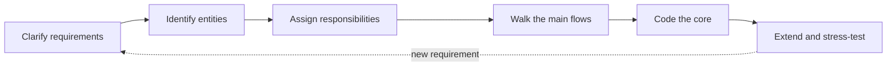
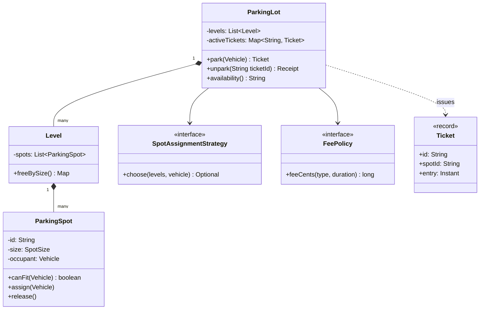
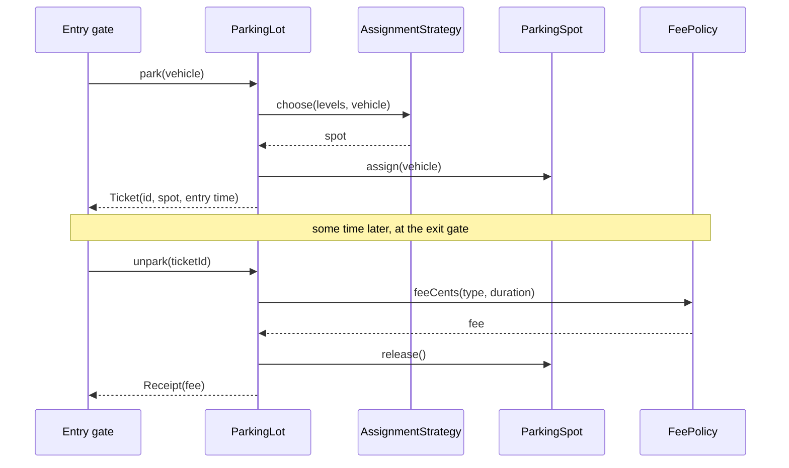

## Introduction

"Design a parking lot." That is the whole prompt. There is no specification, no list of features, no hint about which classes the interviewer expects. You have somewhere between 30 and 45 minutes to turn those four words into a set of classes with clear responsibilities, a few working methods, and a story about how the design would grow.

This kind of exercise is called **low-level design** (LLD), or object-oriented design. Where system design (high-level design, HLD) asks which services, databases and queues a product needs, LLD zooms into a single program: which classes exist, what each one knows, what each one does, and how they call each other. The boundary between the two is covered in [[d4-hld-vs-lld]].

The parking lot is the classic first LLD problem for a good reason. Everyone has used one, so you spend no time learning the domain. Yet it contains every ingredient interviewers want to see: several kinds of entity (vehicles, spots, floors, tickets), a compatibility rule (a truck cannot use a motorcycle spot), a policy that will obviously change (pricing), a choice with real trade-offs (which free spot to give a car), and a concurrency problem (two entry gates offering the same last spot to two drivers).

This lesson does two jobs. It teaches the parking lot design end to end, with code you can run. And it teaches the **method** — the order of steps that turns any vague prompt into a design. The later problems in this module ([[d3-elevator]], [[d3-library]], [[d3-vending-machine]], [[d3-tic-tac-toe]] and [[d3-chess]]) reuse that method and add their own twists, so it is worth learning carefully here.

## Before you start

- **Classes, interfaces and polymorphism** — the design relies on calling an interface without knowing the implementation. See [[c1-interfaces]] and [[c1-polymorphism]].
- **Enums and records** — vehicle types and spot sizes are enums; tickets and receipts are records. See [[c1-enums]] and [[c1-records]].
- **Strategy pattern** — spot selection and pricing are both strategies. See [[d2-strategy]].
- **Design principles** — single responsibility and open/closed are the yardsticks used to judge the design. See [[d1-solid]] and [[d1-coupling-cohesion]].
- **Basic thread safety** — for the concurrency section, know what `synchronized` does and why check-then-act is unsafe. See [[c3-synchronized]] and [[c3-thread-safety]].

## The intuition: a method, not a template

Beginners often approach LLD by trying to remember "the parking lot answer" — a class diagram they saw once. That fails as soon as the interviewer changes one requirement, because a remembered diagram carries no reasons. What transfers from problem to problem is the *sequence of questions* that produced the diagram.

A good design session moves through five steps, and each step uses the output of the one before it:

1. **Clarify requirements.** Ask what the system must do and what is out of scope. Write the answers down.
2. **Identify entities.** The nouns in the requirements — vehicle, spot, level, ticket — are candidate classes.
3. **Assign responsibilities.** For each verb — park, pay, display — decide which class owns it. The owner is usually the class that has the data the operation needs.
4. **Walk through the main flows.** Trace "a car arrives" and "a car leaves" through your classes. Missing pieces show up immediately.
5. **Code the core, then extend.** Write the classes that make the main flows work. Then show how the design absorbs a new requirement without rewrites.

Think of it like an architect visiting a client. The architect does not start by drawing walls; they ask how many people live in the house and whether anyone works from home. The drawing follows from the answers. In an interview, the questions are also how you show judgement — they reveal that you know where the hard parts are.



## Step 1: Clarify the requirements

A parking lot can mean a 20-space surface lot behind a shop or a ten-storey airport garage with number-plate cameras. The design for one is wrong for the other, so the first minutes go into questions. Asking them out loud is not stalling — interviewers explicitly score it (see [[a14-clarifying-requirements]]).

| Question | Assumed answer for this lesson | Why it matters to the design |
|---|---|---|
| What kinds of vehicle? | Motorcycles, cars and trucks | Defines the vehicle and spot types |
| Can a small vehicle use a bigger spot? | Yes; a car may use a large spot, never a small one | This is the core compatibility rule |
| How many levels? | Several, each with a mix of spot sizes | Introduces a `Level` class |
| How is a visitor identified? | A ticket issued at entry | The ticket is the link between entry and exit |
| How is the fee calculated? | Per started hour by vehicle type, with a daily cap and a short grace period | Pricing must be replaceable |
| How many entry and exit gates? | Several, used at the same time | Spot assignment must be safe under concurrency |
| Is there a display of free spaces? | Yes, per level and size | Something must report availability |
| Payment methods, reservations, number-plate recognition? | Out of scope for now; discuss as extensions | Keeps the core small |

Notice the split between **functional requirements** (what the system does: park, unpark, charge, show availability) and **non-functional requirements** (qualities: correct under concurrent gates, easy to change pricing, testable). Both shape the classes. The functional ones tell you which methods exist; the non-functional ones tell you where to put interfaces and locks. The general treatment of both is in [[d4-functional-requirements]] and [[d4-non-functional-requirements]].

Write the agreed scope somewhere visible. When the interviewer later asks "what about electric cars?", you can point at the list, add a line, and show which classes change.

## Step 2: Identify the entities

Read the requirements and underline the nouns: *vehicle*, *spot*, *level*, *ticket*, *fee*, *gate*, *display*, *parking lot*. Each is a candidate class. Not every noun survives — a noun becomes a class only if it has data or behaviour of its own.

- **Vehicle** — has a number plate and a type. It does very little, which matters for the next section.
- **ParkingSpot** — has an ID, a size, a level, and whether it is free. It owns the rule "can this vehicle fit here?" because it knows its own size.
- **Level** — groups spots on one floor and can report how many are free.
- **Ticket** — records which vehicle entered when and which spot it was given. It is the only thing the driver carries from entry to exit, so it must contain everything the exit needs.
- **FeePolicy** — turns a vehicle type and a duration into a price.
- **SpotAssignmentStrategy** — chooses which free spot a vehicle gets.
- **ParkingLot** — the entry point clients call. It coordinates the others but should hold as little logic as possible.

*Gate* and *display* are interesting cases. A gate is where requests come from, not something with rules of its own; in the core design it is just a caller of `ParkingLot.park`. The display needs availability numbers, which `Level` can provide. Both become relevant in the extensions.

### Should cars, trucks and motorcycles be subclasses?

The textbook reflex is `abstract class Vehicle` with `Car`, `Truck` and `Motorcycle` extending it. Ask what each subclass would *do* differently. A car does not park itself; it does not compute its own fee. The only thing that varies by vehicle type is data — the smallest spot it needs, and perhaps its hourly rate. Inheritance is for varying **behaviour**; when only data varies, an enum carries it more simply:

```java
enum VehicleType {
    MOTORCYCLE(SpotSize.SMALL), CAR(SpotSize.MEDIUM), TRUCK(SpotSize.LARGE);

    final SpotSize minimumSpot;
    VehicleType(SpotSize minimumSpot) { this.minimumSpot = minimumSpot; }
}
```

Adding a van later is one enum constant, not a new class. Saying this out loud — "I'd use subclasses if vehicles had different behaviour, but here they only differ in data" — is a strong signal, because it shows you choose inheritance deliberately (see [[d1-composition-vs-inheritance]]). If the interviewer pushes for a hierarchy, it is not wrong, just heavier; the rest of the design is unchanged either way.

## Step 3: Assign responsibilities

The guiding rule is: **put each operation in the class that has the information it needs.** This is sometimes called the *information expert* principle, and it keeps data and the rules about that data together.

| Operation | Owner | Reason |
|---|---|---|
| "Does this vehicle fit?" | `ParkingSpot` | It knows its own size |
| "Mark occupied / free" | `ParkingSpot` | It owns its occupancy state and can reject double assignment |
| "How many free spots of each size?" | `Level` | It owns the list of spots on that floor |
| "Which spot should this car get?" | `SpotAssignmentStrategy` | The choice is a policy that will change |
| "How much does this stay cost?" | `FeePolicy` | Pricing changes independently of everything else |
| "Issue ticket, find active ticket, release spot" | `ParkingLot` | It is the only class that sees all levels and all tickets |

The two policies are the most important decisions here. Pricing rules change with business decisions — weekend rates, a new monthly pass, a price rise. Spot selection changes with operations — nearest to the lift, fill the top floor first. If either lived inside `ParkingLot` as `if` statements, every change would edit the central class and risk breaking parking itself. Behind an interface, a change is a new class plugged in at construction. That is the **open/closed principle** in practice: open for extension, closed for modification.



The filled diamonds are **composition**: a level cannot exist without its lot, and a spot cannot exist without its level. The plain arrows are **associations** to the policies — the lot uses them but does not own their lifecycle, and they could be shared.

## Step 4: Walk through the main flows

Before writing code, trace the two flows that matter.

**A vehicle arrives.** The gate calls `park(vehicle)`. The lot first checks that this plate is not already inside (a car cannot be in two places). It asks the assignment strategy for a spot. If none fits, it refuses with a "full" error. Otherwise it marks the spot occupied, creates a ticket with the current time, records the ticket as active, and returns it.

**A vehicle leaves.** The exit gate calls `unpark(ticketId)`. The lot looks up the active ticket; an unknown or already-used ticket is rejected. It computes the duration from the ticket's entry time to now, asks the fee policy for the price, frees the spot, and returns a receipt.



Tracing exposes two details that a class diagram hides. First, the ticket must carry the vehicle *type*, not only the plate, because the fee depends on it and the vehicle is no longer available at the exit. Second, the lot needs to find a spot by ID when the ticket comes back, so it keeps a map from spot ID to spot rather than searching every level.

## The implementation

The complete program is one file, `ParkingLotDemo.java`, shown here in five parts so each can be explained. The parts are nested classes inside `public class ParkingLotDemo`, and the file starts with imports from `java.time` (`Clock`, `Duration`, `Instant`, `ZoneId`, `ZoneOffset`) and `java.util` (`ArrayList`, `Comparator`, `EnumMap`, `HashMap`, `List`, `Map`, `Optional`). It compiles and runs on Java 21.

### Value types

```java title="ParkingLotDemo.java (part 1: value types)"
enum SpotSize { SMALL, MEDIUM, LARGE }   // declaration order = physical size order

enum VehicleType {
    MOTORCYCLE(SpotSize.SMALL), CAR(SpotSize.MEDIUM), TRUCK(SpotSize.LARGE);

    final SpotSize minimumSpot;
    VehicleType(SpotSize minimumSpot) { this.minimumSpot = minimumSpot; }
}

record Vehicle(String plate, VehicleType type) {}

record Ticket(String id, String plate, VehicleType type, String spotId, Instant entry) {}

record Receipt(String ticketId, String spotId, Duration parked, long feeCents) {}

static class ParkingFullException extends RuntimeException {
    ParkingFullException(String msg) { super(msg); }
}
```

`SpotSize` is declared from smallest to largest on purpose. Java enums compare by declaration order, so `LARGE.compareTo(MEDIUM)` is positive. That turns the compatibility rule into one comparison instead of a table of cases.

`Ticket` and `Receipt` are **records**: immutable carriers of data with `equals`, `hashCode` and `toString` generated. A ticket must never change after it is issued — if its entry time could be modified, so could the fee — and a record makes that impossible by construction.

Money is a `long` number of cents, never a `double`. Binary floating point cannot represent most decimal fractions exactly (`0.1 + 0.2` is `0.30000000000000004`), and small errors accumulate across thousands of transactions. Integer minor units or `BigDecimal` are the two safe choices; cents are simpler when there is a single currency.

### Spots and levels

```java title="ParkingLotDemo.java (part 2: spots and levels)"
static final class ParkingSpot {
    private final String id;
    private final int level;
    private final SpotSize size;
    private Vehicle occupant;               // null means free

    ParkingSpot(String id, int level, SpotSize size) {
        this.id = id; this.level = level; this.size = size;
    }

    boolean isFree() { return occupant == null; }

    boolean canFit(Vehicle v) {
        // A spot fits any vehicle whose minimum spot is the same size or smaller.
        return size.compareTo(v.type().minimumSpot) >= 0;
    }

    void assign(Vehicle v) {
        if (!isFree()) throw new IllegalStateException(id + " is occupied");
        if (!canFit(v)) throw new IllegalArgumentException(v + " does not fit " + id);
        occupant = v;
    }

    void release() {
        if (isFree()) throw new IllegalStateException(id + " is already free");
        occupant = null;
    }

    String id() { return id; }
    int level() { return level; }
    SpotSize size() { return size; }
}

static final class Level {
    private final int number;
    private final List<ParkingSpot> spots = new ArrayList<>();

    Level(int number, int small, int medium, int large) {
        this.number = number;
        add(SpotSize.SMALL, small);
        add(SpotSize.MEDIUM, medium);
        add(SpotSize.LARGE, large);
    }

    private void add(SpotSize size, int count) {
        for (int i = 0; i < count; i++) {
            String id = "L" + number + "-" + size.name().charAt(0) + (i + 1);
            spots.add(new ParkingSpot(id, number, size));
        }
    }

    List<ParkingSpot> spots() { return spots; }

    Map<SpotSize, Long> freeBySize() {
        Map<SpotSize, Long> free = new EnumMap<>(SpotSize.class);
        for (SpotSize s : SpotSize.values()) free.put(s, 0L);
        for (ParkingSpot p : spots) if (p.isFree()) free.merge(p.size(), 1L, Long::sum);
        return free;
    }
}
```

`ParkingSpot` protects its own state. `assign` refuses an occupied spot and an incompatible vehicle even if the caller already checked, and `release` refuses to free a spot twice. This is **defensive encapsulation** (see [[d1-encapsulation]]): whatever bug exists elsewhere, a spot can never hold two vehicles or a truck in a motorcycle bay. The exceptions turn silent corruption into a loud failure at the exact line where the rule was broken.

`Level.freeBySize` uses an `EnumMap`, a map specialised for enum keys that iterates in declaration order and is backed by an array. Pre-filling zeros means the display shows `SMALL=0` rather than omitting the size.

### The two policies

```java title="ParkingLotDemo.java (part 3: assignment and pricing strategies)"
interface SpotAssignmentStrategy {
    Optional<ParkingSpot> choose(List<Level> levels, Vehicle v);
}

/** Smallest spot that fits, lowest level first: keeps large spots for large vehicles. */
static final class BestFitStrategy implements SpotAssignmentStrategy {
    public Optional<ParkingSpot> choose(List<Level> levels, Vehicle v) {
        return levels.stream()
                .flatMap(l -> l.spots().stream())
                .filter(s -> s.isFree() && s.canFit(v))
                .min(Comparator.comparing(ParkingSpot::size)
                               .thenComparingInt(ParkingSpot::level));
    }
}

interface FeePolicy {
    long feeCents(VehicleType type, Duration parked);
}

/** Per started hour, by vehicle type, capped per started 24 hours. */
static final class HourlyFeePolicy implements FeePolicy {
    private final Map<VehicleType, Long> hourly;
    private final Map<VehicleType, Long> dailyCap;

    HourlyFeePolicy(Map<VehicleType, Long> hourly, Map<VehicleType, Long> dailyCap) {
        this.hourly = hourly; this.dailyCap = dailyCap;
    }

    public long feeCents(VehicleType type, Duration parked) {
        long minutes = parked.toMinutes();
        if (minutes <= 15) return 0;                       // grace period
        long fullDays = minutes / (24 * 60);
        long restMinutes = minutes % (24 * 60);
        long restHours = (restMinutes + 59) / 60;          // round a started hour up
        long rest = Math.min(restHours * hourly.get(type), dailyCap.get(type));
        return fullDays * dailyCap.get(type) + rest;
    }
}
```

`BestFitStrategy` returns an `Optional` (see [[c1-optional]]) because "no spot" is a normal outcome, not a programming error. It considers every free, compatible spot and picks the smallest size, breaking ties by the lowest level. The comparator reads almost like the policy statement, which is the point of writing it this way.

`HourlyFeePolicy` shows why the fee belongs in its own class: even a "simple" tariff has a grace period, rounding and a cap, and each rule is a place for bugs. `(restMinutes + 59) / 60` is integer ceiling division — 61 minutes becomes 2 hours, 60 minutes stays 1. Because the policy is a pure function of type and duration, it can be unit-tested with a table of inputs without building a lot at all.

### The parking lot

```java title="ParkingLotDemo.java (part 4: the ParkingLot facade)"
static final class ParkingLot {
    private final List<Level> levels;
    private final SpotAssignmentStrategy assignment;
    private final FeePolicy fees;
    private final Clock clock;
    private final Map<String, ParkingSpot> spotsById = new HashMap<>();
    private final Map<String, Ticket> activeTickets = new HashMap<>();
    private final Map<String, String> ticketByPlate = new HashMap<>();
    private int nextTicket = 1;

    ParkingLot(List<Level> levels, SpotAssignmentStrategy assignment,
               FeePolicy fees, Clock clock) {
        this.levels = levels; this.assignment = assignment;
        this.fees = fees; this.clock = clock;
        for (Level l : levels) for (ParkingSpot s : l.spots()) spotsById.put(s.id(), s);
    }

    public synchronized Ticket park(Vehicle v) {
        if (ticketByPlate.containsKey(v.plate())) {
            throw new IllegalStateException(v.plate() + " is already parked");
        }
        ParkingSpot spot = assignment.choose(levels, v)
                .orElseThrow(() -> new ParkingFullException("no spot for " + v.type()));
        spot.assign(v);
        Ticket t = new Ticket("T" + nextTicket++, v.plate(), v.type(),
                              spot.id(), clock.instant());
        activeTickets.put(t.id(), t);
        ticketByPlate.put(v.plate(), t.id());
        return t;
    }

    public synchronized Receipt unpark(String ticketId) {
        Ticket t = activeTickets.remove(ticketId);
        if (t == null) throw new IllegalArgumentException("unknown ticket " + ticketId);
        ticketByPlate.remove(t.plate());
        Duration parked = Duration.between(t.entry(), clock.instant());
        long fee = fees.feeCents(t.type(), parked);
        spotsById.get(t.spotId()).release();
        return new Receipt(t.id(), t.spotId(), parked, fee);
    }

    public synchronized String availability() {
        StringBuilder sb = new StringBuilder();
        for (Level l : levels) sb.append("L").append(l.number).append(' ')
                                 .append(l.freeBySize()).append("  ");
        return sb.toString().trim();
    }
}
```

`ParkingLot` is a **facade** (see [[d2-facade]]): gates call two methods and never see levels, spots or policies. Its methods are short because each decision is delegated — the strategy chooses, the spot validates, the policy prices. What remains in the lot is bookkeeping that only it can do, because only it sees all tickets.

Three details deserve attention. The policies and the clock are **passed into the constructor** rather than created inside, so a test or a different site can supply different ones — this is dependency injection without a framework. `unpark` removes the ticket from the active map *first*, so presenting the same ticket twice fails the second time instead of freeing a spot that a new car may already occupy. And the public methods are `synchronized`, which is the simplest correct answer to concurrent gates; the concurrency section below explains what it costs and what the alternatives are.

**Why a `Clock` instead of `Instant.now()`?** `Instant.now()` reads the system clock, so a test of "2 hours 30 minutes costs $9.00" would have to wait two and a half hours. `java.time.Clock` is an abstraction over "what time is it", and production code passes `Clock.systemUTC()`. Tests pass a clock they control. Storing `Instant` values (points on the UTC timeline) rather than local date-times also means a daylight-saving change during a stay cannot make the duration wrong. See [[c13-clock-time]].

### Running it

```java title="ParkingLotDemo.java (part 5: a controllable clock and main)"
static final class ManualClock extends Clock {
    private Instant now;
    ManualClock(Instant start) { now = start; }
    void advance(Duration d) { now = now.plus(d); }
    public Instant instant() { return now; }
    public ZoneId getZone() { return ZoneOffset.UTC; }
    public Clock withZone(ZoneId zone) { return this; }
}

static String money(long cents) { return String.format("$%d.%02d", cents / 100, cents % 100); }

public static void main(String[] args) {
    ManualClock clock = new ManualClock(Instant.parse("2026-03-02T08:00:00Z"));
    FeePolicy fees = new HourlyFeePolicy(
            Map.of(VehicleType.MOTORCYCLE, 100L, VehicleType.CAR, 300L,
                   VehicleType.TRUCK, 600L),
            Map.of(VehicleType.MOTORCYCLE, 800L, VehicleType.CAR, 2000L,
                   VehicleType.TRUCK, 4000L));
    ParkingLot lot = new ParkingLot(
            List.of(new Level(0, 1, 1, 1), new Level(1, 0, 2, 0)),
            new BestFitStrategy(), fees, clock);

    System.out.println("start  " + lot.availability());
    Ticket car1 = lot.park(new Vehicle("KA-01", VehicleType.CAR));
    Ticket bike = lot.park(new Vehicle("KA-02", VehicleType.MOTORCYCLE));
    Ticket car2 = lot.park(new Vehicle("KA-03", VehicleType.CAR));
    Ticket truck = lot.park(new Vehicle("KA-04", VehicleType.TRUCK));
    for (Ticket t : List.of(car1, bike, car2, truck)) {
        System.out.println("parked " + t.plate() + " (" + t.type() + ") at " + t.spotId());
    }
    System.out.println("now    " + lot.availability());

    try {
        lot.park(new Vehicle("KA-05", VehicleType.TRUCK));
    } catch (ParkingFullException e) {
        System.out.println("refused: " + e.getMessage());
    }

    clock.advance(Duration.ofMinutes(10));
    System.out.println("exit   " + describe(lot.unpark(bike.id())));
    clock.advance(Duration.ofMinutes(140));                  // 2h30m after entry
    System.out.println("exit   " + describe(lot.unpark(car1.id())));
    clock.advance(Duration.ofHours(26));
    System.out.println("exit   " + describe(lot.unpark(truck.id())));
    System.out.println("end    " + lot.availability());
}

static String describe(Receipt r) {
    return r.ticketId() + " from " + r.spotId() + " after " + r.parked().toMinutes()
            + " min: " + money(r.feeCents());
}
```

```output
start  L0 {SMALL=1, MEDIUM=1, LARGE=1}  L1 {SMALL=0, MEDIUM=2, LARGE=0}
parked KA-01 (CAR) at L0-M1
parked KA-02 (MOTORCYCLE) at L0-S1
parked KA-03 (CAR) at L1-M1
parked KA-04 (TRUCK) at L0-L1
now    L0 {SMALL=0, MEDIUM=0, LARGE=0}  L1 {SMALL=0, MEDIUM=1, LARGE=0}
refused: no spot for TRUCK
exit   T2 from L0-S1 after 10 min: $0.00
exit   T1 from L0-M1 after 150 min: $9.00
exit   T4 from L0-L1 after 1710 min: $70.00
end    L0 {SMALL=1, MEDIUM=1, LARGE=1}  L1 {SMALL=0, MEDIUM=1, LARGE=0}
```

## Dry run: what changed and why

The lot has two levels: level 0 with one spot of each size, level 1 with two medium spots. Follow each event.

| Event | Strategy sees (free, compatible) | Chosen | Reason |
|---|---|---|---|
| Car KA-01 | L0-M1, L0-L1, L1-M1, L1-M2 | L0-M1 | Medium is the smallest fitting size; level 0 wins the tie |
| Motorcycle KA-02 | L0-S1, L0-L1, L1-M1, L1-M2 | L0-S1 | Small fits a motorcycle and is the smallest |
| Car KA-03 | L0-L1, L1-M1, L1-M2 | L1-M1 | Medium beats large even though large is on a lower level |
| Truck KA-04 | L0-L1 | L0-L1 | Only a large spot fits |
| Truck KA-05 | none | refused | One medium spot is free, but a truck needs large |

The third row is the policy doing its job. A first-fit strategy that scanned level 0 first would have put the second car in the large spot, and then the truck would have been turned away while a medium spot sat empty upstairs. Best fit trades a slightly longer walk for keeping scarce large spots available.

The fees follow the policy exactly. The motorcycle stayed 10 minutes, inside the 15-minute grace period: $0.00. The first car stayed 150 minutes, which is two full hours and a started third, so 3 × $3.00 = $9.00. The truck stayed 1,710 minutes: one full day (1,440 minutes) at the $40.00 cap, plus 270 minutes rounded up to 5 hours at $6.00 = $30.00, which is under the cap, for $70.00 in total.

```quiz
Q: In the dry run, why did the second car (KA-03) get the medium spot on level 1 rather than the free large spot on level 0?
- [ ] Level 1 was closer to the entrance
- [x] The best-fit strategy compares spot size before level, so the smallest fitting size wins
- [ ] Large spots are reserved for trucks and can never be used by cars
- [ ] The strategy picks spots at random
> The comparator is `comparing(size).thenComparingInt(level)`: size is the primary key, level only breaks ties. Cars *may* use large spots (`canFit` allows it), but best fit prefers the smallest that works so a later truck still has somewhere to go.
```

## Choosing a spot: first fit, best fit and nearest

Spot assignment is the most discussed decision in this problem, because there is no universally right answer.

**First fit** walks the spots in a fixed order and takes the first compatible free one. It is simple and fast when the lot is mostly empty, and it naturally fills lower levels first. Its weakness is **fragmentation**: small vehicles drift into large spots that happen to come first, and large vehicles get refused while the lot has plenty of space in total.

**Best fit** takes the smallest compatible spot, as in the demo. It protects scarce large spots. Its weakness is that it may send a car to a far level when a slightly larger spot is right next to the entrance.

**Nearest to entrance** minimises walking or driving distance from a given gate. It needs to know which gate the request came from, so the strategy's signature grows — `choose(levels, vehicle, gate)` — or the gate is captured in the strategy instance. Real garages often combine rules: best size first, then nearest.

Because all three implement `SpotAssignmentStrategy`, switching is a constructor argument. That is the entire value of the Strategy pattern here: the policy argument can happen in a product meeting without anyone touching `ParkingLot`.

### Making the search fast

The demo's strategy scans every spot on every request: O(S) for S spots. For a lot with a few hundred spots and cars arriving every few seconds that is entirely fine, and it is the right thing to write first. If an interviewer asks about a 10,000-spot garage, keep a **free-spot index**: for each size, a sorted set of free spots ordered by level and spot number.

```java
// One sorted set of free spots per size; the comparator is the preference within a size.
Comparator<ParkingSpot> byLevelThenId =
        Comparator.comparingInt(ParkingSpot::level).thenComparing(ParkingSpot::id);
Map<SpotSize, TreeSet<ParkingSpot>> free = new EnumMap<>(SpotSize.class);
// filled once at start-up: free.put(size, new TreeSet<>(byLevelThenId)) and add every spot

Optional<ParkingSpot> bestFit(Vehicle v) {
    for (SpotSize size : SpotSize.values()) {
        if (size.compareTo(v.type().minimumSpot) < 0) continue;  // too small
        ParkingSpot s = free.get(size).pollFirst();             // O(log S)
        if (s != null) return Optional.of(s);
    }
    return Optional.empty();
}
// release(spot) must add it back: free.get(spot.size()).add(spot)
```

With three sizes, a request costs at most three `pollFirst` calls on a `TreeSet` (see [[c1-treeset]]), so O(log S). The cost is that the index and the spots' own `occupant` fields must be updated together, inside the same lock — two sources of truth that drift apart are a classic bug. Mention it as an optimisation, not as your first version.

## Concurrency: two gates, one spot

The requirements said several gates work at once. Picture two gates, each running on its own thread, with exactly one spot left. Without coordination this interleaving is possible:

| Time | Gate A thread | Gate B thread | Spot L1-M2 |
|---|---|---|---|
| t1 | strategy finds L1-M2 free | | free |
| t2 | | strategy finds L1-M2 free | free |
| t3 | assigns car A | | car A |
| t4 | | assigns car B | car B (car A's assignment lost) |
| t5 | prints ticket for L1-M2 | prints ticket for L1-M2 | two tickets, one spot |

This is a **check-then-act race**: the check ("is it free?") and the action ("take it") are separate steps, and another thread acted in between. In the demo, `ParkingSpot.assign` would actually throw at t4 because it re-checks `isFree()` — but that re-check is itself a check-then-act without a lock, so two threads can still both pass it. Plain field access gives no guarantee here (see [[c3-shared-mutable-state]]).

There are four standard fixes, from simplest to most scalable.

**1. Lock the whole lot.** Making `park` and `unpark` `synchronized`, as the demo does, means only one gate runs the find-and-assign sequence at a time. It is obviously correct and fast enough for any single garage: the critical section is microseconds of work, while a barrier takes seconds to open. Say this first.

**2. Lock per level.** If profiling ever showed contention, each level could have its own lock so gates working on different floors do not wait for each other. The catch is that best fit looks across levels, so a request may need several level locks; taking them always in the same order (level 0, then 1, ...) avoids deadlock (see [[c3-lock-ordering]]).

**3. Compare-and-set on the spot.** Make each spot claim itself atomically: "set occupant to this car *only if* it is currently null". If two gates race, exactly one succeeds and the other moves on to the next candidate. No lock is held while searching.

```java title="ConcurrentSpots.java"
import java.util.ArrayList;
import java.util.List;
import java.util.Optional;
import java.util.concurrent.ExecutorService;
import java.util.concurrent.Executors;
import java.util.concurrent.atomic.AtomicInteger;
import java.util.concurrent.atomic.AtomicReference;

public class ConcurrentSpots {

    static final class Spot {
        final String id;
        private final AtomicReference<String> occupant = new AtomicReference<>();

        Spot(String id) { this.id = id; }

        /** Claims the spot only if it is still free; exactly one caller can win. */
        boolean tryClaim(String plate) { return occupant.compareAndSet(null, plate); }

        void release() { occupant.set(null); }
    }

    static Optional<Spot> park(List<Spot> spots, String plate) {
        for (Spot s : spots) {
            if (s.tryClaim(plate)) return Optional.of(s);   // lost the race? try the next spot
        }
        return Optional.empty();
    }

    public static void main(String[] args) throws InterruptedException {
        List<Spot> spots = new ArrayList<>();
        for (int i = 1; i <= 50; i++) spots.add(new Spot("S" + i));

        AtomicInteger parked = new AtomicInteger();
        AtomicInteger refused = new AtomicInteger();
        try (ExecutorService gates = Executors.newFixedThreadPool(8)) {
            for (int car = 1; car <= 100; car++) {
                String plate = "CAR-" + car;
                gates.submit(() -> {
                    if (park(spots, plate).isPresent()) parked.incrementAndGet();
                    else refused.incrementAndGet();
                });
            }
        }   // close() waits for every submitted task (Java 19+)

        long occupied = spots.stream().filter(s -> s.occupant.get() != null).count();
        System.out.println("parked=" + parked + " refused=" + refused + " occupied=" + occupied);
    }
}
```

```output
parked=50 refused=50 occupied=50
```

Eight threads try to park 100 cars into 50 spots. *Which* car gets *which* spot changes from run to run because it depends on thread scheduling, but the totals do not: `compareAndSet` is a single atomic hardware operation, so no spot is ever claimed twice and exactly 50 cars park. `ExecutorService` became `AutoCloseable` in Java 19; `close()` waits for submitted tasks, which is why the counts are complete when they are printed. See [[c3-atomics]].

**4. Let the database decide.** In a real deployment, gates may be separate machines sharing a database, and in-memory locks no longer cover them. The same compare-and-set idea becomes a conditional update:

```sql
UPDATE parking_spot
SET    occupant_plate = 'KA-05', occupied_since = now()
WHERE  id = 'L1-M2' AND occupant_plate IS NULL;
-- 1 row updated: the spot is ours. 0 rows: someone else won; try another spot.
```

Under PostgreSQL's default isolation level (Read Committed), row-level locking guarantees that if two transactions run this concurrently, the second waits for the first, re-evaluates the `WHERE` clause after the first commits and updates zero rows. A partial unique index such as `CREATE UNIQUE INDEX one_active_ticket_per_spot ON ticket (spot_id) WHERE exit_time IS NULL` adds a second safety net at the schema level. See [[c7-row-locks]] and [[c8-optimistic-locking]].

> [!IMPORTANT] Locking the decision, not just the data
> Making each field thread-safe is not enough. What must be atomic is the *decision* "this spot is free, so it is mine". Every correct fix above makes the check and the claim one indivisible step — a lock around both, a single compare-and-set, or a single conditional `UPDATE`.

## Extending the design

A good design is judged by how it absorbs requirements nobody mentioned at the start. Interviewers usually add one or two of these.

**Electric-vehicle charging spots.** A charging spot is a spot with a charger. Model it as a *feature* of the spot — a `Set<SpotFeature>` containing `EV_CHARGER`, `ACCESSIBLE`, `RESERVED` — rather than a subclass, because features combine (an accessible charging spot) and subclasses do not. The vehicle (or the request) states what it needs, and `canFit` checks size *and* required features. The fee policy may add a charging cost per kilowatt-hour; a `CompositeFeePolicy` that sums a parking policy and a charging policy keeps both independent.

**Reserved and accessible spots.** These are spots only some requests may use. The rule "only permit holders may use accessible spots" belongs in the assignment strategy or a filter in front of it, not in `ParkingSpot`, because it depends on who is asking.

**A live availability board.** Each level's display must update whenever a spot changes. Rather than displays polling the lot, the lot can publish an event after every park and unpark, and each display subscribes — the **Observer** pattern (see [[d2-observer]]). The lot stays unaware of how many displays exist or what they show.

**Payment before exit.** Many garages let drivers pay at a machine and then have 15 minutes to leave. The ticket now has a lifecycle — active, paid, exited, lost — and actions that are legal only in some states (exiting without paying is refused). That is a state machine; see [[d2-state]].

**Lost ticket.** The driver has no ticket ID. The lot needs a lookup by plate (the demo already keeps `ticketByPlate`) and a policy, usually charging the daily maximum. This is a good example of why the plate-to-ticket map exists beyond preventing double entry.

**Number-plate recognition.** Cameras read the plate at entry and exit, so the "ticket" becomes the plate itself. The core classes barely change: the gate calls `park` with the recognised plate, and `unpark` takes a plate instead of a ticket ID.

```quiz
Q: The lot must now support electric-vehicle charging spots, and some charging spots are also accessible spots. Which change fits best?
- [ ] Create `ElectricSpot extends ParkingSpot` and `AccessibleSpot extends ParkingSpot`
- [x] Give `ParkingSpot` a set of features and have `canFit` check required features as well as size
- [ ] Add an `if (vehicle.isElectric())` branch inside `ParkingLot.park`
- [ ] Create a separate `ElectricParkingLot` class
> Features combine — one spot can be both accessible and have a charger — and a single-inheritance hierarchy cannot express combinations without an explosion of subclasses. A feature set keeps the change local to the spot and the request, and `ParkingLot` does not change at all.
```

## In real systems

A production parking system is several programs. **Gate controllers** run on embedded hardware at each barrier, read tickets or number plates, and talk to a central service over the network. The **central service** holds the authoritative state — which spots or how many spaces are free, which sessions are active — in a database, because gate machines restart and must not lose track of cars inside. **Payment terminals** integrate with card processors and must be idempotent: a terminal that times out and retries must not charge twice (see [[c12-idempotency]]). **Occupancy sensors** above each bay feed the availability boards, often more trustworthy than the software's own count, because drivers ignore assigned spots.

That last point changes the design in a way interviews rarely mention. Many real garages do not assign spots at all; they count free spaces per level and let drivers choose. The core classes still apply, but `ParkingSpot.assign` happens when a sensor reports a car, not when a ticket is issued. A strong candidate can say which model they are designing for and why.

The class design in this lesson is what would live inside the central service. Splitting it across machines, choosing the database and handling network failures between gates and the centre is the high-level design layer — the same split described in [[d4-hld-vs-lld]].

## Trade-offs and alternatives

| Decision | Choice here | Alternative | When the alternative wins |
|---|---|---|---|
| Vehicle types | Enum carrying data | Class hierarchy | Vehicle types need genuinely different behaviour |
| Spot selection | Strategy interface, best fit | Hard-coded first fit | A throwaway prototype |
| Free-spot lookup | Linear scan | Sorted free-spot index per size | Thousands of spots and high arrival rate |
| Concurrency | One lock on the lot | Per-spot compare-and-set or per-level locks | Measured contention, or many gates on one process |
| State storage | In memory | Database with conditional updates | Multiple machines, or restarts must not lose cars |
| Money | `long` cents | `BigDecimal` | Multiple currencies, tax rules with fractional cents |

The general cost of this design is ceremony. A strategy interface with a single implementation is extra code until the second implementation arrives. In an interview, that cost is worth paying for the two policies everyone agrees will change — pricing and assignment — and not worth paying for things that will not, such as how a spot ID is formatted.

## Common mistakes

**One class that does everything.** A `ParkingLot` with a 200-line `park` method that loops over levels, compares sizes with `if` chains, computes fees and prints tickets is the most common weak answer. Each rule should live with the data it concerns: fitting with the spot, pricing with the policy, selection with the strategy.

**Forgetting the compatibility rule.** Treating all spots as identical, or allowing a truck into any free spot, misses the central rule of the problem. Put `canFit` on the spot and also enforce it inside `assign`.

**Storing the spot's state in two places without care.** A free-spot counter on the level *and* an occupied flag on each spot will drift apart the first time one update is missed. Either compute counts from the spots (as the demo does) or update both inside the same lock.

**Using `double` for money.** `0.1 + 0.2 != 0.3` in binary floating point. Use `long` minor units or `BigDecimal`.

**Calling `Instant.now()` inside the fee logic.** It makes pricing untestable and couples it to the machine's clock. Inject a `Clock`, and keep the fee policy a pure function of type and duration.

**Accepting a ticket twice.** If `unpark` frees the spot before invalidating the ticket, a second presentation of the same ticket frees whatever car is now in that spot. Remove the active ticket first, as the demo does.

> [!MISTAKE] Saying "I'll make it thread-safe" without saying what is atomic
> Interviewers follow up with "how?". Name the race (two gates choose the same free spot), name the atomic step (check and claim together), and name the mechanism (a lock around both, a compare-and-set, or a conditional `UPDATE`).

## Interview perspective

A 45-minute parking lot interview usually rewards this pacing: about five minutes on requirements, ten on entities, responsibilities and a class diagram, fifteen on code for `park`, `unpark` and the fee policy, and the rest on extensions and concurrency. Shorter slots compress the code; they do not skip the requirements.

> [!INTERVIEW] What a strong answer sounds like
> "Spots own the fit rule because they know their size. Pricing and spot selection will change for business reasons, so each sits behind an interface and the lot takes them in its constructor. The ticket carries the vehicle type and entry time because that is all the exit needs. Two gates can race for the last spot, so the find-and-claim step is atomic — a lock on the lot is enough for one garage, and with several machines I'd use a conditional `UPDATE ... WHERE occupant IS NULL`."

Questions you should be ready for:

- **What are the main classes, and why does each exist?** Lot (facade and bookkeeping), Level (grouping and counts), Spot (size, occupancy, fit rule), Vehicle and Ticket (data), FeePolicy and SpotAssignmentStrategy (changeable policies).
- **Can a car use a large spot?** Allowed by the fit rule; whether the strategy *chooses* it is a policy question — explain best fit versus first fit and fragmentation.
- **How do you add a new vehicle type?** One enum constant with its minimum spot, plus a rate in the fee policy's configuration. No class changes if the design is right.
- **How do you add weekend pricing?** A new `FeePolicy` implementation, or a policy that delegates to weekday and weekend policies based on the entry time.
- **What happens when the lot is full?** `park` fails with a specific exception; the gate shows "full". Extensions: a waiting queue, or redirecting to another lot.
- **How do you test it?** Pure unit tests for the fee policy with a table of durations; a manual clock for park/unpark scenarios; a concurrency test like `ConcurrentSpots` asserting no spot is claimed twice.
- **Multiple entrances on different machines?** Move the state into a database and make the claim a conditional update; in-memory locks only protect one process.

## Practice

1. **First-fit strategy.** Implement `FirstFitStrategy` and rerun the demo with it. Which vehicle is now refused, and why?
2. **Nearest-to-gate strategy.** Give each spot a distance from each gate and implement a strategy that picks the nearest compatible spot for the requesting gate. What has to change in the interface?
3. **Weekend pricing.** Write a `FeePolicy` that charges a flat $5.00 per started day for stays that begin on a Saturday or Sunday (in the lot's local time zone) and delegates to `HourlyFeePolicy` otherwise. Which class needs to know the time zone?
4. **Free-spot index.** Replace the linear scan with per-size `TreeSet`s and make sure `unpark` returns the spot to the right set. Write a test that parks and unparks 1,000 random vehicles and checks that the index always matches the spots' occupancy.
5. **Lost ticket.** Add `unparkByPlate(String plate)` that charges the daily cap when the ticket is lost. Where should "lost ticket costs the daily cap" live?
6. **Database model.** Sketch tables for spots and tickets, including the constraint that a spot has at most one active ticket. Write the `UPDATE` that claims a spot.

## Quick revision {#quick-revision}

- Method: clarify requirements → identify entities (nouns) → assign responsibilities (verbs to the class with the data) → walk the flows → code the core → extend.
- Entities: `ParkingLot` (facade), `Level`, `ParkingSpot`, `Vehicle`, `Ticket`, `FeePolicy`, `SpotAssignmentStrategy`.
- Vehicle types differ only in data → enum with a minimum spot size, not a class hierarchy.
- Fit rule lives on the spot: `spot.size >= vehicle.minimumSpot`, enforced again in `assign`.
- Ticket = ID + plate + vehicle type + spot ID + entry instant; immutable record.
- Pricing and spot selection are strategies injected through the constructor (open/closed).
- Money as `long` cents or `BigDecimal`, never `double`. Time through an injected `Clock`; store `Instant`.
- Best fit protects large spots; first fit fragments; nearest-to-gate needs the gate in the request.
- Race: two gates choose the same free spot. Make check-and-claim atomic: lock, compare-and-set, or `UPDATE ... WHERE occupant IS NULL`.
- Unpark: invalidate the ticket first, then compute the fee and free the spot.
- Extensions: features set for EV/accessible spots, Observer for displays, State for paid/exited tickets.

## Key takeaways {#key-takeaways}

- Low-level design is a method: requirements drive entities, entities and data drive responsibilities, and flows reveal what is missing.
- Put each rule in the class that owns the data it needs — the spot decides whether a vehicle fits, the policy decides the price.
- Use interfaces where change is expected (pricing, spot selection) and plain enums and records where only data varies.
- A ticket must carry everything the exit needs, because the vehicle is not available to ask at exit time.
- Concurrency bugs in this problem come from check-then-act; correctness means making "free, so mine" a single atomic step.
- Judge the design by its extensions: a new vehicle type, tariff or spot feature should touch one small place.
