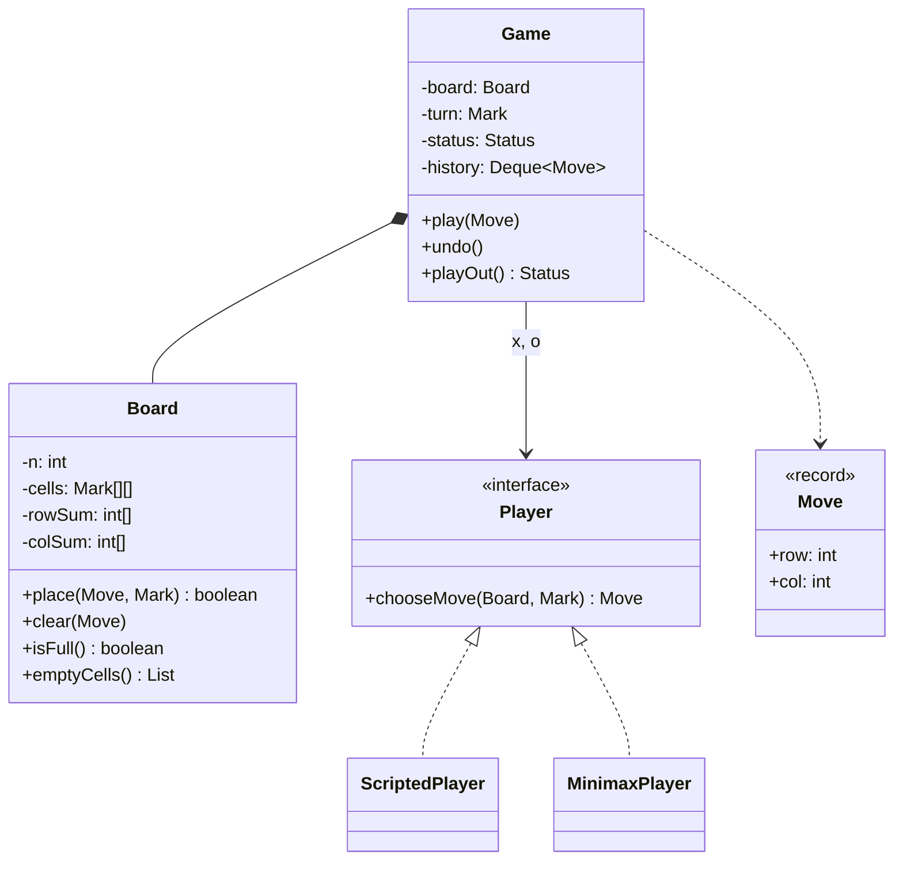

## Introduction

Two players take turns marking cells on a three-by-three grid, X first. The first to complete a row, a column or a diagonal wins; if the grid fills with no line, it is a draw. Everybody knows the rules, which is exactly why tic-tac-toe is a common opening problem in low-level design (LLD) interviews: you spend no time on the domain and all of it on design.

What is being tested is not whether you can detect three in a row — any programmer can — but whether the code has a sensible shape. Where does the rule "you cannot play on an occupied cell" live? Who decides whose turn it is? Can you swap a human for a computer player without touching the game logic? Can the board grow to 4×4 or 15×15 without a rewrite? Can you undo a move? Each of those questions has a clean answer if the responsibilities are split well, and a messy one if they are not.

Tic-tac-toe is also the simplest place to meet **game-tree search**. Because the game is tiny, a computer can examine every possible continuation and play perfectly. The algorithm that does this, **minimax**, is the foundation of classical game AI, and the pruning technique that speeds it up is used in chess engines — which is where [[d3-chess]], the next lesson, picks up.

## Before you start

- **The LLD method** — clarify, identify entities, assign responsibilities, walk the flows, code, extend. It is taught in [[d3-parking-lot]].
- **Two-dimensional arrays** — the board is a grid indexed by row and column. See [[a2-matrix]].
- **Recursion and backtracking** — minimax explores moves recursively and undoes each one. See [[a1-recursion]] and [[a9-pruning]].
- **Strategy pattern** — players are interchangeable strategies for choosing moves. See [[d2-strategy]].
- **Enums and records** — marks and statuses are enums; moves are records. See [[c1-enums]] and [[c1-records]].

## The intuition

Think about a physical game. There is a **board** — paper with a grid on it. The paper does not care whose turn it is; it only holds marks, and anyone looking at it can see whether a line is complete. Then there is the **game**: the agreement between two people about who goes first, whose turn it is now, and when it is over. And there are the **players**, who each decide where to move by whatever means they like — thinking, guessing, or following a strategy from a book.

Those three things change for different reasons. The board changes if you play on a bigger grid. The game changes if you add a rule such as "the loser of the last game goes first" or an undo button. The players change if one of them is replaced by a computer. Keeping them in separate classes means each kind of change touches one class.

The common weak design is one class, `TicTacToe`, with a `char[][]`, a `currentPlayer` character, a 40-line `checkWinner` and a `Scanner` reading keyboard input — all intertwined. It works for one game at one terminal, and nothing else.

## Step 1: Clarify the requirements

| Question | Assumed answer | Effect on the design |
|---|---|---|
| Board size? | 3×3 now; should extend to N×N | Board takes `n` as a parameter |
| Win condition? | A full row, column or diagonal (n in a row) | Line detection depends on `n` |
| Players? | Human vs human, human vs computer, computer vs computer | A `Player` interface |
| Computer strength? | Should play perfectly on 3×3 | Minimax |
| Undo? | Yes, any number of moves | Game keeps a history |
| Illegal moves? | Rejected with a clear reason; the same player tries again | Validation with exceptions |
| User interface? | Console now; maybe web later | No input or output inside `Board` or `Game` |
| Online play? | Possibly, as an extension | Game logic must not assume a local keyboard |

The last two rows are easy to skip and important. If `Game` reads from `System.in`, it cannot be used by a web server, a test, or an AI-versus-AI simulation. Keeping input and output outside the core classes is what makes every later extension cheap.

## Step 2: Entities and responsibilities

- **Mark** — `X` or `O`, with `opponent()`.
- **Move** — a record of row and column. Immutable, comparable by value, easy to store in a history.
- **Board** — owns the cells. Answers "is this cell on the board?", "is it empty?", "is the board full?", and — crucially — "did this placement complete a line?". It also rejects placements on occupied or out-of-range cells, because those rules are about its own data.
- **Status** — `IN_PROGRESS`, `X_WON`, `O_WON`, `DRAW`.
- **Game** — owns turn order, status and history. Rejects moves after the game has ended, applies a move through the board, updates the status and switches turns, and supports undo.
- **Player** — an interface with one method: given the board and my mark, choose a move. Implementations: a scripted player (a stand-in for keyboard input), and a minimax AI.



### Who owns win detection?

A frequent point of debate: should "has someone won?" live in `Game` or `Board`? The answer follows from the information-expert rule — put the logic with the data it reads. Win detection reads only the cells, so it belongs on `Board`. `Game` decides what a completed line *means* (this player won, the game is over), which is a game rule. If win detection lived in `Game`, an AI that wants to evaluate a hypothetical board would need a whole `Game` object, turn order and all, just to ask whether a line exists.

Similarly, "is this cell free?" is a board rule, while "is it your turn?" and "is the game over?" are game rules. The demo enforces each in the class that owns the data.

## Step 3: Detecting a win

There are three ways to decide whether a move won, and comparing them is a classic interview follow-up.

**Scan every line after every move.** On an n×n board there are n rows, n columns and 2 diagonals — 2n + 2 lines of n cells each, so O(n²) work per move. For 3×3 that is 8 lines and 24 cell reads, which is nothing. It is still worth knowing why it is wasteful: almost all of those lines did not change.

**Scan only the lines through the last move.** A move at (r, c) can only complete row r, column c, and the diagonals if it lies on them. That is at most four lines, O(n) per move. This observation — *only the last move can create a win* — is the key insight interviewers look for.

**Keep running counts.** Give each line a counter. When X plays, add 1 to the counters of every line through the cell; when O plays, subtract 1. A line is complete exactly when its counter reaches +n (all X) or −n (all O), because a single opposing mark makes the total impossible to reach. Each move updates at most four counters, so win detection is **O(1)** regardless of board size, at the cost of O(n) extra memory. Undo is equally cheap: subtract what was added.

Here is the counter approach on a 3×3 board as X completes the anti-diagonal (the line where `row + col == 2`):

| Move | Row sums | Column sums | Diagonal | Anti-diagonal | Win? |
|---|---|---|---|---|---|
| X at (1,1) | [0, 1, 0] | [0, 1, 0] | 1 | 1 | no |
| O at (0,0) | [−1, 1, 0] | [−1, 1, 0] | 0 | 1 | no |
| X at (0,2) | [0, 1, 0] | [−1, 1, 1] | 0 | 2 | no |
| O at (2,2) | [0, 1, −1] | [−1, 1, 0] | −1 | 2 | no |
| X at (2,0) | [0, 1, 0] | [0, 1, 0] | −1 | **3** | yes, anti-diagonal = +n |

The diagonal sum went 1, 0, 0, −1: it mixes marks, so it can never reach ±3. The anti-diagonal holds only X marks and reaches +3 on the winning move.

## The implementation

The complete program is `TicTacToeDemo.java`, compiled and run on Java 21. It is shown in four parts that together form the body of `public class TicTacToeDemo`, which imports `ArrayDeque`, `ArrayList`, `Deque`, `Iterator` and `List` from `java.util`.

### Value types and the board

```java title="TicTacToeDemo.java (part 1: value types and the board)"
enum Mark {
    X, O;
    Mark opponent() { return this == X ? O : X; }
}

enum Status { IN_PROGRESS, X_WON, O_WON, DRAW }

record Move(int row, int col) {
    @Override public String toString() { return "(" + row + "," + col + ")"; }
}

static class IllegalMoveException extends RuntimeException {
    IllegalMoveException(String msg) { super(msg); }
}

static final class Board {
    private final int n;
    private final Mark[][] cells;
    // +1 for X, -1 for O. A line is won when its sum reaches +n or -n.
    private final int[] rowSum, colSum;
    private int diagSum, antiSum, filled;

    Board(int n) {
        this.n = n;
        cells = new Mark[n][n];
        rowSum = new int[n];
        colSum = new int[n];
    }

    int size() { return n; }

    boolean inBounds(Move m) {
        return m.row() >= 0 && m.row() < n && m.col() >= 0 && m.col() < n;
    }

    boolean isEmpty(Move m) { return cells[m.row()][m.col()] == null; }

    boolean isFull() { return filled == n * n; }

    /** Places a mark and reports whether it completed a line: O(1). */
    boolean place(Move m, Mark mark) {
        if (!inBounds(m)) throw new IllegalMoveException(m + " is off the board");
        if (!isEmpty(m)) throw new IllegalMoveException(m + " is taken");
        cells[m.row()][m.col()] = mark;
        filled++;
        return update(m, mark == Mark.X ? 1 : -1);
    }

    void clear(Move m) {
        Mark mark = cells[m.row()][m.col()];
        cells[m.row()][m.col()] = null;
        filled--;
        update(m, mark == Mark.X ? -1 : 1);
    }

    private boolean update(Move m, int delta) {
        int r = m.row(), c = m.col();
        rowSum[r] += delta;
        colSum[c] += delta;
        if (r == c) diagSum += delta;
        if (r + c == n - 1) antiSum += delta;
        return Math.abs(rowSum[r]) == n || Math.abs(colSum[c]) == n
                || (r == c && Math.abs(diagSum) == n)
                || (r + c == n - 1 && Math.abs(antiSum) == n);
    }

    List<Move> emptyCells() {
        List<Move> moves = new ArrayList<>();
        for (int r = 0; r < n; r++)
            for (int c = 0; c < n; c++)
                if (cells[r][c] == null) moves.add(new Move(r, c));
        return moves;
    }

    String render() {
        StringBuilder sb = new StringBuilder();
        for (int r = 0; r < n; r++) {
            sb.append("  ");
            for (int c = 0; c < n; c++) {
                sb.append(cells[r][c] == null ? "." : cells[r][c].name());
                if (c < n - 1) sb.append(' ');
            }
            sb.append('\n');
        }
        return sb.toString();
    }
}
```

`Mark` has no `EMPTY` value; an empty cell is `null` inside the private array. That keeps "a player's mark" and "no mark" as different concepts — a `Mark` variable can never accidentally hold "empty" and be treated as a player — and the `null` never leaks out of `Board`, because callers use `isEmpty`. Including an `EMPTY` constant is also common and acceptable; the important thing is to choose deliberately.

`place` returns whether the move completed a line, so the caller learns the result in O(1) without a separate scan. `clear` reverses a placement exactly, including the counters, which is what makes both undo and minimax's try-and-take-back loop cheap. The board never prints or reads input; `render()` returns a string, and the caller decides where it goes.

### Players

```java title="TicTacToeDemo.java (part 2: players and minimax)"
interface Player {
    Move chooseMove(Board board, Mark me);
}

/** Replays a fixed list of moves; stands in for a human at a keyboard. */
static final class ScriptedPlayer implements Player {
    private final Iterator<Move> moves;
    ScriptedPlayer(Move... moves) { this.moves = List.of(moves).iterator(); }
    public Move chooseMove(Board board, Mark me) { return moves.next(); }
}

/** Perfect play by minimax with alpha-beta pruning. */
static final class MinimaxPlayer implements Player {
    long nodes;                       // positions examined, for comparison
    private final boolean prune;
    MinimaxPlayer(boolean prune) { this.prune = prune; }

    public Move chooseMove(Board board, Mark me) {
        Move best = null;
        int bestScore = Integer.MIN_VALUE;
        for (Move m : board.emptyCells()) {
            int score = board.place(m, me)
                    ? 10 + board.emptyCells().size()   // win now; sooner is better
                    : -search(board, me.opponent(), -1000, 1000);
            board.clear(m);
            if (score > bestScore) { bestScore = score; best = m; }
        }
        return best;
    }

    /** Score from the point of view of the player to move (negamax form). */
    private int search(Board board, Mark toMove, int alpha, int beta) {
        nodes++;
        List<Move> moves = board.emptyCells();
        if (moves.isEmpty()) return 0;                   // draw
        int best = -1000;
        for (Move m : moves) {
            int score = board.place(m, toMove)
                    ? 10 + board.emptyCells().size()
                    : -search(board, toMove.opponent(), -beta, -alpha);
            board.clear(m);
            best = Math.max(best, score);
            alpha = Math.max(alpha, score);
            if (prune && alpha >= beta) break;           // opponent will avoid this line
        }
        return best;
    }
}
```

`Player` is the **Strategy** pattern: the game asks "where do you move?" and does not care how the answer is produced. A console player would read a line from the keyboard; a web player would wait for an HTTP request; the scripted player replays a list, which is ideal for tests. The minimax player is explained in its own section below.

### The game

```java title="TicTacToeDemo.java (part 3: the game)"
static final class Game {
    private final Board board;
    private final Player x, o;
    private final Deque<Move> history = new ArrayDeque<>();
    private Mark turn = Mark.X;
    private Status status = Status.IN_PROGRESS;

    Game(int n, Player x, Player o) { board = new Board(n); this.x = x; this.o = o; }

    void play(Move m) {
        if (status != Status.IN_PROGRESS) {
            throw new IllegalMoveException("game is over: " + status);
        }
        boolean won = board.place(m, turn);         // the board rejects illegal cells
        history.push(m);
        if (won) status = turn == Mark.X ? Status.X_WON : Status.O_WON;
        else if (board.isFull()) status = Status.DRAW;
        else turn = turn.opponent();
    }

    void undo() {
        if (history.isEmpty()) throw new IllegalMoveException("nothing to undo");
        Move last = history.pop();
        board.clear(last);
        if (status == Status.IN_PROGRESS) turn = turn.opponent();
        status = Status.IN_PROGRESS;   // the mover of `last` is now to move again
    }

    /** Asks the current player for moves until the game ends. */
    Status playOut() {
        while (status == Status.IN_PROGRESS) {
            Player p = turn == Mark.X ? x : o;
            play(p.chooseMove(board, turn));
        }
        return status;
    }

    Status status() { return status; }
    Mark turn() { return turn; }
    Board board() { return board; }
}
```

`play` checks the one rule only the game knows — the game must still be in progress — and then delegates the cell rules to `board.place`, which throws for an occupied or off-board cell *before* changing anything. Because the exception happens before `history.push` and before the turn switches, a rejected move leaves the game exactly as it was, and the same player simply tries again.

The order of the status checks matters: **check for a win before checking for a full board.** The last cell filled can also complete a line, and that game is a win, not a draw. Checking `isFull()` first is a real bug that appears in many first attempts.

`undo` pops the last move and clears it. The subtle part is the turn. After a normal move, `play` switched the turn to the opponent, so undo switches it back. After a winning or drawing move, `play` did *not* switch the turn, so undo leaves it alone. Either way, the player who made the undone move is to move again. Keeping a history of moves rather than copies of the board is the **Command** idea in miniature (see [[d2-command]]): each move knows how to be reversed, so the history is small and undo is O(1).

### Running it

```java title="TicTacToeDemo.java (part 4: main)"
static void attempt(Game g, Move m) {
    try {
        g.play(m);
        System.out.println("played " + m + " -> " + g.status());
    } catch (IllegalMoveException e) {
        System.out.println("rejected: " + e.getMessage());
    }
}

public static void main(String[] args) {
    System.out.println("-- two humans --");
    Game g = new Game(3, null, null);
    attempt(g, new Move(1, 1));          // X
    attempt(g, new Move(1, 1));          // O tries the same cell
    attempt(g, new Move(0, 0));          // O
    attempt(g, new Move(0, 2));          // X
    attempt(g, new Move(3, 0));          // O off the board
    attempt(g, new Move(2, 2));          // O
    attempt(g, new Move(2, 0));          // X completes the anti-diagonal
    attempt(g, new Move(0, 1));          // after the game ended
    System.out.print(g.board().render());
    g.undo();
    System.out.println("after undo: " + g.status() + ", " + g.turn() + " to move");

    System.out.println("-- human (X) vs minimax (O) --");
    MinimaxPlayer ai = new MinimaxPlayer(true);
    Game h = new Game(3, new ScriptedPlayer(new Move(0, 0), new Move(0, 1),
                                            new Move(2, 2)), ai);
    System.out.println("result " + h.playOut());
    System.out.print(h.board().render());

    System.out.println("-- minimax vs minimax --");
    Game p = new Game(3, new MinimaxPlayer(true), new MinimaxPlayer(true));
    System.out.println("result " + p.playOut());
    System.out.print(p.board().render());

    System.out.println("-- cost of choosing the first move --");
    MinimaxPlayer plain = new MinimaxPlayer(false), pruned = new MinimaxPlayer(true);
    plain.chooseMove(new Board(3), Mark.X);
    pruned.chooseMove(new Board(3), Mark.X);
    System.out.println("plain minimax nodes:      " + plain.nodes);
    System.out.println("alpha-beta minimax nodes: " + pruned.nodes);
}
```

```output
-- two humans --
played (1,1) -> IN_PROGRESS
rejected: (1,1) is taken
played (0,0) -> IN_PROGRESS
played (0,2) -> IN_PROGRESS
rejected: (3,0) is off the board
played (2,2) -> IN_PROGRESS
played (2,0) -> X_WON
rejected: game is over: X_WON
  O . X
  . X .
  X . O
after undo: IN_PROGRESS, X to move
-- human (X) vs minimax (O) --
result O_WON
  X X O
  . O .
  O . X
-- minimax vs minimax --
result DRAW
  X X O
  O O X
  X O X
-- cost of choosing the first move --
plain minimax nodes:      340857
alpha-beta minimax nodes: 22320
```

The first game is the one traced in the counter table above. Notice that the rejected moves did not consume a turn: after O's attempt on the occupied centre, O was still to move and played (0,0). After X won, a further move was refused, and undo reopened the game with X to move.

In the second game, the scripted "human" plays (0,0), (0,1), (2,2). The AI answered the corner with the centre (1,1), blocked the threat at (0,2) — which also set up its own anti-diagonal — and won at (2,0) when X failed to block. In the third game, two perfect players draw, as they always do in tic-tac-toe.

```quiz
Q: The last empty cell is filled and that move also completes a row. In `Game.play`, why must the win check come before the full-board check?
- [ ] Because checking for a full board is slower
- [x] Because the game is a win, and checking `isFull()` first would wrongly report a draw
- [ ] Because `isFull()` throws an exception when a line is complete
- [ ] It does not matter; both orders give the same status
> A move can simultaneously fill the board and complete a line. The rules say the line wins. If the code asked "is the board full?" first, it would set DRAW and never look at the line. Checking the move's result (`won`) first gives the correct status in every case.
```

## The unbeatable player: minimax

How can a program play tic-tac-toe perfectly? By imagining every possible continuation of the game and choosing the move that leads to the best outcome *assuming the opponent also plays their best*.

Picture the positions as a tree. The current position is the root; each legal move leads to a child position; each of those has children for the opponent's replies, and so on until the game ends. Each finished game gets a score: a win for the player we are computing for is positive, a loss negative, a draw zero. Now work upward from the leaves. At a position where *we* are to move, we will choose the child with the highest score. At a position where the *opponent* is to move, they will choose the child with the lowest score (from our point of view). That alternating max/min is **minimax**.

The demo uses an equivalent, more compact form called **negamax**. Instead of switching between maximising and minimising, every position is scored from the point of view of the player to move, and a child's score is negated when passed up, because a position that is good for my opponent is bad for me by the same amount. `search` returns "how good is this position for the player to move?"; `chooseMove` picks the move whose resulting position is worst for the opponent.

Two details in the scoring matter in practice:

- **Prefer faster wins.** A win scores `10 + empty cells remaining`, so winning now (more empty cells) beats winning in three moves. Without this, a perfect player that can win immediately might dawdle, since all wins would score the same. By the same negation, it also prefers losses that come later, which makes it resist longer when it is losing.
- **Undo after every trial.** `place` then `clear` around each recursive call means the search walks the whole tree using one board, with no copying. This is the backtracking pattern from [[a9-pruning]].

### Alpha-beta pruning

Plain minimax looks at every position. The output shows that choosing X's first move examined 340,857 positions with this implementation. **Alpha-beta pruning** gets the same answer while skipping branches that cannot affect it.

The idea: while searching, keep track of the best score the current player is already guaranteed elsewhere (`alpha`) and the best score the opponent is guaranteed elsewhere (`beta`). Suppose we are examining one of our moves, and the opponent has a reply that makes this move worse for us than a move we have already found. We do not need to examine the opponent's other replies: whatever they are, the opponent will not let this move turn out better for us, so we will never choose it. The `if (alpha >= beta) break;` line is that cut-off.

With pruning, the first-move search examined 22,320 positions — about 15 times fewer — and chose an equally good move. The saving grows enormously with deeper trees, which is why alpha-beta is the backbone of classical chess engines. Its efficiency depends on **move ordering**: if the best moves are tried first, more branches are cut.

### Why perfect play is a draw, and how big the game is

Minimax versus minimax always draws, because tic-tac-toe is a **solved game**: with best play by both sides, neither can force a win. The game is small enough to count. There are 255,168 distinct possible games (sequences of moves to a finished position) and only 5,478 distinct legal positions, because many move orders reach the same position. That gap is why **memoization** — caching the score of each position the first time it is computed — would shrink the search to a few thousand evaluations (see [[a11-memoization]]).

For bigger boards, full search becomes impossible quickly. A 4×4 board has 16 cells and up to 16! (about 2 × 10¹³) move orderings; 15×15 boards are far beyond any full search. Real game AIs search to a limited depth and score unfinished positions with a heuristic — "how many lines am I close to completing?" — which is exactly what chess engines do.

```quiz
Q: Two minimax players play tic-tac-toe from an empty board. What is the result, and why?
- [ ] X always wins, because X moves first
- [ ] O always wins, because it can react to X
- [x] Always a draw, because tic-tac-toe is solved and neither side can force a win against best play
- [ ] It varies from game to game depending on random choices
> Minimax assumes the opponent plays perfectly and chooses moves that guarantee the best achievable outcome. In tic-tac-toe the best achievable outcome for both sides is a draw, so perfect play from both ends in a draw every time. The demo's players are deterministic, so the same drawn game repeats.
```

## Extending the design

### N×N boards

The demo already supports any `n`: `new Game(4, x, o)` plays four in a row on a 4×4 board. Nothing in `Game` or `Player` changes, the counters still give O(1) detection, and the minimax player still works, although its search time explodes beyond 3×3 without depth limits.

### k in a row on a large board

Games like Gomoku need five in a row on a 15×15 board. A row is no longer "the whole row", so line counters do not apply. Return to the last-move insight: from the new mark, count matching marks in both directions along each of the four axes.

```java
/** Did the mark just placed at (r, c) complete k in a row in any direction? */
static boolean completesRun(Mark[][] cells, int r, int c, int k) {
    int[][] directions = {{0, 1}, {1, 0}, {1, 1}, {1, -1}};   // -, |, \, /
    for (int[] d : directions) {
        int count = 1 + run(cells, r, c, d[0], d[1]) + run(cells, r, c, -d[0], -d[1]);
        if (count >= k) return true;
    }
    return false;
}

/** Counts consecutive cells with the same mark as (r, c), stepping by (dr, dc). */
static int run(Mark[][] cells, int r, int c, int dr, int dc) {
    Mark me = cells[r][c];
    int count = 0;
    for (r += dr, c += dc; r >= 0 && r < cells.length && c >= 0 && c < cells[r].length
            && cells[r][c] == me; r += dr, c += dc) {
        count++;
    }
    return count;
}
```

Each direction stops at the first non-matching cell, so the work is O(k) per move. The 1 in `1 + run(...) + run(...)` counts the new mark itself. In the design, this would replace the counters inside `Board`, perhaps as a `WinRule` strategy that the board is constructed with — a three-in-a-row rule for tic-tac-toe and a five-in-a-row rule for Gomoku.

### Board representations

| Representation | Idea | Strengths | Weaknesses |
|---|---|---|---|
| `Mark[][]` | 2D array of cells | Clear, matches the problem, any `n` | More memory than needed (irrelevant here) |
| `int[9]` or `char[9]` | Flattened array, index = `row * 3 + col` | Compact; easy to hash for memoization | Index arithmetic everywhere |
| Bitboards | One 9-bit integer per player; a win is `(bits & line) == line` for 8 line masks | Extremely fast; position fits in one `int` | Fixed size; harder to read |

Bitboards are how serious game engines represent positions — chess engines use 64-bit integers, one bit per square (see [[a13-bitmasking]]). In an LLD interview, the 2D array is the right default; mentioning bitboards as an optimisation shows range.

### Online two-player games

Making tic-tac-toe multiplayer over the network changes where the rules run, not what they are. The **server** holds the authoritative `Game`; clients send move requests and receive the updated board, typically pushed over a WebSocket. Three new concerns appear:

- **Identity and turn enforcement.** The server must check that the request comes from the player whose turn it is, not only that the move is legal. A client claiming to be X when it is O's turn must be rejected — never trust the client.
- **Concurrent requests.** Two requests for the same game can arrive at once (a double click, or both players acting during a lag). Processing each game's moves one at a time — a lock per game, or a single-threaded queue per game — keeps the state consistent. Different games do not share state, so they can run fully in parallel.
- **Persistence.** Storing the move list (not the board) is enough to rebuild any game and supports replays, which is another dividend of the history design.

Because `Game` never touched the console, the server can use the same class unchanged.

## In real systems

Real game servers follow the structure above: a pure rules engine (board and game), an adapter for each kind of input (local UI, network, AI), and a server that is the single source of truth for each match. Keeping the rules engine free of input and output is what lets the same code run in the browser for instant feedback and on the server for authority — the client shows the move immediately, and the server confirms or rejects it.

Game AI beyond toy games uses the ideas from this lesson at scale: depth-limited alpha-beta search with heuristic evaluation and careful move ordering for chess and similar games, and Monte Carlo tree search — which estimates a move's value by playing many random games from it — for games such as Go, often combined with neural networks that evaluate positions.

## Trade-offs and alternatives

| Decision | Choice here | Alternative | When the alternative wins |
|---|---|---|---|
| Win detection | Line counters, O(1) per move | Scan lines through the last move, O(n) | k-in-a-row games where lines are not whole rows |
| Empty cell | `null` hidden inside `Board` | `Mark.EMPTY` constant | Team preference; simpler rendering |
| Players | `Player` interface | `if (isComputer)` branches in `Game` | Never, once there are two kinds of player |
| Undo | Stack of moves, reversed with `clear` | Stack of board copies | Games where moves are hard to reverse |
| AI | Full minimax with alpha-beta | Depth-limited search with a heuristic | Boards larger than 3×3 |
| Representation | `Mark[][]` | Bitboards | Performance-critical engines |

The main cost of the design is that a three-class solution with an interface is more code than a single class for a game this small. It earns its keep the moment any requirement changes — a computer opponent, a bigger board, undo, online play — and in an interview those changes are always coming.

## Common mistakes

**Everything in one class with console I/O.** A `TicTacToe` class that reads `System.in`, prints the board and holds the rules cannot be tested, reused by a server, or driven by an AI. Keep input and output at the edges.

**Checking for a draw before a win.** The last move can both fill the board and complete a line. Check the win first.

**Moves accepted after the game ends.** Without a status check, players can keep playing after a win, and a second "winner" may be reported. `Game.play` must reject moves unless the status is `IN_PROGRESS`.

**Switching turns on a rejected move.** If the turn switches before validation, a mistyped cell skips the player's turn. Validate first, change state after.

**Forgetting a diagonal.** Hand-written checks of the eight lines often miss the anti-diagonal (`row + col == n - 1`). Deriving lines from `n` rather than listing them avoids the problem.

**Hard-coding 3.** Literal `3`s scattered through the code turn "support 4×4" into a search-and-replace. Use `n` everywhere.

> [!MISTAKE] Win logic that needs the whole game
> If only `Game` can tell whether a line is complete, an AI cannot evaluate a hypothetical position without constructing a full game. Put line detection on `Board`, and let `Game` interpret the result.

## Interview perspective

Tic-tac-toe often appears as a warm-up or as the first part of a longer session. Aim for the class split and working `play` with validation and status within about 15 minutes, then spend the rest on one or two extensions — O(1) win detection, N×N, minimax, or online play.

> [!INTERVIEW] What a strong answer sounds like
> "The board owns cells and line detection; the game owns turns, status and history; players implement an interface, so a human, a test script and a minimax AI all plug in the same way. Only the last move can create a win, so I keep a counter per row, column and diagonal — plus one for X, minus one for O — and a line wins when its counter hits plus or minus n. That's O(1) per move and undo just subtracts."

Questions to expect:

- **What classes would you create?** Game, Board, Mark, Move, Status, Player (with implementations). Explain who validates what.
- **How do you detect a win efficiently?** Only lines through the last move; counters for O(1).
- **How would you support N×N or k in a row?** Parameterise `n`; for k-in-a-row, count runs in four directions from the last move.
- **How does the AI work?** Minimax over the game tree, scores from the player to move, alpha-beta to prune; perfect play draws.
- **How would you implement undo?** A stack of moves; `clear` reverses a move, including counters; restore the turn correctly.
- **How would you make it online?** Authoritative server, turn checked against player identity, one-at-a-time processing per game, move list persisted.

## Practice

1. **Last-move scan.** Replace the counters with a check of only the row, column and diagonals through the last move. Confirm the demo prints the same output.
2. **Gomoku.** Make the win rule a strategy passed to `Board` and implement five-in-a-row on 15×15 using `completesRun`.
3. **Memoization.** Add a `HashMap` from board position (plus the player to move) to score in the unpruned search — with alpha-beta, a cut-off returns a bound rather than an exact score, so caching it naively gives wrong answers. How many entries does the map hold after choosing the first move on 3×3? Compare with the 5,478 legal positions.
4. **Console player.** Implement a `Player` that reads "row col" from a `Scanner`, re-prompting on malformed input. Note that illegal cells are still rejected by `Board`, not by the player.
5. **Depth-limited AI.** Give `MinimaxPlayer` a maximum depth and a heuristic for unfinished positions (for example, lines still open for each player). Play it on 4×4.
6. **Redo.** Add redo alongside undo. What must happen to the redo stack when a new move is played after an undo?

## Quick revision {#quick-revision}

- Board: cells, bounds and emptiness checks, line detection, `place`/`clear`. Game: turn, status, history, game-over check. Player: interface that chooses moves.
- No input or output inside Board or Game; it keeps the core usable by tests, AIs and servers.
- Only the last move can win. Full scan O(n²); lines through the last move O(n); counters O(1).
- Counters: +1 for X, −1 for O per row, column, diagonal (`r == c`), anti-diagonal (`r + c == n - 1`); win when |sum| == n.
- Status order: win check before draw check. Reject moves after the game ends; validate before changing state.
- Undo: stack of moves; `clear` reverses the move and counters; the undone move's player moves again.
- Minimax: maximise for the player to move, assume the opponent does the same; negamax negates child scores.
- Score wins as `10 + empty cells` to prefer faster wins. Alpha-beta cuts branches that cannot change the result.
- Tic-tac-toe is solved: perfect play draws. 255,168 possible games; 5,478 legal positions.
- k-in-a-row: count matching runs in four directions from the last move, O(k).

## Key takeaways {#key-takeaways}

- Separate the board's rules (cells and lines) from the game's rules (turns and status) and from how moves are chosen (players).
- Keep input and output out of the core classes so the same game runs in tests, against an AI and on a server.
- Only the last move can create a win, which turns win detection from a full scan into an O(1) counter update.
- Validate every move before changing any state, and check for a win before declaring a draw.
- Minimax with alpha-beta plays tic-tac-toe perfectly by assuming the opponent plays perfectly too; the result is always a draw.
- A history of moves gives cheap undo, replays and persistence, and carries straight over to bigger games such as chess.
