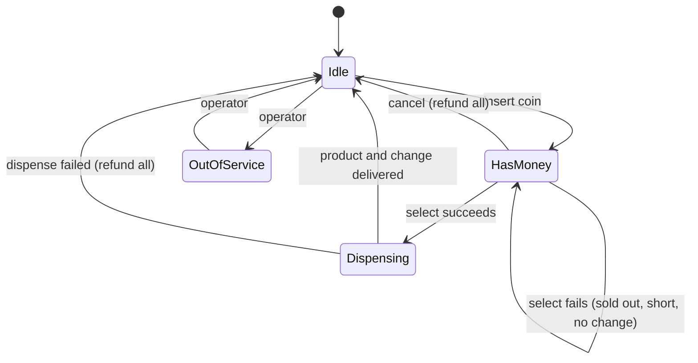
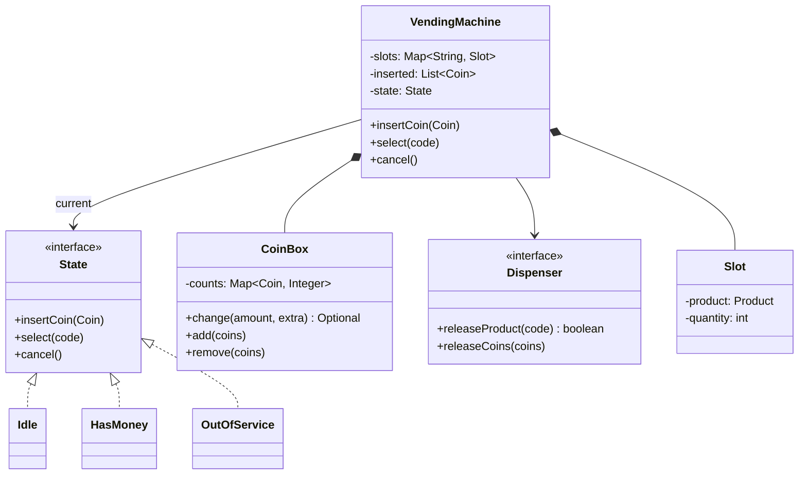

## Introduction

Put a dollar into a vending machine and press the button for a 70-cent bag of chips. You expect three things: the chips drop, you get 30 cents back, and nothing strange happens if you press the button again. Behind that expectation are a surprising number of decisions. What if the chips are sold out? What if you have not inserted enough? What if the machine has no nickels or dimes left to give change? What if the spiral motor jams after the machine has decided to sell?

The vending machine is a favourite low-level design (LLD) interview problem because it compresses three important skills into a small domain:

- **State machines.** The same button means different things depending on whether money has been inserted. A design that ignores this ends up with flags and `if` statements everywhere.
- **Correct money handling.** Prices, credit and change must be exact, and change must be possible with the coins actually in the machine.
- **All-or-nothing operations.** A sale touches stock, coins and hardware. If any part fails, the customer must end up with either the product and correct change, or their money back — never neither.

Those same three skills appear in serious backend systems. An order or payment moves through states. A payment service must never lose or invent a cent. A checkout that reserves stock, charges a card and ships an item must undo earlier steps when a later one fails. The vending machine is the smallest place to practise all three.

## Before you start

- **The LLD method** — clarify, identify entities, assign responsibilities, walk the flows, code, extend. It is taught in [[d3-parking-lot]].
- **The State pattern** — this lesson applies it; [[d2-state]] explains it in full, including enum and transition-table alternatives.
- **Enums with fields** — coins carry their value. See [[c1-enums]] and [[c1-enum-constructor]].
- **Greedy algorithms and backtracking** — for the change-making section. See [[a10-local-vs-global]] and [[a9-pruning]].
- **Exceptions** — illegal actions are rejected with exceptions. See [[c1-exceptions]].

## The intuition

Imagine the machine as a shopkeeper with a very strict routine. While nobody is at the counter, the only thing that makes sense is accepting money; asking for an item gets "please pay first". Once there is money on the counter, the shopkeeper will take more money, hand over an item if you have paid enough, or give your money back if you change your mind. While handing over an item, they ignore everything else until they are done. And if the shop is closed for restocking, they refuse everything.

Each of those situations is a **state**, and in each state the same request — "give me item A1" — gets a different response. That is the defining property of a **finite state machine**: a fixed set of states, a set of events (insert coin, select, cancel), and for each state-and-event pair, an action and a next state.

The second intuition is about the money on the counter. A careful shopkeeper does not put your coins into the till until the sale is done. If they cannot find the item, or cannot make change, your exact coins are still on the counter and can be handed straight back. That pile of not-yet-accepted money is an **escrow**, and it is what makes refunds simple and safe.

## Step 1: Clarify the requirements

| Question | Assumed answer | Effect on the design |
|---|---|---|
| Payment types? | Coins first; card as an extension | A coin model and a coin box |
| Which coins? | Nickel, dime, quarter, dollar coin; prices are multiples of 5 cents | A `Coin` enum with values |
| One item per transaction? | Yes; leftover credit is returned as change | Purchase ends the transaction |
| Change? | Machine gives change from coins it holds; may run out of some coins | Change must respect coin stock |
| What if change is impossible? | Refuse the sale and keep the credit, so the customer can pick something else or cancel | Check change before committing |
| Cancel? | Returns exactly the coins inserted | Inserted coins are kept separately |
| Hardware failures? | The motor can jam | Dispense can fail; compensation needed |
| Operator actions? | Restock, collect cash, take out of service | A maintenance state |
| Several customers at once? | No — one customer at a time at one machine | Little concurrency in the core |

The last row is worth saying aloud in an interview. A physical vending machine serves one person at a time, so the classic concurrency problems of the [[d3-parking-lot]] mostly disappear. Concurrency returns only with remote features — a card payment confirmed asynchronously, or a phone app reserving an item — and those are covered at the end.

## Step 2: The state machine

Draw the states before any classes. Every arrow is a legal transition; every missing arrow is an action the machine must reject.



Three details deserve comment. **A failed selection keeps the money**: if A1 is sold out, the customer should be able to choose A2 without reinserting coins, so the machine stays in `HasMoney`. **Dispensing has no incoming events from the customer**: pressing buttons while the motor turns does nothing. And **out of service is reachable only from `Idle`**, so an operator cannot switch off a machine holding a customer's money without refunding it first.

In the implementation below, dispensing happens synchronously inside the purchase method, so `Dispensing` is not a separate class — nothing can happen during it. If dispensing were asynchronous (start the motor, wait for a sensor callback), `Dispensing` would become a real state object that rejects coins and selections until the callback arrives. Mentioning that distinction shows you understand why a state exists, not just that it appears in diagrams.

## Step 3: Entities and responsibilities

- **Coin** — an enum of denominations, each with its value in cents.
- **Product** and **Slot** — a product has a name and price; a slot holds a product and a quantity. Price lives with the product, quantity with the slot, because the same product could sit in two slots.
- **CoinBox** — the coins the machine owns, and the one operation that needs them: "can I make this amount of change, and with which coins?"
- **Dispenser** — the boundary with hardware: release a product, release coins. It is an interface so the logic can be tested with a fake, and because releasing a product *can fail*.
- **State** — one object per state, each implementing the customer actions for that state.
- **VendingMachine** — the context: it holds slots, coin box, dispenser, the inserted coins (escrow) and the current state, and forwards every customer action to the state.



## The implementation

The whole program is `VendingDemo.java`, compiled and run on Java 21. It is shown in four parts; together they are the body of `public class VendingDemo`, which imports `ArrayList`, `EnumMap`, `LinkedHashMap`, `List`, `Map` and `Optional` from `java.util`.

### Money and products

```java title="VendingDemo.java (part 1: coins, products and the coin box)"
enum Coin {
    DOLLAR(100), QUARTER(25), DIME(10), NICKEL(5);   // declared largest first
    final int cents;
    Coin(int cents) { this.cents = cents; }
}

record Product(String name, int priceCents) {}

static final class Slot {
    final Product product;
    int quantity;
    Slot(Product product, int quantity) { this.product = product; this.quantity = quantity; }
}

/** Coins the machine owns and can give as change. */
static final class CoinBox {
    private final Map<Coin, Integer> counts = new EnumMap<>(Coin.class);

    CoinBox(Map<Coin, Integer> initial) {
        for (Coin c : Coin.values()) counts.put(c, initial.getOrDefault(c, 0));
    }

    void add(List<Coin> coins) { for (Coin c : coins) counts.merge(c, 1, Integer::sum); }

    void remove(List<Coin> coins) { for (Coin c : coins) counts.merge(c, -1, Integer::sum); }

    /**
     * Finds coins summing to amount using only coins in stock, or empty if impossible.
     * Tries large coins first, but backtracks: plain greedy can fail when a coin is
     * missing (30 cents from one quarter and three dimes, with no nickels).
     */
    Optional<List<Coin>> change(int amount, Map<Coin, Integer> extra) {
        Map<Coin, Integer> available = new EnumMap<>(counts);
        extra.forEach((c, n) -> available.merge(c, n, Integer::sum));
        List<Coin> picked = new ArrayList<>();
        return search(amount, 0, available, picked) ? Optional.of(picked) : Optional.empty();
    }

    private boolean search(int amount, int index, Map<Coin, Integer> avail, List<Coin> out) {
        if (amount == 0) return true;
        if (index == Coin.values().length) return false;
        Coin coin = Coin.values()[index];
        int maxUse = Math.min(avail.get(coin), amount / coin.cents);
        for (int use = maxUse; use >= 0; use--) {           // most of this coin first
            for (int i = 0; i < use; i++) out.add(coin);
            if (search(amount - use * coin.cents, index + 1, avail, out)) return true;
            for (int i = 0; i < use; i++) out.remove(out.size() - 1);
        }
        return false;
    }

    @Override public String toString() { return counts.toString(); }
}

/** The hardware boundary: physical dispensing can fail. */
interface Dispenser {
    boolean releaseProduct(String code);
    void releaseCoins(List<Coin> coins);
}
```

All money is an `int` number of cents. Floating-point `double` cannot represent values like 0.1 exactly, and a machine that compares `credit >= price` with rounding errors will occasionally refuse an exact payment. Integer cents make every comparison exact.

The `Coin` enum is declared from largest to smallest so that `Coin.values()` gives the order the change search wants. `CoinBox.change` takes an `extra` map because the coins the customer just inserted can also be used for change — if you insert two quarters for a 45-cent item, the machine may hand back a nickel it already had, or it may need one of your own coins. The search only *plans*: it works on a copy of the counts and changes nothing.

### States and the machine

```java title="VendingDemo.java (part 2: states and the vending machine)"
interface State {
    default void insertCoin(Coin c)     { throw new IllegalStateException(rejection()); }
    default void select(String code)    { throw new IllegalStateException(rejection()); }
    default void cancel()               { throw new IllegalStateException(rejection()); }
    default String rejection()          { return "not allowed now"; }
}

static final class VendingMachine {
    private final Map<String, Slot> slots;
    private final CoinBox box;
    private final Dispenser dispenser;
    private final List<Coin> inserted = new ArrayList<>();   // escrow: not yet ours
    private State state;

    private final State idle = new State() {
        public void insertCoin(Coin c) { inserted.add(c); state = hasMoney; }
        public void select(String code) {
            throw new IllegalStateException("insert coins first");
        }
        public String rejection() { return "nothing to cancel"; }
    };

    private final State hasMoney = new State() {
        public void insertCoin(Coin c) { inserted.add(c); }
        public void select(String code) { purchase(code); }
        public void cancel() { refundAll("cancelled"); state = idle; }
    };

    private final State outOfService = new State() {
        public String rejection() { return "out of service"; }
    };

    VendingMachine(Map<String, Slot> slots, CoinBox box, Dispenser dispenser) {
        this.slots = slots; this.box = box; this.dispenser = dispenser;
        this.state = idle;
    }

    void insertCoin(Coin c) { state.insertCoin(c); }
    void select(String code) { state.select(code); }
    void cancel() { state.cancel(); }
    void setOutOfService() { refundAll("going out of service"); state = outOfService; }

    int credit() { return inserted.stream().mapToInt(c -> c.cents).sum(); }
```

The `State` interface's default methods all reject. Each state overrides only the actions it allows, exactly the arrows leaving it in the diagram. `outOfService` overrides nothing except its message, so every customer action is refused. This "reject unless allowed" default is the safe direction to fail: a new action added to the interface is illegal everywhere until a state opts in.

The machine's public methods are one line each: forward to the current state. There is no `if (state == ...)` anywhere in `VendingMachine`. The states are anonymous inner classes so they can reach the machine's fields directly — a compact choice for a small machine; separate top-level classes that receive the machine as a parameter scale better when states grow (see [[d2-state]]).

`inserted` is the escrow. Coins go there, not into the coin box, until a sale completes. `credit()` is computed from it rather than stored separately, so the credit can never disagree with the coins actually held.

### The purchase

```java title="VendingDemo.java (part 3: purchase and refund)"
    private void purchase(String code) {
        Slot slot = slots.get(code);
        if (slot == null) throw new IllegalArgumentException("no slot " + code);
        if (slot.quantity == 0) {
            throw new IllegalStateException(slot.product.name() + " is sold out");
        }
        int price = slot.product.priceCents();
        if (credit() < price) {
            throw new IllegalStateException("insert " + (price - credit()) + " more cents");
        }
        // Plan the change before touching anything; inserted coins may be reused.
        Map<Coin, Integer> escrow = new EnumMap<>(Coin.class);
        for (Coin c : inserted) escrow.merge(c, 1, Integer::sum);
        List<Coin> change = box.change(credit() - price, escrow).orElseThrow(
                () -> new IllegalStateException("cannot make change; exact amount only"));

        slot.quantity--;                                   // reserve the item
        if (!dispenser.releaseProduct(code)) {
            slot.quantity++;                               // compensate: undo and refund
            refundAll("dispense failed");
            state = idle;
            return;
        }
        box.add(inserted);                                 // the sale is final now
        inserted.clear();
        box.remove(change);
        if (!change.isEmpty()) dispenser.releaseCoins(change);
        state = idle;
    }

    private void refundAll(String why) {
        if (inserted.isEmpty()) return;
        System.out.println("  refund (" + why + "): " + inserted);
        dispenser.releaseCoins(List.copyOf(inserted));
        inserted.clear();
    }

    String coinBox() { return box.toString(); }
}
```

The order of `purchase` is the most important thing in this lesson. It has two phases.

**Phase 1 — validate everything, change nothing.** The slot exists; it is not empty; the credit covers the price; change can be made from the coins available. Each failed check throws, and because nothing has been modified yet, the machine is exactly as it was: still in `HasMoney`, credit intact, stock untouched. The customer can pick something else or cancel.

**Phase 2 — commit, with a plan for failure.** The stock is decremented first, as a reservation. Then the one step that can fail for physical reasons — the motor — runs. If it fails, the method **compensates**: it restores the stock and refunds the inserted coins, which are still in escrow, untouched. Only after the product has dropped does the money move: inserted coins go into the coin box, the planned change comes out.

Why plan change before dispensing rather than after? Because if the machine dropped the chips and *then* discovered it could not make change, it would have given away the product while owing the customer money — a state with no clean way out. Checking change in phase 1 means the machine only commits to sales it can finish.

Why add the inserted coins to the box *before* removing the change? Because the plan may give back one of the customer's own coins. Adding first means the counts never go negative, even for a moment.

### Running it

```java title="VendingDemo.java (part 4: a fake dispenser and main)"
static final class FakeDispenser implements Dispenser {
    boolean jamNext;
    public boolean releaseProduct(String code) {
        if (jamNext) {
            jamNext = false;
            System.out.println("  [motor jammed at " + code + "]");
            return false;
        }
        System.out.println("  dispensed " + code);
        return true;
    }
    public void releaseCoins(List<Coin> coins) { System.out.println("  coins out " + coins); }
}

static void attempt(String label, Runnable action) {
    System.out.println(label);
    try {
        action.run();
    } catch (IllegalStateException | IllegalArgumentException e) {
        System.out.println("  rejected: " + e.getMessage());
    }
}

public static void main(String[] args) {
    Map<String, Slot> slots = new LinkedHashMap<>();
    slots.put("A1", new Slot(new Product("Water", 65), 5));
    slots.put("A2", new Slot(new Product("Chips", 70), 1));
    slots.put("B1", new Slot(new Product("Gum", 45), 0));
    FakeDispenser hw = new FakeDispenser();
    CoinBox box = new CoinBox(Map.of(Coin.QUARTER, 1, Coin.DIME, 3));   // no nickels
    VendingMachine vm = new VendingMachine(slots, box, hw);

    attempt("select A1 with no money", () -> vm.select("A1"));
    attempt("insert $1, select B1", () -> { vm.insertCoin(Coin.DOLLAR); vm.select("B1"); });
    attempt("select A2 with $1 credit", () -> vm.select("A2"));
    System.out.println("  coin box now " + vm.coinBox());

    attempt("insert $1, select A1", () -> { vm.insertCoin(Coin.DOLLAR); vm.select("A1"); });
    attempt("cancel", vm::cancel);

    hw.jamNext = true;
    attempt("insert 65 cents exactly, select A1 (motor jams)", () -> {
        vm.insertCoin(Coin.QUARTER); vm.insertCoin(Coin.QUARTER);
        vm.insertCoin(Coin.DIME); vm.insertCoin(Coin.NICKEL);
        vm.select("A1");
    });
    System.out.println("  Water left: " + slots.get("A1").quantity
            + ", credit " + vm.credit() + ", coin box " + vm.coinBox());
}
```

```output
select A1 with no money
  rejected: insert coins first
insert $1, select B1
  rejected: Gum is sold out
select A2 with $1 credit
  dispensed A2
  coins out [DIME, DIME, DIME]
  coin box now {DOLLAR=1, QUARTER=1, DIME=0, NICKEL=0}
insert $1, select A1
  rejected: cannot make change; exact amount only
cancel
  refund (cancelled): [DOLLAR]
  coins out [DOLLAR]
insert 65 cents exactly, select A1 (motor jams)
  [motor jammed at A1]
  refund (dispense failed): [QUARTER, QUARTER, DIME, NICKEL]
  coins out [QUARTER, QUARTER, DIME, NICKEL]
  Water left: 5, credit 0, coin box {DOLLAR=1, QUARTER=1, DIME=0, NICKEL=0}
```

`FakeDispenser` is a **test double** for the hardware: it prints instead of turning motors and can be told to jam. Because the machine depends on the `Dispenser` interface rather than on hardware, the failure path — the hardest one to test on a real machine — runs in a plain `main`.

## Dry run: state, credit and coins

The machine starts with one quarter and three dimes, and no nickels.

| Step | State before | Action | Result | State after | Credit after |
|---|---|---|---|---|---|
| 1 | Idle | select A1 | Rejected by `idle.select` | Idle | 0 |
| 2 | Idle | insert $1 | Coin into escrow | HasMoney | 100 |
| 2 | HasMoney | select B1 | Sold out — phase 1 fails, nothing changes | HasMoney | 100 |
| 3 | HasMoney | select A2 (70) | Change 30 planned as three dimes; chips drop; dollar into box | Idle | 0 |
| 4 | Idle → HasMoney | insert $1, select A1 (65) | Change 35 impossible with one quarter and no dimes or nickels | HasMoney | 100 |
| 5 | HasMoney | cancel | Escrowed dollar returned | Idle | 0 |
| 6 | Idle → HasMoney | insert 65 exactly, select A1 | Motor jams; stock restored; escrow refunded | Idle | 0 |

Step 3 is where a naive design fails. The common greedy rule "always give the largest coin that fits" would hand out the quarter first, leaving 5 cents to pay — and there are no nickels. A greedy machine would either refuse the sale or, worse, have already released the quarter. The backtracking search tries "one quarter", fails, backs up, tries "no quarters", and finds three dimes.

Step 4 is the opposite case: no combination works, so the sale is refused *before* anything happens, the customer keeps their credit, and the machine reports "exact amount only" — the message real machines display when they are low on coins.

Step 6 shows the compensation path. The final line confirms the invariant: water stock is still 5, credit is 0 (the coins were returned), and the coin box is unchanged. The customer is exactly where they started.

```quiz
Q: In `purchase`, why is the change calculated before the product is dispensed rather than after?
- [ ] Because calculating change is faster than dispensing
- [x] So the machine never releases a product it then cannot give correct change for
- [ ] Because the coin box must be updated before the slot
- [ ] It makes no difference to correctness
> If change were computed after dispensing and turned out to be impossible, the customer would have the product while the machine owed them money, with no clean way to undo the drop. Checking every precondition — stock, credit and change — before the first irreversible step means the machine only commits to sales it can complete.
```

## Making change correctly

Change-making deserves its own section because interviewers often probe it, and the obvious answer is subtly wrong.

The **greedy algorithm** repeatedly takes the largest coin not exceeding the remaining amount. For US-style coins (25, 10, 5, 1) with an **unlimited supply** of each, greedy always finds a solution with the fewest coins — such coin systems are called *canonical*. That is why the textbook answer is greedy.

A vending machine breaks both assumptions. First, its supply is **limited**: once nickels run out, greedy can paint itself into a corner, as step 3 showed (30 = 25 + 5 is impossible, but 30 = 10 + 10 + 10 is fine). Second, some currencies or token systems are **not canonical**. With coins of 1, 3 and 4, greedy makes 6 as 4 + 1 + 1 (three coins), while 3 + 3 uses two. Greedy is a locally best choice that is not globally best — the general lesson of [[a10-local-vs-global]].

The demo's **backtracking search** fixes the limited-supply problem. It considers denominations from largest to smallest; for each, it tries using as many as possible, then one fewer, and so on, recursing on the rest. Because it tries large coins first, the first solution found usually uses few coins; because it backtracks, it finds a solution whenever one exists. With four denominations and amounts under a few dollars, the search is tiny.

If an interviewer asks for the **minimum** number of coins with limited supply, that is the bounded coin-change problem, solvable with dynamic programming in O(amount × total coins) time — the same family as [[a11-knapsack]]. For a vending machine, "any valid change, preferring large coins" is usually the right requirement; say so and offer the DP as the stricter version.

> [!TIP] Keep coins in reserve
> Real machines refuse notes or large coins when change is running low, and operators load extra coins of the denominations that run out first. In the design, that is a policy on `insertCoin` ("accept a dollar only if at least 95 cents of change can be made for the cheapest item") — another reason to keep the coin box as its own class with a clear question it can answer.

## Failures and compensation

A sale has three effects: stock goes down, the machine keeps the customer's coins, and change comes out. These cannot be wrapped in a database transaction, because one of them is a motor. The general technique when a multi-step operation cannot be made atomic is **compensation**: perform the steps in an order where every step before the risky one can be undone, and undo them if the risky step fails.

The demo's order is designed around that:

1. Validate everything (nothing to undo).
2. Decrement stock (undo: increment).
3. Run the motor — **the risky step**.
4. Move escrowed coins into the box and release change (only after success).

Holding the customer's coins in escrow is what keeps step 2's compensation cheap. The coins never entered the box, so a refund is "give back exactly these coins" — no change calculation, no possibility that the machine lacks the coins to refund.

Real machines add a sensor. Many modern machines have an optical **drop sensor** across the delivery bin; if no product breaks the beam after the motor turns, the machine retries or treats the vend as failed and refunds. Without a sensor, the software cannot know the product stuck on the spiral, so "dispense succeeded" must come from hardware feedback, not from having sent the command — which is exactly why `releaseProduct` returns a boolean.

What if releasing *change* fails after the product dropped? The sale has happened; the product cannot be taken back. The right response is to record an **IOU** — log the amount owed, show a message, and let an operator resolve it — rather than pretend nothing happened. Interviewers like this question because it has no perfect answer, and recognising that is the point.

The same pattern appears at a larger scale in distributed systems, where a checkout reserves stock, charges a card and books a shipment across services. If the shipment fails, earlier steps are compensated — release the stock, refund the card. That pattern is called a **saga**; see [[d4-saga]] and [[d4-compensation]].

## Extending the design

**Card payments.** A card does not insert coins; it authorises an amount. The usual flow is **authorise, then capture**: when the customer selects, the machine asks the payment processor to authorise (hold) the price; after a successful dispense, it captures the payment; if dispensing fails, it voids the authorisation, so the customer is never charged. This fits the existing structure: introduce a `Payment` abstraction with `CoinPayment` (escrow) and `CardPayment` (authorisation) implementations, each with `commit()` and `refund()`. The purchase logic calls those instead of manipulating coins directly. Card authorisation is asynchronous, so a `WaitingForAuthorisation` state appears — the machine must reject selections while it waits.

**Restocking and cash collection.** An operator mode (`Maintenance` state) unlocks restock, price changes and coin collection, and blocks customers. Price changes in particular must not happen while a customer has credit, which the state machine guarantees if maintenance is only reachable from `Idle`.

**Sold-out handling.** A slot at zero rejects selection, as in the demo. If *every* slot is empty, a machine-level `SoldOut` state can reject coins at the slot, so customers are not invited to insert money they cannot spend.

**Telemetry.** Modern machines report sales and stock levels to the operator so restocking routes can be planned. Emitting an event after each completed sale — rather than calling a network service inside `purchase` — keeps the sale independent of the network. See [[d2-observer]].

**Remote purchase.** A phone app that reserves an item before the customer walks up introduces genuine concurrency: the app's reservation and a walk-up customer may target the last item at once. The slot quantity then needs the same atomic check-and-decrement discussed in [[d3-parking-lot]], and the machine's event handling should run on a single thread that processes button presses, coin events and network messages in order.

## Enum states versus state classes

The State pattern is not the only way to implement the machine. An enum with a `switch` is a legitimate alternative:

```java
enum Mode { IDLE, HAS_MONEY, OUT_OF_SERVICE }

void select(String code) {
    switch (mode) {
        case IDLE -> throw new IllegalStateException("insert coins first");
        case HAS_MONEY -> purchase(code);
        case OUT_OF_SERVICE -> throw new IllegalStateException("out of service");
    }
}
```

With three states and three actions, this is shorter and perfectly readable. If you write such a `switch` as an *expression* that produces a value, the Java compiler rejects it when an enum constant is missing, which protects you when a state is added. The cost grows with size: every action method contains a `switch` over every state, so the rules for one state are spread across all methods, and adding a state means editing each `switch`. State classes invert that: one class per state containing all of its rules, and adding a state touches only the transitions into it.

A reasonable interview position: "For this size I'd be happy with an enum and switches; I'll use state classes because the machine will grow modes — maintenance, card authorisation, sold out — and each has its own rules." The detailed comparison, including transition tables, is in [[d2-state]].

## In real systems

Vending machines in many regions communicate with their coin mechanisms, note readers and card readers over standard serial protocols, so the controller treats payment devices as peripherals that report "coin of value X accepted" or "card authorised for Y". The coin mechanism itself usually has tubes for each denomination and reports how many coins each tube holds — the hardware equivalent of `CoinBox.counts`. That reported inventory is what drives the "exact change only" light.

Telemetry units report sales, stock and faults to the operator's back office, which plans restocking routes. Card readers authorise through payment processors over a cellular connection, which is why card sales take a second or two and why the authorise-capture-void flow matters.

The patterns from this lesson recur in software that never touches a coin. Checkout flows are state machines with escrow-like holds on stock and payment. Payment systems keep amounts in integer minor units. Any operation that crosses a boundary you cannot roll back — a hardware action, a third-party API, an email — needs the "validate, commit in a compensatable order, undo on failure" structure.

## Trade-offs and alternatives

| Decision | Choice here | Alternative | When the alternative wins |
|---|---|---|---|
| State representation | State objects | Enum + `switch` | Few states and actions that will not grow |
| Inserted money | Escrow list, committed after dispense | Add to coin box immediately | Never; refunds become change calculations that can fail |
| Change algorithm | Backtracking over stock, large coins first | Greedy | Unlimited supply of a canonical coin system (not a real machine) |
| Minimum coins | Not required | Bounded coin-change DP | Requirement explicitly asks for fewest coins |
| Dispense failure | Compensate: restore stock, refund escrow | Ignore | Never acceptable for a customer-facing machine |
| Concurrency | None (single customer) | Single-threaded event loop or locks | Remote reservations, asynchronous card authorisation |

## Common mistakes

**Flags instead of states.** A `hasMoney` boolean, an `isDispensing` boolean and an `outOfService` boolean allow impossible combinations (dispensing with no money) and scatter checks across every method. One state value, or one state object, makes impossible combinations unrepresentable.

**Decrementing stock or taking money before all checks pass.** If the machine reduces stock and then discovers the credit is short, it has lost an item from its count. Validate everything first.

**Greedy change with limited coins.** Greedy fails when a denomination runs out. Search with backtracking, or check that the greedy result is valid and fall back.

**Computing change after dispensing.** The machine gives away a product it cannot complete the sale for. Plan change in the validation phase.

**Using `double` for money.** Rounding errors make exact payments fail comparisons. Use integer cents.

**Refunding by computing change.** If inserted coins went straight into the box, a cancel needs a change calculation that may be impossible. Keep inserted coins in escrow and return those exact coins.

> [!MISTAKE] Assuming the motor always works
> Designs that treat `dispense()` as infallible have no answer to "what if it jams?". Make the hardware boundary an interface that can report failure, order the steps so earlier ones can be undone, and refund from escrow when the risky step fails.

## Interview perspective

In a 30–45 minute slot, aim for: requirements (two or three minutes, including "single customer, coins first"), the state diagram, the class list, then code for `insertCoin`, `select`/`purchase` and `cancel`. Use the remaining time on change-making and failure handling, which are where strong candidates separate themselves.

> [!INTERVIEW] What a strong answer sounds like
> "Inserted coins stay in escrow until the sale completes, so cancel and failure refunds just return them. A purchase validates stock, credit and whether change is possible before changing anything — greedy can fail when a coin runs out, so the change search backtracks over what's in the tubes. Then I reserve the item, run the motor, and only move money after the product drops; if the motor jams, I restore stock and refund the escrow."

Questions to expect:

- **What are the states?** Idle, has money, dispensing, out of service; possibly sold out and waiting for card authorisation. Explain why a failed selection stays in has-money.
- **Why the State pattern?** Each state's rules in one place; illegal actions rejected by default; new states cheap to add. Concede that an enum is fine for a tiny machine.
- **How do you calculate change?** Greedy works for canonical coins with unlimited supply; with limited coins, backtrack or use bounded DP.
- **What if the machine cannot make change?** Refuse the sale before committing, keep the credit, show "exact amount only".
- **What if dispensing fails after payment?** Payment is not taken until dispensing succeeds (escrow, or authorise-then-capture for cards); restore stock and refund.
- **How would you add card payments?** A `Payment` abstraction with commit and refund; authorise, capture on success, void on failure.
- **How would you test it?** Fake dispenser and coin-box setups; one test per row of the state diagram, including the jam path.

## Practice

1. **Fewest coins.** Replace the backtracking search with a bounded coin-change DP that returns the fewest coins possible from the coins in stock. Compare results on 30 cents with one quarter and three dimes.
2. **Asynchronous dispensing.** Make `releaseProduct` start the motor and report success or failure later through a callback. Add a `Dispensing` state that rejects coins and selections until the callback arrives.
3. **Card payment.** Introduce a `Payment` interface with `CoinPayment` and `CardPayment`. Implement authorise, capture and void with a fake processor, and add a `WaitingForAuthorisation` state.
4. **Accept-coin policy.** Refuse a dollar coin when the machine could not make change for the cheapest item from it. Where does the rule live?
5. **Change IOU.** Make `releaseCoins` able to fail after the product has dropped. Record the amount owed and expose it to an operator in maintenance mode.
6. **Enum version.** Rewrite the machine with an enum and `switch` expressions. Which version is easier to extend with a maintenance mode that allows restocking?

## Quick revision {#quick-revision}

- States: Idle → HasMoney (insert) → Dispensing (valid select) → Idle; HasMoney → Idle on cancel; failed select stays in HasMoney; OutOfService only from Idle.
- State pattern: interface defaults reject; each state overrides only its legal actions; the machine forwards every call.
- Money in integer cents. Inserted coins are an escrow; credit is computed from it.
- Purchase phase 1: slot exists, in stock, credit ≥ price, change possible — no changes made.
- Purchase phase 2: reserve stock → dispense → on success move escrow into box and release change; on failure restore stock and refund escrow.
- Greedy change is optimal only for canonical coin systems with unlimited supply; limited coins need backtracking or bounded DP.
- Change impossible → refuse before committing, show "exact amount only".
- Compensation: order steps so everything before the risky step can be undone; same idea as a saga.
- Cards: authorise on select, capture after dispense, void on failure.
- Enum + `switch` is fine for tiny machines; state classes scale as modes grow.

## Key takeaways {#key-takeaways}

- Draw the state machine first; it tells you which actions each state must reject and keeps impossible combinations out of the code.
- Keep the customer's coins in escrow until the sale is final, so every refund is simply returning those coins.
- Validate stock, credit and change before the first irreversible step, then commit in an order where every earlier step can be undone.
- Greedy change-making fails when a coin runs out; a vending machine needs a search that respects the coins actually in stock.
- Treat hardware as an interface that can fail, which makes the failure path both designable and testable.
- The same ideas — explicit states, exact money and compensation — carry over directly to checkout, payment and order systems.
