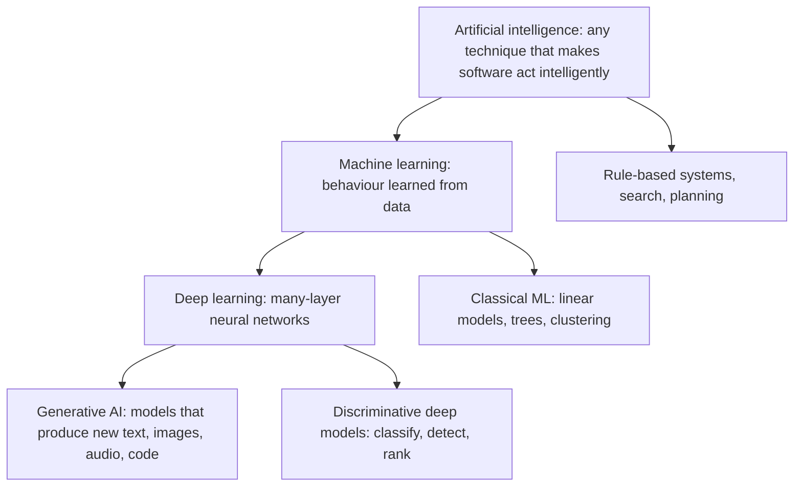
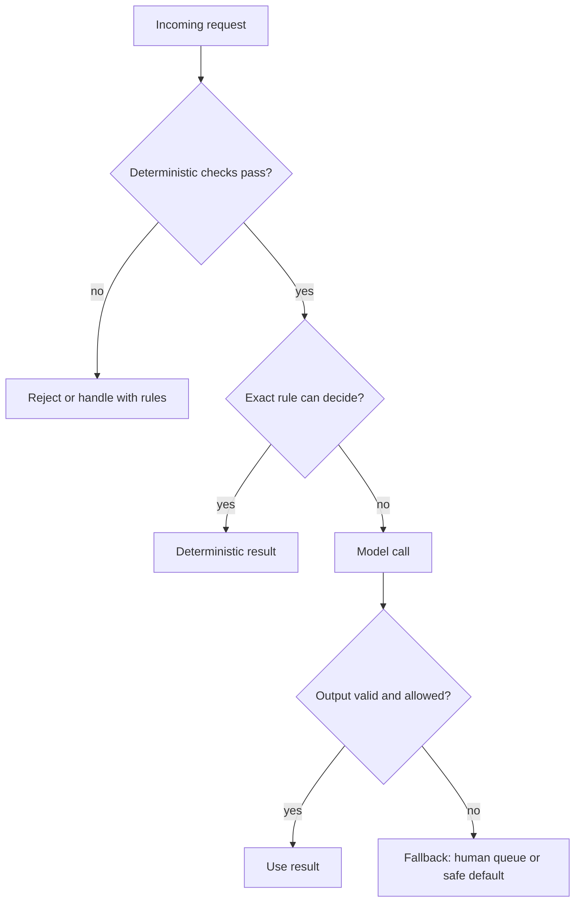
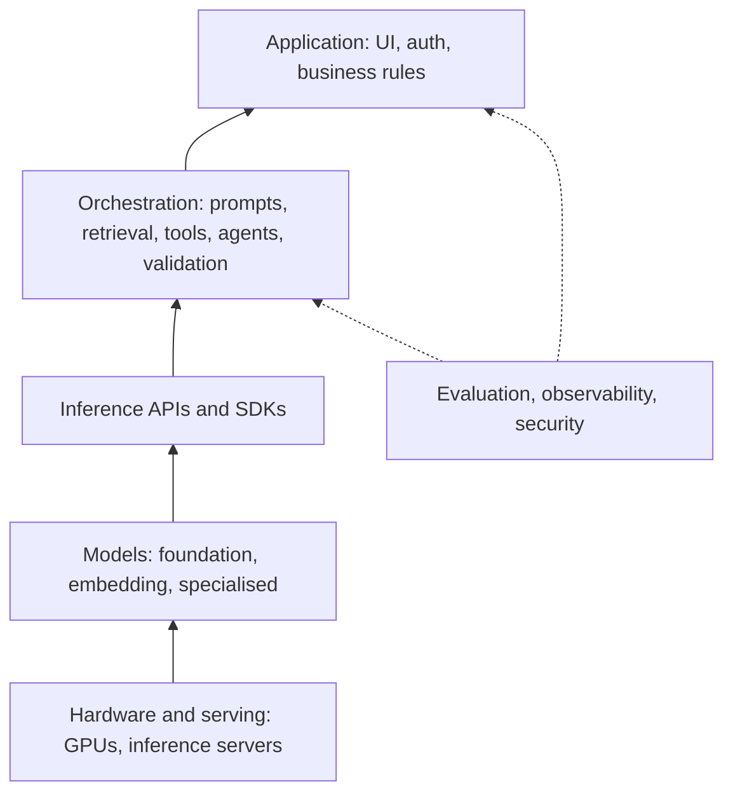

## Introduction

In a single week an engineer might hear "AI" used for a recommendation algorithm, a fraud-detection model, a chatbot, an image generator and a spreadsheet macro. The word has become so broad that it no longer tells you how a system works, what it costs, or how it fails. That is a practical problem: if you cannot say precisely what kind of AI a feature uses, you cannot estimate its latency, test it, secure it, or explain to a product manager why it gave a wrong answer.

**Applied AI engineering** is the discipline of building reliable software products on top of AI models — most often large pre-trained models accessed through an API or run on your own hardware. An applied AI engineer usually does not invent new model architectures or train models from scratch. They choose models, connect them to data and tools, constrain and validate what the models produce, measure quality, and run the result in production with acceptable cost, latency and safety. It is software engineering in which one component is probabilistic.

This lesson is the map for the rest of Track E. It gives you the vocabulary to place any AI technique in context, introduces the kinds of models you will work with and the people you will work alongside, and ends with the judgement that matters most in practice: deciding when a problem should be solved with AI and when ordinary deterministic code is the better answer.

## Before you start

No machine-learning background is needed. It helps to have:

- **General software-engineering experience** — APIs, testing, and the idea of a production system. Track C and Track D cover these.
- **Basic Python** for reading the short examples. See [[e1-syntax]].

You will meet several terms here — tokens, parameters, training, inference — that later lessons teach in depth. Each is defined in plain words when it first appears, with a link to where it is covered properly.

## The intuition: three ways to get behaviour from a computer

Imagine you are asked to build one small feature: send every customer-support ticket that is about billing to the billing team. There are three fundamentally different ways to do it.

**You write the rules.** You list the words that indicate billing — "invoice", "refund", "charged" — and write code that checks for them. The behaviour is exactly what you wrote, nothing more. It is fast, free to run, and easy to test, but it misses "I want my money back", which contains none of your words.

**You learn the rules from examples.** You collect a few thousand tickets that people have already labelled "billing" or "not billing", and an algorithm finds the patterns that separate them. You never write the rule; you supply data, and the rule is the output. It catches paraphrases you did not think of, as long as similar ones appeared in the data.

**You instruct a model that already understands language.** You take a large model trained on a huge amount of text and simply ask it: "Is this ticket about billing? Answer yes or no." You wrote no rules and collected no labels. The model brings general knowledge of language — it knows a "reimbursement" is a kind of refund — and you steer it with instructions.

These three approaches correspond roughly to classic rule-based AI, machine learning, and modern generative AI. Each step trades predictability for flexibility. The rest of this lesson builds on this picture: the first nested section names the layers precisely, the next ones explain the models behind the third approach, and the final one returns to the question of which approach a given feature deserves.

## AI → ML → Deep Learning → Generative AI {#e1-ai-ml-dl-genai}

These four terms are not competitors; each is a subset of the one before it. **Artificial intelligence** is the broadest goal. **Machine learning** is one way to pursue it. **Deep learning** is one family of machine-learning methods. **Generative AI** is one use of deep learning. Knowing where a technique sits tells you how its behaviour is specified, how much data it needs, and how it can fail.



### Artificial intelligence

**Artificial intelligence (AI)** is the field of making computers perform tasks that we associate with human intelligence: understanding language, recognising images, making decisions, planning. The term was coined for a 1956 workshop at Dartmouth College. For decades much of the field was **symbolic** or **rule-based**: people encoded knowledge as explicit rules and logic. Chess programs that search through possible moves, route planners and the "expert systems" of the 1980s are all AI without any learning. A route planner using A* search is still AI today.

Rule-based systems work well when the rules are known and stable. They break down when the rules are too many or too fuzzy to write — nobody can write down the rules for recognising a cat in a photo.

### Machine learning

**Machine learning (ML)** is the part of AI in which the system learns its behaviour from data instead of being explicitly programmed. Arthur Samuel, who built a checkers program that improved by playing, popularised the term in 1959. You provide **training data** — examples, usually with the correct answers, called **labels** — and a learning algorithm adjusts the model's internal numbers, its **parameters**, until its outputs match the labels well. Using the trained model on new inputs is called **inference**. The full vocabulary of datasets, features, labels, training and inference is taught in [[e2-ml-vs-dl-vs-genai]].

The program below makes the difference between written rules and learned rules concrete. It is deliberately tiny — real ML uses far more data and better algorithms — but the shape is the same.

```python title="rules_vs_learning.py"
from collections import Counter

# Approach 1 (classic AI): a person writes the rule.
BILLING_WORDS = {"invoice", "refund", "charge", "charged", "payment"}

def is_billing_rule(text):
    return any(word in BILLING_WORDS for word in text.lower().split())

# Approach 2 (machine learning): the rule is learned from labelled examples.
TRAIN = [
    ("i was charged twice this month", True),
    ("please send a copy of my invoice", True),
    ("my card payment failed", True),
    ("how do i get my money back", True),
    ("the app crashes when i upload a file", False),
    ("how do i reset my password", False),
    ("export to csv is broken", False),
    ("can i add a teammate to my workspace", False),
]

def learn_weights(examples):
    pos, neg = Counter(), Counter()
    for text, is_billing in examples:
        (pos if is_billing else neg).update(set(text.split()))
    # A word's weight: how much more often it appears in billing tickets.
    return {w: pos[w] - neg[w] for w in pos | neg}

def is_billing_learned(text, weights):
    return sum(weights.get(w, 0) for w in set(text.lower().split())) > 0

weights = learn_weights(TRAIN)
print("learned:", {w: weights[w] for w in ["money", "back", "charged", "i", "a"]})

tests = [
    "I was charged for a plan I cancelled",
    "I want my money back",
    "Where can I download last month's receipt",
    "Can I get a reimbursement",
]
for t in tests:
    print(f"{t!r:46} rule={is_billing_rule(t)!s:5} learned={is_billing_learned(t, weights)}")
```

```output
learned: {'money': 1, 'back': 1, 'charged': 1, 'i': -1, 'a': -1}
'I was charged for a plan I cancelled'         rule=True  learned=False
'I want my money back'                         rule=False learned=True
"Where can I download last month's receipt"    rule=False learned=False
'Can I get a reimbursement'                    rule=False learned=False
```

The output shows the strengths and weaknesses of both approaches. The rule catches the first ticket because it contains "charged", and misses "money back" because nobody wrote that rule. The learned model catches "money back" because one training example used those words, without anyone listing them — that is the point of learning. But with only eight examples it also learned nonsense: "i" and "a" got negative weights simply because they happened to appear more often in non-billing tickets, and that noise flipped the first ticket to the wrong answer. Neither approach knows that "receipt" and "reimbursement" relate to billing, because neither word appeared anywhere.

Classical ML fixes the noise with much more data and better algorithms, and it remains the right tool for many structured-data problems: fraud scores, demand forecasts, churn prediction. Track E covers it in [[e2-classical-ml]]. But it still knows only what is in its training set. Understanding "reimbursement" needs a model that has learned how language works in general.

### Deep learning

**Deep learning** is machine learning with **neural networks** that have many layers — hence "deep". A neural network is a large function built from simple units, each multiplying its inputs by learned weights and passing the result through a non-linear function. Stacking many layers lets the network learn its own **features** — useful intermediate representations — instead of relying on features a human designed. Early layers of an image network learn edges, later layers learn shapes and objects. Language networks learn representations in which "refund" and "reimbursement" end up close together.

Neural networks are old, but deep learning took off around 2012, when a deep network called AlexNet won the ImageNet image-recognition competition by a wide margin. Three things had come together: large labelled datasets, graphics processing units (GPUs) that could do the necessary arithmetic quickly, and better training techniques. Deep learning then took over speech recognition, translation and image recognition. The mechanics are covered in [[e2-neural-networks]].

The price of deep learning is that the learned behaviour is spread across millions or billions of parameters. You cannot read the rule the network learned the way you can read an `if` statement, and it can fail on inputs that look nothing like its training data.

### Generative AI

Most ML models are **discriminative**: they map an input to a label or score — spam or not, fraud probability, which object is in the image. **Generative AI** refers to models that produce *new content* — text, images, audio, video or code — that resembles the data they were trained on. A language model writes a paragraph; an image model draws a picture from a description.

The breakthrough behind modern generative text was the **transformer** architecture, introduced in the 2017 paper "Attention Is All You Need" (see [[e2-transformers]]). Transformers made it practical to train very large models on enormous amounts of text. GPT-3 (2020) showed that a large enough model could perform tasks it was never explicitly trained for, given only an instruction and a few examples in the prompt. ChatGPT's launch in November 2022 put a conversational version in front of the public, and the current wave of applied AI engineering began.

Generative models are what most of Track E is about, because they changed who can build with AI. Before, a useful ML feature needed a labelled dataset and a training pipeline. Now a software engineer can get a reasonable first version from a well-written instruction to a pre-trained model, and then spend their effort on the engineering around it: retrieval, validation, evaluation and reliability.

| Layer | How behaviour is specified | Typical data needed | Example |
|---|---|---|---|
| Rule-based AI | People write rules or search procedures | None | Route planning, keyword filters, chess search |
| Classical ML | Learned from labelled, structured data | Thousands of labelled rows | Fraud score, churn prediction |
| Deep learning | Learned features from raw data | Large datasets, GPUs | Image classification, speech recognition |
| Generative AI | Pre-trained model steered by instructions and context | Usually none for a first version; evaluation data to measure quality | Drafting replies, extracting fields, chat assistants |

## Foundation, Language & Multimodal Models {#e1-foundation-llm-multimodal}

A **foundation model** is a large model trained once on very broad data and then adapted to many different tasks. The term was introduced by researchers at Stanford in 2021 to describe a shift: instead of training one model per task, you train one huge general model and build many applications on top of it, the way many buildings stand on one foundation. Large language models are the best-known foundation models, multimodal models extend them beyond text, and embedding models are a quieter but equally important kind.

### How a foundation model is made

A foundation model is built in two broad stages. In **pretraining**, the model learns from a vast unlabelled dataset using **self-supervised learning**: the training signal comes from the data itself rather than from human labels. For text, the task is to predict the next piece of text given everything before it. Nobody labels anything — the "correct answer" is simply the word that actually came next. Predicting the next word well across trillions of words forces the model to absorb grammar, facts, styles of reasoning and the structure of code. The result is a **base model**: very knowledgeable, but it continues text rather than following instructions. Ask a base model "What is the capital of France?" and it may continue with three more quiz questions.

In **post-training**, the base model is adapted to be useful. **Instruction tuning** trains it on examples of instructions paired with good responses. **Preference training** — such as reinforcement learning from human feedback (RLHF) — further shapes it towards answers people judge helpful, honest and safe. The output is an **assistant model** that answers the question. These stages are taught in [[e2-pretraining-instruction-alignment]].


### Large language models

A **large language model (LLM)** is a foundation model for text. It reads and writes text as **tokens** — chunks of characters, often a whole common word or a piece of a rarer one. In English, a token averages roughly three-quarters of a word. Given a sequence of tokens, the model computes a probability for every possible next token, one is chosen, appended, and the process repeats. Everything an LLM does — answering, summarising, writing code, producing JSON — is built from this one operation of predicting the next token. That explains several properties you must design around:

- **The output is probabilistic.** The same prompt can produce different answers, depending on sampling settings such as temperature ([[e2-temperature]]).
- **Fluency is not truth.** The model produces likely-sounding text. When it lacks the knowledge, it can produce confident, plausible and wrong statements — **hallucinations** ([[e2-hallucinations]]).
- **The model has a fixed context window** — the maximum number of tokens it can consider at once, prompt and answer together ([[e2-context-windows]]). Anything not in the context or the model's training data is unknown to it.
- **Knowledge is frozen at training time.** The model does not know about events after its training data was collected, or about your company's private documents, unless you put that information in the prompt. Supplying it is the job of retrieval-augmented generation (RAG), taught from [[e6-ingestion]].

"Large" refers to the number of parameters, which for current LLMs ranges from about a billion to hundreds of billions or more.

### Multimodal models

A **multimodal model** works with more than one kind of data — text, images, audio, video. Many current assistant models accept images and documents as input alongside text, so you can ask a question about a screenshot, a chart or a scanned invoice. Some also accept or produce audio directly, which enables voice assistants that do not need a separate speech-to-text step. Image generation is usually done by different kinds of models, such as **diffusion models**, which create an image by gradually removing noise, guided by a text description. These are covered in [[e8-multimodal]] and [[e8-voice-ai]].

Multimodality matters for engineering because real business data is rarely clean text. Invoices are PDFs, product photos are images, support calls are audio. A multimodal model can sometimes replace a whole pipeline of OCR, layout analysis and text processing — though, as with any model, you must measure whether it is accurate enough for your documents.

### Embedding models

Not every foundation model generates content. An **embedding model** converts text (or an image) into a **vector** — a list of numbers — such that inputs with similar meanings get vectors that are close together. Embeddings power semantic search, recommendation, clustering and the retrieval step of RAG. You do not chat with an embedding model; you use its vectors as data. They are covered in [[e5-embeddings]].

### Model, API, pipeline, agent, product

Beginners often use "the AI" to mean any of five different things. Keeping them separate is essential, because each has different failure modes and each is a different layer of the system you will build.

| Term | What it is | Example |
|---|---|---|
| Model | Learned parameters plus the code to run them | An LLM's weights loaded on a GPU |
| Inference API | A network service that runs a model for you, billed per token | A provider's chat-completions endpoint ([[e3-chat-apis]]) |
| RAG pipeline | Code that retrieves relevant documents and adds them to the prompt so answers are grounded in your data | A help-centre assistant that cites articles ([[e6-rag-pipeline]]) |
| Agent | A loop in which a model chooses actions (tool calls), observes results and continues until a goal is met | A coding assistant that edits files and runs tests ([[e7-agent-loops]]) |
| AI product | The whole application: UI, authentication, model calls, retrieval, tools, evaluation, monitoring, cost controls | A customer-support system with escalation to humans |

When something goes wrong, the question "which layer failed?" is the start of every diagnosis. A wrong answer might come from the model's limits, from retrieval that fetched the wrong document, from an agent that called the wrong tool, or from product code that displayed a stale result.

## AI Engineer vs ML Engineer vs Data Scientist vs Researcher {#e1-ai-vs-ml-engineer}

Four job titles cover most technical AI work, and they are easy to confuse because they share vocabulary. The clearest way to separate them is by what each one *produces*. A **researcher** produces new methods and models. A **data scientist** produces insight and decisions from data. An **ML engineer** produces trained models and the systems that train and serve them. An **AI engineer** produces applications built on top of existing models. Real people often span two of these, and titles vary between companies, but the distinctions explain who you will work with and what this course is preparing you for.

### Research scientist

A **research scientist** advances what models can do: new architectures, training methods, alignment techniques, evaluation methods. Their output is papers, experimental results and new model capabilities. The work needs deep mathematics, statistics and experimental rigour, and frequently a PhD. Researchers at large AI labs build the foundation models everyone else uses; researchers elsewhere adapt methods to a domain such as medicine or chemistry.

### Data scientist

A **data scientist** answers questions with data. Did the new onboarding flow increase retention? Which customers are likely to churn? What drives delivery delays? They clean and explore data, run statistical analyses and experiments such as A/B tests, build models when prediction helps, and communicate findings to decision-makers. Their tools are SQL, Python with pandas and notebooks, statistics and visualisation. Their output is often a recommendation or a dashboard rather than a production system.

### ML engineer

A **machine-learning engineer** turns models into dependable production systems when the team trains its own models. They build data and feature pipelines, training jobs, model registries, evaluation, deployment and monitoring for drift — the collection of practices called **MLOps**. They might own a recommendation model retrained nightly, a fraud model serving thousands of predictions per second, or the infrastructure for fine-tuning an open-weight LLM. They need solid software engineering plus a working understanding of how models are trained and why they fail.

### AI engineer

An **AI engineer** builds products and features on top of pre-trained foundation models, usually without training a model from scratch. The day-to-day work is: choosing a model and provider; designing prompts and structured outputs; building retrieval over company data; giving models tools and building agents where appropriate; validating model output; building evaluation datasets and running evaluations; and operating the system in production with attention to latency, cost, security and observability. The role grew out of full-stack and backend engineering, and it rewards the same skills — APIs, data modelling, testing, reliability — plus an understanding of how LLMs behave.

| | Research scientist | Data scientist | ML engineer | AI engineer |
|---|---|---|---|---|
| Main output | New methods, models, papers | Analyses, experiments, decisions | Trained models in production, ML pipelines | AI features and applications |
| Trains models? | Yes, often from scratch | Sometimes, mostly classical ML | Yes, and builds the training systems | Rarely; adapts existing models, sometimes fine-tunes |
| Typical tools | PyTorch, JAX, clusters of GPUs | SQL, pandas, notebooks, statistics | PyTorch, feature stores, orchestration, model serving | Provider SDKs, vector stores, FastAPI, evaluation tools |
| Key question | "Can we make models do something new?" | "What does the data tell us?" | "Can we train and serve this model reliably?" | "Can we build a useful, reliable product with this model?" |
| Measured by | Advances in capability | Quality of insights and decisions | Model quality and system reliability | Task success, user value, cost and reliability |

The roles meet constantly. An AI engineer who finds that prompting cannot reach the required quality may work with an ML engineer to fine-tune a model ([[e2-fine-tuning]]). A data scientist may analyse the AI feature's usage logs to find where users abandon it. Researchers publish the techniques — reasoning models, better retrieval — that AI engineers adopt months later. Adjacent roles include **applied scientists** (between research and ML engineering), **AI platform engineers** (who build the shared gateway, evaluation and observability infrastructure that product teams use), and AI-focused product managers.

> [!TIP] Where this track takes you
> Track E is aimed at the AI-engineer role. If you already build backends or full-stack applications, you have most of the engineering foundation. What you add is an accurate model of how LLMs behave, the patterns for retrieval, tools and agents, and the discipline of evaluation — enough ML foundations ([[e2-ml-vs-dl-vs-genai]]) to collaborate with ML engineers, not to replace them.

## Frontier, Open-Weight, Small & Reasoning Models {#e1-model-ecosystem}

There are hundreds of models available, and new ones appear every month. Rather than memorising names, an engineer needs a way to classify them. Four categories cover most decisions: **frontier models** (the most capable, usually hosted by their makers), **open-weight models** (whose parameters you can download and run yourself), **small models** (cheap and fast enough for high volume or on-device use), and **reasoning models** (which spend extra computation thinking before they answer). The categories overlap — there are small open-weight models and open-weight reasoning models — but each one names a different trade-off.

### Frontier models

**Frontier models** are the most capable general models available at a given time. They are typically very large, expensive to train, and offered by their makers through APIs and consumer apps rather than as downloadable files. As of 2025–2026, the leading frontier families include OpenAI's GPT models, Anthropic's Claude models and Google's Gemini models. Model names and rankings change every few months, so treat any specific comparison as perishable.

Frontier models are the default starting point when quality matters most or the task is hard — complex reasoning, long documents, difficult code. You get strong capability without managing infrastructure. The costs are per-token pricing that adds up at volume, dependence on a provider's availability and policies, rate limits, and the need to send data to a third party, which some regulated organisations cannot do without contractual safeguards.

### Open-weight models

An **open-weight model** is one whose trained parameters (weights) are published, so anyone can download and run it on their own hardware or a cloud provider of their choice. Widely used families include Meta's Llama, Mistral's models, Alibaba's Qwen, DeepSeek's models and Google's Gemma; OpenAI also released open-weight `gpt-oss` models in August 2025. Hugging Face is the main hub where they are distributed ([[e8-hugging-face-hub]]).

"Open weight" is not the same as "open source". The weights are available, but the training data and full training code usually are not, so you cannot reproduce the model. Licences vary widely: some models use permissive licences such as Apache 2.0 or MIT, while others use custom licences with conditions on use, attribution or company size. Read the licence before shipping a product — see [[e8-model-licenses]].

Open weights give you control: data never leaves your infrastructure, you can fine-tune the model, no provider can deprecate the version you depend on, and at high, steady volume self-hosting can cost less. In exchange you take on GPUs, serving software, scaling and security patches, and the best open models have historically trailed the best frontier models by some months on the hardest tasks. The full decision is in [[e8-hosted-vs-open]].

### Small models

A **small model** typically has somewhere from under a billion to roughly ten billion parameters — the boundary is informal. Small models are faster and much cheaper per token, can run on a laptop, phone or a single modest GPU, and are often good enough for narrow, well-defined tasks: classification, extraction, routing, short summaries. Many are produced by **distillation**, training a small model to imitate a larger one ([[e8-distillation-synthetic]]). Providers also offer small, cheap hosted tiers of their frontier families.

The parameter count directly determines the memory a model needs, which is the first question when deciding whether you can run it yourself. Each parameter is stored as a number; at 16-bit precision (FP16 or BF16) that is 2 bytes. **Quantization** stores parameters with fewer bits, trading a little quality for a lot of memory ([[e2-quantization]]).

| Model size | 16-bit (2 bytes/param) | 8-bit (1 byte/param) | 4-bit (0.5 bytes/param) |
|---|---|---|---|
| 3 billion | 6 GB | 3 GB | 1.5 GB |
| 7 billion | 14 GB | 7 GB | 3.5 GB |
| 70 billion | 140 GB | 70 GB | 35 GB |

The arithmetic is parameters × bytes per parameter: 7 × 10⁹ × 2 bytes = 14 × 10⁹ bytes, about 14 GB. These figures cover the weights only. Running the model needs extra memory for the **KV cache** — stored intermediate results for every token in the context, which grows with context length and the number of concurrent requests ([[e2-kv-cache]]) — plus runtime overhead. So a 7-billion-parameter model quantized to 4 bits fits comfortably on a laptop with 16 GB of memory, while a 70-billion-parameter model at 16 bits needs several data-centre GPUs. Running models locally is covered in [[e8-local-models]].

### Reasoning models

A **reasoning model** is trained to produce a long internal chain of intermediate steps — often called thinking or reasoning tokens — before giving its final answer. OpenAI's o1 (September 2024) brought the approach to wide attention; DeepSeek-R1 (January 2025) was an influential open-weight example; and the major providers now offer reasoning or "extended thinking" modes in their frontier families, often with a setting that controls how much the model may think.

The idea is **test-time compute**: instead of only making the model bigger, let it spend more computation on each hard problem at inference time. This substantially improves results on multi-step mathematics, complex code, planning and problems where checking intermediate steps helps. The cost is latency and money — the thinking tokens are generated and usually billed even when they are not shown — and no gain on simple tasks. Using a reasoning model to classify a support ticket is like hiring a mathematician to sort mail. The mechanics are covered in [[e2-reasoning-models]].

### Choosing among them

| Category | Strength | Cost | Typical use |
|---|---|---|---|
| Frontier (hosted) | Highest general capability, no infrastructure | Highest per token; data leaves your systems | Hard tasks, first prototypes, quality ceiling |
| Open-weight | Control, privacy, fine-tuning, no deprecation | You run GPUs and serving | Regulated data, high steady volume, customisation |
| Small | Fast, cheap, can run on device | Lower capability on hard tasks | Classification, extraction, routing, high volume |
| Reasoning | Multi-step problems, maths, complex code | Slow, many billed tokens | Planning, hard analysis, difficult debugging |

A practical strategy used by many teams: prototype with a strong frontier model to find out what quality is achievable at all, build an evaluation set, and then try cheaper or smaller models against that evaluation set to see how far you can reduce cost without losing quality. In production, a **router** often sends easy requests to a small model and hard ones to a larger or reasoning model ([[e10-small-vs-frontier]], [[e3-model-selection]]). Because the ecosystem changes quickly, design your code so swapping models is a configuration change, not a rewrite ([[e3-provider-abstraction]]).

## Deterministic Software vs AI Decision {#e1-applied-ai-decision}

The most valuable judgement an applied AI engineer exercises is deciding *whether* to use a model at all. **Deterministic software** always produces the same output for the same input, following logic someone wrote. An **AI component** produces its output from a learned model, so it can handle inputs no one anticipated but may be wrong, may vary between runs, and costs time and money on every call. Many features are best built with no AI; many more are best built as a hybrid in which deterministic code does everything it can and the model does only the part that genuinely needs it.

### What each approach is good at

Deterministic code is the right choice when the rules are known and can be written down. Calculating tax, validating an email address, checking permissions, applying a discount, sorting search results by date, and enforcing business rules all have a single correct answer. Code gets that answer every time, in microseconds, at essentially zero marginal cost, and a unit test proves it.

AI earns its place when the input is unstructured or the rules cannot be written: understanding what a free-text message means, extracting fields from documents with varying layouts, summarising, translating, drafting text, answering questions over a large body of documents, or recognising what is in an image. The best signal is this: *if a person can do the task easily but cannot write down the rules they use, a model may help.*

| Question | Points to deterministic code | Points to AI |
|---|---|---|
| Can the rules be written down? | Yes, completely | No — the task relies on judgement or language understanding |
| Is there exactly one correct answer? | Yes (a tax amount, a permission) | Many acceptable answers (a summary, a draft) |
| What does an error cost? | Errors are unacceptable or irreversible | Errors are cheap, visible and correctable |
| What is the input? | Structured fields | Free text, documents, images, audio |
| Latency and cost budget? | Microseconds, near-zero cost | Hundreds of milliseconds to seconds, per-call cost acceptable |
| Must the decision be explainable or auditable? | Strictly | A cited source or human review is sufficient |

### The hidden costs of an AI component

Adding a model to a system is a larger change than adding a library. Before choosing AI, account for the costs that do not show up in a demo:

- **Probabilistic behaviour.** Outputs vary and are sometimes wrong. You cannot prove correctness with a few unit tests; you need an evaluation dataset and a measured success rate ([[e9-probabilistic-testing]]).
- **Latency.** A model call typically takes from a few hundred milliseconds to many seconds, against microseconds for code.
- **Money.** Every call is billed by tokens. It is cheap per request and real at scale.
- **New failure modes.** Provider outages, rate limits, timeouts, malformed output, and security risks such as prompt injection, where text inside the input tries to override your instructions ([[e4-prompt-injection]]).
- **Drift.** Behaviour can change when the provider updates the model or your data changes, so quality must be monitored, not tested once.

A quick cost estimate makes the money concrete. Suppose a support system classifies 50,000 tickets a day, each call using about 1,000 input tokens (instructions plus ticket) and 100 output tokens, at illustrative prices of $0.50 per million input tokens and $1.50 per million output tokens. Input is 50,000 × 1,000 = 50 million tokens, costing $25. Output is 50,000 × 100 = 5 million tokens, costing $7.50. That is $32.50 a day, roughly $1,000 a month. Affordable for a valuable feature — but a keyword rule that handles 40% of those tickets correctly would cut the bill by 40% and respond instantly for those tickets. Real prices vary by model and change often; the method of estimating is what matters.

### The hybrid pattern

The most robust design is usually a hybrid with a clear shape: **deterministic code at the edges, AI in the middle, validation around the AI**. Code handles what is certain — input checks, exact matches, permissions, business rules. The model handles only the fuzzy judgement. Its output is treated as untrusted data that must pass validation, and anything that fails falls back to a safe default such as a human queue.

The program below routes support tickets this way. A fake model function stands in for a real API call so that the example runs offline and its output is reproducible; in a real system that function would call a provider's API, as taught in [[e3-chat-apis]].

```python title="ticket_router.py"
import json
import re

ALLOWED = {"billing", "bug", "account", "other"}
ORDER_ID = re.compile(r"\bORD-\d{6}\b")

def fake_model(prompt):
    """Stands in for an LLM API call so the example runs offline."""
    canned = {
        "charged twice": '{"category": "billing", "confidence": 0.94}',
        "crashes": '{"category": "bug", "confidence": 0.62}',
        "teammate": '{"category": "sales", "confidence": 0.91}',
    }
    for phrase, reply in canned.items():
        if phrase in prompt:
            return reply
    return "Hmm, this is probably about billing?"     # not JSON at all

def route(ticket):
    # 1. Deterministic code first: exact, free and testable.
    if not ticket.strip():
        return "rejected", "empty ticket"
    order_ids = ORDER_ID.findall(ticket)

    # 2. The model only does the fuzzy part: understanding free text.
    raw = fake_model(f"Classify this support ticket as JSON: {ticket}")

    # 3. Model output is untrusted data: parse, validate, fall back.
    try:
        data = json.loads(raw)
        category = data["category"]
        confidence = float(data["confidence"])
    except (json.JSONDecodeError, KeyError, TypeError, ValueError):
        return "human-review", "unparseable model output"
    if category not in ALLOWED:
        return "human-review", f"unknown category {category!r}"
    if confidence < 0.8:
        return "human-review", f"low confidence {confidence}"
    return category, f"orders={order_ids}"

tickets = [
    "I was charged twice for ORD-482913",
    "The editor crashes when I paste an image",
    "Can I add a teammate to my plan?",
    "Where is my parcel?",
    "   ",
]
for t in tickets:
    queue, reason = route(t)
    print(f"{queue:13} {reason}")
```

```output
billing       orders=['ORD-482913']
human-review  low confidence 0.62
human-review  unknown category 'sales'
human-review  unparseable model output
rejected      empty ticket
```

Walk through the five tickets. The empty ticket never reaches the model: a one-line check is cheaper and more reliable than asking a model whether nothing is a support request. The order ID is extracted with a regular expression, because an order-ID format is an exact rule and a model might mistype digits. Only the meaning of the text goes to the model. Then every model response is validated. The second ticket's answer is well formed but below the confidence threshold. The third names a category, "sales", that the system does not have — models do invent labels when an input fits none of the options, which is why the code checks against an allow-list instead of trusting the string. The fourth reply is not JSON at all. In every failure case the ticket goes to a human queue instead of crashing or being misrouted.

One caution about the confidence threshold: a number a model writes in its own output is not a calibrated probability. It is a useful rough signal, but the real measure of reliability comes from running the router over a labelled evaluation set and counting how often each route is right ([[e9-golden-datasets]]). Structured-output features of provider APIs reduce the parsing failures ([[e3-structured-outputs]]), but validation of values and permissions stays your job.



### A decision procedure

When someone proposes an AI feature, work through these questions in order:

1. **Can deterministic code solve it, or most of it?** If so, build that first and measure what remains.
2. **What does a wrong answer cost, and who notices?** Cheap, visible, correctable errors (a draft the user edits) suit AI well. Costly or invisible errors (a payment, a medical instruction) need human approval or should not be automated at all ([[e7-human-approval]]).
3. **How will you measure quality?** If you cannot describe what a correct output looks like and collect examples of it, you cannot evaluate the feature, and you will not know whether a change made it better or worse.
4. **What happens when the model fails?** Design the fallback before the happy path: timeouts, invalid output, provider outage.
5. **Do the latency and cost fit?** Estimate tokens per request and requests per day, as above.
6. **What is the simplest AI design that works?** A single model call with good instructions before retrieval; retrieval before an agent; an agent only when the steps genuinely cannot be fixed in advance ([[e7-when-not-agent]]).

This procedure reappears in more depth in [[e10-ai-suitable-problems]] and [[e10-architecture-decision-tree]], once you know the full range of techniques.

## How it works internally: the applied AI stack

Seen from a distance, every AI product is a stack of layers, and Track E walks up it. At the bottom is **hardware** — GPUs and their memory — and the serving software that runs models efficiently. Above it sit the **models** themselves: foundation, embedding and specialised models. Models are reached through **inference APIs** or self-hosted servers that accept tokens and return tokens. The **orchestration** layer is where most AI-engineering code lives: prompt construction, retrieval, tool calling, agent loops, output validation. The **application** layer adds the user interface, authentication, permissions and business logic. Wrapped around everything are **evaluation, observability and security**, which tell you whether the system works and keep it safe.



An AI engineer works mostly in the orchestration and application layers, with enough understanding of the layers below to make good choices — why a long prompt is slow, why a 70-billion-parameter model cannot run on a laptop, why a model cannot know yesterday's news.

## In real systems

**Customer support.** A support platform uses rules to detect account numbers and urgent keywords, a small model to classify intent, RAG over the help centre to draft answers with citations, and a human agent who approves the draft before it is sent. Each layer does what it is best at.

**Document processing.** An insurance company extracts fields from claim forms with a multimodal model, then validates every field with code — dates must parse, policy numbers must exist in the database, amounts must be within policy limits. Forms that fail validation go to a person. The model removes most of the typing; the code keeps the data trustworthy.

**Coding assistants.** A coding agent uses a frontier or reasoning model to plan and write changes, but deterministic tools decide whether the work is acceptable: the compiler, the test suite, the linter. The model proposes; the tools verify. The next lesson, [[e1-ai-tool-mastery]], teaches how to work with such tools well.

**Search.** An e-commerce search keeps its exact keyword and filter search — users searching for a SKU must get that SKU — and adds embedding-based semantic search so that "warm jacket for hiking" finds relevant products without those exact words ([[e5-hybrid-search]]).

In each case, the AI part is a component inside an ordinary, carefully engineered system.

## Trade-offs and alternatives

The central trade-off of the whole field is **flexibility against predictability**. Rules are predictable and brittle. Classical ML is more flexible but needs labelled data and a training pipeline. Foundation models are the most flexible — a first version may need no data at all — but they are the least predictable, the slowest and the most expensive per decision, and they introduce new security risks.

Within generative AI, the main alternatives to "send a prompt to a big model" are cheaper or more controlled options: a smaller model for narrow tasks; an open-weight model for privacy and control; a fine-tuned model when consistent style or format matters and prompting cannot achieve it; or classical ML when the input is structured data and labelled history exists. A fraud model trained on transaction features usually beats an LLM on fraud detection, at a tiny fraction of the cost.

The newest technique is not automatically the best one. A team that solves a problem with a regular expression, a SQL query and a small classifier has often built something cheaper, faster and more reliable than a team that reached for an agent.

## Common mistakes

> [!MISTAKE] Using AI where a rule would do
> Asking a model to validate an email address, compute a total or check a permission adds cost, latency and a non-zero error rate to a problem that code solves perfectly. Use code for exact rules; reserve models for judgement.

**Treating model output as trusted.** A model's response is untrusted input, like a form field submitted by a stranger. Parse it, validate it against an allow-list or schema, and never let it decide authorisation on its own ([[e4-model-not-authority]]).

**Confusing the layers.** Saying "the model is wrong" when retrieval fetched the wrong document, or blaming "the AI" for a product bug, sends the fix to the wrong place. Diagnose by layer: model, API, retrieval, agent, application.

**Choosing a model by reputation instead of measurement.** Leaderboards measure general benchmarks, not your task. Build a small evaluation set from real examples and compare models on it.

**Defaulting to the largest or a reasoning model for everything.** Simple classification and extraction rarely need the most expensive model. Start strong to find the quality ceiling, then measure cheaper options.

**Assuming open weights means open source or free to use.** Check the licence for commercial-use restrictions, and remember that self-hosting has real infrastructure costs.

**Skipping the fallback.** Every AI call can time out, fail or return nonsense. A feature without a defined failure path will fail in production in an undefined way.

## Interview perspective

AI-engineering interviews increasingly start with judgement questions before any code: interviewers want to see that you understand what models are, where they fail, and when not to use them.

> [!INTERVIEW] "Would you use an LLM for this?"
> A strong answer does not say yes or no immediately. It asks what the input looks like, what an error costs, and what latency and volume are expected; proposes deterministic code for the exact parts; uses a model only for the part that needs language understanding; and describes the validation, fallback and evaluation around it.

Questions to be ready for:

- **How are AI, ML, deep learning and generative AI related?** Nested subsets: AI is the goal; ML learns behaviour from data; deep learning uses many-layer neural networks; generative AI uses deep models to produce new content. Give one example of each.
- **What is a foundation model?** A large model pretrained on broad data with self-supervision, then adapted to many tasks through prompting, post-training or fine-tuning.
- **Why do LLMs hallucinate?** They generate likely next tokens, not verified facts; when knowledge is missing or the prompt is ambiguous, a plausible but false continuation can still be the most likely. Mitigations: grounding with retrieval, citations, validation, and the option to abstain.
- **AI engineer versus ML engineer?** The ML engineer trains and serves models and builds ML pipelines; the AI engineer builds applications on existing models — retrieval, tools, evaluation, production reliability.
- **When would you choose an open-weight model?** Data that must stay in your infrastructure, need for fine-tuning or a fixed model version, or high steady volume where self-hosting is cheaper — weighed against operational cost and capability.
- **How much memory does a 13-billion-parameter model need at 16-bit precision?** About 26 GB for the weights (13 × 10⁹ × 2 bytes), plus KV cache and overhead.
- **When is a reasoning model worth it?** Multi-step problems where accuracy matters more than latency and cost — complex code, maths, planning. Not for simple classification or extraction.

## Practice

1. **Classify the technique.** For each of these, say whether it is rule-based AI, classical ML, deep learning (discriminative) or generative AI, and why: a spam filter trained on labelled emails; a sudoku solver; a model that writes product descriptions; face detection in a camera app; a credit-risk score trained on loan history.
2. **Extend the toy learner.** Add twenty more labelled tickets to `rules_vs_learning.py`, including ones with "receipt" and "reimbursement". Which predictions change? Which noise words still get weights, and what does that tell you about data quantity?
3. **Memory estimates.** Calculate the weight memory for an 8-billion-parameter model at 16, 8 and 4 bits. Which would fit on a GPU with 24 GB of memory with room left for the KV cache?
4. **Decide the design.** For each feature, decide deterministic, AI or hybrid, and describe the fallback: (a) applying a coupon code; (b) summarising a 40-page contract for a lawyer; (c) detecting whether an uploaded image contains a receipt; (d) deciding whether a user may delete a project.
5. **Cost estimate.** A summarisation feature handles 8,000 documents a day at 6,000 input tokens and 400 output tokens each. Using the illustrative prices from this lesson, estimate the daily and monthly cost. Then estimate the saving if a small model at one-fifth of the price handles 70% of documents.
6. **Harden the router.** Add two failure cases to `ticket_router.py` — a reply where `confidence` is the string `"high"`, and a reply that is a JSON list — and confirm both reach `human-review`. Which `except` clause catches each?

```quiz
Q: Which statement about AI, machine learning, deep learning and generative AI is correct?
- [ ] They are four competing approaches; a system uses exactly one of them
- [x] Each is a subset of the one before: generative AI is a use of deep learning, which is a kind of machine learning, which is one way of doing AI
- [ ] Generative AI is the broadest category and includes all of machine learning
- [ ] Deep learning and machine learning are synonyms
> The fields nest. A rule-based route planner is AI without ML; a decision tree is ML without deep learning; an image classifier is deep learning without being generative; an LLM is all four. "Competing approaches" is wrong because one real system often combines several layers.

Q: What makes pretraining of a large language model "self-supervised"?
- [ ] Humans label every sentence with its meaning
- [ ] The model supervises its own deployment in production
- [x] The training signal comes from the data itself: the target for each position is the token that actually comes next
- [ ] The model is trained without any data
> No human labels are needed because the next token in real text is the correct answer. That is why pretraining can use trillions of tokens. Human-written examples and preferences come later, in post-training.

Q: A 7-billion-parameter model is stored at 4-bit precision. Roughly how much memory do the weights alone need?
- [ ] 28 GB
- [ ] 14 GB
- [x] 3.5 GB
- [ ] 700 MB
> 4 bits is half a byte per parameter: 7 × 10^9 × 0.5 bytes = 3.5 × 10^9 bytes. 14 GB is the 16-bit figure. The KV cache and runtime need memory on top of the weights.

Q: A team wants an LLM to check whether a user is allowed to delete a project. What is the best response?
- [ ] Use a reasoning model, because permissions are a multi-step problem
- [ ] Use an LLM with a confidence threshold of 0.95
- [x] Use deterministic authorisation code; permission checks have an exact correct answer and errors are costly
- [ ] Use an open-weight model so the permission data stays private
> Authorisation rules can be written down exactly, and a wrong answer could delete someone's data. Code gets it right every time, instantly and for free. A model's self-reported confidence is not a calibrated guarantee, and model output should never be the authorisation layer.

Q: What best distinguishes an AI engineer from an ML engineer?
- [ ] AI engineers do not write code
- [ ] ML engineers only work on generative models
- [x] ML engineers train models and build the pipelines to train and serve them; AI engineers build applications on top of existing pre-trained models
- [ ] They are the same role with different titles
> The difference is the main output: trained models and ML infrastructure versus AI-powered product features. The roles overlap — an AI engineer may fine-tune, an ML engineer may build an AI feature — but the centre of gravity differs.
```

## Quick revision {#quick-revision}

- **AI** ⊃ **ML** ⊃ **deep learning** ⊃ **generative AI**. Rules are written by people in classic AI; learned from data in ML; learned as many-layer features in deep learning; generative models produce new content.
- Milestones: "AI" coined 1956; "machine learning" popularised 1959; AlexNet 2012; transformer 2017; GPT-3 2020; ChatGPT November 2022.
- **Foundation model**: pretrained once on broad data with self-supervision, adapted to many tasks. Base model → post-training (instruction tuning, preference training) → assistant model.
- **LLM**: predicts the next token; probabilistic, can hallucinate, has a fixed context window, knowledge frozen at training time.
- **Multimodal**: handles images, audio, video as well as text. **Embedding model**: maps inputs to vectors for search and retrieval.
- Keep the layers distinct: model → inference API → RAG pipeline → agent → product.
- **Roles**: researcher (new methods), data scientist (insight from data), ML engineer (trains and serves models, MLOps), AI engineer (applications on pre-trained models).
- **Model categories**: frontier (most capable, hosted), open-weight (downloadable weights; licence varies; not the same as open source), small (cheap, fast, on-device), reasoning (thinks before answering; slower, costlier; for multi-step problems).
- Weight memory = parameters × bytes per parameter: 2 bytes at 16-bit, 1 at 8-bit, 0.5 at 4-bit. 7B at 16-bit ≈ 14 GB. Add KV cache and overhead.
- Prototype with a strong model, build an eval set, then measure cheaper models; route easy requests to small models.
- **Deterministic code** for exact rules, permissions, money, validation. **AI** for language, documents, images and judgement where errors are cheap and visible.
- Hybrid pattern: code at the edges, model in the middle, validation around the model, fallback for every failure.
- Hidden costs of AI: probabilistic output, latency, per-token cost, new failure modes, drift — all need evaluation and monitoring.

## Key takeaways {#key-takeaways}

- "AI" is a family of nested techniques; naming the precise layer tells you how a system's behaviour is specified, what data it needs and how it fails.
- Foundation models changed applied AI by moving the work from training models to engineering around pre-trained ones: instructions, retrieval, tools, validation and evaluation.
- An LLM predicts the next token, which explains both its power and its main failure modes — variability, hallucination, limited context and frozen knowledge.
- The AI engineer builds products on existing models; this is a software-engineering role with an added understanding of probabilistic components.
- Classify models by trade-off — capability, control, cost, latency — rather than by name, because names and rankings change every few months.
- The most important decision is whether to use AI at all. Prefer deterministic code for anything with an exact answer, and wrap every model call in validation and a defined fallback.
