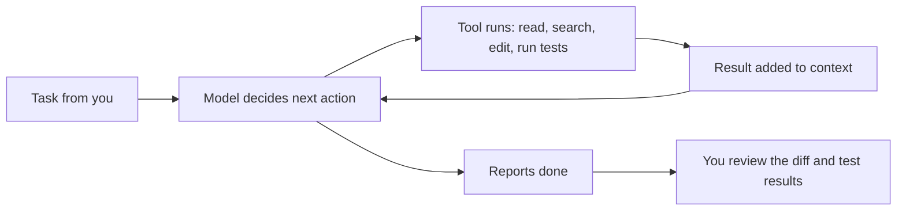

## Introduction

A modern software engineer has a remarkable set of assistants. A chat model can explain an unfamiliar library in a minute. A research tool can read fifty web pages and summarise them with citations. An IDE assistant completes the line you are typing, and a coding agent can read a repository, edit a dozen files, run the tests and fix what fails — while you review something else.

Used well, these tools remove a great deal of slow work: reading boilerplate, writing first drafts of tests, tracking down where a function is called, translating a stack trace into a hypothesis. Used carelessly, they produce code that looks right and is subtly wrong, tests that test nothing, and research summaries that cite sources which do not say what the summary claims. The output is fluent either way, which is exactly what makes the careless version dangerous.

This lesson is about the skill of using AI tools as a professional. It is less about clever prompts and more about three habits: **choosing the right tool** for a task, **delegating clearly** so the tool knows what done looks like, and **verifying rigorously** so that you can take ownership of the result. The products named here change every few months; those habits do not.

There is a second reason this lesson sits at the start of the applied AI track. Using AI tools daily is the fastest way to build an intuition for how models behave — where they excel, where they fail, how they respond to context. That intuition is what you will later engineer around when you build AI products yourself.

## Before you start

- **The landscape of models.** [[e1-ai-landscape]] explains what an LLM is, why it can hallucinate, and the difference between frontier, small and reasoning models. This lesson assumes those ideas.
- **Git basics.** Branches, commits, diffs and reverting a change are the safety net for coding agents. See [[c14-git-merge-strategies]] for the wider workflow.
- **Unit testing.** Verification relies on tests. [[c13-unit-testing]] covers the principles; the examples here use plain Python, taught in [[e1-syntax]].

## The intuition: a brilliant new colleague with no context and no accountability

Picture a new colleague who has read most of the public internet, types at superhuman speed, never gets tired, and is happy to try anything. They also have no memory of your project beyond what you show them today, they cannot tell the difference between what they know and what merely sounds plausible, they tend to agree with whatever you suggest, and they will not be the one paged at 3 a.m. when their code breaks production.

How would you work with that colleague? You would give them clear, self-contained tasks with all the context they need. You would tell them how you will judge the result. You would let them work fast on things you can check quickly, and you would review their work before it shipped under your name. You would not hand them the production database password and walk away.

That is the right mental model for every AI tool in this lesson. The analogy has limits — a model does not learn from your feedback the way a colleague does, unless a tool's memory feature stores it, and it can be confidently wrong in ways a competent human rarely is — but it gets the working relationship right: **the model drafts, you decide.**

## ChatGPT, Claude, Gemini & Research Tools {#e1-assistant-ecosystems}

The AI tools an engineer uses fall into a few families, and each family is built for a different kind of work. **General chat assistants** — ChatGPT from OpenAI, Claude from Anthropic, Gemini from Google, and Microsoft Copilot among others — are conversational interfaces to frontier models, with extra capabilities attached. **Research tools** are built around searching and citing sources. **Coding tools** live in your editor or terminal and act on your repository; they get their own section below. Knowing which family fits a task saves time and avoids the most common misuse: asking a chat model from memory for something it should have looked up.

### What a chat assistant actually is

A chat assistant is not just a model. It is a product that wraps a model with features, and those features change what the assistant can do reliably. The common ones, offered in some form by all the major assistants as of 2025–2026, are:

- **Web search.** The assistant can search and read pages before answering, which helps with anything recent or factual. Without search, the model answers from its training data, which has a cut-off date.
- **File and image input.** You can upload PDFs, spreadsheets, screenshots and code, and ask questions about them.
- **Code execution.** Many assistants can write and run code in a sandbox — useful for analysing a CSV, doing exact arithmetic, or making a chart. A model computing `17.3% of 48,291` in its head may get it wrong; the same model running Python will not.
- **Projects and custom instructions.** You can attach standing context — a project's documents, your preferred style, "always answer with TypeScript examples" — so you do not repeat it each time.
- **Memory.** Some assistants remember facts across conversations. Convenient, but worth reviewing, because remembered context silently shapes later answers.
- **Canvases, artifacts and connectors.** Side panels for editing a document or code alongside the chat, and connectors that let the assistant read from tools such as Google Drive, GitHub or Slack — increasingly via the Model Context Protocol (MCP), covered in [[e7-mcp-fundamentals]].

The practical lesson is to turn on the capability the task needs. Ask a factual question about a library released last month with search off, and the model may invent an API; with search on, it can read the documentation. Ask for a statistic about a dataset without code execution, and it may estimate; with code execution, it computes.

### Research tools

**Search-first answer engines** such as Perplexity run a web search for every question and write an answer with numbered citations. **Deep research** modes — offered by OpenAI, Google, Anthropic and others since late 2024 — take a question, plan a sequence of searches, read dozens of sources over several minutes, and produce a long report with citations. **Source-grounded notebooks** such as Google's NotebookLM answer only from documents you upload, citing the passage each statement came from.

These tools are much better than a bare chat model for research, because their claims are tied to sources you can open. They do not remove the need to check. A citation proves only that a page exists and was read, not that it supports the sentence it is attached to — the section on [[e1-deep-research|research synthesis]] below teaches how to verify.

| Tool family | Best for | Watch out for |
|---|---|---|
| Chat assistant, no tools | Explanations of stable concepts, brainstorming, drafting, rewriting | Outdated or invented facts, APIs and version details |
| Chat assistant with search | Recent facts, current documentation, quick lookups | Low-quality sources; summaries that drift from the source |
| Chat assistant with code execution | Data analysis, exact calculations, charts, file conversion | Check the code it ran, not only the conclusion |
| Deep research | Broad surveys, comparisons, literature overviews | Long reports hide weak citations; verify key claims |
| Source-grounded notebook | Questions over your own documents | Answers limited to what you uploaded |
| IDE assistant or coding agent | Working inside a code repository | Covered in the coding sections below |

### Data handling: what you may paste where

Everything you type or upload into a hosted assistant is sent to the provider. Before pasting anything, know three things. First, **your organisation's policy**: many companies allow only enterprise accounts, which come with contractual commitments about data retention and training. Second, **the account's settings**: consumer plans may use conversations to improve models unless you opt out, while business and API plans typically do not by default — check the current terms rather than assuming. Third, **what the data is**: never paste secrets (API keys, passwords, private keys), customer personal data or confidential source code into a tool your organisation has not approved. A leaked key in a chat log is still a leaked key; rotate it.

## Compare Model Strengths, Limits & Outputs {#e1-model-strengths}

Different models are better at different things, and the differences matter: one model may follow formatting instructions precisely while another writes better prose; one handles a 300-page document well while another loses track of details in the middle. **Comparing models** means running them on the same tasks and judging the outputs against explicit criteria. The skill is doing that systematically — with your own tasks and pass/fail checks — instead of forming impressions from a few memorable answers or a public leaderboard.

### Dimensions that differ between models

When you compare models, look along several separate dimensions rather than asking "which is smarter?":

- **Correctness** on your domain — does it know your framework, your language, your field?
- **Instruction following** — does it respect "return only JSON", "at most 50 words", "do not change the public API"?
- **Long-context handling** — can it use a detail from the middle of a long document? Many models attend less reliably to material in the middle of a long context ([[e2-context-windows]]).
- **Coding ability**, which itself varies by language and by task type (writing new code, debugging, reviewing).
- **Writing style and verbosity** — some models pad answers; some are terse.
- **Refusal behaviour** — how often legitimate requests are declined, or risky ones accepted.
- **Latency and cost**, which matter as soon as a tool is used heavily or a model goes into a product.

### Limits all current models share

Some failures are not quirks of one model but consequences of how LLMs work, so you should expect them from every tool:

- **Knowledge cut-off.** The model knows nothing after its training data ends, and it may not know *that* it does not know. Ask about a library's newest release and it may describe an older one confidently.
- **Hallucinated specifics.** Function names, configuration flags, package names, paper titles, URLs and statistics are exactly the kind of detail a model can invent fluently ([[e2-hallucinations]]).
- **Sycophancy.** Models tend to agree with the user. "Isn't the bug in the cache layer?" invites "Yes, the cache layer…" even when it is not. Ask neutral questions, or ask the model to argue against your hypothesis.
- **Unreliable mental arithmetic and counting**, unless the model uses a code tool.
- **Variability.** The same prompt can give different answers on different runs. One good answer is not evidence of reliability.

### Comparing with checks, not impressions

Public benchmarks measure general skills on public datasets; they say little about whether a model handles *your* invoices, *your* codebase or *your* writing standards. The reliable method is a small personal evaluation: a handful of representative tasks, each with a check you can apply mechanically. The program below scores two assistants' outputs — pasted in from each tool — on three tasks.

```python title="compare_models.py"
import json

# The same three tasks, answered by two assistants (outputs pasted in from each tool).
TASKS = [
    {
        "id": "extract-date",
        "prompt": "Return only the invoice date from: 'Invoice #88, issued 2024-03-07'",
        "check": lambda out: out.strip() == "2024-03-07",
    },
    {
        "id": "json-only",
        "prompt": 'Return JSON {"sentiment": "positive"|"negative"} for: "Love it"',
        "check": lambda out: json.loads(out) == {"sentiment": "positive"},
    },
    {
        "id": "word-limit",
        "prompt": "Explain a hash map in at most 25 words.",
        "check": lambda out: len(out.split()) <= 25,
    },
]

OUTPUTS = {
    "assistant_a": {
        "extract-date": "2024-03-07",
        "json-only": 'Sure! Here is the JSON: {"sentiment": "positive"}',
        "word-limit": "A hash map stores key-value pairs and uses a hash of each key "
                      "to find its bucket, giving average constant-time lookups.",
    },
    "assistant_b": {
        "extract-date": "The invoice date is 2024-03-07.",
        "json-only": '{"sentiment": "positive"}',
        "word-limit": "Key-value store; hashing picks a bucket, so lookups are O(1) on average.",
    },
}

def passes(check, output):
    try:
        return bool(check(output))
    except (ValueError, TypeError):      # e.g. json.loads on prose
        return False

for name, outputs in OUTPUTS.items():
    results = {t["id"]: passes(t["check"], outputs[t["id"]]) for t in TASKS}
    score = sum(results.values())
    print(f"{name}: {score}/{len(TASKS)}", results)
```

```output
assistant_a: 2/3 {'extract-date': True, 'json-only': False, 'word-limit': True}
assistant_b: 2/3 {'extract-date': False, 'json-only': True, 'word-limit': True}
```

Both assistants scored two out of three, but they failed *different* tasks, and that is the useful finding. Assistant A wrapped its JSON in a friendly sentence, which would break any program that parses the output. Assistant B answered the date question correctly in substance but not in the requested format. If you were choosing a model to sit inside a data pipeline, A's failure is the more serious one; for a chat tool used by a person, neither matters much. Impressions would have said "both seem fine". The checks reveal *how* each fails.

Three tasks are far too few to choose a model for a product — you would want dozens or hundreds, run several times each because outputs vary — but the method is the same one used in professional evaluation, which Track E develops properly in [[e9-golden-datasets]] and [[e9-offline-evals]]. Even for personal use, keeping a short list of your own test prompts and re-running them when a new model appears is far more informative than reading launch announcements.

> [!TIP] Ask two models, then make them disagree
> For an important question, ask two different assistants independently. Where they agree, confidence rises a little. Where they disagree, you have found exactly the point to verify against a primary source.

## Cursor, Copilot & Coding-Agent Workflows {#e1-coding-agents}

AI coding tools work inside your development environment and act on your code. They range from autocomplete that suggests the next few lines to **coding agents** that take a task in plain language, read the repository, edit files, run commands and tests, and iterate until the task is done. The more autonomy a tool has, the more it can do per instruction — and the more important your workflow becomes, because an agent can make a large number of changes before you look.

### The levels of assistance

| Level | What it does | Examples (2025–2026) | Your job |
|---|---|---|---|
| Inline completion | Suggests the rest of the line or function as you type | GitHub Copilot, Cursor Tab | Accept or reject each suggestion |
| Chat in the editor | Answers questions using open files as context | Copilot Chat, Cursor chat | Ask precise questions, check answers |
| Multi-file edit | Proposes a set of changes as a diff across files | Edit modes in Copilot and Cursor | Review the diff before applying |
| Agent | Plans, edits files, runs commands and tests, iterates on failures | Cursor agent, Copilot agent mode, Claude Code, OpenAI Codex CLI, Gemini CLI | Brief it, set permissions, review the result |
| Background agent | Works on a task remotely and opens a pull request | GitHub Copilot coding agent, OpenAI Codex cloud tasks | Review the pull request like any other |

GitHub Copilot, first released in 2021, popularised inline completion; in 2025 GitHub added an agent mode in the editor and a coding agent that can be assigned an issue and opens a pull request. Cursor is an AI-focused editor built on VS Code. Claude Code, OpenAI's Codex CLI and Google's Gemini CLI are agents that run in the terminal. The products and their features change quickly; the levels in the table are the stable idea.

### How a coding agent works

An agent is a loop around a model, as described in [[e7-agent-loops]]. The model receives your task, a description of the tools it may use — read a file, search the code, edit a file, run a shell command — and whatever context it has gathered so far. It chooses an action; the tool runs it; the result (file contents, test output, an error) is added to the context; and the model chooses the next action. The loop ends when the model decides the task is done or a limit is reached.



Two consequences follow. First, **the agent knows only what it reads**. It does not know your team's conventions, why a strange piece of code exists, or which command runs the tests, unless that is written somewhere it looks. Second, **the agent's own checks are only as good as the tools it runs**. "All tests pass" means something only if the tests cover the change.

### Giving an agent context

Most agents read a **project instruction file** at the start of every session: `AGENTS.md` (a convention several agents support), `CLAUDE.md` for Claude Code, `.github/copilot-instructions.md` for Copilot, or rule files under `.cursor/rules` for Cursor. Use it for the facts a new teammate would need on day one:

```markdown title="AGENTS.md"
# Working in this repository

- Python 3.12, dependencies managed with uv. Install: `uv sync`.
- Run tests with `uv run pytest -q`; type-check with `uv run mypy src`.
- Source lives in `src/docqa/`; tests mirror it under `tests/`.
- Never edit files under `migrations/` by hand; generate them with `alembic revision`.
- Public functions need type hints and a docstring.
- Do not add new dependencies without asking.
```

Short, specific and verifiable instructions work best. "Write clean code" adds nothing; "run `uv run pytest -q` before saying a task is done" changes behaviour.

### A safe workflow: explore, plan, implement, verify

Agents produce the best results, and the fewest surprises, with a deliberate rhythm:

1. **Start clean.** Commit or stash your own work and create a branch. Git is your undo button; an agent working on a dirty tree mixes its changes with yours.
2. **Explore.** Ask the agent to read the relevant code and explain how the feature currently works, without changing anything. This exposes misunderstandings before they become code.
3. **Plan.** Ask for a short plan — which files change, what tests will prove it works. Correct the plan; it is far cheaper than correcting the code.
4. **Implement in small steps.** One coherent change at a time, each followed by tests. Commit at good checkpoints so you can roll back a bad step without losing the good ones.
5. **Verify yourself.** Read the full diff, run the tests and the application, and check the edge cases the agent may not have considered (next sections).

### Permissions and blast radius

An agent that can run shell commands can do anything you can do in that terminal: delete files, push to remote branches, run database migrations, install packages, call production APIs with your credentials. Most agents ask for approval before running commands or editing files, and let you allow specific safe commands automatically. Keep approvals narrow: allowing `pytest` and `git diff` automatically is reasonable; allowing every command is not. Run agents with access to development credentials only, never production secrets. For autonomous or background work, use a container or cloud sandbox so that the worst outcome is a discarded environment ([[e7-sandboxing]]).

Agents can also be manipulated. A malicious instruction hidden in a README, an issue, a web page or a dependency's documentation can try to redirect an agent that reads it — this is **prompt injection** ([[e11-indirect-injection]]). Narrow permissions and human review of consequential actions are the defence.

## Repository Research, Refactoring, Debugging & Tests {#e1-repository-assistance}

Four everyday engineering tasks benefit most from AI assistance in a repository: **researching** unfamiliar code, **refactoring** it, **debugging** it, and **writing tests** for it. Each has a characteristic way of going wrong, and knowing that failure mode tells you what to check.

### Repository research

Joining a new codebase used to mean days of reading. An assistant with access to the repository can produce a map in minutes: the main modules and what they do, how a request flows from the HTTP handler to the database, where a configuration value is read, which code calls a function you want to change.

Good research questions are specific and ask for evidence: "Trace what happens when `POST /documents` is called, naming each function and file in order" is better than "Explain this project". Ask for file paths and line references, then **open the files** to confirm. The typical failure is a plausible but invented connection — the model assumes a function is called somewhere because a typical project would do so. A cheap guard is to ask "show me the exact line where that happens" and check it, or to confirm with an ordinary search such as `grep -rn "index_document" src/`.

### Refactoring

A **refactoring** changes the structure of code without changing its behaviour. AI tools are good at the mechanical part — renaming across files, extracting a function, converting callbacks to `async`, applying a pattern consistently in fifty places. The failure mode is an accidental behaviour change hidden in a large diff: an edge case handled differently, an exception type changed, a default value lost.

The defence is the classic one. Before refactoring, make sure tests pin down the current behaviour; if none exist, ask the assistant to write **characterisation tests** that record what the code does today, and check them. Refactor in small, separately committed steps. Ask the agent to make *only* the structural change — "do not fix anything else you notice; list it instead" — so the diff stays reviewable. Then run the tests after each step.

### Debugging

For debugging, give the assistant what you would give a senior colleague: the full error message and stack trace, the steps to reproduce, what you expected, what you have already ruled out, and the relevant code. Ask for **ranked hypotheses and a way to test each** rather than an immediate fix. "List the three most likely causes and what log line or experiment would confirm each" turns the model into a fast reasoning partner while you stay in control of the investigation.

The characteristic failure is a fix that makes the symptom disappear without addressing the cause: catching and ignoring the exception, adding a `None` check that hides why the value was `None`, increasing a timeout that was masking a deadlock, or editing the test until it passes. Before accepting a fix, make sure you can explain *why* the bug happened and why the change prevents it. A useful rule is to reproduce the bug with a failing test first, then let the fix make that test pass.

### Writing tests

Generating tests is one of the most valuable uses of AI in a codebase, and one of the most deceptive. The trap is that a model writing tests for code tends to test what the code *does*, not what it *should* do — and when the same assistant writes both the code and the tests, the tests can encode the same misunderstanding. The following example is realistic: an assistant suggested a batching helper for an embedding API, along with a test.

```python title="batching.py"
def split_into_batches(items, batch_size):
    """AI-suggested: split items into batches for an embedding API."""
    return [items[i:i + batch_size] for i in range(0, len(items) - batch_size, batch_size)]

def test_ai_written():
    # The test the assistant wrote alongside the code.
    batches = split_into_batches(list(range(7)), 3)
    assert len(batches) == 2

def test_nothing_lost():
    # Our test: an invariant that must hold for every input.
    for n in range(0, 12):
        for size in range(1, 5):
            items = list(range(n))
            batches = split_into_batches(items, size)
            flat = [x for b in batches for x in b]
            assert flat == items, f"n={n} size={size}: lost {sorted(set(items) - set(flat))}"
            assert all(1 <= len(b) <= size for b in batches)

for test in (test_ai_written, test_nothing_lost):
    try:
        test()
        print(f"PASS {test.__name__}")
    except AssertionError as err:
        print(f"FAIL {test.__name__}: {err}")
```

```output
PASS test_ai_written
FAIL test_nothing_lost: n=1 size=1: lost [0]
```

The bug is in the `range` stop value: `len(items) - batch_size` stops too early, so the final batch — and sometimes every batch — is dropped. Seven items in batches of three should give three batches, `[0, 1, 2]`, `[3, 4, 5]` and `[6]`; this code returns two and silently loses item 6. In an ingestion pipeline that means documents that never get embedded and can never be found, with no error anywhere. The assistant's test passed because it asserted the buggy result: it checked that there were two batches.

The second test does not check a specific answer; it checks an **invariant** — a property that must hold for every input: flattening the batches must give back exactly the original items, and every batch must have between 1 and `batch_size` items. It tries many sizes, including tiny ones, and fails immediately at one item. Fix the stop value to `len(items)` and run both again:

```text
FAIL test_ai_written: 
PASS test_nothing_lost
```

Now the invariant test passes and the assistant's test *fails*, because it encoded the wrong answer. That is the lesson in miniature: **AI-written tests must themselves be reviewed against the requirement**, not against the code. Useful habits are to write or at least specify the key test cases yourself, prefer tests of properties and edge cases (empty input, one item, exact multiples, very large input), and check that a test fails when you deliberately break the code. If a test still passes with the logic removed, it is not testing anything. That deliberate breaking is the idea behind mutation testing ([[c13-mutation-testing]]).

## Delegate, Verify & Retain Human Ownership {#e1-delegation-verification}

**Delegation** is handing a task to an AI tool; **verification** is establishing that the result is correct before you rely on it; **ownership** is the principle that you remain accountable for anything you ship, whoever — or whatever — drafted it. Together they form the core professional skill of working with AI. The tools can do a lot of the typing. They cannot take responsibility, and the review process, your users and your incident reports will all treat AI-assisted code as your code.

### What to delegate

A task is a good candidate for delegation when it is **well specified** (you can state what done looks like), **verifiable** (you can check the result much faster than you could produce it), and **low in blast radius** (a mistake is cheap to find and reverse). Writing a test fixture, converting a module to use type hints, drafting a migration script you will review, summarising a long design document, or generating a first pass of API documentation all qualify.

Be more careful — delegate the drafting but keep the thinking — with security-sensitive code (authentication, authorisation, cryptography, input handling), architectural decisions that will be expensive to undo, changes to data that cannot be recovered, and anything you could not evaluate yourself. If you cannot tell whether the output is right, delegating it does not save time; it transfers risk to whoever finds the bug later.

### Writing a delegation brief

The quality of delegated work depends heavily on the brief. A good brief covers the same points you would give a contractor: the goal, the context, the constraints, how the result will be judged, and what is out of scope.

```markdown title="Delegation brief"
Goal: Add retry with exponential backoff to `EmbeddingClient.embed_batch`
in src/docqa/embeddings.py.

Context: The provider returns HTTP 429 (rate limited) and 503 under load.
We already use `httpx`; `tests/test_embeddings.py` has a fake transport.

Constraints:
- Retry only on 429, 503 and connection errors; never on 400 or 401.
- At most 4 attempts; honour the Retry-After header when present.
- No new dependencies. Keep the public signature unchanged.

Done when:
- New tests cover: success after two 503s, giving up after 4 attempts,
  no retry on 400, Retry-After respected (use a fake clock, no real sleeping).
- `uv run pytest -q` and `uv run mypy src` pass.

Out of scope: changing batch sizes or logging format. List anything else
you notice instead of fixing it.
```

Every line closes off a likely mistake. Without "never on 400 or 401", an agent may retry an invalid request four times. Without "use a fake clock", it may write tests that really sleep for many seconds. Without "out of scope", it may reformat half the file. The acceptance criteria also give *you* a checklist for verification.

### The verification ladder

Verification should be proportional to risk. Think of it as a ladder: every change climbs the first rungs, and riskier changes climb higher.

| Rung | What you do | Catches |
|---|---|---|
| 1. Read the whole diff | Every line, not a skim of the summary | Unrelated edits, deleted code, debugging leftovers |
| 2. Run the checks | Tests, type checker, linter, build | Breakage the agent missed or claimed to have fixed |
| 3. Check the tests themselves | Do they test the requirement? Do they fail when the code is broken? | Tests that assert buggy behaviour or nothing at all |
| 4. Run it for real | Exercise the feature with realistic and edge-case inputs | Integration problems, wrong assumptions about data |
| 5. Check dependencies and APIs | Every new package and API call exists and is the one intended | Hallucinated packages and functions, wrong versions |
| 6. Security and data review | Input validation, secrets, permissions, injection, data loss | Vulnerabilities that tests rarely cover |

Rung 5 deserves emphasis. Models sometimes suggest packages that do not exist, and attackers have begun registering such names on public registries with malicious code — a supply-chain attack nicknamed **slopsquatting**. Before adding any dependency an AI suggested, confirm it is the real, maintained project you expect.

Measure your own results honestly, too. Feeling productive is not the same as being productive: a 2025 randomised study by METR found that experienced open-source developers working in their own familiar repositories took about 19% *longer* on tasks when allowed AI tools, while believing the tools had made them faster. Other settings and tasks show large gains. The point is not that AI tools are slow, but that the time saved typing can be lost to reviewing, correcting and re-prompting, so it is worth noticing which tasks really go faster for you.

### Retaining ownership

Ownership means three concrete things. First, **you can explain every line** you commit — why it is there and what happens if it is removed — well enough to defend it in code review. If you cannot, you are not ready to commit it. Second, **you keep the judgement**: architecture, trade-offs, and the decision that something is finished stay with you, even when the model drafted the options. Third, **you keep your skills**. Engineers who delegate everything gradually lose the ability to evaluate what they delegate. Deliberately write some code by hand, especially in areas you are still learning, and use AI to explain and critique rather than only to produce. Follow your team's rules about disclosing AI assistance and about which tools may see which code.

## Research Synthesis, Citations & Fact Checking {#e1-deep-research}

**Research synthesis** is gathering information from many sources and combining it into a coherent answer — comparing three vector databases, summarising what is known about a security issue, or surveying approaches to a design problem. AI research tools are very good at the gathering and drafting. **Fact checking** is the part that remains yours: confirming that each claim is true and that each citation actually supports it.

### How AI research goes wrong

Research output fails in recognisable ways, and each has a check:

- **Fabricated citations.** A reference to a paper, page or documentation section that does not exist. Less common in search-grounded tools than in bare chat models, but not eliminated. Check: open it.
- **Citation that does not support the claim.** The source exists and is relevant, but it does not say what the sentence says — a number is different, a qualifier is dropped, or the claim comes from the model's own knowledge with a nearby source attached. This is the most common failure in search-grounded tools. Check: find the sentence in the source that supports the claim.
- **Outdated sources.** A blog post from three years ago describing an API that has since changed. Check the date and the version.
- **Weak sources.** Marketing pages, content farms and forum guesses presented with the same weight as official documentation. Prefer **primary sources**: official documentation, specifications, release notes, papers, the source code itself.
- **Over-generalisation.** One benchmark or one anecdote becomes "X is faster than Y". Check what was measured, under what conditions.
- **Missing counter-evidence.** A synthesis can be fluent and one-sided. Ask explicitly for the strongest arguments against the conclusion.

### A fact-checking workflow

For anything you will act on or publish, work through the claims that matter. Open each cited source. Find the specific passage that supports the claim — not just a page on the right topic. Check its date and whether it applies to the version you use. For important facts, confirm with a second, independent primary source. Where the summary and the source disagree, trust the source and fix the summary.

Part of this can be made mechanical. If you ask a research tool to give, for each claim, the exact quote that supports it, you can check that the quotes really appear in the sources you saved. The script below does that for four claims from an AI-written summary about Python.

```python title="check_citations.py"
import re

# Source texts you actually opened (saved from the cited pages).
SOURCES = {
    "pep-8": "Use 4 spaces per indentation level. Limit all lines to a maximum "
             "of 79 characters.",
    "py-3.7-notes": "the insertion-order preservation nature of dict objects has "
                    "been declared to be an official part of the Python language spec.",
}

# Claims from an AI-written research summary, each with the quote it cited.
CLAIMS = [
    ("PEP 8 recommends 4-space indentation.",
     "pep-8", "Use 4 spaces per indentation level."),
    ("PEP 8 limits lines to 100 characters.",
     "pep-8", "Limit all lines to a maximum of 100 characters."),
    ("Dicts keep insertion order as part of the language spec since 3.7.",
     "py-3.7-notes", "insertion-order preservation nature of dict objects"),
    ("Sets are ordered since Python 3.8.",
     "py-3.8-notes", "sets now preserve insertion order"),
]

def normalise(text):
    return re.sub(r"\s+", " ", text).strip().lower()

for claim, source_id, quote in CLAIMS:
    source = SOURCES.get(source_id)
    if source is None:
        verdict = "NO SOURCE  (cited page not found or not opened)"
    elif normalise(quote) in normalise(source):
        verdict = "QUOTE FOUND (now read it in context)"
    else:
        verdict = "NOT IN SOURCE (citation does not support claim)"
    print(f"{verdict:48} | {claim}")
```

```output
QUOTE FOUND (now read it in context)             | PEP 8 recommends 4-space indentation.
NOT IN SOURCE (citation does not support claim)  | PEP 8 limits lines to 100 characters.
QUOTE FOUND (now read it in context)             | Dicts keep insertion order as part of the language spec since 3.7.
NO SOURCE  (cited page not found or not opened)  | Sets are ordered since Python 3.8.
```

The second claim shows the most dangerous pattern: a real source, a confident claim, and a "quote" that has been altered — PEP 8 says 79 characters, not 100. The fourth claim cites release notes that the checker cannot find, and indeed the claim is false: Python sets are unordered in every version. The two passing claims are true, but notice the wording of the verdict. A quote that appears in the source is necessary, not sufficient — a sentence taken out of context can still mislead — so the script only tells you which claims to read more carefully and which are already disproved.

Real research tools rarely give you neat quote-per-claim output unless you ask for it, and paywalled or dynamic pages may not be readable at all. The habit transfers anyway: for each important claim, locate the supporting text yourself. The same idea, automated at scale, is how citation correctness is evaluated in RAG systems ([[e6-citation-correctness]]), and it is the core of the research-assistant project in [[e12-research-assistant]].

### Using research tools well

Frame the question precisely, including the context that changes the answer: "for a 10-person team on PostgreSQL 16, with about 2 million vectors" rather than "which vector database is best". Ask for sources to be primary where possible and for disagreements between sources to be highlighted rather than smoothed over. Ask what the answer would look like if it were wrong. And keep the final synthesis — the recommendation you put your name to — your own, written after you have checked the claims it rests on.

## In real systems

Teams that use AI tools effectively tend to converge on similar practices. They maintain an `AGENTS.md` or equivalent with build commands and conventions, and keep it current because it measurably improves agent results. They treat AI-generated pull requests exactly like human ones: same review, same CI, same standards, and a named human owner who answers for the change. They keep tasks for background agents small and well specified, often written as issues with acceptance criteria, so the review is manageable.

They also set boundaries in tooling rather than relying on memory: enterprise accounts with data-retention controls, secret scanning in CI ([[c9-ci-secret-scanning]]) to catch keys that slip into code, dependency checks for new packages, and agents run in sandboxes without production credentials. Research summaries that feed decisions — a vendor choice, a security assessment — are checked against primary sources before they are circulated, and the person who circulates them is responsible for their accuracy.

Finally, these teams learn from their AI tools as a source of product insight. Seeing where a coding agent fails — losing track of a large context, inventing an API, retrying a broken approach — is a direct preview of the failure modes you will design around when you build agents yourself in [[e7-agent-loops]] and [[e12-coding-assistant]].

## Trade-offs and alternatives

AI tools trade **speed of production for cost of verification**. For tasks where checking is much faster than creating — boilerplate, test scaffolding, format conversion, first drafts, exploring an unfamiliar API — the trade is excellent. For tasks where checking is as hard as creating — subtle concurrency, security-critical logic, novel algorithms, decisions that need deep context — the gain shrinks or reverses, and writing it yourself with AI as a reviewer or explainer may be faster and safer.

Autonomy is a second trade-off. Inline completion keeps you in control of every line but saves less effort; a background agent saves the most effort but produces a large change to review all at once. Many engineers move between levels by task: completion for code they are actively designing, an agent for well-specified mechanical work, chat for explanation and debugging hypotheses.

The alternatives are not "AI or nothing". Deterministic tools — refactoring support in the IDE, code search, linters, code generators from schemas, static analysis — do some of the same jobs with perfect reliability. A rename across a codebase is often better done by the IDE's rename refactoring than by an agent, because the IDE's version is guaranteed correct.

## Common mistakes

> [!MISTAKE] Accepting "all tests pass" as proof
> An agent reporting green tests tells you the tests it ran did not fail. It does not tell you the tests cover the change, that they assert the right behaviour, or that the agent did not weaken them. Read the tests, and break the code on purpose to see them fail.

**Asking from memory what should be looked up.** Version-specific APIs, recent releases, prices and statistics should come from search or documentation, not from a model's training data.

**Vague delegation.** "Improve this module" invites a large, unfocused diff. State the goal, constraints, acceptance criteria and what is out of scope.

**Leading questions.** "The bug is in the cache, right?" invites agreement. Ask "what are the possible causes?" or ask the model to argue against your theory.

**Pasting secrets or customer data** into unapproved tools, or leaving production credentials available to an agent's shell.

**Over-broad permissions.** Auto-approving every command an agent proposes removes the one checkpoint between a model's mistake and your filesystem, remote repository or cloud account.

**Trusting citations because they exist.** A link is not evidence. Find the supporting sentence in the source.

**Committing code you cannot explain.** If you could not defend it in review, you do not own it yet.

## Interview perspective

Interviewers now often ask how candidates use AI tools, and some allow them during coding exercises. They are looking for judgement: productive use plus visible verification.

> [!INTERVIEW] "How do you use AI tools in your work?"
> A strong answer is specific: which tools for which tasks, how you brief an agent (context file, plan first, acceptance criteria), how you verify (full diff review, tests that fail when the code is broken, dependency checks), where you deliberately do not delegate (security-critical code, decisions you cannot evaluate), and a concrete example of catching a plausible but wrong AI output.

Questions to be ready for:

- **How do you know AI-generated code is correct?** The same way as any code — review, tests, running it — plus extra attention to AI-specific failures: invented APIs and packages, tests that encode the bug, symptom-hiding fixes.
- **What would you put in an `AGENTS.md`?** Build, test and lint commands; project layout; conventions; things never to do; how to verify before finishing.
- **How do you compare two models for a task?** A set of representative inputs with explicit pass/fail checks, run multiple times, looking at failure types as well as scores, plus latency and cost.
- **What are the risks of coding agents?** Destructive commands, leaked credentials, prompt injection from content they read, large unreviewable diffs, hallucinated dependencies. Mitigations: branches and checkpoints, narrow permissions, sandboxes, small tasks, human review.
- **How do you verify an AI research summary?** Open sources, find supporting passages, check dates and versions, prefer primary sources, triangulate important claims.
- **What does ownership mean when using AI?** You are accountable for every line and every claim you ship, and you must understand them well enough to defend them.

## Practice

1. **Tool choice.** For each task, choose a tool family and justify it: (a) the default connection-pool size in the latest release of a database driver; (b) a chart of monthly signups from a CSV export; (c) a summary of your own 60-page design document; (d) a survey of approaches to rate limiting.
2. **Personal evaluation.** Write five prompts representative of your work, each with a mechanical check. Run them on two assistants, three times each, and record pass rates and failure types using the structure of `compare_models.py`.
3. **Agent context file.** Write an `AGENTS.md` for a project you know: commands, layout, conventions, and three things an agent must never do. Run an agent on a small task with and without it, and compare the results.
4. **Break the tests.** Ask an assistant to write tests for a function of yours. Then introduce three deliberate bugs, one at a time. How many do the tests catch? Add tests until all three are caught.
5. **Delegation brief.** Write a brief, in the format shown in this lesson, for adding pagination to a list endpoint. Give it to an agent, then verify the result against your acceptance criteria and note anything the brief failed to specify.
6. **Fact-check a report.** Run a deep-research query on a technical question you care about. Pick the five most important claims and trace each to the exact supporting passage in a primary source. Record how many were fully supported, partly supported, or unsupported.

```quiz
Q: You need the exact default value of a configuration flag in a library version released two months ago. Which approach is most reliable?
- [ ] Ask a chat model with no tools, since it has read the library's documentation
- [x] Look it up in the official documentation or source, or use an assistant with search and check the page it cites
- [ ] Ask two chat models without search and take the answer they agree on
- [ ] Use a reasoning model, because it thinks harder
> The release is probably after the model's training cut-off, and exact defaults are the kind of specific detail models invent fluently. Agreement between two models answering from memory proves little, and extra reasoning cannot recover facts the model never saw. Primary sources settle it.

Q: An agent's batching function passes the test it wrote. Your invariant test — flattening the batches must return the original items — fails. What does this most likely mean?
- [ ] Your invariant test is wrong because it disagrees with the agent's test
- [x] The agent's test asserted the code's buggy behaviour rather than the requirement
- [ ] The test runner is flaky
- [ ] Invariant tests should not be used for batching code
> When the same tool writes code and tests, the tests can encode the same misunderstanding. "Nothing is lost" is the actual requirement, so a failure there is a real bug; the agent's test that expected two batches for seven items was checking the wrong answer.

Q: Which item belongs in a delegation brief to stop an agent retrying requests that can never succeed?
- [ ] "Write clean, idiomatic code"
- [ ] "Be careful with errors"
- [x] "Retry only on 429, 503 and connection errors; never on 400 or 401"
- [ ] "Use best practices for retries"
> Specific, checkable constraints change behaviour; vague quality instructions do not. Retrying a 400 (bad request) or 401 (unauthenticated) wastes time and quota because the request will fail the same way every time.

Q: A research summary cites the official documentation for a claim, and the page exists and is on the right topic. What still needs checking?
- [ ] Nothing — an official source is enough
- [ ] Only the page's visual design
- [x] That a specific passage on the page actually supports the claim, and that it applies to the version you use
- [ ] Whether a second AI tool produces the same summary
> The most common failure of search-grounded research is a real, relevant source that does not say what the sentence claims — a changed number or a dropped qualifier. Find the supporting passage and check its date and version.

Q: What is the main reason to start an agent session on a clean git branch?
- [ ] Agents cannot read uncommitted files
- [x] It gives you an exact record of the agent's changes and an easy way to roll back without mixing them with your own work
- [ ] Git branches make the model more accurate
- [ ] It is required by every coding agent's licence
> A clean starting point means `git diff` shows exactly what the agent did, and a bad step can be reverted to the last checkpoint. On a dirty tree, the agent's edits and yours become tangled.
```

## Quick revision {#quick-revision}

- Mental model: a fast, well-read colleague with no project context, no accountability, a tendency to agree, and no reliable sense of what it does not know. The model drafts; you decide.
- **Assistants**: ChatGPT, Claude, Gemini and others wrap frontier models with search, file input, code execution, projects, memory and connectors. Turn on the capability the task needs.
- **Research tools**: search-first answer engines, deep research modes, source-grounded notebooks. Citations make claims checkable, not true.
- **Data rules**: follow company policy, prefer approved enterprise accounts, never paste secrets or customer data into unapproved tools.
- **Comparing models**: your own tasks, mechanical pass/fail checks, multiple runs, look at failure types, latency and cost. Shared limits: cut-off, hallucinated specifics, sycophancy, weak arithmetic, variability.
- **Coding tools**: completion → chat → multi-file edit → agent → background agent. More autonomy, bigger review.
- Agents loop: decide → run tool → observe. They know only what they read; give context in `AGENTS.md`, `CLAUDE.md`, Copilot or Cursor rule files.
- Workflow: clean branch → explore → plan → small implementation steps with commits → your own verification.
- Permissions: narrow auto-approvals, no production credentials, sandboxes for autonomy; beware prompt injection from content the agent reads.
- **Repository tasks**: research (demand file and line evidence), refactoring (characterisation tests, small steps), debugging (ranked hypotheses, reproduce with a failing test, no symptom-hiding), tests (review against the requirement; break the code to see them fail; prefer invariants and edge cases).
- **Delegate** when well specified, verifiable and low blast radius. Brief = goal, context, constraints, done-when, out of scope.
- **Verification ladder**: diff → checks → the tests themselves → run it → dependencies and APIs (slopsquatting) → security and data.
- **Ownership**: explain every line, keep the judgement, keep your skills, follow disclosure rules.
- **Research checking**: open every key source, find the supporting passage, check date and version, prefer primary sources, triangulate, seek counter-evidence.

## Key takeaways {#key-takeaways}

- The durable skill is not prompting tricks but choosing the right tool, delegating with a clear brief, and verifying the result.
- Turn on the capability a task needs — search for facts, code execution for numbers, repository access for code — instead of asking a model to answer from memory.
- Compare models with your own tasks and explicit checks; how a model fails matters as much as how often.
- Coding agents are powerful loops that know only what they read and can do anything their permissions allow: give them context, start from a clean branch, keep permissions narrow and review every diff.
- AI-written tests can encode the same bug as AI-written code; judge tests against the requirement and make sure they fail when the code is broken.
- A citation is a pointer, not proof. Trace important claims to the supporting passage in a primary source.
- You own whatever you ship. If you cannot explain and defend it, it is not ready.
