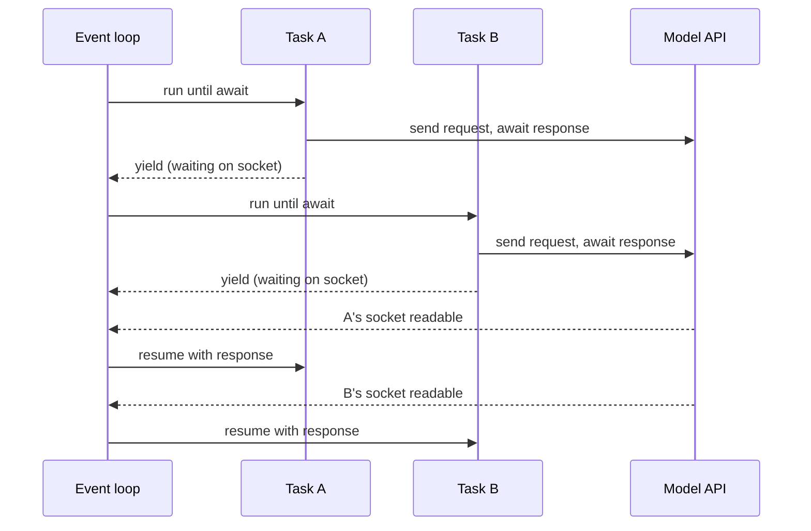
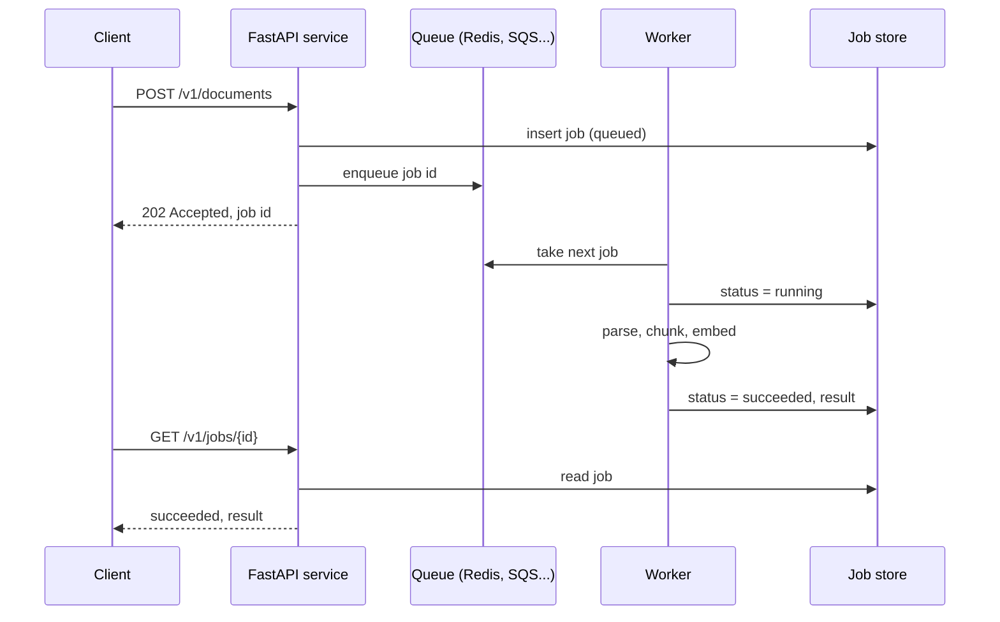
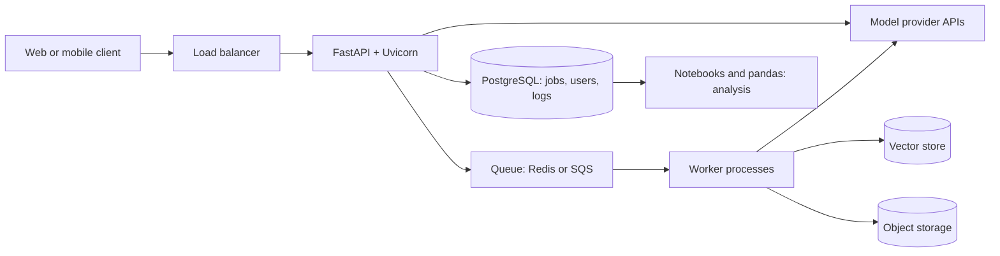

## Introduction

Picture the backend behind a "summarise this document" button. A request arrives with a JSON body. The service checks that the body is well formed, calls a model provider's API, waits somewhere between half a second and thirty seconds for the reply, checks that the reply has the shape it expected, stores a record, and returns a response — or streams the summary word by word so the user is not staring at a spinner. If the document is a 300-page PDF, the work is too long for one HTTP request, so the service accepts the job, returns a job id immediately and lets a worker process do the rest.

Nearly every piece of that flow is about **waiting** and **trusting data**. The waiting is for networks: the model API, the database, object storage. The trust problem is that every input — the user's request, the provider's response, the model's generated JSON — can be missing fields, have wrong types or contain nonsense. A Python AI backend is mostly code that waits efficiently and validates rigorously.

This lesson teaches the tools that do those two jobs in modern Python:

- **asyncio** and `async`/`await` let one process handle hundreds of slow network calls at once.
- **Pydantic** turns untrusted dictionaries and JSON into typed objects, or explains exactly why it cannot.
- **FastAPI** builds HTTP APIs from type hints and Pydantic models, with validation and documentation generated for you.
- **Server-Sent Events** and **WebSockets** stream tokens to clients as a model produces them.
- **Background job queues** move long work out of the request so it survives timeouts and crashes.
- **NumPy** and **pandas** are the data tools: NumPy for vectors such as embeddings, pandas for tables such as request logs and evaluation results.

The first part of the lesson teaches asyncio, because everything else builds on it. Each nested section after that can be read on its own. All code targets **Python 3.12**, Pydantic 2, and recent FastAPI releases; version-specific behaviour is named where it matters.

## Before you start

- **Python fundamentals** — functions, classes, exceptions and generators. See [[e1-syntax]], [[e1-functions]] and [[e1-classes]].
- **Type hints** — Pydantic and FastAPI read your annotations at runtime, so you need to be comfortable writing `list[str]`, `int | None` and `Literal[...]`. See [[e1-type-hints]].
- **Virtual environments and packages** — the libraries here are installed per project. See [[e1-venvs]] and [[e1-packages]].
- **HTTP basics** — methods, status codes, headers and JSON bodies. See [[c4-http]].
- **Threads and processes** — helpful for the comparison with asyncio. See [[c3-processes-vs-threads]].

If you know JavaScript, [[b1-event-loop]] and [[b1-async-await]] describe a very similar model; Python's asyncio was designed around the same idea of a single-threaded loop that switches between tasks when they wait.

## The intuition: one waiter, many tables

Think of a restaurant with one waiter. A bad waiter takes an order to the kitchen and stands at the hatch until the food is ready, ignoring every other table. A good waiter hands in the order and, while the kitchen cooks, takes orders from other tables, refills water and brings bills. The kitchen's speed has not changed. The waiter serves more tables because they never stand idle while something else is doing the work.

**asyncio** makes your program the good waiter. A call to a model API is an order sent to someone else's kitchen: your CPU has nothing to do until the reply arrives. With `await`, your code says "I am waiting here — go and serve someone else", and the **event loop** (the waiter's routine) switches to another task that is ready to run.

The analogy shows the limit too. If a table asks the waiter to personally peel a hundred potatoes, every other table waits, because there is still only one waiter. In the same way, asyncio does nothing for CPU-heavy work such as parsing a huge file or running a model locally — and code that does such work inside an async function freezes every other request. Keep that rule in mind; most asyncio bugs in production break it.

## Concurrency choices in Python

Three tools let Python do more than one thing at a time, and choosing among them depends on what the work spends its time on.

**I/O-bound** work spends most of its time waiting for something external: a network response, a disk read, a database query. **CPU-bound** work spends its time calculating: resizing images, tokenising millions of documents, matrix maths in pure Python.

The standard CPython interpreter has a **Global Interpreter Lock (GIL)**: only one thread executes Python bytecode at a time. Threads still help I/O-bound work, because a thread releases the GIL while it waits on a socket or file. They do not speed up CPU-bound pure-Python code, because the threads take turns on one core. Libraries such as NumPy release the GIL inside their compiled code, which is why they can still use several cores. Python 3.13 added an optional **free-threaded** build without the GIL (PEP 703); it is experimental in 3.13 and officially supported but still optional in 3.14, and most deployments today still run the standard build.

| Tool | How it runs work | Good for | Cost and limits |
|---|---|---|---|
| `asyncio` | Many tasks on one thread; switches only at `await` | Large numbers of concurrent network calls | Every library in the path must be async; any blocking call stalls everything |
| Threads (`threading`, `ThreadPoolExecutor`) | OS threads; the GIL lets one run Python at a time | Blocking I/O libraries you cannot replace | Each thread costs memory; shared state needs locks |
| Processes (`multiprocessing`, `ProcessPoolExecutor`) | Separate interpreters, each with its own GIL | CPU-bound Python code | Higher start-up and memory cost; data must be pickled between processes |

An AI backend is the classic I/O-bound program. A request might use 5 milliseconds of CPU and spend 3 seconds waiting on a model. With one thread per request, 500 concurrent users need 500 threads. With asyncio, one process can hold 500 waiting requests as cheap task objects. That is why FastAPI, the official model SDKs (which ship async clients) and HTTP clients like `httpx` all support async.

## Coroutines, `await` and the event loop

A function defined with `async def` is a **coroutine function**. Calling it does not run its body. It returns a **coroutine object** — a paused computation that runs only when something drives it.

```python title="coroutine_object.py"
import asyncio


async def greet() -> str:
    return "hello"


coro = greet()
print(type(coro).__name__)
print(asyncio.run(coro))
```

```output
coroutine
hello
```

`asyncio.run` creates an event loop, runs the coroutine to completion and closes the loop. You call it once, at the program's entry point; web frameworks call the equivalent for you. Inside async code, `await something` does two things: it runs `something` until it produces a result, and — if `something` has to wait — it hands control back to the event loop so other tasks can run in the meantime.

The next program shows why that matters. `call_model` stands in for an HTTP request; `asyncio.sleep` waits without blocking, exactly like a network call would.

```python title="sequential_vs_concurrent.py"
import asyncio
import time


async def call_model(prompt: str, seconds: float) -> str:
    # Stands in for an HTTP call to a model API: the wait is pure I/O.
    await asyncio.sleep(seconds)
    return f"answer to {prompt!r}"


async def sequential() -> None:
    start = time.perf_counter()
    a = await call_model("summarise", 1.0)
    b = await call_model("classify", 1.0)
    c = await call_model("translate", 1.0)
    print(f"sequential: {time.perf_counter() - start:.1f}s", [a, b, c])


async def concurrent() -> None:
    start = time.perf_counter()
    a, b, c = await asyncio.gather(
        call_model("summarise", 1.0),
        call_model("classify", 1.0),
        call_model("translate", 1.0),
    )
    print(f"concurrent: {time.perf_counter() - start:.1f}s", [a, b, c])


asyncio.run(sequential())
asyncio.run(concurrent())
```

```output
sequential: 3.0s ["answer to 'summarise'", "answer to 'classify'", "answer to 'translate'"]
concurrent: 1.0s ["answer to 'summarise'", "answer to 'classify'", "answer to 'translate'"]
```

In `sequential`, each `await` waits for one call to finish before the next starts, so the three one-second waits add up. Writing `async` does not make code concurrent by itself. In `concurrent`, `asyncio.gather` wraps each coroutine in a **task** — a coroutine scheduled on the loop — and waits for all of them. All three start, all three wait at the same time, and the total is the longest single wait. `gather` returns results in the order you passed the coroutines, not the order they finished.

### Tasks, task groups and timeouts

`asyncio.create_task(coro)` schedules a coroutine to run in the background and returns a `Task` you can await later. Python 3.11 added two tools that make task code safer, and you should prefer them in new code:

- **`asyncio.TaskGroup`** starts tasks inside an `async with` block and waits for all of them at the end of the block. If one task raises, the group cancels the others and re-raises the errors together as an `ExceptionGroup`. No task is left running unobserved.
- **`asyncio.timeout(seconds)`** cancels whatever is running inside its block when the deadline passes and raises `TimeoutError`.

A third tool, **`asyncio.Semaphore`**, limits how many tasks enter a section at once. Model providers enforce rate limits, so sending 5,000 embedding requests at the same moment gets most of them rejected; a semaphore keeps a fixed number in flight.

```python title="taskgroup_semaphore_timeout.py"
import asyncio
import time

LIMIT = asyncio.Semaphore(2)          # at most two requests in flight


async def embed(doc_id: int) -> str:
    async with LIMIT:
        print(f"{time.perf_counter() - START:.1f}s start doc {doc_id}")
        await asyncio.sleep(0.5)      # pretend network call
        return f"vector-{doc_id}"


async def main() -> None:
    global START
    START = time.perf_counter()
    async with asyncio.TaskGroup() as tg:          # Python 3.11+
        tasks = [tg.create_task(embed(i)) for i in range(5)]
    print([t.result() for t in tasks])

    try:
        async with asyncio.timeout(0.3):           # Python 3.11+
            await embed(99)
    except TimeoutError:
        print("doc 99 timed out and was cancelled")


asyncio.run(main())
```

```output
0.0s start doc 0
0.0s start doc 1
0.5s start doc 2
0.5s start doc 3
1.0s start doc 4
['vector-0', 'vector-1', 'vector-2', 'vector-3', 'vector-4']
1.5s start doc 99
doc 99 timed out and was cancelled
```

All five tasks are created at once, but the semaphore admits only two at a time, so they run in waves of two. The `async with` block of the task group does not finish until every task has, so `t.result()` is safe afterwards. The timeout block then cancels `embed(99)` 0.3 seconds into its 0.5-second wait. The timings are approximate and depend on the machine, but the pattern of waves is fixed by the semaphore.

How errors behave is the main difference between `gather` and `TaskGroup`:

```python title="errors.py"
import asyncio


async def flaky(i: int) -> int:
    await asyncio.sleep(0.1 * i)
    if i == 2:
        raise ValueError(f"bad input {i}")
    return i


async def main() -> None:
    results = await asyncio.gather(*(flaky(i) for i in range(4)), return_exceptions=True)
    print(results)
    try:
        async with asyncio.TaskGroup() as tg:
            for i in range(4):
                tg.create_task(flaky(i))
    except* ValueError as eg:
        print("TaskGroup failed:", [str(e) for e in eg.exceptions])


asyncio.run(main())
```

```output
[0, 1, ValueError('bad input 2'), 3]
TaskGroup failed: ['bad input 2']
```

`gather(..., return_exceptions=True)` treats failures as values: you get every result and decide per item what to do, which suits "embed 1,000 chunks and retry the ones that failed". The task group treats one failure as failure of the whole operation: when task 2 raises, task 3 is cancelled, and `except*` (Python 3.11+) catches the `ExceptionGroup`. That suits "these three calls together make one answer, so if one fails the rest are wasted". Without `return_exceptions=True`, `gather` raises the first exception but does *not* cancel the other tasks, which keep running in the background — a common source of leaked work.

### Cancellation

Cancelling a task raises `asyncio.CancelledError` inside it at its current `await`. The exception travels up through the coroutine, running any `finally` blocks and `async with` exits on the way, so connections are released and partial results can be recorded. Timeouts, task-group failures and client disconnects all work through this mechanism. The rule that follows is: **do not swallow `CancelledError`**. If you catch it to clean up, re-raise it. Since Python 3.8 it inherits from `BaseException`, so a plain `except Exception:` no longer catches it by accident.

## How it works internally

The event loop is a scheduler with two collections: a queue of tasks that are **ready** to run, and a set of tasks **waiting** on something — a socket becoming readable, a timer expiring. Each turn of the loop, it asks the operating system which sockets have data (using `epoll` on Linux or `kqueue` on macOS, through Python's `selectors` module), moves tasks whose waits have finished to the ready queue, and then runs each ready task until that task reaches its next `await` on something that is not ready yet.

That last point is the key to everything: **a task runs uninterrupted until it awaits**. asyncio is **cooperative** multitasking. Nothing can stop a task in the middle of a calculation; the loop regains control only when the task voluntarily yields at an `await`. That is why async code rarely needs locks for simple shared state — between two `await`s, no other task can run — and also why one task that never yields freezes the whole process.



Under the hood, a coroutine is built on the same machinery as a generator: it is an object with a saved frame that can be resumed. `await` on an unfinished operation suspends the frame and returns control up the chain to the loop; when the operation completes, the loop resumes the frame at the same line with the result.

## Blocking the event loop

Any call that waits *without* `await` — `time.sleep`, `requests.get`, a synchronous database driver, an SDK's sync client, reading a large file — holds the thread, and so holds every task. The program below makes this visible. A heartbeat task should print every 0.4 seconds; two request handlers each call a one-second blocking function.

```python title="blocking.py"
import asyncio
import time


def slow_library_call() -> str:
    time.sleep(1.0)            # a blocking call: an old SDK, file I/O, requests.get
    return "done"


async def bad() -> str:
    return slow_library_call()             # blocks the whole event loop


async def good() -> str:
    return await asyncio.to_thread(slow_library_call)   # runs in a worker thread


async def heartbeat() -> None:
    for _ in range(3):
        print(f"  tick at {time.perf_counter() - START:.1f}s")
        await asyncio.sleep(0.4)


async def main(handler) -> None:
    global START
    START = time.perf_counter()
    await asyncio.gather(heartbeat(), handler(), handler())
    print(f"{handler.__name__}: {time.perf_counter() - START:.1f}s total")


asyncio.run(main(bad))
asyncio.run(main(good))
```

```output
  tick at 0.0s
  tick at 2.0s
  tick at 2.4s
bad: 2.8s total
  tick at 0.0s
  tick at 0.4s
  tick at 0.8s
good: 1.2s total
```

With `bad`, the heartbeat prints once and then goes silent for two full seconds while the two blocking calls run one after the other. In a web server, that silence is every other user's request hanging. With `good`, `asyncio.to_thread` (Python 3.9+) runs the blocking function in a thread pool and gives the loop an awaitable to wait on, so the heartbeat keeps ticking and the two calls overlap.

The fixes, in order of preference:

1. **Use an async library.** `httpx.AsyncClient` or `aiohttp` instead of `requests`; `asyncpg` or SQLAlchemy's async engine instead of a sync driver; the provider SDK's async client (`AsyncOpenAI`, `AsyncAnthropic`) instead of the sync one.
2. **Push unavoidable blocking I/O to a thread** with `asyncio.to_thread`.
3. **Push CPU-heavy work to a process** with `loop.run_in_executor(ProcessPoolExecutor(), fn, arg)`, or better, to a background worker (see [[e1-background-jobs]]). A thread does not help pure-Python CPU work because of the GIL.

> [!WARNING] The silent production failure
> Blocking calls inside `async def` do not raise errors. Tests pass, and the service works with one user. Under load, latency climbs for everyone at once. Running with `PYTHONASYNCIODEBUG=1` (or `asyncio.run(main(), debug=True)`) makes asyncio log any step that holds the loop longer than 100 ms, which is the quickest way to find the culprit.

```quiz
Q: An `async def` endpoint calls `requests.get(url)` to reach a model API that takes 2 seconds. Ten users call it at the same moment. Roughly how long does the last user wait?
- [ ] About 2 seconds, because the endpoint is async
- [x] About 20 seconds, because each blocking call holds the only event-loop thread
- [ ] About 0.2 seconds, because asyncio runs the calls in parallel
- [ ] It raises an error because sync calls are not allowed in async functions
> `requests.get` blocks without awaiting, so the event loop cannot switch to other tasks while it waits. The ten calls run one after another. Writing `async def` changes nothing unless the waiting happens at an `await`; Python does not raise an error for blocking calls.

Q: Why does asyncio code rarely need a lock to protect a simple counter shared by tasks?
- [ ] The event loop uses a lock internally around every line
- [ ] asyncio runs each task in its own process
- [x] A task runs uninterrupted until it reaches an `await`, so no other task can run between two statements that contain no `await`
- [ ] Python integers are atomic in all contexts
> asyncio is cooperative: switches happen only at `await`. A read-modify-write with no `await` in the middle cannot be interleaved. If the update spans an `await` (read, await a network call, write), another task can run in between, and then you do need an `asyncio.Lock`.
```

## Pydantic Models & Validation {#e1-pydantic}

**Pydantic** is a library that checks data against a class you declare with type hints and converts it into a typed object — or raises an error listing every field that is wrong. In an AI backend it sits at every boundary where data enters the program: request bodies, configuration, responses from third-party APIs, and JSON generated by a language model.

Plain type hints do not do this. As [[e1-type-hints]] explains, Python ignores annotations at runtime: a `dataclass` with `id: int` happily stores the string `"forty-two"`. Pydantic reads the same annotations and enforces them when an object is created. The validation engine, `pydantic-core`, is written in Rust, which is why Pydantic 2 is fast enough to run on every request.

### Declaring a model and validating input

```python title="ticket.py"
from datetime import datetime

from pydantic import BaseModel, Field, ValidationError


class Ticket(BaseModel):
    id: int
    subject: str = Field(min_length=1, max_length=200)
    priority: int = Field(default=3, ge=1, le=5)
    created_at: datetime
    tags: list[str] = []


raw = {"id": "42", "subject": "Refund not received", "created_at": "2026-03-01T09:30:00Z"}
t = Ticket.model_validate(raw)
print(t.id + 1, type(t.created_at).__name__, t.priority, t.tags)

try:
    Ticket.model_validate({"id": "forty-two", "subject": "", "priority": 9})
except ValidationError as e:
    print(e.error_count(), "errors")
    for err in e.errors():
        print(err["loc"], err["type"], "-", err["msg"])
```

```output
43 datetime 3 []
4 errors
('id',) int_parsing - Input should be a valid integer, unable to parse string as an integer
('subject',) string_too_short - String should have at least 1 character
('priority',) less_than_equal - Input should be less than or equal to 5
('created_at',) missing - Field required
```

Each class attribute declares a field: its type, and optionally a default and constraints. `Field(ge=1, le=5)` means "greater than or equal to 1, less than or equal to 5"; `min_length` and `max_length` constrain strings and lists. Fields without a default are required.

On success, Pydantic **converted** values: the string `"42"` became the integer `42`, and the ISO 8601 string became a real `datetime`, so `t.id + 1` is integer arithmetic. On failure, it did not stop at the first problem. It collected all four, each with a **location** (`loc`, a path into nested data), a machine-readable **type** and a human message. That list is what FastAPI sends back as a 422 response, and what you feed back to a model when its output is invalid.

The list default `tags: list[str] = []` is safe here, unlike the mutable-default-argument bug in plain functions: Pydantic copies the default for each new instance, so two tickets never share one list.

### Coercion: lax and strict modes

By default Pydantic runs in **lax mode**: it accepts values that can be converted without losing information. `"7"` becomes `7`, `1` becomes `1.0`, and `"yes"` becomes `True`. It refuses conversions that would lose data, such as `7.5` to an `int`. **Strict mode** turns conversion off, so the input must already have the declared type.

```python title="coercion.py"
from pydantic import BaseModel, ConfigDict, ValidationError


class Lax(BaseModel):
    count: int
    ratio: float
    active: bool


class Strict(BaseModel):
    model_config = ConfigDict(strict=True)
    count: int


print(Lax.model_validate({"count": "7", "ratio": 1, "active": "yes"}))
for value in [7.0, 7.5]:
    try:
        print(Lax.model_validate({"count": value, "ratio": 0, "active": True}).count)
    except ValidationError as e:
        print(value, "->", e.errors()[0]["type"])
try:
    Strict.model_validate({"count": "7"})
except ValidationError as e:
    print("strict:", e.errors()[0]["type"])
```

```output
count=7 ratio=1.0 active=True
7
7.5 -> int_from_float
strict: int_type
```

Lax mode suits data that crosses text boundaries — query strings, form fields, environment variables, CSV files — where everything arrives as a string. Strict mode suits internal contracts where a string arriving in an integer field signals a bug upstream. You can set strictness per model with `ConfigDict(strict=True)` or per field with `Field(strict=True)`.

### Validating nested data and model-generated JSON

Real payloads are nested: an invoice has line items, a chat request has a list of messages. A field whose type is another model validates recursively, and error locations show the full path. The example below is the kind of model you would use to check an invoice that a language model extracted from a PDF.

```python title="invoice.py"
from datetime import date
from typing import Literal

from pydantic import BaseModel, ConfigDict, Field, ValidationError, field_validator, model_validator


class LineItem(BaseModel):
    description: str
    quantity: int = Field(gt=0)
    unit_price: float = Field(ge=0)


class Invoice(BaseModel):
    model_config = ConfigDict(extra="forbid")   # unknown keys are an error, not ignored

    vendor: str
    currency: Literal["USD", "EUR", "GBP"]
    issued_on: date
    items: list[LineItem]
    total: float

    @field_validator("vendor")
    @classmethod
    def strip_vendor(cls, v: str) -> str:
        v = v.strip()
        if not v:
            raise ValueError("vendor must not be blank")
        return v

    @model_validator(mode="after")
    def total_matches_items(self) -> "Invoice":
        expected = round(sum(i.quantity * i.unit_price for i in self.items), 2)
        if abs(expected - self.total) > 0.01:
            raise ValueError(f"total {self.total} does not match items sum {expected}")
        return self


good = """{"vendor": "  Acme Cloud ", "currency": "USD", "issued_on": "2026-02-28",
 "items": [{"description": "GPU hours", "quantity": 10, "unit_price": 2.5}],
 "total": 25.0}"""
inv = Invoice.model_validate_json(good)
print(inv.vendor, inv.issued_on.year, inv.items[0].quantity)
print(inv.model_dump_json())

bad = """{"vendor": "Acme", "currency": "INR", "issued_on": "2026-02-28",
 "items": [{"description": "GPU hours", "quantity": 0, "unit_price": 2.5}],
 "total": 30, "notes": "thanks"}"""
try:
    Invoice.model_validate_json(bad)
except ValidationError as e:
    for err in e.errors():
        print(err["loc"], err["type"])

wrong_total = good.replace('"total": 25.0', '"total": 99.0')
try:
    Invoice.model_validate_json(wrong_total)
except ValidationError as e:
    print(e.errors()[0]["msg"])
```

```output
Acme Cloud 2026 10
{"vendor":"Acme Cloud","currency":"USD","issued_on":"2026-02-28","items":[{"description":"GPU hours","quantity":10,"unit_price":2.5}],"total":25.0}
('notes',) extra_forbidden
('currency',) literal_error
('items', 0, 'quantity') greater_than
Value error, total 99.0 does not match items sum 25.0
```

Several features appear here. `model_validate_json` parses and validates a JSON string in one step, which is faster than `json.loads` followed by `model_validate`. `Literal["USD", "EUR", "GBP"]` restricts a field to fixed values — ideal for model outputs that must be one of a set of labels. `extra="forbid"` rejects unknown keys; the default, `"ignore"`, silently drops them, which can hide a model that is inventing fields or a client that misspelt one. The error for the quantity has the location `('items', 0, 'quantity')`, pointing at the exact element.

There are two kinds of custom validator. A **`field_validator`** checks or transforms one field; here it strips whitespace, and its return value replaces the input. A **`model_validator(mode="after")`** runs after all fields have been validated and can check rules that involve several fields, such as a total that must equal the sum of its items. Notice that in the `bad` payload the total rule never ran: when field validation fails, the after-validator is skipped because the object it would inspect does not exist. Raise `ValueError` inside a validator, and Pydantic turns it into a normal validation error. (Error order and message wording come from Pydantic 2.13 and can differ slightly between releases.)

`model_dump()` turns a model back into a dictionary and `model_dump_json()` into a JSON string, converting `date` back to ISO format. Those two methods, together with `model_validate` and `model_validate_json`, are the core API.

### JSON Schema and structured LLM output

Every model can describe itself as **JSON Schema**, the standard format for describing JSON shapes:

```python title="schema.py"
import json
from typing import Literal

from pydantic import BaseModel, Field


class Sentiment(BaseModel):
    """Sentiment of one customer review."""
    label: Literal["positive", "neutral", "negative"]
    confidence: float = Field(ge=0, le=1, description="Model confidence from 0 to 1")


print(json.dumps(Sentiment.model_json_schema()))
```

```output
{"description": "Sentiment of one customer review.", "properties": {"label": {"enum": ["positive", "neutral", "negative"], "title": "Label", "type": "string"}, "confidence": {"description": "Model confidence from 0 to 1", "maximum": 1, "minimum": 0, "title": "Confidence", "type": "number"}}, "required": ["label", "confidence"], "title": "Sentiment", "type": "object"}
```

This is how Pydantic connects to model APIs. Provider structured-output and tool-calling features take a JSON Schema describing what the model must return, and the Python SDKs accept Pydantic classes directly and generate the schema for you. One class then does three jobs: it tells the model what to produce, validates what came back, and gives your code typed access to the result. [[e3-structured-outputs]] and [[e3-schema-validation]] cover the provider side in depth.

Even with structured-output features, validate the reply yourself. Schema-constrained decoding guarantees shape, not truth, and older models or prompt-only approaches produce invalid JSON regularly. A common pattern is to retry with the validation errors included in the prompt, so the model knows exactly what to fix:

```python title="validated_llm_call.py"
import asyncio
from typing import Literal

from pydantic import BaseModel, Field, ValidationError


class Triage(BaseModel):
    category: Literal["billing", "bug", "account", "other"]
    urgency: int = Field(ge=1, le=5)
    summary: str = Field(max_length=120)


# A fake model client so the example runs offline: the first reply is broken.
REPLIES = iter([
    '{"category": "payments", "urgency": 4, "summary": "Charged twice"}',
    '{"category": "billing", "urgency": 4, "summary": "Charged twice in March"}',
])


async def call_llm(prompt: str) -> str:
    await asyncio.sleep(0.01)
    return next(REPLIES)


async def triage(ticket: str, max_attempts: int = 3) -> Triage:
    prompt = f"Classify this ticket as JSON matching {Triage.model_json_schema()}:\n{ticket}"
    for attempt in range(1, max_attempts + 1):
        raw = await call_llm(prompt)
        try:
            return Triage.model_validate_json(raw)
        except ValidationError as e:
            print(f"attempt {attempt} rejected: {e.errors()[0]['loc']} {e.errors()[0]['type']}")
            # Tell the model exactly what was wrong instead of repeating the same prompt.
            prompt += f"\nYour previous reply was invalid: {e.errors(include_url=False)}"
    raise RuntimeError("model never produced valid output")


print(asyncio.run(triage("I was charged twice for my March invoice")))
```

```output
attempt 1 rejected: ('category',) literal_error
category='billing' urgency=4 summary='Charged twice in March'
```

The model first invented a category, `"payments"`, which the `Literal` rejected. The retry included the error, and the second reply passed. The attempt limit matters: without it, a model that keeps failing turns into an infinite, expensive loop. After the last attempt the function raises, so the caller can return an error or send the item for human review instead of storing garbage.

### Settings and the v1 to v2 change

Pydantic models also hold **configuration**. The separate `pydantic-settings` package provides `BaseSettings`, which reads fields from environment variables (and optionally a `.env` file), so `class Settings(BaseSettings): openai_api_key: str; request_timeout_s: float = 30` fails at start-up if the key is missing rather than at the first request. That is the standard way to load secrets in a FastAPI service.

Pydantic 2 (released in 2023) renamed most methods, and older tutorials still show the version 1 names. `parse_obj` became `model_validate`, `parse_raw` became `model_validate_json`, `.dict()` became `model_dump()`, `.json()` became `model_dump_json()`, `@validator` became `@field_validator`, and the inner `class Config` became `model_config = ConfigDict(...)`. If you see the old names, the code is from Pydantic 1.

> [!TIP] Where Pydantic belongs
> Validate at the edges — when data enters (requests, files, API and model responses) and when it leaves (responses, messages to queues). Inside the program, pass the validated objects around. Re-validating the same data in every function adds cost and noise without adding safety.

## FastAPI & Typed REST APIs {#e1-fastapi}

**FastAPI** is a Python web framework for building HTTP APIs in which the type hints on your handler functions declare the API. A parameter annotated `int` becomes a validated integer from the URL; a parameter annotated with a Pydantic model becomes a validated JSON body; the return type becomes the response schema. From the same annotations FastAPI generates an **OpenAPI** description of the API and serves interactive documentation at `/docs`. It runs on **Starlette**, an asynchronous web toolkit, and is served by an ASGI server such as **Uvicorn**. ASGI (Asynchronous Server Gateway Interface) is the standard interface between async Python web apps and servers.

Most Python AI backends are FastAPI services, because the framework matches their needs closely: async handlers for slow model calls, Pydantic for strict request and response shapes, and streaming responses for token output.

### A minimal typed endpoint

```python title="main.py"
from fastapi import FastAPI
from pydantic import BaseModel, Field

app = FastAPI(title="Summaries API")


class SummarizeRequest(BaseModel):
    text: str = Field(min_length=1, max_length=20_000)
    max_words: int = Field(default=80, ge=10, le=300)


class SummarizeResponse(BaseModel):
    summary: str
    input_chars: int


@app.post("/v1/summaries")
async def summarize(req: SummarizeRequest) -> SummarizeResponse:
    words = req.text.split()[: req.max_words]      # placeholder for a model call
    return SummarizeResponse(summary=" ".join(words), input_chars=len(req.text))


@app.get("/v1/documents/{doc_id}")
async def get_document(doc_id: int, include_chunks: bool = False) -> dict:
    return {"id": doc_id, "include_chunks": include_chunks}
```

Run it with `uvicorn main:app --reload` (or `fastapi dev main.py` with the `fastapi[standard]` extras installed) and open `http://127.0.0.1:8000/docs` to try the endpoints from the browser.

FastAPI decides where each parameter comes from by its type and name. `doc_id` appears in the path template `{doc_id}`, so it is a **path parameter**, converted to `int`. `include_chunks` is a simple type that is not in the path, so it is a **query parameter** (`?include_chunks=true`), optional because it has a default. `req` is a Pydantic model, so it is read from the **JSON body**. The return annotation `-> SummarizeResponse` makes FastAPI validate and serialise the response with that model — and filter out any extra fields, which stops internal data from leaking into responses.

If a request does not match, the handler never runs. FastAPI returns **422 Unprocessable Entity** with Pydantic's error list, each location prefixed with where the value came from:

```bash title="terminal"
curl -s -X POST localhost:8000/v1/summaries \
  -H 'content-type: application/json' -d '{"text": "", "max_words": 5}'
```

```json title="response body (422)"
{"detail": [{"type": "string_too_short", "loc": ["body", "text"],
  "msg": "String should have at least 1 character", "input": "", "ctx": {"min_length": 1}},
 {"type": "greater_than_equal", "loc": ["body", "max_words"],
  "msg": "Input should be greater than or equal to 10", "input": 5, "ctx": {"ge": 10}}]}
```

You wrote no validation code, yet bad input is rejected with a precise, machine-readable explanation. That is the main reason to use typed frameworks: the declared contract and the enforced contract cannot drift apart.

### Dependencies, shared clients and errors

Real endpoints need things that are not part of the request: an authenticated user, a database session, a configured model client. FastAPI's **dependency injection** system provides them. A dependency is a function; you declare it with `Depends`, FastAPI calls it for each request, and passes the result into your handler. Dependencies can depend on other dependencies and can raise `HTTPException` to reject a request early.

Clients that hold connection pools — an `httpx.AsyncClient`, a provider SDK client, a database engine — should be created **once** at start-up and shared, not created per request. Creating a client per request throws away its pooled connections and pays a new TCP and TLS handshake every time. FastAPI's **lifespan** handler is the place for this.

```python title="app.py"
import asyncio
from contextlib import asynccontextmanager
from typing import Annotated, Protocol

from fastapi import Depends, FastAPI, Header, HTTPException, Request, status
from pydantic import BaseModel, Field


class LLMClient(Protocol):
    async def complete(self, prompt: str) -> str: ...


class FakeLLM:
    """Stands in for a provider SDK's async client."""
    async def complete(self, prompt: str) -> str:
        await asyncio.sleep(0.2)
        return "A short summary."


@asynccontextmanager
async def lifespan(app: FastAPI):
    app.state.llm = FakeLLM()      # created once, shared by every request
    yield
    # Close pooled connections here, e.g. `await app.state.http.aclose()`.


app = FastAPI(title="Summaries API", lifespan=lifespan)


def get_llm(request: Request) -> LLMClient:
    return request.app.state.llm


def require_api_key(x_api_key: Annotated[str | None, Header()] = None) -> str:
    # `x_api_key` is read from the `x-api-key` header (underscores become hyphens).
    if x_api_key != "dev-key":     # in real code, compare against a secret from settings
        raise HTTPException(status.HTTP_401_UNAUTHORIZED, "invalid or missing API key")
    return x_api_key


class SummarizeRequest(BaseModel):
    text: str = Field(min_length=1, max_length=20_000)


class SummarizeResponse(BaseModel):
    summary: str


@app.post("/v1/summaries")
async def summarize(
    req: SummarizeRequest,
    llm: Annotated[LLMClient, Depends(get_llm)],
    _: Annotated[str, Depends(require_api_key)],
) -> SummarizeResponse:
    try:
        async with asyncio.timeout(20):
            text = await llm.complete(f"Summarise:\n{req.text}")
    except TimeoutError:
        raise HTTPException(status.HTTP_504_GATEWAY_TIMEOUT, "model took too long")
    return SummarizeResponse(summary=text)
```

Read the handler signature as a list of everything the endpoint needs: a validated body, a model client and a valid API key. Nothing is fetched from globals inside the function, which makes the dependencies visible and replaceable. The timeout matters because model APIs occasionally hang; without it, a stuck call holds the request until the client or load balancer gives up, and the user gets an unhelpful generic error. Here the client receives a clear `504`.

`HTTPException` maps an error to a status code and a JSON `{"detail": ...}` body. A sensible mapping for AI endpoints: `400` or `422` for bad input, `401`/`403` for authentication and permission failures, `429` when your own rate limit is hit, `502` when the provider returned an error, and `504` when it timed out. Unexpected exceptions become `500`; log them with the request id so they can be traced. Rate limiting, retries and fallbacks between providers are covered in [[e3-retries]] and [[e3-model-routing-fallback]].

### `async def` or `def`?

FastAPI accepts both, and runs them differently. An `async def` handler runs on the event loop. A plain `def` handler runs in a thread pool (Starlette uses AnyIO's pool, 40 threads by default), so blocking code inside it does not freeze the loop. The rule follows from the earlier section on blocking: use `async def` when everything you call inside is awaitable; use `def` when you must call blocking libraries. The worst choice is `async def` with blocking calls inside. The same rule applies to dependencies.

### Testing

Because dependencies are declared, tests can swap them out. `app.dependency_overrides` replaces a dependency for the duration of a test, and `TestClient` (which needs `httpx` installed) sends requests to the app in memory, without a running server.

```python title="test_app.py"
from fastapi.testclient import TestClient

from app import app, get_llm


class StubLLM:
    async def complete(self, prompt: str) -> str:
        return "stub summary"


def test_summarize_returns_model_text() -> None:
    app.dependency_overrides[get_llm] = lambda: StubLLM()
    with TestClient(app) as client:       # `with` runs the lifespan handler
        r = client.post("/v1/summaries", json={"text": "hello"},
                        headers={"x-api-key": "dev-key"})
    app.dependency_overrides.clear()
    assert r.status_code == 200
    assert r.json() == {"summary": "stub summary"}


def test_rejects_missing_key() -> None:
    with TestClient(app) as client:
        r = client.post("/v1/summaries", json={"text": "hello"})
    assert r.status_code == 401
```

Tests that never call a real model are fast, free and deterministic. Real model behaviour is tested separately with evaluation sets, because it is probabilistic and costs money per run.

> [!NOTE] REST conventions still apply
> FastAPI does not design the API for you. Use nouns for resources (`/v1/summaries`, `/v1/jobs/{id}`), version the path, return `201` with a `Location` header for created resources and `202` for accepted asynchronous work, and paginate list endpoints. See [[c4-rest-resources]] and [[c4-rest-pagination-errors]].

```quiz
Q: In `async def get_document(doc_id: int, include_chunks: bool = False)` registered at `/v1/documents/{doc_id}`, where does FastAPI read `include_chunks` from?
- [ ] The JSON request body
- [ ] A request header
- [x] The query string, such as `?include_chunks=true`
- [ ] The path
> Parameters named in the path template are path parameters. Other parameters with simple types (int, str, bool) are query parameters, and a default makes them optional. Only parameters typed as Pydantic models are read from the body; headers need an explicit `Header()`.

Q: Why should a model SDK client be created in the lifespan handler rather than inside each request handler?
- [ ] FastAPI forbids creating objects inside handlers
- [x] The client holds a connection pool; creating it per request discards pooled connections and repeats connection setup every time
- [ ] Clients created inside handlers cannot be awaited
- [ ] It makes the API key secret
> HTTP clients reuse open TCP/TLS connections between calls. A new client per request pays a fresh handshake each time and can exhaust sockets under load. Create it once, share it through a dependency, and close it when the app shuts down.
```

## Async/Await, SSE & WebSockets {#e1-python-streaming}

This section is about **streaming**: sending a response to the client in pieces as it is produced, instead of all at once at the end. Language models generate text one token at a time, and a long answer can take 10–30 seconds to finish. Streaming shows the first words within a second or so, which makes the product feel responsive even though the total time is unchanged. In Python, streaming is built from **async generators** and delivered over **Server-Sent Events (SSE)** or **WebSockets**. It assumes the asyncio basics taught in [[e1-async]].

### Async generators

An **async generator** is an `async def` function that contains `yield`. It produces values one at a time, and it can `await` between them. You consume it with `async for`. Provider SDKs expose streaming responses in exactly this shape — an async iterator of events or text deltas — so your server code is usually one async generator wrapping another.

### Server-Sent Events

**Server-Sent Events** is a simple standard for a server to push a stream of messages over one ordinary HTTP response. The response has the content type `text/event-stream`, stays open, and carries text frames. Each frame is one or more `field: value` lines followed by a blank line:

```text title="SSE wire format"
event: delta
id: 17
data: {"text": "Hello"}

data: {"text": " world"}

event: done
data: {"finish_reason": "stop"}

```

`data:` holds the payload (JSON by convention). `event:` names the message type; frames without it are type `message`. `id:` lets a reconnecting browser send `Last-Event-ID` so the server can resume, and `retry:` sets the reconnection delay. The browser's `EventSource` API parses this automatically and reconnects on drops. See [[b3-sse]] for the client side.

The program below builds SSE frames from a fake token stream and shows what happens when a client disconnects partway.

```python title="sse_stream.py"
import asyncio
import json
from collections.abc import AsyncIterator


async def fake_model_stream(prompt: str) -> AsyncIterator[str]:
    # Real SDKs expose the same shape: an async iterator of text deltas.
    for token in ["Async", " lets", " one", " thread", " wait", " well."]:
        await asyncio.sleep(0.05)
        yield token


def sse(data: dict, event: str | None = None) -> str:
    frame = f"event: {event}\n" if event else ""
    return frame + f"data: {json.dumps(data)}\n\n"


async def sse_events(prompt: str) -> AsyncIterator[str]:
    try:
        async for token in fake_model_stream(prompt):
            yield sse({"delta": token})
        yield sse({"finish_reason": "stop"}, event="done")
    except asyncio.CancelledError:
        print("[server] client went away: stop generating, record partial usage")
        raise


async def main() -> None:
    async for frame in sse_events("explain async"):
        print(repr(frame))

    # A client that disconnects after two frames: the server cancels the generator task.
    async def client() -> None:
        async for frame in sse_events("explain async"):
            print("client got", frame.strip())

    task = asyncio.create_task(client())
    await asyncio.sleep(0.12)
    task.cancel()
    try:
        await task
    except asyncio.CancelledError:
        print("[main] stream cancelled")


if __name__ == "__main__":      # so the FastAPI example below can import the helpers
    asyncio.run(main())
```

```output
'data: {"delta": "Async"}\n\n'
'data: {"delta": " lets"}\n\n'
'data: {"delta": " one"}\n\n'
'data: {"delta": " thread"}\n\n'
'data: {"delta": " wait"}\n\n'
'data: {"delta": " well."}\n\n'
'event: done\ndata: {"finish_reason": "stop"}\n\n'
client got data: {"delta": "Async"}
client got data: {"delta": " lets"}
[server] client went away: stop generating, record partial usage
[main] stream cancelled
```

The first loop prints the raw frames: each ends with `\n\n`, and the final frame has a named `done` event so the client knows the stream finished normally rather than being cut off. The second part simulates a disconnect after about two tokens (the exact count depends on timing). Cancellation raises `CancelledError` inside the generator at its current `await`, the `except` block runs, and the error is re-raised. That hook is where a real server stops the upstream model request — so you do not keep paying for tokens nobody will read — and records how many tokens were used.

In FastAPI, the same generator becomes an HTTP response with `StreamingResponse`:

```python title="stream_endpoint.py"
from fastapi import FastAPI, Request
from fastapi.responses import StreamingResponse
from pydantic import BaseModel

from sse_stream import sse, fake_model_stream

app = FastAPI()


class ChatRequest(BaseModel):
    message: str


@app.post("/v1/chat/stream")
async def chat_stream(req: ChatRequest, request: Request) -> StreamingResponse:
    async def events():
        try:
            async for token in fake_model_stream(req.message):
                if await request.is_disconnected():
                    break
                yield sse({"delta": token})
            yield sse({"finish_reason": "stop"}, event="done")
        finally:
            pass   # close the upstream stream and log usage here

    return StreamingResponse(
        events(),
        media_type="text/event-stream",
        headers={"Cache-Control": "no-cache", "X-Accel-Buffering": "no"},
    )
```

Two details catch people out in production. First, proxies buffer: nginx, for example, holds response bytes until it has a full buffer, so the client receives everything at the end and streaming appears broken. `X-Accel-Buffering: no` turns that off for nginx; other proxies and some hosting platforms need their own settings. Second, the browser `EventSource` API only sends `GET` requests with no body. Chat endpoints usually need `POST` with a JSON body, so web clients read the stream with `fetch` and a `ReadableStream` instead, parsing the same SSE format. The `request.is_disconnected()` check and the `finally` block cover disconnects; depending on the Starlette version, a disconnect may also cancel the generator or make the next send fail, so cleanup belongs in `finally`, which runs in every case.

Errors that happen after streaming has started cannot change the status code, because the `200` header was already sent. Send them as an in-band frame, such as `event: error` with a JSON message, and make the client handle it.

### WebSockets

A **WebSocket** is a persistent, two-way connection that starts as an HTTP request and then upgrades to a message channel where either side can send at any time. SSE is one-way (server to client); WebSockets are bidirectional. That matters when the client needs to talk *during* a response: cancelling a generation mid-stream, sending audio chunks for live transcription, or a collaborative session where several users and an agent exchange messages.

```python title="ws_endpoint.py"
from fastapi import FastAPI, WebSocket, WebSocketDisconnect

from sse_stream import fake_model_stream

app = FastAPI()


@app.websocket("/ws/chat")
async def ws_chat(ws: WebSocket) -> None:
    await ws.accept()
    try:
        while True:
            msg = await ws.receive_json()            # e.g. {"text": "hello"}
            async for token in fake_model_stream(msg["text"]):
                await ws.send_json({"type": "delta", "text": token})
            await ws.send_json({"type": "done"})
    except WebSocketDisconnect:
        pass   # client closed the connection; release per-connection resources
```

The handler accepts the connection, then loops: receive a message, stream the answer back as JSON messages, and wait for the next one. When the client closes, `receive_json` or `send_json` raises `WebSocketDisconnect`. This simple version cannot react to a "stop" message while it is streaming, because it only receives between answers; supporting cancellation means running the generation as a separate task and receiving concurrently, then cancelling the task when a stop message arrives.

| | SSE | WebSockets |
|---|---|---|
| Direction | Server to client | Both ways |
| Protocol | Plain HTTP response | HTTP upgrade, then WebSocket frames |
| Reconnection | Built into `EventSource` | You implement it |
| Proxies, load balancers, auth | Work like any HTTP request | Need upgrade support; long-lived connections complicate scaling |
| Best for | Streaming a model's answer | Voice, live collaboration, mid-stream control |

For the common case — the user sends a prompt and watches the answer appear — SSE is simpler and is what most model APIs use themselves. Choose WebSockets when the client must send data while the server is streaming. [[b3-sse-vs-websockets]] compares them from the browser's side, and [[e3-streaming]] covers streaming from provider APIs.

> [!MISTAKE] Treating a dropped stream as success
> If a stream ends without its final `done` event, the answer is incomplete. Clients should show it as interrupted, and servers should record the request as cancelled with partial token usage — not as a completed answer.

```quiz
Q: A chat feature needs the user to be able to press "Stop" while the model is still streaming, and the stop must reach the server immediately. Which transport fits most naturally?
- [ ] SSE, because it reconnects automatically
- [x] A WebSocket, because the client can send a message on the same connection while the server streams
- [ ] A plain JSON response, because it is simplest
- [ ] SSE with a longer `retry:` value
> SSE carries data only from server to client. The client could close the stream or send a separate HTTP request to stop, but a WebSocket lets the stop message travel on the existing connection while tokens flow the other way. For streaming alone, SSE is usually the simpler choice.
```

## Background Jobs & Queues {#e1-background-jobs}

A **background job** is work that a service accepts during a request but performs later, outside that request. A **job queue** is the system that holds those jobs until a **worker** process picks them up. In AI applications, many tasks are too slow or too unreliable for a request-response cycle: ingesting and embedding a 500-page document, transcribing an hour of audio, running an evaluation suite over 2,000 test cases, or calling a provider's batch API that may take hours.

### Why not do it in the request?

HTTP requests have deadlines you do not control. Load balancers and proxies commonly close idle connections after about 60 seconds, browsers and mobile apps give up, and users close tabs. If the work dies with the connection, it is lost and probably repeated when the user clicks again. Long work in the request also holds a server slot that could have served others, and a deploy or crash in the middle loses everything.

The standard shape for long work is:

1. The client calls `POST /v1/jobs` (or `/v1/documents`). The API validates the input, stores a job record with status `queued`, puts a message on a queue and returns **`202 Accepted`** with the job id — in milliseconds.
2. A separate worker process takes the message, marks the job `running`, does the work, writes the result to the database or object storage and marks it `succeeded` or `failed`.
3. The client polls `GET /v1/jobs/{id}`, or subscribes to progress updates over SSE, or receives a webhook when the job finishes.



### The options, from lightest to heaviest

**FastAPI `BackgroundTasks`** run a function in the same process *after* the response has been sent:

```python title="feedback.py"
from fastapi import BackgroundTasks, FastAPI
from pydantic import BaseModel

app = FastAPI()


class Feedback(BaseModel):
    request_id: str
    rating: int


def write_to_warehouse(row: dict) -> None:
    ...   # slow insert into an analytics store


@app.post("/v1/feedback", status_code=202)
async def feedback(fb: Feedback, background: BackgroundTasks) -> dict:
    background.add_task(write_to_warehouse, fb.model_dump())
    return {"accepted": True}
```

This is right for small, non-critical side effects such as logging feedback or sending a notification email. It is wrong for anything important: the task lives in the web process's memory, so a crash, deploy or restart loses it, there is no retry, and heavy tasks steal capacity from requests.

**`asyncio.create_task` fire-and-forget** has the same weaknesses plus a subtle one: the event loop keeps only a weak reference to tasks, so a task with no other reference can be garbage-collected before it finishes. The asyncio documentation tells you to keep a reference, for example in a set that the task removes itself from when done.

**A real job queue** stores jobs outside the web process, so they survive restarts, and runs them in separate worker processes that you can scale on their own. Common Python choices are **Celery** (the long-established option, with Redis or RabbitMQ as the **broker** that holds messages), **RQ** (simple, Redis-based), **ARQ** (asyncio-native, Redis-based) and **Dramatiq**. Cloud services such as Amazon SQS and Google Cloud Tasks play the same role, and workflow engines such as Temporal add durable multi-step workflows with automatic retries and state. A Celery task looks like this:

```python title="tasks.py"
from celery import Celery

celery_app = Celery("ingest", broker="redis://localhost:6379/0")


class TransientError(Exception):
    pass


@celery_app.task(
    autoretry_for=(TransientError,),   # retry only errors that may succeed later
    retry_backoff=True,                # exponential backoff between attempts
    max_retries=5,
    acks_late=True,                    # acknowledge after the work, not before
)
def ingest_document(document_id: str) -> None:
    ...   # load the file, chunk, embed, upsert into the vector store

# In the API:  ingest_document.delay(document_id)   -> returns immediately
```

The API process calls `.delay(...)`, which serialises the arguments into a message on the broker; a separately started worker process (`celery -A tasks worker`) executes it. Pass ids, not large objects: the worker should load the document from storage, which keeps messages small and means the worker always sees current data.

### Delivery guarantees, retries and idempotency

Most queues guarantee **at-least-once delivery**: a job will run, but it may run more than once. With `acks_late`, for example, a worker that crashes after doing the work but before acknowledging it causes the message to be redelivered. SQS has a **visibility timeout**: a taken message is hidden, and reappears for another worker if not deleted in time — so a job that runs longer than the timeout runs twice.

The consequence is that **jobs must be idempotent**: running one twice must leave the same result as running it once. For document ingestion, that means using deterministic ids for chunks (for example a hash of document id and chunk index) and upserting rather than inserting, so a second run overwrites instead of duplicating. For jobs with external effects, such as charging a customer or sending an email, record that the effect happened and check before repeating it. See [[c12-idempotency]].

Retries should distinguish **transient** errors (timeouts, `429 Too Many Requests`, `503` from a provider), which may succeed later, from **permanent** errors (a corrupt file, a validation failure), which never will. Retry transient errors with exponential backoff and a maximum attempt count. Send permanent failures, and transient ones that ran out of attempts, to a **dead-letter queue (DLQ)** or a `failed` status, where a person can inspect them. A job that fails every time and is retried forever is a **poison message**: it burns resources and can block the queue. See [[c12-poison-messages]] and [[c11-dlq]].

The program below models these ideas with only the standard library: a queue, two workers, job status tracking, retries with backoff for transient errors, and a dead-letter list for permanent ones.

```python title="job_queue.py"
import asyncio
import uuid
from dataclasses import dataclass, field
from typing import Literal

Status = Literal["queued", "running", "succeeded", "failed"]


@dataclass
class Job:
    doc: str
    id: str = field(default_factory=lambda: uuid.uuid4().hex[:8])
    status: Status = "queued"
    attempts: int = 0
    result: str | None = None
    error: str | None = None


class TransientError(Exception):
    """Worth retrying: timeouts, 429s, 5xx from a provider."""


CALLS: dict[str, int] = {}


async def embed_document(doc: str) -> str:
    CALLS[doc] = CALLS.get(doc, 0) + 1
    await asyncio.sleep(0.01)
    if doc == "flaky.pdf" and CALLS[doc] == 1:
        raise TransientError("provider returned 503")
    if doc == "corrupt.pdf":
        raise ValueError("cannot parse PDF")      # permanent: retrying will not help
    return f"{doc}: 12 chunks embedded"


async def worker(name: str, queue: asyncio.Queue[Job], dead: list[Job]) -> None:
    while True:
        job = await queue.get()
        job.status, job.attempts = "running", job.attempts + 1
        try:
            job.result = await embed_document(job.doc)
            job.status = "succeeded"
        except TransientError as e:
            if job.attempts < 3:
                print(f"{name}: {job.doc} attempt {job.attempts} failed ({e}), requeueing")
                await asyncio.sleep(0.02 * 2 ** job.attempts)    # exponential backoff
                job.status = "queued"
                queue.put_nowait(job)
            else:
                job.status, job.error = "failed", str(e)
                dead.append(job)
        except Exception as e:
            job.status, job.error = "failed", str(e)
            dead.append(job)
        finally:
            queue.task_done()


async def main() -> None:
    queue: asyncio.Queue[Job] = asyncio.Queue()
    dead: list[Job] = []
    jobs = [Job(d) for d in ["a.pdf", "flaky.pdf", "corrupt.pdf", "b.pdf"]]
    for job in jobs:
        queue.put_nowait(job)

    workers = [asyncio.create_task(worker(f"w{i}", queue, dead)) for i in range(2)]
    await queue.join()                     # wait until every job is finished
    for w in workers:
        w.cancel()

    for job in jobs:
        print(f"{job.doc:12} {job.status:9} attempts={job.attempts} {job.result or job.error}")
    print("dead letters:", [j.doc for j in dead])


asyncio.run(main())
```

```output
w1: flaky.pdf attempt 1 failed (provider returned 503), requeueing
a.pdf        succeeded attempts=1 a.pdf: 12 chunks embedded
flaky.pdf    succeeded attempts=2 flaky.pdf: 12 chunks embedded
corrupt.pdf  failed    attempts=1 cannot parse PDF
b.pdf        succeeded attempts=1 b.pdf: 12 chunks embedded
dead letters: ['corrupt.pdf']
```

Follow the two failing documents. `flaky.pdf` hits a transient 503 on its first attempt, is put back on the queue after a backoff, and succeeds on attempt 2. `corrupt.pdf` raises a permanent `ValueError`, so it goes straight to the dead-letter list without wasting retries. `queue.join()` returns only when every `get` has been matched by a `task_done`; because the retry re-queues the job *before* calling `task_done`, the count never reaches zero early. This in-memory version loses everything if the process dies — that is exactly what a broker such as Redis or SQS adds — and a production worker would schedule a delayed retry rather than sleep, so the worker stays free for other jobs.

> [!IMPORTANT] Store results, not only status
> The queue is for *work to do*, not for results. Put job state and outputs in a database or object store keyed by job id, so the API can answer status requests, results survive broker restarts, and you can audit what happened. [[e10-job-state]] and [[e10-queues]] cover this for production AI systems.

```quiz
Q: A document-ingestion job inserts 40 chunk rows and then the worker crashes before acknowledging the message. The queue redelivers it. What design prevents 80 rows?
- [ ] Turning off retries in the queue
- [ ] Using FastAPI BackgroundTasks instead of a queue
- [x] Giving chunks deterministic ids and upserting, so a second run overwrites the same rows
- [ ] Increasing the number of workers
> With at-least-once delivery, duplicates are expected, so the job itself must be idempotent. Deterministic ids plus upserts make the second run harmless. Disabling retries loses work, and BackgroundTasks lose jobs on crashes entirely.
```

## NumPy Basics {#e1-numpy}

**NumPy** is Python's library for fast numerical arrays. Its central type, the **ndarray** (n-dimensional array), stores many numbers of one type in a single contiguous block of memory, and its operations run in compiled C code over the whole block at once. Pandas, scikit-learn, PyTorch's interoperability layer and most embedding code are built on top of it. For an AI engineer, NumPy is the tool for vectors and matrices: embeddings, similarity scores, model outputs and evaluation metrics.

### Why arrays instead of lists

A Python list stores pointers to separate Python objects, each with its own type information and reference count. Adding two lists of numbers element by element means a Python loop that unpacks every object, checks its type and allocates a new result object. An ndarray of `float64` stores raw 8-byte numbers side by side, so one C loop can process them without any per-element Python work. This style — writing one array operation instead of a Python loop — is called **vectorisation**.

```python title="vectorise.py"
import time
import numpy as np

n = 1_000_000
xs = list(range(n))
arr = np.arange(n)

t = time.perf_counter(); total = sum(x * x for x in xs); py = time.perf_counter() - t
t = time.perf_counter(); total2 = int((arr * arr).sum()); npt = time.perf_counter() - t
print(total == total2, f"python {py*1000:.1f} ms, numpy {npt*1000:.1f} ms, ratio {py/npt:.0f}x")
```

```output
True python 29.1 ms, numpy 1.1 ms, ratio 26x
```

The timings come from one laptop and will differ on yours, but a 10–100x gap is typical for simple arithmetic. The same results, many times faster, with less code.

### Shape, dtype and axes

Every array has a **shape** (its size along each dimension), a **dtype** (the one type all its elements share) and a number of dimensions, `ndim`.

```python title="basics.py"
import numpy as np

a = np.array([[1, 2, 3], [4, 5, 6]])
print(a.shape, a.ndim, a.dtype, a.size)
print(a * 10)
print(a.sum(), a.sum(axis=0), a.sum(axis=1))
print(np.array([1, 2.5, 3]).dtype, np.array(["a", 1]).dtype)

lst = [1, 2, 3]
print(lst * 2, np.array(lst) * 2)

b = a.reshape(3, 2)
print(b)
print(a.T.shape)
```

```output
(2, 3) 2 int64 6
[[10 20 30]
 [40 50 60]]
21 [5 7 9] [ 6 15]
float64 <U21
[1, 2, 3, 1, 2, 3] [2 4 6]
[[1 2]
 [3 4]
 [5 6]]
(3, 2)
```

`a` has two rows and three columns, so its shape is `(2, 3)`. Arithmetic with a single number applies to every element. The **axis** argument says which dimension an aggregation collapses: `axis=0` sums *down* the rows, giving one value per column; `axis=1` sums *across* each row, giving one value per row. Without an axis, the whole array is reduced to one number.

NumPy picks one dtype that fits every element: mixing an integer and a float gives `float64`, and mixing a string and a number gives a string type (`<U21`, Unicode strings up to 21 characters) — a sign that you probably wanted a pandas DataFrame instead. The default integer is `int64` on Linux and macOS, and on Windows too since NumPy 2.0 (earlier versions used `int32` there). Note the difference in the list line: `*` on a list repeats it, while `*` on an array multiplies each element. `reshape` changes the shape without changing the data, and `.T` transposes.

### Indexing, views and copies

Slicing an array with `start:stop` does not copy the data. It returns a **view**: a new array object that looks at the same memory. Changing the view changes the original. **Fancy indexing** (indexing with a list or array of positions) and **boolean masks** return copies.

```python title="views.py"
import numpy as np

x = np.arange(10)
s = x[2:5]           # basic slice: a view onto x's memory
s[0] = 99
print(x)
print(np.shares_memory(x, s))

f = x[[1, 3, 5]]     # fancy (integer-array) indexing: a copy
f[0] = -1
print(x[1], np.shares_memory(x, f))

m = x[x % 2 == 0]    # boolean mask: also a copy
print(m)
x[x > 50] = 0        # but assigning through a mask writes into x
print(x)
c = x[2:5].copy()
print(np.shares_memory(x, c))
```

```output
[ 0  1 99  3  4  5  6  7  8  9]
True
1 False
[0 4 6 8]
[0 1 0 3 4 5 6 7 8 9]
False
```

Views make slicing cheap — taking the first 1,000 rows of a 10-million-row array costs nothing — but they surprise people who expect a copy. Changing `s[0]` changed `x[2]`. **Boolean masking** is how you filter: `x % 2 == 0` produces an array of `True`/`False`, and indexing with it selects the `True` positions. Used on the left of an assignment, a mask writes into the original, which is the idiomatic way to clip or replace values. Call `.copy()` when you need independent data, and `np.shares_memory` when you are unsure.

### Broadcasting

**Broadcasting** is NumPy's rule for combining arrays of different shapes without copying data. Compare the shapes from the rightmost dimension backwards: two dimensions are compatible if they are equal or if one of them is 1. A dimension of size 1 is stretched to match; a missing dimension counts as 1.

```python title="broadcasting.py"
import numpy as np

scores = np.array([[70, 80, 90],
                   [60, 75, 95]])          # shape (2, 3)
curve = np.array([5, 0, -5])              # shape (3,)   -> stretched across rows
print(scores + curve)
row_means = scores.mean(axis=1, keepdims=True)   # shape (2, 1) -> stretched across columns
print(row_means)
print(scores - row_means)
try:
    scores + np.array([1, 2])             # shape (2,) vs (2, 3): trailing dims 2 vs 3
except ValueError as e:
    print("ValueError:", e)
print(scores + np.array([1, 2])[:, None])   # (2, 1) works
```

```output
[[75 80 85]
 [65 75 90]]
[[80.        ]
 [76.66666667]]
[[-10.           0.          10.        ]
 [-16.66666667  -1.66666667  18.33333333]]
ValueError: operands could not be broadcast together with shapes (2,3) (2,) 
[[71 81 91]
 [62 77 97]]
```

`(2, 3)` with `(3,)`: the trailing dimensions are both 3, and the missing leading dimension is stretched, so `curve` is added to every row. `keepdims=True` keeps the row means as shape `(2, 1)` rather than `(2,)`, so they broadcast across columns — this is how you centre each row. `(2, 3)` with `(2,)` fails because the trailing dimensions, 3 and 2, differ and neither is 1. Adding an axis with `[:, None]` turns `(2,)` into `(2, 1)`, which works. When broadcasting gives a surprising result, print the shapes; most bugs are an array that is `(n,)` where you meant `(n, 1)`.

### dtypes and overflow

Fixed-size integer dtypes wrap around when they overflow, without an error:

```python title="overflow.py"
import numpy as np

counts = np.array([100, 120], dtype=np.int8)       # int8 holds -128..127
print(counts + counts)                             # wraps around silently
tokens = np.array([2_000_000_000, 2_000_000_000], dtype=np.int32)
print(tokens.sum(), tokens.sum(dtype=np.int64))
print(tokens + tokens)
```

```output
[-56 -16]
4000000000 4000000000
[-294967296 -294967296]
```

Python integers never overflow, so this surprises people coming from pure Python. Element-wise arithmetic on `int32` wraps; `sum` happens to promote small integer types to the platform's default integer, which is why the total is correct here, but you should not rely on that for other operations. Choose dtypes deliberately: `int64` for counts that may grow, and `float32` for embeddings, which halves memory compared with `float64` at precision that is more than enough for similarity search.

### Worked example: cosine similarity over embeddings

An **embedding** is a vector of numbers that represents the meaning of a piece of text; similar texts have vectors pointing in similar directions. **Cosine similarity** measures that: the dot product of two vectors divided by the product of their lengths, ranging from -1 to 1. Semantic search computes it between a query and every document, which NumPy does in one matrix-vector product.

```python title="cosine.py"
import numpy as np

rng = np.random.default_rng(seed=0)
docs = rng.normal(size=(5, 4)).astype(np.float32)        # 5 document embeddings, dim 4
query = docs[3] + rng.normal(scale=0.1, size=4).astype(np.float32)   # close to doc 3

docs_n = docs / np.linalg.norm(docs, axis=1, keepdims=True)
query_n = query / np.linalg.norm(query)
sims = docs_n @ query_n                                   # (5, 4) @ (4,) -> (5,)
print(np.round(sims, 3))
top = np.argsort(sims)[::-1][:2]
print("top-2 docs:", top)
print(docs.nbytes, "bytes as float32;", docs.astype(np.float64).nbytes, "as float64")
```

```output
[-0.641 -0.239  0.581  0.998  0.009]
top-2 docs: [3 2]
80 bytes as float32; 160 as float64
```

The steps: `np.linalg.norm(docs, axis=1, keepdims=True)` computes each row's length as a `(5, 1)` array, and broadcasting divides every row by its own length, giving unit vectors. After normalising, cosine similarity equals the dot product, and `@` (matrix multiplication) computes all five dot products at once. `np.argsort` returns the indices that would sort the scores ascending; reversing and taking two gives the best matches. Document 3 scores 0.998 because the query was built from it. Real embeddings have hundreds or thousands of dimensions and millions of rows, at which point a vector index replaces the brute-force product — see [[e5-cosine]] and [[e5-exact-knn]] — but the arithmetic is the same.

## Pandas, Jupyter & Data Exploration {#e1-pandas}

**pandas** is Python's library for tables. Its **DataFrame** is a two-dimensional table with labelled columns, where each column can have its own type, and a labelled row **index**. A single column is a **Series**: a one-dimensional labelled array. pandas adds what NumPy lacks for real-world data: mixed column types, missing values, labels, SQL-like grouping and joins, and readers and writers for CSV, Parquet, JSON, Excel and SQL databases. **Jupyter** notebooks are the interactive environment where most of this exploration happens.

An AI engineer reaches for pandas constantly, though rarely inside a request path: analysing request logs for latency and cost, inspecting evaluation results by category, cleaning a dataset before fine-tuning or indexing, or comparing two prompts' outputs side by side.

### Loading and inspecting data

The example uses a small log of model requests, read from a string so it runs anywhere; with a real file you would pass a path to `read_csv`.

```python title="load.py"
import io

import pandas as pd

CSV = """request_id,model,latency_ms,input_tokens,output_tokens,status
r1,small,420,1200,150,ok
r2,large,2100,1500,600,ok
r3,small,380,900,,ok
r4,large,,1800,0,timeout
r5,small,510,1100,200,ok
r6,large,1900,1300,450,ok
"""

df = pd.read_csv(io.StringIO(CSV))
print(df.shape)
print(df.dtypes)
print(df.head(3))
print(df.isna().sum())
```

```output
(6, 6)
request_id        object
model             object
latency_ms       float64
input_tokens       int64
output_tokens    float64
status            object
dtype: object
  request_id  model  latency_ms  input_tokens  output_tokens status
0         r1  small       420.0          1200          150.0     ok
1         r2  large      2100.0          1500          600.0     ok
2         r3  small       380.0           900            NaN     ok
request_id       0
model            0
latency_ms       1
input_tokens     0
output_tokens    1
status           0
dtype: int64
```

The first habit with any dataset is to look before you compute: `shape` for size, `dtypes` for column types, `head()` for a sample, `isna().sum()` for missing values per column; `info()` and `describe()` give further summaries. Look closely at the dtypes. `latency_ms` and `output_tokens` became `float64` even though they hold whole numbers, because each has a missing value, shown as `NaN` (Not a Number), and the classic NumPy integer type cannot represent "missing". Text columns show as `object`, meaning they hold Python string objects. (This output is from pandas 2.2; pandas 3.0 stores text in a dedicated string dtype by default, so `dtypes` displays differently there.)

### Selecting, cleaning, joining and grouping

```python title="analyse.py"
import io

import pandas as pd

CSV = """request_id,model,latency_ms,input_tokens,output_tokens,status
r1,small,420,1200,150,ok
r2,large,2100,1500,600,ok
r3,small,380,900,,ok
r4,large,,1800,0,timeout
r5,small,510,1100,200,ok
r6,large,1900,1300,450,ok
"""
PRICES = pd.DataFrame({
    "model": ["small", "large"],
    "usd_per_m_input": [0.25, 3.00],
    "usd_per_m_output": [1.25, 15.00],
})

df = pd.read_csv(io.StringIO(CSV))

# Selection: label-based .loc versus position-based .iloc
print(df.loc[df["status"] == "ok", ["request_id", "latency_ms"]].head(2))
print(df.iloc[0, 2])

# Missing values: a missing output count on a successful call means "not logged"
df["output_tokens"] = df["output_tokens"].fillna(0).astype(int)

# Join prices, then compute cost with vectorized column arithmetic
df = df.merge(PRICES, on="model", how="left")
df["cost_usd"] = (df["input_tokens"] * df["usd_per_m_input"]
                  + df["output_tokens"] * df["usd_per_m_output"]) / 1_000_000

summary = df.groupby("model").agg(
    requests=("request_id", "count"),
    errors=("status", lambda s: (s != "ok").sum()),
    p50_latency_ms=("latency_ms", "median"),
    total_cost_usd=("cost_usd", "sum"),
)
print(summary.round(5))
```

```output
  request_id  latency_ms
0         r1       420.0
1         r2      2100.0
420.0
       requests  errors  p50_latency_ms  total_cost_usd
model                                                  
large         3       1          2000.0         0.02955
small         3       0           420.0         0.00124
```

**`.loc`** selects by label: rows by index label or a boolean mask, columns by name. **`.iloc`** selects by integer position, like NumPy: `df.iloc[0, 2]` is the first row, third column. The mask `df["status"] == "ok"` works exactly like a NumPy boolean mask.

Missing data needs a decision, not a reflex. Here a missing output count on a logged call is taken to mean zero tokens, so `fillna(0)` is reasonable; for latency, a missing value means the request timed out, and filling it with zero would make the slow model look fast. So latency is left as `NaN`, and `median` skips missing values by default — the large model's median of 2000 comes from its two completed calls. `dropna()` removes rows with missing values when that is the right choice.

**`merge`** joins two tables on a key, like SQL's `JOIN`; `how="left"` keeps every request even if a model had no price row. The cost column is computed with whole-column arithmetic, which is vectorised exactly like NumPy. Finally **`groupby`** follows the **split-apply-combine** pattern: split rows into groups by model, apply aggregations to each group, combine the results into a new table. Named aggregations (`requests=("request_id", "count")`) give readable column names. The result answers a real question — the large model costs roughly 24 times as much in this sample and is the only one timing out.

Avoid `df.apply(f, axis=1)` and `for` loops over rows when a column expression exists; they call a Python function per row and lose the vectorisation advantage, often by a factor of 100 or more.

### Chained assignment and Copy-on-Write

The most famous pandas pitfall is **chained assignment**: selecting with one operation and assigning with another.

```python title="chained.py"
import pandas as pd

df = pd.DataFrame({"model": ["small", "large", "small"], "latency_ms": [420, 2100, 380]})

df[df["model"] == "small"]["latency_ms"] = 0       # chained: df is NOT changed
print(df)

df.loc[df["model"] == "small", "latency_ms"] = 0   # one .loc call: df IS changed
print(df)
```

```output
   model  latency_ms
0  small         420
1  large        2100
2  small         380
   model  latency_ms
0  small           0
1  large        2100
2  small           0
```

`df[mask]` with a boolean mask returns a new DataFrame, so the second `[...] = 0` modifies that temporary copy, which is then thrown away. pandas 2.x prints a `SettingWithCopyWarning` here (omitted from the output above, which shows only standard output), but the warning was famously confusing because whether a selection was a view or a copy depended on internal details. pandas fixed this with **Copy-on-Write**: every selection behaves as a copy, and data is only physically copied when one side is modified. It is opt-in in pandas 2.x (`pd.options.mode.copy_on_write = True`) and the default in pandas 3.0, where chained assignment never modifies the original. The rule that works in every version: **assign with a single `.loc[rows, columns] = value`**, and call `.copy()` when you deliberately want an independent subset to modify.

### Scale: types, formats and alternatives

pandas loads the whole table into memory, and a DataFrame typically needs several times the size of the CSV on disk. When data grows:

- **Use Parquet instead of CSV.** Parquet is a columnar, compressed binary format that stores dtypes, so files are smaller, loads are much faster, and you can read only the columns you need (`pd.read_parquet(path, columns=[...])`).
- **Use the `category` dtype** for low-cardinality text such as model names or status codes; it stores each distinct value once.
- **Read in chunks** with `pd.read_csv(path, chunksize=100_000)`, which yields DataFrames you aggregate incrementally.
- **Consider Polars or DuckDB** for data that is large for pandas but fits on one machine. Polars is a DataFrame library written in Rust with a lazy, multi-threaded engine; DuckDB runs SQL directly over Parquet and CSV files. For data that truly does not fit one machine, the work belongs in a data warehouse or Spark.

### Jupyter notebooks

A **Jupyter notebook** is a document of **cells** — code, output and Markdown text — backed by a live Python process called the **kernel**. You run cells one at a time, and the kernel keeps every variable in memory, so you can load a dataset once and then try twenty different analyses on it, seeing tables and charts inline. That makes notebooks excellent for exploration, evaluation analysis and explaining results to others.

The same feature is their main hazard. The kernel's state reflects the order in which you *ran* cells, not the order they appear. Delete a cell that defined a variable, or edit and rerun an earlier cell, and the notebook can show results that no top-to-bottom run would reproduce. Two habits prevent this: run **Restart Kernel and Run All** before trusting or sharing a result, and move code that matures into ordinary `.py` modules that the notebook imports (the `%load_ext autoreload` and `%autoreload 2` magics reload them when you edit). Notebooks do not belong in a production request path, and their JSON format makes code review and version control awkward; tools such as `jupytext` or `nbstripout` help when notebooks are committed.

> [!TIP] Pin the versions in analysis notebooks
> pandas behaviour changes between major versions — Copy-on-Write and the string dtype in 3.0 are recent examples. Record the library versions with the analysis (`pd.__version__`) or run it in a locked environment, so a result can be reproduced months later.

```quiz
Q: In the request-log example, why was missing `latency_ms` left as NaN instead of filled with 0?
- [ ] pandas cannot fill float columns
- [x] A missing latency means the request timed out; filling it with 0 would make the slow model look fast, and median skips NaN anyway
- [ ] NaN makes groupby faster
- [ ] `fillna` only works on integer columns
> How to treat missing values depends on what "missing" means in the data. Zero tokens for an unlogged count is plausible; zero latency for a timeout is false and would distort averages and percentiles. Aggregations such as median and mean skip NaN by default, so leaving it is the honest choice.

Q: Which line reliably sets latency to 0 for the small model's rows in every pandas version?
- [ ] `df[df["model"] == "small"]["latency_ms"] = 0`
- [x] `df.loc[df["model"] == "small", "latency_ms"] = 0`
- [ ] `df["latency_ms"][df["model"] == "small"] = 0`
- [ ] `df.iloc[df["model"] == "small"]["latency_ms"] = 0`
> A single `.loc[rows, columns]` assignment modifies the DataFrame directly. The other forms are chained: the first selection creates an intermediate object, and assigning into it may or may not reach the original depending on version and internals — under Copy-on-Write (default in pandas 3.0) it never does.
```

## In real systems

A typical production Python AI backend combines everything in this lesson. A FastAPI service runs under Uvicorn, often several worker processes behind a load balancer, with one shared async client per provider created in the lifespan handler. Each endpoint validates its body with Pydantic, applies authentication and per-tenant rate limits through dependencies, calls the model with a timeout, validates structured output against a Pydantic model, and either returns JSON or streams SSE frames. Long jobs — document ingestion, batch embedding, evaluation runs — are enqueued to Celery, ARQ or a cloud queue and processed by separate worker deployments that scale on queue depth. Job state lives in PostgreSQL; files live in object storage.



Request logs with model, latency, token counts and cost are written for every call, and engineers analyse them in notebooks with pandas to find slow prompts, expensive tenants and failure clusters — the same analysis the pandas example performed. NumPy appears inside retrieval code, evaluation metrics and any place embeddings are handled directly.

## Trade-offs and alternatives

**Async versus sync Python.** Async gives high concurrency for I/O-bound services with modest memory, but it is all or nothing along the call path: one sync library in an async handler undoes the benefit. A sync framework (Flask, Django without async views) with a thread pool is simpler and is fine at moderate concurrency, especially when the main libraries are sync-only. Django supports async views too, and is a better choice than FastAPI when you need its admin, ORM and authentication out of the box.

**Python versus other languages for the backend.** Python's advantage is the ecosystem: provider SDKs, evaluation tools and data libraries arrive in Python first, and the team can share code with notebooks and pipelines. Go, Java or Node.js give more raw throughput per core and stronger concurrency stories; many companies put a TypeScript or Java gateway in front and keep model-facing logic in Python. Because the expensive part is usually the model call, Python's interpreter speed rarely decides the matter.

**Pydantic versus alternatives.** Dataclasses give typed containers without validation; `attrs` with `cattrs` and `msgspec` are faster or lighter alternatives. Pydantic wins on ecosystem: FastAPI, provider SDKs and settings management all speak it.

**Queues.** In-process background tasks are simplest and lose work on crashes. Redis-backed queues are easy to run and fast; Redis can lose recent data on failure depending on its persistence settings. Managed queues (SQS, Cloud Tasks) remove operational work. Workflow engines (Temporal) handle long, multi-step processes with durable state, at the cost of a new system to learn.

**pandas versus Polars, DuckDB and SQL.** pandas has the largest ecosystem and is what most examples use. Polars and DuckDB are faster and more memory-efficient on larger data. When the data already lives in a warehouse, SQL there is usually better than downloading it into a DataFrame.

## Common mistakes

**Calling blocking code inside `async def`.** `requests`, `time.sleep`, sync database drivers and sync SDK clients freeze the event loop. Use async libraries, `asyncio.to_thread`, or a plain `def` endpoint.

**Writing `async` and still running sequentially.** Three `await`s in a row run one after another. Use `gather` or a `TaskGroup` when calls are independent.

**Unbounded concurrency.** `gather` over 10,000 coroutines sends 10,000 requests at once and triggers provider rate limits. Bound it with a semaphore.

**Creating clients per request.** It discards connection pools and adds latency. Create clients once in the lifespan handler.

**Trusting model output because it parsed.** Valid JSON is not valid data. Validate it with a Pydantic model, with constraints, `Literal` labels and cross-field checks, and limit the retry attempts.

**Using `extra="ignore"` for model output.** Unknown fields silently disappear, hiding invented or misspelt keys. Use `extra="forbid"` where the contract is strict.

**Long work inside a request, or in `BackgroundTasks`.** It dies with timeouts, deploys and crashes. Use a durable queue, a job id and a status endpoint.

**Non-idempotent jobs.** At-least-once delivery means duplicates. Use deterministic ids and upserts, and dead-letter permanent failures instead of retrying forever.

**Python loops over arrays and DataFrames.** They give up the speed that is the reason to use NumPy and pandas. Write column and array expressions.

**Chained assignment in pandas.** Assign with one `.loc[rows, cols] = value`.

## Interview perspective

Interviews for AI engineering roles test whether you can build a reliable service around a model, not only call one. Expect questions that probe async understanding, validation and failure handling.

> [!INTERVIEW] What a strong answer sounds like
> "The endpoint is I/O-bound — almost all its time is spent waiting on the model — so I'd use async FastAPI with a shared async client and a timeout on every call. I'd validate the request and the model's structured output with Pydantic, stream tokens over SSE, and anything longer than a few seconds goes to a queue with a job id, idempotent workers, retries for transient errors and a dead-letter path."

Questions to be ready for:

- **When does async help, and when does it not?** It helps I/O-bound concurrency by letting one thread wait on many operations. It does not make CPU-bound code faster; that needs processes or native code that releases the GIL.
- **What is the GIL and why do threads still help I/O?** Only one thread runs Python bytecode at a time, but threads release the GIL while blocked on I/O, so they overlap waits.
- **What happens if you call `requests.get` in an `async def` FastAPI endpoint?** The event loop blocks, and every request on that worker stalls. Fix with an async client, `to_thread`, or a `def` endpoint.
- **`gather` versus `TaskGroup`?** `gather` collects results and, with `return_exceptions=True`, treats failures as values; without it, other tasks keep running after one fails. `TaskGroup` cancels the siblings on failure and raises an `ExceptionGroup`.
- **Why Pydantic if you already have type hints?** Hints are not enforced at runtime; Pydantic validates, converts and reports all errors with locations, and generates JSON Schema for model APIs.
- **SSE or WebSockets for a chat app?** SSE for one-way token streaming; WebSockets when the client must send during the stream. Mention proxy buffering and disconnect handling.
- **How do you design a long-running ingestion endpoint?** `202 Accepted` with a job id, durable queue, idempotent workers, transient-versus-permanent retry policy, DLQ, state in a database, polling or SSE for progress.
- **View versus copy in NumPy?** Basic slices are views; fancy indexing and masks copy; check with `np.shares_memory`.
- **`loc` versus `iloc`?** Label-based versus position-based selection.

A good follow-up to anticipate: *"Your streaming endpoint works locally but users see the whole answer at once in production."* The likely cause is proxy or load balancer buffering; disable it (`X-Accel-Buffering: no` for nginx) and check the hosting platform's streaming support.

## Practice

1. **Bounded fan-out.** Write `async def embed_all(texts: list[str], limit: int) -> list[list[float]]` that calls a fake `embed(text)` coroutine with at most `limit` calls in flight, retries a call up to three times on a `TransientError`, and returns results in input order.
2. **Find the blocker.** Take the `blocking.py` example, run it with `asyncio.run(main(bad), debug=True)`, and read the slow-callback warning. Then fix it two ways: with `to_thread`, and by replacing `time.sleep` with an awaitable.
3. **Validated extraction.** Define Pydantic models for a meeting summary: `title`, `date`, a list of `action_items` each with `owner`, `task` and an optional `due` date, and a rule that every owner appears in an `attendees` list. Write five JSON payloads — three valid, two invalid — and print the error locations.
4. **Typed API.** Build a FastAPI app with `POST /v1/classify` (returns a `Literal` label and confidence), an API-key dependency, a 504 on timeout, and two tests that override the model dependency.
5. **Streaming.** Add `POST /v1/chat/stream` returning SSE with `delta`, `done` and `error` events. Write a Python client with `httpx` that prints tokens as they arrive.
6. **Job flow.** Design the tables and endpoints for document ingestion: job states, what happens when a worker crashes mid-job, and how a duplicate delivery is made harmless.
7. **Log analysis.** Generate 10,000 fake request rows with NumPy's random generator, then use pandas to compute p50 and p95 latency, error rate and cost per model and per day.

## Quick revision {#quick-revision}

- AI backends are I/O-bound: most time is spent waiting on model APIs, databases and networks.
- asyncio runs many tasks on one thread; switches happen only at `await` (cooperative). CPU work and blocking calls stall every task.
- Threads help blocking I/O (GIL released while waiting); processes help CPU-bound Python.
- `async def` returns a coroutine; `asyncio.run` drives the top level; `gather` and `TaskGroup` (3.11+) run tasks concurrently; `asyncio.timeout` (3.11+) cancels; `Semaphore` bounds concurrency.
- Fix blocking: async library, `asyncio.to_thread`, process pool or worker; find it with asyncio debug mode.
- Pydantic: `BaseModel` fields with types and `Field` constraints; `model_validate`, `model_validate_json`, `model_dump`, `model_dump_json`; `ValidationError.errors()` gives `loc`, `type`, `msg`.
- Lax mode converts lossless values; strict mode does not. `extra="forbid"` rejects unknown keys. `field_validator` for one field, `model_validator(mode="after")` for cross-field rules.
- `model_json_schema()` feeds structured-output and tool-calling APIs; still validate replies and cap retries.
- FastAPI: path, query and body parameters come from type hints; bad input returns 422; return type is the response model; `Depends` injects auth, clients, sessions; lifespan creates shared clients; `async def` on the loop, `def` in a thread pool.
- SSE: `text/event-stream`, frames of `event:`/`data:`/`id:` ending in a blank line; `StreamingResponse`; disable proxy buffering; handle disconnects in `finally`; send errors in-band.
- WebSockets: two-way messages; use when the client must send during the stream.
- Long work: `202` + job id, durable queue, separate workers, status in a database. At-least-once delivery means idempotent jobs; retry transient errors with backoff; dead-letter permanent ones.
- NumPy: homogeneous ndarray, `shape`/`dtype`/`axis`, vectorise instead of looping, slices are views, masks and fancy indexing copy, broadcasting aligns trailing dimensions, fixed-width ints wrap.
- pandas: DataFrame of typed columns; inspect with `shape`, `dtypes`, `head`, `isna`; `.loc` labels, `.iloc` positions; `merge` joins; `groupby().agg()` is split-apply-combine; assign with one `.loc`; Copy-on-Write is default in 3.0; Parquet and categoricals at scale.
- Notebooks: hidden kernel state; Restart and Run All before trusting results; move mature code into modules.

## Key takeaways {#key-takeaways}

- An AI backend's main jobs are waiting efficiently and validating rigorously; asyncio handles the first and Pydantic the second.
- `await` is where concurrency happens: independent calls need `gather` or a `TaskGroup`, and any blocking call inside `async def` stalls every request on that process.
- Validate every boundary — requests, configuration, provider responses and model-generated JSON — and treat "it parsed" as different from "it is correct".
- FastAPI turns type hints into validated, documented endpoints; dependencies and a lifespan handler keep auth, shared clients and tests clean.
- Stream long answers with SSE, use WebSockets only when the client must talk during the stream, and always handle disconnects and incomplete streams.
- Anything slow or important belongs in a durable queue with job ids, idempotent workers, bounded retries and a dead-letter path.
- NumPy and pandas are fast only when you think in whole arrays and columns; learn views, broadcasting, `.loc` and `groupby` well.
