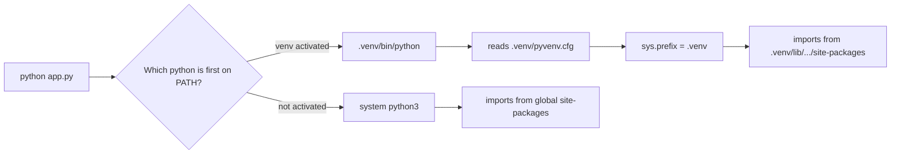

## Introduction

Almost every piece of applied AI work touches Python. The official SDKs for model providers ship Python first, PyTorch and Hugging Face are Python libraries, notebooks for exploring data are Python, and many AI backends are FastAPI services written in Python. Even when a product's user interface is TypeScript, the evaluation scripts, data-cleaning jobs and ingestion pipelines behind it are usually Python.

Python became the default for this work because it is quick to write and read, it has a very large standard library, and it can call fast code written in C, C++ or CUDA. NumPy, PyTorch and tokenizers do their heavy numerical work in compiled code; Python is the readable layer that wires it together. That makes Python excellent "glue", and an AI engineer spends much of their day writing glue: call a model, validate what came back, store it, retry when the network fails, log what happened.

This lesson assumes you can already program in another language — Java or JavaScript, for example — and teaches what is *different* about Python, in the order you need it. The first part covers the core language model: how names, objects and blocks work. The nested sections then cover collections, functions (with iterators and exceptions), classes and dataclasses, type hints, modules and packages, and virtual environments. Each section can be read on its own, but they build on each other.

All code targets **Python 3.12**. Where a feature needs a newer version than 3.9 or so, the version is named.

## Before you start

- **Programming in at least one language.** Variables, loops, functions and classes should feel familiar. The Java track starts at [[c1-syntax]]; the JavaScript track covers loops in [[b1-for-loops]].
- **Big-O notation.** The collections section compares operations by cost. See [[a1-big-o]].
- **Hashing.** Python's `dict` and `set` are hash tables; [[a2-hashing]] explains why lookups are fast on average.
- **The bigger picture.** [[e1-ai-landscape]] explains where Python sits in applied AI work; it is useful context but not required.

You will need Python 3.12 or newer installed. Run `python3 --version` to check.

## The intuition: names are labels, not boxes

In C or Java, a beginner's mental model is that a variable is a box holding a value. In Python that model leads to wrong predictions. A better model: **every value is an object living somewhere in memory, and a variable is a name tag tied to one object.** Assignment ties a name to an object; it never copies the object.

```python title="names.py"
a = [1, 2, 3]
b = a              # a second name for the same list object
b.append(4)
print(a)
print(a is b, a == [1, 2, 3, 4], a is [1, 2, 3, 4])

x = 10
y = x
y += 1             # ints are immutable: y is rebound to a new object
print(x, y)
```

```output
[1, 2, 3, 4]
True True False
10 11
```

`b = a` did not create a second list. It tied a second name to the same list, so appending through `b` is visible through `a`. The integers behave differently only because integers are **immutable** — they cannot be changed in place. `y += 1` cannot modify the object `10`, so Python builds a new object `11` and moves the name `y` to it. `x` still points at `10`.

That single idea explains a surprising amount of Python behaviour: why changing a list inside a function changes the caller's list, why default arguments can "remember" values, and why copying nested data needs care. Each of those comes up below.

The last line of the first `print` introduces two different comparisons. **`==` asks whether two objects have equal values**; **`is` asks whether two names refer to the very same object**. `a == [1, 2, 3, 4]` is `True` because the values match, but `a is [1, 2, 3, 4]` is `False` because the literal creates a brand-new list. Use `is` only for identity checks — in practice almost always `x is None` — and `==` for everything else.

## Blocks, indentation and statements

Python marks blocks with indentation instead of braces. A line ending in a colon (`if`, `for`, `while`, `def`, `class`, `with`, `try`) opens a block, and every line indented under it belongs to that block. The standard is four spaces, as set out in **PEP 8**, the community style guide.

```python title="grades.py"
scores = {"asha": 82, "ben": 47, "chen": 91}

for name, score in scores.items():
    if score >= 60:
        verdict = "pass"
    else:
        verdict = "fail"
    print(f"{name:<5} {score:>3}  {verdict}")

print(7 / 2, 7 // 2, -7 // 2, 7 % 3)
print(2 ** 100)
print(0.1 + 0.2 == 0.3, round(0.1 + 0.2, 10) == 0.3)
```

```output
asha   82  pass
ben    47  fail
chen   91  pass
3.5 3 -4 1
1267650600228229401496703205376
False True
```

Several Python habits appear in this short program:

- `for` loops iterate over *items*, not indices. `scores.items()` yields `(key, value)` pairs, and `name, score` unpacks each pair. When you need an index as well, use `enumerate(items)`; to walk two sequences together, use `zip(a, b)`. A C-style `for (i = 0; ...)` loop is written `for i in range(n)`.
- `f"..."` strings (**f-strings**) evaluate the expressions inside braces. `{name:<5}` left-aligns in five characters; `{score:>3}` right-aligns in three.
- `/` is always true division and returns a float. `//` is floor division, which rounds towards negative infinity — so `-7 // 2` is `-4`, not `-3` as in Java.
- Integers have arbitrary precision. `2 ** 100` does not overflow; Python allocates as many digits as needed. Floats are ordinary 64-bit IEEE 754 numbers, so `0.1 + 0.2 == 0.3` is `False` exactly as in Java or JavaScript.

Python 3.10 added the `match` statement for **structural pattern matching**. It is more than a `switch`: it can check the shape of a dictionary and pull values out of it at the same time, which suits the event payloads that streaming AI APIs send.

```python title="events.py"
def describe(event):
    match event:
        case {"type": "text", "content": str(content)}:
            return f"text: {content}"
        case {"type": "tool_call", "name": name, "args": dict(args)}:
            return f"call {name} with {sorted(args)}"
        case {"type": "done"}:
            return "finished"
        case _:
            return f"unknown event: {event}"

events = [
    {"type": "text", "content": "Hello"},
    {"type": "tool_call", "name": "search", "args": {"q": "python", "k": 3}},
    {"type": "done", "reason": "stop"},
    {"kind": "mystery"},
]
for e in events:
    print(describe(e))
```

```output
text: Hello
call search with ['k', 'q']
finished
unknown event: {'kind': 'mystery'}
```

A mapping pattern such as `{"type": "done"}` matches any dictionary that *contains* those keys — the extra `"reason"` key does not stop the match. `str(content)` both checks the type and binds the value to `content`. `case _` is the fallback.

## Dynamic typing and truthiness

Python is **dynamically typed**: a name has no type of its own, only the object it currently points to does. The same name can point to an integer and later a string. Python is also **strongly typed**: it will not silently convert between unrelated types.

```python title="typing_demo.py"
value = 42
print(type(value).__name__)
value = "forty-two"
print(type(value).__name__)
print("3" + "4", 3 + 4)
try:
    print("3" + 4)
except TypeError as err:
    print("TypeError:", err)
```

```output
int
str
34 7
TypeError: can only concatenate str (not "int") to str
```

JavaScript would turn `"3" + 4` into `"34"`. Python raises an error instead, which is safer but happens only when that line runs. That is the cost of dynamic typing: a type mistake in a rarely used branch hides until production. Type hints and a checker, covered in [[e1-type-hints|the type hints section]], close most of that gap.

Every object also has a **truth value**, used by `if` and `while`. The rule is short: `None`, `False`, numeric zero, and empty containers are **falsy**; almost everything else is **truthy**.

```python title="truthiness.py"
for value in [0, 0.0, "", [], {}, None, "0", [0], -1]:
    print(f"{value!r:>6} -> {bool(value)}")

def first_name(user):
    name = user.get("name")
    if name is None:
        return "anonymous"
    return name

print(repr(first_name({"name": ""})), repr(first_name({})))
```

```output
     0 -> False
   0.0 -> False
    '' -> False
    [] -> False
    {} -> False
  None -> False
   '0' -> True
   [0] -> True
    -1 -> True
'' 'anonymous'
```

`if not items:` is the idiomatic test for an empty list. But truthiness is a trap when an empty value is legitimate. Had `first_name` used `if not name:`, a user whose name is an empty string would be called "anonymous", and a model temperature of `0.0` would be treated as "not set". When you mean "missing", test `is None` explicitly.

## How Python runs your code

When you run `python app.py`, the CPython interpreter (the standard implementation) compiles the source to **bytecode** — instructions for Python's virtual machine — and then executes that bytecode one instruction at a time. Compilation happens per module, and compiled bytecode for imported modules is cached in `__pycache__` folders so the next run starts faster.

Because Python executes instructions one by one, pure-Python loops are much slower than the same loop in Java or C. That is why AI code pushes number crunching into libraries: `numpy.dot` on a million numbers runs a compiled loop, while a Python `for` loop over the same numbers runs a million bytecode iterations. See [[e1-numpy]] for that style.

CPython's default build also has a **Global Interpreter Lock (GIL)**: only one thread executes Python bytecode at a time. Threads still help with I/O — while one thread waits for an HTTP response, another runs — but they do not make CPU-bound Python code faster on multiple cores. Python 3.13 introduced an optional free-threaded build without the GIL; it is not yet the default, and most deployments still use the standard build. For AI applications, which mostly wait on network calls to model providers, the usual tool is `asyncio`, taught in [[e1-async]]. For CPU-heavy work, use `multiprocessing` or a compiled library.

## Collections {#e1-collections}

Python's four built-in collections — **list**, **tuple**, **dict** and **set** — carry almost all the data in an AI program: messages in a conversation, the JSON body of an API response, retrieved document IDs, token counts. Choosing the right one is a matter of three questions: does the order matter, must the contents change, and do you need fast lookup by key or membership?

### Lists and tuples: ordered sequences

A **list** is an ordered, mutable sequence. You can append, remove, and replace items in place. A **tuple** is an ordered, *immutable* sequence: once created, its items cannot be replaced.

```python title="sequences.py"
tokens = ["the", "cat", "sat"]
tokens.append("down")          # lists grow in place
tokens[0] = "a"                # and can be changed in place
print(tokens, len(tokens))
print(tokens[-1], tokens[1:3], tokens[::-1])

point = (3, 4)
x, y = point                   # unpacking works on any sequence
print(x, y)
try:
    point[0] = 10
except TypeError as err:
    print("TypeError:", err)
```

```output
['a', 'cat', 'sat', 'down'] 4
down ['cat', 'sat'] ['down', 'sat', 'cat', 'a']
3 4
TypeError: 'tuple' object does not support item assignment
```

Negative indices count from the end, so `tokens[-1]` is the last item. **Slicing** with `[start:stop:step]` builds a new list: `tokens[1:3]` takes indices 1 and 2 (the stop index is excluded), and `[::-1]` walks backwards.

Use a list for a collection of similar items whose length changes — the turns of a conversation, a batch of documents. Use a tuple for a fixed group of related values whose positions mean something — a `(latitude, longitude)` pair, or a `(model, temperature)` key. The immutability is a feature: a tuple can be used as a dictionary key, and code that receives one knows nobody will change it underneath them.

### Dictionaries: lookup by key

A **dict** maps keys to values. It is a hash table, so getting, setting and deleting by key take O(1) time on average. Since Python 3.7, dictionaries are guaranteed to preserve insertion order. JSON objects from APIs arrive as dicts, so you will read and write them constantly.

```python title="dicts.py"
user = {"id": 7, "name": "Asha", "roles": ["admin"]}
print(user["name"])
print(user.get("email"))                # missing key -> None
print(user.get("email", "not set"))     # missing key -> default
try:
    user["email"]
except KeyError as err:
    print("KeyError:", err)

user["email"] = "asha@example.com"      # insert
user["roles"].append("editor")          # mutate the nested list
for key, value in user.items():         # insertion order is preserved
    print(f"{key} = {value}")
print("id" in user, "asha" in user)     # 'in' checks keys, not values
```

```output
Asha
None
not set
KeyError: 'email'
id = 7
name = Asha
roles = ['admin', 'editor']
email = asha@example.com
True False
```

`user["email"]` raises `KeyError` when the key is missing; `user.get("email", default)` returns the default instead. Choose deliberately: use `[]` when a missing key is a bug that should fail loudly, and `.get` when absence is normal. Model responses are a good example of the second case — an optional field may simply not be there.

### Sets: membership and uniqueness

A **set** is an unordered collection of unique items, also backed by a hash table. Its two jobs are fast membership tests and removing duplicates.

```python title="sets.py"
seen = {"python", "java"}
seen.add("python")                      # duplicates are ignored
print(len(seen), "java" in seen)

docs_a = {"intro.md", "setup.md", "faq.md"}
docs_b = {"faq.md", "api.md"}
print(sorted(docs_a | docs_b))          # union
print(sorted(docs_a & docs_b))          # intersection
print(sorted(docs_a - docs_b))          # difference

words = ["rag", "agent", "rag", "eval", "agent", "rag"]
print(list(dict.fromkeys(words)))       # dedupe, keep first-seen order
```

```output
2 True
['api.md', 'faq.md', 'intro.md', 'setup.md']
['faq.md']
['intro.md', 'setup.md']
['rag', 'agent', 'eval']
```

Sets have no defined order, so the example wraps them in `sorted()` before printing. If you need to deduplicate while keeping the original order — common when merging search results from two retrievers — `dict.fromkeys` does it, because dict keys are unique and ordered. Note that `{}` is an empty *dict*; an empty set is written `set()`.

### Hashability: what can be a key

Dict keys and set members must be **hashable**: the object must have a hash value that never changes while it is stored, and equal objects must have equal hashes. Immutable built-ins (`int`, `str`, `float`, `tuple` of hashables, `frozenset`) are hashable. Mutable containers are not, because changing them after insertion would leave them in the wrong hash bucket.

```python title="hashable.py"
cache = {}
cache[("gpt-small", 0.2)] = "cached answer"     # tuple of hashables: fine
print(cache)
for key in (["gpt-small", 0.2], {"model": "gpt-small"}):
    try:
        cache[key] = "nope"
    except TypeError as err:
        print("TypeError:", err)
```

```output
{('gpt-small', 0.2): 'cached answer'}
TypeError: unhashable type: 'list'
TypeError: unhashable type: 'dict'
```

This is exactly the situation when you cache model responses: the cache key must combine the prompt and settings, and a tuple is the natural way to do it.

### Comprehensions and sorting

A **comprehension** builds a new collection from an existing iterable in one expression. It reads as "this expression, for each item, if a condition holds".

```python title="comprehensions.py"
prices = [12.5, 3.0, 8.25, 40.0]
with_tax = [round(p * 1.2, 2) for p in prices]
cheap = [p for p in prices if p < 10]
by_name = {name: len(name) for name in ["rag", "agent", "eval"]}
initials = {name[0] for name in ["rag", "retrieval", "agent"]}
print(with_tax)
print(cheap)
print(by_name)
print(sorted(initials))

docs = [
    {"title": "FAQ", "score": 0.71},
    {"title": "Setup", "score": 0.93},
    {"title": "API", "score": 0.85},
]
top = sorted(docs, key=lambda d: d["score"], reverse=True)[:2]
print([d["title"] for d in top])
```

```output
[15.0, 3.6, 9.9, 48.0]
[3.0, 8.25]
{'rag': 3, 'agent': 5, 'eval': 4}
['a', 'r']
['Setup', 'API']
```

The last example — sort retrieved documents by relevance score and keep the top two — is a pattern you will write in every retrieval pipeline. `sorted()` returns a new list; `list.sort()` sorts in place and returns `None`. Both accept `key=`, a function that extracts what to compare.

### The `collections` module

The standard library's `collections` module adds specialised containers that replace common hand-written loops.

```python title="collections_demo.py"
from collections import Counter, defaultdict, deque

words = "the model read the doc and the model answered".split()
counts = Counter(words)
print(counts.most_common(2))

by_first = defaultdict(list)
for w in words:
    by_first[w[0]].append(w)            # no KeyError: missing keys start as []
print(dict(by_first))

history = deque(maxlen=3)               # keeps only the newest 3 items
for turn in ["hi", "hello", "how are you?", "fine", "bye"]:
    history.append(turn)
print(list(history))
```

```output
[('the', 3), ('model', 2)]
{'t': ['the', 'the', 'the'], 'm': ['model', 'model'], 'r': ['read'], 'd': ['doc'], 'a': ['and', 'answered']}
['how are you?', 'fine', 'bye']
```

`Counter` counts things. `defaultdict(list)` creates a missing key with an empty list the first time you touch it, which removes the "if key not in dict" boilerplate when grouping. `deque` is a double-ended queue with O(1) appends and pops at both ends; with `maxlen` it becomes a sliding window, the simplest form of conversation-history trimming.

### Costs and copying

| Operation | `list` | `dict` / `set` |
|---|---|---|
| Index `x[i]` / lookup `d[k]` | O(1) | O(1) average |
| `item in x` | O(n) — scans every item | O(1) average |
| Append at end / insert key | O(1) amortised | O(1) average |
| Insert or delete at the front | O(n) — shifts items | — |
| Delete by key | — | O(1) average |

The row that matters most is `in`. Checking whether an ID is in a list of 100,000 IDs scans the list; checking a set hashes once. Converting the list to a set before a loop of membership tests turns an O(n·m) job into O(n + m).

Because names are labels, copying needs care. `list(x)`, `dict(x)` and `x.copy()` make a **shallow copy**: a new outer container whose items are the *same objects*. `copy.deepcopy(x)` copies everything recursively.

```python title="copying.py"
import copy

grid = [[0] * 3] * 2            # two references to ONE inner list
grid[0][0] = 1
print(grid)

grid = [[0] * 3 for _ in range(2)]   # two separate inner lists
grid[0][0] = 1
print(grid)

config = {"model": "small", "stop": ["\n\n"]}
shallow = dict(config)          # new outer dict, same inner list
deep = copy.deepcopy(config)    # everything copied
config["stop"].append("END")
print(shallow["stop"], deep["stop"])
```

```output
[[1, 0, 0], [1, 0, 0]]
[[1, 0, 0], [0, 0, 0]]
['\n\n', 'END'] ['\n\n']
```

`[[0] * 3] * 2` repeats the *reference* to one inner list, so changing one row changes both. The comprehension evaluates `[0] * 3` afresh for each row. The config example shows why a shallow copy of a request template is dangerous: appending a stop sequence for one request silently changes the template for every later request.

## Functions, Iterators & Exceptions {#e1-functions}

A **function** packages a piece of behaviour behind a name. In Python, functions are also ordinary objects: you can store them in variables, pass them to other functions and return them. That one property is what makes decorators, callbacks and retry wrappers possible. This section covers how to define functions and pass arguments, how scope works, the closures and decorators that build on them, lazy iteration with generators, and how errors are raised and handled.

### Defining functions and passing arguments

A function is defined with `def`. If it reaches the end without a `return`, it returns `None`. Arguments can be passed by position or by name, and parameters can have defaults.

```python title="arguments.py"
def build_prompt(question, context="", *, max_words=50, style="plain"):
    """Return a prompt string. Arguments after * must be passed by name."""
    parts = [f"Answer in at most {max_words} words ({style})."]
    if context:
        parts.append(f"Context: {context}")
    parts.append(f"Question: {question}")
    return "\n".join(parts)

print(build_prompt("What is RAG?"))
print("---")
print(build_prompt("What is RAG?", "RAG = retrieval-augmented generation", max_words=20))
try:
    build_prompt("What is RAG?", "", 20)
except TypeError as err:
    print("TypeError:", err)
```

```output
Answer in at most 50 words (plain).
Question: What is RAG?
---
Answer in at most 20 words (plain).
Context: RAG = retrieval-augmented generation
Question: What is RAG?
TypeError: build_prompt() takes from 1 to 2 positional arguments but 3 were given
```

The bare `*` in the parameter list makes every parameter after it **keyword-only**. That is why `build_prompt("...", "", 20)` fails: a reader of `build_prompt(q, ctx, 20)` cannot tell what `20` means, while `max_words=20` is self-explanatory. Model SDKs use keyword-only arguments heavily for exactly this reason — you write `temperature=0.2`, never a bare `0.2`. The mirror image is `/`, which makes the parameters before it **positional-only**; you will see it in built-in signatures such as `len(obj, /)`.

The string in triple quotes right after `def` is a **docstring**. Editors show it on hover and `help(build_prompt)` prints it.

To accept any number of arguments, use `*args` (collects extra positional arguments into a tuple) and `**kwargs` (collects extra keyword arguments into a dict). The same symbols at a *call* site do the reverse and unpack a sequence or dict into arguments.

```python title="star_args.py"
def log_call(event, *args, **kwargs):
    print(event, args, kwargs)

log_call("search", "python", 3, k=5, rerank=True)

def call_model(prompt, temperature=0.0, max_tokens=256):
    return f"{prompt!r} t={temperature} max={max_tokens}"

settings = {"temperature": 0.7, "max_tokens": 64}
print(call_model("hi", **settings))       # unpack a dict into keyword args
args = ["hello", 0.2]
print(call_model(*args))                  # unpack a list into positional args
```

```output
search ('python', 3) {'k': 5, 'rerank': True}
'hi' t=0.7 max=64
'hello' t=0.2 max=256
```

Python passes arguments by **object reference**: the parameter becomes a new name for the caller's object. If the function mutates a list it received, the caller sees the change. If it rebinds the parameter (`items = []`), the caller does not — only the local name moved.

### The mutable default argument bug

Default values are evaluated **once, when the `def` statement runs**, not on each call. For an immutable default such as `0` or `"plain"` that makes no difference. For a mutable default it is a classic bug.

```python title="mutable_default.py"
def add_message(text, history=[]):        # BUG: one list shared by every call
    history.append(text)
    return history

print(add_message("hi"))
print(add_message("bye"))                 # surprise: still holds "hi"

def add_message_fixed(text, history=None):
    if history is None:                   # a fresh list on every call
        history = []
    history.append(text)
    return history

print(add_message_fixed("hi"))
print(add_message_fixed("bye"))
```

```output
['hi']
['hi', 'bye']
['hi']
['bye']
```

The single list created at definition time is stored on the function object and reused. In a web server that handles many users, a bug like this leaks one user's conversation into another's. The fix is the `None` sentinel shown above, which every Python linter will suggest.

### Scope: LEGB, `global` and `nonlocal`

When Python looks up a name, it searches four scopes in order, remembered as **LEGB**: **L**ocal (the current function), **E**nclosing (any outer functions), **G**lobal (the module) and **B**uilt-in (names such as `len` and `print`). Reading a name from an outer scope needs nothing special. *Assigning* to a name inside a function makes it local to that function for the whole function body, unless you declare otherwise.

```python title="scope.py"
total_calls = 0

def make_counter():
    count = 0                     # enclosing scope of increment()
    def increment():
        nonlocal count            # rebind the enclosing variable
        count += 1
        return count
    return increment

def record_call():
    global total_calls            # rebind the module-level variable
    total_calls += 1

counter = make_counter()
counter()
counter()
print(counter())
record_call()
print(total_calls)

def broken():
    print(total_calls)
    total_calls = 5               # assignment makes total_calls local to broken()

try:
    broken()
except UnboundLocalError as err:
    print("UnboundLocalError:", err)
```

```output
3
1
UnboundLocalError: cannot access local variable 'total_calls' where it is not associated with a value
```

`broken()` fails on its *first* line, before the assignment runs. Python decides which names are local when it compiles the function, and because `total_calls = 5` appears somewhere in the body, `total_calls` is local everywhere in it. The `print` then reads a local variable that has no value yet.

`make_counter` shows a **closure**: `increment` keeps access to `count` even after `make_counter` has returned. Closures are how Python functions carry private state without a class. Use `global` rarely — shared module-level state makes code hard to test — but `nonlocal` inside closures is normal.

### First-class functions, lambdas and decorators

Because functions are objects, you can pass one as an argument. You already did: `sorted(docs, key=lambda d: d["score"])` passed a function that extracts the sort key. A **lambda** is a small anonymous function limited to a single expression. Use it for short keys and callbacks; give anything longer a proper `def` and a name.

A **decorator** is a function that takes a function and returns a replacement, usually a wrapper that adds behaviour before or after the original runs. The `@name` line above a `def` is shorthand for `func = name(func)`. Decorators are everywhere in AI backends: FastAPI routes (`@app.get`), caching (`@functools.cache`), and retries around flaky provider calls.

```python title="retry_decorator.py"
import functools
import time

def retry(times, delay=0.0):
    """Decorator factory: retry a function that raises ConnectionError."""
    def decorator(func):
        @functools.wraps(func)            # keep func.__name__ and docstring
        def wrapper(*args, **kwargs):
            for attempt in range(1, times + 1):
                try:
                    return func(*args, **kwargs)
                except ConnectionError as err:
                    print(f"attempt {attempt} failed: {err}")
                    if attempt == times:
                        raise
                    time.sleep(delay)
        return wrapper
    return decorator

failures_left = 2

@retry(times=3)
def fetch_completion(prompt):
    global failures_left
    if failures_left > 0:
        failures_left -= 1
        raise ConnectionError("provider timed out")
    return f"answer to {prompt!r}"

print(fetch_completion("What is a decorator?"))
print(fetch_completion.__name__)
```

```output
attempt 1 failed: provider timed out
attempt 2 failed: provider timed out
answer to 'What is a decorator?'
fetch_completion
```

Read it from the outside in. `retry(times=3)` runs first and returns `decorator`. Python then calls `decorator(fetch_completion)`, which returns `wrapper`, and binds the name `fetch_completion` to that wrapper. Every later call goes through `wrapper`, which uses `*args, **kwargs` to forward whatever arguments it received. The bare `raise` re-raises the last error once attempts are exhausted, so the caller still learns about the failure. `functools.wraps` copies the original name and docstring onto the wrapper; without it, `fetch_completion.__name__` would print `wrapper`, which confuses logs and debuggers. A production retry would also add exponential backoff and only retry errors that are safe to retry — see [[e3-retries]].

### Iterators and generators

A `for` loop works on any **iterable** — an object that can hand out an **iterator**. An iterator is an object with a `__next__` method that returns the next item each time it is called and raises `StopIteration` when it is exhausted. `for x in items` is roughly "call `iter(items)`, then call `next()` on the result until `StopIteration`".

The easy way to write your own iterator is a **generator function**: a function containing `yield`. Calling it does not run the body. It returns a generator object, and each `next()` runs the body until the next `yield`, hands out that value, and pauses with all local variables intact.

```python title="generators.py"
def stream_tokens(text):
    """A generator: produces one token at a time, only when asked."""
    print("[generator started]")
    for word in text.split():
        yield word
    print("[generator finished]")

gen = stream_tokens("Paris is the capital")
print(type(gen).__name__)
print(next(gen))
print(next(gen))
for token in gen:                 # continues where next() left off
    print("for loop got", token)

lengths = (len(w) for w in ["rag", "agent", "eval"])   # generator expression
print(sum(lengths))
print(sum(lengths))               # already exhausted
```

```output
generator
[generator started]
Paris
is
for loop got the
for loop got capital
[generator finished]
12
0
```

Notice that `[generator started]` is printed only at the first `next()`, not when `stream_tokens(...)` is called — generators are **lazy**. This is the model behind streaming responses from LLM APIs: the SDK gives you an iterator of chunks and you process each as it arrives instead of waiting for the full answer. Laziness also saves memory: a generator that reads a 10 GB file line by line holds one line at a time. The cost is that a generator can be consumed only once, which is why the second `sum(lengths)` returns `0`.

### Exceptions

Errors in Python are **exceptions**: objects raised with `raise` and caught with `try`/`except`. The full form has four parts. `try` holds the code that may fail; `except SomeError` handles a specific error type; `else` runs only if no exception occurred; `finally` runs no matter what, even after a `return`, and is the place for cleanup.

```python title="exceptions.py"
import json

class ModelOutputError(Exception):
    """The model returned something our code cannot use."""

def parse_label(raw):
    try:
        data = json.loads(raw)
    except json.JSONDecodeError as err:
        raise ModelOutputError(f"not JSON: {raw!r}") from err
    else:                         # runs only if no exception was raised
        label = data.get("label")
        if label not in {"billing", "bug", "other"}:
            raise ModelOutputError(f"unknown label: {label!r}")
        return label
    finally:                      # runs no matter what
        print(f"parsed {raw[:20]!r}")

for raw in ['{"label": "bug"}', 'Sure! Here is JSON:', '{"label": "refund"}']:
    try:
        print("->", parse_label(raw))
    except ModelOutputError as err:
        print("-> rejected:", err, "| cause:", type(err.__cause__).__name__)
```

```output
parsed '{"label": "bug"}'
-> bug
parsed 'Sure! Here is JSON:'
-> rejected: not JSON: 'Sure! Here is JSON:' | cause: JSONDecodeError
parsed '{"label": "refund"}'
-> rejected: unknown label: 'refund' | cause: NoneType
```

This is a realistic AI pattern: a model was asked for a JSON label, and the code must not trust what came back. Three design choices are worth copying. First, a **custom exception class** (`ModelOutputError`) lets callers catch "the model misbehaved" separately from genuine bugs. Second, `raise ... from err` chains the original error as `__cause__`, so the traceback shows both the JSON error and your higher-level explanation. Third, the handler catches a *specific* type. A bare `except:` or `except Exception:` would also swallow typos such as `NameError`, hiding real bugs behind "the model returned bad output".

Python's style here is often called **EAFP** — "easier to ask forgiveness than permission": try the operation and handle the failure, rather than checking every precondition first. It fits naturally with I/O and external services, where checking first cannot guarantee success anyway.

Related to `finally` is the `with` statement, which uses a **context manager** to guarantee cleanup. `with open("data.jsonl") as f:` closes the file when the block ends, even if an exception escapes. Database sessions, locks and HTTP clients all use the same pattern.

## Classes & Dataclasses {#e1-classes}

A **class** bundles data (attributes) with the functions that operate on it (methods). You define the class once and create as many **instances** as you need, each with its own attribute values. In AI code, classes model things such as a conversation, a client for a model provider, a document chunk or the usage record of a request. Python adds one shortcut that you will use more than plain classes: the **dataclass**, which writes the boilerplate for classes that mainly hold data.

### Defining a class

```python title="conversation.py"
class Conversation:
    max_turns = 4                         # class attribute: shared by all instances

    def __init__(self, system_prompt):
        self.system_prompt = system_prompt  # instance attributes: one set per object
        self.turns = []

    def add(self, role, text):
        self.turns.append((role, text))
        if len(self.turns) > self.max_turns:
            self.turns.pop(0)             # drop the oldest turn

    def __len__(self):
        return len(self.turns)

    def __repr__(self):
        return f"Conversation(turns={len(self)}, system={self.system_prompt!r})"

chat = Conversation("You are concise.")
for i in range(6):
    chat.add("user", f"message {i}")
print(chat)
print(len(chat), chat.turns[0])

other = Conversation("You are verbose.")
print(len(other), other.max_turns)
```

```output
Conversation(turns=4, system='You are concise.')
4 ('user', 'message 2')
0 4
```

`Conversation("You are concise.")` creates a new object and then calls `__init__` on it to set it up. `__init__` is an initialiser, not a constructor that allocates memory — the object already exists when it runs. Every method receives the instance as its first parameter, named **`self`** by convention. Python passes it automatically: `chat.add("user", "hi")` is the same call as `Conversation.add(chat, "user", "hi")`. Unlike Java's implicit `this`, `self` must be written explicitly, both in the parameter list and when accessing attributes.

Methods with double underscores on both sides are **dunder methods** (special methods). Python calls them for you when you use built-in syntax: `len(chat)` calls `chat.__len__()`, `print(chat)` uses `__repr__` (when no `__str__` is defined), `a == b` calls `__eq__`, and `for x in obj` calls `__iter__`. Implementing them makes your objects work with the rest of the language. Always give classes a useful `__repr__`; it is what you see in logs, the debugger and the interactive shell.

### Class attributes versus instance attributes

`max_turns` is defined in the class body, so it is a **class attribute**, stored once on the class and visible through every instance. `self.turns` is an **instance attribute**, created separately in each `__init__`. When you read `self.max_turns`, Python looks on the instance first and then on the class. That lookup rule creates a bug that mirrors the mutable default argument.

```python title="class_attribute_bug.py"
class Leaky:
    tags = []                             # ONE list, owned by the class

    def tag(self, t):
        self.tags.append(t)               # mutates the shared class list

a, b = Leaky(), Leaky()
a.tag("urgent")
print(b.tags)                             # b sees a's tag

class Fixed:
    def __init__(self):
        self.tags = []                    # each instance gets its own list

    def tag(self, t):
        self.tags.append(t)

a, b = Fixed(), Fixed()
a.tag("urgent")
print(b.tags)
```

```output
['urgent']
[]
```

Class attributes are right for constants shared by every instance, like `max_turns` or a price table. Anything that belongs to one object must be created in `__init__`.

### `@classmethod`, `@staticmethod` and `@property`

Three built-in decorators change how a method is called.

```python title="usage.py"
class Usage:
    PRICE_PER_1K = {"input": 0.0005, "output": 0.0015}   # illustrative prices

    def __init__(self, input_tokens, output_tokens):
        self.input_tokens = input_tokens
        self.output_tokens = output_tokens

    @classmethod
    def from_api(cls, payload):           # alternative constructor
        u = payload["usage"]
        return cls(u["prompt_tokens"], u["completion_tokens"])

    @staticmethod
    def tokens_to_words(tokens):          # utility: needs neither self nor cls
        return round(tokens * 0.75)

    @property
    def cost(self):                       # computed attribute, read like a field
        p = self.PRICE_PER_1K
        return (self.input_tokens * p["input"] + self.output_tokens * p["output"]) / 1000

usage = Usage.from_api({"usage": {"prompt_tokens": 1200, "completion_tokens": 400}})
print(usage.input_tokens, usage.output_tokens)
print(f"${usage.cost:.4f}")
print(Usage.tokens_to_words(400))
```

```output
1200 400
$0.0012
300
```

A **class method** receives the class (`cls`) instead of an instance. Its main use is an **alternative constructor**: `Usage.from_api(payload)` knows how to build a `Usage` from a provider's JSON, keeping that parsing in one place. Because it calls `cls(...)` rather than `Usage(...)`, it also builds the right type for subclasses. A **static method** receives neither; it is a plain function that lives in the class's namespace because it belongs there logically. A **property** runs a method when you read an attribute, so `usage.cost` is always computed from the current token counts and can never go stale. The "0.75 words per token" figure is a rough rule of thumb for English text, not a fixed constant.

### Inheritance and `super()`

A class can **inherit** from another, reusing its methods and overriding the ones it wants to change. `super()` calls the parent's version of a method.

```python title="inheritance.py"
class LLMClient:
    def __init__(self, model):
        self.model = model

    def complete(self, prompt):
        return f"[{self.model}] reply to {prompt!r}"

class CachedClient(LLMClient):
    def __init__(self, model):
        super().__init__(model)           # run the parent's __init__ first
        self.cache = {}

    def complete(self, prompt):           # override, reusing the parent version
        if prompt not in self.cache:
            self.cache[prompt] = super().complete(prompt)
        return self.cache[prompt]

client = CachedClient("small-model")
print(client.complete("hi"))
print(client.complete("hi"), len(client.cache))
print(isinstance(client, LLMClient), CachedClient.__mro__)
```

```output
[small-model] reply to 'hi'
[small-model] reply to 'hi' 1
True (<class '__main__.CachedClient'>, <class '__main__.LLMClient'>, <class 'object'>)
```

If `CachedClient.__init__` forgot to call `super().__init__(model)`, `self.model` would never be set and `complete` would fail with `AttributeError`. Python supports multiple inheritance; the order in which it searches classes for a method is the **method resolution order (MRO)**, visible as `__mro__`. Every class ultimately inherits from `object`. In practice, keep hierarchies shallow. Wrapping an object (composition) is often clearer than inheriting from it, and Python's [[e1-type-hints|`Protocol`]] lets you describe "anything with a `complete` method" without a shared base class.

### Dataclasses

Many classes exist only to hold a few fields: a message, a search hit, a configuration. Writing `__init__`, `__repr__` and `__eq__` by hand for each is repetitive and easy to get wrong. The **`@dataclass`** decorator (standard library, Python 3.7+) generates them from annotated class attributes.

```python title="dataclasses_demo.py"
from dataclasses import dataclass, field, asdict

@dataclass
class Message:
    role: str
    content: str
    tokens: int = 0
    tags: list[str] = field(default_factory=list)   # fresh list per instance

m1 = Message("user", "What is RAG?")
m2 = Message("user", "What is RAG?")
m1.tags.append("faq")
print(m1)
print(m2.tags, m1 == m2)
print(asdict(m1))

@dataclass(frozen=True, order=True)
class ModelVersion:
    major: int
    minor: int

versions = [ModelVersion(2, 1), ModelVersion(1, 9), ModelVersion(2, 0)]
print(max(versions), sorted(versions)[0])
print({ModelVersion(2, 1): "current"})        # frozen -> hashable
try:
    versions[0].major = 3
except AttributeError as err:
    print(type(err).__name__, err)

bad = Message(role=42, content=None)          # hints are NOT checked at runtime
print(bad)
```

```output
Message(role='user', content='What is RAG?', tokens=0, tags=['faq'])
[] False
{'role': 'user', 'content': 'What is RAG?', 'tokens': 0, 'tags': ['faq']}
ModelVersion(major=2, minor=1) ModelVersion(major=1, minor=9)
{ModelVersion(major=2, minor=1): 'current'}
FrozenInstanceError cannot assign to field 'major'
Message(role=42, content=None, tokens=0, tags=[])
```

From four annotated lines, `@dataclass` generated an `__init__` with the fields in order, a readable `__repr__`, and an `__eq__` that compares field by field — which is why `m1 == m2` became `False` once `m1` gained a tag. Fields with defaults must come after fields without them.

`field(default_factory=list)` is the dataclass answer to the mutable default problem. Writing `tags: list[str] = []` raises `ValueError` when the class is defined, precisely to stop you sharing one list between instances. The factory is called once per instance instead.

Options on the decorator change what is generated. `frozen=True` makes instances immutable (assignment raises `FrozenInstanceError`, a subclass of `AttributeError`) and therefore hashable, so they can be dict keys. `order=True` adds `<`, `>` and friends, comparing fields as a tuple in declaration order. Python 3.10 added `slots=True`, which uses less memory per instance and rejects attributes not declared as fields, and `kw_only=True`, which makes every field keyword-only.

The last two lines are the most important limitation: **a dataclass does not check types**. `role=42` was accepted without complaint. For data you control, that is fine. For data that arrives from outside — an HTTP request body, a model's JSON output — use Pydantic, which reads the same annotations and validates and converts values at runtime. See [[e1-pydantic]].

## Type Hints {#e1-type-hints}

**Type hints** are annotations that state what types a function expects and returns, or what type a variable holds. They were added by PEP 484 (Python 3.5) and have improved in almost every release since. The key fact is that **the interpreter does not enforce them**. Hints are read by tools: a **static type checker** such as mypy or Pyright reads your code without running it and reports mismatches; your editor uses hints for autocompletion; and libraries such as Pydantic and FastAPI read them at runtime to validate data and generate API schemas.

### Annotations are not checked when code runs

```python title="prices.py"
def total(prices: list[float]) -> float:
    return sum(prices)

print(total([9.5, 0.5]))
print(total.__annotations__)
try:
    print(total(["9.5", "0.5"]))          # wrong type: Python does not stop it here
except TypeError as err:
    print("TypeError:", err)
```

```output
10.0
{'prices': list[float], 'return': <class 'float'>}
TypeError: unsupported operand type(s) for +: 'int' and 'str'
```

Python stored the hints in `total.__annotations__` and then ignored them. The call with strings was allowed, and the failure came from inside `sum`, which starts from `0` and tries `0 + "9.5"`. In a longer program the bad value could travel much further before anything noticed. A type checker catches it before the program runs. Given this file:

```python title="app.py"
def total(prices: list[float]) -> float:
    return sum(prices)

labels: list[str] = ["9.5", "0.5"]
print(total(labels))
```

running mypy reports:

```bash
mypy app.py
```

```output
app.py:5: error: Argument 1 to "total" has incompatible type "list[str]"; expected "list[float]"  [arg-type]
Found 1 error in 1 file (checked 1 source file)
```

The hints cost nothing at runtime beyond storing the annotation objects. They are a static safety net, much like TypeScript's types, which are erased before JavaScript runs (compare [[b2-what-is-typescript]]).

### The everyday vocabulary

| Hint | Meaning | Since |
|---|---|---|
| `int`, `str`, `float`, `bool`, `bytes` | That built-in type | 3.5 |
| `list[str]`, `dict[str, int]`, `tuple[int, int]`, `set[str]` | Collection with element types | 3.9 (before: `typing.List` etc.) |
| `tuple[int, ...]` | Tuple of any length, all `int` | 3.9 |
| `str \| None` | Either a `str` or `None` | 3.10 (before: `Optional[str]`) |
| `int \| str` | Either type | 3.10 (before: `Union[int, str]`) |
| `Literal["user", "assistant"]` | Only these exact values | 3.8 |
| `Callable[[str], int]` | A function taking a `str`, returning an `int` | 3.5 (`collections.abc` from 3.9) |
| `Any` | Opt out of checking for this value | 3.5 |

`Optional[str]` and `str | None` mean the same thing. Note that "optional" here means "may be `None`", not "may be omitted" — whether an argument can be omitted depends on whether it has a default.

A union with `None` forces the code to handle the `None` case, and that is one of the most useful checks a type checker makes. If a function returns `str | None` and you write `name.upper()` without testing, mypy reports `Item "None" of "str | None" has no attribute "upper"`. After `if name is not None:`, the checker **narrows** the type to `str` inside the block and the error disappears.

### Richer types: `TypedDict`, `Protocol` and generics

```python title="typing_tools.py"
from typing import Literal, Protocol, TypedDict

Role = Literal["system", "user", "assistant"]

class ChatMessage(TypedDict):
    role: Role
    content: str

def find_user(user_id: int, users: dict[int, str]) -> str | None:
    return users.get(user_id)

class Embedder(Protocol):
    def embed(self, text: str) -> list[float]: ...

class FakeEmbedder:                       # never mentions Embedder
    def embed(self, text: str) -> list[float]:
        return [float(len(text)), float(text.count(" "))]

def index_all(docs: list[str], embedder: Embedder) -> dict[str, list[float]]:
    return {d: embedder.embed(d) for d in docs}

def first[T](items: list[T]) -> T:        # Python 3.12+ generic syntax
    return items[0]

msg: ChatMessage = {"role": "user", "content": "hi"}
print(msg, type(msg).__name__)
name = find_user(3, {1: "asha"})
print(name.upper() if name is not None else "no such user")
print(index_all(["a cat", "dog"], FakeEmbedder()))
print(first(["x", "y"]), first([1, 2]))
```

```output
{'role': 'user', 'content': 'hi'} dict
no such user
{'a cat': [5.0, 1.0], 'dog': [3.0, 0.0]}
x 1
```

A **`TypedDict`** describes the keys and value types of a plain dictionary. At runtime `msg` is an ordinary `dict`, as the output shows, but the checker will flag a misspelled key or a role of `"admin"`. It suits JSON-shaped data such as chat messages.

A **`Protocol`** describes behaviour rather than ancestry: "any object with an `embed(text) -> list[float]` method". `FakeEmbedder` never inherits from `Embedder`, yet the checker accepts it because its shape matches. This is **structural typing** — the static version of Python's duck typing, and the same idea as TypeScript interfaces ([[b2-structural-typing]]). Protocols are ideal for swapping a real embedding client for a fake one in tests.

A **generic** function works for many types while keeping them linked. `first[T]` says "given a list of some type `T`, return a `T`", so the checker knows `first(["x"])` is a `str` and `first([1])` is an `int`. The square-bracket syntax arrived in Python 3.12 (PEP 695); older code declares `T = TypeVar("T")` at module level and writes `def first(items: list[T]) -> T`.

### Gradual typing in practice

Python's typing is **gradual**: unannotated code is treated as `Any` and not checked, so you can add hints one module at a time. A sensible approach for an AI service is to annotate every function signature (parameters and return types), let the checker infer local variables, run mypy or Pyright in CI, and tighten settings (`--strict` in mypy) as coverage grows. Where data crosses a trust boundary — HTTP input, model output, files — remember that hints only describe what you *expect*; validate with Pydantic to make sure that is what you *got*.

## Modules & Package Management {#e1-packages}

As a program grows past one file, you split it into **modules**, group modules into **packages**, and depend on other people's packages from the **Python Package Index (PyPI)**. This section covers how imports actually find code, how to structure your own project, and how to declare dependencies so the project installs the same way on every machine.

### Modules and how `import` works

A **module** is a `.py` file. `import json` finds a module named `json`, executes its top-level code once, stores the resulting module object in the cache `sys.modules`, and binds the name `json` in your namespace. A second `import json` anywhere in the program reuses the cached module; the file is not executed again. That makes module-level code a natural place for one-time setup, and it is also why a slow import, such as a large ML library, is paid once per process.

To find a module, Python searches the directories in **`sys.path`** in order. It starts with the directory of the script being run (or the current directory when using `-m`), then the standard library, then the active environment's `site-packages` directory, where `pip` installs third-party packages.

That search order causes a classic beginner bug. If you name your own script `openai.py`, `random.py` or `json.py`, then `import openai` inside it finds *your file* first instead of the installed library, and you get confusing errors such as `AttributeError: module 'openai' has no attribute 'OpenAI'`. Never name a file after a module you import.

### Packages and project layout

A **package** is a directory of modules that can be imported as a unit. A directory containing an `__init__.py` file is a regular package; `__init__.py` runs when the package is first imported and is often used to re-export the package's public names. A common, recommended layout for an application or library puts the package under `src/`:

```text
docqa/
├── pyproject.toml
├── README.md
├── src/
│   └── docqa/
│       ├── __init__.py
│       ├── chunking.py
│       └── cli.py
└── tests/
    └── test_chunking.py
```

```python title="src/docqa/__init__.py"
"""docqa: answer questions about documents."""
from docqa.chunking import chunk_text

__all__ = ["chunk_text"]
```

```python title="src/docqa/chunking.py"
def chunk_text(text: str, size: int = 4) -> list[str]:
    words = text.split()
    return [" ".join(words[i:i + size]) for i in range(0, len(words), size)]
```

```python title="src/docqa/cli.py"
import sys

from docqa import chunk_text          # absolute import of our own package
from .chunking import chunk_text as same_function   # relative import

def main() -> None:
    text = " ".join(sys.argv[1:]) or "retrieval augmented generation needs good chunks"
    for i, chunk in enumerate(chunk_text(text, size=3)):
        print(i, chunk)
    print(chunk_text is same_function)

if __name__ == "__main__":
    main()
```

Running the module from the `src` directory:

```bash
cd docqa/src
python -m docqa.cli
```

```output
0 retrieval augmented generation
1 needs good chunks
True
```

Three details are worth understanding. First, every module has a `__name__`. When a file is run as the program, `__name__` is `"__main__"`; when it is imported, it is the module's dotted name. The `if __name__ == "__main__":` guard therefore means "run `main()` only when executed directly, not when imported" — without it, importing `cli` from a test would run the command-line program.

Second, `python -m docqa.cli` runs the module *as part of its package*, so both the absolute import (`from docqa import ...`) and the relative import (`from .chunking import ...`) work. Running the file by path, `python docqa/cli.py`, puts `src/docqa/` rather than `src/` on `sys.path` and fails with `ModuleNotFoundError: No module named 'docqa'`. Prefer `-m`, or better, install your project into its environment (next section) so it is importable from anywhere.

Third, the final `True` shows both imports produced the same function object: the module was executed once and cached. **Circular imports** — `a.py` imports `b.py`, which imports `a.py` — break this, because one module sees the other half-initialised. The fix is to move shared code into a third module.

### Installing packages with pip

**pip** is Python's standard package installer. `pip install httpx` downloads the package from PyPI, along with every package it depends on, and installs them into the active environment's `site-packages`. Packages are distributed as **wheels** (pre-built `.whl` archives, which may contain compiled code for a specific platform) or source distributions that must be built on install.

Always run pip as `python -m pip install ...`. That guarantees you are installing into the same interpreter you will run, which avoids the common situation where `pip` belongs to one Python and `python` is another. And always install into a virtual environment, as explained in [[e1-venvs|the next section]] — many modern systems refuse to let pip modify the system Python at all.

### Declaring dependencies: `pyproject.toml`

A project needs to record what it depends on. The modern standard is a **`pyproject.toml`** file, whose `[project]` table is defined by PEP 621.

```toml title="pyproject.toml"
[build-system]
requires = ["hatchling"]
build-backend = "hatchling.build"

[project]
name = "docqa"
version = "0.1.0"
requires-python = ">=3.12"
dependencies = [
    "httpx>=0.27",
    "pydantic>=2.7,<3",
]

[project.optional-dependencies]
dev = ["pytest>=8", "mypy>=1.10", "ruff>=0.5"]

[project.scripts]
docqa = "docqa.cli:main"
```

`dependencies` lists what the code needs at runtime, with **version specifiers**: `>=2.7,<3` means any 2.x release from 2.7 on, which accepts bug fixes but rejects a future major version that may break your code. `~=2.7` is shorthand for the same range. `==` pins one exact version. `[project.optional-dependencies]` groups extras that are installed only on request, such as development tools. `[project.scripts]` creates a `docqa` command that calls `docqa.cli:main`. `[build-system]` names the tool that turns the project into an installable package (hatchling here; setuptools, flit and others are equivalent choices).

With this file in place, `python -m pip install -e ".[dev]"` installs the project in **editable mode** plus its dev extras: your `src/docqa` becomes importable from anywhere in the environment, and edits take effect without reinstalling.

### Reproducible installs: lockfiles

The ranges in `pyproject.toml` say what versions are *acceptable*. They do not say what was *actually installed*, and the transitive dependencies (the dependencies of your dependencies) are not listed at all. Two developers installing a week apart can get different versions, and CI can break even though nobody changed a line. AI libraries make this worse, because SDKs, Pydantic, PyTorch and CUDA builds have narrow compatibility windows.

The fix is a **lockfile**: an exact, complete list of every package and version, often with hashes of the files, generated from your declared ranges. Common options:

- `pip freeze > requirements.txt` writes every package installed in the current environment with `==` pins. It is simple, but it captures whatever happens to be installed, including leftovers.
- **pip-tools** (`pip-compile`) generates a pinned `requirements.txt` from your declared dependencies.
- **uv** (from Astral, released 2024) and **Poetry** manage the environment and write `uv.lock` or `poetry.lock`. uv is notably fast and has become a popular default for new projects.
- PEP 751 (accepted in 2025) defines a standard `pylock.toml` lockfile format that tools are adopting.

Whichever you choose, commit the lockfile and install from it in CI and production. Update it deliberately (`uv lock --upgrade`, re-running `pip-compile`), review the diff, and run your tests and evaluations before merging.

## Virtual Environments {#e1-venvs}

A **virtual environment** (venv) is an isolated Python installation for one project: its own `python` command, its own `pip`, and its own `site-packages` directory where packages are installed. Each project gets independent dependency versions, and nothing it installs touches the system Python or other projects.

### Why isolation matters

Without virtual environments, every `pip install` lands in one shared location. Project A needs `pydantic` 1.x; project B needs 2.x; only one can be installed at a time, so one of them breaks. Worse, operating-system tools written in Python can break when you upgrade a library they rely on. For this reason many systems now mark the system Python as **externally managed** (PEP 668) and refuse global installs. On macOS with Homebrew Python, a plain `pip install` outside a venv fails like this:

```text
error: externally-managed-environment

× This environment is externally managed
╰─> To install Python packages system-wide, try brew install
    xyz, where xyz is the package you are trying to
    install.
```

Debian and Ubuntu show the same error. The answer is not to force it with `--break-system-packages`; it is to create a virtual environment.

### Creating and using a venv

```bash
python3 -m venv .venv               # create the environment in ./.venv
source .venv/bin/activate           # macOS / Linux (Windows: .venv\Scripts\activate)
python -m pip install -U pip        # upgrade pip inside the venv
python -m pip install -e ".[dev]"   # install the project and its dev tools
deactivate                          # leave the environment
```

`venv` is part of the standard library, so it needs no installation. Naming the directory `.venv` inside the project is a widespread convention that editors such as VS Code detect automatically.

### What a venv actually is

A venv is not a copy of Python. It is a small directory, about 12 MB on a fresh macOS Python 3.13 install, mostly pip itself:

```text
.venv/
├── pyvenv.cfg
├── bin/                 # Scripts\ on Windows
│   ├── activate
│   ├── pip
│   ├── python -> python3.13
│   └── python3.13 -> /opt/homebrew/opt/python@3.13/bin/python3.13
├── include/
└── lib/
    └── python3.13/
        └── site-packages/
```

`bin/python` is a symbolic link (on Windows, a copy or launcher) pointing at the base interpreter. The file `pyvenv.cfg` records which interpreter that is:

```text title=".venv/pyvenv.cfg"
home = /opt/homebrew/opt/python@3.13/bin
include-system-site-packages = false
version = 3.13.3
```

When Python starts, it looks for a `pyvenv.cfg` next to (or one level above) its executable. If it finds one, it sets `sys.prefix` to the venv directory and uses the venv's `site-packages` instead of the global one. The standard library still comes from the base installation. You can check which mode you are in:

```python title="where.py"
import sys
print("in a venv:", sys.prefix != sys.base_prefix)
print("prefix ends with:", sys.prefix.rsplit("/", 1)[-1])
```

Run once with the system Python and once with the venv's Python (macOS):

```bash
python3.13 where.py
.venv/bin/python where.py
```

```output
in a venv: False
prefix ends with: 3.13
in a venv: True
prefix ends with: .venv
```

This also explains what **activation** does: `source .venv/bin/activate` only prepends `.venv/bin` to your shell's `PATH` (and changes the prompt), so typing `python` or `pip` finds the venv's copies first. Activation is a convenience, not a requirement — running `.venv/bin/python app.py` directly uses the venv without activating anything, which is how scripts, cron jobs and Dockerfiles usually do it.



### Habits that keep environments healthy

- **One venv per project**, created inside the project directory.
- **Never commit `.venv`**. Add it to `.gitignore`. It contains absolute paths and platform-specific binaries, so it cannot be moved to another machine anyway. Commit `pyproject.toml` and the lockfile; anyone can recreate the venv from them.
- **Recreate rather than repair.** If an environment gets into a strange state, delete `.venv` and rebuild it from the lockfile. That should take seconds or minutes, and it proves your setup is reproducible.
- **Match the Python version** in development, CI and production. A venv is tied to the interpreter that created it; upgrading from 3.12 to 3.13 means creating a new venv. Pin the version with `requires-python` and a `.python-version` file, and use the same minor version in your Docker base image.
- **Audit dependencies.** Tools such as `pip-audit` check installed packages against known vulnerabilities.

### venv, uv, conda and Docker

A venv isolates *Python packages*. It does not isolate system libraries, the CUDA toolkit or the operating system. Other tools cover those layers.

| Tool | Isolates | Typical use |
|---|---|---|
| `venv` (standard library) | Python packages | Every Python project, local development |
| `uv` | Python packages, and it can install Python versions | Fast venv creation, dependency resolution and locking in one tool |
| `conda` | Python packages plus non-Python binaries (compilers, CUDA libraries) | Data science and GPU stacks with complex native dependencies |
| Docker | The whole user-space filesystem: OS libraries, Python, packages | Production parity and deployment; see [[c14-containers]] |

These layers combine rather than compete. A common production setup is a Docker image that creates a venv inside it from a lockfile, so the deployed service runs exactly the versions that were tested.

## In real systems

A small AI service shows all of these pieces working together. The repository has a `pyproject.toml` and `uv.lock`; a developer clones it, runs `uv sync` (or creates a venv and installs from the lockfile), and has the exact package versions CI uses. The code lives in `src/<package>/`. Request and response bodies are Pydantic models; internal records such as `Usage` or `Chunk` are dataclasses. Every function is annotated, and mypy runs in CI with ruff for linting and formatting.

At the edges, the code treats everything external as untrusted. Provider calls are wrapped in a retry decorator with backoff; model output is parsed inside `try`/`except` with a custom exception, so "the model returned junk" becomes a logged, handled event rather than a crash. Responses stream back through generators. Caches use tuples of `(model, prompt_hash, settings)` as keys. Conversation history is a list trimmed to a token budget, and lookups that would otherwise scan a list — "is this document ID already indexed?" — use sets.

None of this is advanced Python. It is the core language used deliberately, and it is the base the next module builds on: [[e1-async]] adds asynchronous I/O, and [[e1-pydantic]] and [[e1-fastapi]] turn the type hints you wrote here into validated APIs.

## Trade-offs and alternatives

Python's strengths for AI work are speed of development, readability, and the ecosystem: nearly every model, vector database and evaluation tool ships a Python SDK first. Its weaknesses are real too. Pure Python is slow for CPU-bound loops, the GIL limits CPU parallelism with threads in the default build, and dynamic typing lets type errors reach runtime unless you use hints and a checker. Packaging has historically been fragmented, although `pyproject.toml`, lockfiles and uv have improved it considerably.

The usual answer is not to abandon Python but to put each kind of work in the right place: numerical work in NumPy or PyTorch (compiled code), concurrency for network calls in `asyncio`, heavy CPU work in separate processes or a compiled language, and correctness in type checking plus tests. Teams also build AI applications in TypeScript, Go or Java when the rest of their stack lives there — the provider APIs are plain HTTP and all have SDKs — but training, fine-tuning, data work and most open-source AI tooling remain Python-first.

## Common mistakes

> [!MISTAKE] Mutable defaults and shared class attributes
> `def f(items=[])` and `class C: items = []` both create *one* list shared by every call or instance. Use `None` and create the list inside the function, create instance lists in `__init__`, and use `field(default_factory=list)` in dataclasses.

**Using `is` to compare values.** `x is 1000` or `name is "admin"` may appear to work in a quick test because CPython reuses some small integers and strings, then fail elsewhere. Use `==` for values and `is` only for `None` (and other true singletons).

**Testing truthiness when you mean "missing".** `if not temperature:` treats `0.0` as unset. Write `if temperature is None:`.

**Shallow copies of nested data.** `dict(template)` copies only the outer dictionary. If the template contains lists or dicts that a request will modify, use `copy.deepcopy` or build a fresh structure.

**Catching everything.** `except Exception: pass` turns bugs into silent wrong answers. Catch the specific exceptions you expect, and log or re-raise the rest.

**Expecting hints or dataclasses to validate input.** Neither checks types at runtime. Validate external data with Pydantic.

**Shadowing library names.** A file called `openai.py`, `json.py` or `random.py` in your project hides the real module of that name from your own imports.

**Installing outside a venv, or not pinning.** Global installs collide across projects; unpinned dependencies drift between machines and break CI. One venv per project, a committed lockfile, and `.venv` in `.gitignore`.

## Interview perspective

Python interviews for AI-engineering roles rarely test obscure syntax. They test whether you understand the object model and can write reliable glue code.

> [!INTERVIEW] A question you will almost certainly hear
> "What does `def add(item, items=[])` do wrong?" A strong answer explains the mechanism, not only the fix: "Defaults are evaluated once, when `def` runs, and stored on the function object. Every call that omits `items` mutates the same list, so data leaks between calls. Use `items=None` and create a new list inside the function."

Other questions to be ready for:

- **List versus tuple?** Both are ordered. Lists are mutable; tuples are immutable, which makes a tuple of hashable items hashable — usable as a dict key — and signals a fixed-structure record.
- **Why is `in` faster on a set than a list?** A set is a hash table: one hash computation and a bucket check, O(1) on average, versus an O(n) scan.
- **What is the GIL and when does it matter?** In standard CPython only one thread runs Python bytecode at a time. It does not hurt I/O-bound work, because threads release it while waiting; it does prevent CPU-bound threads from using multiple cores. Use `asyncio` for many concurrent network calls, and processes or compiled libraries for CPU work.
- **Generator versus list?** A generator produces items lazily and once; a list materialises all items in memory and can be reused. Generators suit streams and large files.
- **What does a decorator do?** It replaces a function with a wrapper; `@d` above `def f` means `f = d(f)`. Mention `functools.wraps`.
- **Do type hints slow code down or enforce types?** Neither in any meaningful way: they are stored as annotations and checked by external tools; libraries like Pydantic opt in to runtime use.
- **Why use a virtual environment, and how is it different from Docker?** It isolates Python packages per project; Docker isolates the whole user-space environment, including system libraries. Production setups often use both.

## Practice

1. **Predict, then run.** Without running it, write down what `a = [[]] * 3; a[0].append(1); print(a)` prints. Explain the result using the "names are labels" model, then fix it with a comprehension.
2. **Word statistics.** Given a list of document strings, return the ten most common words (lower-cased, ignoring words shorter than three letters) using `Counter`, and the set of words that appear in *every* document using set intersection.
3. **Safe JSON extraction.** Write `parse_scores(raw: str) -> dict[str, float]` that accepts a model response, extracts the JSON object even if it is surrounded by prose, validates that every value is a number between 0 and 1, and raises a custom `ModelOutputError` (chained with `from`) otherwise. Write three test inputs that exercise each failure.
4. **Timing decorator.** Write `@timed` that prints how long a function took, preserves the wrapped function's name with `functools.wraps`, and works on functions with any arguments.
5. **Dataclass model.** Define a frozen dataclass `Chunk(doc_id: str, index: int, text: str)` and a mutable dataclass `Document` with a `chunks: list[Chunk]` field. Add a `@classmethod from_text(cls, doc_id, text, size)` that builds the chunks. Annotate everything and make mypy pass with no errors.
6. **Fresh project.** Create a new directory with a `src/` layout, a `pyproject.toml` declaring one dependency, a venv in `.venv`, and an editable install. Add `.venv` to `.gitignore`. Delete the venv and recreate it from scratch to prove the setup is reproducible.

```quiz
Q: What does this print? `x = [1, 2]; y = x; y = y + [3]; print(x)`
- [ ] `[1, 2, 3]`
- [x] `[1, 2]`
- [ ] It raises `TypeError`
- [ ] `[3]`
> `y + [3]` builds a brand-new list and `y = ...` moves the name `y` to it; `x` still names the original list. Contrast with `y.append(3)` or `y += [3]`, which mutate the shared list in place and would make `x` print `[1, 2, 3]`.

Q: You need to check, inside a loop over 50,000 incoming documents, whether each document ID has already been indexed. The indexed IDs are currently in a list. What is the best change?
- [ ] Sort the list first so `in` becomes faster
- [x] Convert the indexed IDs to a set once, then use `in` on the set
- [ ] Use a tuple instead of a list
- [ ] Use a list comprehension instead of a loop
> `in` on a list is O(n) whether or not it is sorted, because the `in` operator always scans. A set is a hash table, so membership is O(1) on average and the whole job becomes linear. A tuple has the same O(n) scan as a list.

Q: Why does `@dataclass class Msg: tags: list[str] = []` raise an error when the class is defined?
- [ ] Dataclasses cannot contain lists
- [ ] `list[str]` is not a valid annotation
- [x] A mutable default would be shared by every instance, so dataclasses reject it and ask for `field(default_factory=list)`
- [ ] Fields with defaults must be declared first
> This is the mutable-default bug again. Dataclasses reject unhashable defaults such as lists, dicts and sets with a `ValueError`, pointing you to `default_factory`, which calls `list()` once per instance.

Q: A function is annotated `def total(prices: list[float]) -> float` and is called with `["1", "2"]`. What happens when the call runs?
- [ ] Python raises a `TypeError` at the call because the argument type is wrong
- [ ] Python converts the strings to floats automatically
- [x] The call proceeds; any error comes later from whatever operation fails on strings
- [ ] The program refuses to start
> Hints are stored as annotations but not enforced by the interpreter. A static checker such as mypy would flag the call before running; at runtime the failure, if any, happens inside `sum`. Runtime validation needs a library such as Pydantic.

Q: What does `source .venv/bin/activate` actually change?
- [ ] It copies the Python interpreter into the project
- [ ] It installs the packages listed in `pyproject.toml`
- [x] It prepends `.venv/bin` to the shell's `PATH`, so `python` and `pip` resolve to the venv's copies
- [ ] It changes `sys.path` for every Python process on the machine
> Activation is a shell convenience. The isolation itself comes from `pyvenv.cfg` next to the venv's interpreter, which is why running `.venv/bin/python` directly works without activating.
```

## Quick revision {#quick-revision}

- Names are labels tied to objects; assignment never copies. `==` compares values, `is` compares identity (use it for `None`).
- Mutable: `list`, `dict`, `set`, most objects. Immutable: `int`, `float`, `str`, `tuple`, `frozenset`.
- Falsy: `None`, `False`, `0`, `0.0`, `""`, empty containers. Test `is None` when "missing" is meant.
- `/` true division, `//` floor division (`-7 // 2 == -4`); integers never overflow.
- Default build of CPython has a GIL: threads help I/O, not CPU-bound Python code.
- **Collections:** list (ordered, mutable), tuple (ordered, immutable, hashable if items are), dict (key → value, O(1) average, insertion-ordered since 3.7), set (unique, O(1) membership). `in` is O(n) on lists.
- Dict keys and set members must be hashable. Shallow copy shares nested objects; `copy.deepcopy` does not.
- `Counter`, `defaultdict`, `deque(maxlen=n)` replace common hand-written loops.
- **Functions:** `*` makes later parameters keyword-only; `*args` tuple, `**kwargs` dict; defaults are evaluated once — never use a mutable default.
- LEGB lookup; assignment inside a function makes a name local unless `global`/`nonlocal`.
- Decorator: `@d def f` means `f = d(f)`; use `functools.wraps`.
- Generators (`yield`) are lazy and single-use; ideal for streams.
- Exceptions: catch specific types, `raise New(...) from err` to chain, `finally`/`with` for cleanup.
- **Classes:** `__init__` initialises, `self` is explicit, dunder methods hook into syntax; class attributes are shared.
- `@classmethod` for alternative constructors, `@staticmethod` for namespaced helpers, `@property` for computed attributes.
- `@dataclass` generates `__init__`, `__repr__`, `__eq__`; `field(default_factory=list)`; `frozen=True` → immutable and hashable. No runtime type checks.
- **Type hints:** not enforced at runtime; checked by mypy/Pyright; `X | None` (3.10+), `list[str]` (3.9+), `TypedDict`, `Protocol`, `def f[T]` (3.12+).
- **Packages:** module = file, package = directory; imports are cached in `sys.modules`; `sys.path` order means a local `openai.py` shadows the library.
- Use `if __name__ == "__main__":` and `python -m package.module`. `pyproject.toml` declares ranges; a lockfile pins exact versions.
- **Venvs:** `python -m venv .venv`; isolation comes from `pyvenv.cfg` + own `site-packages`; activation only edits `PATH`. One per project, never committed, recreate from the lockfile.

## Key takeaways {#key-takeaways}

- Python variables are labels on objects, and most surprising Python behaviour — aliasing, mutable defaults, shallow copies — follows from that one idea.
- Pick collections by mutability, hashability and lookup cost; reaching for a set or dict instead of scanning a list is the most common performance fix in glue code.
- Functions are objects, which is what makes keyword-only APIs, closures, decorators and lazy generators possible; use specific exceptions to make failures of external services explicit and handleable.
- Dataclasses remove boilerplate for data-holding classes, but neither they nor type hints validate data at runtime — that job belongs to Pydantic at trust boundaries.
- Type hints plus a checker in CI recover much of the safety of a statically typed language without changing how the code runs.
- Reproducibility is a habit: one virtual environment per project, dependencies declared in `pyproject.toml`, exact versions in a committed lockfile, and the same Python version everywhere.
