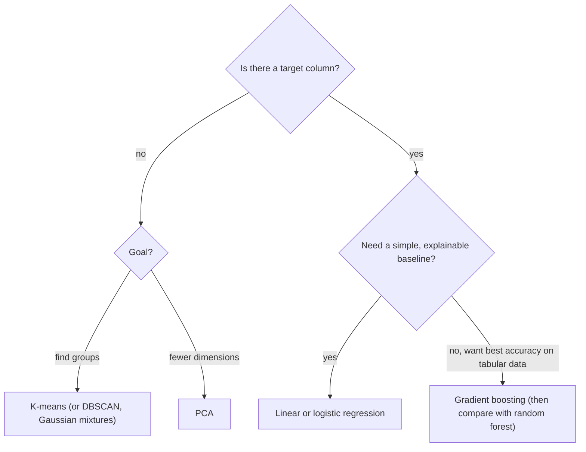

## Introduction

A product team wants to predict which customers will cancel next month, using a table with one row per customer: tenure, plan, monthly spend, country, number of support tickets, days since last login. Someone suggests sending each row to a large language model and asking "will this customer churn?". It would work, after a fashion. It would also cost money for every prediction, take a second or more per customer, give slightly different answers on different days, and almost certainly be *less accurate* than a model trained in a few seconds on the company's own historical data.

That second kind of model is **classical machine learning**: algorithms such as linear regression, logistic regression, decision trees, random forests, gradient boosting, k-means and principal component analysis. They predate the deep learning era, they train on a laptop, and on **tabular data** — rows and columns of numbers and categories, which is how most business data is stored — gradient-boosted trees remain among the strongest methods available. They are also interpretable enough to explain to a stakeholder, cheap enough to run on every row of a database, and fast enough to serve in a millisecond.

For an AI engineer, classical ML matters in three ways. It is often the right tool outright: churn, fraud scores, demand forecasts, lead scoring and anomaly detection are classical problems. It is the **baseline** an LLM feature must beat to justify its cost; an intent classifier built from embeddings and logistic regression is a strong, cheap competitor to prompting. And it is the vocabulary of the field: regularization, ensembles, cross-validation and pipelines reappear throughout deep learning and LLM evaluation.

This lesson covers five topics in the order you would use them on a real project: the linear models, tree-based models, unsupervised methods (k-means and PCA), preprocessing with scikit-learn pipelines, and hyperparameter tuning with cross-validation. Each algorithm is first written from scratch in a few lines of plain Python 3.12 so you can see exactly what it computes, then shown in **scikit-learn**, the standard Python library for classical ML. The from-scratch programs were run to produce the outputs shown. The scikit-learn snippets are written for scikit-learn 1.5 or later; they were not executed when this lesson was written, so they are shown without output.

## Before you start

- **Training and evaluation** — loss functions, gradient descent, overfitting, data splits and classification metrics are used throughout. See [[e2-training-evaluation]].
- **Supervised and unsupervised learning, regression and classification** — the problem types these algorithms solve. See [[e2-supervised-unsupervised]] and [[e2-regression-classification]].
- **Vectors and basic statistics** — dot products, means, variance and covariance. See [[e2-math-foundations]].
- **Python, NumPy and pandas** — scikit-learn takes NumPy arrays or pandas DataFrames as input. See [[e1-syntax]], [[e1-numpy]] and [[e1-pandas]].

## The intuition

Every supervised algorithm in this lesson answers the same question — "given these features, what is the target?" — but each makes a different assumption about the *shape* of the answer.

**Linear models** assume each feature pushes the prediction up or down by a fixed amount: an extra square metre adds about the same rent whether the flat is small or large. That assumption is often roughly true, makes the model easy to interpret, and makes it hard to overfit.

**Decision trees** assume the answer can be found by asking a sequence of yes/no questions: "more than two existing debts? If so, high risk. If not, is income below 32k?". Trees capture interactions and thresholds that linear models miss, but a single tree overfits easily. **Ensembles** combine many trees: a **random forest** averages hundreds of trees trained on different samples, and **gradient boosting** builds trees one after another, each fixing the previous ones' mistakes.

**Unsupervised methods** have no target. **K-means** looks for groups of similar rows. **PCA** looks for a few directions that capture most of the variation in many features, so the data can be described with fewer numbers.

Around all of them sits the engineering: turning raw columns into numbers the algorithm can use, without leaking information from the test set (**pipelines**), and choosing settings such as tree depth or regularization strength by **cross-validation** rather than by guesswork.



## Linear & Logistic Regression {#e2-linear-logistic-regression}

**Linear regression** predicts a number as a weighted sum of the input features plus a constant: `ŷ = w₁x₁ + w₂x₂ + … + wₙxₙ + b`. **Logistic regression** uses the same weighted sum for classification: it passes the sum through the **sigmoid** function to turn it into a probability between 0 and 1. Both are fast, need little data, produce coefficients a human can read, and are the first model to try on almost any tabular problem.

### Linear regression: fitting a line

With one feature, linear regression fits a straight line `ŷ = w·x + b`. "Best" means the line that minimises the **mean squared error** between predictions and true values — **ordinary least squares (OLS)**. For one feature the best line has a closed-form solution: the slope is the covariance of `x` and `y` divided by the variance of `x`, and the line passes through the point of means.

```python title="linreg.py"
import statistics as st

# Apartment size (square metres) and monthly rent (EUR).
size = [35, 48, 52, 60, 75, 80, 95, 110]
rent = [780, 950, 1010, 1150, 1390, 1420, 1700, 1930]

# Ordinary least squares for one feature has a closed form:
#   slope = cov(x, y) / var(x),  intercept = mean(y) - slope * mean(x)
mx, my = st.mean(size), st.mean(rent)
cov = sum((x - mx) * (y - my) for x, y in zip(size, rent))
var = sum((x - mx) ** 2 for x in size)
slope = cov / var
intercept = my - slope * mx
print(f"rent = {intercept:.1f} + {slope:.2f} * size")

predictions = [intercept + slope * x for x in size]
ss_res = sum((y - p) ** 2 for y, p in zip(rent, predictions))
ss_tot = sum((y - my) ** 2 for y in rent)
print(f"R^2 = {1 - ss_res / ss_tot:.4f}")
print(f"predicted rent for 70 m^2: {intercept + slope * 70:.0f}")
print(f"predicted rent for 400 m^2: {intercept + slope * 400:.0f}  (outside the data)")
```

```output
rent = 216.1 + 15.50 * size
R^2 = 0.9978
predicted rent for 70 m^2: 1301
predicted rent for 400 m^2: 6415  (outside the data)
```

The coefficient is the model's main output for a human: each extra square metre adds about €15.50 of monthly rent, on top of a base of about €216. **R²** (the **coefficient of determination**) compares the model's squared error with that of always predicting the mean: `R² = 1 − SS_res / SS_tot`. 1 means perfect predictions, 0 means no better than the mean, and negative values mean worse than the mean. Here 0.998 means size explains almost all of the variation in these eight rents — expected, because the data was made to be nearly linear.

The last line is a warning about **extrapolation**. The model was fitted on flats from 35 to 110 m² and confidently predicts €6,415 for 400 m². Nothing in the data supports that; a 400 m² property may be a different market altogether. Linear models extend their straight line forever, so predictions far outside the training range are guesses.

With many features, the same idea generalises. The model is `ŷ = Xw + b` for a feature matrix `X`, and OLS has a matrix solution (the **normal equations**), which scikit-learn's `LinearRegression` computes with a numerically stable least-squares solver. Gradient descent, as in [[e2-gradient-descent]], reaches the same answer and scales to datasets too large for the direct method.

### Reading coefficients carefully

Coefficients are the reason people choose linear models, and they are easy to misread.

- **A coefficient is a change holding the other features fixed.** In a model with both `size` and `number_of_rooms`, the `size` coefficient is the effect of extra area for the same number of rooms, which can differ greatly from its effect on its own.
- **Coefficient size depends on units.** A coefficient of 15.5 per square metre would be 1.44 per square foot. To compare features' importance, **standardise** them first (subtract the mean, divide by the standard deviation); then each coefficient is the effect of a one-standard-deviation change.
- **Correlated features make coefficients unstable.** If two features carry nearly the same information (**multicollinearity**), the model can split the weight between them in many ways that predict equally well, and small changes in the data swing the coefficients wildly or flip their signs. Predictions stay fine; interpretation does not.
- **Coefficients describe association, not causation.** A positive coefficient for "used the premium support channel" in a churn model does not mean premium support causes churn; unhappy customers seek support.

Linear regression also assumes the relationship really is linear. If it is not — rent rising faster for very large flats, say — you can add transformed features (`size²`, `log(size)`, interaction terms such as `size × city_centre`) and the model stays linear in its weights. Regularized versions, **ridge** (L2 penalty), **lasso** (L1 penalty, which can set coefficients to exactly zero) and **elastic net** (both), shrink the weights to reduce overfitting and stabilise correlated features; the penalties themselves are explained in [[e2-overfit-underfit]].

### Logistic regression: probabilities for classification

For a yes/no target, a raw weighted sum is the wrong shape: it can be any number, while a probability must lie between 0 and 1. Logistic regression computes the same linear score `z = w·x + b` and passes it through the **sigmoid** function `σ(z) = 1 / (1 + e⁻ᶻ)`, which squashes any number into (0, 1): large positive scores approach 1, large negative scores approach 0, and `z = 0` gives exactly 0.5.

The linear score has a precise meaning. If `p` is the probability of the positive class, `p / (1 − p)` is the **odds** (a probability of 0.8 is odds of 4 to 1), and the score `z` is the logarithm of the odds, the **log-odds** or **logit**. Each coefficient therefore adds a fixed amount to the log-odds, which means it *multiplies* the odds by `e^w`. There is no closed-form solution; the weights are found by minimising log loss with gradient descent or a related optimiser.

```python title="logreg.py"
import math

# Days since last login (feature) and whether the user cancelled within a month (label).
days =      [1, 2, 3, 5, 6, 8, 10, 12, 14, 15, 18, 20, 22, 25, 28, 30]
cancelled = [0, 0, 0, 0, 0, 0, 1,  0,  1,  0,  1,  1,  0,  1,  1,  1]

def sigmoid(z):
    return 1 / (1 + math.exp(-z))

# Fit w and b by gradient descent on log loss (no closed form exists).
w, b, lr = 0.0, 0.0, 0.02
for _ in range(50_000):
    gw = gb = 0.0
    for x, y in zip(days, cancelled):
        err = sigmoid(w * x + b) - y          # dL/dz for sigmoid + log loss
        gw += err * x
        gb += err
    w -= lr * gw / len(days)
    b -= lr * gb / len(days)

print(f"log-odds = {b:.3f} + {w:.3f} * days")
print(f"each extra day multiplies the odds of cancelling by {math.exp(w):.3f}")
print(f"decision boundary (p = 0.5) at days = {-b / w:.1f}")
for d in (3, 12, 25):
    print(f"days={d:2}: P(cancel) = {sigmoid(w * d + b):.2f}")
```

```output
log-odds = -3.489 + 0.229 * days
each extra day multiplies the odds of cancelling by 1.257
decision boundary (p = 0.5) at days = 15.3
days= 3: P(cancel) = 0.06
days=12: P(cancel) = 0.32
days=25: P(cancel) = 0.90
```

The gradient line uses the result derived in [[e2-calculus-gradients]]: for sigmoid with log loss, the gradient with respect to the score is simply predicted probability minus label. The fitted model says each extra day since the last login multiplies the odds of cancelling by about 1.26 — a 26% increase in odds, not in probability. The probability curve is S-shaped: 6% at 3 days, 32% at 12, 90% at 25. The **decision boundary**, where the probability crosses 0.5, is where the score is zero: `days = 3.489 / 0.229 ≈ 15.3`. With several features the boundary is a straight line (or flat hyperplane) through feature space, which is why logistic regression is called a **linear classifier**: it cannot separate classes that need a curved boundary unless you add transformed features.

### Logistic regression in scikit-learn

```python title="sklearn_logreg.py"
from sklearn.datasets import load_breast_cancer
from sklearn.linear_model import LogisticRegression
from sklearn.metrics import classification_report, roc_auc_score
from sklearn.model_selection import train_test_split
from sklearn.pipeline import make_pipeline
from sklearn.preprocessing import StandardScaler

X, y = load_breast_cancer(return_X_y=True)        # 569 tumours, 30 numeric features
X_train, X_test, y_train, y_test = train_test_split(
    X, y, test_size=0.25, stratify=y, random_state=0)

# Scaling matters: the default solver converges faster and the L2 penalty
# treats all features equally only when they share a scale.
model = make_pipeline(StandardScaler(), LogisticRegression(C=1.0, max_iter=1000))
model.fit(X_train, y_train)

proba = model.predict_proba(X_test)[:, 1]          # probability of class 1
print(classification_report(y_test, model.predict(X_test)))
print("ROC-AUC:", round(roc_auc_score(y_test, proba), 3))
```

Every scikit-learn model follows the same interface: construct it with hyperparameters, call `fit(X, y)` to learn, then `predict(X)` for labels or `predict_proba(X)` for class probabilities. In this dataset, class 1 means benign and class 0 malignant, so read the report with that in mind. `LogisticRegression` applies an L2 penalty by default, and its `C` parameter is the **inverse** of regularization strength: smaller `C` means stronger regularization. That is the opposite convention from the `λ` or `alpha` used by `Ridge` and `Lasso`, and a common source of confusion. `max_iter` is raised because the default of 100 iterations can stop before convergence, which scikit-learn reports with a `ConvergenceWarning`. With more than two classes, the default `lbfgs` solver fits a multinomial (softmax) model.

> [!TIP] Embeddings plus logistic regression
> For text classification — intent routing, ticket triage, topic labelling — computing an embedding for each text (see [[e5-embeddings]]) and training logistic regression on those vectors is a strong, cheap baseline. It needs a few hundred labelled examples, predicts in microseconds after the embedding call, and is often competitive with prompting a large model for the same labels.

```quiz
Q: A logistic regression churn model has a coefficient of 0.69 for `has_failed_payment` (a 0/1 feature). What does it mean?
- [ ] A failed payment raises the churn probability by 0.69
- [ ] A failed payment raises the churn probability by 69 percentage points
- [x] A failed payment multiplies the odds of churning by about e^0.69 ≈ 2, holding other features fixed
- [ ] 69% of customers with a failed payment churn
> Logistic regression coefficients add to the log-odds, so they multiply the odds by e^w. e^0.69 is about 2, so the odds double. The change in probability depends on where the customer starts: doubling odds of 1:9 (10%) gives 2:9 (about 18%), while doubling odds of 1:1 (50%) gives 2:1 (about 67%).
```

## Decision Trees, Random Forests & Gradient Boosting {#e2-trees-ensembles}

A **decision tree** predicts by asking a sequence of yes/no questions about the features — "is `debts` ≤ 2?", then "is `income` ≤ 32?" — and returning the answer stored at the leaf it reaches. A **random forest** trains hundreds of trees on random variations of the data and averages their predictions. **Gradient boosting** trains trees one after another, each correcting the errors of all the trees before it. Tree ensembles handle mixed feature types, non-linear relationships and interactions with little preprocessing, and gradient boosting in particular is one of the most accurate methods available for tabular data.

### How a tree chooses its questions

A tree is built top-down, greedily. At each node, the algorithm tries every feature and every useful threshold, measures how *pure* the two resulting groups would be, and keeps the split that makes them purest. It then repeats the process inside each group until a stopping rule is met.

For classification, the usual purity measure is **Gini impurity**: the probability that two items picked at random (with replacement) from the group have different labels. For a group where a fraction `p` is positive, `Gini = 1 − p² − (1 − p)²`. A pure group scores 0; a 50/50 group scores 0.5, the maximum for two classes. A split is scored by the size-weighted average impurity of its two children. (**Entropy**, from information theory, is an alternative that usually picks similar splits.) For regression trees, the purity measure is the squared error around each group's mean.

```python title="tree.py"
# Loan applications: (income in k EUR, existing debts, defaulted?)
rows = [(25, 3, 1), (32, 2, 1), (40, 4, 1), (45, 1, 0), (52, 3, 1), (58, 0, 0),
        (61, 2, 0), (70, 1, 0), (75, 4, 1), (83, 0, 0), (90, 2, 0), (97, 1, 0)]
FEATURES = ["income", "debts"]

def gini(labels):
    """Probability that two random picks (with replacement) have different labels."""
    if not labels:
        return 0.0
    p = sum(labels) / len(labels)
    return 1 - p ** 2 - (1 - p) ** 2

def best_split(rows):
    labels = [r[-1] for r in rows]
    best = (gini(labels), None, None)        # (weighted impurity, feature, threshold)
    for f in range(len(FEATURES)):
        for t in sorted({r[f] for r in rows}):
            left = [r[-1] for r in rows if r[f] <= t]
            right = [r[-1] for r in rows if r[f] > t]
            if not left or not right:
                continue
            score = (len(left) * gini(left) + len(right) * gini(right)) / len(rows)
            if score < best[0]:
                best = (score, f, t)
    return best

print(f"root impurity: {gini([r[-1] for r in rows]):.3f}")
score, f, t = best_split(rows)
print(f"best first split: {FEATURES[f]} <= {t}  (weighted impurity {score:.3f})")

left = [r for r in rows if r[f] <= t]
right = [r for r in rows if r[f] > t]
for name, part in (("left", left), ("right", right)):
    s2, f2, t2 = best_split(part)
    labels = [r[-1] for r in part]
    where = f"then split on {FEATURES[f2]} <= {t2}" if f2 is not None else "pure, stop"
    print(f"{name:5}: {len(part)} rows, {sum(labels)} defaults, "
          f"gini {gini(labels):.3f} -> {where}")
```

```output
root impurity: 0.486
best first split: debts <= 2  (weighted impurity 0.146)
left : 8 rows, 1 defaults, gini 0.219 -> then split on income <= 32
right: 4 rows, 4 defaults, gini 0.000 -> pure, stop
```

The root holds 12 applications, 5 of which defaulted, so its impurity is `1 − (5/12)² − (7/12)² ≈ 0.486`. Of all candidate splits, `debts ≤ 2` is best: the four applicants with three or more debts all defaulted (a pure leaf), and only one of the other eight did. The left group's impurity is `1 − (1/8)² − (7/8)² ≈ 0.219`, and the weighted average is `(8 × 0.219 + 4 × 0) / 12 ≈ 0.146`. Inside the left group, the next best question is `income ≤ 32`, which isolates the one remaining default. The finished tree reads like a policy: "three or more debts: decline; otherwise, income at or below 32k: decline; otherwise: approve".

Several properties follow from this procedure. Trees need **no feature scaling**, because a threshold on income in euros works the same as one in thousands of euros. They capture **interactions** naturally: the income question only applies to applicants with few debts. They are easy to explain when shallow. But they are **high-variance**: grown to full depth, a tree keeps splitting until every leaf is pure, memorising the training data, and a small change in the data can change the first split and therefore the whole tree. Depth limits (`max_depth`), minimum leaf sizes (`min_samples_leaf`) and pruning control this, but a single tree rarely matches an ensemble's accuracy.

### Random forests: averaging away variance

A **random forest** reduces a tree's variance by averaging many trees that make *different* mistakes. Two sources of randomness make the trees different. Each tree is trained on a **bootstrap sample** — rows drawn with replacement from the training set, so each tree sees about 63% of distinct rows, some more than once. Training many models on bootstrap samples and averaging them is called **bagging** (bootstrap aggregating). In addition, at each split a tree considers only a random subset of the features (in scikit-learn's `RandomForestClassifier`, the square root of the number of features by default). Without this, every tree would pick the same dominant feature first and the trees would be too similar to benefit from averaging.

Each tree is deep and overfits on its own, but their errors are partly independent, so averaging cancels much of the noise while keeping the low bias of deep trees — the variance-reduction effect described in [[e2-bias-variance]]. Random forests are robust, hard to misconfigure, and parallelise across CPU cores because the trees are independent. A convenient by-product is the **out-of-bag (OOB) estimate**: each row is absent from roughly a third of the trees, so those trees' predictions on it give a built-in validation score (`oob_score=True`).

### Gradient boosting: fixing mistakes one tree at a time

**Boosting** takes the opposite approach. Instead of averaging independent deep trees, it builds a sequence of small, weak trees, where each new tree is trained to correct what the ensemble so far gets wrong. In **gradient boosting** for squared error, "what it gets wrong" is literally the **residuals** — the true value minus the current prediction. Each tree's contribution is scaled down by a **learning rate** (also called shrinkage) so that no single tree dominates. For other losses, such as log loss, the trees fit the negative gradient of the loss, which is where the name comes from.

The program below boosts **stumps** (trees with a single split) on a noisy wavy curve. A single stump can only predict two values, so it is a very weak model; hundreds of them added together can trace the curve.

```python title="boosting.py"
import math
import random

rng = random.Random(3)
def make(n):
    xs = sorted(rng.uniform(0, 10) for _ in range(n))
    return [(x, math.sin(x) * 3 + 0.5 * x + rng.gauss(0, 0.5)) for x in xs]
train, val = make(80), make(200)

def fit_stump(points):
    """Depth-1 tree: one threshold, a constant on each side, minimising squared error."""
    best = None
    xs = sorted({x for x, _ in points})
    for lo, hi in zip(xs, xs[1:]):
        t = (lo + hi) / 2
        left = [y for x, y in points if x <= t]
        right = [y for x, y in points if x > t]
        lm, rm = sum(left) / len(left), sum(right) / len(right)
        sse = sum((y - lm) ** 2 for y in left) + sum((y - rm) ** 2 for y in right)
        if best is None or sse < best[0]:
            best = (sse, t, lm, rm)
    _, t, lm, rm = best
    return lambda x: lm if x <= t else rm

def mse(predict, data):
    return sum((predict(x) - y) ** 2 for x, y in data) / len(data)

# Gradient boosting for squared error: each new stump fits the current residuals.
base = sum(y for _, y in train) / len(train)
stumps, learning_rate = [], 0.3
def ensemble(x):
    return base + learning_rate * sum(s(x) for s in stumps)

for round_ in range(1, 601):
    residuals = [(x, y - ensemble(x)) for x, y in train]
    stumps.append(fit_stump(residuals))
    if round_ in (1, 5, 20, 50, 100, 200, 400, 600):
        print(f"{round_:3} stumps: train MSE {mse(ensemble, train):.3f}   "
              f"val MSE {mse(ensemble, val):.3f}")
```

```output
  1 stumps: train MSE 3.840   val MSE 4.267
  5 stumps: train MSE 1.899   val MSE 2.169
 20 stumps: train MSE 0.925   val MSE 1.124
 50 stumps: train MSE 0.353   val MSE 0.526
100 stumps: train MSE 0.150   val MSE 0.367
200 stumps: train MSE 0.086   val MSE 0.359
400 stumps: train MSE 0.065   val MSE 0.377
600 stumps: train MSE 0.054   val MSE 0.388
```

The model starts as the mean of the targets. In each round, the code computes every training point's residual under the current ensemble, fits one stump to those residuals, and adds it to the ensemble scaled by 0.3. Training error falls every round, because each stump is chosen to reduce it. Validation error falls with it at first — from 4.27 with one stump to 0.359 at 200 — and then starts creeping up: by 600 stumps the ensemble is fitting noise in the 80 training points. The noise variance in this data is 0.25 (standard deviation 0.5), so a training error of 0.054 is a clear sign of memorisation. Boosting therefore **can overfit** as rounds increase, unlike a random forest, where adding trees only stabilises the average. The number of rounds is a key hyperparameter, usually set by **early stopping** on validation data, and it trades off against the learning rate: a smaller learning rate needs more rounds but usually generalises slightly better.

Where bagging mainly reduces variance, boosting mainly reduces **bias**: each round adds capacity exactly where the model is still wrong. Production implementations add many refinements — deeper trees (typically 3 to 8 levels or a cap on leaves), row and column subsampling, L1/L2 penalties on leaf values, histogram binning of features for speed, and native handling of missing values and categorical features. The widely used libraries are **XGBoost**, **LightGBM** and **CatBoost**, and scikit-learn's own `HistGradientBoostingClassifier` and `HistGradientBoostingRegressor`, which are fast and handle missing values natively.

### Comparing the three

| | Single decision tree | Random forest | Gradient boosting |
|---|---|---|---|
| How trees are combined | One tree | Many deep trees, trained independently, averaged | Many shallow trees, trained sequentially, summed |
| Main error it reduces | — (high variance) | Variance | Bias (with variance controlled by regularization) |
| Overfits with more trees? | n/a | No, it stabilises | Yes, without early stopping |
| Tuning effort | Low | Low: defaults are often good | Medium: learning rate, rounds, depth matter |
| Typical accuracy on tabular data | Lowest | Strong | Often the strongest |
| Interpretability | High when shallow | Low (feature importances) | Low (feature importances, SHAP values) |
| Training parallelism | n/a | Trees in parallel | Sequential rounds; parallel within each tree |

To understand an ensemble's behaviour, use **feature importance**. The impurity-based importances that tree libraries report for free are biased towards features with many distinct values, such as IDs and continuous numbers. **Permutation importance** — shuffle one feature's values in the validation set and measure how much the score drops — is more trustworthy and is available as `sklearn.inspection.permutation_importance`. For per-prediction explanations, **SHAP values** are the common choice for tree ensembles.

```python title="sklearn_trees.py"
from sklearn.datasets import load_breast_cancer
from sklearn.ensemble import HistGradientBoostingClassifier, RandomForestClassifier
from sklearn.model_selection import cross_val_score

X, y = load_breast_cancer(return_X_y=True)

forest = RandomForestClassifier(n_estimators=300, n_jobs=-1, random_state=0)
boosted = HistGradientBoostingClassifier(
    learning_rate=0.1, max_iter=500, early_stopping=True,   # holds out 10% internally
    validation_fraction=0.1, n_iter_no_change=20, random_state=0)

for name, model in [("random forest", forest), ("gradient boosting", boosted)]:
    scores = cross_val_score(model, X, y, cv=5, scoring="roc_auc")
    print(f"{name:18} ROC-AUC {scores.mean():.3f} +/- {scores.std():.3f}")
```

Neither model needs feature scaling. `n_jobs=-1` trains the forest's trees on all CPU cores. The boosting model uses its built-in early stopping, holding out 10% of each training fold and stopping when the validation loss has not improved for 20 rounds. `cross_val_score` evaluates each model with 5-fold cross-validation, explained in the tuning section below. On a small, clean dataset like this one, the two usually score close to each other; differences between strong models are often within the fold-to-fold spread, which is why the standard deviation is printed.

```quiz
Q: Adding more trees to a random forest rarely causes overfitting, but adding more rounds to gradient boosting can. Why?
- [ ] Random forests use shallower trees
- [x] Forest trees are averaged independently, so more trees only reduce the variance of the average; boosting rounds keep fitting the remaining residuals, which eventually means fitting noise
- [ ] Gradient boosting does not use a learning rate
- [ ] Random forests are evaluated with out-of-bag samples, which prevents overfitting
> Each forest tree is trained independently and the forest averages them, so beyond a point extra trees change the average very little. Each boosting round is fitted to what the current ensemble still gets wrong; once the real pattern is captured, what remains is mostly noise, and fitting it raises validation error. Forest trees are usually deep, and OOB samples measure overfitting rather than prevent it.
```

## K-Means & PCA {#e2-kmeans-pca}

**K-means** and **principal component analysis (PCA)** are the two classic **unsupervised** methods: they find structure in data that has no target column. K-means partitions rows into `k` groups so that each row is close to the centre of its group, which is useful for customer segmentation, grouping similar documents or detecting unusual points. PCA finds a small number of new axes — combinations of the original features — that capture most of the variation in the data, which is useful for compression, visualisation and removing redundant, correlated features.

### K-means: the algorithm

K-means needs a number of clusters `k` and repeats two steps until nothing changes:

1. **Assignment step.** Assign each point to the nearest of the `k` centres, using squared Euclidean distance.
2. **Update step.** Move each centre to the mean of the points assigned to it (the **centroid**).

Each step can only lower the total squared distance from points to their centres, called the **inertia** or **within-cluster sum of squares**. So the algorithm always converges. It does not always converge to the *best* clustering, though: the result depends on the starting centres, and a bad start can leave two centres sharing one real group while another group has none. The standard remedies are a smarter initialisation, **k-means++**, which spreads the initial centres out by picking each new one with probability proportional to its squared distance from the existing ones, and running the algorithm several times and keeping the run with the lowest inertia.

```python title="kmeans.py"
import math
import random

rng = random.Random(4)
# Customers described by (average order value in EUR, orders per month).
# Three hidden groups; the algorithm is not told which point belongs where.
centres = [(20, 1), (60, 4), (120, 1.5)]
points = [(rng.gauss(cx, 8), rng.gauss(cy, 0.6)) for cx, cy in centres for _ in range(30)]

def standardise(pts):
    """Put both features on the same scale so neither dominates the distance."""
    stats = []
    for col in zip(*pts):
        mean = sum(col) / len(col)
        std = math.sqrt(sum((v - mean) ** 2 for v in col) / len(col))
        stats.append((mean, std))
    return [tuple((v - m) / s for v, (m, s) in zip(p, stats)) for p in pts]

def dist2(a, b):
    return sum((x - y) ** 2 for x, y in zip(a, b))

def kmeans(pts, k, seed, iters=20):
    centroids = random.Random(seed).sample(pts, k)          # random initial centres
    for _ in range(iters):
        clusters = [[] for _ in range(k)]
        for p in pts:                                       # assignment step
            nearest = min(range(k), key=lambda j: dist2(p, centroids[j]))
            clusters[nearest].append(p)
        new = [tuple(sum(c) / len(cl) for c in zip(*cl)) if cl else centroids[j]
               for j, cl in enumerate(clusters)]            # update step
        if new == centroids:
            break
        centroids = new
    inertia = sum(min(dist2(p, c) for c in centroids) for p in pts)
    return centroids, clusters, inertia

X = standardise(points)
for k in range(1, 7):
    best = min((kmeans(X, k, seed) for seed in range(10)), key=lambda r: r[2])
    print(f"k={k}: inertia (within-cluster sum of squares) = {best[2]:7.2f}")

runs = [kmeans(X, 3, seed) for seed in range(10)]
print("k=3 inertia per random start:", sorted(round(r[2], 1) for r in runs))
best_run = min(runs, key=lambda r: r[2])
print("cluster sizes, best k=3 run:", sorted(len(c) for c in best_run[1]))
```

```output
k=1: inertia (within-cluster sum of squares) =  180.00
k=2: inertia (within-cluster sum of squares) =   93.83
k=3: inertia (within-cluster sum of squares) =   17.42
k=4: inertia (within-cluster sum of squares) =   13.39
k=5: inertia (within-cluster sum of squares) =   10.29
k=6: inertia (within-cluster sum of squares) =    8.28
k=3 inertia per random start: [17.4, 17.4, 17.4, 17.4, 17.4, 17.4, 17.4, 17.4, 17.4, 91.8]
cluster sizes, best k=3 run: [30, 30, 30]
```

The data has 90 customers in three hidden groups. Before clustering, both features are **standardised**. Without it, order value (spread over about 100 euros) would dominate the distance and orders per month (spread over a few units) would barely count — k-means has no idea that the two are measured in different units. With `k = 1` the inertia is exactly 180, because each standardised feature has variance 1 across 90 points.

The inertia curve shows how to choose `k`. Inertia always falls as `k` grows — with one cluster per point it would be zero — so you cannot simply minimise it. Instead, look for the **elbow**: the point after which extra clusters give only small improvements. Here inertia drops from 180 to 94 to 17 for `k` = 1, 2, 3, then only to 13 and 10. The elbow at 3 matches the three groups the data was built from, and the best run recovers them exactly, 30 customers each. Real data rarely has such a clean elbow; the **silhouette score**, which compares each point's distance to its own cluster with its distance to the nearest other cluster, is a second opinion, and the final choice usually depends on whether the clusters are *useful* — can the marketing team act on five segments, or only three?

The second-to-last line shows why you restart. Nine of ten random starts found the good solution with inertia 17.4; one got stuck at 91.8, with two centres in one real group. Scikit-learn's `KMeans` uses k-means++ initialisation by default, and its `n_init` parameter controls how many runs to keep the best of.

K-means has strong built-in assumptions. It works best for **roughly spherical clusters of similar size**, because it assigns each point to the nearest centre. It handles elongated, nested or very unequal clusters poorly, every point must belong to some cluster (outliers drag centres towards them), and you must choose `k`. **DBSCAN** and **HDBSCAN** find clusters of arbitrary shape and label outliers as noise; **Gaussian mixture models** allow elliptical clusters and give soft, probabilistic assignments.

### PCA: finding the directions that matter

Many datasets have more features than they have independent pieces of information. Minutes spent in an app and pages viewed are two numbers, but both mostly measure one thing: engagement. **PCA** finds new axes, called **principal components**, with two properties. The first component is the direction along which the data varies most. Each subsequent component is the direction of greatest remaining variation that is **perpendicular** (uncorrelated) to all earlier components. Keeping the first few components and discarding the rest describes each row with fewer numbers while losing as little variation as possible.

Mathematically, the principal components are the **eigenvectors** of the data's **covariance matrix** — the matrix whose entries are the covariances between every pair of features — and each component's **eigenvalue** is the variance of the data along it. (An eigenvector of a matrix is a direction that the matrix only stretches, without rotating; the eigenvalue is the stretch factor.) For two features, the eigenvalues of a 2 × 2 matrix have a simple formula, so the whole computation fits in a short program.

```python title="pca.py"
import math
import random

rng = random.Random(8)
# Two strongly related measurements per user: minutes in app and pages viewed.
data = []
for _ in range(200):
    engagement = rng.gauss(0, 1)                     # the hidden factor behind both
    data.append((engagement + rng.gauss(0, 0.3), engagement + rng.gauss(0, 0.3)))

# 1. Centre the data (PCA needs zero-mean columns).
mx = sum(x for x, _ in data) / len(data)
my = sum(y for _, y in data) / len(data)
centred = [(x - mx, y - my) for x, y in data]

# 2. Covariance matrix [[a, b], [b, c]].
n = len(centred)
a = sum(x * x for x, _ in centred) / (n - 1)
c = sum(y * y for _, y in centred) / (n - 1)
b = sum(x * y for x, y in centred) / (n - 1)
print(f"covariance matrix: [[{a:.3f}, {b:.3f}], [{b:.3f}, {c:.3f}]]")

# 3. Eigenvalues of a symmetric 2x2 matrix, in closed form.
mid, gap = (a + c) / 2, math.sqrt(((a - c) / 2) ** 2 + b ** 2)
lam1, lam2 = mid + gap, mid - gap
v1 = (b, lam1 - a)                                   # eigenvector for lam1
length = math.hypot(*v1)
v1 = (v1[0] / length, v1[1] / length)
print(f"eigenvalues: {lam1:.3f}, {lam2:.3f}")
print(f"first principal component direction: ({v1[0]:.3f}, {v1[1]:.3f})")
print(f"explained variance ratio: PC1 {lam1 / (lam1 + lam2):.3f}, "
      f"PC2 {lam2 / (lam1 + lam2):.3f}")

# 4. Project onto PC1: each user is now described by one number instead of two.
scores = [x * v1[0] + y * v1[1] for x, y in centred]
var_scores = sum(s * s for s in scores) / (n - 1)
print(f"variance of PC1 scores = {var_scores:.3f} (equals the first eigenvalue)")
```

```output
covariance matrix: [[1.191, 1.125], [1.125, 1.239]]
eigenvalues: 2.340, 0.090
first principal component direction: (0.699, 0.715)
explained variance ratio: PC1 0.963, PC2 0.037
variance of PC1 scores = 2.340 (equals the first eigenvalue)
```

Each user's two measurements are generated from one hidden "engagement" value plus a little independent noise. The covariance between them (1.125) is almost as large as their variances (about 1.2), which says they move together strongly. The first principal component points along `(0.699, 0.715)` — almost exactly the diagonal, "both measurements up together", which is engagement. Its eigenvalue, 2.340, is the variance along that direction, and it accounts for 96.3% of the total variance: the **explained variance ratio**. The second component, perpendicular to the first, captures the remaining 3.7%, which is mostly the noise. Projecting each user onto the first component (a dot product with the direction vector) replaces two numbers with one while keeping 96% of the information; the last line confirms that the projected scores have exactly the variance the eigenvalue predicted.

With dozens or hundreds of features, the same logic applies, and libraries compute PCA through the **singular value decomposition (SVD)** of the centred data rather than forming the covariance matrix explicitly, which is faster and numerically more stable. In scikit-learn, `PCA(n_components=0.95)` keeps however many components are needed to explain 95% of the variance, and the fitted object's `explained_variance_ratio_` shows each component's share.

Three cautions apply. **Standardise first** when features have different units; otherwise the component directions are dominated by whichever feature has the largest numbers, exactly as in k-means. PCA is **linear** and **unsupervised**: it keeps the directions of greatest variance, which are not necessarily the directions that best predict your target, so a low-variance direction you discarded might have been the useful one. And components are **mixtures of all features**, which makes them harder to explain than the originals. For visualising high-dimensional data such as embeddings in two dimensions, the non-linear methods **t-SNE** and **UMAP** usually show clusters more clearly, but their distances and axes have no direct meaning and they should be used for looking, not as model inputs.

```python title="sklearn_kmeans_pca.py"
from sklearn.cluster import KMeans
from sklearn.datasets import load_breast_cancer
from sklearn.decomposition import PCA
from sklearn.metrics import silhouette_score
from sklearn.pipeline import make_pipeline
from sklearn.preprocessing import StandardScaler

X, _ = load_breast_cancer(return_X_y=True)          # ignore the labels: unsupervised

pca = make_pipeline(StandardScaler(), PCA(n_components=0.95))
X_reduced = pca.fit_transform(X)
print("components kept:", X_reduced.shape[1], "of", X.shape[1])
print("variance ratio of first 3:", pca[-1].explained_variance_ratio_[:3].round(3))

for k in range(2, 7):
    km = KMeans(n_clusters=k, n_init=10, random_state=0).fit(X_reduced)
    print(k, round(km.inertia_, 1), round(silhouette_score(X_reduced, km.labels_), 3))
```

The pipeline standardises the 30 features and keeps enough principal components to explain 95% of the variance; `pca[-1]` indexes the last step of the pipeline to read the fitted `PCA` object. The loop then clusters the reduced data for several values of `k`, printing inertia and silhouette score for each, which is the elbow-plus-silhouette procedure from above.

```quiz
Q: You run k-means on customer data with two features — annual spend in euros (range 0 to 50,000) and number of logins per week (range 0 to 20) — without scaling. What is the likely result?
- [ ] Clusters based equally on both features
- [x] Clusters determined almost entirely by annual spend, because it dominates the Euclidean distance
- [ ] Clusters determined mostly by logins, because it has smaller numbers
- [ ] K-means fails to converge
> Euclidean distance adds squared differences, and a difference of a few thousand euros dwarfs a difference of a few logins, so the logins feature barely influences any assignment. K-means still converges; it just answers a question about spend alone. Standardising both features gives them comparable influence.
```

## Preprocessing & scikit-learn Pipelines {#e2-sklearn-pipelines}

**Preprocessing** turns raw columns into the numeric inputs a model needs: filling missing values, scaling numbers, and encoding categories such as `"plan": "premium"` as numbers. A **scikit-learn `Pipeline`** chains those preprocessing steps and a final model into a single object that is fitted, evaluated, tuned and deployed as one unit. Pipelines exist for one critical reason beyond tidiness: they guarantee that every preprocessing step learns its statistics from training data only, which prevents the data leakage that makes offline scores misleadingly high.

### The fit / transform / predict contract

Scikit-learn's design rests on a small set of method names that every component implements:

- A **transformer** (such as `StandardScaler`) has `fit(X)`, which learns parameters from data — a scaler learns each column's mean and standard deviation — and `transform(X)`, which applies them. `fit_transform(X)` does both on the same data.
- An **estimator** that predicts (such as `LogisticRegression`) has `fit(X, y)` and `predict(X)`, and classifiers usually add `predict_proba(X)`.

The distinction between *fitting* and *applying* is the heart of leakage prevention. You fit a scaler on the training split and apply the same fitted scaler to the validation split, the test split and, later, production requests. If you fit it on all the data, the test rows' mean and variance shape the training features — a small leak for a scaler, a large one for steps like target encoding or feature selection. A **`Pipeline`** enforces the rule: calling `pipeline.fit(X_train, y_train)` fits each step in order on the training data, and `pipeline.predict(X_test)` only *transforms* the test data with the already-fitted steps.

### Common preprocessing steps

| Problem in the raw data | Transformer | What it learns in `fit` | Notes |
|---|---|---|---|
| Missing numeric values | `SimpleImputer(strategy="median")` | Each column's median | Median is robust to outliers; consider adding a "was missing" indicator (`add_indicator=True`) |
| Numbers on different scales | `StandardScaler()` | Mean and standard deviation | Needed for linear models, k-NN, k-means, PCA, neural networks; not for trees |
| Heavy outliers | `RobustScaler()` | Median and interquartile range | Scales without being dominated by extremes |
| Categories with no order | `OneHotEncoder(handle_unknown="ignore")` | The set of categories seen | One 0/1 column per category; unseen categories at prediction time become all zeros |
| Categories with a natural order | `OrdinalEncoder(categories=[...])` | Category-to-integer mapping | Pass the order explicitly, such as small < medium < large |
| Skewed positive numbers | `FunctionTransformer(np.log1p)` | Nothing | Log transform for counts or amounts with long tails |

Real tables mix column types, so different columns need different steps. A **`ColumnTransformer`** applies a separate pipeline to each group of columns and concatenates the results.

### A complete preprocessing pipeline

The program below builds a churn model on a customer table with numeric and categorical columns, some values missing. It assumes a CSV file with the columns named in the code.

```python title="churn_pipeline.py"
import joblib
import pandas as pd
from sklearn.compose import ColumnTransformer
from sklearn.impute import SimpleImputer
from sklearn.linear_model import LogisticRegression
from sklearn.metrics import classification_report
from sklearn.model_selection import train_test_split
from sklearn.pipeline import Pipeline
from sklearn.preprocessing import OneHotEncoder, StandardScaler

df = pd.read_csv("customers.csv")
# Columns: tenure_months, monthly_spend, support_tickets, plan, country, churned
X = df.drop(columns=["churned"])
y = df["churned"]

numeric = ["tenure_months", "monthly_spend", "support_tickets"]
categorical = ["plan", "country"]

preprocess = ColumnTransformer([
    ("num", Pipeline([
        ("impute", SimpleImputer(strategy="median", add_indicator=True)),
        ("scale", StandardScaler()),
    ]), numeric),
    ("cat", Pipeline([
        ("impute", SimpleImputer(strategy="most_frequent")),
        ("onehot", OneHotEncoder(handle_unknown="ignore")),
    ]), categorical),
])

model = Pipeline([
    ("preprocess", preprocess),
    ("clf", LogisticRegression(max_iter=1000, class_weight="balanced")),
])

# Split FIRST; every statistic below is learned from X_train only.
X_train, X_test, y_train, y_test = train_test_split(
    X, y, test_size=0.2, stratify=y, random_state=42)

model.fit(X_train, y_train)
print(classification_report(y_test, model.predict(X_test)))

joblib.dump(model, "churn_model.joblib")    # preprocessing and model saved together
```

Read it from the inside out. The numeric branch fills missing values with each column's training median — adding a 0/1 indicator column for each feature that had missing values, because "missing" can itself be informative — and then standardises. The categorical branch fills missing categories with the most frequent one and one-hot encodes. `handle_unknown="ignore"` means a country that first appears in production does not crash the model; it is encoded as all zeros. The `ColumnTransformer` runs both branches and joins their outputs side by side, and the outer `Pipeline` feeds the result to logistic regression. `class_weight="balanced"` weights errors on the rarer class more heavily, a common adjustment when churners are a minority.

The data is split **before** anything is fitted, and `model.fit(X_train, y_train)` learns the medians, means, standard deviations, category lists and model weights from the training rows alone. `model.predict(X_test)` then applies all of them unchanged. Finally, `joblib.dump` saves the whole pipeline. That last step matters in production: the serving code loads one object and calls `predict` on raw rows, so it cannot accidentally scale features differently from training, which is one of the most common sources of **training–serving skew**.

Because the pipeline is a single estimator, everything else in scikit-learn accepts it: `cross_val_score(model, X, y)` re-fits the preprocessing inside every fold, and grid search can tune preprocessing choices and model hyperparameters together, as the next section shows. Step names matter for that: a parameter of a nested step is addressed as `step__parameter`, such as `clf__C` or `preprocess__num__impute__strategy`.

> [!WARNING] Leakage that pipelines cannot catch
> A pipeline prevents statistics from leaking across splits, but it cannot fix a leaky *column*. A feature such as `cancellation_reason` or `refund_issued_after_churn` still hands the model the answer. Review every feature for whether its value would really be known at prediction time.

### When pipelines are not enough

Some preprocessing has to happen before a scikit-learn pipeline: joining tables, aggregating events per customer ("orders in the last 30 days"), parsing dates. Do these in pandas or SQL, and be careful that every aggregate uses only data available at the prediction time for that row — the temporal leakage discussed in [[e2-train-validation-test]]. Pipelines also accept your own transformers: any class with `fit` and `transform` methods works, and `FunctionTransformer` wraps a stateless function.

```quiz
Q: A data scientist standardises the full dataset with `StandardScaler().fit_transform(X)`, then runs 5-fold cross-validation on the result. What is wrong?
- [ ] Nothing; scaling does not depend on the labels, so it cannot leak
- [x] Each validation fold's statistics influenced the scaling of the training folds, so the cross-validation score can be optimistic; the scaler should be inside a pipeline so it is re-fitted on each training fold
- [ ] StandardScaler cannot be used with cross-validation
- [ ] The scaler should be fitted on the validation folds instead
> Even label-free statistics such as means and standard deviations carry information about the held-out rows. The effect is small for scaling and much larger for steps such as feature selection or target encoding, but the principle is the same: fit every step on training data only. Putting the scaler in a Pipeline makes cross_val_score re-fit it inside each fold automatically.
```

## Cross-Validation & Hyperparameter Tuning {#e2-hyperparameter-tuning}

**Hyperparameters** are the settings you choose before training — a tree's maximum depth, the number of neighbours in k-NN, the regularization strength `C` of logistic regression — as opposed to the parameters the model learns. **Hyperparameter tuning** searches for the settings that generalise best. **k-fold cross-validation** is the standard way to measure "generalise best" when data is limited: it rotates which part of the data is held out, so every example is used for both training and validation, and it averages the results into a more stable score than any single split gives.

### k-fold cross-validation

Splitting off one validation set has two weaknesses with a few thousand rows or fewer: the held-out data is lost to training, and the score depends heavily on which rows happened to land in the validation set. **k-fold cross-validation** fixes both:

1. Shuffle the training data and divide it into `k` equal **folds** (5 or 10 is typical).
2. For each fold in turn, train on the other `k − 1` folds and score on that fold.
3. Report the mean of the `k` scores, and their standard deviation as a measure of stability.

Every row is used for validation exactly once and for training `k − 1` times. The cost is training `k` models instead of one.

```python title="kfold.py"
import math
import random
import statistics as st

rng = random.Random(42)
def make(n):
    xs = [rng.random() for _ in range(n)]
    return [(x, math.sin(2 * math.pi * x) + rng.gauss(0, 0.3)) for x in xs]

data, test = make(60), make(500)        # small development set, separate test set

def knn_predict(train, x, k):
    nearest = sorted(train, key=lambda p: abs(p[0] - x))[:k]
    return sum(y for _, y in nearest) / k

def mse(train, evaluate, k):
    return sum((knn_predict(train, x, k) - y) ** 2 for x, y in evaluate) / len(evaluate)

def k_fold_scores(rows, k_neighbours, folds=5, seed=0):
    rows = rows[:]
    random.Random(seed).shuffle(rows)
    scores = []
    for i in range(folds):
        held_out = rows[i::folds]                      # every folds-th row, offset i
        training = [r for j, r in enumerate(rows) if j % folds != i]
        scores.append(mse(training, held_out, k_neighbours))
    return scores

results = {}
for k in (1, 3, 5, 9, 15, 25):
    scores = k_fold_scores(data, k)
    results[k] = st.mean(scores)
    print(f"k={k:2}: fold MSEs {[round(s, 3) for s in scores]}  "
          f"mean {st.mean(scores):.3f} +/- {st.stdev(scores):.3f}")

best_k = min(results, key=results.get)
print(f"chosen k = {best_k}; refit on all 60 rows -> test MSE "
      f"{mse(data, test, best_k):.3f}")
```

```output
k= 1: fold MSEs [0.145, 0.165, 0.275, 0.107, 0.178]  mean 0.174 +/- 0.062
k= 3: fold MSEs [0.049, 0.053, 0.212, 0.132, 0.123]  mean 0.114 +/- 0.067
k= 5: fold MSEs [0.041, 0.06, 0.182, 0.133, 0.125]  mean 0.108 +/- 0.057
k= 9: fold MSEs [0.047, 0.058, 0.202, 0.14, 0.098]  mean 0.109 +/- 0.064
k=15: fold MSEs [0.047, 0.046, 0.221, 0.122, 0.095]  mean 0.106 +/- 0.072
k=25: fold MSEs [0.11, 0.065, 0.347, 0.113, 0.1]  mean 0.147 +/- 0.113
chosen k = 15; refit on all 60 rows -> test MSE 0.137
```

The program tunes one hyperparameter — the number of neighbours in k-nearest-neighbours regression (the model from [[e2-overfit-underfit]]) — on just 60 rows, using 5 folds of 12 rows each. `rows[i::folds]` takes every fifth row starting at offset `i`, so the five folds partition the shuffled data.

Look at the individual fold scores before the means. The third fold is much harder than the others for every value of `k` — its MSE is two to four times the rest — simply because of which 12 points it contains. Any single train/validation split would have given a score anywhere in that range; averaging over folds smooths it out. That is the main benefit of cross-validation.

Now look at the means. `k = 1` (overfitting) and `k = 25` (underfitting) are clearly worse. But `k` = 5, 9 and 15 differ by 0.003, while each has a fold-to-fold standard deviation around 0.06: the data cannot tell them apart. The code picks the minimum, `k = 15`, but a reasonable alternative is the **one-standard-error rule**: choose the simplest model whose score is within one standard error of the best. (The standard error of the mean of `k` folds is roughly the standard deviation divided by `√k`.) After choosing, the model is **refitted on all the development data**, and the separate test set is used once for the final estimate. That estimate, 0.137, is worse than the cross-validated 0.106, which is typical: the winning hyperparameter was selected *because* it scored well on these folds, so its cross-validation score is optimistically biased, as explained in [[e2-train-validation-test]].

### Choosing the right kind of fold

Cross-validation inherits every rule about splits from the training-and-evaluation lesson; the folds must reflect how the model will be used.

| Data situation | Splitter in scikit-learn | What it guarantees |
|---|---|---|
| Classification, especially imbalanced | `StratifiedKFold(n_splits=5, shuffle=True)` | Each fold has the same class proportions |
| Several rows per entity (user, patient, document) | `GroupKFold` or `StratifiedGroupKFold` | All rows of an entity stay in one fold |
| Time-ordered data | `TimeSeriesSplit` | Each fold trains on the past and validates on the period after it |
| Regression, IID rows | `KFold(n_splits=5, shuffle=True)` | Plain partition into folds |

When you pass an integer `cv=5` to scikit-learn with a classifier, it uses stratified folds automatically, but it does not shuffle by default. For grouped or time-ordered data you must pass the right splitter yourself; nothing will warn you if you use plain folds on data with duplicated users or a time order.

### Grid search and randomized search

With the scoring procedure settled, tuning is a search over candidate settings. **Grid search** tries every combination from lists of values you provide. It is simple and exhaustive, but the number of combinations multiplies: four values each for four hyperparameters is 256 combinations, times five folds is 1,280 training runs. **Randomized search** samples a fixed number of combinations from ranges or distributions instead. It is usually the better default with more than two hyperparameters, because typically only a few hyperparameters matter much, and random sampling tries many more distinct values of each important one than a grid of the same cost. For hyperparameters that span orders of magnitude — learning rates, regularization strengths — sample on a **log scale** (0.001, 0.01, 0.1, 1) rather than a linear one.

```python title="tuning.py"
from scipy.stats import loguniform, randint
from sklearn.datasets import load_breast_cancer
from sklearn.ensemble import HistGradientBoostingClassifier
from sklearn.linear_model import LogisticRegression
from sklearn.model_selection import (GridSearchCV, RandomizedSearchCV,
                                     StratifiedKFold, train_test_split)
from sklearn.pipeline import Pipeline
from sklearn.preprocessing import StandardScaler

X, y = load_breast_cancer(return_X_y=True)
X_dev, X_test, y_dev, y_test = train_test_split(
    X, y, test_size=0.2, stratify=y, random_state=0)    # test set: untouched until the end
cv = StratifiedKFold(n_splits=5, shuffle=True, random_state=0)

# Grid search over one hyperparameter of a pipeline step: name it "step__param".
logreg = Pipeline([("scale", StandardScaler()),
                   ("clf", LogisticRegression(max_iter=5000))])
grid = GridSearchCV(logreg, {"clf__C": [0.001, 0.01, 0.1, 1, 10, 100]},
                    cv=cv, scoring="roc_auc", n_jobs=-1)
grid.fit(X_dev, y_dev)
print("logreg best:", grid.best_params_, round(grid.best_score_, 3))

# Randomized search over several hyperparameters of gradient boosting.
search = RandomizedSearchCV(
    HistGradientBoostingClassifier(random_state=0),
    {
        "learning_rate": loguniform(0.01, 0.3),     # sampled on a log scale
        "max_leaf_nodes": randint(8, 64),
        "min_samples_leaf": randint(5, 50),
        "l2_regularization": loguniform(1e-4, 10),
    },
    n_iter=40, cv=cv, scoring="roc_auc", n_jobs=-1, random_state=0)
search.fit(X_dev, y_dev)
print("boosting best:", search.best_params_, round(search.best_score_, 3))

# Only now, once, evaluate the chosen model on the test set.
best = max([grid, search], key=lambda s: s.best_score_)
print("test ROC-AUC of chosen model:", round(best.score(X_test, y_test), 3))
```

Both searches use the same stratified 5-fold splitter and the same metric, so their scores are comparable. `GridSearchCV` evaluates six values of `C`, and because the scaler is inside the pipeline it is re-fitted in each fold. `RandomizedSearchCV` draws 40 combinations of four boosting hyperparameters from the given distributions; `loguniform` from SciPy (a scikit-learn dependency) samples evenly across orders of magnitude. With the default `refit=True`, each search finishes by refitting its best configuration on all of `X_dev`, so `best_estimator_` and the search object itself are ready to predict. `best_score_` is the mean cross-validated score of the winner — remember that it is optimistically biased — and `cv_results_` holds the full table of every candidate's fold scores, which is worth inspecting to see how sensitive the model is to each setting. The test set appears only in the last line, after every decision has been made, and `score` uses the search's `roc_auc` scorer.

### Beyond grid and random search

**Successive halving** (`HalvingGridSearchCV` and `HalvingRandomSearchCV`, which in current scikit-learn versions must be enabled with `from sklearn.experimental import enable_halving_search_cv`) starts many candidates on a small budget — few rows or few boosting rounds — and gives more budget only to the best ones, which saves a lot of compute when there are many candidates. **Bayesian optimisation** libraries such as Optuna build a model of which regions of the search space look promising and sample there next; they pay off when each training run is expensive.

Whatever the search method, the selection step leaks optimism into the winner's score. If you need an unbiased estimate of the *whole procedure* — "how well does tuned gradient boosting do on this problem?" — and cannot spare a test set, use **nested cross-validation**: an outer loop of folds for evaluation, and inside each outer training fold, an inner cross-validated search. In scikit-learn that is `cross_val_score(search, X, y, cv=outer_cv)`, at the cost of multiplying the number of training runs by the number of outer folds.

> [!NOTE] Spend tuning effort wisely
> Tuning usually adds a few points at most. Better features, more and cleaner data, and a correct split typically matter far more. A sensible order: build a leak-free pipeline, get a baseline with defaults, fix data problems the errors reveal, then tune the handful of hyperparameters that matter most for the chosen model.

```quiz
Q: After running a grid search with 5-fold cross-validation, `best_score_` is 0.94. You report 0.94 as the expected production performance. What is the problem?
- [ ] Nothing; cross-validation scores are unbiased
- [x] The best configuration was chosen because it scored highest on these folds, so its score is optimistically biased; an untouched test set or nested cross-validation gives an honest estimate
- [ ] Grid search scores are always pessimistic, so production will be better
- [ ] You should report the worst configuration's score instead
> Selecting the maximum of many noisy scores favours configurations that were lucky on these particular folds. The more candidates you try, the larger the bias. Evaluate the final, refitted model once on a held-out test set, or use nested cross-validation to estimate the performance of the whole tuning procedure.
```

## In real systems

**Tabular prediction in production is mostly gradient boosting and logistic regression.** Fraud scoring, credit risk, churn, lead scoring, delivery-time estimation and search ranking features are commonly served by gradient-boosted trees or logistic regression, retrained on a schedule. They run in a millisecond on a CPU, need no GPU, and their behaviour can be explained to auditors and regulators.

**Classical models guard and route LLM systems.** A logistic regression on embeddings can route requests to the right prompt or model, flag likely prompt-injection attempts, or decide whether a question needs retrieval — cheaply, before any expensive LLM call. See [[e3-model-routing-fallback]] and [[e3-extraction-classification]].

**Clustering and dimensionality reduction support analysis.** Teams cluster embeddings of support tickets or user queries with k-means or HDBSCAN to discover common themes and gaps in a knowledge base, and use PCA or UMAP to visualise embedding spaces when debugging retrieval. PCA is also used to shrink embedding dimensions for storage, although many modern embedding models offer reduced dimensions natively. See [[e2-clustering-ranking-recommendation]] and [[e5-dimensions-normalization]].

**Pipelines are the deployable unit.** A fitted scikit-learn `Pipeline` is saved with `joblib` and loaded by the serving process, so preprocessing in production matches training exactly. It must be loaded with the same scikit-learn version it was saved with; pin the version, and treat model files as code artefacts, because unpickling runs code and must never be done on files from untrusted sources.

**Baselines keep LLM projects honest.** Before shipping a prompt-based classifier, strong teams train a quick classical baseline on the same labelled data. If logistic regression on embeddings reaches 92% and the prompt reaches 93% at a hundred times the cost and latency, that comparison drives the decision. Evaluation discipline for these comparisons is covered in [[e9-offline-evals]].

## Trade-offs and alternatives

| Method | Strengths | Weaknesses | Reach for it when |
|---|---|---|---|
| Linear / logistic regression | Fast, interpretable coefficients, little data needed, calibrated probabilities (logistic) | Only linear relationships unless you engineer features; sensitive to scaling and correlated features | You need a baseline, an explanation, or a model on embeddings |
| Decision tree | Readable rules, no scaling, handles interactions | High variance, unstable, usually less accurate | You need a human-auditable rule set |
| Random forest | Robust defaults, hard to overfit by adding trees, parallel, OOB estimate | Large models, slower prediction, less accurate than tuned boosting | You want a strong model with minimal tuning |
| Gradient boosting | Often the most accurate on tabular data; handles missing values and mixed types | More hyperparameters; can overfit without early stopping; sequential training | Accuracy on tabular data is the priority |
| K-means | Simple, fast, scales to large data | Must choose `k`; assumes round, similar-sized clusters; sensitive to scaling and outliers | Segmenting data with compact groups |
| PCA | Fast, removes correlated redundancy, lossless if all components kept | Linear only; components hard to interpret; ignores the target | Compressing or decorrelating many numeric features |

Compared with neural networks, classical methods win on small and medium tabular datasets, on interpretability and on cost; neural networks win on unstructured data — text, images, audio — where they learn the features themselves. The two meet in the common pattern of using a neural network to produce embeddings and a classical model on top.

## Common mistakes

> [!MISTAKE] Preprocessing outside the pipeline
> Scaling, imputing or selecting features on the full dataset before splitting or cross-validating leaks information from held-out rows into training. Put every learned transformation inside a `Pipeline` so it is re-fitted on training data for each split, and save the whole pipeline for serving.

**Forgetting to scale for distance- and gradient-based models.** Logistic regression with regularization, k-NN, k-means, PCA, support vector machines and neural networks are all sensitive to feature scale. Trees are not. Put a scaler in the pipeline unless the model is tree-based.

**Reading `C` as regularization strength.** In `LogisticRegression` and support vector machines, `C` is the inverse: smaller `C` means *stronger* regularization. In `Ridge` and `Lasso`, `alpha` is the strength directly.

**Interpreting coefficients of correlated or unscaled features.** Large coefficients can reflect units, and correlated features can trade weight arbitrarily. Standardise before comparing, and do not read causation into any coefficient.

**Letting gradient boosting run without early stopping.** More rounds eventually overfit. Use early stopping on validation data, or tune the number of rounds together with the learning rate.

**Trusting impurity-based feature importance.** It favours high-cardinality features such as IDs. Use permutation importance on validation data to decide what really matters.

**Choosing `k` in k-means by minimum inertia.** Inertia always falls as `k` grows. Use the elbow, the silhouette score and, above all, whether the clusters are useful.

**Using plain k-fold on grouped or time-ordered data.** Users split across folds, or future rows used to validate the past, inflate scores. Use `GroupKFold` or `TimeSeriesSplit`.

**Reporting the tuning score as the final result.** `best_score_` is optimistic. Report the score on an untouched test set or from nested cross-validation.

## Interview perspective

Interviews for applied AI and ML engineering roles often include a tabular modelling question, partly because it reveals whether a candidate reaches for a baseline and evaluates honestly before reaching for a large model.

> [!INTERVIEW] What a strong answer sounds like
> "For a churn table I'd start with logistic regression in a pipeline — impute, scale, one-hot encode — as a baseline, and then a gradient-boosted model, which usually wins on tabular data. I'd split by time, since we're predicting the future, tune with time-series cross-validation inside the training period, choose the threshold from the cost of a missed churner versus a wasted offer, and only then look at the test period once."

Questions you should be able to answer:

- **How does logistic regression produce a probability, and how do you interpret a coefficient?** Sigmoid of a linear score; each coefficient multiplies the odds by `e^w`, holding other features fixed.
- **Why is logistic regression called a linear classifier?** Its decision boundary, where the score equals zero, is a hyperplane in feature space.
- **How does a decision tree choose a split?** Greedily, choosing the feature and threshold that minimise the weighted impurity (Gini or entropy) of the children.
- **Random forest versus gradient boosting?** Forests average independent deep trees to reduce variance; boosting adds shallow trees sequentially to reduce bias; boosting is often more accurate but needs early stopping and more tuning.
- **Why do trees not need feature scaling?** Splits are thresholds on one feature at a time, unaffected by monotonic rescaling.
- **How do you choose `k` in k-means?** Elbow in inertia, silhouette score, stability across runs, and business usefulness; standardise first.
- **What does PCA do, and when should you not use it?** Projects onto the directions of maximum variance; avoid it when interpretability matters or when low-variance directions carry the predictive signal.
- **Why use a Pipeline?** To fit preprocessing on training data only in every split, tune preprocessing with the model, and deploy one object that preprocesses identically in production.
- **Grid search versus randomized search?** Randomized search covers important hyperparameters better for the same budget when there are several; sample scale-like hyperparameters on a log scale.
- **What is nested cross-validation for?** An unbiased estimate of a model-plus-tuning procedure when you cannot spare a test set.

A frequent follow-up: *"Your gradient-boosted model scores 0.99 AUC in cross-validation. What do you check first?"* Leakage: features that encode the target, duplicates or entities shared across folds, a random split on time-ordered data, and preprocessing fitted outside the folds.

## Practice

1. **Multiple regression.** Extend `linreg.py` with a second feature, `distance_to_centre_km`, invent plausible values, and fit both coefficients with gradient descent. Interpret each coefficient in a sentence.
2. **Probability shifts.** Using the fitted model in `logreg.py`, compute how much the cancellation probability changes for one extra day at 3 days and at 15 days. Explain why the answers differ when the odds ratio is the same.
3. **Grow the tree.** Turn `best_split` into a recursive function that builds a full tree with a `max_depth` parameter, and print it as nested if/else rules. Add three noisy rows and observe how a deep tree changes compared with a depth-2 tree.
4. **Bagging by hand.** Fit 50 stumps from `boosting.py`, each on a bootstrap sample of the training data, average them, and compare validation MSE with boosting. Explain the difference in terms of bias and variance.
5. **Bad scaling.** In `kmeans.py`, multiply the order-value column by 100 after standardising and rerun. Report what happens to the clusters and why.
6. **Pipeline and search.** With scikit-learn installed, combine `churn_pipeline.py` and `tuning.py`: run `GridSearchCV` over `clf__C` and `preprocess__num__impute__strategy` (`"mean"` or `"median"`) using `StratifiedKFold`, then evaluate once on the test split.

## Quick revision {#quick-revision}

- **Linear regression**: `ŷ = Xw + b`, fitted by least squares (closed form or gradient descent). Coefficient = change in prediction per unit of a feature, others fixed. **R²** compares with predicting the mean. Do not extrapolate.
- **Logistic regression**: probability `σ(w·x + b)`; score = log-odds; `e^w` = odds ratio; linear decision boundary; fitted by minimising log loss. In scikit-learn, `C` is *inverse* regularization strength.
- **Ridge** (L2), **lasso** (L1, sparse), **elastic net** (both) regularize linear models; standardise features first.
- **Decision tree**: greedy splits minimising weighted **Gini** (`1 − Σpᵢ²`) or entropy; no scaling needed; captures interactions; high variance.
- **Random forest**: bootstrap samples + random feature subsets per split, averaged; reduces variance; more trees do not overfit; OOB estimate.
- **Gradient boosting**: shallow trees added sequentially to fit residuals (negative gradients), scaled by a learning rate; reduces bias; overfits without early stopping. XGBoost, LightGBM, CatBoost, `HistGradientBoosting*`.
- Prefer **permutation importance** to impurity-based importance.
- **K-means**: assign to nearest centre, move centres to means, repeat; minimises inertia; standardise; k-means++ and multiple restarts; choose `k` by elbow, silhouette and usefulness.
- **PCA**: eigenvectors of the covariance matrix (computed via SVD); explained variance ratio guides how many components to keep; standardise first; unsupervised and linear.
- **Pipeline / ColumnTransformer**: fit preprocessing on training data only; impute, scale numeric, one-hot categorical with `handle_unknown="ignore"`; save the whole pipeline; tune nested steps with `step__param`.
- **k-fold CV**: rotate the held-out fold, average scores, look at the spread; stratified, grouped or time-series folds as the data requires.
- **Grid search** for few hyperparameters, **randomized search** (log-scale distributions) for many; `best_score_` is optimistic; test once at the end or use **nested CV**.

## Key takeaways {#key-takeaways}

- Classical models are often the right tool for tabular data and always the baseline an LLM-based solution should beat on accuracy, cost and latency.
- Linear and logistic regression are fast and interpretable, but their coefficients must be read with scaling, correlation and causation in mind.
- Trees capture thresholds and interactions; random forests tame their variance by averaging, while gradient boosting reduces bias by correcting errors sequentially and needs early stopping.
- K-means and PCA find structure without labels, and both depend on standardised features and on judgement about how many clusters or components are useful.
- Pipelines make preprocessing leak-free and deployable as one object, and cross-validated search chooses hyperparameters — with the test set kept for a single, final measurement.
