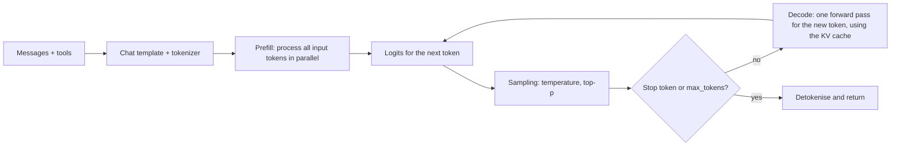
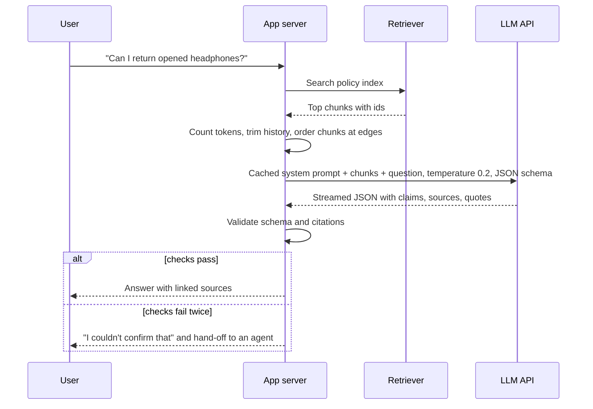

## Introduction

From the outside, a large language model (LLM) API looks like a function: send text, receive text. Engineers who treat it that way get surprised. The same prompt returns different answers on different calls. A request that worked yesterday fails today because the conversation grew past a limit. A long prompt takes a second before anything appears, and then the words arrive steadily, one after another. The model invents a policy section that does not exist, cites it confidently, and formats it perfectly. Each of these behaviours follows directly from how LLMs work, and each has a standard engineering response.

An **LLM** is a decoder-only transformer ([[e2-transformers]]) with billions of parameters, trained first to predict the next token across a huge amount of text, and then further trained to follow instructions and behave helpfully. When you call one, it reads your entire input, produces a probability for every token in its vocabulary, picks one, appends it, and repeats until it emits a stop token or hits a limit. Everything else — chat, tool use, structured output, reasoning — is built on that loop.

This lesson explains the parts of that loop that you control or must design around:

1. **Context windows** — the maximum tokens per request, how to budget them, and why models use the middle of long inputs poorly.
2. **Logits, temperature, top-p and sampling** — how a probability distribution becomes a chosen token, and how the knobs change it.
3. **Prefill, decode and the KV cache** — why the first token is slow, why output tokens cost more, and what fills GPU memory.
4. **Pretraining, instruction tuning and alignment** — how a text predictor becomes an assistant, and what each stage gives it.
5. **Reasoning models and test-time compute** — models that think before answering, and when that is worth paying for.
6. **Hallucinations, bias and reasoning failures** — the failure modes that come with the mechanism, and how production systems contain them.

The code examples use only the Python standard library and small, hand-checkable numbers. They model the mechanisms; they do not call a real API.

## Before you start

- **The transformer** — tokens, embeddings, attention, the causal mask and the output layer that produces logits. See [[e2-transformers]].
- **Tokens and tokenization** — what a token is and why counts are model-specific. See [[e2-tokens]] and [[e2-tokenization]].
- **Neural-network training** — loss, gradient descent and the training loop. See [[e2-neural-networks]].
- **Probability basics** — distributions, sampling and expected values. See [[e2-probability]].
- **Python basics** — dictionaries, functions and loops. See [[e1-syntax]].

## The intuition

Think of the autocomplete on a phone keyboard, which suggests the next word from the words you have typed. Now imagine an autocomplete that has read a large fraction of the public internet, millions of books and most open-source code; that conditions not on the last two words but on the last hundred thousand tokens; and that has been coached, through many rounds of feedback, to continue a conversation the way a careful assistant would. Ask it a question and the most likely continuation is a good answer, so that is usually what it writes.

This picture explains a lot. The model writes one token at a time, each chosen from a probability distribution — so the output can vary, and settings that reshape the distribution change its style. It conditions on everything in its input — so what you put in the context, and where, matters. It has a fixed reading span — so very long inputs must be cut, summarised or retrieved selectively. And it produces the most *plausible* continuation, which is usually but not always the *true* one — so when it does not know something, a fluent, confident fabrication is a natural output.

The analogy undersells the model in one way: to predict text well across so many domains, LLMs learn rich internal representations that support translation, summarisation, coding and multi-step reasoning, abilities nobody programmed explicitly. It oversells the model in another: there is no lookup of facts, no internal check that a statement is true, and no memory between API calls beyond what you send.

## The generation loop

Every LLM response is produced by the same **autoregressive** loop. The model reads the whole sequence so far and outputs a vector of **logits** — one raw score per vocabulary token. Softmax turns the logits into probabilities. A **decoding strategy** picks one token from that distribution. The token is appended to the sequence, and the loop repeats. It stops when the model produces an end-of-sequence or end-of-turn token, when a stop sequence you specified appears, or when the maximum output length is reached.

The program below shows the loop with the simplest possible language model — a **bigram model** that predicts the next word only from the previous word, using counts from a tiny corpus. An LLM replaces the counting with a transformer that conditions on the entire context, but the loop around it is the same.

```python title="bigram.py"
import random
from collections import Counter, defaultdict

corpus = ("the cat sat on the mat . the dog sat on the rug . "
          "the cat saw the dog . the dog saw the cat .").split()

# "Training": count which token follows which
counts = defaultdict(Counter)
for prev, nxt in zip(corpus, corpus[1:]):
    counts[prev][nxt] += 1

def next_token_distribution(prev):
    total = sum(counts[prev].values())
    return {tok: c / total for tok, c in counts[prev].items()}

print("P(next | 'the') =", next_token_distribution("the"))

def generate(prompt, max_new_tokens, rng):
    tokens = prompt.split()
    for _ in range(max_new_tokens):          # one token per step, appended to the input
        dist = next_token_distribution(tokens[-1])
        tok = rng.choices(list(dist), weights=list(dist.values()))[0]
        tokens.append(tok)
        if tok == ".":                       # our stand-in for an end-of-sequence token
            break
    return " ".join(tokens)

rng = random.Random(7)
for _ in range(3):
    print(generate("the", 10, rng))
```

```output
P(next | 'the') = {'cat': 0.375, 'mat': 0.125, 'dog': 0.375, 'rug': 0.125}
the cat sat on the dog .
the cat saw the mat .
the cat saw the cat sat on the dog .
```

Three things in this output reappear throughout the lesson. The same prompt produced three different continuations, because each step *samples* from a distribution. Generation stopped when the model produced its end token, `.`, not after a fixed length. And "the cat sat on the dog" never appears in the corpus: every individual step was a plausible transition, yet the sentence as a whole is something the training data never said. A transformer is vastly better at staying coherent over long spans, but the root of hallucination is already visible here — the model optimises for plausible next tokens, not for true statements.



## Context Windows & Lost-in-the-Middle {#e2-context-windows}

A **context window** is the maximum number of tokens an LLM can process in a single request, counting both the input you send and the output it generates. Everything the model can use to produce its answer must be inside that window: the system prompt, tool definitions, conversation history, retrieved documents, the user's message and the tokens it writes. Nothing outside it exists for the model — it has no memory of earlier calls unless you send that history again. **Lost in the middle** is the observation that even within the window, models tend to use information at the beginning and end of a long input more reliably than information buried in the middle.

### What the window contains

An LLM API is stateless. When a chat application seems to "remember" the conversation, it is because the application re-sends the earlier messages on every request. A typical request is assembled from several parts, all of which consume the window:

| Part | Typical size | Notes |
|---|---|---|
| System prompt | 500–5,000 tokens | Instructions, persona, rules; usually stable across requests |
| Tool definitions | 100–500 tokens per tool | JSON schemas count as input tokens ([[e3-tool-calling]]) |
| Conversation history | Grows every turn | The main reason long chats eventually overflow |
| Retrieved documents | Hundreds to tens of thousands | Retrieval-augmented generation (RAG) chunks ([[e6-context-construction]]) |
| User message | Small to very large | Pasted documents and files can dominate |
| Output reservation | The `max_tokens` you allow | Must fit alongside the input |

Context windows have grown quickly: early GPT-3 models had 2,048 tokens, while many current frontier models accept 128,000 to 200,000 tokens and some accept a million or more. Model documentation lists each model's limit, along with a separate, usually much smaller, maximum output length.

### Budgeting the window

Because input and output share the window, a robust application decides how many tokens each part may use *before* calling the model, using the model's own tokenizer or the provider's counting endpoint ([[e3-token-usage]]). The program below checks a request against an 8,192-token window with 1,000 tokens reserved for the answer, and fixes an overflow by dropping the lowest-ranked retrieved chunks rather than truncating blindly.

```python title="budget.py"
from dataclasses import dataclass

@dataclass
class Budget:
    context_window: int
    max_output: int          # tokens reserved for the reply

    def fits(self, parts: dict[str, int]) -> None:
        used = sum(parts.values())
        available = self.context_window - self.max_output
        for name, n in parts.items():
            print(f"  {name:<14}{n:>7,}")
        print(f"  {'input total':<14}{used:>7,} of {available:,} available "
              f"({self.context_window:,} window - {self.max_output:,} reserved for output)")
        print("  OK" if used <= available else f"  OVER by {used - available:,} tokens")

# Token counts would come from the model's own tokenizer or a counting endpoint
request = {"system prompt": 1_800, "chat history": 2_400,
           "retrieved docs": 3_600, "user message": 350}
Budget(context_window=8_192, max_output=1_000).fits(request)
print("after dropping the two lowest-ranked document chunks:")
request["retrieved docs"] = 2_400
Budget(context_window=8_192, max_output=1_000).fits(request)
```

```output
  system prompt   1,800
  chat history    2,400
  retrieved docs  3,600
  user message      350
  input total     8,150 of 7,192 available (8,192 window - 1,000 reserved for output)
  OVER by 958 tokens
after dropping the two lowest-ranked document chunks:
  system prompt   1,800
  chat history    2,400
  retrieved docs  2,400
  user message      350
  input total     6,950 of 7,192 available (8,192 window - 1,000 reserved for output)
  OK
```

The input alone, 8,150 tokens, would fit inside 8,192 — but leave almost no room for the answer. Reserving the output first exposes the real problem. Deciding *what* to cut is a product decision: the system prompt is usually protected, the current user message is essential, and history and retrieved documents are the flexible parts. Common strategies are keeping only the most recent turns ([[e4-sliding-window]]), summarising older turns ([[e4-history-summarization]]), retrieving fewer but better chunks, and failing fast with a clear error when even the essentials do not fit.

What happens if you do not budget depends on the system. Hosted APIs generally reject a request whose input exceeds the window, and some also reject one where input plus the requested `max_tokens` exceeds it. Some frameworks and self-hosted servers instead truncate silently — and if they drop the *oldest* tokens, the first thing to go may be your system prompt. If the output runs out of room, the response stops mid-sentence with a finish reason such as `length` or `max_tokens`, which your code should check ([[e3-refusal-partial-output]]).

### Why the window is finite

Three constraints set the limit. **Attention cost** grows with the square of sequence length, so doubling the input roughly quadruples the attention work. **Memory** for the KV cache grows linearly with length for every request being served, and at long lengths it can exceed the memory of the model's weights ([[e2-kv-cache]]). And **training**: a model only learns to use positions similar to the lengths it was trained on; long-context models are usually extended after pretraining by rescaling their positional encoding and training further on long documents ([[e2-embeddings]]).

Longer context is also not free per request. You pay for every input token on every call, and time to first token grows with input length. A chat that re-sends 100,000 tokens of history on every turn pays for those 100,000 tokens every turn. Prompt caching reduces the cost of repeated prefixes ([[e4-context-cache]]), but the cheapest token is still the one you did not send.

> [!NOTE] Context window is not knowledge cutoff
> The context window is how much text the model can read in one request. The **knowledge cutoff** is the date after which the training data ends, so the model knows nothing about later events unless you put them in the context. A model with a million-token window still does not know yesterday's news.

### Lost in the middle

A larger window means the model *accepts* more text, not that it *uses* all of it equally well. In the 2023 study *Lost in the Middle: How Language Models Use Long Contexts*, Liu and colleagues gave models a question plus many documents, only one of which contained the answer, and moved that document to different positions. Accuracy was highest when the relevant document was at the beginning or the end of the context and dropped noticeably when it was in the middle — a U-shaped curve — and in some settings accuracy with the answer in the middle fell below the model's accuracy with no documents at all. Newer models have improved, and simple "needle in a haystack" tests (finding one inserted sentence in a long document) are now often passed near-perfectly. But benchmarks that require combining several facts, or reasoning over long inputs, still find that a model's *effective* context is often shorter than its advertised window and that quality falls well before the hard limit.

The practical rules follow:

- **Send less, better.** Retrieval quality beats context size. Ten relevant chunks usually outperform fifty loosely related ones, because irrelevant text dilutes attention and can mislead ([[e4-context-pollution]]).
- **Put important material at the edges.** Place key instructions at the start (the system prompt) and restate the essential task near the end, after long documents. When ordering retrieved chunks, put the strongest at the beginning and the end.
- **Test with your own data.** Measure answer quality as you vary the number of chunks and their order, rather than trusting the advertised window ([[e9-rag-ablation]]).

The helper below orders chunks so the strongest sit at both edges and the weakest in the middle — a common, cheap mitigation:

```python title="edges.py"
def edges_first(ranked):
    """Place the best chunks at the start and end of the context, weakest in the middle."""
    front, back = [], []
    for i, chunk in enumerate(ranked):
        (front if i % 2 == 0 else back).append(chunk)
    return front + back[::-1]

ranked = ["#1", "#2", "#3", "#4", "#5", "#6"]   # best first, from the retriever
print(edges_first(ranked))
```

```output
['#1', '#3', '#5', '#6', '#4', '#2']
```

The top two chunks end up first and last, and the two weakest share the middle. Whether this helps your model is an empirical question — measure it — but it costs nothing to try. Context ordering more generally is covered in [[e4-context-ordering]].

```quiz
Q: A model has a 128,000-token context window. Your input is 126,000 tokens and you request up to 4,000 output tokens. What is the most likely outcome?
- [ ] It works, because only the input counts against the window
- [x] The request is rejected or the output is cut short, because input and output share the 128,000 tokens and 126,000 + 4,000 exceeds it
- [ ] The model automatically summarises the input to make room
- [ ] The model ignores the max output setting
> The window bounds input plus generated tokens. Depending on the provider, the request either fails validation up front or the response stops when the window fills, with a length finish reason. Nothing summarises automatically; budgeting is your job.

Q: In a long-context question-answering test, where is a relevant document least likely to be used correctly?
- [ ] At the very beginning of the context
- [x] In the middle of a long context
- [ ] At the very end of the context
- [ ] Position never matters for modern models
> The lost-in-the-middle study found a U-shaped curve: best at the beginning and end, worst in the middle. Newer models have improved, but position effects and degraded use of very long contexts still appear on harder tasks, so put critical content at the edges and keep contexts focused.
```

## Logits, Temperature, Top-p & Sampling {#e2-temperature}

At every generation step, an LLM's final layer outputs **logits**: one raw, unbounded score for each token in its vocabulary. **Softmax** converts them into a probability distribution. **Sampling** is choosing the next token from that distribution, and the sampling parameters reshape the distribution before the choice: **temperature** sharpens or flattens it, **top-k** keeps only the `k` most likely tokens, and **top-p** (nucleus sampling) keeps the smallest set of tokens whose probabilities add up to `p`. These settings do not change what the model knows; they change how adventurous it is in choosing among the continuations it considers plausible.

### From logits to probabilities

Softmax maps logits `z₁, …, z_V` to probabilities `pᵢ = e^(zᵢ) / Σⱼ e^(zⱼ)`. Larger logits get exponentially larger probabilities, every probability is positive, and they sum to 1. Only differences between logits matter: adding the same constant to every logit changes nothing, which is why implementations subtract the maximum logit first to avoid overflow.

**Temperature** `T` divides every logit before the softmax: `pᵢ ∝ e^(zᵢ / T)`. With `T < 1`, differences between logits are magnified, so the top token takes even more of the probability. With `T > 1`, differences shrink, and lower-ranked tokens get more chance. `T = 1` leaves the model's distribution unchanged. As `T` approaches 0, the distribution approaches all probability on the single highest-logit token, so `T = 0` is implemented as **greedy decoding**: always take the most likely token.

The program uses logits a model might produce after "The capital of France is":

```python title="sampling.py"
import math
import random
from collections import Counter

# Logits a model might produce after "The capital of France is"
logits = {" Paris": 6.0, " a": 3.5, " the": 3.0, " located": 2.5, " Lyon": 1.0, " banana": -2.0}

def softmax(scores, temperature=1.0):
    scaled = {t: s / temperature for t, s in scores.items()}
    m = max(scaled.values())                      # subtract max for numerical stability
    exps = {t: math.exp(s - m) for t, s in scaled.items()}
    total = sum(exps.values())
    return {t: e / total for t, e in exps.items()}

def show(title, probs):
    print(title)
    print("   " + "  ".join(f"{t.strip()}={p:.3f}" for t, p in probs.items()))

for T in (0.5, 1.0, 2.0):
    show(f"temperature {T}:", softmax(logits, T))

def top_k(probs, k):
    keep = dict(sorted(probs.items(), key=lambda kv: -kv[1])[:k])
    total = sum(keep.values())
    return {t: p / total for t, p in keep.items()}   # renormalise the survivors

def top_p(probs, p):
    keep, cumulative = {}, 0.0
    for t, q in sorted(probs.items(), key=lambda kv: -kv[1]):
        keep[t] = q
        cumulative += q
        if cumulative >= p:                           # smallest set reaching mass p
            break
    total = sum(keep.values())
    return {t: q / total for t, q in keep.items()}

base = softmax(logits, 1.0)
show("top-k, k=2:", top_k(base, 2))
show("top-p, p=0.95:", top_p(base, 0.95))

rng = random.Random(0)
for T in (0.5, 1.0, 2.0):
    probs = softmax(logits, T)
    draws = Counter(rng.choices(list(probs), weights=list(probs.values()), k=1000))
    print(f"1,000 samples at T={T}: " + ", ".join(f"{t.strip()}:{n}" for t, n in draws.most_common()))
```

```output
temperature 0.5:
   Paris=0.990  a=0.007  the=0.002  located=0.001  Lyon=0.000  banana=0.000
temperature 1.0:
   Paris=0.855  a=0.070  the=0.043  located=0.026  Lyon=0.006  banana=0.000
temperature 2.0:
   Paris=0.561  a=0.161  the=0.125  located=0.097  Lyon=0.046  banana=0.010
top-k, k=2:
   Paris=0.924  a=0.076
top-p, p=0.95:
   Paris=0.883  a=0.073  the=0.044
1,000 samples at T=0.5: Paris:995, a:3, located:2
1,000 samples at T=1.0: Paris:846, a:68, the:52, located:24, Lyon:8, banana:2
1,000 samples at T=2.0: Paris:548, a:171, the:120, located:106, Lyon:43, banana:12
```

At `T = 0.5`, " Paris" takes 99% of the probability. At `T = 2.0` it falls to 56%, and the wrong answer " Lyon" rises from 0.6% to 4.6%. The samples make the consequence concrete: across 1,000 draws at `T = 2.0`, the model said "Lyon" 43 times and "banana" 12 times. Even at `T = 1.0`, the long tail produced "banana" twice — a token with a probability that rounds to `0.000` is still sampled occasionally, and a 500-token answer gives the tail 500 chances. That is the motivation for truncation.

**Top-k** keeps the `k` highest-probability tokens and renormalises. With `k = 2`, only " Paris" and " a" survive. Its weakness is that a fixed `k` ignores the shape of the distribution: when the model is confident, `k = 40` still lets 39 poor tokens through; when many continuations are reasonable, a small `k` cuts good ones.

**Top-p** adapts to the shape. It sorts tokens by probability and keeps the smallest set whose cumulative probability reaches `p`. With `p = 0.95`: " Paris" (0.855) plus " a" (0.070) is 0.925, still short, so " the" (0.043) is added to reach 0.968 and the rest — including " Lyon" and " banana" — are discarded. When the model is confident, the nucleus is tiny; when it is uncertain, it grows. Open-source inference engines also offer **min-p**, which keeps tokens whose probability is at least a fixed fraction of the top token's.

### Choosing settings by task

Sampling settings are a per-endpoint product decision:

| Task | Typical setting | Why |
|---|---|---|
| Extraction, classification, structured output, tool calls | Temperature 0–0.3 | You want the single most likely correct answer, reproducibly |
| Code generation | Low temperature (0–0.4) | Unlikely tokens are usually bugs |
| General assistant answers | Provider default (often around 0.7–1.0) | Natural phrasing without wandering |
| Brainstorming, marketing copy, fiction | Temperature 0.8–1.2 with top-p around 0.9–0.95 | Variety is the goal; truncation stops nonsense |
| Generating several candidates to vote on or rank | Moderate temperature | Diversity across samples is the point |

Most providers advise adjusting temperature *or* top-p, not both, because their effects compound and become hard to reason about. Not every API exposes every knob: some offer top-k and others do not, and some providers fix or restrict sampling parameters for their reasoning models. Check the model's documentation and log the parameters used with every request, so a quality change can be traced to a settings change.

Other decoding controls you will meet: **stop sequences** end generation when a given string appears; **frequency and presence penalties** lower the logits of tokens that have already appeared, reducing repetition; **logprobs** return the log-probabilities of chosen tokens, useful for confidence scoring and classification; and **constrained decoding**, which powers structured outputs, masks out at each step every token that would violate a JSON schema or grammar, so the output is guaranteed to parse ([[e3-structured-outputs]]).

> [!WARNING] Temperature 0 is not a determinism or truth guarantee
> Greedy decoding removes sampling randomness, but hosted models can still return different outputs for the same request: GPU floating-point arithmetic is not perfectly associative, results can depend on how requests are batched together, and providers update models. Some APIs offer a `seed` parameter for best-effort reproducibility, not a guarantee. More importantly, temperature 0 picks the model's most likely token — if the model's most likely answer is wrong, you get the wrong answer every time. Low temperature reduces randomness, not hallucination.

```quiz
Q: What does lowering the temperature from 1.0 to 0.2 do to the next-token distribution?
- [ ] Removes all tokens except the top 20%
- [x] Divides the logits by 0.2, magnifying differences so the most likely tokens take even more of the probability
- [ ] Makes the model look up facts more carefully
- [ ] Flattens the distribution so rare tokens become more likely
> Temperature scales logits before softmax. Dividing by a value below 1 increases the gaps between logits, so softmax concentrates probability on the top tokens. It does not truncate (that is top-k or top-p) and it adds no knowledge.

Q: A distribution has probabilities 0.50, 0.30, 0.15 and 0.05. Which tokens does top-p with p = 0.9 keep?
- [ ] Only the first, because it is the most likely
- [ ] The first two, because 0.50 + 0.30 is closest to 0.9
- [x] The first three, because 0.50 + 0.30 = 0.80 is below 0.9 and adding 0.15 reaches 0.95
- [ ] All four, because top-p never removes tokens
> Top-p keeps the smallest prefix of the sorted distribution whose cumulative probability reaches p. 0.80 has not reached 0.9, so the third token is included; 0.95 has, so the fourth is dropped and the remaining three are renormalised.
```

## Prefill, Decode & KV Cache {#e2-kv-cache}

LLM inference has two phases that behave very differently. **Prefill** processes the entire input prompt in one parallel pass and produces the first output token. **Decode** then generates the remaining tokens one at a time, each requiring its own forward pass. The **KV cache** connects them: it stores the attention keys and values computed for every token so far, so each decode step only computes the new token's keys and values instead of reprocessing the whole sequence. These three ideas explain why the first token takes a moment, why output tokens are slower and more expensive than input tokens, and why long contexts consume so much GPU memory.

### Two phases, two bottlenecks

During **prefill**, all input tokens are known, so the model processes them together, as in training: large matrix multiplications that keep the GPU's arithmetic units busy. Prefill is **compute-bound** — its speed is limited by how fast the GPU can multiply. Its duration determines **time to first token (TTFT)**, and it grows with prompt length (super-linearly for very long prompts, because of attention's quadratic term).

During **decode**, only one new token is processed per step, but generating it requires reading *every* model weight from GPU memory, plus the KV cache. The arithmetic per step is small; moving the data is the cost. Decode is **memory-bandwidth-bound**. Its speed determines the **inter-token latency** (or time per output token), and the total response time is roughly TTFT plus the number of output tokens times the inter-token latency.

A back-of-the-envelope calculation shows why bandwidth dominates. An 8-billion-parameter model in 16-bit precision has about 16 GB of weights. A data-centre GPU with around 3.35 TB/s of memory bandwidth (an NVIDIA H100 SXM) can read those weights at most about 200 times per second — so a single sequence cannot decode faster than roughly 200 tokens per second on it, no matter how fast the arithmetic is. Real servers recover efficiency by **batching**: decoding many users' sequences in the same step, so each read of the weights produces many tokens. Continuous batching, which adds and removes sequences from the batch at every step, is a core feature of serving engines such as vLLM ([[e8-vllm]]).

This asymmetry is why providers price output tokens higher than input tokens, why streaming the response ([[e3-streaming]]) matters for perceived latency, and why "make the answer shorter" is often the most effective latency optimisation available.

### What the KV cache stores

Recall from [[e2-attention]] that every token's representation in every layer is projected into a query, a key and a value. Under the causal mask, a token's key and value at a given layer depend only on that token and the tokens before it — so once computed, they never change. When the model generates token 1,001, it needs the keys and values of tokens 1 to 1,000 in every layer, and they are the same as in the previous step. The **KV cache** keeps them in GPU memory. Each decode step computes keys and values only for the new token, appends them to the cache, and runs attention of the new query against all cached keys.

Without a cache, step `t` would recompute keys and values for all `t` previous tokens. The program counts the token positions processed while generating 500 tokens after a 2,000-token prompt:

```python title="decode_cost.py"
# Key/value projections computed while generating 500 tokens after a 2,000-token prompt
prompt, new = 2_000, 500

# Without a cache, every step re-processes the whole sequence so far
no_cache = sum(prompt + i for i in range(new))
# With a cache, the prompt is processed once (prefill), then one new token per step
with_cache = prompt + new
print(f"token positions processed without cache: {no_cache:,}")
print(f"token positions processed with cache:    {with_cache:,}")
print(f"ratio: {no_cache / with_cache:.0f}x")
```

```output
token positions processed without cache: 1,124,750
token positions processed with cache:    2,500
ratio: 450x
```

The cache turns quadratic recomputation into linear work. The attention step itself still compares each new query with every cached key, so per-token decode cost grows slowly as the context lengthens, but the expensive projections and MLP work happen once per token.

### How big the cache gets

The price is memory. For every token, every layer stores one key vector and one value vector per key–value head:

```text
KV bytes per token = 2 × layers × kv_heads × head_dim × bytes_per_value
```

```python title="kv_cache.py"
def kv_bytes_per_token(layers, kv_heads, head_dim, bytes_per_value=2):
    # 2 = one key vector and one value vector, per KV head, per layer
    return 2 * layers * kv_heads * head_dim * bytes_per_value

MODELS = {
    # name: (layers, KV heads, head dim) from the published model configs
    "Llama 2 7B (32 KV heads, no GQA)": (32, 32, 128),
    "Llama 3 8B (8 KV heads, GQA)": (32, 8, 128),
    "Llama 3 70B (8 KV heads, GQA)": (80, 8, 128),
}

for name, cfg in MODELS.items():
    per_tok = kv_bytes_per_token(*cfg)               # 16-bit keys and values
    print(f"{name}")
    print(f"   {per_tok / 1024:,.0f} KiB per token")
    for ctx in (8_192, 128_000):
        print(f"   {ctx:>7,} tokens: {per_tok * ctx / 2**30:6.2f} GiB per sequence")
```

```output
Llama 2 7B (32 KV heads, no GQA)
   512 KiB per token
     8,192 tokens:   4.00 GiB per sequence
   128,000 tokens:  62.50 GiB per sequence
Llama 3 8B (8 KV heads, GQA)
   128 KiB per token
     8,192 tokens:   1.00 GiB per sequence
   128,000 tokens:  15.62 GiB per sequence
Llama 3 70B (8 KV heads, GQA)
   320 KiB per token
     8,192 tokens:   2.50 GiB per sequence
   128,000 tokens:  39.06 GiB per sequence
```

(Llama 2 7B's actual limit was 4,096 tokens; its longer rows show what the same design would cost at those lengths.) A single 128,000-token conversation on Llama 3 8B needs about 15.6 GiB of cache — as much as the model's 16 GB of weights — and a server handling dozens of concurrent users needs that per user. The comparison between Llama 2 7B and Llama 3 8B, which have the same number of layers and head size, shows why **grouped-query attention** ([[e2-multi-head-causal]]) became standard: sharing each key–value head among four query heads cuts the cache to a quarter. Other techniques attack the same problem: storing the cache in 8-bit precision, **PagedAttention** (vLLM's method of storing the cache in fixed-size blocks to avoid wasted memory), and sliding-window attention, which keeps only recent tokens.

### Prefix caching and what it means for your bills

If many requests start with the same tokens — the same long system prompt, the same tool definitions, the same document being asked several questions — their KV caches for that prefix are identical. **Prefix caching** (called prompt caching by providers) stores those caches between requests, so a repeated prefix skips most of its prefill. Providers pass on the savings as lower prices for cached input tokens and lower TTFT. Some apply it automatically to long repeated prefixes; others let you mark explicit cache breakpoints. Either way, caching only matches an *exact* prefix, so the design rule is to put stable content first (system prompt, tools, reference documents) and variable content last (the user's message). Details are in [[e4-context-cache]] and [[e8-kv-prefix-cache]].

Two further inference optimisations build on this picture. **Speculative decoding** uses a small, fast draft model to propose several tokens, which the large model verifies in one parallel pass — exploiting the fact that a decode step has spare compute ([[e8-speculative-decoding]]). And separating prefill and decode onto different hardware is an active area in large serving systems ([[e8-prefill-decode]]).

```quiz
Q: Why is generating output tokens usually slower per token than processing input tokens?
- [ ] Output tokens are longer than input tokens
- [x] Input tokens are processed together in one parallel prefill pass, while output tokens are generated one at a time, each step reading all model weights from memory
- [ ] The model re-reads the whole prompt from disk for every output token
- [ ] Output tokens use a larger vocabulary
> Prefill is compute-bound and parallel over the prompt. Decode produces one token per forward pass and is limited by memory bandwidth, because every step must read the weights (and the KV cache) for little arithmetic. That is also why output tokens are priced higher.

Q: Using the formula 2 × layers × kv_heads × head_dim × bytes, what is the 16-bit KV cache for one token on a model with 32 layers, 8 KV heads and head dimension 128?
- [ ] 8 KiB
- [ ] 32 KiB
- [x] 128 KiB
- [ ] 512 KiB
> 2 × 32 × 8 × 128 × 2 bytes = 131,072 bytes = 128 KiB. With 32 KV heads instead of 8 it would be 512 KiB, which is why grouped-query attention matters for long contexts.
```

## Pretraining, Instruction Tuning & Alignment {#e2-pretraining-instruction-alignment}

An assistant-style LLM is built in stages. **Pretraining** trains a transformer to predict the next token over trillions of tokens of text and code, producing a **base model** that knows a great deal but simply continues whatever text it is given. **Instruction tuning** (supervised fine-tuning) trains it further on examples of instructions paired with good responses, so it learns to answer rather than continue. **Alignment** — usually preference training such as reinforcement learning from human feedback (RLHF) or direct preference optimisation (DPO) — teaches it which of several possible answers people prefer: more helpful, more honest, safer. Knowing what each stage contributes explains much of a model's behaviour, including several of its failure modes.

### Pretraining: learning from next-token prediction

Pretraining uses the training loop from [[e2-neural-networks]] at enormous scale. Documents from web crawls, books, code repositories, scientific papers and other sources are filtered, deduplicated and tokenized. The model reads sequences of a few thousand tokens, predicts the next token at every position (in parallel, thanks to the causal mask), and is updated to reduce the **cross-entropy loss** — the negative log-probability it assigned to the token that actually came next. Meta reported training Llama 3 on over 15 trillion tokens; GPT-3, in 2020, was trained on about 300 billion. A frontier pretraining run occupies thousands of GPUs for weeks to months.

This objective is deceptively simple. To predict the next token of a physics textbook, a Python file or a legal contract well, the model must pick up grammar, facts, styles, reasoning patterns and programming idioms, because all of them make the next token more predictable. Research on **scaling laws** found that loss falls smoothly and predictably as parameters, data and compute grow together; the 2022 Chinchilla study concluded that, for a fixed compute budget, models had been undertrained and that roughly 20 training tokens per parameter was compute-optimal. Many current models are trained well beyond that ratio, because a smaller model trained longer is cheaper to serve.

A **base model** is a powerful text continuer, not an assistant. Given "What is the capital of France?", it might continue with "What is the capital of Germany? What is the capital of Italy?" — because in its training data, a question is often followed by more questions, as on a quiz page. Pretraining also fixes the model's **knowledge cutoff**: it knows nothing that happened after its data was collected, and it absorbs whatever errors, biases and contradictions the data contained.

### Instruction tuning: learning the assistant format

**Supervised fine-tuning (SFT)**, often called instruction tuning, continues training on a much smaller, curated dataset — tens of thousands to millions of examples — of prompts paired with high-quality responses, written by people or generated and filtered with model help. The examples are formatted with the model's chat template, using role markers and end-of-turn tokens ([[e2-tokens]]), and the loss is usually computed only on the response tokens. After SFT, the model has learned the *format* of being an assistant: follow the instruction, answer the question, use the system prompt, stop at the end of the turn, call tools in the expected syntax.

SFT teaches by imitation, so it is limited by its examples: it cannot easily teach a model to be *better* than the demonstrations, and it does not teach which of two acceptable answers is preferable. Datasets for SFT are covered in [[e8-sft-datasets]].

### Alignment: learning from preferences

The landmark 2022 InstructGPT work from OpenAI set out the classic **RLHF** pipeline. First, people compare pairs of model responses to the same prompt and pick the better one. Second, a **reward model** is trained on those comparisons to predict a score that agrees with human preferences. Third, the LLM is optimised with reinforcement learning (originally the PPO algorithm) to produce responses the reward model scores highly, with a penalty for drifting too far from the SFT model so it does not exploit quirks of the reward model. InstructGPT's labellers preferred the outputs of a 1.3-billion-parameter tuned model over those of the 175-billion-parameter base GPT-3 — a striking demonstration that post-training changes usefulness, not only knowledge.

Variants have followed. **Direct Preference Optimisation (DPO)**, published in 2023, skips the separate reward model and RL loop, training directly on preference pairs with a classification-style loss; it is simpler and widely used for open models ([[e8-preference-dpo]]). **RLAIF** (reinforcement learning from AI feedback) uses a model, guided by written principles, to produce the preference judgements — Anthropic's Constitutional AI is an example. And reinforcement learning against **verifiable rewards** — did the code pass the tests, is the maths answer correct — has become central to training reasoning models, discussed in the next section.

| Stage | Data | Objective | What it gives the model |
|---|---|---|---|
| Pretraining | Trillions of tokens of web text, books, code | Next-token prediction | Language, broad knowledge, reasoning patterns; knowledge cutoff |
| Instruction tuning (SFT) | Curated prompt–response pairs in chat format | Next-token prediction on responses | Following instructions, chat format, tool-call syntax, stopping |
| Preference training (RLHF, DPO, RLAIF) | Comparisons of responses | Maximise preferred-response likelihood or learned reward | Helpfulness, tone, refusing harmful requests, honesty norms |
| RL with verifiable rewards | Problems with checkable answers | Reward correct outcomes | Longer, more reliable multi-step reasoning |

### Side effects worth knowing

Post-training shapes behaviour, and it introduces characteristic quirks. **Sycophancy** — agreeing with the user, or changing a correct answer when the user pushes back — has been linked to preference training, because people tend to rate agreeable answers highly. Over-cautious **refusals** of harmless requests are a side effect of safety training. Preference training can also reward confident-sounding answers, which matters for hallucination. None of the stages adds a fact-checking mechanism: alignment changes how the model behaves with what it knows, not what it knows.

For application builders, the stages map onto choices. Most products use a provider's fully post-trained model and steer it with prompts ([[e4-system-instructions]]) and retrieved context. When prompting is not enough — a consistent output style, a specialised classification task, a smaller and cheaper model for a narrow job — teams fine-tune an open or hosted model with SFT, sometimes followed by DPO ([[e2-fine-tuning]], [[e8-lora-qlora-peft]]). Fine-tuning is good at teaching format and behaviour and poor at reliably injecting new facts; for facts that change, retrieval is usually the better tool ([[e8-rag-vs-tools-vs-finetune]]).

```quiz
Q: You send "What is the capital of France?" to a base model that has only been pretrained. Which response is most plausible?
- [ ] A refusal, because it has not been aligned
- [ ] Always the single word "Paris", because it knows the fact
- [x] A continuation such as a list of similar questions, because it continues text the way its training data typically did
- [ ] An error, because base models cannot accept questions
> A base model predicts likely continuations. On quiz-style pages a question is often followed by more questions, so continuing the list is plausible. It may well know the answer; instruction tuning teaches it to respond as an assistant.

Q: What does the reward model do in the classic RLHF pipeline?
- [ ] Generates the training text for pretraining
- [x] Predicts how much people would prefer a response, learned from human comparisons, and supplies the reward the LLM is optimised against
- [ ] Checks every answer against a database of facts
- [ ] Converts text into tokens
> Labellers compare pairs of responses; a reward model learns to score responses consistently with those choices; reinforcement learning then pushes the LLM towards higher-scoring outputs. It models preferences, not truth, which is why it can reward confident or agreeable answers.
```

## Reasoning Models & Test-Time Compute {#e2-reasoning-models}

A **reasoning model** is an LLM trained to generate an extended chain of intermediate reasoning — working through a problem step by step, trying approaches, checking and correcting itself — before it writes its final answer. **Test-time compute** (or inference-time compute) is the idea behind it: spending more computation when answering a question, rather than only when training the model, can buy better answers on hard problems. OpenAI's o1 (September 2024), DeepSeek-R1 (January 2025) and the extended-thinking modes of Claude and Gemini are examples. They trade higher cost and latency for substantially better results on mathematics, coding, planning and other multi-step tasks.

### From "think step by step" to trained reasoning

The idea started as a prompting technique. In 2022, **chain-of-thought prompting** showed that asking a model to write out intermediate steps — through worked examples, or simply the instruction "Let's think step by step" — improved accuracy on arithmetic and logic problems. The reason follows from the generation loop: each token is produced by a fixed amount of computation, so a model that must answer a hard question in its first token has very little computation to work with. Writing intermediate steps gives it more forward passes, and lets later steps condition on earlier results written into the context, like scratch paper.

Reasoning models make this a trained behaviour. They are post-trained with large-scale reinforcement learning on problems whose answers can be checked automatically — maths with known solutions, code with tests. The model generates long reasoning traces, receives a reward when the final answer is correct, and is updated to make successful reasoning more likely. DeepSeek's published account of R1 describes behaviours emerging from this process that nobody wrote demonstrations for: re-checking work, trying alternative approaches and backtracking when an approach fails. Accuracy on competition maths and programming benchmarks improved dramatically, and it kept improving as models were allowed to reason for longer — the **test-time scaling** behaviour that gives the approach its name.

### How it looks through an API

Reasoning tokens are generated like any other output tokens, so they cost money and time. Providers differ in the details, and the specifics change frequently, so check current documentation; at the time of writing the common patterns are:

- **Controls for how much to think.** Some APIs take an effort level (such as low, medium or high); others take a token budget for thinking. More thinking generally means better answers on hard tasks and higher cost and latency.
- **Billing.** Reasoning tokens are billed as output tokens, even when they are not shown to you, and they count against output limits. A short visible answer can carry thousands of billed reasoning tokens.
- **Visibility.** Some providers return the reasoning in full, some return a summary, and some hide it.
- **Sampling restrictions.** Some reasoning modes fix temperature or disallow other sampling changes.
- **Latency.** Time to the first *visible* token can be seconds to minutes, which affects interface design: show progress, stream, or run the task in the background.

### Sampling more instead of thinking longer

Test-time compute can also be spent across several attempts. **Self-consistency** samples several independent answers at a moderate temperature and takes a majority vote over their final answers: errors tend to scatter while correct reasoning paths tend to agree.

```python title="vote.py"
from collections import Counter

# Final answers extracted from five independently sampled reasoning attempts
samples = ["42", "42", "38", "42", "40"]
answer, votes = Counter(samples).most_common(1)[0]
print(f"majority answer: {answer} ({votes}/{len(samples)} samples agree)")
```

```output
majority answer: 42 (3/5 samples agree)
```

The agreement level is also a cheap confidence signal: if five samples produce five different answers, the system can escalate to a stronger model or a human instead of returning any of them. Related patterns generate candidates and select with a verifier — running the tests against generated code, checking a calculation in Python, or asking a judge model to compare candidates ([[e7-evaluator-optimizer]]). Verification with real tools is usually more reliable than more thinking, whenever a checker exists.

### When reasoning is worth it

| Use a reasoning model or higher effort when | Prefer a standard model when |
|---|---|
| The task needs several dependent steps: maths, algorithms, debugging, planning | The task is retrieval, extraction, classification or rewriting |
| Errors are expensive and answers can be checked | Latency must be low (autocomplete, voice, interactive UI) |
| A standard model fails on your evaluation set | Volume is high and per-request cost dominates |
| The task benefits from exploring alternatives (agent planning, complex code changes) | A deterministic tool can compute the answer directly |

More thinking is not always better. Reasoning models can **overthink** simple questions — spending thousands of tokens on what needed one — and longer reasoning gives more chances to drift. And the visible reasoning is not a guaranteed account of how the model reached its answer: research on reasoning models has found cases where the stated reasoning omitted factors that demonstrably influenced the answer. Treat reasoning traces as a useful debugging aid, not as an audit log or proof of correctness, and evaluate the final answers ([[e9-offline-evals]]).

```quiz
Q: Why does letting a model write intermediate reasoning steps tend to improve accuracy on multi-step problems?
- [ ] The model looks up the answer in a database while reasoning
- [x] Each generated token adds another forward pass, and later steps can condition on intermediate results written into the context
- [ ] Reasoning tokens are processed by a different, larger model
- [ ] It lowers the temperature automatically
> A model uses a fixed amount of computation per token. Writing steps spends more computation on the problem and turns the context into scratch paper. Reasoning models are additionally trained with reinforcement learning to make this process reliable.

Q: A reasoning model returns a 50-token answer to a classification request, but the bill shows 3,000 output tokens. What is the most likely explanation?
- [ ] A billing error
- [ ] The input was counted as output
- [x] The model generated hidden or summarised reasoning tokens, which are billed as output tokens
- [ ] Tokens are billed per character for reasoning models
> Reasoning tokens are produced by the same generation loop and are billed as output even when not shown. For simple classification, a standard model or a lower reasoning effort is usually far cheaper with little quality loss.
```

## Hallucinations, Bias & Reasoning Failures {#e2-hallucinations}

A **hallucination** is model output that is fluent and confident but false, unsupported by the provided sources, or invented outright — a non-existent court case, a wrong API parameter, a policy clause that was never written, a citation to a paper nobody published. **Bias** is a systematic skew in outputs, inherited from training data and training choices, such as associating professions with a particular gender or performing worse for some dialects and languages. **Reasoning failures** are errors in multi-step logic, arithmetic, counting or consistency, even when the necessary facts are present. All three follow from how LLMs are built, so they cannot be eliminated by a setting; production systems contain them with grounding, validation, evaluation and human review.

### Why models hallucinate

The generation loop chooses plausible next tokens. Nothing in it checks a statement against the world. Several forces make fabrication a natural output:

- **The objective rewards plausibility.** Pretraining rewards predicting text that looks like the training data. A citation-shaped string with a plausible author, year and journal is very predictable text even when no such paper exists. The bigram example at the start of this lesson produced "the cat sat on the dog" from entirely valid transitions; LLMs make the same kind of move at the level of facts.
- **Knowledge is uneven.** Facts that appeared many times in training are usually recalled well; rare facts — a small company's policy, a minor historical figure, a niche library's API — are recalled poorly, but the model's fluency does not drop with its knowledge.
- **Training and evaluation reward guessing.** If a benchmark or a preference rating scores a confident guess above "I don't know", training pushes the model to guess. A model that abstains when unsure scores worse on accuracy-only metrics, even though it is more trustworthy.
- **Knowledge cutoff and missing context.** Asked about events after its cutoff, or about your private data it has never seen, the model can only produce plausible text unless you supply the facts.
- **Pressure from the prompt.** A question that presupposes something false ("Why did the 2019 policy change refunds to 60 days?") invites an explanation of a change that never happened. Sycophancy makes models more likely to go along with the user's framing.
- **Sampling.** Higher temperature makes low-probability — often wrong — tokens more likely, though as noted earlier, temperature 0 does not prevent the model's most likely answer from being wrong.

The consequences are real. In 2023, lawyers in the US case *Mata v. Avianca* were sanctioned after filing a brief citing court decisions that ChatGPT had invented. In 2024, a Canadian tribunal held Air Canada responsible for a refund policy its website chatbot had described incorrectly. The model is not "lying" — it has no intent — but the organisation deploying it owns the output.

It helps to distinguish two kinds. An **intrinsic** (or closed-domain) hallucination contradicts the sources the model was given: the retrieved policy says 30 days and the answer says 60. An **extrinsic** (or open-domain) hallucination adds claims that the sources neither support nor contradict. Retrieval-augmented systems aim to eliminate the first and minimise the second by instructing the model to answer only from the provided context.

### Containing hallucinations in production

No single technique is enough; reliable systems layer several:

1. **Ground the answer in retrieved evidence.** Retrieval-augmented generation puts the relevant documents in the context and instructs the model to answer from them ([[e6-grounding]]). This reduces hallucination substantially but does not eliminate it: the model can still misread, over-generalise or ignore the documents, and retrieval can return the wrong ones.
2. **Require citations, and check them in code.** Ask for structured output in which every claim names a source chunk and quotes it, then verify that the source exists and the quote appears in it ([[e6-citation-correctness]]).
3. **Allow and reward abstention.** Tell the model to say it cannot find the answer when the evidence is missing, and treat that as a correct outcome in your evaluations ([[e6-insufficient-evidence]]).
4. **Validate structured outputs and tool arguments.** Schema validation catches malformed output; business rules catch impossible values; tool calls with side effects should be checked or confirmed before executing ([[e3-schema-validation]], [[e4-model-not-authority]]).
5. **Evaluate continuously.** Maintain a test set of questions with known answers — including unanswerable ones — and measure groundedness and correctness whenever the prompt, model or retrieval changes ([[e9-groundedness]], [[e9-golden-datasets]]).
6. **Keep humans in the loop for high stakes.** Medical, legal, financial and safety-critical outputs need review, and the interface should make sources visible so users can check.

The validator below implements step 2 for a refund-policy assistant. The model is asked to return JSON in which each claim carries a `source` id and an exact `quote`; the code accepts the answer only if every source was actually retrieved and every quote appears verbatim in it.

```python title="citations.py"
import json

# Chunks the retrieval step actually put in the prompt
RETRIEVED = {
    "policy-3.1": "Customers may return unused items within 30 days of delivery for a full refund.",
    "policy-3.2": "Refunds are issued to the original payment method within 5 business days.",
}

def check_answer(raw: str) -> tuple[bool, list[str]]:
    """Accept a model answer only if every claim cites a retrieved chunk and quotes it."""
    problems = []
    try:
        answer = json.loads(raw)
    except json.JSONDecodeError:
        return False, ["answer is not valid JSON"]
    for i, claim in enumerate(answer.get("claims", []), 1):
        source = RETRIEVED.get(claim.get("source", ""))
        if source is None:
            problems.append(f"claim {i}: cites unknown source {claim.get('source')!r}")
        elif claim.get("quote", "") not in source:
            problems.append(f"claim {i}: quote not found in {claim['source']}")
    if not answer.get("claims"):
        problems.append("no claims with sources")
    return not problems, problems

grounded = json.dumps({"claims": [
    {"text": "You can return unused items within 30 days.",
     "source": "policy-3.1", "quote": "within 30 days of delivery"},
    {"text": "The refund goes back to your card within 5 business days.",
     "source": "policy-3.2", "quote": "within 5 business days"}]})

fabricated = json.dumps({"claims": [
    {"text": "Opened electronics can be returned within 60 days.",
     "source": "policy-7.4", "quote": "electronics may be returned within 60 days"},
    {"text": "Refunds take 5 business days.",
     "source": "policy-3.2", "quote": "within 3 business days"}]})

for name, raw in [("grounded", grounded), ("fabricated", fabricated), ("broken", "Sure! {")]:
    ok, problems = check_answer(raw)
    print(f"{name}: {'ACCEPT' if ok else 'REJECT'}")
    for p in problems:
        print(f"   - {p}")
```

```output
grounded: ACCEPT
fabricated: REJECT
   - claim 1: cites unknown source 'policy-7.4'
   - claim 2: quote not found in policy-3.2
broken: REJECT
   - answer is not valid JSON
```

The fabricated answer shows the two classic failures: a citation to a section that was never retrieved (`policy-7.4`, plausible-looking and invented) and a real source with a misquoted number. Both are caught by plain string checks, with no second model involved. On rejection, a production system would retry once with the problems listed in the prompt, then fall back to a safe response such as "I couldn't confirm that from our policy documents" and route the conversation to a person. Note what the check does *not* prove: a verbatim quote shows the source exists and says those words, not that the claim's paraphrase is faithful to them. Teams add a faithfulness check — often an LLM judge or an entailment model comparing claim and quote — for that ([[e9-context-faithfulness]], [[e9-llm-as-judge]]).

### Bias

LLMs learn from human-written text, so they absorb its patterns, including stereotypes and imbalances. Bias appears as skewed associations (assuming a nurse is a woman and an engineer a man), unequal quality (weaker performance, or more tokens and higher cost, for some languages and dialects), skewed perspectives (over-representing viewpoints common in the training data), and choices in post-training that shape which answers are preferred or refused. Bias matters most when outputs feed decisions about people — screening job applications, moderating content, scoring risk.

Mitigation is a system-level practice, not a prompt. Avoid using an LLM as the sole decision-maker for consequential decisions about people. Remove attributes the decision should not depend on, where possible. Evaluate on slices — the same test set broken down by language, region or demographic group — and compare error rates across them ([[e9-rubrics-slices]]). Keep humans accountable for outcomes, and document the model's known limitations for the people who rely on it.

### Reasoning failures

Even with the facts in front of them, LLMs make characteristic reasoning errors:

- **Arithmetic and counting.** Models see tokens, not digits or letters, so multi-digit arithmetic and counting letters in a word are unreliable ([[e2-tokenization]]). Delegate calculation to code via tool calls.
- **Compounding errors.** In a 10-step chain where each step is 95% reliable, the whole chain is right only about 60% of the time (0.95¹⁰ ≈ 0.60). Long agent workflows inherit this arithmetic, which is why they need checkpoints and verification ([[e7-plan-execute-verify]]).
- **Inconsistency.** The same question phrased differently, or with options reordered, can receive different answers. Research has documented the "reversal curse": models trained on "A is B" often fail to answer "what is B?" with A.
- **Pattern-matching on familiar problems.** A slightly modified version of a well-known puzzle can elicit the answer to the original, because the familiar pattern dominates the details.
- **Sycophancy.** A correct answer abandoned under pushback ("Are you sure?") is a reasoning failure driven by post-training, not by missing knowledge.

Reasoning models reduce several of these, especially on maths and code, but do not remove them. The robust design principle is the same as for hallucinations: let the model propose and let deterministic code check — run the tests, recompute the number, validate against the schema, compare against the source.

> [!IMPORTANT] Fluency is not evidence
> The most dangerous property of LLM errors is that they look exactly like correct answers: same tone, same formatting, same confidence. Never use how confident an answer sounds as a signal of correctness. Use sources, checks and evaluations.

```quiz
Q: A team sets temperature to 0 and declares their support bot "hallucination-free". What is wrong with this reasoning?
- [ ] Nothing; temperature 0 makes outputs factual
- [x] Temperature 0 only removes sampling randomness; if the model's most likely continuation is a fabrication, it will produce that fabrication consistently
- [ ] Temperature 0 increases hallucinations
- [ ] Temperature only affects code generation
> Greedy decoding picks the highest-probability token, and the highest-probability continuation can be false — especially for facts the model never learned. Grounding, citation checks, abstention and evaluation reduce hallucination; temperature mainly controls variety.

Q: Which check most directly catches a RAG answer that cites a policy section that was never retrieved?
- [ ] Lowering the temperature
- [ ] Asking the model whether it is confident
- [x] Requiring structured citations and verifying in code that each cited source id was in the retrieved set and that the quoted text appears in it
- [ ] Increasing the context window
> Fabricated citations look plausible, so self-reported confidence is unreliable. A deterministic check against the retrieved chunks catches invented sources and misquotes cheaply; faithfulness of paraphrases needs an additional judge or entailment check.
```

## In real systems

A production request to an LLM touches every section of this lesson. The sequence below shows a retrieval-augmented support assistant handling one question.



Each step is a decision from this lesson. Token counting and history trimming keep the request within the context window with room for the answer. Putting the stable system prompt first lets prefix caching cut cost and time to first token. Strong chunks go at the edges to counter lost-in-the-middle effects. Low temperature and a schema suit an extraction-like answer. Streaming hides decode latency. Citation validation and an abstention path contain hallucinations. And behind the scenes, the team logs input, output and cached token counts, sampling settings, model version and validation outcomes for every request, and re-runs an evaluation set before changing any of them ([[e9-eval-before-change]]).

Model choice is part of the same design. A small, fast model may handle classification and routing; a frontier model handles the grounded answer; a reasoning model is reserved for the rare hard case such as a complex billing dispute, where its extra cost and latency are justified ([[e3-model-routing-fallback]]).

## Trade-offs and alternatives

| Decision | Option A | Option B | How to choose |
|---|---|---|---|
| Fitting knowledge in | Long context: send whole documents | Retrieval: send selected chunks | Long context is simpler for a few documents; retrieval scales, costs less per request and often answers better |
| Sampling | Low temperature: consistent, conservative | Higher temperature with top-p: varied, creative | Match the task; never use high temperature for factual or structured outputs |
| Model type | Standard model: fast, cheap | Reasoning model: slower, pricier, stronger on multi-step tasks | Use evaluations on your tasks; route by difficulty |
| Adapting behaviour | Prompting and retrieval | Fine-tuning (SFT, DPO) | Prompt first; fine-tune for consistent format or narrow tasks, not for changing facts |
| Hosting | Hosted API | Self-hosted open model | APIs for quality and speed of development; self-hosting for data control, cost at scale, or customisation, at the price of managing GPUs and KV-cache memory |

## Common mistakes

> [!MISTAKE] Treating the model as a database
> Asking an LLM for facts it may not have — your company's policies, recent events, exact figures — and trusting the fluent answer is the root of most hallucination incidents. Supply the facts in the context, require citations, and verify.

**Not reserving output tokens.** Filling the window with input leaves no room for the answer and produces truncated responses. Budget the output first, and check the finish reason on every response.

**Re-sending everything every turn.** Unbounded chat history grows cost and latency linearly with conversation length and eventually overflows. Trim or summarise history, and keep stable content at the start so prefix caching applies.

**Assuming temperature 0 is deterministic and safe.** It reduces randomness, but hosted outputs can still vary, and a consistently wrong answer is still wrong. Use schemas, validation and evaluation for reliability.

**Using a reasoning model for everything.** Hidden reasoning tokens multiply cost and latency on tasks that do not need them. Route simple tasks to standard models and measure whether reasoning helps on the hard ones.

**Trusting reasoning traces as explanations.** The visible chain of thought may not reflect what drove the answer. Evaluate outcomes, not the persuasiveness of the reasoning.

**Expecting fine-tuning to add reliable facts.** Fine-tuning shapes behaviour and style; facts injected this way are recalled unreliably and go stale. Use retrieval for knowledge that changes.

**Ignoring slices.** An assistant that is 95% accurate overall may be 80% accurate in one language or region. Evaluate by segment before launch.

## Interview perspective

Interviewers for applied AI roles probe whether you understand the mechanics well enough to make sound engineering decisions: budgeting context, choosing sampling settings, reasoning about latency and cost, and designing around hallucinations.

> [!INTERVIEW] "How would you reduce hallucinations in a customer-facing assistant?" — a strong answer
> "First, I'd ground answers with retrieval over the authoritative documents and instruct the model to answer only from them. I'd require structured output with a source id and quote for each claim and verify those in code, retrying once and then abstaining with a hand-off if they fail. I'd make 'I don't know' an acceptable answer and include unanswerable questions in an evaluation set that measures groundedness and correctness on every change. Low temperature helps consistency but isn't the fix. For high-stakes topics, a human reviews before anything is promised to a customer."

Questions to be ready for:

- **What is a context window, and what counts against it?** Input plus output tokens per request; system prompt, tools, history, documents and the answer all share it.
- **What is lost in the middle?** Models use information at the start and end of long contexts more reliably than the middle; keep contexts focused and put key content at the edges.
- **Temperature versus top-p?** Temperature rescales all logits; top-p truncates to the smallest set covering probability mass p. Adjust one, not both.
- **Why is the first token slow and why do output tokens cost more?** Prefill processes the prompt in parallel and is compute-bound; decode produces one token per pass and is memory-bandwidth-bound.
- **What is the KV cache?** Stored keys and values for previous tokens so each decode step only processes the new token; its memory grows with layers, KV heads and context length, which GQA reduces.
- **How does a base model become a chat model?** Pretraining on next-token prediction, then instruction tuning, then preference training (RLHF or DPO).
- **When would you use a reasoning model?** Multi-step tasks where accuracy matters more than latency and cost, validated on your own evaluation set.

Likely follow-ups: *"Your 100-page PDF doesn't fit in the window — what do you do?"* (chunk and retrieve, or map-reduce summarisation; never silent truncation), and *"Why might the same prompt give different answers at temperature 0?"* (floating-point and batching non-determinism, model updates; use seeds and evaluations, not assumptions).

## Practice

1. **Budget a request.** A model has a 32,000-token window and an 8,000-token output limit. Your system prompt is 3,000 tokens, tools 2,000, and each retrieved chunk 700. With 9,000 tokens of history and 4,000 reserved for output, how many chunks fit? Which part would you cut first if the user pastes a 10,000-token document?
2. **Explore sampling.** In `sampling.py`, find the temperature at which " Lyon" exceeds 10% probability. Then compute which tokens top-p keeps at `p = 0.8` and `p = 0.99` for `T = 1.0`.
3. **Size a server.** Using `kv_cache.py`, estimate how many concurrent 32,000-token conversations fit on an 80 GB GPU serving Llama 3 8B in 16-bit, after subtracting the weights. What changes if the cache is stored in 8-bit?
4. **Classify the stage.** For each behaviour — knows Python syntax; stops at the end of its turn; refuses to give instructions for a dangerous activity; knows nothing about last month's events — name the training stage responsible.
5. **Decide on reasoning.** For a ticket-routing classifier, a tax-calculation assistant, and an agent that edits code across several files, decide whether to use a reasoning model and how you would verify the decision.
6. **Extend the validator.** Add a check to `citations.py` that rejects any claim containing a number that does not appear in its quoted source, and test it on a claim that says "within 7 days" while quoting "within 5 business days".

## Quick revision {#quick-revision}

- An LLM is a decoder-only transformer: read all tokens, output logits, sample one token, append, repeat until a stop token, stop sequence or `max_tokens`.
- APIs are stateless; history must be re-sent. Context window = input + output tokens per request.
- Budget the output first, then system prompt, tools, history, retrieved documents and user message; trim history and retrieve fewer, better chunks; check the finish reason.
- Lost in the middle: start and end of long contexts are used best; effective context is often shorter than advertised.
- Softmax(logits / T): T < 1 sharpens, T > 1 flattens, T = 0 is greedy. Top-k keeps k tokens; top-p keeps the smallest set with mass ≥ p. Adjust temperature or top-p, not both.
- Low temperature for extraction, code and tools; higher with top-p for creative work. Temperature 0 is neither fully deterministic nor factual.
- Prefill: parallel, compute-bound, sets time to first token. Decode: one token per pass, memory-bandwidth-bound, sets inter-token latency. Output tokens cost more.
- KV cache bytes per token = 2 × layers × kv_heads × head_dim × bytes; GQA, 8-bit caches and paging reduce it. Prefix caching reuses identical prompt prefixes.
- Pretraining (next-token, trillions of tokens) → SFT (instruction format) → preference training (RLHF reward model + RL, DPO, RLAIF) → RL with verifiable rewards for reasoning.
- Reasoning models spend test-time compute on hidden or visible reasoning tokens, billed as output; best for multi-step, checkable tasks; traces are not faithful explanations.
- Hallucinations come from plausibility-based generation, uneven knowledge, guessing incentives, cutoffs and prompt pressure. Contain with grounding, verified citations, abstention, validation, evaluation and human review.
- Bias and reasoning failures (arithmetic, compounding errors, inconsistency, sycophancy) need slice evaluation and deterministic checks.

## Key takeaways {#key-takeaways}

- Every LLM behaviour you see through an API comes from one loop: predict a distribution over the next token, choose one, append it, repeat.
- The context window is a hard per-request budget shared by input and output, and quality degrades before the limit, so send focused context and put what matters at the edges.
- Sampling settings control variety, not truth: low temperature for structured and factual work, higher temperature with top-p for creative work.
- Prefill and decode explain latency and pricing; the KV cache makes decode fast but makes long contexts expensive in memory.
- Pretraining provides knowledge, instruction tuning provides the assistant format, and preference training shapes behaviour, including side effects such as sycophancy.
- Reasoning models buy accuracy on hard multi-step problems with extra tokens, cost and latency; use them where evaluations show they help.
- Hallucinations, bias and reasoning failures are built into the mechanism; design systems in which the model proposes and grounding, code and people verify.
