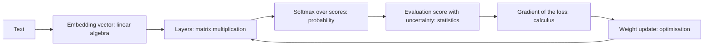

## Introduction

Open the documentation for any embedding API and you will read that results are ranked by "cosine similarity". Read about sampling from a language model and you will meet "logits", "softmax" and "temperature". Read an evaluation report and you will see "accuracy 0.86 ± 0.03". Read a fine-tuning guide and you will be asked to choose an optimiser, a learning rate and a "cosine schedule with warm-up". Each of those phrases is a small piece of mathematics, and an engineer who does not know what they mean is forced to copy settings without understanding them.

The good news is that applied AI engineering needs a surprisingly small, specific slice of mathematics, and none of it requires proving theorems. You need:

- **Linear algebra** to understand what an embedding is, why similarity is a dot product, and why tensors have the shapes they do.
- **Probability** to understand model outputs as distributions, reason about classifiers with Bayes' theorem, and know what sampling does.
- **Statistics** to summarise latencies and scores honestly and to tell a real improvement from noise.
- **Calculus** — derivatives, gradients and the chain rule — to understand how models learn.
- **Optimisation** to choose and tune the algorithms that do the learning.

This lesson teaches each of these "just in time": every idea is introduced through the AI task that needs it, and every formula is accompanied by a short Python program that computes it, so you can change the numbers and watch what happens. The programs use only the Python 3.12 standard library. In real work you would use NumPy or PyTorch, which do the same arithmetic thousands of times faster; seeing it written out once with plain loops is what makes those libraries' behaviour unsurprising.

## Before you start

- **Python basics** — lists, functions, loops, comprehensions and f-strings. See [[e1-syntax]].
- **NumPy (optional)** — helpful for seeing how these operations look in a real library. See [[e1-numpy]].
- **What training is** — that a model has parameters adjusted to reduce a loss. The overview is in [[e2-training-evaluation]]; this lesson supplies the mathematics underneath it.

School algebra is enough: you should be comfortable with `x²`, square roots, and reading a formula with a summation sign `Σ`, which means "add up the following for every item".

## The intuition

Think about what a machine learning system does to a sentence such as "how do I get my money back?". First it turns the text into a list of numbers — a point in a space with hundreds of dimensions, placed so that sentences with similar meanings sit near each other. Measuring "near" is **linear algebra**. The model then processes those numbers by multiplying them by large grids of learned weights, which is also linear algebra.

At the end, the model does not output an answer; it outputs a set of scores that become a **probability distribution** — "refund question 84%, password question 11%, other 5%" — and either picks the most likely option or samples one. That is **probability**.

To know whether the model is any good, you run it on a few hundred labelled examples and get a score. Whether that score would be similar on a different few hundred examples is a question for **statistics**.

How did the weights get their values? Training measured how wrong the model was and asked, for each weight, "if I nudge this weight up slightly, does the error go up or down, and by how much?" That rate of change is a **derivative**, all of them together form a **gradient**, and computing them through many layers uses the **chain rule**. Using gradients to update the weights efficiently is **optimisation**.

Each section below takes one of those steps and makes it precise.



## Vectors, Matrices, Tensors & Dot Products {#e2-linear-algebra}

**Linear algebra** is the mathematics of lists and grids of numbers and the operations on them. A **vector** is an ordered list of numbers, such as `[0.9, 0.1, 0.0, 0.3]`. A **matrix** is a rectangular grid of numbers with rows and columns. A **tensor** generalises both to any number of dimensions. The **dot product** combines two vectors into one number that measures how much they point in the same direction. These four ideas are enough to understand embeddings, similarity search and what happens inside a neural network layer.

### Vectors as points and directions

A vector with `n` numbers can be read as a point in `n`-dimensional space, or as an arrow from the origin to that point. With two numbers you can draw it on paper: `[3, 4]` is three units right and four up. The arrow's **length** (or **norm**) comes from Pythagoras: `√(3² + 4²) = 5`. In general, the length of a vector `a` is `‖a‖ = √(a₁² + a₂² + … + aₙ²)`.

An **embedding** is a vector that represents something — a word, a sentence, an image, a product — chosen by a model so that similar things get nearby vectors. Real text embeddings have hundreds to a few thousand dimensions; you cannot picture 1,536-dimensional space, but every formula works the same way as in two dimensions. Each individual dimension usually has no human-readable meaning; it is the overall direction that carries the meaning. Embeddings themselves are taught in [[e5-embeddings]].

### The dot product and cosine similarity

The **dot product** of two vectors of the same length multiplies matching entries and adds the results:

```text
a · b = a₁b₁ + a₂b₂ + … + aₙbₙ
```

For `[1, 2, 3] · [4, 5, 6]` that is `4 + 10 + 18 = 32`. Geometrically, `a · b = ‖a‖ · ‖b‖ · cos(θ)`, where `θ` (theta) is the angle between the arrows. So the dot product is large and positive when the vectors point the same way, zero when they are at right angles (**orthogonal**), and negative when they point in opposite directions.

Dividing out the lengths leaves only the angle. That is **cosine similarity**:

```text
cosine(a, b) = (a · b) / (‖a‖ · ‖b‖)
```

It ranges from −1 (opposite) through 0 (unrelated) to 1 (same direction), regardless of how long the vectors are. Here it is used to rank documents against a query, as a semantic search system would:

```python title="vectors.py"
import math

def dot(a, b):
    assert len(a) == len(b), "dot product needs vectors of the same length"
    return sum(x * y for x, y in zip(a, b))

def norm(a):
    return math.sqrt(dot(a, a))

def cosine(a, b):
    return dot(a, b) / (norm(a) * norm(b))

# Toy 4-dimensional "embeddings". Real ones have hundreds or thousands of dimensions.
docs = {
    "refund policy":      [0.9, 0.1, 0.0, 0.3],
    "return an item":     [0.8, 0.2, 0.1, 0.4],
    "reset my password":  [0.1, 0.9, 0.3, 0.0],
    "chocolate cake":     [0.0, 0.1, 0.9, 0.1],
}
query = [0.85, 0.15, 0.05, 0.35]   # "how do I get my money back?"

for text, vec in sorted(docs.items(), key=lambda kv: -cosine(query, kv[1])):
    print(f"{text:18} dot={dot(query, vec):.3f}  cosine={cosine(query, vec):.3f}")

# Scaling a vector changes its dot product but not its direction (cosine).
doubled = [2 * v for v in docs["refund policy"]]
print(f"{'refund policy x2':18} dot={dot(query, doubled):.3f}  "
      f"cosine={cosine(query, doubled):.3f}")
```

```output
refund policy      dot=0.885  cosine=0.995
return an item     dot=0.855  cosine=0.994
reset my password  dot=0.235  cosine=0.264
chocolate cake     dot=0.095  cosine=0.112
refund policy x2   dot=1.770  cosine=0.995
```

The vectors were made up so the effect is easy to see, but the mechanics are exactly what a vector database does. The query vector points in nearly the same direction as "refund policy" and "return an item", so their cosine similarities are close to 1, while "chocolate cake" points somewhere else entirely. The last line shows the difference between the two measures: doubling a vector doubles its dot product but leaves its cosine unchanged, because cosine only looks at direction.

That difference has a practical consequence. Many embedding models return **normalised** vectors — vectors scaled to length 1. For unit-length vectors, `‖a‖ = ‖b‖ = 1`, so cosine similarity *equals* the dot product, and systems use the cheaper dot product. If your vectors are not normalised, ranking by raw dot product rewards long vectors, which may simply correspond to longer or more repetitive texts. The trade-offs between cosine, dot product and Euclidean distance are covered in [[e5-dot-euclidean]] and [[e5-cosine]].

### Matrices: many dot products at once

A **matrix** with `m` rows and `n` columns has **shape** `(m, n)`. Multiplying a matrix `W` of shape `(m, n)` by a vector `x` of length `n` produces a vector of length `m`, and each output entry is the dot product of one row of `W` with `x`. That operation, plus adding a **bias** vector `b`, is the core of a neural network layer: `y = Wx + b`. Each row of `W` is a learned "detector", and each output says how strongly the input matches that detector.

Multiplying two matrices extends the idea. For `A` of shape `(m, n)` and `B` of shape `(n, p)`, the product `AB` has shape `(m, p)`, and entry `(i, j)` is the dot product of row `i` of `A` with column `j` of `B`. The **inner dimensions must match** — `n` in both — or the product is undefined. That single rule explains most of the "shape mismatch" errors you will see in PyTorch.

```python title="matrices.py"
def matvec(W, x):
    """Each output is the dot product of one row of W with x."""
    return [sum(w * xi for w, xi in zip(row, x)) for row in W]

def matmul(A, B):
    """(m x n) @ (n x p) -> (m x p). Inner dimensions must match."""
    n, p = len(B), len(B[0])
    assert all(len(row) == n for row in A), "inner dimensions must match"
    return [[sum(A[i][k] * B[k][j] for k in range(n)) for j in range(p)]
            for i in range(len(A))]

def shape(t):
    """Shape of a nested-list tensor, e.g. [batch, rows, cols]."""
    dims = []
    while isinstance(t, list):
        dims.append(len(t))
        t = t[0]
    return tuple(dims)

# A tiny "layer": 3 input features -> 2 outputs. Weight matrix shape (2, 3).
W = [[0.5, -1.0, 2.0],
     [1.5,  0.0, -0.5]]
b = [0.1, -0.2]
x = [1.0, 2.0, 3.0]
y = [v + bi for v, bi in zip(matvec(W, x), b)]
print("W shape", shape(W), "x length", len(x), "-> y", y)

# A batch of 4 inputs stacked as rows: X is (4, 3). X @ W^T is (4, 2).
X = [[1.0, 2.0, 3.0], [0.0, 1.0, 0.0], [2.0, 0.0, 1.0], [1.0, 1.0, 1.0]]
W_T = [list(col) for col in zip(*W)]          # transpose: (3, 2)
Y = matmul(X, W_T)
print("X shape", shape(X), "@ W^T shape", shape(W_T), "->", shape(Y))
for row in Y:
    print("  ", row)

# Matrix multiplication is not commutative.
A = [[1, 2], [3, 4]]
B = [[0, 1], [1, 0]]
print("A@B =", matmul(A, B), " B@A =", matmul(B, A))

# A rank-3 tensor: a batch of 2 sequences, 3 tokens each, 4 numbers per token.
batch = [[[0.0] * 4 for _ in range(3)] for _ in range(2)]
print("token tensor shape", shape(batch))
```

```output
W shape (2, 3) x length 3 -> y [4.6, -0.2]
X shape (4, 3) @ W^T shape (3, 2) -> (4, 2)
   [4.5, 0.0]
   [-1.0, 0.0]
   [3.0, 2.5]
   [1.5, 1.0]
A@B = [[2, 1], [4, 3]]  B@A = [[3, 4], [1, 2]]
token tensor shape (2, 3, 4)
```

Trace the first output by hand: row one of `W` dotted with `x` is `0.5·1 − 1.0·2 + 2.0·3 = 4.5`, plus the bias `0.1` gives `4.6`. Row two gives `1.5 − 1.5 = 0`, plus `−0.2`.

The batch section shows how real frameworks work. Instead of looping over inputs, they stack a **batch** of inputs as the rows of a matrix `X` and do one matrix multiplication. To make the shapes line up — `(4, 3)` times something must have 3 rows — the weight matrix is **transposed** (rows and columns swapped, written `Wᵀ`) to shape `(3, 2)`. The result has one row per input and one column per output. The first row of `Y` equals the single-input result without the bias, as it should. PyTorch's `nn.Linear` layer stores its weight as `(out_features, in_features)` and computes `x @ W.T + b` for exactly this reason. Doing the work as one big matrix multiplication is also what makes GPUs fast: they are built to perform thousands of these multiply-and-add operations in parallel.

The `A@B` line is a warning: unlike ordinary multiplication, **matrix multiplication is not commutative** — `AB` and `BA` are generally different, and often only one of them is even defined.

### Tensors and shapes

A **tensor** is the general term for an array with any number of dimensions (also called **axes**). A single number is a rank-0 tensor (a scalar), a vector is rank 1, a matrix is rank 2. Language models work constantly with rank-3 tensors of shape `(batch, sequence_length, hidden_size)`: several sequences, each a list of tokens, each token represented by a vector. The last line of the program builds a small one of shape `(2, 3, 4)`. Images are typically rank 4: `(batch, channels, height, width)`.

Most bugs in model code are shape bugs, so it is worth getting into the habit of writing the shape next to every tensor, as in the comments above. Libraries also support **broadcasting**: when you add a vector of shape `(4,)` to a matrix of shape `(3, 4)`, the vector is reused for each of the three rows without being copied. Broadcasting is convenient, and it is also a source of silent errors when shapes line up accidentally — adding a `(3, 1)` tensor to a `(3,)` tensor produces a `(3, 3)` result, not a `(3,)` one. NumPy's rules are explained in [[e1-numpy]] and PyTorch tensors in [[e2-pytorch-tensors-autograd]].

> [!TIP] Read shapes before reading values
> When a model or a similarity search behaves strangely, print the shapes first. A query embedding of shape `(1, 768)` compared against a document matrix of shape `(768, 10000)` gives `(1, 10000)` scores — one per document. If you see `(768, 768)` or `(10000,)`, a transpose is missing or an axis was dropped.

```quiz
Q: A model's embedding vectors are normalised to length 1. Why can a vector database rank results by dot product instead of cosine similarity?
- [ ] Dot product is more accurate than cosine similarity
- [x] For unit-length vectors, cosine similarity equals the dot product, and the dot product is cheaper to compute
- [ ] Cosine similarity only works in two dimensions
- [ ] Normalised vectors always have a dot product of 1
> Cosine similarity is the dot product divided by the product of the lengths. When both lengths are 1, the division changes nothing, so ranking by dot product gives exactly the same order with less work. Two different unit vectors have a dot product of 1 only if they are identical.
```

## Probability, Bayes, Expectation & Sampling {#e2-probability}

**Probability** is the mathematics of uncertainty: it assigns each possible outcome a number between 0 (impossible) and 1 (certain), with the numbers for all outcomes adding up to 1. Machine learning models are probabilistic at their core — a classifier outputs "spam with probability 0.93", and a language model outputs a probability for every possible next token. **Bayes' theorem** updates a probability when new evidence arrives, **expectation** gives the long-run average of an uncertain quantity, and **sampling** draws concrete outcomes from a distribution.

### Distributions, joint and conditional probability

A **random variable** is a quantity whose value is uncertain, such as "the next token" or "whether this transaction is fraud". Its **probability distribution** lists each possible value with its probability. A fair die has six outcomes with probability 1/6 each. A language model's next-token distribution has one entry per vocabulary token — often 30,000 to 200,000 of them.

Three kinds of probability appear constantly:

- **Marginal** probability `P(A)`: the probability of `A` on its own, such as "2% of messages are toxic".
- **Joint** probability `P(A and B)`: the probability that both happen.
- **Conditional** probability `P(A | B)`, read "probability of A given B": the probability of `A` once you know `B` happened. It equals `P(A and B) / P(B)`.

Conditional probability is not symmetric, and confusing `P(A | B)` with `P(B | A)` is one of the most common reasoning errors in evaluating classifiers. "95% of toxic messages are flagged" is `P(flag | toxic)`. "95% of flagged messages are toxic" would be `P(toxic | flag)`. They can be wildly different, as the next example shows. A language model is itself a conditional distribution: `P(next token | all previous tokens)`.

### Bayes' theorem

**Bayes' theorem** connects the two directions:

```text
P(A | B) = P(B | A) · P(A) / P(B)
```

In words: to get the probability of a cause given the evidence, take how likely the evidence is under that cause, multiply by how common the cause was beforehand (the **prior**), and divide by how common the evidence is overall. The result is the **posterior** probability.

Here is a realistic case. A content filter catches 95% of toxic messages (recall 0.95) and wrongly flags 5% of clean messages. Only 2% of messages are toxic. When a message is flagged, how likely is it to really be toxic?

```python title="bayes.py"
import random

# A content filter flags toxic messages. 2% of messages are toxic.
p_toxic = 0.02
p_flag_given_toxic = 0.95      # recall (sensitivity)
p_flag_given_clean = 0.05      # false positive rate

# Bayes' theorem: P(toxic | flag) = P(flag | toxic) P(toxic) / P(flag)
p_flag = p_flag_given_toxic * p_toxic + p_flag_given_clean * (1 - p_toxic)
p_toxic_given_flag = p_flag_given_toxic * p_toxic / p_flag
print(f"P(flag)         = {p_flag:.4f}")
print(f"P(toxic | flag) = {p_toxic_given_flag:.3f}")

# Check by simulation: generate a million messages and count.
rng = random.Random(0)
flagged = toxic_and_flagged = 0
for _ in range(1_000_000):
    toxic = rng.random() < p_toxic
    flag = rng.random() < (p_flag_given_toxic if toxic else p_flag_given_clean)
    if flag:
        flagged += 1
        toxic_and_flagged += toxic
print(f"simulated       = {toxic_and_flagged / flagged:.3f}  ({flagged} flagged)")
```

```output
P(flag)         = 0.0680
P(toxic | flag) = 0.279
simulated       = 0.281  (67948 flagged)
```

`P(flag)` is computed with the **law of total probability**: a message can be flagged either because it is toxic and caught (0.95 × 0.02 = 0.019) or because it is clean and wrongly flagged (0.05 × 0.98 = 0.049). Adding them gives 0.068. Bayes' theorem then gives 0.019 / 0.068 ≈ 0.279.

So a filter that sounds excellent — 95% recall, only 5% false positives — is wrong about **72% of the messages it flags**. The reason is the **base rate**: clean messages outnumber toxic ones 49 to 1, so even a small false positive rate applied to the huge clean population produces more false alarms than true catches. The simulation confirms the formula without any algebra: out of about 68,000 flagged messages, only 28% were toxic. In metric terms, `P(toxic | flag)` is the filter's **precision**, and this is why precision collapses on rare-event problems (see [[e2-classification-metrics]]). Ignoring the prior in this way is called the **base-rate fallacy**.

Bayes' theorem is also the basis of the **naive Bayes** classifier, a fast, classic baseline for text classification, and of the general idea of updating beliefs as evidence arrives.

### Expectation and variance

The **expected value** (or **expectation**) `E[X]` of a random variable is the probability-weighted average of its values — the long-run average you would see over many repetitions:

```text
E[X] = Σ value × probability
```

The **variance** measures how spread out the values are: the expected squared distance from the mean, `Var(X) = E[(X − E[X])²]`. Its square root, the **standard deviation**, is in the same units as `X`.

```python title="expectation.py"
import random

# Each call to a flaky API: 90% succeed in 200 ms, 10% time out after 2,000 ms.
outcomes = [(0.9, 200), (0.1, 2000)]
expected = sum(p * ms for p, ms in outcomes)
variance = sum(p * (ms - expected) ** 2 for p, ms in outcomes)
print(f"expected latency = {expected:.0f} ms, std dev = {variance ** 0.5:.0f} ms")

rng = random.Random(1)
for n in (10, 1_000, 100_000):
    samples = [200 if rng.random() < 0.9 else 2000 for _ in range(n)]
    print(f"mean of {n:>7} samples = {sum(samples) / n:7.1f} ms")
```

```output
expected latency = 380 ms, std dev = 540 ms
mean of      10 samples =   200.0 ms
mean of    1000 samples =   387.2 ms
mean of  100000 samples =   382.8 ms
```

The expected latency is 0.9 × 200 + 0.1 × 2,000 = 380 ms, even though no single call ever takes 380 ms. That is typical: the expected value is a summary of the distribution, not a likely outcome. The simulation illustrates the **law of large numbers** — the average of many independent samples approaches the expected value. With 10 samples, every call happened to succeed and the average was 200 ms; with 100,000 it is within a few milliseconds of 380. Small samples can be badly misleading, which is the starting point for the statistics section.

Expectation is everywhere in machine learning. The training loss is an average over examples, standing in for the expected loss over all possible data. The cost of an LLM feature is the expected number of tokens per request times the price per token.

### Softmax: turning scores into a distribution

A classifier or language model's final layer outputs raw, unbounded scores called **logits**, one per class or token. To turn them into probabilities, models apply **softmax**:

```text
softmax(zᵢ) = e^(zᵢ / T) / Σⱼ e^(zⱼ / T)
```

Exponentiating makes every value positive and exaggerates differences; dividing by the total makes them sum to 1. `T` is the **temperature**, normally 1. Dividing logits by `T < 1` makes the distribution sharper (more confident); `T > 1` makes it flatter. **Sampling** means drawing an outcome at random according to those probabilities, which is how a language model generates varied text instead of always choosing the single most likely token.

```python title="sampling.py"
import math
import random

def softmax(logits, temperature=1.0):
    scaled = [z / temperature for z in logits]
    m = max(scaled)                        # subtract the max for numerical stability
    exps = [math.exp(z - m) for z in scaled]
    total = sum(exps)
    return [e / total for e in exps]

tokens = ["Paris", "Lyon", "London", "banana"]
logits = [4.0, 2.0, 1.0, -2.0]             # raw scores from a model's final layer

for t in (0.5, 1.0, 2.0):
    probs = softmax(logits, t)
    print(f"T={t}: " + "  ".join(f"{tok}={p:.3f}" for tok, p in zip(tokens, probs)))

rng = random.Random(42)
probs = softmax(logits)
draws = rng.choices(tokens, weights=probs, k=10_000)
print("10,000 samples at T=1:", {tok: draws.count(tok) for tok in tokens})
```

```output
T=0.5: Paris=0.980  Lyon=0.018  London=0.002  banana=0.000
T=1.0: Paris=0.842  Lyon=0.114  London=0.042  banana=0.002
T=2.0: Paris=0.609  Lyon=0.224  London=0.136  banana=0.030
10,000 samples at T=1: {'Paris': 8462, 'Lyon': 1076, 'London': 442, 'banana': 20}
```

Imagine these are the model's scores for the next token after "The capital of France is". At temperature 0.5, "Paris" gets 98% of the probability. At 2.0, the distribution flattens and even "banana" gets 3%. The sampling line shows that drawing 10,000 tokens at `T = 1` reproduces the probabilities closely — about 84.6% "Paris" — and that low-probability tokens still appear occasionally: "banana" was chosen 20 times. Over a long generated text, those rare draws add up, which is one reason higher temperatures make output more creative and less reliable.

Subtracting the maximum logit before exponentiating does not change the result (it cancels in the division) but prevents `math.exp` from overflowing when logits are large — a standard trick in every real implementation. Temperature, top-k and top-p sampling for LLMs are covered in [[e2-temperature]].

```quiz
Q: A fraud model flags 90% of fraudulent transactions and 1% of legitimate ones. Fraud is 1 in 1,000 transactions. Roughly what fraction of flagged transactions are fraud?
- [ ] About 90%
- [ ] About 99%
- [x] About 8%
- [ ] About 50%
> By Bayes' theorem, P(flag) is 0.9 × 0.001 + 0.01 × 0.999 ≈ 0.0109, and P(fraud | flag) is 0.0009 / 0.0109 ≈ 0.083. The base rate is so low that false alarms from the huge legitimate population outnumber real catches about eleven to one. 90% is P(flag | fraud), the reverse conditional.
```

## Statistics, Correlation & Confidence {#e2-statistics}

**Statistics** is the practice of summarising data and drawing conclusions from samples while accounting for randomness. Probability starts from a known distribution and asks what data it will produce; statistics starts from data and asks what can be concluded about the process that produced it. For an AI engineer, statistics answers three practical questions: how to summarise measurements such as latency and cost, how to tell whether two quantities are related, and how confident to be in an evaluation score.

### Describing data: mean, median, spread and percentiles

The **mean** is the sum divided by the count. The **median** is the middle value when the data is sorted. The **standard deviation** measures typical distance from the mean. **Percentiles** describe the distribution's shape: the 95th percentile (**p95**) is the value below which 95% of observations fall.

```python title="describe.py"
import statistics as st

# Response times (ms) of 20 LLM API calls. Two calls hit a cold start.
latency = [820, 790, 910, 870, 760, 805, 840, 4200, 880, 830,
           795, 850, 900, 815, 780, 860, 3900, 825, 845, 810]

print(f"mean   = {st.mean(latency):7.1f} ms")
print(f"median = {st.median(latency):7.1f} ms")
print(f"stdev  = {st.stdev(latency):7.1f} ms   (sample standard deviation)")
q = st.quantiles(latency, n=20, method="inclusive")   # cut points at 5%, 10%, ..., 95%
print(f"p50 = {q[9]:.0f} ms, p90 = {q[17]:.0f} ms, p95 = {q[18]:.0f} ms")
```

```output
mean   =  1154.2 ms
median =   835.0 ms
stdev  =   992.3 ms   (sample standard deviation)
p50 = 835 ms, p90 = 1209 ms, p95 = 3915 ms
```

Eighteen calls took between 760 and 910 ms, and two took around 4 seconds. The mean of 1,154 ms describes *no* real call: it is pulled up by the two slow ones. The median, 835 ms, describes a typical call. The standard deviation, 992 ms, is also inflated by the outliers and badly overstates how variable a normal call is. For skewed data such as latency, cost and token counts, report the **median and high percentiles** rather than the mean and standard deviation. The p95 of 3,915 ms tells the product team that one user in twenty waits about four seconds — which matters more to user experience than any average. With only 20 samples, though, percentiles beyond the middle are unreliable: p90 here is an interpolation between the 18th value (910 ms) and the 19th (3,900 ms), and one more slow call would move it dramatically. Serving metrics are covered in [[e8-serving-slo]].

`st.stdev` computes the **sample** standard deviation, dividing by `n − 1` rather than `n`. Dividing by `n − 1` corrects for the fact that the sample mean is itself fitted to the data, which otherwise makes the spread look slightly smaller than it is.

### Correlation and what it does not tell you

**Correlation** measures how strongly two quantities move together. The **Pearson correlation coefficient** `r` ranges from −1 (perfect negative linear relationship) through 0 (no linear relationship) to +1 (perfect positive linear relationship).

```python title="correlation.py"
import statistics as st

prompt_tokens = [120, 450, 300, 800, 650, 200, 950, 500]
latency_ms    = [610, 980, 820, 1450, 1210, 700, 1690, 1010]
user_rating   = [4, 5, 3, 4, 5, 4, 3, 4]

print(f"tokens vs latency: r = {st.correlation(prompt_tokens, latency_ms):.3f}")
print(f"tokens vs rating:  r = {st.correlation(prompt_tokens, user_rating):.3f}")

# Correlation only measures *linear* association.
xs = [-3, -2, -1, 0, 1, 2, 3]
ys = [x * x for x in xs]                      # perfectly determined by x
print(f"y = x^2 on symmetric xs: r = {st.correlation(xs, ys):.3f}")
```

```output
tokens vs latency: r = 0.995
tokens vs rating:  r = -0.097
y = x^2 on symmetric xs: r = 0.000
```

Prompt length and latency are almost perfectly correlated in this sample: longer prompts take longer to process. Prompt length and user rating show essentially no linear relationship. The third line is the important caveat: `y = x²` is completely determined by `x`, yet `r` is exactly 0, because the relationship is a U-shape, not a line. A correlation near zero means "no *linear* relationship", not "no relationship". Plot the data before trusting `r`.

The second caveat is the famous one: **correlation is not causation**. If conversations that use a retrieval tool get higher ratings, it might be that retrieval improves answers — or that retrieval is triggered by factual questions, which are easier to answer well in the first place. A **confounder** (question type) can drive both. The way to establish cause is an experiment that assigns the treatment at random, such as an A/B test (see [[e9-ab-testing]]).

### How much to trust an evaluation score

Suppose your classifier gets 86% accuracy on a 400-example evaluation set. If you had drawn a different 400 examples from the same population, you would not get exactly 86% again. A **confidence interval** expresses that uncertainty: a range, computed from the data, that would contain the true accuracy in a stated fraction (commonly 95%) of repeated experiments.

For a proportion `p` measured on `n` independent examples, the **standard error** — the typical size of the sampling error — is `√(p(1 − p) / n)`. Because averages of many independent values are approximately normally distributed (the **central limit theorem**), about 95% of samples land within 1.96 standard errors of the true value. That gives the familiar formula `p ± 1.96 · SE`. A second method, the **bootstrap**, makes no distributional assumption: resample the evaluation set *with replacement* thousands of times, recompute the score each time, and take the middle 95% of the results.

```python title="confidence.py"
import math
import random

rng = random.Random(7)
# Per-example results of a classifier on a 400-example evaluation set (1 = correct).
results = [1 if rng.random() < 0.86 else 0 for _ in range(400)]
n = len(results)
acc = sum(results) / n

# Normal-approximation 95% interval: p +/- 1.96 * sqrt(p(1-p)/n)
se = math.sqrt(acc * (1 - acc) / n)
print(f"accuracy = {acc:.3f}, standard error = {se:.4f}")
print(f"95% CI (normal approx): [{acc - 1.96 * se:.3f}, {acc + 1.96 * se:.3f}]")

# Bootstrap: resample the evaluation set with replacement many times.
boot = sorted(sum(rng.choices(results, k=n)) / n for _ in range(10_000))
print(f"95% CI (bootstrap):     [{boot[249]:.3f}, {boot[9749]:.3f}]")

for size in (100, 400, 1600, 6400):
    half_width = 1.96 * math.sqrt(acc * (1 - acc) / size)
    print(f"n={size:5}: accuracy {acc:.3f} +/- {half_width:.3f}")
```

```output
accuracy = 0.860, standard error = 0.0173
95% CI (normal approx): [0.826, 0.894]
95% CI (bootstrap):     [0.825, 0.892]
n=  100: accuracy 0.860 +/- 0.068
n=  400: accuracy 0.860 +/- 0.034
n= 1600: accuracy 0.860 +/- 0.017
n= 6400: accuracy 0.860 +/- 0.009
```

Both methods agree: the true accuracy is plausibly anywhere from about 82.5% to 89.4%. The bootstrap indices 249 and 9,749 pick the 2.5th and 97.5th percentiles of the 10,000 sorted resampled scores. The last four lines show the most useful rule of thumb in evaluation: the interval's width shrinks with the **square root** of the sample size. Quadrupling the evaluation set halves the uncertainty. To distinguish an 86% model from an 87% model reliably you need thousands of examples, not dozens.

The normal approximation behaves poorly when `p` is near 0 or 1 or when `n` is small (it can even produce intervals outside 0 to 1); the **Wilson interval** or the bootstrap is better there.

### Comparing two models fairly

The most common statistical question in AI engineering is "is version B better than version A?" The right approach evaluates both on the **same** examples and analyses the per-example differences — a **paired** comparison. Pairing removes the variation caused by some examples being harder than others.

```python title="compare.py"
import random

rng = random.Random(11)
# Two prompt versions graded on the SAME 500 evaluation examples (1 = correct).
# Each example has a difficulty that affects both versions.
a, b = [], []
for _ in range(500):
    difficulty = rng.random()
    a.append(1 if rng.random() > difficulty * 0.30 else 0)
    b.append(1 if rng.random() > difficulty * 0.26 else 0)

n = len(a)
diff = (sum(b) - sum(a)) / n
print(f"A = {sum(a) / n:.3f}, B = {sum(b) / n:.3f}, difference = {diff:+.3f}")
print("examples where they disagree:", sum(x != y for x, y in zip(a, b)))

# Paired bootstrap: resample example indices, keep each A/B pair together.
diffs = []
for _ in range(10_000):
    idx = rng.choices(range(n), k=n)
    diffs.append(sum(b[i] - a[i] for i in idx) / n)
diffs.sort()
print(f"95% CI for B - A: [{diffs[249]:+.3f}, {diffs[9749]:+.3f}]")
not_better = sum(d <= 0 for d in diffs) / len(diffs)
print(f"share of resamples where B is not better: {not_better:.3f}")
```

```output
A = 0.842, B = 0.846, difference = +0.004
examples where they disagree: 120
95% CI for B - A: [-0.040, +0.046]
share of resamples where B is not better: 0.445
```

By construction, version B really is slightly better: its error rate grows more slowly with difficulty, so its expected accuracy is about 87% against A's 85%. But on these 500 examples B scored only 0.4 points higher, the 95% interval for the difference runs from −4.0 to +4.6 points, and in 44.5% of resamples B was not ahead at all. The honest conclusion is "we cannot tell these apart with 500 examples", not "B wins". Teams that ship every prompt change that scores a point higher on a small evaluation set are mostly shipping noise. Evaluation design is covered further in [[e9-offline-evals]] and [[e9-probabilistic-testing]].

> [!WARNING] Many comparisons inflate false wins
> If you compare twenty prompt variants against a baseline at a 95% confidence level, you should expect about one to look significantly better by chance alone. Decide in advance what you will compare, confirm surprising wins on fresh data, and be suspicious of the single best result out of many tries.

```quiz
Q: Your evaluation set has 100 examples and model accuracy is 80%. Roughly how wide is the 95% confidence interval, and what would halve it?
- [ ] About ±1 point; doubling the set to 200 examples halves it
- [x] About ±8 points; quadrupling the set to 400 examples halves it
- [ ] About ±20 points; it cannot be reduced
- [ ] About ±8 points; doubling the set to 200 examples halves it
> The standard error is √(0.8 × 0.2 / 100) = 0.04, so the 95% half-width is about 1.96 × 0.04 ≈ 0.078. Width scales with 1/√n, so halving it needs four times as many examples. Doubling the set only shrinks it by a factor of about 1.41.
```

## Derivatives, Gradients & Chain Rule {#e2-calculus-gradients}

**Calculus**, for machine learning purposes, is the mathematics of rates of change. A **derivative** says how fast a function's output changes when its input changes slightly. A **gradient** collects the derivatives of a function with respect to each of its many inputs into one vector. The **chain rule** computes the derivative of a function built by chaining simpler functions together — which is exactly what a neural network is. Together they let a training algorithm work out, for every one of millions of weights, which direction to adjust it.

### The derivative as a slope

For a function `f(x)`, the derivative `f′(x)` (also written `df/dx`) is the slope of the curve at `x`: if you increase `x` by a tiny amount `h`, the output changes by about `f′(x) · h`. Positive slope means the function is rising, negative means falling, zero means a flat spot — possibly a minimum or maximum.

You can always *estimate* a derivative numerically by evaluating the function at two nearby points: `f′(x) ≈ (f(x + h) − f(x − h)) / (2h)` for small `h`. This is the **central difference**. Calculus also gives exact rules, of which the most useful are:

| Rule | Function | Derivative |
|---|---|---|
| Constant | `c` | `0` |
| Power | `xⁿ` | `n · xⁿ⁻¹` |
| Sum | `f(x) + g(x)` | `f′(x) + g′(x)` |
| Constant multiple | `c · f(x)` | `c · f′(x)` |
| Exponential | `eˣ` | `eˣ` |
| Natural log | `ln x` | `1 / x` |
| Sigmoid | `σ(x) = 1 / (1 + e⁻ˣ)` | `σ(x) · (1 − σ(x))` |

```python title="derivative.py"
def f(x):
    return x ** 3 - 2 * x

def f_prime(x):
    return 3 * x ** 2 - 2          # from the power rule

def numeric_derivative(func, x, h=1e-5):
    # Central difference: slope of the line through x-h and x+h.
    return (func(x + h) - func(x - h)) / (2 * h)

for x in (-1.0, 0.0, 2.0):
    approx = numeric_derivative(f, x)
    print(f"x={x:5}: rule gives {f_prime(x):7.4f}, numeric gives {approx:7.4f}")

# Partial derivatives of g(w, b) = (w*3 + b - 10)^2 at w=1, b=2.
def g(w, b):
    return (w * 3 + b - 10) ** 2

w, b = 1.0, 2.0
dg_dw = numeric_derivative(lambda v: g(v, b), w)
dg_db = numeric_derivative(lambda v: g(w, v), b)
print(f"gradient of g at (1, 2): ({dg_dw:.4f}, {dg_db:.4f})")
print(f"analytic: ({2 * (w * 3 + b - 10) * 3:.4f}, {2 * (w * 3 + b - 10):.4f})")
```

```output
x= -1.0: rule gives  1.0000, numeric gives  1.0000
x=  0.0: rule gives -2.0000, numeric gives -2.0000
x=  2.0: rule gives 10.0000, numeric gives 10.0000
gradient of g at (1, 2): (-30.0000, -10.0000)
analytic: (-30.0000, -10.0000)
```

The power rule turns `x³ − 2x` into `3x² − 2`, and the numerical estimate agrees at every point. At `x = 0` the slope is −2: the function is falling there. At `x = 2` it is rising steeply.

### Partial derivatives and the gradient

A model's loss depends on many parameters at once. A **partial derivative**, written `∂L/∂w`, is the derivative with respect to one input while all the others are held fixed. The **gradient**, written `∇L` ("nabla L" or "grad L"), is the vector of all partial derivatives: `∇L = [∂L/∂w₁, ∂L/∂w₂, …]`.

The second half of the program does this for `g(w, b) = (3w + b − 10)²`, which you can read as the squared error of a model predicting `3w + b` when the answer is 10. At `w = 1, b = 2`, the prediction is 5, too low by 5. The gradient is `(−30, −10)`. Both entries are negative, meaning that increasing either parameter would *decrease* the error, and `w` has three times the influence of `b` because it is multiplied by the input 3. Gradient descent moves the parameters in the direction of `−∇L` — here, increasing both, `w` more than `b`. The gradient always points in the direction of steepest increase, so its negative is the direction of steepest decrease. How that step is taken is the subject of [[e2-gradient-descent]].

### The chain rule

Models are compositions: the input goes through a linear step, then an activation function, then a loss. If `y = f(u)` and `u = g(x)`, the **chain rule** says

```text
dy/dx = dy/du · du/dx
```

The rate of change through a chain is the product of the rates of change of each link. If `u` changes 3 times as fast as `x`, and `y` changes 2 times as fast as `u`, then `y` changes 6 times as fast as `x`. For a longer chain you keep multiplying.

Here is one logistic "neuron" with its loss, written as three steps — `z = w·x + b`, then `p = σ(z)`, then the log loss — with the gradient computed by hand, link by link, and then checked numerically.

```python title="chain_rule.py"
import math

# One logistic "neuron" and its loss, written as a chain of small steps:
#   z = w*x + b  ->  p = sigmoid(z)  ->  L = -(y*log(p) + (1-y)*log(1-p))
def forward(w, b, x, y):
    z = w * x + b
    p = 1 / (1 + math.exp(-z))
    loss = -(y * math.log(p) + (1 - y) * math.log(1 - p))
    return z, p, loss

w, b, x, y = 0.5, -1.0, 3.0, 1.0
z, p, loss = forward(w, b, x, y)
print(f"forward:  z={z:.4f}  p={p:.4f}  loss={loss:.4f}")

# Backward pass: multiply local derivatives from the loss back to each parameter.
dL_dp = -(y / p) + (1 - y) / (1 - p)
dp_dz = p * (1 - p)                # derivative of the sigmoid
dz_dw, dz_db = x, 1.0
dL_dz = dL_dp * dp_dz              # chain rule, one link at a time
dL_dw = dL_dz * dz_dw
dL_db = dL_dz * dz_db
print(f"backward: dL/dz={dL_dz:.4f}  (p - y = {p - y:.4f})")
print(f"          dL/dw={dL_dw:.4f}  dL/db={dL_db:.4f}")

# Gradient check: compare with finite differences.
h = 1e-6
num_w = (forward(w + h, b, x, y)[2] - forward(w - h, b, x, y)[2]) / (2 * h)
num_b = (forward(w, b + h, x, y)[2] - forward(w, b - h, x, y)[2]) / (2 * h)
print(f"numeric:  dL/dw={num_w:.4f}  dL/db={num_b:.4f}")
```

```output
forward:  z=0.5000  p=0.6225  loss=0.4741
backward: dL/dz=-0.3775  (p - y = -0.3775)
          dL/dw=-1.1326  dL/db=-0.3775
numeric:  dL/dw=-1.1326  dL/db=-0.3775
```

The **forward pass** computes each intermediate value in order: `z = 0.5`, `p = 0.6225`, and since the true label is 1, the loss is `−ln(0.6225) ≈ 0.474`. The **backward pass** goes the other way. Each step has a simple **local derivative**: the loss with respect to `p`, the sigmoid's derivative `p(1 − p)`, and the linear step's derivatives `x` and `1`. Multiplying along the chain gives each parameter's gradient.

Notice the line `dL/dz = −0.3775 (p − y = −0.3775)`. When you multiply the log loss's derivative by the sigmoid's derivative, the algebra simplifies to `p − y`: predicted probability minus true label. That neat result is why logistic regression and neural network classifiers pair sigmoid or softmax with cross-entropy. The final line is a **gradient check**: the numerical estimate matches the hand-derived gradient to four decimal places, which is how you test a hand-written gradient.

```mermaid title="Forward values flow right; gradients flow back left by multiplication"
flowchart LR
    W["w, b, x"] -->|"z = w·x + b"| Z["z = 0.5"]
    Z -->|"p = σ(z)"| P["p = 0.6225"]
    P -->|"log loss"| L["L = 0.4741"]
    L -.->|"dL/dp"| P
    P -.->|"× p(1 − p)"| Z
    Z -.->|"× x for w, × 1 for b"| W
```

### From one neuron to backpropagation

A neural network is the same structure with millions of links. **Backpropagation** is the chain rule applied systematically: run the forward pass, storing every intermediate value, then walk backwards from the loss, multiplying local derivatives and accumulating each parameter's gradient. Its key property is efficiency: computing the gradient for *all* parameters costs only a small constant multiple of one forward pass, rather than one extra forward pass per parameter as numerical estimation would. With a billion parameters, that difference is the difference between possible and impossible.

You will almost never write backward passes by hand. Frameworks such as PyTorch record the operations of the forward pass and apply the chain rule automatically — **automatic differentiation**, or autograd. Knowing the chain rule still matters for debugging: it explains **vanishing gradients** (multiplying many small local derivatives, such as a saturated sigmoid's `p(1 − p) ≈ 0`, produces a gradient too small to learn from) and **exploding gradients** (multiplying many large ones). Backpropagation in networks is taught in [[e2-forward-backprop]] and autograd in [[e2-pytorch-tensors-autograd]].

```quiz
Q: A network is a chain of ten layers, and at the current inputs each layer's local derivative is about 0.05. What happens to the gradient of the loss that reaches the first layer?
- [ ] It equals 0.05, because only the last link matters
- [ ] It equals 0.5, the sum of the ten local derivatives
- [x] It becomes vanishingly small, about 0.05 to the tenth power
- [ ] It becomes very large
> The chain rule multiplies local derivatives along the chain, so ten links of 0.05 give 0.05¹⁰ ≈ 10⁻¹³ and the early layers barely learn. Adding the derivatives would be wrong: a chain multiplies them. This is the vanishing-gradient problem, which motivated activations such as ReLU and architectures with residual connections.
```

## SGD, Adam & Learning-Rate Schedules {#e2-optimization}

An **optimiser** is the algorithm that uses gradients to update a model's parameters during training. The simplest is **stochastic gradient descent (SGD)**, which steps each parameter against its gradient by a fixed **learning rate**. **Momentum** adds a running memory of past gradients to smooth and accelerate the path. **Adam** goes further and gives each parameter its own effective step size based on the history of its gradients. A **learning-rate schedule** changes the learning rate over the course of training, usually warming it up at the start and decaying it towards the end. Together, the optimiser and schedule decide how quickly and how reliably training converges.

### Plain SGD and its weakness

SGD's update for each parameter `θ` is `θ ← θ − η · g`, where `η` (eta) is the learning rate and `g` is the gradient computed on a mini-batch. The basic algorithm and why it uses mini-batches are explained in [[e2-gradient-descent]]. Its main weakness shows up when the loss surface is shaped like a long, narrow valley — steep across, shallow along. That shape is common: it happens whenever parameters have very different sensitivities, such as weights attached to features on different scales.

In such a valley, one learning rate cannot suit both directions. The steep direction limits how large the step can be before the optimiser overshoots and diverges; the shallow direction then gets tiny steps and crawls. The program below compares SGD, momentum and Adam on the valley `loss = 0.5 · (x² + 200y²)`, which is 200 times steeper in `y` than in `x`, starting from `(10, 1)`.

```python title="optimizers.py"
import math

# A long, narrow valley: steep in y, shallow in x. Minimum at (0, 0).
def loss(x, y):
    return 0.5 * (x ** 2 + 200 * y ** 2)

def grad(x, y):
    return x, 200 * y

def sgd(lr, steps):
    x, y = 10.0, 1.0
    for _ in range(steps):
        gx, gy = grad(x, y)
        x, y = x - lr * gx, y - lr * gy
    return x, y

def momentum(lr, steps, beta=0.9):
    x, y, vx, vy = 10.0, 1.0, 0.0, 0.0
    for _ in range(steps):
        gx, gy = grad(x, y)
        vx, vy = beta * vx + gx, beta * vy + gy     # decaying sum of past gradients
        x, y = x - lr * vx, y - lr * vy
    return x, y

def adam(lr, steps, b1=0.9, b2=0.999, eps=1e-8):
    p = [10.0, 1.0]
    m = [0.0, 0.0]                                  # first moment: mean of gradients
    v = [0.0, 0.0]                                  # second moment: mean of squared grads
    for t in range(1, steps + 1):
        g = grad(*p)
        for i in range(2):
            m[i] = b1 * m[i] + (1 - b1) * g[i]
            v[i] = b2 * v[i] + (1 - b2) * g[i] ** 2
            m_hat = m[i] / (1 - b1 ** t)            # bias correction for early steps
            v_hat = v[i] / (1 - b2 ** t)
            p[i] -= lr * m_hat / (math.sqrt(v_hat) + eps)
    return tuple(p)

for name, fn, lr in [("SGD lr=0.0099", sgd, 0.0099), ("SGD lr=0.0101", sgd, 0.0101),
                     ("momentum lr=0.005", momentum, 0.005), ("Adam lr=0.5", adam, 0.5)]:
    for steps in (50, 200):
        x, y = fn(lr, steps)
        print(f"{name:17} {steps:3} steps: x={x:8.4f} y={y:10.4g} loss={loss(x, y):.3g}")
```

```output
SGD lr=0.0099      50 steps: x=  6.0807 y=    0.3642 loss=31.7
SGD lr=0.0099     200 steps: x=  1.3671 y=   0.01759 loss=0.965
SGD lr=0.0101      50 steps: x=  6.0196 y=     2.692 loss=743
SGD lr=0.0101     200 steps: x=  1.3130 y=     52.48 loss=2.75e+05
momentum lr=0.005  50 steps: x= -0.1419 y=  -0.04965 loss=0.257
momentum lr=0.005 200 steps: x= -0.0004 y=-1.731e-05 loss=9.73e-08
Adam lr=0.5        50 steps: x= -0.3788 y=  -0.05477 loss=0.372
Adam lr=0.5       200 steps: x=  0.0003 y= 1.845e-05 loss=7.45e-08
```

Look at SGD first. The gradient in `y` is `200y`, so each step multiplies `y` by `1 − 200η`. If `200η` exceeds 2, that factor is below −1 and `y` grows with every step: SGD can only be stable when `η < 0.01`. At 0.0099, `y` survives but oscillates, and `x` — whose gradient is only `x` — shrinks by just 1% per step, so after 200 steps it has only fallen from 10 to 1.37. At 0.0101, a hair above the limit, `y` explodes to 52 and the loss to 275,000. The steep direction sets the speed limit; the shallow direction pays for it.

### Momentum

**Momentum** keeps a velocity `v` that accumulates gradients with exponential decay: `v ← β·v + g`, then `θ ← θ − η·v`, with `β` typically 0.9. The physical picture is a heavy ball rolling down the valley. In the steep direction the gradient flips sign every step, so successive contributions largely cancel and the oscillation is damped. In the shallow direction the gradient points the same way every step, so the velocity builds up to roughly `1 / (1 − β) = 10` times a single gradient, and progress accelerates. In the output, momentum at half SGD's learning rate reaches a loss of about 10⁻⁷ in 200 steps, where SGD was still near 1. Momentum's overshoot is visible too: `x` and `y` end slightly negative, having rolled past zero and come back.

### Adam

**Adam** (adaptive moment estimation, Kingma and Ba, 2015) keeps two running averages per parameter: `m`, an exponential moving average of the gradient (like momentum), and `v`, an exponential moving average of the *squared* gradient. The update divides one by the square root of the other:

```text
m ← β₁·m + (1 − β₁)·g          v ← β₂·v + (1 − β₂)·g²
m̂ = m / (1 − β₁ᵗ)              v̂ = v / (1 − β₂ᵗ)
θ ← θ − η · m̂ / (√v̂ + ε)
```

The division is the key idea. `√v̂` is roughly the typical size of that parameter's gradient, so `m̂ / √v̂` is roughly ±1 for every parameter regardless of whether its gradients are tiny or huge. Each parameter effectively moves at a speed set by the learning rate, not by the scale of its gradient. That is why Adam handled the 200-to-1 valley with a learning rate of 0.5 — fifty times larger than SGD's stability limit — and converged in both directions. The `m̂` and `v̂` lines are **bias corrections**: both averages start at zero and would be too small in the first few steps without them. `ε` (epsilon, about 10⁻⁸) prevents division by zero.

The standard defaults are `η = 0.001`, `β₁ = 0.9`, `β₂ = 0.999` and `ε = 10⁻⁸`, and they work reasonably well across a wide range of problems, which is a large part of Adam's popularity. The cost is memory: Adam stores two extra numbers per parameter, tripling optimiser state compared with plain SGD — significant for a model with billions of parameters.

**AdamW** (Loshchilov and Hutter, 2019) fixes how Adam handles **weight decay**. With plain SGD, adding an L2 penalty to the loss and shrinking weights directly are the same thing. With Adam they are not, because the penalty's gradient gets rescaled by `√v̂` like every other gradient, so heavily-updated parameters are barely regularized. AdamW applies the decay directly to the weights, separately from the adaptive step. AdamW is the default optimiser for training and fine-tuning transformers.

| Optimiser | Extra state per parameter | Strengths | Weaknesses |
|---|---|---|---|
| SGD | None | Simple, low memory, well understood; often generalises well with a tuned schedule | Sensitive to learning rate and scaling; slow in narrow valleys |
| SGD with momentum | 1 (velocity) | Faster and smoother than SGD; standard for many vision models | Still one global step size |
| Adam | 2 (`m`, `v`) | Robust defaults, handles badly scaled parameters | More memory; weight decay interacts badly |
| AdamW | 2 | Adam's strengths with correct weight decay | More memory than SGD |

### Learning-rate schedules

Even with a good optimiser, a fixed learning rate is a compromise: large steps make fast progress early but bounce around the minimum later; small steps settle precisely but waste the early phase. A **learning-rate schedule** changes the rate as training proceeds.

**Warm-up** starts the learning rate near zero and raises it linearly over the first few hundred or thousand steps. At the start of training, weights are random and gradients can be large and erratic, and Adam's running averages are based on very few steps; a full-sized step at that moment can push the model into a bad region from which it never recovers. Warm-up is standard for transformers. **Decay** then lowers the rate for the rest of training. **Step decay** multiplies it by a factor such as 0.1 at fixed milestones. **Cosine decay** lowers it smoothly along half a cosine curve from the peak to a minimum. **Linear decay** lowers it in a straight line, and is common in fine-tuning recipes.

```python title="schedule.py"
import math

def warmup_cosine(step, total_steps, peak_lr, warmup_steps, min_lr=0.0):
    if step < warmup_steps:                       # linear warm-up from ~0 to the peak
        return peak_lr * (step + 1) / warmup_steps
    progress = (step - warmup_steps) / max(1, total_steps - warmup_steps)
    return min_lr + 0.5 * (peak_lr - min_lr) * (1 + math.cos(math.pi * progress))

def step_decay(step, peak_lr, drop_every, factor=0.1):
    return peak_lr * factor ** (step // drop_every)

total = 10_000
for s in (0, 250, 499, 500, 2_500, 5_000, 7_500, 9_999):
    wc = warmup_cosine(s, total, peak_lr=3e-4, warmup_steps=500, min_lr=3e-5)
    sd = step_decay(s, peak_lr=3e-4, drop_every=4_000)
    print(f"step {s:5}: warmup+cosine = {wc:.2e}   step decay = {sd:.2e}")
```

```output
step     0: warmup+cosine = 6.00e-07   step decay = 3.00e-04
step   250: warmup+cosine = 1.51e-04   step decay = 3.00e-04
step   499: warmup+cosine = 3.00e-04   step decay = 3.00e-04
step   500: warmup+cosine = 3.00e-04   step decay = 3.00e-04
step  2500: warmup+cosine = 2.72e-04   step decay = 3.00e-04
step  5000: warmup+cosine = 1.76e-04   step decay = 3.00e-05
step  7500: warmup+cosine = 7.36e-05   step decay = 3.00e-05
step  9999: warmup+cosine = 3.00e-05   step decay = 3.00e-06
```

The warm-up-plus-cosine schedule climbs from almost zero to the peak of 3 × 10⁻⁴ over the first 500 steps, then glides down to the floor of 3 × 10⁻⁵ — 10% of the peak — by the final step. The cosine shape stays near the peak for a while, falls fastest in the middle, and flattens out near the end. Step decay holds the rate constant and then drops it tenfold at steps 4,000 and 8,000; the sudden drops often show up as sudden steps down in the loss curve.

In PyTorch, you would not write these functions yourself: `torch.optim.lr_scheduler` provides schedules, and the Hugging Face `transformers` library has helpers such as `get_cosine_schedule_with_warmup`. Whatever the library, you call the scheduler once per optimiser step, and the schedule's length must match the real number of training steps.

> [!NOTE] Typical settings, not rules
> As rough starting points: Adam or AdamW at about 10⁻³ for small networks trained from scratch; much smaller rates when fine-tuning a large pretrained model, often in the 10⁻⁵ to 10⁻⁴ range, because large steps can destroy what the model already knows. Always confirm with a few short runs at rates spaced by factors of about 3 and compare the loss curves.

```quiz
Q: Why does Adam often work with default settings on problems where plain SGD needs careful learning-rate tuning?
- [ ] Adam computes exact second derivatives
- [x] Adam divides each parameter's step by a running estimate of its gradient magnitude, so parameters with very different gradient scales move at similar speeds
- [ ] Adam uses a larger batch size automatically
- [ ] Adam never needs a learning rate
> Adam normalises each parameter's update by the square root of a moving average of its squared gradients. That makes the effective step size roughly independent of gradient scale, so one learning rate suits steep and shallow directions alike. It still has a learning rate, uses only first-order gradient information, and does not change the batch size.
```

## In real systems

**Vector search is dot products at scale.** A semantic search or RAG system embeds the query, then computes its similarity with up to millions of stored document vectors. Exact search is one large matrix–vector product; approximate nearest-neighbour indexes such as HNSW avoid computing most of them. See [[e5-semantic-search]] and [[e5-ann]].

**Model inference is mostly matrix multiplication.** The bulk of a transformer's computation is matrix multiplications in its attention and feed-forward layers, which is why GPUs, built for parallel multiply-and-add, dominate AI hardware, and why reducing the precision of the numbers (quantisation) speeds models up. See [[e2-transformers]] and [[e2-quantization]].

**Generation is sampling from a distribution.** Every token an LLM produces is drawn from a softmax distribution shaped by temperature and top-p. Setting temperature to 0 typically selects the most likely token each time, which is how applications get more repeatable output for extraction and classification, although providers do not always guarantee bit-for-bit determinism.

**Evaluation is statistics.** Offline evaluation reports a score on a sample; a responsible report gives the sample size and an interval, and comparisons between versions are paired and bootstrapped. Online, A/B tests decide whether a change helped users. See [[e9-offline-evals]].

**Training and fine-tuning are calculus plus optimisation.** Fine-tuning a model, even with parameter-efficient methods such as LoRA, means choosing an optimiser (almost always AdamW), a learning rate, a warm-up length and a decay schedule, then watching the loss curve for the instability the chain rule and the optimiser comparison above explain. See [[e8-lora-qlora-peft]].

## Trade-offs and alternatives

The main judgement calls in this material are about which measure or method to use:

| Choice | Option | Use when | Avoid when |
|---|---|---|---|
| Similarity | Cosine | Vectors have varying lengths you want to ignore | You deliberately want magnitude to count |
| Similarity | Dot product | Vectors are normalised (equal to cosine, cheaper) | Lengths vary and carry no meaning |
| Summary of a measurement | Mean and standard deviation | Data is roughly symmetric without outliers | Latency, cost, token counts (skewed) |
| Summary of a measurement | Median and percentiles | Skewed data, user-experience metrics | Very small samples for high percentiles |
| Confidence interval | Normal approximation | Large `n`, proportion not near 0 or 1 | Small samples or extreme proportions |
| Confidence interval | Bootstrap | Any metric, including F1 or custom scores | Data points are not independent (resample by group instead) |
| Optimiser | SGD with momentum | Memory is tight; well-tuned recipes exist | You cannot afford learning-rate tuning |
| Optimiser | AdamW | Transformers, fine-tuning, most new problems | Optimiser memory is the bottleneck |

There is also a trade-off in how much mathematics to learn. You do not need to derive backpropagation for a transformer or prove convergence of Adam to build reliable AI applications. You do need to recognise when a symptom — a similarity ranking dominated by long documents, a "significant" improvement on 50 examples, a loss that explodes after warm-up ends — has a mathematical cause. The topics in this lesson are chosen for exactly that.

## Common mistakes

> [!MISTAKE] Confusing P(A | B) with P(B | A)
> "The filter catches 95% of toxic messages" does not mean "95% of flagged messages are toxic". The second depends on the base rate and can be far lower. Always ask which conditional a number describes, and use Bayes' theorem with the real base rate before predicting how a classifier will behave in production.

**Mixing normalised and unnormalised vectors.** Ranking by dot product when some vectors are normalised and others are not makes length, not meaning, decide the ranking. Normalise consistently, or use cosine similarity.

**Ignoring shapes.** A missing transpose or an accidental broadcast often produces a result of the wrong shape without an error. Print and assert shapes at the boundaries of every function that handles tensors.

**Reporting the mean for skewed data.** A mean latency of 1.2 seconds can hide a median of 0.8 seconds and a p95 of 4 seconds. Report percentiles for anything with a long tail.

**Treating a single score as exact.** Accuracy on 200 examples has an uncertainty of several points. Report the sample size and an interval, and compare versions with a paired analysis on the same examples.

**Reading causation into correlation.** A correlation between a feature and good outcomes may come from a confounder. Use a randomised experiment to establish cause.

**Numerical overflow in softmax and log loss.** `math.exp(1000)` overflows and `math.log(0)` fails. Subtract the maximum logit before exponentiating and clip probabilities away from 0 and 1 — or use library functions that combine softmax and cross-entropy stably.

**Using Adam's L2 penalty and expecting weight decay.** With Adam, adding `λ‖w‖²` to the loss does not behave like true weight decay. Use AdamW's `weight_decay` parameter instead.

**A schedule that does not match training length.** If a cosine schedule is configured for 10,000 steps but training runs 30,000, the learning rate hits its floor a third of the way through (or, with some implementations, starts rising again). Compute total steps from dataset size, batch size and epochs.

## Interview perspective

Applied AI interviews rarely ask you to prove anything, but they do check that you can explain these ideas precisely and apply them to a scenario.

> [!INTERVIEW] What a strong answer sounds like
> "Cosine similarity is the dot product divided by both lengths, so it compares direction only. Our embedding model returns unit vectors, so the dot product gives the same ranking and is cheaper — that's what the vector index uses. If we mixed in vectors from a model that doesn't normalise, I'd normalise them at write time, otherwise longer vectors would win regardless of meaning."

Questions you should be able to answer:

- **What is the difference between the dot product and cosine similarity?** Cosine divides by the vectors' lengths, measuring only angle; for unit vectors they are equal.
- **What does `(32, 128, 768)` mean for a language-model tensor?** A batch of 32 sequences, 128 tokens each, 768 numbers per token.
- **Explain Bayes' theorem with an example.** Use a classifier with a low base rate and show that precision can be low despite high recall and a low false positive rate.
- **What does softmax temperature do?** Divides logits before softmax; below 1 sharpens the distribution, above 1 flattens it.
- **Your new prompt scores 84% versus 82% on 150 examples. Ship it?** Not on that evidence: the uncertainty is several points; use a paired comparison, a bigger set, or both.
- **What is the chain rule and why does it matter for neural networks?** The derivative of a composition is the product of local derivatives; backpropagation applies it to get every parameter's gradient in one backward pass.
- **What are vanishing gradients?** Products of many small local derivatives make early layers' gradients tiny, so they barely learn.
- **Why use Adam over SGD? Why AdamW?** Per-parameter adaptive step sizes make it robust to scaling; AdamW decouples weight decay so regularization works as intended.
- **Why warm up the learning rate?** Early gradients and optimiser statistics are unreliable; full-size steps then can destabilise training.

A common follow-up: *"How would you check that a custom loss function's gradient is correct?"* Compare the analytic or autograd gradient with a central-difference estimate on a few random inputs, using double precision, and check the relative error is tiny.

## Practice

1. **Normalise and rank.** Add a `normalise` function to `vectors.py` and show that ranking by dot product on normalised vectors gives the same order as cosine similarity. Then add a fifth document that is the "chocolate cake" vector multiplied by 10 and compare raw dot-product ranking with cosine ranking.
2. **Shape prediction.** Without running code, give the result shape of: `(8, 16) @ (16, 4)`; `(32, 128, 768) @ (768, 3072)`; a `(5,)` vector added to a `(3, 5)` matrix. Then check the first with `matmul` from `matrices.py`.
3. **Bayes in production.** A prompt-injection detector has 98% recall and a 2% false positive rate. Compute the precision when 0.1% of inputs are attacks and when 10% are. Explain what this means for how you would act on its flags.
4. **Bootstrap F1.** Using the `metrics.py` data from [[e2-classification-metrics]], write a bootstrap that resamples transactions and computes a 95% interval for F1 at threshold 0.5. Explain why the interval is so wide.
5. **Gradient check.** Add a second input to `chain_rule.py` (`z = w1*x1 + w2*x2 + b`), derive all three gradients by hand, and verify them numerically.
6. **Schedule experiment.** In `optimizers.py`, give SGD a step-decay schedule (start at 0.0099, halve every 50 steps) and see whether it ends closer to the minimum than constant SGD after 200 steps. Explain why or why not.

## Quick revision {#quick-revision}

- **Vector** = list of numbers (a point or direction); **norm** = length `√Σaᵢ²`; **embedding** = vector placed so similar things are close.
- **Dot product** `Σaᵢbᵢ` = `‖a‖‖b‖cos θ`; **cosine similarity** = dot / (‖a‖‖b‖), range −1 to 1; equal to dot product for unit vectors.
- **Matrix–vector product**: each output is a row of `W` dotted with `x`; a layer is `y = Wx + b`. `(m, n) @ (n, p) → (m, p)`; inner dimensions must match; not commutative.
- **Tensor** = n-dimensional array; LLM activations are `(batch, seq_len, hidden)`. Check shapes first; beware accidental broadcasting.
- **Conditional** `P(A | B) = P(A and B) / P(B)`; **Bayes**: `P(A | B) = P(B | A)P(A) / P(B)`. Low base rates make precision low even for accurate classifiers.
- **Expectation** = probability-weighted average; **variance** = expected squared deviation; law of large numbers: sample means approach the expectation.
- **Softmax** turns logits into probabilities; temperature < 1 sharpens, > 1 flattens; subtract the max logit for stability.
- Skewed data → **median and percentiles**, not mean. **Correlation** measures linear association only and is not causation.
- **Standard error** of a proportion = `√(p(1−p)/n)`; 95% CI ≈ `p ± 1.96·SE`; width ∝ `1/√n`. **Bootstrap** works for any metric. Compare models with **paired** analysis.
- **Derivative** = slope; **gradient** = vector of partial derivatives, points uphill; **chain rule** multiplies local derivatives; sigmoid + log loss gives `dL/dz = p − y`.
- **SGD**: `θ ← θ − ηg`, limited by the steepest direction. **Momentum** damps oscillation and accelerates consistent directions. **Adam** scales steps per parameter by `√v̂`; defaults `η=1e-3, β₁=0.9, β₂=0.999`. **AdamW** decouples weight decay.
- **Schedules**: warm-up then cosine, linear or step decay; match the schedule length to real training steps.

## Key takeaways {#key-takeaways}

- Embeddings, similarity search and neural network layers are all built from dot products and matrix multiplications; reading tensor shapes is the fastest way to understand and debug them.
- Model outputs are probability distributions; Bayes' theorem explains why a classifier's precision depends on the base rate, and softmax with temperature explains how LLMs sample.
- Every evaluation score is an estimate from a sample; its uncertainty shrinks only with the square root of the sample size, so small improvements on small sets are usually noise.
- Gradients are slopes, the chain rule multiplies them through a model, and backpropagation does this efficiently for every parameter at once.
- Plain SGD is limited by the steepest direction of the loss; momentum and Adam fix that in different ways, and AdamW with warm-up and decay is the standard recipe for modern models.
