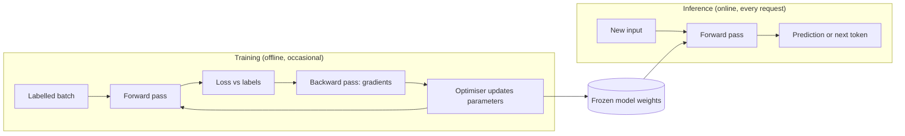
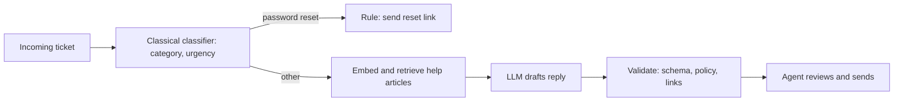

## Introduction

A support team receives 20,000 tickets a week. Product wants three features: predict which customers are about to cancel, flag screenshots that contain credit card numbers, and draft a reply for each ticket. All three would be described as "AI" in a planning meeting. They are very different engineering problems.

Predicting cancellations is a question about a table of numbers — logins, tickets filed, months subscribed — and a yes/no answer. A **classical machine learning** model trained on last year's customers answers it cheaply, in microseconds, and can explain which factors mattered. Spotting card numbers in screenshots means working from raw pixels, where nobody can write down the useful features by hand; that is the territory of **deep learning**, which learns its own features from large amounts of data. Drafting a reply means producing new text, which is what **generative AI** — in practice a large language model (LLM) — does. Using an LLM for the churn prediction would be slower, costlier and harder to evaluate than a small model; using a churn-style model to write replies is impossible.

This lesson gives you the map. It explains what each of the three layers is, how each one is built and used, and the shared vocabulary they all rest on: **datasets, features and labels**, **parameters and hyperparameters**, **training and inference**, and **generalization**. These words appear in every later topic in Track E — in model APIs, in fine-tuning, in evaluation, in system design interviews — so it pays to have them precise from the start.

[[e1-ai-ml-dl-genai]] introduced the hierarchy of AI, ML, deep learning and generative AI and their history. This lesson goes one level deeper: how the methods actually work, what that means for an engineer, and how to choose.

## Before you start

- **The AI landscape** — the high-level picture of AI, ML, deep learning and generative AI. See [[e1-ai-ml-dl-genai]].
- **Python** — the worked examples are short Python programs. See [[e1-syntax]].
- **NumPy and pandas** — arrays for the model maths and DataFrames for feature engineering. See [[e1-numpy]] and [[e1-pandas]].

No calculus is needed. The one place a gradient appears, the lesson explains what it does in words; the mathematics is in [[e2-calculus-gradients]] and [[e2-gradient-descent]].

## The intuition: three ways to learn a job

Imagine teaching three new hires.

The first is an analyst. You give them a spreadsheet of past customers, one row each, with columns you chose — logins, tickets, tenure — and a final column saying whether each customer cancelled. They work out how much each column matters and produce a scoring formula. That is **classical machine learning**: a human decides which measurable facts (features) to provide, and the algorithm learns how to weigh them.

The second is an apprentice photographer. You cannot hand them a spreadsheet, because "contains a credit card" is not a column anyone can compute from pixels with a simple rule. Instead you show them thousands of labelled photos, and over time they develop their own sense of edges, digit shapes and card layouts. That is **deep learning**: the model learns the features as well as the weights, but needs far more examples and computing power.

The third is a writer who has read an enormous library. Nobody trained them on your support tickets specifically, but they have absorbed so much language that, given instructions and some context, they can draft a reasonable reply to almost anything. That is **generative AI**: a huge model pre-trained once on broad data, then steered with instructions, examples and retrieved documents.

The analogy holds in one important way and fails in another. It holds because each hire really does need a different kind of training material. It fails because none of these models *understands* the job the way a person does: each one learns statistical patterns from its data, and each one fails when reality stops resembling that data. That failure mode is the subject of the generalization section.

## Classical machine learning: learning weights for features you choose

**Machine learning (ML)** means building a program's behaviour from examples rather than writing the rules by hand. In **classical ML** — also called traditional or "shallow" ML — the examples are usually rows in a table, each described by a fixed set of numeric or categorical columns called **features**, and the learning algorithm fits a relatively simple mathematical form to them.

The common algorithm families are:

- **Linear and logistic regression** — a weighted sum of the features, optionally squashed into a probability. Fast, and the weights are readable. See [[e2-linear-logistic-regression]].
- **Decision trees and their ensembles** — random forests and gradient-boosted trees (XGBoost, LightGBM, CatBoost). They learn sequences of if/else splits and are often the strongest choice for tabular business data. See [[e2-trees-ensembles]].
- **Clustering and dimensionality reduction** — k-means and PCA, which find structure without labels. See [[e2-kmeans-pca]].

Classical ML dominates problems that are naturally tabular: fraud scores, churn prediction, demand forecasting, credit risk, ad click prediction, ranking search results by engineered signals. Its strengths are practical. Models train in seconds to minutes on a laptop, predictions take microseconds on a CPU, and many models can explain themselves — this customer is high risk mainly because logins dropped. Its key limitation is that **someone has to design the features**. A table of numbers is easy; raw text, images and audio are not.

## Deep learning: learning the features too

**Deep learning** is machine learning with **neural networks** that have many layers. Each layer transforms its input into a new set of numbers, and the network learns the weights of every layer together. The first layers of an image network end up detecting edges and textures, later layers detect parts and objects; nobody programmed those detectors. This is called **representation learning**: the model learns its own features from raw data.

That capability is why deep learning took over perception tasks — image recognition, speech recognition, translation — from around 2012 onwards. The price is high. Deep networks need large amounts of data, specialised hardware (graphics processing units, GPUs) to train in reasonable time, and careful engineering; and their learned behaviour is spread across millions or billions of weights that no one can read directly. Architectures are matched to data: convolutional networks for images, recurrent networks historically for sequences, and **transformers**, since 2017, for text and increasingly for everything. See [[e2-neural-networks]] and [[e2-transformers]].

One common misconception is worth correcting early: deep learning does not automatically beat classical ML. On tabular data with meaningful columns, gradient-boosted trees are often as accurate as or more accurate than deep networks, and far cheaper to train and serve. Deep learning wins when the input is raw and high-dimensional — pixels, waveforms, free text.

## Generative AI: models that produce content

Most models up to this point are **discriminative**: given an input, they output a label, a number or a score. **Generative** models produce new content that resembles their training data: text, images, audio, code. **Generative AI** is the umbrella term for applications built on such models.

The workhorse of generative text is the **large language model (LLM)**: a transformer network with billions of parameters, trained to predict the next **token** (a word or word piece) given all the tokens before it. Generating a reply means predicting one token, appending it, and repeating. Image generators such as diffusion models work differently — they learn to turn random noise into an image step by step — but share the same basic idea of learning the distribution of their training data and sampling new examples from it.

What changed engineering is that these models are **foundation models**: trained once, at enormous cost, on broad data, then adapted to many tasks. You usually do not train an LLM. You adapt one in increasing order of effort:

1. **Prompting** — write instructions and examples in the input. No training at all. See [[e4-zero-shot]] and [[e4-few-shot]].
2. **Retrieval-augmented generation (RAG)** — fetch relevant documents and put them in the prompt, so the model answers from your data. See [[e6-rag-pipeline]].
3. **Fine-tuning** — train the model further on your own examples to change its style or behaviour. See [[e2-fine-tuning]].

Generative models are flexible — one model can classify, extract, summarise, translate and write code — but they cost far more per prediction than a classical model, are slower, can produce fluent and wrong output (**hallucination**, see [[e2-hallucinations]]), and are harder to evaluate because many different outputs can be acceptable.

## Comparing the three

| | Classical ML | Deep learning | Generative AI (LLMs) |
|---|---|---|---|
| Typical input | Table of engineered features | Raw images, audio, text | Text (and images, audio) as a prompt |
| Typical output | Label, score, number | Label, score, embedding, detection | New text, code, images; also labels via prompting |
| Who designs features | Engineers | The network learns them | Pre-trained; you supply context |
| Data you need | Hundreds to millions of labelled rows | Usually large labelled sets, or a pre-trained model to adapt | Often none to start; an evaluation set to measure quality |
| Training cost | Seconds to hours on CPUs | Hours to weeks on GPUs | Pre-training costs millions; you usually only run inference |
| Prediction cost and latency | Microseconds, near-free | Milliseconds on GPU or CPU | Hundreds of milliseconds to many seconds; priced per token |
| Explainability | Often good | Poor | Poor; its explanations are generated text, not its reasoning |
| Typical failure | Bad features, leakage, drift | Needs data; brittle outside training distribution | Hallucination, inconsistency, prompt sensitivity |

The table explains most architecture decisions. If the output is a fixed label or number and you have historical labelled data, start with classical ML. If the input is raw media, start with a pre-trained deep model. If the output is open-ended language, or the task changes too often to retrain a model for each variant, use an LLM.

## Worked example: a churn model end to end

The rest of the lesson uses one small, complete example. It predicts whether a customer will cancel next month from three features. Because real customer data cannot be shipped in a lesson, the program generates synthetic customers from a hidden rule — and then tries to rediscover that rule from examples alone. Everything is NumPy, so every step is visible: no library hides the training loop.

```python title="churn.py"
import numpy as np

FEATURES = ["logins", "tickets", "tenure_months"]


def make_customers(n, rng, logins_scale=1.0, extra_risk=0.0):
    logins = rng.poisson(12, n)                 # logins last month
    tickets = rng.poisson(1.5, n)               # support tickets last month
    tenure = rng.integers(1, 48, n)             # months subscribed
    # The hidden rule the model must discover from examples. Real data has no such
    # formula you can read; that is why we learn one.
    score = 1.5 - 0.25 * logins + 0.6 * tickets - 0.04 * tenure + extra_risk
    churned = rng.random(n) < 1 / (1 + np.exp(-score))
    X = np.column_stack([logins * logins_scale, tickets, tenure]).astype(float)
    return X, churned.astype(int)


def sigmoid(z):
    return 1 / (1 + np.exp(-z))


class ChurnModel:
    def __init__(self, lr=0.1, epochs=300):
        self.lr, self.epochs = lr, epochs          # hyperparameters: chosen by us

    def fit(self, X, y, log_every=None):
        self.mu, self.sigma = X.mean(axis=0), X.std(axis=0)
        Xs = (X - self.mu) / self.sigma
        self.w, self.b = np.zeros(X.shape[1]), 0.0   # parameters: learned from data
        for epoch in range(self.epochs):
            p = sigmoid(Xs @ self.w + self.b)        # forward pass
            loss = -np.mean(y * np.log(p + 1e-12) + (1 - y) * np.log(1 - p + 1e-12))
            self.w -= self.lr * Xs.T @ (p - y) / len(y)   # gradient step
            self.b -= self.lr * np.mean(p - y)
            if log_every and (epoch % log_every == 0 or epoch == self.epochs - 1):
                print(f"epoch {epoch:3}: loss {loss:.3f}")
        self.final_loss = loss
        return self

    def predict_proba(self, X):                    # inference: forward pass only
        return sigmoid((X - self.mu) / self.sigma @ self.w + self.b)

    def predict(self, X):
        return (self.predict_proba(X) >= 0.5).astype(int)


def report(name, y_true, y_pred):
    acc = (y_true == y_pred).mean()
    caught = y_pred[y_true == 1].mean()            # share of real churners we flagged
    print(f"{name:28} accuracy {acc:.3f}  churners caught {caught:.0%}")


if __name__ == "__main__":
    rng = np.random.default_rng(seed=7)
    X, y = make_customers(2000, rng)
    X_train, y_train, X_test, y_test = X[:1600], y[:1600], X[1600:], y[1600:]
    print(f"{len(X_train)} training rows, churn rate {y_train.mean():.2f}")

    model = ChurnModel().fit(X_train, y_train, log_every=100)
    print("learned weights", dict(zip(FEATURES, model.w.round(2).tolist())), "bias", round(model.b, 2))

    report("model, training data", y_train, model.predict(X_train))
    report("model, held-out test data", y_test, model.predict(X_test))
    report("baseline: always 'stays'", y_test, np.zeros_like(y_test))

    new_customer = np.array([[2.0, 4.0, 3.0]])     # rarely logs in, many tickets, new
    print(f"churn probability for new customer: {model.predict_proba(new_customer)[0]:.2f}")
```

```output
1600 training rows, churn rate 0.24
epoch   0: loss 0.693
epoch 100: loss 0.450
epoch 200: loss 0.437
epoch 299: loss 0.434
learned weights {'logins': -0.8, 'tickets': 0.75, 'tenure_months': -0.5} bias -1.44
model, training data         accuracy 0.808  churners caught 35%
model, held-out test data    accuracy 0.810  churners caught 37%
baseline: always 'stays'     accuracy 0.777  churners caught 0%
churn probability for new customer: 0.96
```

The model is **logistic regression**: it computes a weighted sum of the (standardised) features plus a bias, and the `sigmoid` function squashes that sum into a probability between 0 and 1. Training starts with all weights at zero, which predicts 0.5 for everyone — hence the starting loss of 0.693, the loss of a coin flip. Each **epoch** (one pass over the training data) measures how wrong the predictions are with a **loss** function, computes in which direction each weight should move to reduce the loss (the gradient), and moves the weights a small step that way. The loss falls quickly and then levels off.

The learned weights have the right signs: more logins lower the risk, more tickets raise it, longer tenure lowers it. The model discovered the direction of each effect without being told. The numbers are not the hidden rule's coefficients, because the features were standardised first, but they encode the same relationships.

The evaluation lines teach the most. Accuracy on held-out data (0.810) matches training (0.808), so the model is not merely memorising. But a model that always says "stays" scores 0.777, because only about a quarter of customers churn. The model's real value is in the second column: it catches over a third of the churners, which the baseline never does. You will meet each of these ideas — features and labels, parameters and hyperparameters, training versus inference, and evaluation against baselines — in the four sections that follow.

## Datasets, Features, Labels & Targets {#e2-datasets-features-labels}

A **dataset** is the collection of examples a model learns from or is evaluated on. Each **example** (also called a row, sample, instance or observation) describes one case — one customer, one email, one image. The **features** are the inputs that describe an example; the **label** is the correct answer recorded for that example; and the **target** is the quantity the model is trained to predict. In everyday usage "label" and "target" are often interchangeable: label is common for categories ("spam"), target for numbers and for the column as a whole ("the target variable is next month's revenue").

In the churn example, each customer is an example, `logins`, `tickets` and `tenure_months` are features, and `churned` is the label. By convention the feature matrix is called `X` (one row per example, one column per feature) and the label vector `y`.

### From raw data to features

Data rarely arrives in that shape. A product database holds events and records — logins with timestamps, tickets, subscriptions, plan names — not one tidy row per customer. Turning raw data into model inputs is **feature engineering**, and in classical ML it often matters more than the choice of algorithm.

```python title="features.py"
import pandas as pd

# Raw data as it exists in the product database: one row per event.
events = pd.DataFrame({
    "customer": ["c1", "c1", "c1", "c2", "c3", "c3"],
    "type": ["login", "login", "ticket", "login", "ticket", "ticket"],
})
customers = pd.DataFrame({
    "customer": ["c1", "c2", "c3"],
    "plan": ["pro", "free", "team"],
    "signup": pd.to_datetime(["2025-01-10", "2026-02-01", "2025-11-20"]),
    "churned_next_month": [0, 0, 1],                        # the label
})

# Feature engineering: turn raw events into one row of numbers per customer.
counts = pd.crosstab(events["customer"], events["type"]).add_suffix("s")
df = customers.merge(counts, left_on="customer", right_index=True, how="left")
df[["logins", "tickets"]] = df[["logins", "tickets"]].fillna(0).astype(int)
df["tenure_days"] = (pd.Timestamp("2026-03-01") - df["signup"]).dt.days
df = pd.get_dummies(df, columns=["plan"], dtype=int)    # one column per category

X = df.drop(columns=["customer", "signup", "churned_next_month"])
y = df["churned_next_month"]
print(X)
print(y.tolist())
```

```output
   logins  tickets  tenure_days  plan_free  plan_pro  plan_team
0       2        1          415          0         1          0
1       1        0           28          1         0          0
2       0        2          101          0         0          1
[0, 0, 1]
```

Three common transformations appear. **Aggregation** turns many event rows into counts per customer (`crosstab` counts each event type). **Derived features** compute something more useful than the raw value: a signup date means little to a model, but tenure in days does. **Encoding** turns categories into numbers: `get_dummies` performs **one-hot encoding**, creating one 0/1 column per plan. Encoding plans as 1, 2, 3 would wrongly tell a linear model that "team" is three times "free". The identifier `customer` is dropped: it is unique per row, so a model could only memorise it.

Feature types matter because algorithms treat them differently. **Numeric** features (counts, amounts, durations) may need scaling — the churn model standardised them so that tenure, measured in tens, did not dominate logins. **Categorical** features need encoding. **Text, images and audio** need either hand-made features or, more commonly now, **embeddings**: vectors produced by a pre-trained deep model, which a classical model can use as features. That combination — deep model for representation, simple model on top — is very common in production.

### Labels: where the answers come from

Labels come from three main places. Some are **logged naturally**: whether a customer cancelled, whether a user clicked, whether a payment was disputed. Some require **human annotation**: someone reads a ticket and marks its category. Some are **derived from the data itself**, as in LLM pre-training, where the "label" for each position is the next word — covered in [[e2-self-semi-supervised]].

Label quality caps model quality. If two annotators disagree on 20% of tickets, no model can reliably exceed that agreement, and measured accuracy above it is probably noise. Write labelling guidelines, measure annotator agreement on a shared sample, and check a random sample of labels yourself before training anything.

### Target leakage

**Target leakage** happens when a feature contains information that would not be available at prediction time — usually because it was recorded *after*, or *because of*, the outcome. Suppose the customer table has a `cancellation_reason` column. It is filled in only for customers who cancelled, so a model learns "reason present means churned" and scores near-perfect accuracy offline. In production, when predicting next month's churn for active customers, the column is always empty, and the model is useless.

Leakage is the most common reason a model looks excellent in a notebook and fails in production. Guard against it by asking, for every feature: *at the moment the prediction is made, would this value exist, and would it have this value?* Build features from data **as of** the prediction time — counts of logins *before* the cutoff date, not over the whole history. Suspiciously high accuracy is a reason to look for leakage, not to celebrate.

### Datasets in the LLM era

When you build on an LLM, you often have no training dataset at all — but you still need a dataset. It is an **evaluation set**: inputs paired with expected outputs or grading criteria, used to measure whether a prompt, model or retrieval change made things better or worse. The same principles apply: examples must represent real traffic, labels (expected answers) must be correct, and test examples must not leak into the prompt's few-shot examples. See [[e9-golden-datasets]].

```quiz
Q: A model predicting whether a loan will default is trained with the feature `number_of_collection_calls`, which is recorded by the collections team after a borrower misses payments. Offline accuracy is 98%. What is the problem?
- [ ] The feature should be one-hot encoded
- [ ] 98% shows the model is overfitting to noise
- [x] Target leakage: the feature is a consequence of the outcome and will not exist when a new loan is scored
- [ ] There is no problem; more informative features are always better
> Collection calls happen after missed payments, so the feature effectively encodes the label. At application time it is zero for everyone, so the model fails in production. Ask of every feature whether it would exist, with this value, at the moment of prediction.
```

## Parameters vs Hyperparameters {#e2-parameters-hyperparameters}

A **parameter** is a number inside a model that the training algorithm learns from data. A **hyperparameter** is a setting that controls the model or the training process and is chosen by a person (or a search procedure) *before* training. Parameters are the model's knowledge; hyperparameters are the conditions under which it acquires that knowledge.

In the churn model from the worked example in [[e2-ml-vs-dl-vs-genai]] — a logistic regression that predicts cancellation from three features — the three weights `w` and the bias `b` are parameters: they start at zero and training moves them until the loss is small. The learning rate `lr` and the number of epochs are hyperparameters: they are passed to the constructor and never change during training. You can see the split in code — parameters are assigned inside `fit`, hyperparameters in `__init__`.

| | Parameters | Hyperparameters |
|---|---|---|
| Set by | The training algorithm, from data | A person or a tuning search, before training |
| Examples | Weights and biases of a neural network; coefficients of a linear model; split thresholds in a tree | Learning rate, number of epochs, batch size, tree depth, number of trees, `k` in k-means, regularisation strength, network size |
| Stored in | The trained model file | Configuration and experiment logs |
| How many | From a handful to hundreds of billions | Usually a few to a few dozen |

### Why hyperparameters matter

Hyperparameters do not appear in the final predictions directly, but they decide whether training finds good parameters at all. The program below trains the churn model with several learning rates and epoch counts, and measures loss on a separate **validation set** — examples held out from training specifically for comparing settings.

```python title="hyperparams.py"
import numpy as np

from churn import ChurnModel, make_customers

rng = np.random.default_rng(seed=7)
X, y = make_customers(2000, rng)
X_train, y_train, X_val, y_val = X[:1200], y[:1200], X[1200:1600], y[1200:1600]


def log_loss(y, p):
    return -np.mean(y * np.log(p + 1e-12) + (1 - y) * np.log(1 - p + 1e-12))


for lr in [0.001, 0.1, 1.0, 20.0]:
    for epochs in [30, 300]:
        m = ChurnModel(lr=lr, epochs=epochs).fit(X_train, y_train)
        val = log_loss(y_val, m.predict_proba(X_val))
        print(f"lr={lr:<6} epochs={epochs:<4} train loss {m.final_loss:.3f}  validation loss {val:.3f}")
```

```output
lr=0.001  epochs=30   train loss 0.690  validation loss 0.690
lr=0.001  epochs=300  train loss 0.663  validation loss 0.663
lr=0.1    epochs=30   train loss 0.524  validation loss 0.522
lr=0.1    epochs=300  train loss 0.435  validation loss 0.434
lr=1.0    epochs=30   train loss 0.435  validation loss 0.434
lr=1.0    epochs=300  train loss 0.434  validation loss 0.433
lr=20.0   epochs=30   train loss 0.920  validation loss 1.070
lr=20.0   epochs=300  train loss 0.920  validation loss 1.070
```

(It imports `ChurnModel` and `make_customers` from `churn.py`, the logistic-regression churn model built in the worked example of [[e2-ml-vs-dl-vs-genai]].) The same model and data give very different results. With `lr=0.001` each step is so small that 300 epochs barely move the weights from their starting point. With `lr=0.1` the model needs about 300 epochs to converge; with `lr=1.0` it converges in 30, which is ten times cheaper. With `lr=20.0` every step overshoots, the weights bounce back and forth, and the loss ends up *worse* than predicting 0.5 for everyone (0.693) no matter how long you train. Learning rate and training length interact, which is why hyperparameters are usually tuned together.

Hyperparameters are chosen by **tuning**: train with several settings, compare them on validation data, and keep the best. Grid search tries every combination, random search samples combinations, and smarter methods (Bayesian optimisation, early stopping of bad runs) save compute. The crucial rule is that tuning must use validation data, never the final test set; if you pick settings by test score, the test score stops being an honest estimate. See [[e2-train-validation-test]] and [[e2-hyperparameter-tuning]].

### Parameter counts and what they cost

Parameter counts are how model sizes are quoted. The churn model has four. A typical gradient-boosted tree model has thousands of split thresholds and leaf values. GPT-3, published in 2020, has 175 billion; open-weight LLM families commonly come in sizes such as 8, 70 or 400-plus billion.

The count translates directly into memory. Each parameter is stored as a number: 4 bytes in 32-bit floating point, 2 bytes in 16-bit formats (FP16 or BF16), and 1 or half a byte when **quantised** to 8 or 4 bits. A 7-billion-parameter model therefore needs about 7 × 2 = 14 GB only to hold its weights in 16-bit precision, before any working memory — which is why it does not fit on a typical 8 GB consumer GPU without quantisation. See [[e2-quantization]].

### A common confusion: temperature is not a parameter

When you call an LLM API you set values such as `temperature`, `top_p` and `max_tokens`. These are sometimes loosely called "parameters" (APIs call them request parameters), but in the machine-learning sense they are neither parameters nor training hyperparameters. They are **decoding settings**: they change how the next token is picked from the model's output probabilities at inference time, and they change nothing inside the model. The model's billions of parameters are fixed when you call it. See [[e2-temperature]].

> [!TIP] How to tell them apart
> Ask: "Did training produce this number?" If yes, it is a parameter. If someone had to choose it before training started, it is a hyperparameter. If it only affects how outputs are sampled from an already-trained model, it is an inference setting.

```quiz
Q: Which of these is a parameter, in the machine-learning sense, of a fine-tuned LLM?
- [ ] The learning rate used for fine-tuning
- [ ] The `temperature` passed with each API request
- [x] A weight in one of the model's attention layers
- [ ] The number of fine-tuning epochs
> Parameters are values learned during training — the network's weights and biases. Learning rate and epochs are hyperparameters chosen before training, and temperature is an inference-time decoding setting that changes how tokens are sampled, not the model itself.
```

## Training vs Inference {#e2-training-vs-inference}

**Training** is the process of learning a model's parameters from data. **Inference** is using a trained model, with its parameters frozen, to make predictions on new inputs. Training happens occasionally, offline, and is expensive; inference happens every time a user or system asks the model something. When your product calls an LLM API, you are running inference on a model that someone else trained.

### What each one does

A training step for a neural network — and for the churn model's simpler version — has four parts:

1. **Forward pass** — run a batch of examples through the model to get predictions.
2. **Loss** — measure how wrong the predictions are against the labels.
3. **Backward pass** — compute the **gradient**: for every parameter, which direction and how strongly it should change to reduce the loss. For neural networks this is done by **backpropagation**, which applies the chain rule of calculus layer by layer from the output back to the input (see [[e2-forward-backprop]]).
4. **Update** — an **optimiser** such as stochastic gradient descent (SGD) or Adam moves each parameter a small step in that direction.

Repeat over many batches and epochs until the loss stops improving. In `churn.py`, the loop inside `fit` is exactly these four steps.

Inference is only step 1: a forward pass. `predict_proba` in `churn.py` computes the weighted sum and the sigmoid — no labels, no loss, no gradient, no update. For an LLM, inference means running the forward pass once over the prompt (called **prefill**) and then once per generated token (**decode**), appending each new token to the input.



### Why their costs differ

**Compute.** A training step costs roughly three times an inference forward pass for the same input — the forward pass plus a backward pass that does about twice the work — and training repeats that over the whole dataset many times. Pre-training a frontier LLM takes thousands of GPUs for weeks or months. Inference for one request is tiny by comparison, but it repeats for every user, forever. For a successful product, total inference spend usually exceeds training spend over time, which is why inference optimisation matters so much.

**Memory.** Inference needs the weights plus working memory for the current request (for LLMs, mainly the **KV cache**, which stores intermediate results for tokens already processed so they are not recomputed; see [[e2-kv-cache]]). Training needs the weights, a gradient for every weight, the optimiser's state, and the intermediate activations from the forward pass, kept for the backward pass. A widely used estimate for mixed-precision training with Adam is about 16 bytes per parameter before activations: 2 for the 16-bit weights, 2 for gradients and 12 for 32-bit copies of the weights and Adam's two running averages. A 7-billion-parameter model that needs about 14 GB to serve in 16-bit needs over 100 GB to train fully — which is why techniques such as LoRA, which train only a small number of extra parameters, exist (see [[e8-lora-qlora-peft]]).

**Latency and throughput.** Training cares about throughput — examples processed per hour — and nobody waits on a single step. Inference has a user waiting: what matters is time to first token, tokens per second and tail latency, and serving systems batch many users' requests together on one GPU to keep costs down. See [[e2-gpu-inference]].

### Batch and online inference

Inference comes in two shapes. **Online** (real-time) inference answers one request at a time while someone waits: a chat reply, a fraud check during checkout. **Batch** (offline) inference scores a large set on a schedule: nightly churn scores for every customer, embeddings for a million documents, an evaluation run. Batch work can use cheaper hardware or discounted batch APIs and does not need low latency. Many systems that look real-time actually serve precomputed batch predictions from a database.

### Fine-tuning is training; API calls are not

**Fine-tuning** continues training a pre-trained model on your own examples. It is a training job — forward, loss, backward, update — run offline, producing a new set of weights (or a small adapter) that you then deploy for inference. It is far cheaper than pre-training but still costs real compute and needs a curated dataset.

Calling a model API, by contrast, does not change the model. Each request is pure inference on fixed weights, and the model does not "learn" from your conversation; any memory across turns exists only because the conversation history is sent again in the prompt (see [[e3-conversation-state]]). Whether a provider may later use your data to train future models is a matter of its data-use policy and your contract, not something that happens during the request.

### Keep training out of the request path

It can be tempting to "learn from every user interaction" by updating the model live. Production systems almost never do this. Online updates are expensive, can be poisoned by bad or malicious inputs, make behaviour change unpredictably between two identical requests, and skip evaluation. The safe pattern is a loop: log interactions and feedback, curate them into datasets offline, retrain or fine-tune on a schedule, evaluate the new model against the old one, and deploy it only if it is better.

> [!MISTAKE] Train/serve skew
> If the feature code used in training differs from the code used at inference — a different scaling, a timezone bug, a feature computed over a different window — the model receives inputs it never saw during training. Notice that `ChurnModel` stores the training mean and standard deviation and reuses them in `predict_proba`. Recomputing them from each inference batch would quietly change every prediction. Share one feature implementation between training and serving.

```quiz
Q: A team wants their support chatbot to "learn from every conversation" by running a backpropagation step after each user message. What is the strongest objection?
- [ ] Backpropagation cannot run on GPUs
- [ ] Inference and training use different model architectures
- [x] It puts expensive, unevaluated training in the request path, makes behaviour unstable and lets bad inputs alter the model; logging feedback for offline retraining with evaluation is safer
- [ ] Models can only be trained once
> Training per request costs far more memory and compute than inference, changes the model between identical requests, and gives malicious or wrong inputs a direct way to alter behaviour, with no evaluation gate. The standard pattern is to log, curate, retrain offline, evaluate and then deploy.
```

## Generalization, Distribution Shift & Baselines {#e2-model-generalization}

**Generalization** is a model's ability to perform well on new data it did not see during training. It is the whole point of machine learning: a churn model that is accurate only on last year's customers, whose outcomes you already know, is worthless. Everything in model evaluation exists to estimate how well a model will generalise, and everything in model monitoring exists to notice when it stops.

### Held-out data: measuring generalization honestly

You cannot measure generalization on the training data, because a flexible enough model can memorise it. A decision tree grown without limits can classify every training example perfectly and still be wrong on new ones; that gap is **overfitting**, and its opposite, a model too simple to capture the real pattern, is **underfitting** (see [[e2-overfit-underfit]]). So you hold out data the model never trains on. The standard arrangement uses three parts: a **training set** to fit parameters, a **validation set** to compare hyperparameters and models, and a **test set** used once at the end for an unbiased estimate (see [[e2-train-validation-test]]).

In the worked example, training accuracy was 0.808 and held-out test accuracy 0.810. Those are close, which says the model is not overfitting — unsurprising for a model with only four parameters. A large gap between training and test performance is the classic sign of overfitting.

How you split matters as much as whether you split. If the same customer appears in both training and test data, or if you randomly split data with a time dimension so the model trains on next month and tests on last month, the test score is optimistic. For anything that will predict the future, split by time: train on older data, test on newer data, the same way the model will be used.

### Baselines: is the model worth it?

A test score means little on its own. "81% accurate" sounds good until you learn that predicting "stays" for everyone gets 78%. A **baseline** is the simplest reasonable approach to the same problem, measured on the same test data, and a model is only worth its complexity if it beats the baseline by a margin that matters to the business.

Useful baselines, from simplest up:

- **Trivial**: always predict the most common class, or the mean value for a number.
- **Heuristic**: a rule a domain expert would write, such as "flag customers whose logins fell by half".
- **Simple model**: logistic regression before gradient boosting; a small LLM with a basic prompt before a large one with retrieval.
- **Current system**: whatever is in production today, including a human process.

The churn example shows why baselines must be paired with the right metric. On accuracy, the model beats the trivial baseline by three points. On the metric the business actually cares about — the share of real churners caught, so the retention team can call them — it goes from 0% to 37%. Imbalanced problems such as churn, fraud or rare-defect detection need metrics like precision and recall, covered in [[e2-classification-metrics]].

For LLM features the same discipline applies and is skipped more often. Before building an elaborate agent, measure a single well-written prompt; before adding RAG, measure without it; before using the largest model, measure a small one. You cannot claim an improvement without a number to improve on.

### Distribution shift

Held-out evaluation assumes that future data will look like past data — formally, that training and production data come from the same **distribution**. **Distribution shift** is when that stops being true, and it is the main reason models that passed evaluation degrade in production. It comes in a few forms:

- **Covariate shift** (also called data drift): the distribution of the inputs changes, while the relationship between inputs and label stays the same. A new mobile app counts logins differently; a marketing campaign brings in a younger audience.
- **Label shift** (prior shift): how common each outcome is changes. A recession raises the default rate across the board.
- **Concept drift**: the relationship between inputs and label itself changes. After a competitor launches, customers with the same usage patterns now cancel more often; fraudsters change tactics in response to your model.

The program below takes the churn model from the lesson's worked example — logistic regression predicting cancellation from logins, support tickets and tenure, defined in `churn.py` — and runs it on two kinds of changed world.

```python title="shift.py"
import numpy as np

from churn import ChurnModel, make_customers, report

rng = np.random.default_rng(seed=7)
X, y = make_customers(2000, rng)
model = ChurnModel().fit(X[:1600], y[:1600])
report("same distribution", y[1600:], model.predict(X[1600:]))

# 1. Covariate shift: a new app counts logins differently (half the old number).
#    Customers behave exactly as before; only the input distribution moved.
X_new, y_new = make_customers(400, rng, logins_scale=0.5)
report("logins logged differently", y_new, model.predict(X_new))

# 2. Concept / label shift: a price rise makes everyone likelier to churn.
#    Inputs look the same, but the relationship to the label changed.
X_new, y_new = make_customers(400, rng, extra_risk=1.5)
print(f"churn rate after price rise: {y_new.mean():.2f}")
report("after price rise", y_new, model.predict(X_new))
```

```output
same distribution            accuracy 0.810  churners caught 37%
logins logged differently    accuracy 0.685  churners caught 74%
churn rate after price rise: 0.47
after price rise             accuracy 0.640  churners caught 25%
```

In the first scenario nobody's behaviour changed, but the logging change halved every login count. The model reads that as "engagement collapsed" and flags 44% of customers instead of about 13% — it catches more churners only because it flags so many people who were never at risk — and accuracy drops from 0.81 to 0.69. In the second, the inputs look exactly as before, but the churn rate has roughly doubled to 47%; the model, still applying last year's relationship, keeps flagging about one customer in eight and misses three quarters of the churners. Neither failure raises an error. The model keeps returning confident numbers.

### Detecting and handling shift

Because shift is silent, it must be watched for:

- **Monitor inputs.** Compare the distribution of each feature in production with the training data — means, missing-value rates, category frequencies. The login change in the first scenario would show up immediately as a halved mean.
- **Monitor outputs.** A sudden change in the share of customers flagged, or in an LLM's refusal rate or answer length, is an early warning.
- **Measure against ground truth when it arrives.** Churn labels arrive a month later; fraud labels when chargebacks come in. Compute live accuracy as soon as labels exist.
- **Retrain on recent data on a schedule, and re-evaluate before deploying.** Time-based validation tells you how fast performance decays, which tells you how often to retrain.

LLM applications face the same problem in new forms. User questions drift as the product changes, documents in a RAG index go stale, and the provider may update the model behind an API name. Pin model versions where the provider allows it, and keep running your evaluation set on production samples. See [[e9-eval-monitoring-loop]].

> [!IMPORTANT] Generalization is a claim about a distribution
> "The model is 81% accurate" really means "81% accurate on data like this test set". Every time you report a number, know which population it describes, and ask whether production still looks like that population.

```quiz
Q: A fraud model's input features look statistically identical to last quarter's, but fraud losses are rising because fraudsters changed tactics to evade it. What kind of shift is this?
- [ ] Covariate shift, because the inputs changed
- [x] Concept drift, because the relationship between inputs and the label changed
- [ ] Overfitting, because the model memorised training data
- [ ] Label leakage
> The inputs' distribution is unchanged, so this is not covariate shift. What changed is which input patterns correspond to fraud — the mapping the model learned. Adversarial domains like fraud and spam drift this way constantly, so they need frequent retraining and monitoring against fresh labels.
```

## How it works internally: one learning recipe, three scales

Under the differences, all three layers follow the same recipe: choose a model family with adjustable parameters, define a loss that measures error on examples, and use an optimiser to adjust the parameters to reduce that loss. What changes is scale and what the examples look like.

The churn model has 4 parameters, 1,600 labelled rows and a loss over yes/no labels; it trains in milliseconds. An image classifier has millions of parameters, a million labelled images and the same kind of loss; it trains for hours or days on GPUs. An LLM has billions of parameters and trains on trillions of tokens of text with a loss that asks, at every position, "how much probability did you give to the actual next token?" — a label that comes free with the text, which is why no human labelling is needed for pre-training. After that, LLMs are usually tuned further on instruction-following examples and human preference data (see [[e2-pretraining-instruction-alignment]]).

Seeing the shared recipe makes later topics easier: fine-tuning is the same loop on new data, evaluation is measuring the loss or a related metric on held-out data, and distribution shift threatens every model regardless of size.

## In real systems

Real AI products are usually **hybrids**. A support platform might use a small classical model to route tickets by predicted category and urgency (cheap, fast, measurable), an embedding model and vector search to find relevant help articles, an LLM to draft the reply from those articles, and deterministic code to validate the draft and check policy rules. A fraud system scores transactions with gradient-boosted trees in milliseconds, and uses an LLM only to write a readable explanation for the human analyst on the cases flagged for review. A content moderation pipeline runs a deep image classifier on every upload and sends borderline cases to an LLM or a person.



The routing logic follows cost and risk: deterministic rules where the answer is known, cheap models for high-volume decisions, and LLMs where open-ended language is genuinely needed. [[e10-model-routing]] and [[e10-small-vs-frontier]] develop this further.

## Trade-offs and alternatives

**Rules** need no data and are perfectly predictable, but cannot cope with fuzzy or fast-changing patterns. Use them for policies, validations and anything with an exact answer.

**Classical ML** is cheap, fast, measurable and often explainable, but needs labelled historical data and engineered features, and handles raw text and images poorly unless given embeddings.

**Deep learning** handles raw media and learns its own features, but needs much more data and compute, and is hard to interpret. Starting from a pre-trained model and fine-tuning greatly reduces the data needed.

**LLMs** handle open-ended language and many tasks with no training data, so time to a first version is short. They cost more per call, are slower, can hallucinate, and need careful evaluation. For a high-volume, fixed-label task, a common path is to start with an LLM to launch quickly, collect its outputs and human corrections as labels, and then train a small classifier that does the same job for a fraction of the cost. This approach is a form of **distillation**.

## Common mistakes

**Using an LLM for everything.** Classifying a million transactions a day with an LLM costs orders of magnitude more than a gradient-boosted model and is harder to evaluate. Use the cheapest layer that meets the quality bar.

**Using classical ML where language is needed.** A bag-of-words classifier cannot summarise a document or answer a question about it.

**Evaluating on training data.** Training performance says nothing about generalization. Always evaluate on held-out data, split by time when predicting the future.

**Skipping the baseline.** Without a trivial or simple baseline, "81% accuracy" may be worse than predicting the majority class.

**Leaky features.** A feature recorded after the outcome produces brilliant offline numbers and a useless model.

**Confusing inference settings with model parameters.** Changing temperature changes sampling, not what the model knows.

**Assuming deployment is the finish line.** Data drifts. Without monitoring and retraining, model quality decays silently.

**Treating LLM output as ground truth.** It is a prediction like any other, and needs validation and evaluation.

## Interview perspective

Interviewers use this topic to test whether you choose tools by the problem rather than by fashion.

> [!INTERVIEW] What a strong answer sounds like
> "For churn on tabular usage data I'd start with a majority-class baseline and logistic regression, then try gradient-boosted trees, splitting train and test by time and checking for leakage. I wouldn't use an LLM for the score itself — it's slower, costlier and harder to evaluate — but I might use one to summarise each at-risk account's recent tickets for the retention team."

Questions to be ready for:

- **What is the difference between ML, deep learning and generative AI?** ML learns from data; deep learning is ML with many-layer networks that learn features from raw data; generative AI uses models that produce new content, with LLMs as the main example.
- **When would you not use an LLM?** Fixed-label, high-volume tabular tasks; exact arithmetic or deterministic rules; strict latency or cost budgets; cases needing explainable decisions.
- **Parameters versus hyperparameters?** Learned versus chosen before training; give examples and say that hyperparameters are tuned on validation data.
- **Training versus inference?** Forward, loss, backward, update versus forward only; training is offline and memory-hungry, inference is per request and dominates ongoing cost.
- **What is target leakage?** A feature unavailable or different at prediction time, usually recorded after the outcome.
- **Why do models degrade in production?** Distribution shift — covariate, label and concept drift; detect with input, output and ground-truth monitoring; handle with retraining and evaluation.
- **Design follow-up:** "Build a support assistant." Expect to propose a hybrid: classifier routing, retrieval, LLM drafting, validation and human review, with an evaluation set and cost per ticket.

## Practice

1. **Classify the tasks.** For each, choose rules, classical ML, deep learning or an LLM, and justify in two sentences: detecting duplicate invoices; predicting delivery times; transcribing call recordings; extracting fields from contracts; enforcing a refund policy; recommending articles.
2. **Find the leak.** List all the columns you would expect in a subscription company's customer table, and mark which would leak the churn label.
3. **Run the example.** Save `churn.py`, then add a fourth feature that is pure random noise. Does test accuracy change? What happens to the noise feature's learned weight?
4. **Tune honestly.** Extend `hyperparams.py` to choose the best learning rate on validation data, then report test accuracy once. Explain why you must not also tune on the test set.
5. **Monitor drift.** Write a function that compares each feature's mean and standard deviation in a new batch against the training data and flags features that moved by more than 20%. Run it on the two shifted datasets from `shift.py`.
6. **Cost the choice.** Estimate the monthly cost of classifying 1 million tickets with an LLM at 500 input and 20 output tokens per ticket, using current published prices for one small and one large model, and compare it with serving a small classifier on one CPU instance.

## Quick revision {#quick-revision}

- ML: behaviour learned from examples. Classical ML: engineered features in a table; linear models, trees, boosting, clustering; cheap and often explainable.
- Deep learning: many-layer neural networks that learn features from raw data; needs more data and GPUs; best for images, audio, text.
- Generative AI: models that produce new content; LLMs predict the next token; foundation models are adapted by prompting, RAG and fine-tuning.
- Dataset = examples; features = inputs (`X`); label/target = correct answer (`y`). Feature engineering: aggregate, derive, encode (one-hot), scale; embeddings as features.
- Target leakage: a feature unavailable or different at prediction time; build features as of the prediction moment.
- Parameters are learned (weights, biases); hyperparameters are chosen before training (learning rate, epochs, depth) and tuned on validation data, never the test set.
- Temperature, top-p and max tokens are inference-time decoding settings, not parameters.
- Memory: parameters × bytes per parameter (FP16 = 2 bytes; 7B ≈ 14 GB). Full training with Adam ≈ 16 bytes per parameter plus activations.
- Training = forward, loss, backward (gradients), update. Inference = forward only with frozen weights. Fine-tuning is training; API calls are inference.
- Online versus batch inference. Keep training out of the request path; share feature code to avoid train/serve skew.
- Generalization = performance on unseen data; measure on held-out data; split by time for forecasting.
- Always compare against baselines: trivial, heuristic, simple model, current system — with a metric that matches the business goal.
- Distribution shift: covariate (inputs change), label (outcome rates change), concept (relationship changes). Monitor inputs, outputs and ground truth; retrain and re-evaluate.

## Key takeaways {#key-takeaways}

- Classical ML, deep learning and generative AI share one recipe — parameters adjusted to reduce a loss on examples — at very different scales of data, compute and flexibility.
- Choose by the shape of the problem: tabular prediction suits classical ML, raw media suits deep models, open-ended language suits LLMs, and most products combine them.
- Features and labels must reflect what is knowable at prediction time; leakage produces models that are excellent offline and useless in production.
- Parameters are learned, hyperparameters are chosen and tuned on validation data, and LLM sampling settings are neither.
- Training is an occasional, offline, memory-hungry job; inference runs on every request and dominates long-term cost.
- A model's score only means something compared with a baseline, on held-out data that resembles production.
- The world keeps changing after deployment, so models need monitoring, retraining and re-evaluation.
