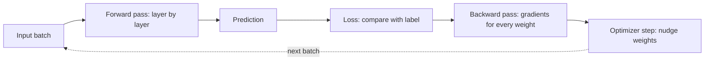
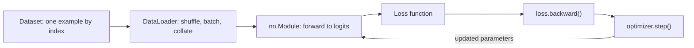

## Introduction

Suppose you want a program that reads a photo and says whether it contains a cat. You could try writing rules: look for two triangles near the top (ears), an oval below them (face), whiskers. Within an hour you would have a list of exceptions longer than the rules — cats photographed from behind, curled up, half hidden, in the dark, drawn as cartoons. The same thing happens with speech, handwriting and language. The patterns are real, but they are too many and too subtle to write down.

A **neural network** takes the opposite approach. Instead of writing the rules, you write a very flexible function with millions of adjustable numbers in it, show it thousands of examples with the right answers, and let an algorithm adjust the numbers until the function's outputs match the answers. Each individual piece of the function is trivial — multiply some inputs by weights, add them up, apply a simple bend — but stacking many of these pieces produces a function that can represent remarkably complicated patterns. Nobody tells the network to look for ears. If ears help it classify cats, training tends to produce internal units that respond to ear-like shapes on their own.

Neural networks matter to an applied AI engineer even if you never train one from scratch. Large language models (LLMs) such as GPT, Claude, Gemini and Llama are neural networks: a specific architecture called the transformer, trained on next-token prediction. Embedding models used for search are neural networks. When someone says a model has "70 billion parameters", the parameters are the weights and biases this lesson teaches. When a fine-tuning job diverges, when a model is quantized to run on smaller hardware, or when a provider talks about "inference" costs, the vocabulary comes from here.

The lesson builds up in five steps, each in its own section:

1. **Neurons, weights, biases and activations** — the building block, and why nonlinearity is essential.
2. **Forward propagation and backpropagation** — how a network makes a prediction and how it learns from its mistake, implemented by hand.
3. **PyTorch tensors and autograd** — how a framework stores the numbers and computes gradients automatically.
4. **nn.Module, DataLoaders and training loops** — how real training code is organised.
5. **CNN, RNN and LSTM context** — the architectures that came before transformers, what they solved, and what they could not.

The from-scratch code uses only the Python 3.12 standard library, so you can run it anywhere. The PyTorch code targets PyTorch 2.x.

## Before you start

- **Vectors, matrices and the dot product** — a layer is a matrix–vector multiplication. See [[e2-linear-algebra]].
- **Derivatives and the chain rule** — backpropagation is the chain rule applied systematically. See [[e2-calculus-gradients]].
- **Loss functions and gradient descent** — training means minimising a loss by stepping against its gradient. See [[e2-loss-functions]] and [[e2-gradient-descent]].
- **Overfitting and train/validation splits** — a network that fits training data perfectly can still fail on new data. See [[e2-overfit-underfit]] and [[e2-train-validation-test]].
- **Python basics** — functions, lists, loops and classes. See [[e1-syntax]] and [[e1-classes]].

If you know logistic regression from [[e2-linear-logistic-regression]], you already know a one-neuron network; this lesson stacks many of them.

## The intuition

Imagine a factory line that turns raw materials into a finished product. Each station takes what the previous station produced, does one small transformation, and passes the result on. No single station "knows" the final product. But if every station's settings are tuned well, the line as a whole produces it.

A neural network is that line. The raw material is the input: pixel values, word identifiers, sensor readings. Each **layer** is a station: it combines its inputs in a weighted way and applies a simple nonlinear bend. The settings on each station are the **weights** and **biases**. The finished product is the output: a probability that the image is a cat, a predicted price, a probability distribution over the next word.

Training is how the settings get tuned. You run an example down the line (the **forward pass**), compare the product to what it should have been (the **loss**), and then walk back up the line asking each station: "if you had turned your dials slightly, how much would the final error have changed?" That backward walk is **backpropagation**, and its answers are **gradients**. Every station then nudges its dials in the direction that reduces the error (**gradient descent**). Repeat for thousands of examples, and the line gradually becomes good at its job.

Where the analogy stops working: real factory stations are designed for a purpose. A network's layers are not. What each internal unit ends up detecting is whatever happened to reduce the loss, which is why trained networks can be hard to interpret and why they sometimes exploit shortcuts in the data that a human would never use.



## Neurons, Weights, Biases & Activations {#e2-neurons-weights-activations}

A **neuron** (also called a unit) is the smallest building block of a neural network. It takes several numbers as input, multiplies each by its own **weight**, adds the results together with one extra number called the **bias**, and passes the total through a fixed function called the **activation**. The output is a single number. That is the entire definition. Everything a neural network does comes from wiring many of these together and choosing good values for the weights and biases.

### What a single neuron computes

Write the inputs as `x₁, x₂, …, xₙ`, the weights as `w₁, …, wₙ`, the bias as `b`, and the activation as `f`. The neuron computes:

```text
z = w₁·x₁ + w₂·x₂ + … + wₙ·xₙ + b        (the pre-activation, a weighted sum)
a = f(z)                                  (the activation, the neuron's output)
```

Each weight says how much its input matters and in which direction. A large positive weight means "this input pushes the output up strongly"; a negative weight means "this input pushes it down"; a weight near zero means "ignore this input". The bias shifts the threshold: it lets the neuron produce a high output even when the inputs are small, or stay low even when they are large. Without a bias, every neuron's weighted sum would be forced through zero when all inputs are zero, which limits what it can represent.

Here is a neuron that scores how spam-like an email is from three features: the number of links, whether it contains an "unsubscribe" phrase, and whether the sender is in the user's contacts.

```python title="neuron.py"
import math

def neuron(inputs, weights, bias, activation):
    # weighted sum of the inputs, shifted by the bias, then squashed
    z = sum(x * w for x, w in zip(inputs, weights)) + bias
    return z, activation(z)

def sigmoid(z):
    return 1 / (1 + math.exp(-z))

def relu(z):
    return max(0.0, z)

# A neuron that scores an email: [num_links, has_unsubscribe, sender_known]
x = [3.0, 1.0, 0.0]
w = [0.8, 1.5, -2.0]
b = -2.0

z, p = neuron(x, w, b, sigmoid)
print(f"z = {z:.2f}, sigmoid(z) = {p:.3f}")
z, r = neuron(x, w, b, relu)
print(f"z = {z:.2f}, relu(z) = {r:.3f}")

x_known = [3.0, 1.0, 1.0]
z, p = neuron(x_known, w, b, sigmoid)
print(f"known sender: z = {z:.2f}, sigmoid(z) = {p:.3f}")
```

```output
z = 1.90, sigmoid(z) = 0.870
z = 1.90, relu(z) = 1.900
known sender: z = -0.10, sigmoid(z) = 0.475
```

Work through the first line by hand: `0.8 × 3 + 1.5 × 1 + (−2.0) × 0 + (−2.0) = 2.4 + 1.5 − 2.0 = 1.9`. The sigmoid turns `1.9` into `0.870`, which you can read as "87% spam-like". Change one input — the sender is known — and the weight of `−2.0` pulls the sum down to `−0.1`, dropping the score below one half. In this example we chose the weights by hand so the numbers are easy to follow. In a real network nobody chooses them: they start random and training sets them.

If this looks familiar, it should. A single neuron with a sigmoid activation is exactly **logistic regression**, and a single neuron with no activation is linear regression. Neural networks generalise those models by stacking many neurons.

### From neurons to layers

A **layer** is a group of neurons that all read the same inputs. If a layer has `m` neurons and receives `n` inputs, it has an `m × n` **weight matrix** `W` (one row of weights per neuron) and a bias vector `b` of length `m`. Computing the whole layer at once is a matrix–vector product:

```text
z = W·x + b        shape: (m × n)·(n) + (m) = (m)
a = f(z)           f applied to each element separately
```

This is why neural networks run so well on Graphics Processing Units (GPUs): almost all of the work is large matrix multiplications, which GPUs perform in parallel.

A **fully connected** (or **dense**, or **linear**) network stacks layers so that each layer's output becomes the next layer's input. The first layer reads the raw input; the last layer produces the output; the layers in between are called **hidden layers** because their values are not inputs or outputs you observe directly. A network described as "2 → 4 → 1" has 2 inputs, one hidden layer of 4 neurons and 1 output neuron.

Counting **parameters** — the learnable numbers — is a useful habit. A dense layer from `n` inputs to `m` outputs has `n × m` weights plus `m` biases. The 2 → 4 → 1 network has `(2 × 4 + 4) + (4 × 1 + 1) = 12 + 5 = 17` parameters. GPT-2 small has about 124 million; current frontier LLMs have hundreds of billions. The arithmetic is the same at every size.

### Why the activation must be nonlinear

Why not skip the activation and use `a = z` everywhere? Because then stacking layers achieves nothing. A linear layer computes `W·x + b`. Feed that into another linear layer and you get `W₂·(W₁·x + b₁) + b₂ = (W₂W₁)·x + (W₂b₁ + b₂)`, which is a single linear layer with weight matrix `W₂W₁` and bias `W₂b₁ + b₂`. A hundred stacked linear layers collapse into one. The program below checks this numerically.

```python title="collapse.py"
def matvec(M, v):
    return [sum(m * x for m, x in zip(row, v)) for row in M]

def matmul(A, B):
    cols = list(zip(*B))
    return [[sum(a * b for a, b in zip(row, col)) for col in cols] for row in A]

def add(u, v):
    return [a + b for a, b in zip(u, v)]

W1 = [[1.0, -2.0], [0.5, 1.0], [-1.0, 0.0]]   # layer 1: 2 inputs -> 3 units
b1 = [0.5, -1.0, 2.0]
W2 = [[2.0, 1.0, -1.0]]                        # layer 2: 3 units -> 1 output
b2 = [0.25]

x = [3.0, 1.0]

# Two linear layers with no activation in between
two_layers = add(matvec(W2, add(matvec(W1, x), b1)), b2)

# The same function as ONE linear layer: W = W2 W1, b = W2 b1 + b2
W = matmul(W2, W1)
b = add(matvec(W2, b1), b2)
one_layer = add(matvec(W, x), b)

print("two linear layers:", two_layers)
print("one linear layer: ", one_layer, "with W =", W, "b =", b)

# Put ReLU between the layers and the collapse no longer happens
relu = lambda v: [max(0.0, a) for a in v]
with_relu = add(matvec(W2, relu(add(matvec(W1, x), b1))), b2)
print("with ReLU:        ", with_relu)
```

```output
two linear layers: [5.75]
one linear layer:  [5.75] with W = [[3.5, -3.0]] b = [-1.75]
with ReLU:         [4.75]
```

The first two lines agree exactly: the two-layer linear network *is* the one-layer network `3.5·x₁ − 3.0·x₂ − 1.75`, for every input, not only this one. With ReLU in between, the third hidden unit's value of `−1` is clipped to `0`, the answer changes, and — more importantly — the network is no longer a single linear function. Which units are clipped depends on the input, so different regions of the input space get different linear pieces. That is how a network bends straight lines into curved decision boundaries.

The classic demonstration is **XOR**: output 1 when exactly one of two binary inputs is 1. Plot the four points and you will see no single straight line separates the 1s from the 0s, so no linear model (and no single neuron) can solve it. A network with one hidden layer and a nonlinear activation can, as the next section shows by training one.

### The common activation functions

| Activation | Formula | Output range | Where you see it |
|---|---|---|---|
| Sigmoid | `1 / (1 + e^(−z))` | (0, 1) | Output of binary classifiers; gates inside LSTMs |
| Tanh | `(e^z − e^(−z)) / (e^z + e^(−z))` | (−1, 1) | Older hidden layers; RNNs |
| ReLU | `max(0, z)` | [0, ∞) | Default hidden activation for CNNs and MLPs |
| GELU | `z · Φ(z)`, Φ = standard normal CDF | about (−0.17, ∞) | BERT, GPT-2 and many transformers |
| SiLU / Swish | `z · sigmoid(z)` | about (−0.28, ∞) | Inside SwiGLU layers in Llama-family models |
| Softmax | `e^(zᵢ) / Σⱼ e^(zⱼ)` over a vector | each in (0, 1), sum 1 | Output layer for multi-class classification and next-token prediction |

**Sigmoid** and **tanh** were the original choices because they are smooth and bounded. Their weakness is **saturation**: for large positive or negative `z`, the curve is almost flat, so its derivative is almost zero. The sigmoid's derivative `σ(z)(1 − σ(z))` is at most `0.25`, reached at `z = 0`. As you will see in the backpropagation section, small derivatives multiplied across many layers make gradients vanish.

**ReLU** (Rectified Linear Unit) fixed much of that. Its derivative is exactly 1 for positive inputs, so gradients pass through active units unchanged, and it is cheap to compute. Its weakness is the flip side: for negative inputs the derivative is 0. A neuron whose pre-activation is negative for every training example never receives a gradient and stops learning — a **dead ReLU**. Variants such as Leaky ReLU (`max(0.01z, z)`) keep a small slope for negative inputs.

**GELU** (Gaussian Error Linear Unit) and **SiLU** are smooth versions of ReLU that let small negative values through. Transformers mostly use them; the original GPT-2 and BERT use GELU, and Llama-family models use SiLU inside a gated layer called SwiGLU (covered in [[e2-transformer-block]]).

**Softmax** is different: it acts on a whole vector, turning arbitrary scores (called **logits**) into a probability distribution. It is used at the output when the answer is one of several classes. An LLM's final layer produces one logit per vocabulary token, and softmax turns those into next-token probabilities, as [[e2-temperature]] explains.

> [!NOTE] What "universal approximation" does and does not promise
> The universal approximation theorem says that a network with a single hidden layer and a suitable nonlinear activation can approximate any continuous function on a bounded input region as closely as you like, *given enough hidden units*. It does not say how many units you need (it can be astronomically many), that gradient descent will find the right weights, or that the network will generalise to new data. Deep networks are used in practice because depth reaches useful functions with far fewer parameters than width alone, and because they train well with modern techniques.

### Neurons are not brain cells

The name comes from a loose analogy with biological neurons, which receive signals from other neurons and "fire" when stimulation passes a threshold. The analogy is historical, not technical. An artificial neuron is a weighted sum and a fixed function; it has no timing, no chemistry and no learning rule of its own. Saying a network "thinks like a brain" sets wrong expectations about what it can do and how it fails.

```quiz
Q: A network has three dense layers with no activation functions between them. What can it represent?
- [ ] Any continuous function, because it has three layers
- [x] Only linear (affine) functions of its input, exactly like a single dense layer
- [ ] Only functions whose outputs are between 0 and 1
- [ ] XOR, but not more complex functions
> Composing affine maps gives another affine map: W3(W2(W1x + b1) + b2) + b3 = Wx + b. Depth only adds expressive power when nonlinear activations sit between the layers. XOR is not linearly separable, so even it is out of reach.

Q: Why did ReLU largely replace sigmoid as the default hidden-layer activation?
- [ ] ReLU outputs probabilities, which hidden layers need
- [ ] ReLU never produces zero, so no neuron can stop learning
- [x] Its derivative is 1 for positive inputs, so gradients do not shrink through active units the way they do through a saturating sigmoid
- [ ] ReLU is smooth everywhere, which makes backpropagation exact
> The sigmoid's derivative is at most 0.25 and near zero when saturated, so gradients shrink layer after layer. ReLU passes gradients through unchanged when active. It can output zero (and dead ReLUs are a real failure mode), and it has a kink at 0, so the other options are false.
```

## Forward Propagation & Backpropagation {#e2-forward-backprop}

**Forward propagation** is running an input through the network, layer by layer, to get a prediction. **Backpropagation** is the algorithm that then computes, for every weight and bias, how much the loss would change if that parameter were nudged — the gradient — by applying the chain rule from the output back towards the input. Together with an optimiser that uses those gradients to update the parameters, they are how every neural network learns, from a 17-parameter toy to a frontier LLM.

### The forward pass and the loss

The forward pass is the computation you have already seen, repeated per layer. For a network with one hidden layer:

```text
z₁ = W₁·x + b₁        hidden pre-activations
h  = f(z₁)            hidden activations
z₂ = W₂·h + b₂        output pre-activation (logit)
ŷ  = g(z₂)            prediction, e.g. g = sigmoid for a probability
L  = loss(ŷ, y)       one number: how wrong the prediction is
```

The **loss** turns "how wrong" into a single number that training can minimise. Regression typically uses mean squared error; classification uses cross-entropy, which heavily penalises confident wrong answers. Both are taught in [[e2-loss-functions]]. During training the forward pass must keep every intermediate value (`z₁`, `h`, `z₂`), because the backward pass needs them.

### The backward pass is the chain rule

Training wants `∂L/∂w` for every parameter `w`: the rate at which the loss changes as `w` changes. Gradient descent then updates `w ← w − η · ∂L/∂w`, where `η` (eta) is the **learning rate**.

The difficulty is that the loss depends on an early weight only *through* a chain of later computations. The **chain rule** handles exactly that: if `L` depends on `ŷ`, `ŷ` depends on `z₂`, and `z₂` depends on `w`, then `∂L/∂w = ∂L/∂ŷ · ∂ŷ/∂z₂ · ∂z₂/∂w`. Each factor is a **local derivative** — how one step's output changes with its own input — and each is easy to compute.

Backpropagation organises this efficiently. It starts at the loss, where `∂L/∂L = 1`, and walks the computation backwards. At each step it multiplies the gradient arriving from above by that step's local derivative, then passes the result further back. A value used by several later steps receives the sum of their gradients. Because each intermediate gradient is computed once and reused for every parameter below it, the backward pass costs roughly the same as one or two forward passes — far cheaper than nudging each of millions of parameters separately and re-running the network.

### Backpropagation by hand

Take the smallest interesting network: one input, one hidden ReLU neuron, one linear output, squared-error loss. With input `x = 2`, target `y = 1`, and parameters `w₁ = 0.5`, `b₁ = 0.25`, `w₂ = −1`, `b₂ = 0.5`:

| Step | Formula | Value |
|---|---|---|
| Forward | `z₁ = w₁·x + b₁` | 1.25 |
| | `h = ReLU(z₁)` | 1.25 |
| | `ŷ = w₂·h + b₂` | −0.75 |
| | `L = ½(ŷ − y)²` | 1.53125 |
| Backward | `∂L/∂ŷ = ŷ − y` | −1.75 |
| | `∂L/∂w₂ = ∂L/∂ŷ · h` | −2.1875 |
| | `∂L/∂b₂ = ∂L/∂ŷ · 1` | −1.75 |
| | `∂L/∂h = ∂L/∂ŷ · w₂` | 1.75 |
| | `∂L/∂z₁ = ∂L/∂h · ReLU'(z₁)`, and `ReLU'(1.25) = 1` | 1.75 |
| | `∂L/∂w₁ = ∂L/∂z₁ · x` | 3.5 |
| | `∂L/∂b₁ = ∂L/∂z₁ · 1` | 1.75 |

Read the signs. The prediction `−0.75` is too low (target `1`). `∂L/∂w₂ = −2.1875` is negative, so gradient descent *increases* `w₂`, which raises `ŷ` because `h` is positive. `∂L/∂w₁ = 3.5` is positive, so gradient descent *decreases* `w₁`: since `w₂` is negative, a smaller `h` means a larger `ŷ`. Backpropagation worked out this indirect effect automatically.

How do you know the derivation is right? Compare it with a **numerical gradient**: nudge one parameter by a tiny `ε` up and down and measure the change in loss, `(L(w + ε) − L(w − ε)) / 2ε`. This is too slow for training — it needs two forward passes per parameter — but it is the standard way to test a backward pass.

```python title="tiny_backprop.py"
import math

def loss_fn(w1, b1, w2, b2, x=2.0, y=1.0):
    z1 = w1 * x + b1
    h = max(0.0, z1)          # ReLU
    yhat = w2 * h + b2
    return 0.5 * (yhat - y) ** 2

w1, b1, w2, b2 = 0.5, 0.25, -1.0, 0.5
x, y = 2.0, 1.0

# Forward pass, keeping every intermediate value for the backward pass
z1 = w1 * x + b1          # 1.25
h = max(0.0, z1)          # 1.25
yhat = w2 * h + b2        # -0.75
L = 0.5 * (yhat - y) ** 2 # 1.53125
print(f"forward: z1={z1}, h={h}, yhat={yhat}, loss={L}")

# Backward pass: chain rule from the loss back to each parameter
dL_dyhat = yhat - y                       # -1.75
dL_dw2 = dL_dyhat * h                     # yhat = w2*h + b2
dL_db2 = dL_dyhat * 1.0
dL_dh = dL_dyhat * w2
dL_dz1 = dL_dh * (1.0 if z1 > 0 else 0.0) # ReLU passes gradient only when active
dL_dw1 = dL_dz1 * x
dL_db1 = dL_dz1 * 1.0
print(f"backprop: dw1={dL_dw1}, db1={dL_db1}, dw2={dL_dw2}, db2={dL_db2}")

# Numerical check: nudge each parameter and measure how the loss changes
eps = 1e-6
params = {"w1": w1, "b1": b1, "w2": w2, "b2": b2}
for name in params:
    up = dict(params); up[name] += eps
    down = dict(params); down[name] -= eps
    numeric = (loss_fn(**up) - loss_fn(**down)) / (2 * eps)
    print(f"numeric d{name} = {numeric:.6f}")
```

```output
forward: z1=1.25, h=1.25, yhat=-0.75, loss=1.53125
backprop: dw1=3.5, db1=1.75, dw2=-2.1875, db2=-1.75
numeric dw1 = 3.500000
numeric db1 = 1.750000
numeric dw2 = -2.187500
numeric db2 = -1.750000
```

The analytic and numerical gradients agree to six decimal places. Notice the line `dL_dz1 = dL_dh * (1.0 if z1 > 0 else 0.0)`: if `z1` had been negative, the ReLU would have blocked the gradient entirely and neither `w₁` nor `b₁` would change on this example. That one line is the dead-ReLU problem in miniature.

### Training a network that solves XOR

Now put the pieces together and train the 2 → 4 → 1 network on XOR, using tanh in the hidden layer, a sigmoid output and binary cross-entropy loss. Everything is written out: the forward pass, the backward pass for each parameter, and the gradient descent update.

```python title="xor.py"
import math
import random

random.seed(0)

# XOR: the output is 1 when exactly one input is 1
DATA = [([0.0, 0.0], 0.0), ([0.0, 1.0], 1.0), ([1.0, 0.0], 1.0), ([1.0, 1.0], 0.0)]
H = 4      # hidden units
LR = 0.5   # learning rate

# Small random weights break symmetry: identical weights would get identical gradients
W1 = [[random.uniform(-1, 1) for _ in range(2)] for _ in range(H)]
b1 = [0.0] * H
W2 = [random.uniform(-1, 1) for _ in range(H)]
b2 = 0.0

def sigmoid(z):
    return 1 / (1 + math.exp(-z))

def forward(x):
    z1 = [W1[j][0] * x[0] + W1[j][1] * x[1] + b1[j] for j in range(H)]
    h = [math.tanh(z) for z in z1]
    z2 = sum(W2[j] * h[j] for j in range(H)) + b2
    p = sigmoid(z2)
    return h, p

def bce(p, y):
    eps = 1e-12   # keeps log() finite if p reaches exactly 0 or 1
    return -(y * math.log(p + eps) + (1 - y) * math.log(1 - p + eps))

for epoch in range(1, 3001):
    gW1 = [[0.0, 0.0] for _ in range(H)]
    gb1 = [0.0] * H
    gW2 = [0.0] * H
    gb2 = 0.0
    total = 0.0
    for x, y in DATA:
        h, p = forward(x)                  # forward pass
        total += bce(p, y)
        dz2 = p - y                         # dLoss/dz2 for sigmoid + cross-entropy
        for j in range(H):
            gW2[j] += dz2 * h[j]
            dh = dz2 * W2[j]                # flow back through the output weight
            dz1 = dh * (1 - h[j] ** 2)      # tanh'(z) = 1 - tanh(z)^2
            gW1[j][0] += dz1 * x[0]
            gW1[j][1] += dz1 * x[1]
            gb1[j] += dz1
        gb2 += dz2
    n = len(DATA)
    for j in range(H):                      # gradient descent step on the average
        W2[j] -= LR * gW2[j] / n
        W1[j][0] -= LR * gW1[j][0] / n
        W1[j][1] -= LR * gW1[j][1] / n
        b1[j] -= LR * gb1[j] / n
    b2 -= LR * gb2 / n
    if epoch in (1, 100, 500, 1000, 3000):
        print(f"epoch {epoch:4d}  loss {total / n:.4f}")

for x, y in DATA:
    _, p = forward(x)
    print(f"{x} -> {p:.3f} (target {y:.0f})")
```

```output
epoch    1  loss 0.6996
epoch  100  loss 0.4035
epoch  500  loss 0.0107
epoch 1000  loss 0.0037
epoch 3000  loss 0.0009
[0.0, 0.0] -> 0.000 (target 0)
[0.0, 1.0] -> 0.999 (target 1)
[1.0, 0.0] -> 0.999 (target 1)
[1.0, 1.0] -> 0.001 (target 0)
```

Walk through what happens. The first loss, `0.6996`, is close to `ln 2 ≈ 0.693` — the cross-entropy of guessing 50% for everything, which is what random small weights produce. As gradient descent repeats, the loss falls and the predictions separate towards 0 and 1. A problem no single neuron can solve is solved by four hidden tanh units.

Three details in the code carry over to every real network:

- **`dz2 = p − y`.** The derivative of binary cross-entropy through a sigmoid simplifies to prediction minus target. This neat cancellation is one reason sigmoid outputs are paired with cross-entropy, and why frameworks provide a combined, numerically stable version (PyTorch's `BCEWithLogitsLoss`).
- **Gradients are accumulated, then averaged.** The inner loop sums each example's gradient into `gW1`, `gW2`, and so on; the update divides by `n`. This is *full-batch* gradient descent. Real training uses **mini-batches** — a few dozen to a few thousand examples per update — because the full dataset does not fit in memory and noisy, frequent updates train faster. See [[e2-gradient-descent]].
- **Random initialisation.** If every weight started at the same value, every hidden unit would compute the same thing and receive the same gradient, forever. Random starting weights break that symmetry.

> [!TIP] Debugging a hand-written backward pass
> If a network written from scratch does not learn, run a numerical gradient check on a tiny input before touching the learning rate. A wrong sign or a missing factor in one local derivative is far more common than a bad hyperparameter, and the check pinpoints which parameter's gradient is wrong.

### Vanishing and exploding gradients

Backpropagation multiplies local derivatives along the path from the loss to each parameter. In a deep network, that is a long product, and long products are unstable. If most factors are smaller than 1, the gradient shrinks geometrically as it travels back: early layers receive almost no signal and barely learn. That is the **vanishing gradient problem**. If most factors are larger than 1, the gradient grows geometrically and the updates blow the weights up: **exploding gradients**, which show up as a loss that suddenly becomes `inf` or `NaN`.

The sigmoid makes vanishing easy to see. Its derivative is never more than 0.25, so each sigmoid layer contributes a factor of at most 0.25 (the weights contribute factors too, but they must be consistently large to compensate):

```python title="vanish.py"
# The sigmoid's derivative is at most 0.25 (at z = 0). Backprop multiplies one such
# factor per layer, so even in the best case the gradient shrinks geometrically.
for layers in (2, 5, 10, 20):
    print(f"{layers:2d} sigmoid layers: gradient scaled by at most {0.25 ** layers:.2e}")
```

```output
 2 sigmoid layers: gradient scaled by at most 6.25e-02
 5 sigmoid layers: gradient scaled by at most 9.77e-04
10 sigmoid layers: gradient scaled by at most 9.54e-07
20 sigmoid layers: gradient scaled by at most 9.09e-13
```

This problem kept deep networks impractical for years. The fixes that made depth work are worth knowing by name, because modern architectures use all of them:

| Technique | What it does | Where you meet it |
|---|---|---|
| ReLU-family activations | Derivative 1 when active, so no shrinking from the activation | CNNs, MLPs; GELU/SiLU in transformers |
| Careful initialisation | Scales random weights so activations and gradients keep a stable size across layers (Xavier/Glorot for tanh, He/Kaiming for ReLU) | Framework defaults |
| Normalisation layers | Re-centre and re-scale activations inside the network (BatchNorm, LayerNorm, RMSNorm) | LayerNorm and RMSNorm in every transformer block |
| Residual connections | Compute `x + layer(x)`, giving gradients a direct path that skips the layer | ResNets (2015) and every transformer block |
| Gradient clipping | Caps the gradient's overall size before the update, preventing explosion | Standard in LLM training |

Residual connections and normalisation return in [[e2-transformer-block]]; they are the reason a transformer can stack dozens of layers.

```quiz
Q: During backpropagation, what does a hidden unit with ReLU activation do when its pre-activation z was negative in the forward pass?
- [ ] Passes the incoming gradient through unchanged
- [ ] Reverses the sign of the incoming gradient
- [x] Blocks it: the local derivative is 0, so the unit's incoming weights get no gradient from this example
- [ ] Doubles it to compensate for the clipped output
> ReLU's derivative is 0 for negative inputs. The chain rule multiplies by that 0, so no gradient reaches the weights feeding the unit for this example. If that happens for every example, the unit is "dead" and never recovers.

Q: Why is backpropagation used instead of computing each parameter's gradient numerically with (L(w + ε) − L(w − ε)) / 2ε?
- [ ] Numerical gradients are always wrong
- [x] Numerical gradients need two forward passes per parameter; backprop gets all gradients in about the cost of one extra pass by reusing intermediate results
- [ ] Backprop does not need the forward pass
- [ ] Numerical gradients cannot handle nonlinear activations
> With millions of parameters, two forward passes each is millions of passes per step. Backprop reuses each intermediate gradient for every parameter beneath it. Numerical gradients are accurate enough to *check* backprop on small cases, which is exactly how they are used.
```

## PyTorch Tensors & Autograd {#e2-pytorch-tensors-autograd}

**PyTorch** is the most widely used deep-learning framework in research and in open-model work. Its two foundations are the **tensor** — a multi-dimensional array of numbers that can live on a CPU or a GPU — and **autograd**, a system that records the operations you perform on tensors and computes gradients for you with backpropagation. The hand-written backward pass in the previous section is exactly what autograd automates: you write only the forward computation, and calling `.backward()` produces every gradient.

> [!NOTE] About the PyTorch examples
> PyTorch was not installed where this lesson was written, so the PyTorch snippets were not executed here. They use stable PyTorch 2.x APIs, and the outputs shown are the deterministic results those APIs document (shapes, dtypes and hand-checkable gradients). Install PyTorch with the command for your platform from pytorch.org to run them.

### Tensors: shape, dtype and device

A tensor generalises the scalar (0 dimensions), vector (1), and matrix (2) to any number of dimensions. A batch of 32 colour images of 224 × 224 pixels is a 4-dimensional tensor of shape `(32, 3, 224, 224)`; a batch of 8 token sequences, each 512 tokens long, each token represented by a 768-number vector, is `(8, 512, 768)`. Every tensor has three properties you should always know:

- **Shape** — the size of each dimension. Most model bugs are shape bugs.
- **dtype** — the number type. `torch.float32` is the default for floating point; training often uses `bfloat16` or `float16` to halve memory; integer token ids use `torch.int64` (also called `torch.long`).
- **device** — where the data lives: `cpu`, `cuda` (an NVIDIA GPU), or `mps` (Apple silicon). Operations between tensors require them to be on the same device.

```python title="tensors.py"
import torch

a = torch.tensor([[1.0, 2.0], [3.0, 4.0]])
print(a.shape, a.dtype, a.device)
print(torch.tensor([1, 2, 3]).dtype)    # integers default to int64

b = torch.tensor([10.0, 20.0])
print(a + b)                            # broadcasting: b is added to every row
print(a @ a)                            # matrix multiplication
print(torch.zeros(2, 3).shape)
```

```output
torch.Size([2, 2]) torch.float32 cpu
torch.int64
tensor([[11., 22.],
        [13., 24.]])
tensor([[ 7., 10.],
        [15., 22.]])
torch.Size([2, 3])
```

`a + b` shows **broadcasting**: `b` has shape `(2,)`, `a` has shape `(2, 2)`, so PyTorch treats `b` as if it were repeated along the first dimension. Broadcasting is what lets a layer add one bias vector to a whole batch, and it is also a source of silent bugs when two shapes line up by accident — adding a `(3, 1)` tensor to a `(3,)` tensor gives a `(3, 3)` result, not an error. The rules match NumPy's ([[e1-numpy]]). `@` is matrix multiplication; `*` is element-wise multiplication, and confusing them is another common mistake.

Moving work to a GPU is a matter of moving the tensors (and later the model): `x = x.to("cuda")`. A typical script picks the device once: `device = "cuda" if torch.cuda.is_available() else "cpu"`.

### Autograd: gradients for free

To make PyTorch track a tensor for differentiation, create it with `requires_grad=True`. Every operation on it is then recorded in a **computational graph**: each result remembers which operation produced it (its `grad_fn`) and which tensors it came from. Calling `.backward()` on a scalar result walks that graph backwards, applying the chain rule, and stores each gradient in the `.grad` attribute of the tensors that required it.

```python title="autograd_basics.py"
import torch

x = torch.tensor(2.0, requires_grad=True)
y = x ** 2 + 3 * x       # dy/dx = 2x + 3 = 7 at x = 2
print(y)
y.backward()
print(x.grad)
```

```output
tensor(10., grad_fn=<AddBackward0>)
tensor(7.)
```

`y` prints with `grad_fn=<AddBackward0>` because its last operation was an addition that autograd knows how to differentiate. The gradient `7` matches `2·2 + 3`.

Now reproduce the hand-derived example from the backpropagation section. You write only the forward pass:

```python title="autograd_tiny_net.py"
import torch

x, y = torch.tensor(2.0), torch.tensor(1.0)
w1 = torch.tensor(0.5, requires_grad=True)
b1 = torch.tensor(0.25, requires_grad=True)
w2 = torch.tensor(-1.0, requires_grad=True)
b2 = torch.tensor(0.5, requires_grad=True)

h = torch.relu(w1 * x + b1)
yhat = w2 * h + b2
loss = 0.5 * (yhat - y) ** 2

loss.backward()
print(w1.grad, b1.grad, w2.grad, b2.grad)
```

```output
tensor(3.5000) tensor(1.7500) tensor(-2.1875) tensor(-1.7500)
```

These are the same four numbers derived by hand: `3.5`, `1.75`, `−2.1875`, `−1.75`. The inputs `x` and `y` were created without `requires_grad`, so autograd does not compute gradients for them — you do not want to "train" the data.

### Three autograd behaviours that cause real bugs

**Gradients accumulate.** `.backward()` *adds* to `.grad`; it does not overwrite it. That design supports legitimate tricks, such as accumulating gradients over several small batches to simulate a large one. But if you forget to reset gradients between training steps, every step uses the sum of all previous gradients.

```python title="accumulate.py"
import torch

x = torch.tensor(2.0, requires_grad=True)
for _ in range(2):
    y = x ** 2 + 3 * x
    y.backward()
    print(x.grad)

x.grad.zero_()    # reset in place; optimizers do this with optimizer.zero_grad()
print(x.grad)
```

```output
tensor(7.)
tensor(14.)
tensor(0.)
```

The second gradient is `14`, not `7`. In a training loop, this is why `optimizer.zero_grad()` is called once per step.

**The graph is freed after `.backward()`.** To save memory, PyTorch releases the intermediate values once the backward pass has used them. Calling `.backward()` a second time through the same graph raises a `RuntimeError` that suggests `retain_graph=True`. In ordinary training you rebuild the graph each step with a fresh forward pass, so this only bites when you try to reuse a result.

**Tracking costs memory, so turn it off when you do not need it.** During evaluation and inference you need no gradients. Wrapping code in `with torch.no_grad():` (or the stricter `torch.inference_mode()`) stops autograd from recording, which saves memory and time. To take a single tensor out of the graph — for example, to log a loss value or use a model output as a fixed target — call `.detach()`, which returns a tensor that shares the same data but has no history. `loss.item()` converts a one-element tensor to a plain Python number, which is what you want for logging.

```python title="no_grad.py"
import torch

w = torch.tensor(3.0, requires_grad=True)
with torch.no_grad():
    z = w * 2
print(z.requires_grad)                 # not tracked inside no_grad
print((w * 2).detach().requires_grad)  # detached copy is not tracked either
print((w * 2).requires_grad)           # normal operation is tracked
```

```output
False
False
True
```

> [!WARNING] Accumulating a loss tensor leaks memory
> Writing `running_loss += loss` inside a training loop keeps every step's computational graph alive, because `running_loss` is now a tensor that depends on all of them. Memory grows until the process runs out. Use `running_loss += loss.item()` instead.

### Leaf tensors and in-place operations

Tensors you create directly with `requires_grad=True` — in practice, the model's parameters — are **leaf tensors**, and only leaves have their `.grad` populated by default. Intermediate results such as `h` above have gradients during the backward pass, but PyTorch discards them unless you call `h.retain_grad()`.

In-place operations (methods ending in an underscore, such as `x.add_(1)`, and assignments like `x[0] = 5`) modify a tensor's memory directly. If autograd saved that tensor's old value for the backward pass, modifying it would make the gradient wrong; PyTorch detects most such cases and raises an error that mentions "modified by an inplace operation". Updating parameters in-place is fine when done inside `torch.no_grad()`, which is exactly what optimisers do internally.

```quiz
Q: A training loop calls loss.backward() every step but never calls optimizer.zero_grad(). What happens?
- [ ] Nothing; PyTorch overwrites .grad on every backward call
- [x] Each step's gradients are added to all previous ones, so updates use an ever-growing sum and training misbehaves
- [ ] PyTorch raises an error on the second backward call
- [ ] The model trains normally but more slowly
> .backward() accumulates into .grad by design, which supports gradient accumulation across micro-batches. Without zeroing, step t updates with the sum of t gradients, so the effective step size keeps growing and the loss usually diverges.

Q: Why wrap a validation loop in torch.no_grad()?
- [ ] It makes the model's predictions more accurate
- [ ] It switches dropout and batch normalization to evaluation behaviour
- [x] It stops autograd from recording operations, saving memory and time because no gradients are needed
- [ ] It is required before calling model(x)
> no_grad only disables graph recording. Switching dropout and BatchNorm to inference behaviour is a different call, model.eval(); a correct validation loop needs both.
```

## nn.Module, DataLoaders & Training Loops {#e2-pytorch-training-loop}

Real training code is organised around three pieces that PyTorch provides. An **`nn.Module`** packages a model: its layers, its parameters, and its `forward` computation. A **`Dataset`** describes how to fetch one example, and a **`DataLoader`** turns it into shuffled mini-batches. The **training loop** ties them together with a loss function and an **optimiser**, repeating the same five steps for every batch. Almost every PyTorch training script you will read — from a tutorial classifier to an LLM fine-tuning job — follows this structure, so learning it once lets you read all of them.

### nn.Module: a model that knows its parameters

You define a model by subclassing `nn.Module`, creating layers in `__init__`, and describing the computation in `forward`. Layers such as `nn.Linear(in_features, out_features)` are themselves modules that create and own their weight and bias tensors, initialised randomly with `requires_grad=True`. Because they are assigned as attributes, the parent module registers them automatically: `model.parameters()` yields every learnable tensor, `model.to(device)` moves them all, and `model.state_dict()` returns them all for saving.

```python title="model.py"
import torch
from torch import nn

class CircleClassifier(nn.Module):
    def __init__(self, hidden: int = 16):
        super().__init__()          # required: sets up parameter registration
        self.net = nn.Sequential(
            nn.Linear(2, hidden),
            nn.ReLU(),
            nn.Linear(hidden, hidden),
            nn.ReLU(),
            nn.Linear(hidden, 1),
        )

    def forward(self, x):
        # Return raw logits; the loss function applies the sigmoid itself
        return self.net(x).squeeze(-1)

model = CircleClassifier()
print(sum(p.numel() for p in model.parameters()))
```

```output
337
```

The count checks out by hand: `(2·16 + 16) + (16·16 + 16) + (16·1 + 1) = 48 + 272 + 17 = 337`. You call the model as `model(x)`, never `model.forward(x)` directly — `__call__` runs `forward` plus any registered hooks.

`nn.Sequential` chains modules in order and is convenient for straight pipelines. When the computation branches — a residual connection, two inputs, an attention mask — you write the steps out in `forward` instead. The model returns **logits** rather than probabilities because `nn.BCEWithLogitsLoss` (and `nn.CrossEntropyLoss` for multiple classes) combine the sigmoid or softmax with the logarithm in one numerically stable operation. Applying a sigmoid yourself and then using `BCEWithLogitsLoss` applies it twice — a classic bug.

### Dataset and DataLoader: feeding batches

A **`Dataset`** answers two questions: how many examples there are (`__len__`) and what example number `i` is (`__getitem__`). For data already in tensors, `TensorDataset` does this for you. For data on disk — images, text files, database rows — you write a small class that loads and preprocesses one example on demand, so the whole dataset never has to fit in memory.

```python title="dataset.py"
import torch
from torch.utils.data import Dataset

class TicketDataset(Dataset):
    """Support tickets stored as (text, label) pairs; text is tokenised on demand."""

    def __init__(self, rows, tokenizer, max_len=128):
        self.rows = rows
        self.tokenizer = tokenizer
        self.max_len = max_len

    def __len__(self):
        return len(self.rows)

    def __getitem__(self, i):
        text, label = self.rows[i]
        ids = self.tokenizer(text)[: self.max_len]
        return torch.tensor(ids), torch.tensor(label)
```

A **`DataLoader`** wraps a dataset and yields batches. Its key arguments are `batch_size`; `shuffle=True` for training data, so each epoch sees examples in a new order and batches are not correlated; `num_workers` to load batches in background processes so the GPU is not left waiting; and `collate_fn` to control how individual examples are combined — needed, for example, when text sequences have different lengths and must be padded to the same length within a batch.

### The training loop, step by step

Here is a complete script that trains the classifier above to decide whether a 2-D point lies outside the unit circle, with a validation pass after every epoch and the model saved at the end.

```python title="train.py"
import torch
from torch import nn
from torch.utils.data import DataLoader, TensorDataset, random_split

torch.manual_seed(0)

# Synthetic data: 1,000 points; label 1 when the point is outside the unit circle
X = torch.randn(1000, 2) * 1.5
y = ((X ** 2).sum(dim=1) > 1.0).float()

dataset = TensorDataset(X, y)
train_set, val_set = random_split(dataset, [800, 200])
train_loader = DataLoader(train_set, batch_size=32, shuffle=True)
val_loader = DataLoader(val_set, batch_size=200)

class CircleClassifier(nn.Module):
    def __init__(self, hidden: int = 16):
        super().__init__()
        self.net = nn.Sequential(
            nn.Linear(2, hidden), nn.ReLU(),
            nn.Linear(hidden, hidden), nn.ReLU(),
            nn.Linear(hidden, 1),
        )

    def forward(self, x):
        return self.net(x).squeeze(-1)

device = "cuda" if torch.cuda.is_available() else "cpu"
model = CircleClassifier().to(device)
loss_fn = nn.BCEWithLogitsLoss()
optimizer = torch.optim.Adam(model.parameters(), lr=1e-2)

for epoch in range(1, 21):
    model.train()                          # training behaviour for dropout/BatchNorm
    train_loss = 0.0
    for xb, yb in train_loader:
        xb, yb = xb.to(device), yb.to(device)
        optimizer.zero_grad()              # 1. clear gradients from the last step
        logits = model(xb)                 # 2. forward pass
        loss = loss_fn(logits, yb)         # 3. loss
        loss.backward()                    # 4. backward pass: fill .grad
        optimizer.step()                   # 5. update parameters
        train_loss += loss.item() * len(xb)

    model.eval()                           # inference behaviour for dropout/BatchNorm
    correct, val_loss = 0, 0.0
    with torch.no_grad():                  # no graph needed for evaluation
        for xb, yb in val_loader:
            xb, yb = xb.to(device), yb.to(device)
            logits = model(xb)
            val_loss += loss_fn(logits, yb).item() * len(xb)
            correct += ((logits > 0).float() == yb).sum().item()

    if epoch % 5 == 0:
        print(f"epoch {epoch:2d}  train {train_loss / len(train_set):.3f}  "
              f"val {val_loss / len(val_set):.3f}  acc {correct / len(val_set):.2%}")

torch.save(model.state_dict(), "circle.pt")
```

The exact numbers it prints depend on your PyTorch version and hardware, so none are shown; what you should see is training and validation loss both falling over the 20 epochs and validation accuracy climbing well above the roughly 80% you would get by always predicting the majority class (about four in five points drawn this way fall outside the circle). If training loss falls while validation loss rises, the model is overfitting.

The five numbered lines inside the batch loop are the heart of every PyTorch training script:

1. **`optimizer.zero_grad()`** resets the `.grad` of every parameter, because gradients accumulate.
2. **`model(xb)`** runs the forward pass and builds the computational graph.
3. **`loss_fn(logits, yb)`** reduces the batch's errors to one scalar (averaged over the batch by default).
4. **`loss.backward()`** runs backpropagation and fills `.grad` for every parameter.
5. **`optimizer.step()`** updates each parameter using its gradient. For plain stochastic gradient descent (`torch.optim.SGD`) that is `w ← w − lr · grad`. **Adam** (and **AdamW**, its variant with decoupled weight decay that is the default for transformers) keeps running averages of each parameter's gradient and squared gradient, giving every parameter an adaptive step size. That usually trains faster with less tuning, at the cost of extra memory per parameter.

The surrounding lines matter as much. `model.train()` and `model.eval()` switch layers whose behaviour differs between training and inference: **dropout** randomly zeroes activations during training as regularisation and is disabled in eval mode; **batch normalisation** uses batch statistics in training and stored running averages in eval mode. Forgetting `model.eval()` makes validation scores noisy and wrong. `torch.no_grad()` is a separate concern — it saves memory — and you need both. The `logits > 0` comparison is how you turn logits into class predictions: a logit of 0 is a probability of exactly 0.5.

### Saving and loading

`torch.save(model.state_dict(), path)` saves a dictionary of parameter tensors, not the Python class. To load, construct the model first and then fill it:

```python title="load.py"
import torch

model = CircleClassifier()
model.load_state_dict(torch.load("circle.pt", weights_only=True))
model.eval()
```

`torch.load` uses Python's pickle format, which can execute code from an untrusted file. `weights_only=True` restricts loading to tensors and basic types, and since PyTorch 2.6 it is the default. Many open models are distributed in the `safetensors` format instead, which stores only raw tensors and cannot execute code. To resume training rather than only run inference, also save the optimiser's `state_dict()` and the epoch number.

### What changes at scale

The loop above is the same loop used to fine-tune language models; what changes is the surrounding machinery. **Mixed precision** (`torch.autocast`) runs most operations in `bfloat16` or `float16` to roughly halve memory and speed up GPU maths. **Gradient accumulation** calls `backward()` on several micro-batches before one `optimizer.step()`, simulating a batch too large for memory. **Gradient clipping** (`torch.nn.utils.clip_grad_norm_`) prevents exploding updates. **Learning-rate schedules** warm up and then decay the learning rate. **Checkpointing** saves model and optimiser state regularly so a crashed job can resume. Distributing training across many GPUs splits the data, the layers or the individual matrices ([[e8-data-parallel]], [[e8-pipeline-parallel]], [[e8-tensor-parallel]]). Libraries such as Hugging Face Transformers ([[e8-transformers-library]]) and PyTorch Lightning wrap this loop, but when a fine-tuning run misbehaves, the five steps above are what you debug.



```quiz
Q: A validation loop is wrapped in torch.no_grad() but never calls model.eval(). The model uses dropout. What goes wrong?
- [ ] Gradients are computed during validation and waste memory
- [x] Dropout keeps randomly zeroing activations, so validation predictions are noisy and the measured accuracy is unreliable
- [ ] The parameters are updated during validation
- [ ] Nothing, because no_grad also switches dropout off
> no_grad only stops graph recording. Dropout and batch normalization check the module's training flag, which only model.eval() and model.train() change. Parameters change only when optimizer.step() runs.

Q: Your model ends with nn.Sigmoid() and you train it with nn.BCEWithLogitsLoss(). What is the problem?
- [ ] BCEWithLogitsLoss only works for multi-class problems
- [x] The sigmoid is applied twice — once by the model and once inside the loss — so the loss is computed on the wrong values and gradients are weakened
- [ ] There is no problem; the two are designed to be used together
- [ ] The model cannot be saved with state_dict
> BCEWithLogitsLoss expects raw logits and applies a numerically stable sigmoid internally. Either return logits from the model, or use nn.BCELoss with an explicit sigmoid; the first option is preferred for numerical stability.
```

## CNN, RNN & LSTM Context {#e2-cnn-rnn-history}

Before transformers, two families of neural networks dominated: **convolutional neural networks (CNNs)**, which exploit the spatial structure of images, and **recurrent neural networks (RNNs)**, including the **long short-term memory (LSTM)** variant, which process sequences one step at a time. Both add a structural assumption to the plain dense network so that it needs far fewer parameters and generalises better on its kind of data. Knowing what they solved — and where they fell short — explains why the transformer was designed the way it was, and you will still meet CNNs in vision systems and RNN ideas in streaming and speech.

### Why plain dense networks struggle with images and sequences

A dense layer connects every input to every neuron. For a 224 × 224 colour image, that is 150,528 inputs; a single dense layer to 1,000 units needs over 150 million weights. Worse, the layer has no idea that neighbouring pixels are related, or that a cat in the top-left corner is the same thing as a cat in the bottom-right. It would have to learn "cat" separately for every position.

Sequences have a similar problem plus another. A sentence can be 5 words or 500, but a dense layer has a fixed number of inputs. And the meaning of "it" in a sentence depends on words that may be far away. Each architecture below adds an assumption that fixes one of these problems.

### CNNs: local patterns, shared weights

A **convolution** slides a small grid of weights — a **kernel** or **filter**, typically 3 × 3 — across the image. At each position it computes a dot product between the kernel and the patch beneath it, producing one output value. The output values form a **feature map** that is high wherever the patch matches the kernel's pattern. Two ideas make this powerful:

- **Local connectivity.** Each output looks only at a small neighbourhood, matching the fact that useful image features (edges, corners, textures) are local.
- **Weight sharing.** The *same* kernel is used at every position, so a pattern learned in one place is recognised everywhere. This property is called translation equivariance: shift the input, and the feature map shifts with it.

A one-dimensional example shows the mechanism. The kernel `[-1, 1]` responds to changes, so it acts as an edge detector:

```python title="conv.py"
def conv1d(signal, kernel):
    k = len(kernel)
    # Slide the same small kernel along the signal: one dot product per position
    return [sum(signal[i + j] * kernel[j] for j in range(k))
            for i in range(len(signal) - k + 1)]

signal = [0, 0, 0, 5, 5, 5, 5, 0, 0]
edge = [-1, 1]                     # responds to "value went up" / "value went down"
print(conv1d(signal, edge))

# Parameter counts for a 224 x 224 RGB image
inputs = 224 * 224 * 3
dense = inputs * 1000 + 1000       # fully connected layer to 1,000 units
conv = 3 * 3 * 3 * 64 + 64         # 64 filters of size 3x3 over 3 channels
print(f"dense layer: {dense:,} parameters")
print(f"conv layer:  {conv:,} parameters")
```

```output
[0, 0, 5, 0, 0, 0, -5, 0]
dense layer: 150,529,000 parameters
conv layer:  1,792 parameters
```

The output is `5` where the signal rises and `−5` where it falls, and zero on flat stretches. A 2-D image kernel works the same way over rows and columns, and in a real CNN the kernel values are learned rather than chosen. The parameter counts show the payoff: 64 learned 3 × 3 filters over three colour channels cost 1,792 parameters — `nn.Conv2d(3, 64, kernel_size=3)` in PyTorch — against more than 150 million for a dense layer.

A CNN stacks convolution layers with activations, usually interleaved with **pooling** (downsampling, for example keeping the maximum of each 2 × 2 block) or strided convolutions that shrink the feature maps. Early layers detect edges and colour blobs; middle layers combine them into textures and parts; late layers respond to whole objects. A final dense layer maps the result to class scores. The landmarks are LeNet (1998, handwritten digits), AlexNet (2012, which won the ImageNet competition by a wide margin and started the deep-learning boom), and ResNet (2015), whose residual connections made networks of 100+ layers trainable and were later adopted by transformers.

### RNNs: a loop with memory

A **recurrent neural network** processes a sequence one element at a time, keeping a **hidden state** vector `h` that summarises everything seen so far. At each step it combines the new input with the previous state:

```text
hₜ = tanh(W·hₜ₋₁ + U·xₜ + b)
```

The same `W`, `U` and `b` are reused at every step — weight sharing across time, the sequence equivalent of a CNN's sharing across space — so one network handles sequences of any length. To predict the next word, the network reads `hₜ` through an output layer. Training uses **backpropagation through time (BPTT)**: unroll the loop into one long chain, one copy per step, and backpropagate through all of it.

That long chain is exactly where vanishing gradients appear. The gradient that tells the network how the first word affects the last prediction must pass back through every step, multiplied each time by a local derivative. The program below measures how much the final hidden state of a tiny scalar RNN responds to a nudge in its first input:

```python title="rnn.py"
import math

def run_rnn(xs, w=0.5, u=1.0):
    h = 0.0
    for x in xs:
        h = math.tanh(w * h + u * x)   # the same w and u are reused at every step
    return h

# How much does the FIRST input still affect the final hidden state?
for steps in (2, 5, 10, 20):
    xs = [0.1] * steps
    eps = 1e-6
    bumped = [xs[0] + eps] + xs[1:]
    sensitivity = (run_rnn(bumped) - run_rnn(xs)) / eps
    print(f"{steps:2d} steps: d h_final / d x_1 = {sensitivity:.2e}")
```

```output
 2 steps: d h_final / d x_1 = 4.84e-01
 5 steps: d h_final / d x_1 = 5.47e-02
10 steps: d h_final / d x_1 = 1.41e-03
20 steps: d h_final / d x_1 = 9.35e-07
```

After 20 steps, the first input's influence has shrunk by a factor of about a million. With these weights, each step multiplies the influence by roughly `w · tanh'(·) ≈ 0.5`, and `0.5²⁰ ≈ 10⁻⁶`. In a real RNN, the effect is that the network cannot learn dependencies spanning more than a few dozen tokens: the training signal connecting "The keys that I left on the kitchen table yesterday ..." to "... *are* missing" is lost. Had `w` been large instead, the influence would have exploded.

RNNs have a second, practical limitation: they are **sequential**. Step `t` cannot start until step `t − 1` finishes, so training on a 1,000-token sequence takes 1,000 dependent steps no matter how many GPU cores are available.

### LSTMs and GRUs: gated memory

The **LSTM** (Hochreiter and Schmidhuber, 1997) attacks vanishing gradients by adding a separate **cell state** `cₜ` that flows from step to step mostly by addition, controlled by three **gates**. Each gate is a sigmoid layer producing values between 0 and 1 that act as soft switches:

- The **forget gate** decides how much of the old cell state to keep.
- The **input gate** decides how much of a newly computed candidate to write in.
- The **output gate** decides how much of the cell state to expose as the hidden state.

```text
cₜ = forget ⊙ cₜ₋₁ + input ⊙ candidate      (⊙ is element-wise multiplication)
hₜ = output ⊙ tanh(cₜ)
```

When the forget gate is near 1 and the input gate near 0, the cell state passes through unchanged, and so does its gradient — a protected path along which information and training signal can travel for hundreds of steps. The **GRU** (gated recurrent unit, 2014) is a simplified variant with two gates and no separate cell state, often performing similarly with fewer parameters. In PyTorch these are `nn.LSTM` and `nn.GRU`.

LSTMs powered most of the language technology of the mid-2010s: speech recognition, machine translation, text prediction on phone keyboards. The **sequence-to-sequence** design (2014) used one LSTM, the encoder, to read a sentence into a vector and another, the decoder, to generate the translation from it. Squeezing a whole sentence into one fixed-size vector was a bottleneck, so **attention** was added (Bahdanau and colleagues, 2014): at each output step, the decoder computed a weighted average over *all* encoder states, weighting the relevant ones most heavily.

### Why transformers replaced them

The 2017 paper *Attention Is All You Need* asked what happens if you remove the recurrence and keep only attention. The resulting **transformer** lets every position look directly at every other position in a single step, which fixes both RNN problems at once:

| Property | RNN / LSTM | Transformer |
|---|---|---|
| Path between distant tokens | One step per token in between; signal decays | One attention step, regardless of distance |
| Training parallelism | Sequential over time steps | All positions processed in parallel |
| Cost per layer for sequence length `n` | O(n) steps, each sequential | O(n²) attention scores, all parallel |
| Memory during generation | Fixed-size hidden state | Grows with context (the KV cache) |
| Built-in notion of order | Yes, from processing order | No; positional information must be added |

Parallel training mattered as much as long-range modelling: it let researchers use far more data and compute, and transformer quality kept improving with scale in a way RNN quality had not. The cost is attention's O(n²) growth with sequence length and a memory footprint that grows during generation, which is why context windows are finite and why [[e2-kv-cache]] is a central inference topic. The transformer's attention mechanism is taught in [[e2-attention]].

CNNs did not disappear. They remain efficient and strong for many vision tasks, especially on small devices. **Vision Transformers** (ViT, 2020) apply the transformer to images by cutting them into patches, and many modern vision systems mix both ideas. Recurrent ideas also returned in research on **state-space models** such as Mamba, which aim for transformer-like quality with memory that does not grow with sequence length. For an applied engineer, the practical summary is: language models today are transformers; convolutional and recurrent networks are context you need to read papers, understand older systems and see why the transformer is built the way it is.

```quiz
Q: What is the main reason a CNN needs far fewer parameters than a dense network on images?
- [ ] CNNs use smaller images
- [x] Each filter is small and its weights are shared across every position in the image
- [ ] CNNs do not use biases
- [ ] CNNs only work on grayscale images
> A 3 × 3 filter over 3 channels has 27 weights plus a bias, reused at every location. A dense layer has separate weights connecting every pixel to every unit, which is why it needs over a hundred million parameters for a single layer on a 224 × 224 image.

Q: Which RNN limitation did the transformer remove that most directly enabled training on far more data?
- [ ] RNNs could not process text
- [ ] RNNs had no learnable parameters
- [x] RNNs must process time steps sequentially, while a transformer processes all positions of a training sequence in parallel
- [ ] RNNs required a fixed sequence length
> RNNs handle any length, but each step depends on the previous one, so training cannot be parallelised across the sequence. Transformers compute all positions at once (with a causal mask for language modelling), which uses GPUs efficiently and made very large-scale training practical.
```

## How it all fits: from neuron to LLM

It is worth connecting the five sections to the models you will call through APIs. An LLM is a neural network whose input is a sequence of token ids ([[e2-tokenization]]). The first layer looks up a learned vector for each token — an embedding, which is a dense layer applied to a one-hot input. Then come dozens of transformer blocks, each made of attention and a dense MLP of exactly the kind built in this lesson, using GELU or SiLU activations, with residual connections and normalisation to keep gradients healthy. The final layer produces one logit per vocabulary token, and softmax turns those into next-token probabilities. Training is the loop from the PyTorch section, run on thousands of GPUs over trillions of tokens, with cross-entropy loss on the next token and AdamW as the optimiser. Nothing in an LLM is a different kind of thing from what you have built here; it is the same components at a vastly larger scale. [[e2-transformers]] takes up the architecture, and [[e2-llm-fundamentals]] the training and inference lifecycle.

## In real systems

**Most applied AI engineers use networks rather than train them.** Calling a hosted LLM, embedding text for search, or running an open model locally all execute a trained network's forward pass — **inference** — without any backward pass. Understanding the forward pass explains inference costs: compute grows with parameter count and input length, and memory must hold every weight (a 7-billion-parameter model at 16 bits per weight needs about 14 GB just for weights). Shrinking that is what [[e2-quantization]] does.

**Fine-tuning reuses the training loop.** Adapting an open model to a task — classifying support tickets, matching a house style — is the PyTorch loop with a pretrained model, a small learning rate and task data. Parameter-efficient methods such as LoRA ([[e8-lora-qlora-peft]]) freeze the original weights and train small added matrices, which is possible precisely because autograd computes gradients only for tensors that require them.

**Small custom networks still earn their place.** A two-layer MLP on top of embeddings is a common, cheap classifier for intent detection or routing; a small CNN can inspect product images on an edge device. For tabular business data with good features, gradient-boosted trees ([[e2-trees-ensembles]]) usually beat neural networks with less effort — reach for a network when the input is images, audio or text, or when you can reuse a pretrained one.

**Monitoring is about predictions, not loss.** In production there are no labels at prediction time, so training loss is unavailable. Teams monitor input distributions and prediction distributions for drift, and collect delayed labels or human review to measure real accuracy. A model whose inputs have shifted can be confidently wrong while every system metric looks healthy.

## Trade-offs and alternatives

| Approach | Strengths | Costs | Prefer when |
|---|---|---|---|
| Neural network trained from scratch | Learns features from raw data; very flexible | Needs lots of labelled data, compute, and tuning; hard to interpret | Large datasets of images, audio or text with no suitable pretrained model |
| Pretrained network, fine-tuned | Strong results from little data; reuses learned features | Inherits the base model's biases; GPU needed; licences vary | Most custom perception or language tasks |
| Pretrained model via API, no training | No ML infrastructure; best general quality | Per-call cost, latency, data leaves your systems, less control | Prototyping and most LLM application features |
| Classical ML (linear models, gradient-boosted trees) | Fast, cheap, interpretable, strong on tabular data | Needs hand-engineered features for raw text and images | Structured business data with meaningful columns |
| Rules | Fully predictable and auditable | Breaks on variation; expensive to maintain | Tiny, stable domains with clear logic |

Depth and width are not free either. More layers and units increase capacity, but they also increase compute, memory and the risk of overfitting a small dataset. "More layers always helps" is false: beyond the point the data can support, a bigger network memorises rather than generalises, and without residual connections and normalisation a deeper network may not train at all.

## Common mistakes

> [!MISTAKE] Forgetting optimizer.zero_grad()
> Gradients accumulate across `.backward()` calls. Without clearing them each step, updates use a growing sum of every past gradient and training diverges. Call `optimizer.zero_grad()` at the start of each step.

**Skipping `model.eval()` during validation.** Dropout keeps dropping and batch normalisation keeps using batch statistics, so validation numbers are noisy and wrong. Call `model.eval()` before evaluating and `model.train()` before training again; `torch.no_grad()` does not do this for you.

**Applying a sigmoid or softmax before a "with logits" loss.** `BCEWithLogitsLoss` and `CrossEntropyLoss` apply their own sigmoid or softmax. Doing it in the model as well squashes the values twice and weakens learning. Return logits from the model.

**Accumulating tensors instead of numbers.** `total += loss` keeps every step's computational graph in memory. Use `loss.item()`.

**Shape mismatches hidden by broadcasting.** A target of shape `(batch, 1)` compared with predictions of shape `(batch,)` silently broadcasts to `(batch, batch)` in some operations, producing a loss that looks plausible but is meaningless. PyTorch's loss functions raise errors or warn on many mismatches, but not all element-wise arithmetic does. Print shapes while developing, and `squeeze` or `unsqueeze` deliberately.

**Device mismatches.** Moving the model to the GPU but not the batch (or the reverse) raises "Expected all tensors to be on the same device". Move every batch inside the loop.

**Evaluating on training data.** A large network can memorise its training set. Always report validation or test metrics, and watch for training loss falling while validation loss rises — the signature of overfitting. Remedies are more data, data augmentation, dropout, weight decay and early stopping ([[e2-overfit-underfit]]).

**Treating the learning rate as an afterthought.** Too high and the loss oscillates or becomes `NaN`; too low and nothing seems to happen. When a network fails to learn, first check that it can overfit a handful of examples — if it cannot drive the loss near zero on ten examples, there is a bug, not a capacity problem.

## Interview perspective

Interviewers for applied AI roles rarely ask you to derive backpropagation for a large network, but they expect a crisp mental model: how a network computes, how it learns, why nonlinearity matters, and how this connects to LLMs.

> [!INTERVIEW] "How does a neural network learn?" — a strong answer
> "It runs a forward pass to get predictions and computes a loss that measures how wrong they are. Backpropagation applies the chain rule from the loss back through each layer to get the gradient of the loss with respect to every weight. An optimiser like Adam then moves each weight a small step against its gradient. Repeating that over many mini-batches gradually lowers the loss; a validation set tells us whether it is learning patterns or memorising."

Questions to be ready for:

- **Why do we need activation functions?** Without a nonlinearity, stacked linear layers collapse into one linear map, so depth adds nothing; the nonlinearity lets the network represent curved decision boundaries, such as XOR.
- **Explain backprop in one sentence.** The chain rule applied from the loss backwards through the computational graph, reusing intermediate gradients so all parameter gradients cost about one extra pass.
- **What are vanishing gradients and how are they fixed?** Gradients shrink as they are multiplied through many layers or time steps; fixes are ReLU-family activations, good initialisation, normalisation, residual connections, and LSTMs or attention for sequences.
- **Walk through a PyTorch training step.** `zero_grad`, forward, loss, `backward`, `step` — and say why each is there.
- **How do you spot overfitting?** Training loss keeps falling while validation loss rises; respond with regularisation, more data or early stopping.
- **How do LLMs relate to this?** They are deep transformer networks trained with the same loop on next-token cross-entropy, at enormous scale.

A follow-up worth anticipating: *"Why did transformers replace RNNs?"* Give both reasons — direct paths between distant tokens, and parallel training across the sequence — and mention the cost, quadratic attention.

## Practice

1. **Count parameters.** Compute the parameter count of a 784 → 256 → 128 → 10 MLP (a classic handwritten-digit classifier). Then check it by building the model in PyTorch and summing `p.numel()`.
2. **Break XOR.** In `xor.py`, replace `math.tanh` with the identity function (and its derivative with 1). Explain the final predictions using the linear-collapse argument.
3. **Gradient check.** Add a second hidden unit to `tiny_backprop.py`, derive the new gradients by hand, and confirm them numerically.
4. **Port to PyTorch.** Rewrite `xor.py` with `nn.Module`, `BCEWithLogitsLoss` and `torch.optim.SGD(lr=0.5)`. Confirm it learns, then remove `optimizer.zero_grad()` and describe what happens to the loss.
5. **Find the bugs.** A teammate's validation loop has no `model.eval()`, sums `loss` instead of `loss.item()`, and applies `torch.sigmoid` before `BCEWithLogitsLoss`. Explain the symptom each bug causes.
6. **Explain the history.** In five sentences, explain to a colleague why an LSTM translation model struggled with long sentences and how attention addressed it.

## Quick revision {#quick-revision}

- Neuron: `a = f(w·x + b)`. Weights scale inputs, bias shifts the threshold, activation adds nonlinearity.
- Layer: `a = f(Wx + b)`; parameters per dense layer = `in × out + out`.
- Without nonlinear activations, any stack of linear layers equals one linear layer; XOR needs a hidden layer with a nonlinearity.
- Activations: sigmoid (0–1, saturates, derivative ≤ 0.25), tanh (−1–1), ReLU (default, can die), GELU/SiLU (transformers), softmax (probabilities over classes).
- Forward pass computes predictions and keeps intermediates; loss reduces error to one number.
- Backprop = chain rule from the loss backwards; cost ≈ one extra pass; verify with numerical gradients.
- Update: `w ← w − lr · ∂L/∂w`; mini-batches in practice; Adam/AdamW adapt step sizes per parameter.
- Vanishing/exploding gradients come from long products of derivatives; fixed by ReLU-family activations, initialisation, normalisation, residuals, clipping.
- Tensor: shape, dtype, device. Broadcasting can hide shape bugs. `@` is matmul, `*` is element-wise.
- Autograd: `requires_grad=True`, `.backward()` fills `.grad`; gradients accumulate; `no_grad()` for inference; `.detach()` and `.item()` to leave the graph.
- Training step: `zero_grad` → forward → loss → `backward` → `step`. `model.train()` / `model.eval()` switch dropout and BatchNorm.
- Return logits with `BCEWithLogitsLoss` / `CrossEntropyLoss`; save `state_dict()`; load with `weights_only=True`.
- CNN: small shared filters, local patterns, few parameters. RNN: hidden state over time, sequential, vanishing gradients. LSTM/GRU: gates protect memory. Transformer: attention between all positions, parallel training, O(n²) cost.

## Key takeaways {#key-takeaways}

- A neural network is layers of weighted sums and nonlinear activations; the nonlinearity is what makes depth useful.
- Learning is a loop: forward pass, loss, backpropagation (the chain rule applied backwards), and an optimiser step.
- Deep networks became trainable through activations, initialisation, normalisation and residual connections that keep gradients from vanishing or exploding.
- PyTorch automates backpropagation with autograd; most real bugs come from accumulated gradients, missing `model.eval()`, double activations, shapes and devices.
- Every PyTorch training script follows the same five-step loop, from a toy classifier to LLM fine-tuning.
- CNNs exploit spatial structure and RNNs exploit sequential structure; transformers replaced RNNs for language because attention gives direct long-range paths and parallel training.
- LLMs are not a different kind of thing: they are very large transformer networks trained with exactly these mechanics.
