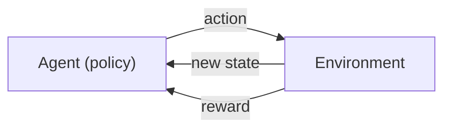
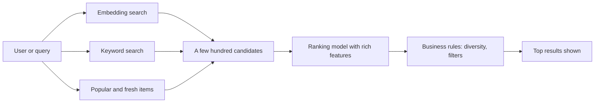
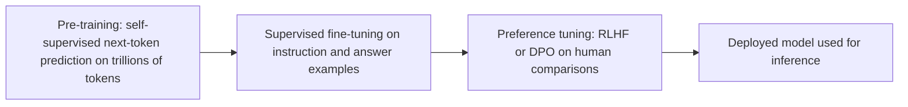

## Introduction

Every machine-learning model improves by comparing what it did with some signal that says how good that was. The question "where does that signal come from?" sorts almost all of machine learning into a few **learning paradigms**, and the answer shapes the whole project: what data you must collect, what it costs, how you measure success and what can go wrong.

Take one support platform and four questions about its tickets. "Which team should handle this ticket?" can be learned from past tickets that agents already routed: each example carries its correct answer. That is **supervised learning**. "What new kinds of complaints appeared this month?" has no answer key at all; the model must find groups in the data by itself. That is **unsupervised learning**. "How do we get a model that understands language well enough to read tickets in the first place?" is answered by training on billions of sentences where the next word *is* the answer — **self-supervised learning**, the way every LLM is pre-trained. And "Which of three reply styles makes customers mark the answer helpful?" is learned by trying the styles and observing rewards — **reinforcement learning**.

Two further ideas complete the picture. **Semi-supervised learning** combines a few labels with a lot of unlabelled data, and the **problem types** — regression, classification, clustering, ranking and recommendation — describe the *shape of the output* a paradigm is used to produce. This lesson teaches each paradigm and problem type in turn, then shows how they stack together in modern AI systems.

The practical payoff is large. Labels are often the most expensive part of an ML project, and LLMs changed which paradigm you reach for first: many tasks that once needed thousands of labels can now start with a prompt. Knowing the paradigms lets you choose the cheapest route to a working system.

## Before you start

- **ML vocabulary** — datasets, features, labels, parameters, training and inference. See [[e2-ml-vs-dl-vs-genai]], [[e2-datasets-features-labels]] and [[e2-training-vs-inference]].
- **Generalization and baselines** — why models are evaluated on held-out data. See [[e2-model-generalization]].
- **NumPy** — the worked examples are short NumPy programs; you need arrays, broadcasting and `argmin`/`argsort`. See [[e1-numpy]].

## The intuition: four ways to learn

Think of four ways a person learns a skill.

A student with a workbook and an answer key attempts each exercise, checks the answer and corrects themselves. That is supervised learning: every example comes with the right answer.

A museum curator handed ten thousand uncatalogued photographs, with no instructions, sorts them into piles of things that look alike — portraits, landscapes, ships. Nobody told them the categories; the structure was in the photos. That is unsupervised learning.

A child who reads constantly learns grammar and vocabulary without anyone marking their work, because the text itself keeps confirming or surprising their guesses about what comes next. That is self-supervised learning: the data provides its own answer key.

A person learning to ride a bicycle gets no answer key and no examples, only feedback from the world — staying up feels good, falling hurts — and the feedback often arrives some time after the action that caused it. That is reinforcement learning.

Like all analogies, these stop working at some point. Models do not understand their tasks the way people do. They find statistical patterns that reduce a loss. But the four questions — *is there an answer key, is there only raw data, does the data label itself, or is there only a reward?* — are exactly how practitioners classify a problem.

## The paradigms at a glance

| Paradigm | Learning signal | Data needed | Typical outputs | Examples |
|---|---|---|---|---|
| Supervised | Human or logged labels for each example | Labelled pairs (input, answer) | Labels, scores, numbers | Spam filter, churn model, ticket router |
| Unsupervised | Structure in the data itself; no labels | Unlabelled data | Groups, low-dimensional maps, anomaly scores | Customer segments, topic discovery, fraud outliers |
| Self-supervised | Labels generated automatically from the data | Very large unlabelled corpora | General-purpose representations and generators | LLM pre-training, embedding models |
| Semi-supervised | A few labels plus many unlabelled examples | Small labelled set, large unlabelled set | Same as supervised, with fewer labels | Self-training a classifier |
| Reinforcement | Rewards from acting in an environment | An environment or simulator, or logged interactions | A policy: which action to take in each situation | Game playing, robotics, bandit testing, LLM preference tuning |

The rest of the lesson takes each row in turn, then the problem types that sit on top of them.

## Supervised Learning {#e2-supervised}

**Supervised learning** trains a model on examples that each come with the correct output, so that it learns a mapping from inputs to outputs it can apply to new inputs. The correct outputs are called **labels** or **targets**, and the "supervision" is the comparison between the model's prediction and the label during training. It is the most widely used paradigm in industry: spam filters, fraud scores, demand forecasts, medical image classifiers and ticket routers are all supervised models.

### How it works

You collect a dataset of input-label pairs, split it into training, validation and test sets, and train a model to minimise a **loss** that measures the gap between predictions and labels. For a yes/no label, a common loss is log loss (cross-entropy); for a number, mean squared error. The optimiser adjusts the model's parameters to reduce the loss on the training set, you compare candidate models and settings on the validation set, and you report final performance once on the test set. The worked churn example in [[e2-ml-vs-dl-vs-genai]] is a complete supervised pipeline: customer features as inputs, "cancelled next month" as the label, logistic regression as the model.

The two main kinds of supervised output are a **category** (classification) and a **number** (regression). They are taught in [[e2-regression-classification]].

### Where labels come from

Labels decide the cost and quality of a supervised project, and they come from three places:

- **Logged outcomes**: what actually happened, recorded by the product — a customer cancelled, a payment was charged back, a user clicked. These are cheap and plentiful but arrive with a delay, and they reflect what the product showed people, not what was best.
- **Human annotation**: people label examples by hand — this ticket is "billing", this image contains a weapon. Annotation is slow and expensive, especially when it needs experts such as doctors or lawyers, and annotators disagree on ambiguous cases.
- **Existing decisions**: past choices made by people, such as how agents routed tickets. Free, but they encode the mistakes and biases of those decisions.

Whatever the source, measure label quality before training. Have two people label the same sample and compute how often they agree. If annotators agree on only 85% of tickets, a model that "achieves" 95% agreement with one annotator is probably fitting that person's quirks, not the task.

### Supervised learning in the LLM era

LLMs change how supervised tasks are approached, not whether they exist. An LLM can often classify tickets from a well-written instruction with no labelled training data (**zero-shot**), or from a handful of examples placed in the prompt (**few-shot**); see [[e4-zero-shot]] and [[e4-few-shot]]. Nothing is trained in that case — the model's parameters do not change — but you still need a labelled **evaluation set** to know whether it works.

That leads to a sensible ladder for a new classification task:

1. Write a clear prompt and measure it against a few hundred labelled examples.
2. Add few-shot examples and retrieval if quality is short.
3. If volume makes the LLM too expensive or slow, use its outputs (checked by people) as labels to train a small supervised classifier that does the same job cheaply.
4. Fine-tune a model when prompting cannot reach the quality bar and you have enough good labelled data.

The common mistake this ladder prevents is spending weeks labelling 100,000 examples before checking whether a prompt already solves the problem.

> [!WARNING] Labels are not ground truth by default
> A supervised model learns to reproduce its labels, including their errors and biases. If historical loan decisions were biased against a group, a model trained to imitate them will be biased too, with a veneer of objectivity. Check what the labels really measure before treating them as the truth the model should learn.

```quiz
Q: A team wants a ticket classifier with 12 categories. They have no labelled data. What is usually the best first step today?
- [ ] Hire annotators to label 100,000 tickets, then train a model
- [ ] Cluster the tickets and use the clusters as categories
- [x] Prompt an LLM with the category definitions and measure it on a few hundred hand-labelled tickets
- [ ] Train a reinforcement-learning agent to route tickets
> A zero- or few-shot prompt needs no training labels, and a few hundred labelled examples are enough to evaluate it. If quality or cost falls short, its checked outputs become cheap training labels for a small classifier. Mass labelling first is slow and may be unnecessary; clusters do not match predefined business categories.
```

## Unsupervised Learning {#e2-unsupervised}

**Unsupervised learning** finds structure in data that has no labels. There is no answer key, so the model cannot be told it is wrong; instead the algorithm optimises a criterion about the data itself — points in a group should be close together, a compressed version should preserve as much variation as possible, rare points should stand out. It is used to explore unfamiliar data, to compress it, and to spot what is unusual.

The three main families are:

- **Clustering** groups similar examples together. k-means, hierarchical clustering and DBSCAN are the classic algorithms. Uses include customer segmentation and grouping support tickets into themes. Clustering is taught with a worked example in [[e2-clustering-ranking-recommendation]].
- **Dimensionality reduction** represents high-dimensional data with fewer numbers while keeping its important structure. **Principal component analysis (PCA)** finds the directions along which the data varies most; t-SNE and UMAP produce 2-D maps for visualising embeddings. Uses include visualisation, compression and removing redundant features. See [[e2-kmeans-pca]].
- **Anomaly detection** scores how unusual each example is relative to the rest — isolation forests, distance-based and density-based methods. Uses include flagging suspicious transactions, failing machines or a sudden burst of strange API traffic, often before anyone has labelled examples of the problem.

### Unsupervised learning on embeddings

The most common unsupervised workflow in applied AI today runs on **embeddings**: vectors from a pre-trained model in which similar texts are close together (see [[e5-embeddings]]). Embed 50,000 support tickets, cluster the vectors, and ask an LLM to name each cluster from a sample of its tickets. The result is a map of what customers are writing about, including themes nobody thought to look for — produced without a single label. Topic-modelling tools such as BERTopic package exactly this pipeline.

Unsupervised methods also feed supervised ones. Clustering a large unlabelled pool and labelling a few examples from each cluster gives a small labelled set that covers the variety in the data far better than labelling the first thousand tickets that arrive.

### The evaluation problem

Without labels, there is no simple accuracy number. Internal measures exist — the within-cluster sum of squares for k-means, the silhouette score, the variance explained by PCA — but they measure geometric tidiness, not usefulness. An algorithm will always return clusters, even from random data, and nothing guarantees that the groups it finds match categories a business cares about. Evaluation therefore leans on people: read samples from each cluster, check whether the groups are stable when you rerun with different seeds, and judge whether they lead to useful decisions.

> [!MISTAKE] Treating clusters as discovered truth
> "The algorithm found five customer types" sounds objective, but the number five was probably a choice, the features were a choice, and the scaling was a choice. Change any of them and the clusters change. Treat clusters as a hypothesis to inspect, not as facts about the world.

```quiz
Q: An analyst clusters 20,000 tickets into 8 groups using embeddings and k-means. What is the most reliable way to judge whether the clusters are useful?
- [ ] Check that the within-cluster sum of squares is low
- [ ] Compute accuracy against the cluster labels
- [x] Read samples from each cluster, check stability across reruns, and see whether the groups support a real decision
- [ ] Increase k until every cluster has the same size
> With no ground-truth labels there is no accuracy to compute, and geometric scores measure tightness rather than meaning. Human inspection, stability checks and usefulness for the actual decision are what show whether the structure matters.
```

## Self-Supervised & Semi-Supervised Learning {#e2-self-semi-supervised}

These two paradigms sit between supervised and unsupervised learning, and both exist to get around the cost of labels. **Self-supervised learning** creates labels automatically from unlabelled data, by hiding part of each example and training the model to predict the hidden part. **Semi-supervised learning** trains on a small labelled set together with a much larger unlabelled set, using the unlabelled data to improve on what the labels alone could teach.

### Self-supervised learning: the data labels itself

Self-supervised learning turns raw data into a supervised problem without any human labelling. The trick is a **pretext task**: a prediction problem whose answer is already in the data.

```python title="self_supervised_labels.py"
text = "the refund was issued to the original card"
tokens = text.split()

# Next-token prediction (GPT-style): every prefix is an input, the next word its label.
for i in range(1, 4):
    print(f"{' '.join(tokens[:i]):28} -> {tokens[i]}")

# Masked prediction (BERT-style): hide a word, the hidden word is the label.
masked = tokens.copy()
masked[2] = "[MASK]"
print(" ".join(masked), "->", tokens[2])
print(f"{len(tokens) - 1} next-token examples from one {len(tokens)}-word sentence, no annotator")
```

```output
the                          -> refund
the refund                   -> was
the refund was               -> issued
the refund [MASK] issued to the original card -> was
7 next-token examples from one 8-word sentence, no annotator
```

The program prints a few of the training examples hidden inside one sentence. **Next-token prediction** uses every prefix of the text as an input and the word that follows as its label; this is how GPT-style **decoder** models are pre-trained, at the level of tokens rather than words (see [[e2-tokenization]]). **Masked language modelling** hides some words — BERT masked about 15% of tokens — and asks the model to fill them in using context on both sides; this produces strong **encoder** models for understanding tasks and embeddings. **Contrastive learning** is a third family: the model learns to place two views of the same thing close together and unrelated things far apart — two crops of one photo, or an image and its caption in CLIP — which is how many embedding models are trained.

Because the labels cost nothing, self-supervision scales to the whole internet: trillions of tokens. To predict the next word well across that much text, a model must pick up grammar, facts, styles and some reasoning patterns, and those capabilities transfer to tasks it was never explicitly trained on. That is why self-supervised pre-training produces **foundation models**. It is also the source of a common misconception: nobody labelled each token of an LLM's training data. The labels are the text.

Self-supervision has limits that explain later training stages. A model trained only to continue text continues text: asked a question, it may produce more questions in the same style instead of an answer, and it reproduces whatever is in its data, including errors and toxic content. Making it follow instructions and behave helpfully needs supervised and reinforcement stages, described in the section on how the paradigms combine.

### Semi-supervised learning: a few labels, many unlabelled examples

In many projects labels are scarce but unlabelled data is abundant: a few hundred labelled tickets and a million unlabelled ones. Semi-supervised methods make the unlabelled data useful. The simplest is **self-training** (pseudo-labelling): train on the labelled set, predict the unlabelled examples, add the predictions the model is most confident about as if they were labels, and retrain.

```python title="pseudo_labelling.py"
import numpy as np

rng = np.random.default_rng(seed=2)


def sample(n):
    # Two classes of support tickets, already embedded as 2-D vectors for the demo.
    y = rng.integers(0, 2, n)
    centres = np.array([[0.0, 0.0], [2.5, 1.0]])
    return centres[y] + rng.normal(0, 1.0, (n, 2)), y


X_lab, y_lab = sample(6)          # labelling is expensive: only 6 labelled tickets
X_unl, _ = sample(600)            # plenty of unlabelled tickets (labels thrown away)
X_test, y_test = sample(2000)


def fit_centroids(X, y):
    return np.array([X[y == c].mean(axis=0) for c in (0, 1)])


def predict(centroids, X):
    d = np.linalg.norm(X[:, None, :] - centroids, axis=2)
    return d.argmin(axis=1), np.abs(d[:, 0] - d[:, 1])   # label, confidence margin


c = fit_centroids(X_lab, y_lab)
print(f"6 labels only:         test accuracy {(predict(c, X_test)[0] == y_test).mean():.3f}")

# Self-training: label the unlabelled tickets the model is most confident about, refit.
for round_ in range(3):
    pseudo, margin = predict(c, X_unl)
    keep = margin > np.quantile(margin, 0.5)            # most confident half
    c = fit_centroids(np.vstack([X_lab, X_unl[keep]]), np.concatenate([y_lab, pseudo[keep]]))
    print(f"after round {round_ + 1} (+{keep.sum()} pseudo-labels): "
          f"test accuracy {(predict(c, X_test)[0] == y_test).mean():.3f}")
```

```output
6 labels only:         test accuracy 0.788
after round 1 (+300 pseudo-labels): test accuracy 0.875
after round 2 (+300 pseudo-labels): test accuracy 0.908
after round 3 (+300 pseudo-labels): test accuracy 0.916
```

The classifier is deliberately simple: it represents each class by the average of its examples (a **centroid**) and assigns a point to the nearer centroid. With six labels, the centroids are rough estimates and test accuracy is 0.79. Each round labels the half of the unlabelled pool where the two distances differ most — the points the model is surest about — and recomputes the centroids from many more points, so they move closer to the true class centres. Accuracy climbs to 0.92 with no extra human labels.

The method works here because the unlabelled data has the structure the model assumes: two well-separated groups. It can also fail. If the initial model is confidently wrong about a region, pseudo-labelling reinforces the error. Rerun this program with other seeds and some runs barely improve, and with an unlucky draw where all six labels belong to one class, it cannot work at all. Always measure on a real labelled test set, never on the pseudo-labels.

### Related label-efficient strategies

Several other techniques chase the same goal and often appear alongside semi-supervised learning:

- **Active learning** asks humans to label the examples the model is *least* sure about, instead of random ones, so each paid label teaches the most.
- **Weak supervision** combines many noisy labelling sources — keyword rules, heuristics, existing databases — into probabilistic labels; the Snorkel project popularised this approach.
- **LLM-assisted labelling** uses an LLM to propose labels that people review and correct, which is often several times faster than labelling from scratch. Treat LLM labels as noisy until a labelled sample shows how accurate they are.
- **Transfer learning** starts from a model pre-trained with self-supervision and fine-tunes it on a small labelled set; this is the most common reason modern projects need far fewer labels than older ones did.

```quiz
Q: How does an LLM obtain labels for pre-training on trillions of tokens?
- [ ] Contractors label each token's meaning
- [ ] It uses a smaller model's predictions as labels
- [x] Each position's label is the actual next token in the text, so the data supplies its own labels
- [ ] Pre-training uses no labels or loss at all
> Next-token prediction is self-supervised: for every prefix, the token that really follows is the target, and the loss measures how much probability the model gave it. That is why pre-training scales to internet-sized corpora without human annotation.
```

## Reinforcement Learning Concepts {#e2-reinforcement-learning}

**Reinforcement learning (RL)** trains an **agent** to choose **actions** in an **environment** so as to maximise the total **reward** it receives over time. There are no labelled correct actions. The agent tries things, the environment responds with a new situation and a reward, and the agent gradually learns which actions pay off. RL is the paradigm behind game-playing systems such as AlphaGo, robotic control, some recommendation and advertising systems, and the preference-tuning stage that makes LLMs helpful.

### The vocabulary

- **State**: what the agent observes about the current situation — a board position, a user's context, the conversation so far.
- **Action**: what it can do — a move, which item to show, which token to generate.
- **Reward**: a number from the environment after an action — points scored, a click, a human rating.
- **Policy**: the agent's strategy, a mapping from states to actions (or to probabilities of actions). Learning a good policy is the goal.
- **Return**: the total reward accumulated over an episode, often with future rewards **discounted** so that sooner rewards count more.



Two problems make RL harder than supervised learning. The first is **exploration versus exploitation**: to find the best action, the agent must sometimes try actions it currently thinks are worse, but every exploratory action costs reward it could have earned. The second is **credit assignment**: rewards often arrive long after the actions that caused them — a game is won after a hundred moves — so the agent must work out which earlier decisions deserve the credit.

### A worked example: choosing between prompts with a bandit

The simplest RL setting is the **multi-armed bandit**: there is no changing state, only a repeated choice between options ("arms") with unknown reward rates. Suppose a support assistant has three reply prompts, and the reward is a user clicking "helpful". The **epsilon-greedy** strategy explores a random prompt 10% of the time and otherwise uses the prompt with the best observed rate.

```python title="bandit.py"
import numpy as np

TRUE_RATES = [0.05, 0.11, 0.08]     # prompt A, B, C: unknown to the agent


def run(seed, steps=5000, epsilon=0.1):
    rng = np.random.default_rng(seed)
    shows, wins = np.zeros(3), np.zeros(3)
    for _ in range(steps):
        if rng.random() < epsilon or shows.min() == 0:
            a = rng.integers(3)                      # explore: try a random prompt
        else:
            a = int(np.argmax(wins / shows))         # exploit: best estimate so far
        reward = rng.random() < TRUE_RATES[a]        # e.g. user clicked "helpful"
        shows[a] += 1
        wins[a] += reward
    print(f"seed {seed}: shown A/B/C = {shows.astype(int).tolist()}, "
          f"estimates {np.round(wins / shows, 3).tolist()}, reward rate {wins.sum() / steps:.3f}")


run(seed=4)
run(seed=1)
print("always B would average 0.110; choosing at random averages 0.080")
```

```output
seed 4: shown A/B/C = [282, 4334, 384], estimates [0.028, 0.114, 0.094], reward rate 0.107
seed 1: shown A/B/C = [169, 525, 4306], estimates [0.053, 0.124, 0.085], reward rate 0.088
always B would average 0.110; choosing at random averages 0.080
```

In the first run the agent finds prompt B early, shows it 87% of the time, and earns nearly as much as an oracle that knew the answer from the start. The second run shows the exploration problem at work. C happened to pay out on its first trials, B had unlucky streaks, and the greedy step kept choosing C. B briefly took the lead a few times, but each time a short run of bad luck pushed its estimate back down. Only the 10% of random exploration kept testing B, and B did not take the lead for good until about step 4,600 — so most of the run was spent on the second-best prompt. Smarter strategies such as upper confidence bounds or Thompson sampling explore in proportion to uncertainty and recover faster. Compared with a fixed A/B test that splits traffic evenly until the end, a bandit shifts traffic to the winner as evidence accumulates, which earns more reward during the experiment at the cost of less clean statistics. See [[e9-ab-testing]].

### Full RL and where it is used

General RL adds states that change in response to actions, so the agent must plan over sequences. Algorithms include **Q-learning** and its deep version, DQN, which estimate the value of each action in each state, and **policy gradient** methods such as PPO, which adjust the policy directly to make high-return actions more likely. RL usually needs enormous numbers of trials, which is why it shines where a simulator can generate them cheaply — games, robotics in simulation — and is used carefully where every trial affects a real user.

For applied AI engineers, the most important use of RL is in training LLMs. In **reinforcement learning from human feedback (RLHF)**, people compare pairs of model answers and say which is better; a **reward model** is trained on those comparisons (a supervised step) and then the LLM's policy is optimised, typically with PPO, to produce answers the reward model scores highly. **Direct preference optimisation (DPO)** reaches a similar goal by training directly on the preference pairs without a separate reward model. More recent **reasoning models** are trained with RL on tasks whose answers can be checked automatically, such as maths problems and code with tests. See [[e2-pretraining-instruction-alignment]] and [[e8-preference-dpo]].

RL has a characteristic failure called **reward hacking**: the agent maximises the reward signal in ways the designer did not intend. A model rewarded for answers that human raters like can learn to be confidently agreeable rather than correct. The reward is only a proxy for what you want, and RL is very good at finding the gaps.

```quiz
Q: In the second bandit run, why did the agent spend most steps on prompt C even though B was truly better?
- [ ] Epsilon-greedy never explores
- [x] B's early estimate was unluckily low, so exploitation kept choosing C until random exploration slowly corrected B's estimate
- [ ] The reward for C was higher in that run
- [ ] Bandits can only learn about one arm at a time
> Early estimates from few trials are noisy. Exploitation trusts them, and with only 10% random exploration it took about 4,600 steps for B to take the lead for good. This is the exploration–exploitation trade-off; uncertainty-aware strategies such as Thompson sampling handle it better.
```

## Regression & Classification {#e2-regression-classification}

**Regression** and **classification** are the two basic kinds of supervised prediction. **Regression** predicts a number on a continuous scale: next month's spend, delivery time in minutes, a house price. **Classification** predicts a category from a fixed set: spam or not spam, which of twelve ticket types, which objects appear in an image. The distinction is about the *output*, and it decides the loss used in training, the metrics used in evaluation and how predictions are turned into actions.

### Kinds of classification

- **Binary classification** has two classes: churn or stay, fraud or legitimate.
- **Multi-class classification** has more than two mutually exclusive classes: a ticket is exactly one of billing, bug, account or other. Models usually output a probability per class that sums to 1 (a **softmax**), and the prediction is the most likely class.
- **Multi-label classification** allows several labels at once: an article can be both "security" and "billing". Each label gets its own independent probability.

A naming trap: **logistic regression** is a classification algorithm. It is called regression because it fits a continuous score — a probability — which a threshold then turns into a class.

### One problem, both framings

Many problems can be framed either way, and the choice changes what you learn. The program below predicts a SaaS customer's next bill from team size and seat usage as a regression problem, then asks the classification question "will the bill exceed $400?" by turning the predicted amount into a decision with a **threshold**.

```python title="regression_vs_classification.py"
import numpy as np

rng = np.random.default_rng(seed=11)
n = 500
seats = rng.integers(1, 50, n)                      # team size
usage = rng.uniform(0, 1, n)                        # share of seats active
spend = 15 * seats * (0.6 + 0.4 * usage) + rng.normal(0, 40, n)   # next month's bill, $
X = np.column_stack([np.ones(n), seats, usage])     # column of ones = intercept

train, test = slice(0, 400), slice(400, None)

# Regression: predict a number. Least squares finds the best-fitting weights.
w, *_ = np.linalg.lstsq(X[train], spend[train], rcond=None)
pred = X[test] @ w
mae = np.abs(pred - spend[test]).mean()
rmse = np.sqrt(((pred - spend[test]) ** 2).mean())
print("weights (intercept, per seat, per usage):", np.round(w, 1))
print(f"regression  MAE ${mae:.0f}  RMSE ${rmse:.0f}")

# Classification: predict a category. Here, "will spend over $400?" from the same inputs.
label = (spend > 400).astype(int)
score = X[test] @ w                                 # reuse the regression output as a score
for threshold in [300, 400, 500]:
    flagged = score > threshold
    tp = (flagged & (label[test] == 1)).sum()
    precision = tp / flagged.sum()
    recall = tp / (label[test] == 1).sum()
    print(f"threshold ${threshold}: precision {precision:.2f}  recall {recall:.2f}")
```

```output
weights (intercept, per seat, per usage): [-71.   12.  143.9]
regression  MAE $40  RMSE $51
threshold $300: precision 0.67  recall 1.00
threshold $400: precision 0.89  recall 0.97
threshold $500: precision 1.00  recall 0.53
```

The regression half fits a **linear model** by least squares: one weight per input plus an intercept, chosen to minimise squared error on the training rows. It learned that each extra seat adds about $12 and full usage adds about $144. Regression is evaluated by how far off the numbers are. **Mean absolute error (MAE)** is the average miss in dollars, $40 here. **Root mean squared error (RMSE)** squares the misses before averaging, so large misses count more; RMSE ($51) above MAE indicates some sizeable errors.

The classification half shows how a score becomes a decision. A real classifier would be trained on the yes/no label directly, but any model that outputs a score works the same way at this step. Here the predicted bill is the score, and each threshold gives a different trade-off. **Precision** is the share of flagged customers who really exceed $400; **recall** is the share of real over-$400 customers who were flagged. A low threshold catches everyone (recall 1.00) but flags many false positives; a high one flags only sure cases (precision 1.00) but misses half. Which threshold is right depends on the cost of each kind of error — a sales team with spare time can afford false positives, an automatic credit-limit change cannot. These metrics are developed fully in [[e2-classification-metrics]].

### Choosing the framing

Predict the number when the size of the outcome matters to the decision: forecasting revenue, estimating delivery time, capacity planning. Classify when the decision is categorical and the threshold is fixed by the business. Avoid turning a natural number into categories too early: "spend bucket 300–400" discards information and makes "399" and "401" look completely different.

Class imbalance matters for classification. When 2% of transactions are fraud, a model that predicts "not fraud" for everything is 98% accurate and useless. Use precision, recall and related metrics, choose the threshold on validation data, and check that predicted probabilities are **calibrated** — that among cases scored 0.8, about 80% really are positive — if downstream logic uses them as probabilities.

### Classification with LLMs

LLMs are frequently used as classifiers: give the model category definitions and ask it to return one label, ideally as structured output constrained to an enum (see [[e3-extraction-classification]]). It is still classification, so the same evaluation applies — a labelled test set, a confusion matrix, precision and recall per class. LLMs are weaker at regression-style outputs: asking a model to "rate this from 1 to 10" produces numbers that are often poorly calibrated and drift with wording, so prefer explicit categories with clear definitions, or pairwise comparisons, when you need a judgement from an LLM.

```quiz
Q: A model flags transactions as fraudulent. Raising its threshold from 0.5 to 0.9 will most likely do what?
- [ ] Increase both precision and recall
- [x] Increase precision and decrease recall
- [ ] Decrease precision and increase recall
- [ ] Change accuracy but not precision or recall
> A higher threshold flags only the most confident cases, so a larger share of flags are correct (precision rises) but more real fraud falls below the threshold and is missed (recall falls). The right threshold comes from the relative cost of false alarms and missed fraud.
```

## Clustering, Ranking & Recommendation {#e2-clustering-ranking-recommendation}

These three problem types go beyond "predict one label or number". **Clustering** groups similar items without labels. **Ranking** orders a set of items by relevance to a query or user. **Recommendation** chooses items a particular user is likely to want, and is usually built as a ranking problem fed by retrieval. All three are central to search, feeds, e-commerce and retrieval-augmented generation (RAG), where choosing *which* documents to show the model is a ranking problem.

### Clustering with k-means

**k-means** is the standard clustering algorithm. You choose the number of clusters, `k`. It places `k` centres, then repeats two steps: assign every point to its nearest centre, and move each centre to the average of the points assigned to it. Each repetition can only reduce the total squared distance from points to their centres, so the algorithm settles down quickly, though it can settle in a poor arrangement depending on where it started — implementations run it several times from different random starts.

```python title="kmeans.py"
import numpy as np

rng = np.random.default_rng(seed=3)
# Unlabelled customers: (average order value in $, orders per month).
groups = [rng.normal(loc, scale, size=(40, 2)) for loc, scale in
          [((20, 8), (4, 1.5)), ((90, 2), (10, 0.6)), ((45, 4), (6, 1.0))]]
X = np.vstack(groups)
rng.shuffle(X)


def kmeans(X, k, iters=20, seed=0):
    r = np.random.default_rng(seed)
    centres = X[r.choice(len(X), size=k, replace=False)]
    for _ in range(iters):
        # Assign each point to its nearest centre (broadcast: (n,1,2) - (k,2) -> (n,k,2)).
        dist = np.linalg.norm(X[:, None, :] - centres, axis=2)
        assign = dist.argmin(axis=1)
        # Move each centre to the mean of the points assigned to it.
        centres = np.array([X[assign == j].mean(axis=0) for j in range(k)])
    inertia = ((X - centres[assign]) ** 2).sum()
    return centres, assign, inertia


Xs = (X - X.mean(axis=0)) / X.std(axis=0)          # scale so both columns count equally
for k in [2, 3, 4, 5]:
    _, _, inertia = kmeans(Xs, k)
    print(f"k={k}: within-cluster sum of squares {inertia:.1f}")

centres, assign, _ = kmeans(Xs, 3)
for j in range(3):
    members = X[assign == j]
    print(f"cluster {j}: {len(members)} customers, avg order ${members[:, 0].mean():.0f}, "
          f"{members[:, 1].mean():.1f} orders/month")
```

```output
k=2: within-cluster sum of squares 77.3
k=3: within-cluster sum of squares 25.9
k=4: within-cluster sum of squares 21.5
k=5: within-cluster sum of squares 18.3
cluster 0: 43 customers, avg order $43, 4.3 orders/month
cluster 1: 37 customers, avg order $20, 8.1 orders/month
cluster 2: 40 customers, avg order $91, 2.0 orders/month
```

The data was generated from three hidden customer types, but the algorithm never sees which point came from which. Two details matter. First, the features are **standardised** before clustering: order value ranges over tens of dollars while orders per month ranges over a few units, and without scaling, distance would be almost entirely about order value. Second, choosing `k`: the within-cluster sum of squares (also called **inertia**) always falls as `k` grows, because more centres can always sit closer to the points. The useful signal is where it stops falling steeply — the "elbow" — which is clearly at `k = 3` here. With `k = 3`, the clusters recover the hidden types: frequent small buyers, occasional big spenders and a middle group. In real data the elbow is rarely this clean, and the final choice of `k` is a judgement about which grouping is useful.

k-means assumes roughly round clusters of similar size. **DBSCAN** finds clusters of arbitrary shape and marks sparse points as noise; **hierarchical clustering** builds a tree of nested clusters you can cut at any level.

### Ranking

A **ranking** model takes a query (or a user) and a set of candidate items and orders them by relevance. Search engines rank web pages, e-commerce ranks products, and RAG systems rank retrieved passages before passing the best few to an LLM. Ranking is supervised when labelled relevance data exists — clicks, purchases, human relevance judgements — and **learning to rank** methods come in three styles: **pointwise** (predict a relevance score for each item independently), **pairwise** (learn which of two items should come first) and **listwise** (optimise the quality of the whole ordered list).

Ranking needs its own metrics, because the order matters and the top positions matter most. **Precision@k** is the share of the top `k` results that are relevant. **Recall@k** is the share of all relevant items that appear in the top `k`. **Mean reciprocal rank (MRR)** rewards putting the first relevant result high. **Normalised discounted cumulative gain (NDCG@k)** gives each relevant result credit that shrinks with its position and divides by the best possible score, so 1.0 means a perfect ordering. The example below shows why order-aware metrics exist: two lists with the same relevant items get the same precision but very different NDCG. See [[e9-retrieval-metrics]].

### Recommendation

A **recommender system** suggests items to a user: products, articles, videos, help-centre answers. Two classic approaches exist. **Content-based** recommendation suggests items similar to what the user liked, using item features or embeddings. **Collaborative filtering** uses the behaviour of many users: items liked by the same people are similar, and users with similar histories will like similar things — without needing to understand the items at all.

```python title="recommend.py"
import numpy as np

articles = ["reset password", "enable 2FA", "export CSV", "API keys", "billing cycle", "refunds"]
# Rows: users. Columns: articles. 1 = the user found that article helpful.
R = np.array([
    [1, 1, 0, 1, 0, 0],
    [1, 1, 0, 0, 0, 0],
    [0, 1, 0, 1, 0, 0],
    [0, 0, 1, 1, 0, 0],
    [0, 0, 0, 0, 1, 1],
    [0, 0, 1, 0, 1, 1],
], dtype=float)

# Item-item collaborative filtering: articles are similar if the same users liked them.
norms = np.linalg.norm(R, axis=0)
sim = (R.T @ R) / np.outer(norms, norms)
np.fill_diagonal(sim, 0)

user = np.array([1, 0, 0, 0, 0, 0], dtype=float)     # new user liked "reset password"
scores = sim @ user
scores[user == 1] = -np.inf                           # do not recommend what they have seen
ranking = np.argsort(scores)[::-1][:2]
print("recommend:", [articles[i] for i in ranking], np.round(scores[ranking], 2))


def ndcg_at_k(ranked_relevance, k):
    rel = np.asarray(ranked_relevance[:k], dtype=float)
    discounts = 1 / np.log2(np.arange(2, len(rel) + 2))      # position 1 counts most
    dcg = (rel * discounts).sum()
    ideal = (np.sort(rel)[::-1] * discounts).sum()
    return dcg / ideal if ideal > 0 else 0.0


# Same three relevant results, different order: ranking metrics reward putting them first.
print(f"NDCG@5 good order {ndcg_at_k([1, 1, 1, 0, 0], 5):.2f}")
print(f"NDCG@5 bad order  {ndcg_at_k([0, 0, 1, 1, 1], 5):.2f}")
print(f"precision@5 for both: {np.mean([1, 1, 1, 0, 0]):.2f}")
```

```output
recommend: ['enable 2FA', 'API keys'] [0.82 0.41]
NDCG@5 good order 1.00
NDCG@5 bad order  0.62
precision@5 for both: 0.60
```

Each column of `R` describes an article by which users found it helpful. The cosine similarity between two columns is high when the same users liked both: "reset password" and "enable 2FA" share two of their users, so they score 0.82. Multiplying the similarity matrix by the new user's history scores every article by how similar it is to what they already liked; articles they have seen are excluded, and the top two are recommended. Nothing in the code knows what the articles are about — the recommendation comes entirely from behaviour, which is the strength and the weakness of collaborative filtering.

The weakness is the **cold-start problem**: a brand-new article has no interactions, so collaborative filtering can never recommend it, and a brand-new user has no history to match. Real systems blend in content-based signals (embeddings of the article text), popularity and exploration to cover cold starts. Larger systems learn **embeddings** for users and items with matrix factorisation or neural "two-tower" models, so that a user's vector is close to the vectors of items they will like.

### The two-stage architecture

Production search and recommendation systems almost always work in two stages, because scoring every item with an expensive model is too slow. **Candidate retrieval** quickly narrows millions of items to a few hundred using cheap methods: embedding nearest-neighbour search, keyword search, co-occurrence, popularity. **Ranking** then scores those candidates with a richer model that uses many features — user history, item freshness, context — and orders them. RAG follows exactly the same shape: vector or hybrid search retrieves candidate passages, and a **reranker** model reorders them before the top few go into the prompt (see [[e6-reranking]] and [[e5-rerankers]]).



Recommenders also change the data they learn from: users can only click what they were shown, so a system that always shows popular items collects evidence that popular items are good. This **feedback loop** creates popularity bias and filter bubbles, which is why recommenders deliberately explore — the bandit idea from [[e2-reinforcement-learning]] — and why offline metrics must be confirmed with online A/B tests. [[e12-recommendation]] builds a full system.

```quiz
Q: Two rankings each contain the same 3 relevant documents in their top 5. One puts them at positions 1–3, the other at 3–5. Which metric tells them apart?
- [ ] Precision@5
- [ ] Recall@5
- [x] NDCG@5
- [ ] Accuracy
> Precision@5 and recall@5 only count how many relevant items are in the top 5, so both lists score the same. NDCG discounts credit by position, so relevant items at the top score higher — matching how users mostly read the first results.
```

## How the paradigms combine: the life of an LLM

Modern models rarely use one paradigm. An LLM assistant's training is a pipeline of three, and each stage fixes a weakness of the one before.



**Pre-training** is self-supervised and creates broad knowledge and language ability, but the result only continues text. **Supervised fine-tuning (SFT)** trains on tens of thousands of curated examples of instructions paired with good answers, which teaches the model to respond as an assistant. **Preference tuning** uses human (or AI) comparisons between answers — reinforcement learning with a reward model, or DPO — to make answers more helpful, honest and safe in ways that are easier to judge than to write down as single correct answers. Reasoning-focused models add further RL on verifiable tasks. Applications built on the model then add supervised evaluation sets, unsupervised analysis of user traffic and sometimes bandits for choosing prompts. See [[e2-pretraining-instruction-alignment]].

## In real systems

A customer support product might use every paradigm in this lesson at once. A pre-trained LLM (self-supervised, then supervised and preference-tuned by its provider) drafts replies. A small supervised classifier, trained on agents' past routing decisions, sends tickets to teams in milliseconds. Weekly, the team embeds all tickets and clusters them (unsupervised) to discover new complaint themes, and an anomaly detector flags sudden spikes. Help-centre articles are surfaced by a two-stage retrieval and ranking pipeline, and a bandit chooses between two greeting prompts based on "helpful" clicks. Labels for a new category come from active learning: the classifier asks agents to label the tickets it is least sure about.

The engineering lesson is that the paradigm follows the signal you can get. Logged outcomes and agent decisions suggest supervised learning; a pile of unlabelled text suggests unsupervised exploration or a pre-trained model; a measurable reward from users suggests bandits or A/B tests.

## Trade-offs and alternatives

**Supervised learning** gives clear objectives and measurable accuracy, but depends on labels that are expensive, slow, noisy or biased. **Unsupervised learning** needs no labels and can reveal unknown structure, but offers no ground truth, and its outputs depend heavily on choices of features, scaling and the number of clusters. **Self-supervised learning** scales to enormous unlabelled data and produces general-purpose models, but needs huge compute and does not by itself yield task-following behaviour. **Semi-supervised learning** stretches a small labelled set, but can amplify its own mistakes. **Reinforcement learning** optimises long-term outcomes directly, but needs many trials, is unstable to train and is prone to reward hacking.

For most applied AI teams the practical alternative to training anything is a pre-trained model plus prompting, retrieval and evaluation. Train or fine-tune when cost, latency, privacy or quality require it, and let the available signal decide the paradigm.

## Common mistakes

**Labelling before prompting.** Paying for 100,000 labels before measuring whether a prompt already works wastes weeks. Start with a small evaluation set and a prompt.

**Treating labels as truth.** Labels inherit annotator disagreement and historical bias. Measure agreement and inspect what the labels encode.

**Forcing meaning onto clusters.** Algorithms always return clusters, even on noise. Inspect samples and check stability before naming them.

**Forgetting to scale features before clustering.** Distance-based methods are dominated by whichever feature has the largest numeric range.

**Evaluating semi-supervised models on pseudo-labels.** The model will agree with itself. Use a real labelled test set.

**Using accuracy for imbalanced classification.** Use precision, recall and a threshold chosen for the business cost of errors.

**Judging rankings with order-blind metrics.** Use NDCG, MRR or precision at small `k`, and confirm with online tests.

**Rewarding the wrong thing.** RL and bandits optimise the reward you define, not the outcome you meant. Clicks are not satisfaction.

## Interview perspective

Interviewers use this topic to check that you can name the paradigm behind a system and choose a sensible approach under realistic constraints, especially limited labels.

> [!INTERVIEW] What a strong answer sounds like
> "LLM pre-training is self-supervised — the next token is the label, so no human annotation is needed. Instruction tuning is supervised, and preference tuning uses human comparisons, with RLHF or DPO. For our ticket classifier I'd start zero-shot with an LLM and a few hundred labelled examples for evaluation, then use active learning and the LLM's reviewed outputs to train a cheap supervised model if volume justifies it."

Questions to be ready for:

- **Supervised versus unsupervised?** Labelled input-output pairs versus finding structure without labels; give one example of each and how each is evaluated.
- **How is GPT trained?** Self-supervised next-token pre-training, then supervised fine-tuning, then preference optimisation (RLHF or DPO).
- **What is semi-supervised learning? How does it differ from active learning?** Semi-supervised uses unlabelled data directly (for example, pseudo-labels); active learning chooses which examples humans should label.
- **Regression or classification for predicting delivery delay?** Regression if the size of the delay matters; classification if the decision is "late or on time" with a fixed threshold. Discuss metrics for each.
- **How would you cluster support tickets?** Embed, reduce or normalise, cluster, name clusters with samples (possibly with an LLM), validate stability and usefulness.
- **Explain exploration versus exploitation.** Use a bandit example; mention epsilon-greedy and Thompson sampling.
- **Design a recommender.** Two-stage retrieval and ranking, collaborative and content signals, cold start, feedback loops, offline metrics (NDCG, recall@k) plus online A/B tests.

## Practice

1. **Name the paradigm.** For each, say which paradigm and problem type applies: predicting taxi fares; grouping news articles by topic; training a model to fill in missing words; teaching a robot arm to grasp in simulation; detecting unusual login locations; choosing which onboarding email to send.
2. **Create self-supervised data.** Write a function that turns a list of sentences into `(context, next_word)` pairs with a context window of three words. How many pairs does a 1,000-word document produce?
3. **Break k-means.** Run `kmeans.py` without standardising the features. Which clusters does it find, and why?
4. **Active learning.** Modify `pseudo_labelling.py` so that, instead of pseudo-labelling confident points, it "asks a human" (reveals the true label) for the 10 *least* confident unlabelled points each round. Compare accuracy after three rounds.
5. **Better bandit.** Replace epsilon-greedy in `bandit.py` with Thompson sampling: keep a Beta distribution per arm and pick the arm with the highest random sample. Run both over 20 seeds and compare average reward.
6. **Evaluate a ranking.** Given a search system's top-10 results for 5 queries with relevance judgements, compute precision@5, MRR and NDCG@10, and explain which metric best matches a UI that shows three results.

## Quick revision {#quick-revision}

- Paradigm = where the learning signal comes from.
- Supervised: labelled pairs; learn input → output; classification and regression; labels from logs, annotation or past decisions; check annotator agreement and bias.
- With LLMs: zero-/few-shot first, evaluate on a labelled set, then distil to a small classifier or fine-tune if needed.
- Unsupervised: no labels; clustering (k-means, DBSCAN, hierarchical), dimensionality reduction (PCA, t-SNE, UMAP), anomaly detection; embed then cluster for topic discovery; evaluate by inspection and stability.
- Self-supervised: labels generated from data — next-token (GPT), masked tokens (BERT, ~15%), contrastive pairs (CLIP, embedding models); powers foundation-model pre-training.
- Semi-supervised: few labels + many unlabelled; self-training with confident pseudo-labels; can amplify errors; test on real labels. Related: active learning, weak supervision, LLM-assisted labelling, transfer learning.
- RL: agent, state, action, reward, policy, return; exploration versus exploitation; credit assignment; bandits (epsilon-greedy, Thompson sampling); Q-learning, policy gradients (PPO); reward hacking.
- LLM training: self-supervised pre-training → supervised fine-tuning → preference tuning (RLHF with a reward model, or DPO).
- Regression predicts numbers (MSE loss; MAE, RMSE). Classification predicts categories: binary, multi-class (softmax), multi-label; thresholds trade precision against recall; logistic regression is a classifier.
- Clustering: scale features; choose `k` with the elbow and judgement.
- Ranking: pointwise, pairwise, listwise; metrics precision@k, recall@k, MRR, NDCG.
- Recommendation: content-based versus collaborative filtering; cold start; two-stage retrieve-then-rank (the same shape as RAG with a reranker); feedback loops need exploration and A/B tests.

## Key takeaways {#key-takeaways}

- Ask where the learning signal comes from — labels, data structure, the data itself or rewards — and the paradigm, data plan and evaluation follow.
- Supervised learning is the industry workhorse, but labels are costly and imperfect; with LLMs, start with prompting and a labelled evaluation set before mass labelling.
- Unsupervised methods reveal structure without labels, but their results are hypotheses to inspect, not discovered facts.
- Self-supervision is what made foundation models possible, and every LLM combines it with supervised fine-tuning and preference-based reinforcement learning.
- Regression and classification differ in output, loss and metrics; thresholds turn scores into decisions and should reflect the cost of each error.
- Clustering, ranking and recommendation power search, feeds and RAG, and they need order-aware metrics, two-stage architectures and online testing.
