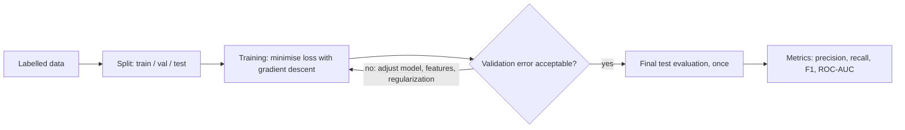
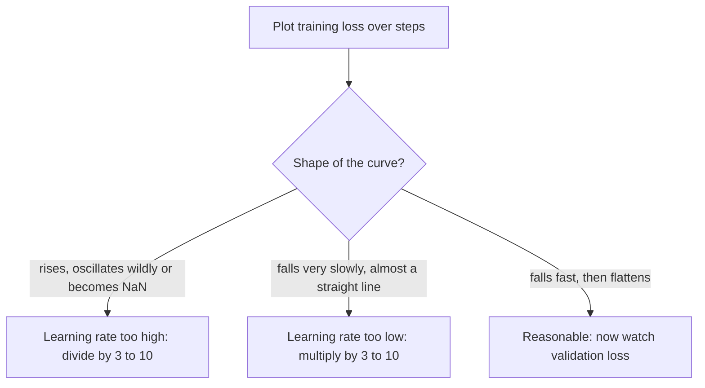

## Introduction

Imagine you are asked to build a model that flags customers who are about to cancel their subscription. You collect two years of customer records, each labelled "churned" or "stayed", and after an afternoon of work your model is right 99% of the time on that data. Is it good?

You cannot tell yet, and that is the point of this lesson. The 99% might mean the model has learned real warning signs. It might mean it memorised the customers it saw and will be useless on next month's customers. It might mean only 1% of customers churn, so a model that always says "stays" is also right 99% of the time while catching nobody. It might mean a column such as `cancellation_reason` slipped into the inputs, so the model is reading the answer. Each of these failures looks identical from the single number "99%".

Machine learning has two halves that this lesson teaches together. **Training** is the process of adjusting a model's parameters so that its predictions on known examples become less wrong. It needs a precise definition of "wrong" — a **loss function** — and a procedure for reducing it — usually **gradient descent**. **Evaluation** is the process of measuring, honestly, how well the trained model will behave on data it has never seen. It needs data held back from training, an understanding of how models fail to generalise, and metrics that reflect what you actually care about.

These ideas are not only for people who train models. If you build applications on top of large language models (LLMs), you will still split data (prompt-development examples versus a held-out evaluation set), still face overfitting (a prompt tuned until it passes your twenty examples and fails on real traffic), and still choose between precision and recall (should the moderation filter block borderline content or let it through?). The vocabulary in this lesson is the vocabulary every AI evaluation discussion uses.

The lesson is organised as a pipeline. First, how to split data so that evaluation is honest. Then the training half: loss functions and gradient descent. Then the generalisation half: overfitting, regularization and the bias–variance trade-off. Finally, the metrics for classification models. A worked example at the end puts every piece into one program. All code is plain Python 3.12 with only the standard library, so you can run it without installing anything and see every calculation.

## Before you start

- **What a model, a feature and a label are** — a model maps inputs (features) to outputs, and supervised training uses examples whose correct output (label) is known. See [[e2-ml-vs-dl-vs-genai]] and [[e2-datasets-features-labels]].
- **Parameters versus hyperparameters** — parameters are learned during training; hyperparameters such as the learning rate are chosen by you. See [[e2-parameters-hyperparameters]].
- **Regression versus classification** — predicting a number versus predicting a category. See [[e2-regression-classification]].
- **Generalization** — the idea that a model must work on new data, not only on the data it learned from. See [[e2-model-generalization]].
- **Python basics** — functions, lists, loops and comprehensions. See [[e1-syntax]].

The calculus behind gradients is explained here in just enough depth to follow the code. If you want the full treatment of derivatives and the chain rule, see [[e2-calculus-gradients]].

## The intuition

Think of a student preparing for an exam using a stack of past papers. Studying the papers is **training**: the student checks their answers against the marking scheme (the labels), notices how wrong they were (the loss), and adjusts their understanding (the parameters). If they study well, they learn the underlying subject. If they study badly, they memorise the specific answers to the specific questions on those papers.

How would a teacher find out which happened? Not by giving the same past papers again — a student who memorised them would score perfectly. The teacher keeps some papers back and uses them as a **mock exam**. The student may take the mock several times and change how they study based on the result, so after a while their mock score becomes slightly flattering too. That is why the real **final exam** is a set of questions nobody has seen, used once.

Those three stacks of papers are exactly the **training set**, **validation set** and **test set**. The student who memorises is **overfitting**; the student who barely studied and gets everything roughly wrong is **underfitting**. The marking scheme that penalises a wrong answer is the **loss function**, and the habit of adjusting a little after each paper, in the direction that would have reduced the mistakes, is **gradient descent**. The final grade report — not just "percent correct" but "which kinds of questions were missed" — is the job of **evaluation metrics**.

The analogy stops working in one place: a student can understand *why* an answer is right. A model only adjusts numbers to make a loss smaller. It will happily exploit any shortcut in the data that reduces the loss, including shortcuts that make no sense, which is why the measurement side of this lesson matters as much as the training side.



## Train, Validation & Test Splits {#e2-train-validation-test}

A **data split** divides your labelled examples into separate groups with different jobs, so that the data used to judge a model is never the data used to build it. The standard arrangement has three groups. The **training set** is what the model learns from: its parameters are adjusted to fit these examples. The **validation set** (sometimes called the development or "dev" set) is used to make decisions *about* the model — which features to use, which hyperparameters, when to stop training, which decision threshold. The **test set** is held back until the very end and used once, to estimate how the final model will perform on new data.

### Why you cannot evaluate on training data

A model's error on its own training data is almost always lower than its error on new data, because the parameters were chosen specifically to make *that* error small. In the extreme, a model can memorise: a lookup table that stores every training example and its label has zero training error and no ability to answer anything else. Training error therefore measures how well the model fits, not how well it **generalises** — performs on data drawn from the same source but not seen during training. Generalisation is what you deploy for.

So you need data the model did not train on. Why two held-out sets rather than one? Because every decision you make based on a dataset leaks a little information from it into the model. If you try twenty hyperparameter settings and keep the one with the best validation score, part of that winning score is luck: one of twenty settings happened to suit the particular validation examples. The validation score of the winner is **optimistically biased**. The test set exists to give one unbiased number after all decisions are made. If you then go back and change the model because the test score disappointed you, the test set has become a second validation set, and you no longer have an unbiased estimate.

| Split | Used for | Touched how often | What its score means |
|---|---|---|---|
| Training | Fitting parameters | Every training step | How well the model fits; not a generalisation estimate |
| Validation | Choosing hyperparameters, features, thresholds, when to stop | Many times during development | A slightly optimistic generalisation estimate |
| Test | Final estimate of real-world performance | Once, at the end | An unbiased estimate, if nothing was tuned on it |

### How big should each split be?

There is no single correct ratio. Common starting points are 70/15/15 or 80/10/10 for datasets of thousands to tens of thousands of examples. The reasoning behind the numbers matters more than the numbers. The validation and test sets need to be big enough that their scores are *stable* — that the difference between two models is larger than the random noise of which examples happened to land in the set. An accuracy measured on 100 examples moves by a whole percentage point for each example that flips, and its statistical uncertainty is several points (see [[e2-statistics]] for how to put a confidence interval on it). With ten million examples, 1% for validation and 1% for test is already 100,000 examples each, so most of the data can go to training.

### Random, stratified, time-based and grouped splits

The simplest split shuffles the rows and cuts them into pieces. That is correct when the examples are **independent and identically distributed** (IID) — each is drawn separately from the same underlying population, and the order carries no information. Many real datasets violate that assumption, and the split must respect the structure.

A **stratified split** keeps the proportion of each class the same in every split. It matters most when one class is rare. The program below has 1,000 messages of which about 6% are spam, and compares how much the validation set's spam rate varies under random and stratified splitting across 1,000 different shuffles.

```python title="split.py"
import random

random.seed(7)
# 1,000 labelled messages; roughly 5% are spam (label 1).
data = [(f"msg-{i}", 1 if random.random() < 0.05 else 0) for i in range(1000)]

def random_split(rows, train=0.70, val=0.15, seed=0):
    rows = rows[:]                      # never shuffle the caller's list in place
    random.Random(seed).shuffle(rows)
    n_train = int(len(rows) * train)
    n_val = int(len(rows) * val)
    return rows[:n_train], rows[n_train:n_train + n_val], rows[n_train + n_val:]

def stratified_split(rows, train=0.70, val=0.15, seed=0):
    by_label = {}
    for row in rows:
        by_label.setdefault(row[1], []).append(row)
    parts = ([], [], [])
    for group in by_label.values():     # split each class separately, same ratios
        for part, chunk in zip(parts, random_split(group, train, val, seed)):
            part.extend(chunk)
    return parts

def spam_rate(rows):
    return sum(label for _, label in rows) / len(rows)

print(f"overall spam rate: {spam_rate(data):.3f}")
train, val, test = random_split(data, seed=3)
print("sizes:", len(train), len(val), len(test))

# Repeat each splitting method with 1,000 different seeds and look at
# how much the validation set's spam rate moves around.
for name, split in (("random", random_split), ("stratified", stratified_split)):
    rates = [spam_rate(split(data, seed=s)[1]) for s in range(1000)]
    print(f"{name:10} val spam rate: min={min(rates):.3f} max={max(rates):.3f}")
```

```output
overall spam rate: 0.058
sizes: 700 150 150
random     val spam rate: min=0.007 max=0.113
stratified val spam rate: min=0.054 max=0.054
```

`random_split` copies the list before shuffling so the caller's data is not reordered behind its back, and it takes a seed so the split is **reproducible** — the same seed gives the same split, which is essential when you compare models trained on different days. `stratified_split` groups rows by label and splits each group with the same ratios, then recombines them.

The output shows why stratification matters. With random splitting, one unlucky shuffle put just one spam message (0.7%) in the 150-row validation set, and another put 17 (11.3%). A model evaluated on the first would look as if it never needed to catch spam; on the second, spam detection would dominate the score. Stratified splitting gives every validation set the same 5.4%, so differences between models reflect the models, not the shuffle. In scikit-learn, `train_test_split(X, y, stratify=y)` does the same thing.

A **time-based split** trains on the past and evaluates on the future: for example, train on January to September, validate on October, test on November. Use it whenever the model will be used to predict forward in time — demand forecasting, fraud, churn, anything where behaviour drifts. A random split would let the model learn from examples that happened *after* the ones it is tested on. If fraudsters changed tactics in October, a random split hides that, because October examples sit in the training set; a time split reveals it, which is exactly what you need to know before deploying.

A **grouped split** keeps all examples belonging to one entity in the same split. If a dataset has ten X-ray images per patient and you split images randomly, the model can learn to recognise *patients* (their anatomy, the scanner they were imaged on) rather than disease, and get a flattering score on images of patients it already saw. Splitting by patient ID asks the question you care about: does it work on a new patient? The same applies to users, sessions, documents split into chunks, and conversations split into turns.

### Data leakage

**Data leakage** is any path by which information that would not be available at prediction time reaches the model during training or evaluation. It is the most common reason a model that looked excellent in development fails in production. Leakage takes several forms:

- **Target leakage**: a feature is a consequence of the label. A churn model given `account_closed_date`, or a loan-default model given `collections_agency_assigned`, reads the answer.
- **Train–test contamination**: the same or near-duplicate examples appear in more than one split, such as the same support ticket submitted twice, or the patient images above.
- **Preprocessing leakage**: a transformation was fitted on all the data before splitting. If you compute the mean and standard deviation for feature scaling over the whole dataset, the test set's statistics have influenced the training data. The rule is to **fit every preprocessing step on the training split only**, then apply the fitted step to validation and test. Scikit-learn pipelines enforce this; see [[e2-sklearn-pipelines]].
- **Temporal leakage**: features computed with future information, such as "number of purchases this month" calculated at month end but used to predict a mid-month event.

> [!WARNING] Leakage in LLM evaluation
> Public benchmarks are often contained in the web-scale text used to pretrain large models, so a model may have seen the test questions. The same risk applies to your own work: if your evaluation examples were pasted into a prompt as few-shot examples, or used while iterating on the prompt, they are no longer held-out data. Keep a separate evaluation set that is never used while developing prompts; see [[e9-golden-datasets]].

### When data is scarce: cross-validation

With a few hundred examples, holding back 30% for validation and test leaves little to train on, and the validation score from one small split is noisy. **k-fold cross-validation** solves both problems: split the training data into *k* folds, train *k* times with a different fold held out each time, and average the *k* validation scores. Every example is used for validation exactly once and for training *k − 1* times. You still keep a separate test set for the final number. Cross-validation, its grouped and time-series variants, and how to use it for hyperparameter search are taught in [[e2-hyperparameter-tuning]].

```quiz
Q: You are building a model that predicts next week's sales for each store, using three years of daily data. Which split is most appropriate?
- [ ] A random 80/10/10 split of all days, because it uses the data most efficiently
- [ ] A stratified split on the sales amount
- [x] A time-based split: train on the oldest data, validate on a later period, test on the most recent period
- [ ] No split; use cross-validation on all the data and report the mean score
> The model will predict the future from the past, so evaluation must do the same. A random split lets the model train on days after the ones it is evaluated on, which hides seasonality changes and trends and inflates the score. Cross-validation without respecting time order has the same flaw, and reporting it with no held-out test leaves you with no unbiased final estimate.
```

## Loss Functions & Optimization {#e2-loss-functions}

A **loss function** is a formula that turns a model's prediction and the correct answer into a single number saying how wrong the prediction was: zero for perfect, larger for worse. Training a model means **optimization** — searching for the parameter values that make the average loss over the training set as small as possible. The loss is the only signal the training process sees, so choosing it is choosing what the model will care about.

### From "wrong" to a number

Suppose a delivery app predicts arrival times in minutes. For one order the true time was 30 and the model said 32. The **error** (or residual) is the difference, here 2 minutes. To train on many orders we need to combine many errors into one number, and positive and negative errors must not cancel out — predicting 10 minutes early for one order and 10 minutes late for another is not "zero error". Two classic ways to remove the sign give the two most common regression losses:

- **Mean squared error (MSE)** averages the squared errors: `MSE = (1/n) Σ (yᵢ − ŷᵢ)²`, where `yᵢ` is the true value and `ŷᵢ` ("y-hat") the prediction.
- **Mean absolute error (MAE)** averages the absolute errors: `MAE = (1/n) Σ |yᵢ − ŷᵢ|`.

They behave very differently when one prediction is far off:

```python title="losses.py"
import math

def mse(y_true, y_pred):
    return sum((t - p) ** 2 for t, p in zip(y_true, y_pred)) / len(y_true)

def mae(y_true, y_pred):
    return sum(abs(t - p) for t, p in zip(y_true, y_pred)) / len(y_true)

def log_loss(y_true, p_pred, eps=1e-15):
    total = 0.0
    for y, p in zip(y_true, p_pred):
        p = min(max(p, eps), 1 - eps)   # log(0) is undefined: clip probabilities
        total += -(y * math.log(p) + (1 - y) * math.log(1 - p))
    return total / len(y_true)

# Delivery-time predictions in minutes. The last order hit a road closure.
actual = [30, 25, 40, 35, 120]
model  = [32, 24, 38, 36, 45]
print(f"MSE = {mse(actual, model):.1f}   MAE = {mae(actual, model):.1f}")
print(f"without the outlier: MSE = {mse(actual[:4], model[:4]):.1f}   "
      f"MAE = {mae(actual[:4], model[:4]):.1f}")

# Probability of "spam" for four messages whose true labels are 1, 0, 1, 0.
labels = [1, 0, 1, 0]
for name, probs in [("cautious", [0.7, 0.3, 0.7, 0.3]),
                    ("sharp",    [0.95, 0.05, 0.95, 0.05]),
                    ("one confident mistake", [0.95, 0.05, 0.95, 0.99])]:
    acc = sum((p >= 0.5) == bool(y) for y, p in zip(labels, probs)) / len(labels)
    print(f"{name:22} accuracy={acc:.2f}  log loss={log_loss(labels, probs):.3f}")
```

```output
MSE = 1127.0   MAE = 16.2
without the outlier: MSE = 2.5   MAE = 1.5
cautious               accuracy=1.00  log loss=0.357
sharp                  accuracy=1.00  log loss=0.051
one confident mistake  accuracy=0.75  log loss=1.190
```

Look at the first two lines. Four orders were predicted within two minutes; one order hit a road closure and took 120 minutes against a prediction of 45. That single 75-minute error, squared, is 5,625, and it dominates the MSE: the average jumps from 2.5 to 1,127. MAE grows too, but only from 1.5 to 16.2, because the outlier contributes 75, not 5,625.

That difference shapes what a trained model does. A model trained with MSE is pulled hard towards outliers, because reducing a large error by a little reduces the squared loss by a lot. Mathematically, the constant prediction that minimises MSE is the **mean** of the targets, and the one that minimises MAE is the **median** — the same reason a median income is more representative than a mean income when a few people are billionaires. Use MSE when large errors are disproportionately bad (an estimate off by 60 minutes is far worse than two estimates off by 30) and when your data is reasonably clean. Use MAE, or the **Huber loss** (squared for small errors, absolute for large ones), when the data has outliers you do not want to chase. MSE is also smooth everywhere, which makes optimisation easier; MAE has a sharp corner at zero error.

### Classification losses: cross-entropy

For classification, the model usually outputs a **probability** for each class — "this message is spam with probability 0.95". The standard loss is **cross-entropy**, called **log loss** in the two-class (binary) case:

```text
log loss for one example = −[ y · log(p) + (1 − y) · log(1 − p) ]
```

Here `y` is 1 for the positive class and 0 for the negative, and `p` is the predicted probability of the positive class. Only one term is active for each example: for a true positive it is `−log(p)`, for a true negative `−log(1 − p)`. So the loss is minus the log of the probability the model gave to the *correct* answer. Assign 0.95 to the right answer and the loss is `−log(0.95) ≈ 0.05`. Assign 0.01 to it and the loss is `−log(0.01) ≈ 4.6`. As the probability of the correct answer approaches zero the loss grows without limit, which is why the code clips probabilities away from exactly 0 and 1.

The second half of the output shows what cross-entropy rewards. The "cautious" and "sharp" models both classify every message correctly at a 0.5 threshold, so their accuracy is identical, but the sharp model's log loss is seven times smaller because it is confidently right. The third model is confidently *wrong* on one message (0.99 spam for a legitimate message), and that one mistake costs more than the other three examples combined. Cross-entropy punishes overconfidence harshly, which pushes models to output probabilities that mean something. With more than two classes, **categorical cross-entropy** is the same idea: minus the log of the probability assigned to the true class, where the probabilities come from a **softmax** over the model's raw scores (see [[e2-probability]]). Language models are trained with exactly this loss, predicting the next token out of a vocabulary of tens of thousands.

### Why not train on accuracy directly?

If accuracy is what you report, why not minimise "1 − accuracy"? Because accuracy is useless as a training signal. Change a weight by a tiny amount and the predicted probabilities change by a tiny amount, but almost no prediction crosses the 0.5 threshold, so accuracy does not change at all. Accuracy is a step function of the parameters: flat almost everywhere, with sudden jumps. Gradient descent, described next, needs to know which direction makes things *slightly* better, and a flat surface gives no direction. Cross-entropy changes smoothly with every parameter, and it improves even when the model moves from 0.6 to 0.9 on an example it already got right.

This produces a distinction worth keeping clear: the **loss** is what the optimiser minimises, chosen because it is smooth and well-behaved; the **metric** is what you and your users care about, such as accuracy, F1 or revenue. They are related but not identical, and you should always report the metric, not just the loss.

### Optimization as minimising average loss

Put together, training a model with parameters `θ` (theta, the collection of all weights) means solving

```text
find θ that minimises  L(θ) = (1/n) Σ loss(model(xᵢ; θ), yᵢ)   over the training set
```

The average loss over the training set is called the **empirical risk**, and minimising it is **empirical risk minimisation**. "Empirical" signals the catch: we minimise the loss on the data we have, hoping it stands in for the loss on all the data the model will ever see. When the hope fails, the model overfits. To discourage overfitting, we often add a **regularization term** that penalises large or complex parameters, so the objective becomes `L(θ) + λ · R(θ)`; that is covered in the overfitting section below.

For a few simple models, such as linear regression with MSE, the minimising parameters can be computed directly with a formula. For almost everything else — logistic regression, neural networks, LLMs — there is no formula, and we search for good parameters iteratively. The dominant search method is gradient descent.

| Task | Typical loss | What it rewards | Watch out for |
|---|---|---|---|
| Regression, clean data | MSE | Small errors everywhere; large errors heavily penalised | Outliers dominate |
| Regression, outliers | MAE or Huber | Robustness to extreme values | MAE has a corner at zero |
| Binary classification | Binary cross-entropy (log loss) | Confident, correct probabilities | Needs probabilities, not labels |
| Multi-class classification, next-token prediction | Categorical cross-entropy with softmax | High probability on the true class | Very large vocabularies make it costly |
| Margin-based classification | Hinge loss (support vector machines) | Correct by a safety margin | No probabilities produced |

## Gradient Descent & Learning Rate {#e2-gradient-descent}

**Gradient descent** is the algorithm that trains almost every modern model: start with some parameter values, measure which direction of change would increase the loss fastest, take a small step in the opposite direction, and repeat. The size of that step is controlled by the **learning rate**, the single most important hyperparameter in training. Too small and training crawls; too large and it overshoots and diverges.

### The hill-in-the-fog picture

Imagine standing on a hillside in thick fog, trying to reach the lowest point of the valley. You cannot see the valley, but you can feel the slope under your feet. A sensible strategy is to step downhill, feel the slope again, step again. If the steps are tiny, you will get there, eventually. If the steps are huge, you may leap clean over the valley floor and land higher up the opposite side.

In this picture, your position is the current parameter values, your altitude is the loss, and the slope under your feet is the **gradient**. The gradient of the loss with respect to the parameters is a vector with one entry per parameter: the **partial derivative** of the loss with respect to that parameter, meaning how fast the loss changes if you nudge only that one parameter. The gradient points in the direction of steepest *increase*, so we step in the opposite direction. The update rule for every parameter `θ` is:

```text
θ_new = θ_old − learning_rate × ∂L/∂θ
```

Where the slope is steep, the step is large; as you approach the bottom, the slope flattens and the steps shrink on their own. The analogy has a limit: a real model has millions or billions of parameters, so the "hillside" has millions of dimensions, and the loss surface of a neural network is not a single tidy valley. The core idea — follow the local slope downhill — is the same.

### Deriving the gradient for a straight line

To see that nothing magic is happening, take the simplest model: a straight line `ŷ = w·x + b` with two parameters, weight `w` and bias `b`, trained with MSE. The loss is

```text
L(w, b) = (1/n) Σ (w·xᵢ + b − yᵢ)²
```

Call `eᵢ = w·xᵢ + b − yᵢ` the error on example `i`. Differentiating a square gives twice the inside times the derivative of the inside (the **chain rule**, explained in [[e2-calculus-gradients]]). The inside's derivative with respect to `w` is `xᵢ`, and with respect to `b` it is `1`. So:

```text
∂L/∂w = (2/n) Σ eᵢ · xᵢ
∂L/∂b = (2/n) Σ eᵢ
```

Read these as plain statements. If the predictions are too high on average (positive errors), `∂L/∂b` is positive and the update lowers `b`. If the predictions are too high specifically where `x` is large, `∂L/∂w` is positive and the update lowers the slope. The gradient tells each parameter how it contributed to the error.

### Watching gradient descent learn

The program below generates data from the line `y = 3x + 2` plus a little noise, starts from `w = 0, b = 0`, and runs gradient descent with three learning rates.

```python title="gd.py"
import random

random.seed(0)
# Ground truth the model must discover: y = 3x + 2, plus a little noise.
xs = [i / 10 for i in range(20)]                 # 0.0, 0.1, ..., 1.9
ys = [3 * x + 2 + random.gauss(0, 0.1) for x in xs]

def mse(w, b):
    return sum((w * x + b - y) ** 2 for x, y in zip(xs, ys)) / len(xs)

def gradients(w, b):
    n = len(xs)
    errors = [w * x + b - y for x, y in zip(xs, ys)]
    dw = 2 / n * sum(e * x for e, x in zip(errors, xs))
    db = 2 / n * sum(errors)
    return dw, db

def train(lr, steps, report_every):
    w, b = 0.0, 0.0                              # start from a deliberately bad guess
    for step in range(steps + 1):
        if step % report_every == 0:
            print(f"  step {step:4}  w={w:7.3f}  b={b:7.3f}  loss={mse(w, b):10.4f}")
        dw, db = gradients(w, b)
        w -= lr * dw                             # step *against* the gradient
        b -= lr * db

for lr, steps, every in [(0.1, 400, 100), (0.01, 400, 100), (0.8, 4, 1)]:
    print(f"learning rate {lr}")
    train(lr, steps, every)
```

```output
learning rate 0.1
  step    0  w=  0.000  b=  0.000  loss=   26.3814
  step  100  w=  2.996  b=  1.990  loss=    0.0120
  step  200  w=  3.008  b=  1.975  loss=    0.0120
  step  300  w=  3.009  b=  1.975  loss=    0.0120
  step  400  w=  3.009  b=  1.975  loss=    0.0120
learning rate 0.01
  step    0  w=  0.000  b=  0.000  loss=   26.3814
  step  100  w=  2.724  b=  2.220  loss=    0.0396
  step  200  w=  2.829  b=  2.177  loss=    0.0236
  step  300  w=  2.879  b=  2.122  loss=    0.0181
  step  400  w=  2.915  b=  2.081  loss=    0.0152
learning rate 0.8
  step    0  w=  0.000  b=  0.000  loss=   26.3814
  step    1  w=  8.947  b=  7.733  loss=  141.6881
  step    2  w=-11.540  b=-10.506  loss=  762.1822
  step    3  w= 36.179  b= 31.577  loss= 4100.7774
  step    4  w=-74.361  b=-66.206  loss=22063.9884
```

With a learning rate of 0.1, the parameters reach about `w = 3.01, b = 1.98` within 100 steps and then stop changing: the model has **converged**. It does not land on exactly 3 and 2, because the 20 noisy points are best fitted by a line slightly different from the true one; the remaining loss of 0.012 is about the variance of the noise (0.1² = 0.01), which no line can remove.

With 0.01, every step is ten times smaller. After 400 steps the model is still on its way, with loss 0.0152 and falling. Nothing is wrong except speed — given ten times as many steps it would arrive. In a large model, that slowness is measured in GPU-days and money.

With 0.8, the loss *increases* every step and the parameters swing between ever-larger positive and negative values. Each step is so big that it jumps past the minimum to a point on the other side that is even steeper, which produces an even bigger step back. This is **divergence**. In real training it shows up as a loss that explodes, or as `NaN` (not a number) once the values overflow.



### Batch, stochastic and mini-batch gradient descent

The program computed the gradient over *all* training examples before each step. That is **batch gradient descent**. It gives the exact gradient of the training loss, but with ten million examples one step means ten million predictions, and you need thousands of steps.

**Stochastic gradient descent (SGD)**, in its original sense, uses one randomly chosen example per step. Each step is cheap, but the gradient from one example is a noisy estimate of the true gradient, so the path towards the minimum zig-zags. **Mini-batch gradient descent**, the practical default, uses a small random batch — typically 32 to a few thousand examples — per step. The batch gradient is a decent estimate, it is cheap to compute, and it maps well onto Graphics Processing Units (GPUs), which process a batch of examples in parallel almost as fast as one. In everyday usage, people say "SGD" when they mean mini-batch gradient descent.

Two terms describe progress. A **step** (or iteration) is one parameter update from one batch. An **epoch** is one full pass over the training set. With 2,000 examples and a batch size of 32, one epoch is 63 steps (62 full batches and one batch of 16). The data is reshuffled each epoch so that batches differ, which keeps the gradient noise unbiased.

The noise of mini-batches is not only a cost. It can shake the optimiser out of flat regions and sharp, narrow minima, and there is evidence that this helps generalisation in neural networks. Batch size and learning rate interact: larger batches give less noisy gradients and usually tolerate a larger learning rate.

### Practical concerns

**Feature scaling.** If one feature is measured in single digits (number of support tickets) and another in thousands (monthly spend in cents), the loss surface is a long, narrow valley: very steep in one direction and nearly flat in the other. A learning rate small enough not to diverge in the steep direction makes progress painfully slow in the flat one. **Standardising** features — subtracting the mean and dividing by the standard deviation, using statistics from the training set — makes the valley rounder and gradient descent much faster.

**Local minima and saddle points.** For linear regression and logistic regression the loss surface is **convex**: bowl-shaped, with one minimum, so gradient descent with a suitable learning rate finds the best solution. Neural network losses are not convex. In practice, poor local minima turn out to be less of a problem than feared in very high dimensions; flat regions and **saddle points** (minimum in some directions, maximum in others) slow training more often. Momentum and adaptive optimisers help here.

**Better optimisers and schedules.** Plain gradient descent uses one fixed learning rate for every parameter. **Momentum** accumulates a running average of past gradients so that consistent directions speed up and zig-zags cancel. **Adam** additionally scales each parameter's step by the recent size of its gradients, so it is far less sensitive to scaling. **Learning-rate schedules** start with a short warm-up and then decay the rate as training progresses, taking large steps early and fine steps near the end. These are the defaults for training neural networks and are taught with code in [[e2-optimization]].

**When to stop.** Stop when the training loss stops improving meaningfully, when a step budget runs out, or — most usefully — when the *validation* loss stops improving, which is the early-stopping technique in the next section.

```quiz
Q: During training the loss goes 2.31, 2.05, 3.90, 11.2, 87.4, NaN. What is the most likely fix?
- [ ] Train for more epochs so it has time to recover
- [x] Reduce the learning rate
- [ ] Increase the learning rate so it escapes the bad region faster
- [ ] Switch from cross-entropy to accuracy as the loss
> A loss that falls briefly and then grows explosively is the signature of steps that overshoot the minimum and land somewhere steeper each time. Smaller steps fix it. More epochs only continue the divergence, a larger rate makes it worse, and accuracy cannot be used as a training loss because it gives no gradient.
```

## Overfitting, Underfitting & Regularization {#e2-overfit-underfit}

**Overfitting** happens when a model learns the training data too specifically — including its noise and accidental patterns — so it performs well on training data and noticeably worse on new data. **Underfitting** is the opposite: the model is too simple or too constrained to capture the real pattern, so it performs poorly even on the training data. **Regularization** is the family of techniques that reduce overfitting by limiting how freely a model can fit the training data.

### Diagnosing from two numbers

You diagnose these conditions by comparing training error with validation error, and by comparing both with what is achievable.

| Training error | Validation error | Diagnosis | Typical next step |
|---|---|---|---|
| High | High (similar) | Underfitting | More capacity, better features, train longer, less regularization |
| Low | Much higher | Overfitting | More data, regularization, simpler model, early stopping |
| Low | Low (similar) | Good fit | Confirm on the test set |
| Low | Low, but test is much worse | Validation set overused or leaky | Fresh data, check for leakage |

"High" and "low" are relative to a baseline. A useful anchor is the error of a trivial model (predict the mean, or the most common class) and, where it exists, human-level or best-known performance. A model at 15% error when humans manage 2% is underfitting; the same 15% when the labels themselves are 14% noisy is close to the limit.

### Seeing it happen

The program below fits **k-nearest-neighbours regression** — predict the average target of the `k` training points closest to the input — to 40 noisy samples of a sine wave. The single knob `k` controls flexibility: `k = 1` copies the nearest training point exactly, while `k = 40` averages *all* training points and predicts the same value everywhere.

```python title="fit.py"
import math
import random

def make_data(n, rng):
    """Noisy samples of a smooth curve: y = sin(2*pi*x) + noise."""
    xs = [rng.random() for _ in range(n)]
    return [(x, math.sin(2 * math.pi * x) + rng.gauss(0, 0.3)) for x in xs]

def knn_predict(train, x, k):
    """Average the y-values of the k training points closest to x."""
    nearest = sorted(train, key=lambda p: abs(p[0] - x))[:k]
    return sum(y for _, y in nearest) / k

def mse(model_data, eval_data, k):
    return sum((knn_predict(model_data, x, k) - y) ** 2
               for x, y in eval_data) / len(eval_data)

rng = random.Random(42)
train, val = make_data(40, rng), make_data(200, rng)

print(" k   train MSE   val MSE")
for k in (1, 3, 7, 15, 40):
    print(f"{k:2}   {mse(train, train, k):9.3f}   {mse(train, val, k):7.3f}")
```

```output
 k   train MSE   val MSE
 1       0.000     0.175
 3       0.034     0.113
 7       0.067     0.125
15       0.126     0.177
40       0.476     0.607
```

With `k = 1`, training error is exactly zero: every training point's nearest neighbour is itself. Yet validation error is 0.175, worse than `k = 3`. The model reproduced every bump of noise in the training data, and those bumps do not exist in new data. That is overfitting in its purest form — **memorisation**.

With `k = 40`, every prediction is the average of all 40 targets, a flat line through a wave. Training and validation errors are both high and close together. That is underfitting: the model cannot represent the pattern no matter how much data it sees.

Between them, validation error falls and then rises again, with the best value at `k = 3` here. Training error only ever increases as `k` grows, so it is useless for choosing `k`. Notice also that even the best validation error, 0.113, does not reach zero: the noise was generated with a standard deviation of 0.3, so its variance is 0.09, and no model can predict random noise. That floor is the **irreducible error**, which the bias–variance section returns to.

In neural networks you see the same shape over *time* rather than over a knob. Plot training and validation loss after each epoch: both fall at first, then training loss keeps falling while validation loss flattens and starts to climb. The point where they diverge is where the network started memorising. These plots are called **learning curves**. A second kind of learning curve plots error against training-set size: if validation error is still falling as you add data, more data will help; if training and validation errors have converged at a high value, more data will not, and you need a more capable model.

### Regularization techniques

Regularization is anything that makes a model prefer simpler explanations of the data. The main techniques:

**More and more varied data.** The most reliable cure. Memorising 40 points is easy; memorising four million is not, so the model is forced to learn the general pattern. **Data augmentation** creates extra varied examples from existing ones: flipped and cropped images, paraphrased sentences, audio with added noise — transformations that change the input but not the correct label.

**A simpler model.** Fewer features, a smaller network, a shallower tree, a larger `k`. Capacity should match the amount and complexity of the data.

**Weight penalties (L2 and L1).** Add a term to the loss that grows with the size of the weights. **L2 regularization** adds `λ · Σ wⱼ²`; linear regression with this penalty is called **ridge regression**. It pushes all weights towards zero, smoothly. **L1 regularization** adds `λ · Σ |wⱼ|` (linear regression with it is **lasso**); because of its sharp corner at zero, it drives many weights to *exactly* zero, which removes features and gives a sparser, more interpretable model. The strength `λ` (lambda) is a hyperparameter chosen on validation data. Why do small weights mean less overfitting? A model with large weights can make its output swing sharply in response to tiny changes in an input, which is exactly what fitting noise requires. Penalising weights forces the model to justify each one with consistent evidence from many examples.

The program below demonstrates L2. It has 15 features, of which only two affect the target, and just 20 training rows — far too few to tell the real features from the 13 noise features. The model has no bias term because all features and the target are centred on zero.

```python title="ridge.py"
import random

rng = random.Random(2)
N_FEATURES = 15

def make_rows(n):
    """Only features 0 and 1 matter: y = 3*x0 - 2*x1 + noise. The other 13 are noise."""
    rows = []
    for _ in range(n):
        x = [rng.gauss(0, 1) for _ in range(N_FEATURES)]
        rows.append((x, 3 * x[0] - 2 * x[1] + rng.gauss(0, 1)))
    return rows

train, val = make_rows(20), make_rows(500)   # deliberately few training rows

def predict(w, x):
    return sum(wi * xi for wi, xi in zip(w, x))

def mse(w, rows):
    return sum((predict(w, x) - y) ** 2 for x, y in rows) / len(rows)

def fit(l2, steps=5000, lr=0.02):
    w = [0.0] * N_FEATURES
    n = len(train)
    for _ in range(steps):
        grad = [0.0] * N_FEATURES
        for x, y in train:
            err = predict(w, x) - y
            for j in range(N_FEATURES):
                grad[j] += 2 * err * x[j] / n
        # The L2 penalty l2 * sum(w^2) adds 2 * l2 * w_j to each gradient.
        w = [wj - lr * (g + 2 * l2 * wj) for wj, g in zip(w, grad)]
    return w

for l2 in (0.0, 0.01, 0.1, 0.3, 1.0):
    w = fit(l2)
    noise_size = sum(abs(v) for v in w[2:])
    print(f"l2={l2:<5} w0={w[0]:5.2f} w1={w[1]:5.2f} |noise weights|={noise_size:5.2f} "
          f"train MSE={mse(w, train):5.2f} val MSE={mse(w, val):5.2f}")
```

```output
l2=0.0   w0= 2.52 w1=-0.73 |noise weights|= 9.13 train MSE= 0.04 val MSE=11.49
l2=0.01  w0= 2.50 w1=-0.92 |noise weights|= 7.83 train MSE= 0.05 val MSE= 8.66
l2=0.1   w0= 2.33 w1=-1.23 |noise weights|= 5.08 train MSE= 0.20 val MSE= 4.61
l2=0.3   w0= 2.06 w1=-1.17 |noise weights|= 4.07 train MSE= 0.61 val MSE= 4.31
l2=1.0   w0= 1.54 w1=-0.85 |noise weights|= 2.99 train MSE= 2.54 val MSE= 5.47
```

The only change from plain gradient descent is one term in the update: the derivative of `λ·w²` is `2λw`, so every step also shrinks each weight a little towards zero. That is why L2 regularization is often called **weight decay**.

Without regularization (`l2 = 0`), the model nearly memorises the 20 rows — training MSE 0.04 — by spreading a total weight of 9.13 across features that are pure noise. On new data those fake relationships are wrong, and validation MSE is 11.49. As the penalty grows, the noise weights shrink, training error rises (the model can no longer bend to fit every row), and validation error falls to 4.31 at `l2 = 0.3`. At `l2 = 1.0` the penalty starts crushing the real weights too — `w0` has fallen from about 3 to 1.54 — and validation error rises again: too much regularization causes underfitting. The best strength is found on validation data, never on training data, where "no regularization" always wins.

**Early stopping.** Monitor validation loss during training, keep a copy of the parameters from the best epoch, and stop when validation loss has not improved for a set number of epochs (the **patience**). It costs nothing and is used almost universally for neural networks. It works because gradient descent fits the broad patterns first and the noise later, so stopping early keeps the parameters closer to their simple starting point. The worked example at the end of this lesson uses it.

**Dropout.** In neural networks, randomly set a fraction of a layer's activations to zero at each training step (for example 10% to 50%), and use all of them at prediction time. Because any unit might vanish, the network cannot rely on fragile co-adaptations between specific units and must spread information redundantly.

**Ensembles.** Averaging the predictions of many models trained differently cancels out much of their individual overfitting. Random forests are the classic example; see [[e2-trees-ensembles]].

> [!NOTE] Regularization in large models
> For LLM fine-tuning you will meet the same ideas under practical names: weight decay in the optimiser, dropout in adapter layers, early stopping on a validation loss, and limiting the number of epochs because a few passes over a small instruction dataset are enough to start memorising it. See [[e8-finetune-evaluation]].

```quiz
Q: Training accuracy is 99.8% and validation accuracy is 71%. Which change is LEAST likely to help?
- [ ] Collecting more training data
- [ ] Adding L2 regularization or dropout
- [x] Training for more epochs with the same settings
- [ ] Stopping training at the epoch with the best validation loss
> A large gap between training and validation performance is overfitting. More data, regularization and early stopping all reduce it. Training longer lets the model fit the training data even more closely, which typically widens the gap rather than closing it.
```

## Bias–Variance Trade-off {#e2-bias-variance}

The **bias–variance trade-off** explains *why* models overfit and underfit by splitting a model's expected error on new data into three parts: **bias**, error from the model's assumptions being too simple to capture the true pattern; **variance**, error from the model being so sensitive to the particular training sample that it would change substantially if trained on a different sample; and **irreducible noise**, randomness in the data itself that no model can predict. Flexible models have low bias and high variance; rigid models have high bias and low variance. Good models balance the two.

### A thought experiment: retraining in parallel universes

Imagine you could collect a fresh training set of 40 points a hundred times — a hundred parallel universes, each with different random noise — and train the same kind of model in each. Now pick one input, say `x = 0.25`, and look at the hundred predictions the hundred models make there.

- If the predictions are, on average, far from the true value, the model type is systematically wrong at that point. That systematic offset is **bias**. A straight line fitted to a curve has bias at the bends no matter how many times you retrain it.
- If the predictions are scattered widely around their own average, each model depends heavily on the luck of its training sample. That scatter is **variance**. A model that memorises its training points has high variance, because each universe's noise is different.

You only ever get one universe — one training set — so you cannot see the scatter directly. But you can measure its consequence: a high-variance model has a large gap between training and validation error.

### The decomposition

For squared-error loss, the expected error of a model at an input `x`, averaged over all the training sets you might have drawn and over the noise in the test label, splits exactly into:

```text
expected error = bias² + variance + irreducible noise

bias²      = (average prediction − true value)²
variance   = average of (prediction − average prediction)²
noise      = variance of the label around the true value (σ²)
```

The noise term is a property of the data. If the label is "will this customer churn?" and two customers with identical features made different choices, no model can get both right. Bias and variance are properties of the model *type and training procedure* together with the amount of data.

### Measuring it by simulation

We cannot run parallel universes in real life, but we can in a simulation where we know the true function. The program below repeats the k-nearest-neighbours experiment with 300 independently drawn training sets and measures bias² and variance directly, averaged over 19 test inputs.

```python title="biasvar.py"
import math
import random

def true_f(x):
    return math.sin(2 * math.pi * x)

NOISE_SD = 0.3

def make_data(n, rng):
    xs = [rng.random() for _ in range(n)]
    return [(x, true_f(x) + rng.gauss(0, NOISE_SD)) for x in xs]

def knn_predict(train, x, k):
    nearest = sorted(train, key=lambda p: abs(p[0] - x))[:k]
    return sum(y for _, y in nearest) / k

rng = random.Random(1)
datasets = [make_data(40, rng) for _ in range(300)]   # 300 "parallel universes"
test_xs = [i / 20 for i in range(1, 20)]              # 0.05, 0.10, ..., 0.95

print(" k   bias^2   variance   noise   expected MSE")
for k in (1, 3, 7, 15, 40):
    bias_sq = variance = 0.0
    for x in test_xs:
        preds = [knn_predict(d, x, k) for d in datasets]
        mean_pred = sum(preds) / len(preds)
        bias_sq += (mean_pred - true_f(x)) ** 2
        variance += sum((p - mean_pred) ** 2 for p in preds) / len(preds)
    bias_sq /= len(test_xs)
    variance /= len(test_xs)
    noise = NOISE_SD ** 2
    total = bias_sq + variance + noise
    print(f"{k:2}   {bias_sq:6.3f}   {variance:8.3f}   {noise:5.3f}   {total:12.3f}")
```

```output
 k   bias^2   variance   noise   expected MSE
 1    0.000      0.099   0.090          0.189
 3    0.000      0.037   0.090          0.128
 7    0.007      0.023   0.090          0.120
15    0.041      0.018   0.090          0.149
40    0.526      0.013   0.090          0.629
```

For each `k` and each test input, the code collects 300 predictions — one per training set — and computes how far their average is from the true curve (bias²) and how widely they scatter around that average (variance).

The table is the trade-off in numbers. With `k = 1`, bias is essentially zero: on average, the nearest training point is close to `x` and centred on the truth. But variance is 0.099, slightly more than the noise itself, because each prediction is one noisy label. Averaging `k` labels divides the noise's contribution by roughly `k`, so variance falls steadily as `k` grows. Bias moves the other way: averaging over 15 or 40 points drags in points from far along the curve, flattening the peaks and troughs, until at `k = 40` every model predicts the same flat line and bias² is 0.526. The sum is smallest in the middle, at `k = 7` in this simulation; the single-dataset experiment in the previous section picked `k = 3`, and the two are close, as you would expect from one noisy validation set. The noise term, 0.09, is the same for every model — the floor that no choice of `k` can get under.

```mermaid title="As model complexity rises, bias falls and variance rises"
flowchart LR
    A["Too simple: high bias, low variance (underfit)"] --> B["Balanced: total error lowest"]
    B --> C["Too flexible: low bias, high variance (overfit)"]
```

### Using the trade-off to make decisions

The framework turns vague advice into specific moves:

| Symptom | Dominant error | Moves that help |
|---|---|---|
| Training error high, close to validation error | Bias | More flexible model, better features, less regularization, train longer |
| Training error low, validation error much higher | Variance | More data, regularization, simpler model, ensembling (bagging), early stopping |
| Both low but not improving | Close to noise floor | Better labels or new information sources; the model is not the bottleneck |

Two moves deserve emphasis. **More data reduces variance but not bias.** If your model is underfitting, doubling the dataset will not help much. **Bagging** — training many models on different resamples of the data and averaging — reduces variance while leaving bias roughly unchanged, which is why random forests average many deep, individually overfit trees. **Boosting** builds models sequentially, each correcting its predecessors' errors, which primarily reduces bias. Both are explained in [[e2-trees-ensembles]].

### Where the classical picture needs updating

The U-shaped curve is reliable for classical models such as k-nearest neighbours, decision trees and polynomial regression. Very large neural networks complicate it. Research on **double descent** (Belkin and colleagues, 2019; Nakkiran and colleagues, 2019) showed that as model size grows past the point where it can fit the training data perfectly, test error can rise and then *fall again*. Massively overparameterised networks, trained with gradient descent and regularization, often generalise well despite being able to memorise their training set. This does not make the bias–variance decomposition wrong — it remains an exact identity for squared error — but it means "bigger model, therefore more overfitting" is not a safe rule for deep learning. The practical rule that always holds is the one this lesson keeps repeating: measure on held-out data.

```quiz
Q: A team's model has 4% training error and 4.5% validation error, while experienced humans achieve about 1% on the same task. Which action is most promising?
- [ ] Collect ten times more training data
- [ ] Add stronger dropout and L2 regularization
- [x] Use a more expressive model or better features
- [ ] Reduce the learning rate
> Training and validation error are close, so variance is small; both are well above the 1% that humans reach, so the gap is bias. More data and more regularization mainly reduce variance and would not close it. A more capable model or more informative features attack bias directly.
```

## Accuracy, Precision, Recall, F1 & ROC-AUC {#e2-classification-metrics}

**Classification metrics** measure how well a model that assigns categories performs, and different metrics answer different questions. **Accuracy** is the fraction of predictions that are correct. **Precision** is the fraction of the model's positive predictions that are actually positive. **Recall** is the fraction of actual positives that the model finds. **F1** combines precision and recall into one number. **ROC-AUC** measures how well the model's scores *rank* positives above negatives across every possible decision threshold. Choosing among them is a business decision about which mistakes cost more.

### The confusion matrix

Everything starts from counting four kinds of outcome for a binary classifier. Call the class you are trying to detect — fraud, spam, disease, churn — the **positive** class.

| | Predicted positive | Predicted negative |
|---|---|---|
| **Actually positive** | True positive (TP): fraud caught | False negative (FN): fraud missed |
| **Actually negative** | False positive (FP): legitimate payment blocked | True negative (TN): legitimate payment allowed |

This table is the **confusion matrix**. The two kinds of error have different names because they almost always have different costs. A false negative in fraud detection loses money; a false positive annoys a genuine customer at the checkout. A false negative in cancer screening can be fatal; a false positive causes anxiety and a follow-up test. Every metric below is a different way of summarising these four counts.

### Accuracy and its trap

```text
accuracy = (TP + TN) / (TP + FP + TN + FN)
```

Accuracy is intuitive and fine when classes are balanced and errors cost about the same. It fails badly on **imbalanced data**. Suppose 100 of 10,000 transactions are fraudulent. A "model" that always answers "legitimate" gets TN = 9,900 and FN = 100, so its accuracy is 99% — and it catches no fraud at all. This is the **accuracy paradox**: on rare-event problems, high accuracy can mean nothing. Always compare against the accuracy of predicting the majority class.

### Precision and recall

```text
precision = TP / (TP + FP)      "When the model says fraud, how often is it right?"
recall    = TP / (TP + FN)      "Of all the fraud, how much did the model catch?"
```

**Precision** is about the cost of false alarms. A spam filter with low precision sends real email to the spam folder. **Recall**, also called **sensitivity** or the **true positive rate (TPR)**, is about the cost of misses. A cancer screening test with low recall sends sick patients home. The always-"legitimate" model above has recall 0 (it caught none of the 100) and undefined precision (it never predicted positive), which exposes it immediately.

### Thresholds: the dial between precision and recall

Most classifiers do not output a label; they output a **score** or probability, and you choose a **decision threshold**: predict positive if the score is at least `t`. Moving the threshold trades precision against recall. The program below scores 20 transactions, 5 of them fraudulent, and computes the metrics at three thresholds.

```python title="metrics.py"
# Fraud model scores for 20 transactions (1 = fraud). Higher score = more suspicious.
labels = [1, 1, 1, 1, 1, 0, 0, 0, 0, 0, 0, 0, 0, 0, 0, 0, 0, 0, 0, 0]
scores = [0.95, 0.80, 0.62, 0.45, 0.30,
          0.70, 0.55, 0.40, 0.35, 0.25, 0.20, 0.18, 0.15, 0.12, 0.10,
          0.08, 0.06, 0.05, 0.03, 0.02]

def confusion(labels, scores, threshold):
    tp = fp = tn = fn = 0
    for y, s in zip(labels, scores):
        predicted = s >= threshold
        if predicted and y:       tp += 1
        elif predicted:           fp += 1
        elif y:                   fn += 1
        else:                     tn += 1
    return tp, fp, tn, fn

def report(threshold):
    tp, fp, tn, fn = confusion(labels, scores, threshold)
    accuracy = (tp + tn) / len(labels)
    precision = tp / (tp + fp) if tp + fp else 0.0   # undefined when nothing is flagged
    recall = tp / (tp + fn)
    f1 = 2 * precision * recall / (precision + recall) if precision + recall else 0.0
    print(f"t={threshold:.2f}  TP={tp} FP={fp} TN={tn:2} FN={fn}  "
          f"acc={accuracy:.2f} prec={precision:.2f} rec={recall:.2f} f1={f1:.2f}")

for t in (0.9, 0.5, 0.3):
    report(t)

def roc_auc(labels, scores):
    """Probability that a random positive outranks a random negative (ties count half)."""
    pos = [s for y, s in zip(labels, scores) if y]
    neg = [s for y, s in zip(labels, scores) if not y]
    wins = sum(1.0 if p > n else 0.5 if p == n else 0.0 for p in pos for n in neg)
    return wins / (len(pos) * len(neg))

print(f"ROC-AUC = {roc_auc(labels, scores):.3f}")

# The ROC curve itself: sweep the threshold over every distinct score.
points = []
for t in sorted(set(scores) | {1.01}, reverse=True):
    tp, fp, tn, fn = confusion(labels, scores, t)
    points.append((fp / (fp + tn), tp / (tp + fn)))
area = sum((x2 - x1) * (y1 + y2) / 2 for (x1, y1), (x2, y2) in zip(points, points[1:]))
print(f"area under the swept curve = {area:.3f}")
print("first points (FPR, TPR):", [(round(x, 3), round(y, 1)) for x, y in points[:6]])
```

```output
t=0.90  TP=1 FP=0 TN=15 FN=4  acc=0.80 prec=1.00 rec=0.20 f1=0.33
t=0.50  TP=3 FP=2 TN=13 FN=2  acc=0.80 prec=0.60 rec=0.60 f1=0.60
t=0.30  TP=5 FP=4 TN=11 FN=0  acc=0.80 prec=0.56 rec=1.00 f1=0.71
ROC-AUC = 0.907
area under the swept curve = 0.907
first points (FPR, TPR): [(0.0, 0.0), (0.0, 0.2), (0.0, 0.4), (0.067, 0.4), (0.067, 0.6), (0.133, 0.6)]
```

Read the first three lines carefully, because they contain the main lesson of this section. At threshold 0.9, the model flags one transaction and it is fraud: precision is perfect, but four of five frauds slip through, so recall is 0.20. At 0.3, it catches every fraud (recall 1.00) at the price of four false alarms (precision 0.56). The model is the same in all three rows — only the threshold changed. And **accuracy is 0.80 in all three rows**, completely blind to the difference between "catches one fraud" and "catches all five". Any metric that cannot tell those apart is the wrong metric for fraud.

The threshold is not a property of the model; it is a business decision, and it should be chosen on validation data. If a missed fraud costs $500 and a false alarm costs $5 in support time, you want high recall and will tolerate many false alarms. If every flag triggers a manual review by an analyst who can handle 50 cases a day, precision at the top of the ranking matters most. The default of 0.5 is rarely the right answer for imbalanced problems.

### F1: one number for both

When you need a single number that respects both precision and recall, use the **F1 score**, their **harmonic mean**:

```text
F1 = 2 · precision · recall / (precision + recall)
```

The harmonic mean is dominated by the smaller of the two values. At threshold 0.9 the arithmetic mean of 1.00 and 0.20 would be 0.60, which flatters a model that misses 80% of fraud; F1 is 0.33. A model cannot get a high F1 by excelling at one and neglecting the other. When one kind of error matters more, the **F-beta score** weights recall `β` times as heavily as precision; F2 is common when misses are worse than false alarms.

### ROC curves and AUC

Precision, recall and F1 all depend on one chosen threshold. Sometimes you want to judge the model's scores *before* choosing a threshold — for example, to compare two models whose thresholds will be tuned later. The **Receiver Operating Characteristic (ROC) curve** does this. For every possible threshold, it plots the **true positive rate** (recall) against the **false positive rate**:

```text
TPR = TP / (TP + FN)        FPR = FP / (FP + TN)
```

At a threshold above every score, nothing is flagged: the point (0, 0). At a threshold below every score, everything is flagged: (1, 1). Lowering the threshold step by step traces a staircase between them; the program prints its first points. A useless model that assigns random scores traces the diagonal from (0, 0) to (1, 1). A perfect model goes straight up to (0, 1) — all positives caught before any negative is flagged — and then across.

The **Area Under the ROC Curve (ROC-AUC, or just AUC)** summarises the curve as one number between 0 and 1: 0.5 for random scores, 1.0 for perfect ranking. It has a clean interpretation that the code computes directly: **AUC is the probability that a randomly chosen positive gets a higher score than a randomly chosen negative**. The `roc_auc` function counts how many of the 5 × 15 = 75 positive–negative pairs are ordered correctly; the program then computes the area under the swept staircase with the trapezoid rule. Both give 0.907, because they are mathematically the same quantity. AUC measures **ranking quality** only: multiplying every score by 0.5 leaves it unchanged, so a high AUC says nothing about whether the scores are well-calibrated probabilities.

### When ROC-AUC misleads, and what to use instead

ROC-AUC can look excellent on heavily imbalanced data. With 100 frauds among 100,000 transactions, flagging 1,000 legitimate payments is a false positive rate of only about 1%, a point far to the left of the ROC plot — yet analysts would face ten false alarms for every real fraud. The **precision–recall (PR) curve**, which plots precision against recall over all thresholds, exposes this, because precision is computed relative to the number of flagged items rather than the huge number of negatives. Its area, **PR-AUC** (often computed as **average precision**), has a baseline equal to the positive rate (0.001 here) rather than 0.5. For rare-event detection, report PR-AUC or precision at a fixed recall alongside ROC-AUC.

### Beyond two classes

With more than two classes, compute precision, recall and F1 **per class**, treating each class in turn as "positive" and all others as "negative", then combine them. **Macro averaging** takes the plain mean over classes, so a rare class counts as much as a common one — use it when every class matters equally. **Micro averaging** pools all the TP, FP and FN counts first; for single-label multi-class problems, micro-averaged F1 equals accuracy. **Weighted averaging** weights each class by its frequency. Scikit-learn's `classification_report` prints all three, and the per-class rows are usually more informative than any average.

> [!TIP] Choosing a metric
> Start from the cost of each error. Misses expensive → recall (at acceptable precision). False alarms expensive → precision (at acceptable recall). Need one number with a threshold → F1 or F-beta. Comparing ranking quality before choosing a threshold → ROC-AUC, plus PR-AUC when positives are rare. Classes balanced and errors equally costly → accuracy is fine.

```quiz
Q: A disease screening model has 99.2% accuracy on a population where 0.5% of people have the disease. What can you conclude?
- [ ] The model is excellent, because 99.2% is very high
- [x] Nothing much yet; a model that predicts "healthy" for everyone would score 99.5%, so recall and precision are needed
- [ ] The model must have high recall, since accuracy includes true positives
- [ ] The model is overfitting
> With 0.5% prevalence, the trivial "everyone is healthy" model reaches 99.5% accuracy, higher than this model. Accuracy is dominated by the many true negatives and says almost nothing about how many sick people are found. Recall (how many of the sick are caught) and precision (how many flagged people are actually sick) answer the questions that matter.

Q: Model A has ROC-AUC 0.92 and model B has ROC-AUC 0.88. What does that tell you?
- [ ] Model A has higher accuracy at a threshold of 0.5
- [ ] Model A's scores are better-calibrated probabilities
- [x] A randomly chosen positive example is more likely to be ranked above a randomly chosen negative by model A than by model B
- [ ] Model A has higher precision at every threshold
> AUC is the probability that a random positive outranks a random negative, so it measures ranking quality across all thresholds. It does not fix a threshold, so it says nothing directly about accuracy or precision at any particular cut-off, and it is unchanged by rescaling scores, so it says nothing about calibration.
```

## How the pieces fit: a complete training and evaluation run

The program below uses every idea in this lesson on a synthetic churn dataset. Customers who churn tend to file more support tickets and log in less; about 20% churn. It splits the data, fits feature scaling on the training split only, trains a **logistic regression** model (a linear score passed through the sigmoid function `1 / (1 + e^(−z))` to give a probability; see [[e2-linear-logistic-regression]]) with mini-batch gradient descent on log loss, stops early based on validation loss, chooses a decision threshold on the validation set, and finally evaluates once on the test set.

```python title="churn.py"
import math
import random

rng = random.Random(2024)

def make_customer():
    """Synthetic churn data: churners file more tickets and log in less."""
    churned = 1 if rng.random() < 0.2 else 0
    tickets = max(0.0, rng.gauss(4 if churned else 2, 1.5))
    logins = max(0.0, rng.gauss(8 if churned else 14, 4))
    return [tickets, logins], churned

rows = [make_customer() for _ in range(3000)]
rng.shuffle(rows)
train, val, test = rows[:2000], rows[2000:2500], rows[2500:]

# 1. Fit preprocessing on the training split only, then apply it everywhere.
n_feat = 2
means = [sum(x[j] for x, _ in train) / len(train) for j in range(n_feat)]
stds = [math.sqrt(sum((x[j] - means[j]) ** 2 for x, _ in train) / len(train))
        for j in range(n_feat)]
def scale(x):
    return [(x[j] - means[j]) / stds[j] for j in range(n_feat)]
train = [(scale(x), y) for x, y in train]
val = [(scale(x), y) for x, y in val]
test = [(scale(x), y) for x, y in test]

def predict_proba(w, b, x):
    z = sum(wj * xj for wj, xj in zip(w, x)) + b
    return 1 / (1 + math.exp(-z))

def log_loss(w, b, data):
    eps = 1e-12
    return -sum(y * math.log(predict_proba(w, b, x) + eps) +
                (1 - y) * math.log(1 - predict_proba(w, b, x) + eps)
                for x, y in data) / len(data)

# 2. Mini-batch gradient descent on log loss, with early stopping on validation loss.
w, b, lr, batch_size = [0.0] * n_feat, 0.0, 0.1, 32
best = (float("inf"), None, None, 0)
patience, bad_epochs = 5, 0
for epoch in range(1, 201):
    rng.shuffle(train)
    for start in range(0, len(train), batch_size):
        batch = train[start:start + batch_size]
        gw, gb = [0.0] * n_feat, 0.0
        for x, y in batch:
            err = predict_proba(w, b, x) - y      # gradient of log loss w.r.t. z
            gw = [g + err * xj for g, xj in zip(gw, x)]
            gb += err
        w = [wj - lr * g / len(batch) for wj, g in zip(w, gw)]
        b -= lr * gb / len(batch)
    val_loss = log_loss(w, b, val)
    if val_loss < best[0] - 1e-4:
        best, bad_epochs = (val_loss, w[:], b, epoch), 0
    else:
        bad_epochs += 1
        if bad_epochs >= patience:
            break
val_loss, w, b, best_epoch = best
print(f"stopped at epoch {epoch}; best epoch {best_epoch}, val loss {val_loss:.3f}")
print(f"weights: tickets={w[0]:.2f} logins={w[1]:.2f} bias={b:.2f}")

def metrics(data, threshold):
    tp = fp = fn = tn = 0
    for x, y in data:
        flagged = predict_proba(w, b, x) >= threshold
        if flagged and y == 1:   tp += 1
        elif flagged:            fp += 1
        elif y == 1:             fn += 1
        else:                    tn += 1
    prec = tp / (tp + fp) if tp + fp else 0.0
    rec = tp / (tp + fn) if tp + fn else 0.0
    f1 = 2 * prec * rec / (prec + rec) if prec + rec else 0.0
    return (tp + tn) / len(data), prec, rec, f1

# 3. Choose the decision threshold on validation data, never on test data.
best_t = max((t / 100 for t in range(5, 96)), key=lambda t: metrics(val, t)[3])
print(f"threshold chosen on validation: {best_t:.2f}")

# 4. Touch the test set exactly once, at the end.
for name, data in (("val", val), ("test", test)):
    acc, prec, rec, f1 = metrics(data, best_t)
    print(f"{name:4} acc={acc:.3f} precision={prec:.3f} recall={rec:.3f} f1={f1:.3f}")
base = sum(1 for _, y in test if y == 0) / len(test)
print(f"test accuracy of always predicting 'stays': {base:.3f}")
```

```output
stopped at epoch 30; best epoch 25, val loss 0.213
weights: tickets=1.57 logins=-1.99 bias=-2.78
threshold chosen on validation: 0.33
val  acc=0.906 precision=0.690 recall=0.812 f1=0.746
test acc=0.852 precision=0.650 recall=0.709 f1=0.678
test accuracy of always predicting 'stays': 0.780
```

Walk through it in order. The data is shuffled once and cut into 2,000 training, 500 validation and 500 test customers. Step 1 computes the mean and standard deviation of each feature **from the training split alone** and applies that same transformation to all three splits; computing them over all 3,000 rows would leak test-set information into training.

Step 2 is mini-batch gradient descent. For logistic regression with log loss, the derivative of the loss with respect to the linear score `z` simplifies to `p − y`, the predicted probability minus the label, which is why the gradient code is so short. After each epoch the code measures validation loss and remembers the best parameters seen so far. Validation loss stopped improving by more than 0.0001 after epoch 25, so after five more epochs without improvement — the patience — training stopped and the epoch-25 parameters were restored. Here the model has only three parameters and cannot overfit much, so early stopping mainly saves wasted epochs; for a large neural network the same code prevents memorisation. The learned weights make sense: more tickets raise churn probability (positive weight), more logins lower it (negative weight).

Step 3 tries every threshold from 0.05 to 0.95 on the **validation** set and keeps the one with the best F1, which is 0.33, well below the default 0.5 — typical when the positive class is the minority. Step 4 evaluates once on the test set.

Notice that the test F1 (0.678) is lower than the validation F1 (0.746). Two effects are at work. The threshold was picked *because* it scored best on those 500 validation customers, so the validation score is optimistically biased — exactly the reason the test set exists. And 500 customers contain only about 100 churners, so either score could move by several points with a different random sample. The test number is the one to report. The last line is the baseline every churn model must beat: predicting "stays" for everyone is already 78% accurate on this test set, which is why accuracy alone would make even a weak model look respectable.

## In real systems

**Production classifiers are threshold-tuned per use case.** A fraud team typically runs one model but several thresholds: a very high score blocks the transaction automatically, a medium score sends it to manual review, a low score lets it through. Each threshold is chosen from precision and recall on recent validation data and the capacity of the review team, and is revisited when fraud patterns change.

**Time-based evaluation is the default for anything that predicts the future.** Recommendation, ranking, fraud and demand models are evaluated with backtests: train on data up to a cut-off date, evaluate on the following weeks, and repeat for several cut-offs. Random splits in these domains routinely produce scores that collapse on deployment.

**Offline metrics are proxies for online outcomes.** A ranking model's AUC may rise while revenue falls, because the metric and the business goal are not the same thing. Teams therefore confirm offline improvements with online A/B tests before full rollout; see [[e9-ab-testing]].

**Models degrade as the world changes.** A model evaluated in March can be wrong by September because customer behaviour, products or adversaries have shifted — **distribution shift**, introduced in [[e2-model-generalization]]. Production systems log predictions, collect true labels as they arrive (did the flagged payment turn out to be fraud?), recompute metrics on a schedule and retrain when they drift.

**LLM applications reuse the same discipline.** When you build a prompt-based classifier, the examples you iterate on are your training and validation data, and you need a held-out set you did not look at while editing the prompt. Precision and recall describe a moderation filter or an intent router exactly as they describe a trained model, and retrieval systems are judged with precision and recall at `k`; see [[e9-offline-evals]] and [[e9-retrieval-metrics]].

**Large-model training watches the same curves.** Training an LLM means minimising cross-entropy on next-token prediction with a variant of gradient descent (usually AdamW with a warm-up and decay schedule), while monitoring training and held-out validation loss. Divergence, loss spikes and learning-rate tuning are daily concerns at that scale too.

## Trade-offs and alternatives

| Decision | Option A | Option B | Choose by |
|---|---|---|---|
| Held-out evaluation | Single train/val/test split | k-fold cross-validation plus a test set | Data size and training cost: CV for small data and cheap models |
| Split strategy | Random (stratified) | Time-based or grouped | Whether order or entity structure exists; use the split that matches deployment |
| Regression loss | MSE | MAE or Huber | Whether large errors are disproportionately costly, and whether outliers are noise |
| Optimiser | Plain (mini-batch) gradient descent | Momentum, Adam, AdamW | Model type: plain GD for convex problems and teaching, Adam family for neural networks |
| Overfitting fix | More data | Regularization, simpler model, early stopping | Cost of data versus cost of lost capacity |
| Headline metric | Accuracy | Precision, recall, F1, PR-AUC | Class balance and relative cost of each error type |
| Threshold-free comparison | ROC-AUC | PR-AUC | Use PR-AUC when positives are rare |

Every evaluation design trades **reliability against data spent**. A larger test set gives a more trustworthy number but leaves less to train on. Cross-validation uses data efficiently but multiplies training cost by *k*, which is impractical for a model that takes a week to train. Time-based splits are honest but evaluate on the most recent slice only, which may be small or unusual.

Every training choice trades **speed against stability**. A higher learning rate trains faster until it diverges; a larger batch uses hardware better but may need retuned learning rates; stronger regularization prevents overfitting until it causes underfitting. The only reliable referee for all of them is validation performance.

## Common mistakes

> [!MISTAKE] Fitting preprocessing on the whole dataset
> Scaling, imputing missing values, selecting features or fitting a vocabulary on all rows before splitting lets test-set statistics shape the training data. The model then looks better offline than it will in production. Split first, fit every transformation on the training split, and apply it unchanged to validation and test — or use a pipeline that does this automatically.

**Tuning on the test set.** Checking the test score after every experiment, then picking the best experiment, turns the test set into a validation set. The reported number becomes optimistic, sometimes by a lot. Decide everything with validation data and look at the test set once; if you must iterate further, collect a fresh test set.

**Random splits for time-ordered or grouped data.** Shuffling time-series rows or splitting a patient's images across sets lets the model see the future or the same entity, producing scores that fall apart on deployment. Split by time or by group whenever the data has that structure.

**Reporting accuracy on imbalanced data.** A 98% accurate model is worthless if the positive rate is 2% and it never predicts positive. Report the majority-class baseline, the confusion matrix, and precision and recall.

**Keeping the default 0.5 threshold.** The threshold should reflect error costs and class balance. Choose it on validation data, using precision–recall trade-offs or an explicit cost calculation.

**Judging a learning rate from one run.** A loss that falls slowly might be a low learning rate or a hard problem; a loss that jumps might be a high learning rate or a bad batch. Try rates spaced by factors of about 3 (0.3, 0.1, 0.03, 0.01) and compare curves.

**Forgetting the noise floor.** If labels are inconsistent — two annotators disagree on 10% of examples — no model will score much above 90% agreement with either. Measure label quality before blaming the model.

**Comparing models on tiny evaluation sets.** A one-point accuracy difference on 200 examples is usually noise. Use larger sets, cross-validation, or confidence intervals before declaring a winner.

## Interview perspective

Interviewers for applied AI roles use this material to test whether you can be trusted to evaluate a model honestly. Expect conceptual questions, diagnosis scenarios ("here are the curves, what is wrong?") and metric-choice questions tied to a business case.

> [!INTERVIEW] What a strong answer sounds like
> "Training error is 2% and validation is 15%, so it's overfitting — variance, not bias. I'd first check the split for leakage or duplicates, because a gap can also come from validation data that's distributed differently. Then I'd try early stopping and regularization, and look at a learning curve to see whether more data would help. For the final number I'd evaluate once on a test set we haven't touched."

Questions you should be able to answer:

- **Why do we need both a validation and a test set?** Validation is used for decisions, which biases its score optimistically; the test set gives an unbiased estimate because no decision was based on it.
- **What is data leakage? Give an example.** Information unavailable at prediction time reaching the model, such as scaling fitted on all data, a feature caused by the label, or duplicates across splits.
- **Why use cross-entropy instead of accuracy as a loss?** Accuracy is piecewise constant in the parameters and gives no gradient; cross-entropy is smooth and rewards calibrated confidence.
- **MSE or MAE?** MSE penalises large errors heavily and its constant minimiser is the mean; MAE is robust to outliers and its constant minimiser is the median.
- **Your loss is NaN after a few hundred steps. What do you check?** Learning rate too high, exploding gradients, division by zero or `log(0)` in a custom loss, and bad input values such as unscaled or infinite features.
- **Explain the bias–variance trade-off.** Expected squared error is bias² plus variance plus noise; flexible models reduce bias and raise variance; more data reduces variance only.
- **When would you prefer precision over recall?** When false positives are costly — blocking legitimate payments, auto-deleting email — and the reverse when misses are costly, such as disease screening or security alerts.
- **What does an AUC of 0.5 mean? Of 0.3?** 0.5 is random ranking. 0.3 means the model ranks consistently backwards — inverting its scores would give 0.7 — which usually points to a label or sign bug.
- **How would you pick a threshold for a fraud model?** On validation data, from the precision–recall curve and the costs of each error type or the review team's capacity, not the default 0.5.

A common follow-up: *"Your offline metrics improved but the online metric did not move. Why?"* Good answers mention distribution shift between the evaluation data and live traffic, a metric that does not reflect the business goal, leakage that inflated offline results, and the need for an online experiment.

## Practice

1. **Grouped split.** Modify `split.py` so that each row has a `user_id`, with several messages per user, and write `grouped_split` that keeps every user's messages in one split. Check that no user appears in two splits.
2. **Huber loss.** Implement the Huber loss with threshold `δ = 5` and compute it for the delivery-time data. Explain where it lands between MSE and MAE and why.
3. **Learning-rate search.** In `gd.py`, find (to one decimal place) the largest learning rate that still converges. Then multiply every `x` by 10 and repeat. Explain why the safe learning rate changes, and how standardising `x` would fix it.
4. **Overfitting over time.** Extend `churn.py` with 20 extra features of pure random noise and only 200 training rows. Plot or print training and validation loss per epoch without early stopping, and identify the epoch where they diverge.
5. **Cost-based threshold.** In `churn.py`, suppose a missed churner costs $200 and a retention offer sent to a customer who would have stayed costs $20. Choose the threshold on validation data that minimises total cost instead of maximising F1, and compare it with 0.33.
6. **PR-AUC.** Add a function to `metrics.py` that computes average precision. Then add 200 more legitimate transactions with low scores and see how ROC-AUC and average precision each respond.

## Quick revision {#quick-revision}

- **Training set** fits parameters; **validation set** guides decisions (hyperparameters, features, threshold, early stopping); **test set** gives one unbiased final estimate, used once.
- Split to match deployment: **stratified** for rare classes, **time-based** for forecasting, **grouped** for entities such as users or patients.
- **Leakage**: future or label-derived information reaching training. Fit all preprocessing on the training split only.
- **Loss** is what training minimises (smooth); **metric** is what you report. MSE (mean, outlier-sensitive), MAE (median, robust), cross-entropy for probabilities.
- **Gradient descent**: `θ ← θ − learning_rate × gradient`. Too high diverges, too low crawls. Mini-batches of 32 to thousands are the default; an epoch is one pass over the data.
- Standardise features so gradient descent converges quickly; Adam, momentum and schedules are covered in [[e2-optimization]].
- **Overfitting**: low train error, high validation error. **Underfitting**: both high. Fix overfitting with more data, L2/L1, dropout, early stopping, simpler models, ensembles.
- **Expected squared error = bias² + variance + noise.** More data cuts variance, not bias. Bagging cuts variance; boosting cuts bias.
- **Confusion matrix** → accuracy `(TP+TN)/all`, precision `TP/(TP+FP)`, recall `TP/(TP+FN)`, F1 = harmonic mean of precision and recall.
- **Threshold** trades precision against recall; choose it on validation data from error costs.
- **ROC-AUC** = probability a random positive outranks a random negative; 0.5 is random. Use **PR-AUC** when positives are rare.

| Symptom | Diagnosis | First moves |
|---|---|---|
| Loss rises or becomes NaN | Learning rate too high | Lower it 3–10x, check inputs |
| Loss falls in a slow straight line | Learning rate too low | Raise it 3–10x |
| Train low, validation high | Overfitting (variance) | Early stopping, regularization, more data |
| Train and validation both high | Underfitting (bias) | More capacity, better features |
| Validation good, test much worse | Validation overused or leakage | Fresh test data, audit features |

## Key takeaways {#key-takeaways}

- A model's score on its own training data measures fit, not generalisation; honest evaluation needs data the model and your decisions never touched.
- The split must mirror how the model will be used — by time, by entity, or stratified by class — and every preprocessing step must be fitted on training data only.
- Training minimises a smooth loss with gradient descent; the learning rate decides whether that search crawls, converges or diverges.
- Overfitting and underfitting are read from the gap between training and validation error, and the bias–variance decomposition says which fixes will work.
- Accuracy hides the errors that matter on imbalanced data; precision, recall, F1 and PR-AUC expose them, and the decision threshold is a business choice made on validation data.
- The same discipline — held-out data, the right metric, one final test — applies whether you train a logistic regression or evaluate an LLM-powered feature.
