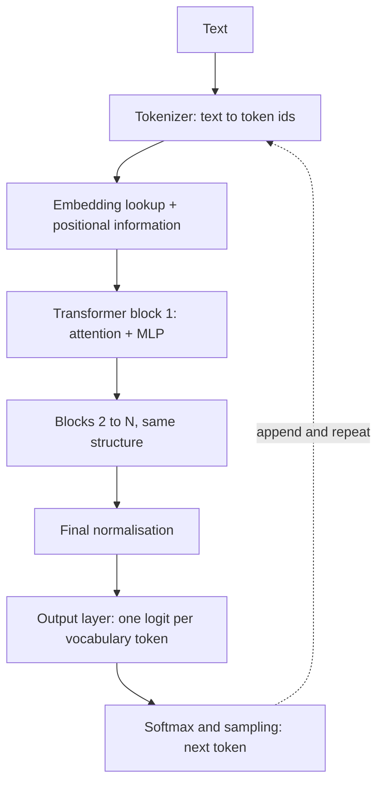
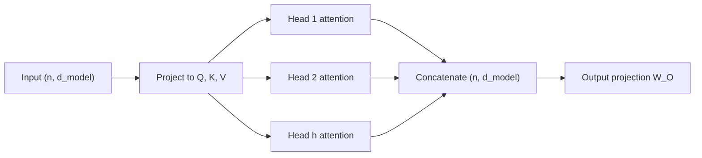
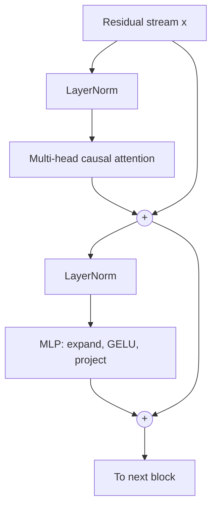

## Introduction

When you send "Summarise this support ticket" to an LLM API, a lot happens before the first word of the answer comes back. The text is chopped into pieces called tokens and converted to integers. Each integer is looked up in a table of learned vectors. Those vectors pass through dozens of identical layers in which every token gathers information from the other tokens around it. At the end, the model produces a score for every token in its vocabulary, one is chosen, appended to the input, and the whole process repeats for the next token.

The architecture doing that work is the **transformer**, introduced in the 2017 paper *Attention Is All You Need* for machine translation. Within a few years it replaced recurrent networks for language, and it is now the basis of GPT, Claude, Gemini, Llama, Mistral, the BERT family, most text-embedding models, Whisper for speech, and Vision Transformers for images. Its central idea, **self-attention**, lets every position in a sequence look directly at every other position and decide which ones matter, in a single parallel step.

An applied AI engineer needs this architecture for practical reasons, not academic ones. Tokenization decides what you pay and whether your prompt fits. Positional encoding decides how far a model's context can stretch. Attention's cost, which grows with the square of sequence length, is why long prompts are slow and context windows are finite. The causal mask is why a chat model generates one token at a time. And the difference between encoder and decoder models is the difference between a model that writes answers and a model that produces embeddings for your vector search. When an API's behaviour surprises you, the explanation is usually in one of these mechanisms.

This lesson follows the path text takes through a transformer, one stage per section:

1. **Tokenization** — how text becomes a sequence of integer ids.
2. **Tokens, vocabulary and special tokens** — what the ids mean, and how they drive cost and limits.
3. **Embeddings and positional information** — how ids become vectors that also encode order.
4. **Query, key, value and self-attention** — how each token gathers context.
5. **Multi-head and causal attention** — running several attention patterns at once, and hiding the future.
6. **Residuals, LayerNorm, MLP and transformer blocks** — the repeating unit that is stacked dozens of times.
7. **Encoder, decoder and encoder–decoder families** — the three ways of assembling blocks, and which to use when.

Runnable examples use only the Python standard library, with small hand-chosen numbers so you can check every value.

## Before you start

- **Neural-network basics** — weights, activations, dense layers, softmax, backpropagation and residual connections. See [[e2-neural-networks]].
- **Vectors, matrices and the dot product** — attention is built from dot products and matrix multiplications. See [[e2-linear-algebra]].
- **Probability distributions** — the model's output is a probability distribution over tokens. See [[e2-probability]].
- **Python basics** — lists, dictionaries and functions. See [[e1-syntax]].

You do not need to have trained a model. The aim is a precise mental model of what happens inside one.

## The intuition

Picture a meeting where everyone holds a card describing themselves, and everyone needs to update their understanding based on the others. Each person does three things. They write down a **question** about what kind of information they are looking for. They hold up a **label** advertising what they can offer. And they keep a **message** ready to share. Each person compares their question with everybody's label, decides how relevant each person is, and listens to a weighted mix of everyone's messages — mostly the relevant ones. After one round, everyone's card is updated with context. Then the meeting repeats, and in each round people can ask more sophisticated questions because their cards already contain context from the previous round.

That is self-attention. The people are tokens. The question, label and message are the **query**, **key** and **value** vectors. "Comparing the question with a label" is a dot product, and "listening to a weighted mix" is a softmax-weighted average. A transformer runs many such meetings in parallel within one layer (multiple heads) and stacks dozens of layers.

Two details of the analogy matter later. First, nobody's position at the table is visible in the comparison — the meeting would go identically if people swapped seats — which is why transformers must add positional information explicitly. Second, in a language model generating text, each person may only listen to those who spoke *before* them, which is the causal mask. Where the analogy fails: tokens do not decide anything; the questions, labels and messages are produced by learned matrices, and what they come to mean is whatever helped the model predict text during training.



## Tokenization {#e2-tokenization}

**Tokenization** is the process of splitting raw text into a sequence of pieces called tokens and mapping each piece to an integer id from a fixed vocabulary. A neural network cannot read characters; it reads numbers. The tokenizer is the translator at both ends: it turns your prompt into ids before the model runs, and it turns the model's output ids back into text. Every count you see in an LLM API — prompt tokens, completion tokens, context window size — is measured in the tokens of that model's specific tokenizer.

### Why not characters or whole words?

There are two obvious ways to split text, and both fail.

**Whole words** give short sequences, but the vocabulary explodes. English alone has hundreds of thousands of word forms; add names, typos, code identifiers, URLs and other languages, and no fixed list is enough. Any word missing from the list becomes an "unknown" token, and the model loses its meaning entirely. A word-level model that has seen "run" and "running" also has no way to know they are related.

**Single characters** need a tiny vocabulary and never meet an unknown symbol, but sequences become very long. A 500-word document becomes roughly 3,000 characters. Because attention cost grows with the square of sequence length, that is expensive, and the model must spend capacity learning to assemble letters into words before it can learn anything about meaning.

**Subword tokenization** sits between them. Frequent strings — common words, common word endings such as "ing" and "tion", common code keywords — become single tokens. Rare strings are split into several smaller pieces that are in the vocabulary. Nothing is ever unknown, because in the worst case text falls back to small pieces, and common text stays short. With typical English text and the tokenizers used by OpenAI's models, one token is about four characters, or about three-quarters of a word — but that ratio is only a rough guide, and it is noticeably worse for many other languages, for code and for unusual strings.

### Byte Pair Encoding, step by step

The most widely used subword algorithm is **Byte Pair Encoding (BPE)**, used by the GPT family, Llama 3 and many others. Training a BPE tokenizer works like this:

1. Start with a vocabulary of single symbols (characters, or in practice the 256 possible byte values) and split every word in a large training corpus into those symbols.
2. Count every adjacent pair of symbols across the corpus, weighted by how often each word appears.
3. Merge the most frequent pair into a new symbol, add it to the vocabulary, and record the merge.
4. Repeat steps 2 and 3 until the vocabulary reaches the target size (for example 50,000 or 128,000 entries).

To tokenize new text, you split it into base symbols and apply the recorded merges in the order they were learned. The program below trains a tiny BPE tokenizer on a toy corpus and then encodes three words, including two it never saw during training.

```python title="bpe.py"
from collections import Counter

def train_bpe(words, num_merges):
    # Start with each word split into characters; "</w>" marks the end of a word
    corpus = Counter(tuple(w) + ("</w>",) for w in words)
    merges = []
    for _ in range(num_merges):
        pairs = Counter()
        for symbols, freq in corpus.items():
            for a, b in zip(symbols, symbols[1:]):
                pairs[(a, b)] += freq
        if not pairs:
            break
        best = max(pairs, key=lambda p: (pairs[p], p))   # most frequent; ties broken deterministically
        merges.append(best)
        new_corpus = Counter()
        for symbols, freq in corpus.items():
            out, i = [], 0
            while i < len(symbols):
                if i + 1 < len(symbols) and (symbols[i], symbols[i + 1]) == best:
                    out.append(symbols[i] + symbols[i + 1])
                    i += 2
                else:
                    out.append(symbols[i])
                    i += 1
            new_corpus[tuple(out)] += freq
        corpus = new_corpus
    return merges

def encode(word, merges):
    symbols = list(word) + ["</w>"]
    for a, b in merges:                       # apply merges in the order they were learned
        out, i = [], 0
        while i < len(symbols):
            if i + 1 < len(symbols) and symbols[i] == a and symbols[i + 1] == b:
                out.append(a + b)
                i += 2
            else:
                out.append(symbols[i])
                i += 1
        symbols = out
    return symbols

words = ["low"] * 5 + ["lower"] * 2 + ["newest"] * 6 + ["widest"] * 3
merges = train_bpe(words, 10)
for n, m in enumerate(merges, 1):
    print(n, m)

for w in ["newest", "lowest", "slower"]:
    print(w, "->", encode(w, merges))
```

```output
1 ('t', '</w>')
2 ('s', 't</w>')
3 ('e', 'st</w>')
4 ('o', 'w')
5 ('l', 'ow')
6 ('w', 'est</w>')
7 ('n', 'e')
8 ('ne', 'west</w>')
9 ('low', '</w>')
10 ('w', 'i')
newest -> ['newest</w>']
lowest -> ['low', 'est</w>']
slower -> ['s', 'low', 'e', 'r', '</w>']
```

Read the merges in order. The corpus contains "newest" six times and "widest" three times, so the ending "est" followed by the end of a word is the most common pattern; the first three merges build `est</w>`. Then "low" is assembled from `o` + `w` and `l` + `ow`. After ten merges, the frequent word "newest" is a single token. The word "lowest" never appeared in the training corpus, yet it encodes as two meaningful pieces, `low` and `est</w>`. And "slower", with its unseen `s` prefix and `er` ending, falls back to smaller pieces: `s`, `low`, `e`, `r`. That graceful fallback is the whole point of subword tokenization — no input is ever unrepresentable, and frequent patterns stay compact.

Production tokenizers differ from this toy in three ways. They start from **bytes** rather than characters (byte-level BPE), so any Unicode text, emoji or binary garbage can be encoded without an unknown token. They first split text with a regular expression into chunks (words, runs of digits, punctuation, whitespace) and never merge across chunk boundaries. And they treat a leading space as part of the token: in GPT-style tokenizers, `" cat"` (with a space) and `"cat"` are different tokens, which is why the same word can have different ids at the start of a line and in mid-sentence.

### WordPiece, Unigram and SentencePiece

BPE is not the only algorithm. **WordPiece**, used by BERT, builds its vocabulary similarly but chooses merges by how much they increase the likelihood of the training data rather than by raw frequency, and marks word-continuation pieces with `##` — "tokenization" might become `token`, `##ization`. The **Unigram** algorithm works in the opposite direction: it starts with a large vocabulary and repeatedly removes the pieces that contribute least, and it can score several possible segmentations of a word. **SentencePiece** is a library rather than an algorithm: it implements BPE and Unigram directly on raw text, treating spaces as an ordinary symbol (shown as `▁`) so it needs no language-specific word splitting. T5 uses SentencePiece Unigram; Llama 1 and 2 used SentencePiece BPE with a 32,000-token vocabulary, and Llama 3 moved to a byte-level BPE tokenizer with about 128,000 tokens.

### Tokenization is model-specific

Every model family has its own tokenizer, trained on its own data with its own vocabulary size. The same sentence can be 20 tokens for one model and 26 for another, and the ids are unrelated. Three consequences follow:

- **Count with the right tokenizer.** Use the model provider's tokenizer library or token-counting endpoint — for example OpenAI's `tiktoken` library, the Hugging Face tokenizer that ships with an open model, or a provider API that counts tokens for a request — rather than a characters-divided-by-four estimate, especially for billing, limits and non-English text.
- **Token ids are not portable.** A list of ids from one model means nothing to another. Anything that stores ids (caches, fine-tuning datasets) is tied to a tokenizer version.
- **Tokenization explains odd failures.** Models see tokens, not letters, so tasks such as counting the letters in a word, reversing a string or doing digit-by-digit arithmetic are harder than they look: "strawberry" might be two or three tokens, none of which is a single letter. Many recent tokenizers split long numbers into chunks of up to three digits, so the model sees `123` `456` `789` rather than individual digits.

Decoding — turning ids back into text — is usually exact for byte-level tokenizers, but some tokenizers normalise text (lower-casing, Unicode normalisation, whitespace cleanup) during encoding, so decode(encode(text)) can differ from the original. When streaming tokens from an API, a single multi-byte character such as an emoji can be split across tokens, so a decoder must buffer incomplete bytes rather than printing each token's bytes immediately.

```quiz
Q: A BPE tokenizer trained mostly on English encodes the never-seen word "unfriendliest". What happens?
- [ ] It returns an unknown-token id because the word is not in the vocabulary
- [x] It splits the word into smaller known pieces, falling back to bytes if necessary, so it is always representable
- [ ] It raises an error and the API request fails
- [ ] It treats the whole word as one new token added on the fly
> Subword vocabularies include every base symbol (every byte, for byte-level BPE), and encoding applies learned merges where they match. Unseen words become several familiar pieces such as "un", "friend", "li", "est". The vocabulary is fixed after training; nothing is added at inference.

Q: Why do two models give different token counts for the same prompt?
- [ ] One of them is counting incorrectly
- [ ] Token counts depend on the temperature setting
- [x] Each model family has its own tokenizer, trained on different data with a different vocabulary, so it splits text differently
- [ ] Token counts only differ for non-English text
> Vocabulary size, training corpus, pre-splitting rules and algorithm (BPE, WordPiece, Unigram) all affect segmentation. Always count with the tokenizer of the model you will call; differences are largest for code, numbers and non-English text but exist for English too.
```

## Tokens, Vocabulary & Special Tokens {#e2-tokens}

A **token** is the unit a language model reads and writes: usually a subword piece such as `" the"`, `"ing"`, `" cat"` (with its leading space) or a single byte, identified by an integer id. The **vocabulary** is the fixed list of every token a model knows, set when its tokenizer is trained. **Special tokens** are reserved vocabulary entries that do not represent ordinary text; they mark structure, such as the start of a document, the end of a turn in a conversation, or padding. Tokens are also the unit of everything operational about LLMs: what you pay, how much fits in one request, and how long generation takes.

### Vocabulary size is a design trade-off

A model's vocabulary size `V` is fixed by its tokenizer. Some reference points:

| Model family | Tokenizer | Vocabulary size |
|---|---|---|
| BERT (base, uncased) | WordPiece | 30,522 |
| GPT-2 | Byte-level BPE | 50,257 |
| T5 | SentencePiece Unigram | about 32,000 |
| Llama 3 | Byte-level BPE | 128,256 (including reserved special tokens) |
| OpenAI `cl100k_base` / `o200k_base` encodings | Byte-level BPE | about 100,000 / about 200,000 |

GPT-2's number is a good illustration: 256 byte tokens, plus 50,000 learned merges, plus one special token, `<|endoftext|>`.

A larger vocabulary makes sequences shorter — more strings fit in a single token — which lowers cost and lets more text fit in the context. Shorter sequences also help languages and scripts that small vocabularies serve poorly. The price is model size and compute at the two ends of the network: the embedding table at the input and the output layer at the end each have `V × d` parameters (where `d` is the model's vector width), and the output layer must compute a score for every vocabulary entry at every step. Recent models have moved towards larger vocabularies (100,000–260,000) because the sequence-length savings outweigh those costs at scale.

### Special tokens

Special tokens give the model structural signals that ordinary text cannot express unambiguously:

- **Beginning and end markers.** `<|begin_of_text|>` (Llama 3) or `<s>` marks the start of a sequence; `<|endoftext|>` (GPT-2) or `</s>` marks the end. A generating model stops when it produces its end token, which is how it "decides" an answer is finished.
- **Classification and separation (encoders).** BERT prepends `[CLS]`, whose final vector is used to classify the whole input, and uses `[SEP]` between two segments, such as a question and a passage. `[MASK]` hides a token during BERT's training.
- **Padding.** `[PAD]` fills shorter sequences so a batch has equal lengths; an attention mask tells the model to ignore those positions.
- **Chat structure.** Chat models are trained on conversations formatted with role markers. Llama 3 uses tokens such as `<|start_header_id|>`, `<|end_header_id|>` and `<|eot_id|>` (end of turn); the ChatML format used by several models uses `<|im_start|>` and `<|im_end|>`. Tool calls and "thinking" sections are often delimited by special tokens too.

When you call a chat API with a list of messages, the provider converts them into one token sequence using the model's **chat template** — the exact arrangement of role markers and special tokens the model was trained on. For an open model, Hugging Face tokenizers expose this as `tokenizer.apply_chat_template(messages, add_generation_prompt=True)`. Getting the template wrong (a missing end-of-turn token, the wrong role header) produces a model that rambles, never stops, or ignores the system prompt — a common bug when self-hosting.

> [!WARNING] Special tokens in user input
> If untrusted text containing a literal string such as `<|im_end|>` were encoded as the real special token, a user could forge a conversation turn or a system message. Robust tokenizer libraries treat special-token strings in ordinary text as plain text by default, or refuse them — `tiktoken`'s `encode` raises an error when the text contains a special-token string unless you explicitly allow it. When you build prompts yourself, keep that protection on and never splice user text into a template as raw special tokens. Prompt injection more generally is covered in [[e4-prompt-injection]].

### Tokens drive cost, limits and latency

Hosted LLM APIs bill per token, usually priced per million tokens, with **input tokens** (everything you send: system prompt, conversation history, retrieved documents, tool definitions, the user's message) priced separately from **output tokens** (what the model generates). Output tokens are typically priced several times higher, because each one requires a sequential forward pass, while the input is processed in parallel. Some providers also discount input tokens that repeat a cached prefix ([[e4-context-cache]]).

```python title="cost.py"
# Example prices in US dollars per million tokens; real prices vary by model and change often
PRICE_IN, PRICE_OUT = 3.00, 15.00

def request_cost(input_tokens: int, output_tokens: int) -> float:
    return input_tokens / 1e6 * PRICE_IN + output_tokens / 1e6 * PRICE_OUT

per_request = request_cost(input_tokens=6_000, output_tokens=500)
print(f"one request:        ${per_request:.4f}")
print(f"50,000 per day x 30: ${per_request * 50_000 * 30:,.0f} per month")

# Compare the two levers: shorter prompts versus shorter answers
print(f"input cut to 3,000: ${request_cost(3_000, 500) * 50_000 * 30:,.0f} per month")
print(f"output cut to 250:  ${request_cost(6_000, 250) * 50_000 * 30:,.0f} per month")
```

```output
one request:        $0.0255
50,000 per day x 30: $38,250 per month
input cut to 3,000: $24,750 per month
output cut to 250:  $32,625 per month
```

A fraction of a cent per request becomes tens of thousands of dollars a month at modest traffic. In this example input dominates: the prompt is twelve times longer than the answer, which outweighs the five-times-higher output price. That is typical of retrieval-augmented applications, which send large prompts and get short answers; a chatbot writing long replies can be the opposite. Measure both sides per route — most APIs return input and output token counts with every response ([[e3-token-usage]]).

Tokens also set **limits**. A model's **context window** is the maximum number of tokens it can handle in one request, and input and output share it: a 128,000-token window with 120,000 tokens of input leaves at most 8,000 for the answer. Budgeting that window is taught in [[e2-context-windows]]. And tokens set **latency**: generation produces output tokens one at a time, so a 1,000-token answer takes roughly ten times as long to generate as a 100-token one, while input length mainly affects the time before the first token appears ([[e2-kv-cache]]).

```quiz
Q: A request has a 5,000-token prompt and asks for up to 1,000 output tokens on a model with an 8,192-token context window. Which statement is correct?
- [ ] The request fails because 5,000 + 1,000 exceeds 4,096
- [x] It fits: input and output share the 8,192-token window, and 6,000 tokens is within it
- [ ] Only the output counts against the window
- [ ] Only the input counts against the window
> The context window bounds the whole sequence the model processes: the input tokens plus every generated token. 5,000 + 1,000 = 6,000 ≤ 8,192, leaving about 2,000 tokens of headroom.

Q: Why must user-supplied text never be encoded so that a string like "<|im_end|>" becomes the real special token?
- [ ] Special tokens cost more than ordinary tokens
- [x] It would let the user forge conversation structure, such as ending their turn and injecting a fake system or assistant message
- [ ] Special tokens cannot be decoded back to text
- [ ] The model would refuse to answer
> Special tokens carry structural meaning the model was trained to trust. Libraries treat their literal strings in untrusted text as ordinary characters, or refuse them, unless you opt in; keep that default.
```

## Token Embeddings & Positional Information {#e2-embeddings}

An **embedding** is a vector of numbers that represents a discrete item, such as a token, in a form a neural network can compute with. The first layer of a transformer is an **embedding table**: a matrix with one learned row for each token in the vocabulary. Looking up a token id returns its row — typically 768 numbers for GPT-2 small, 4,096 for Llama 3 8B. Because attention by itself ignores word order, the model also needs **positional information** — a way to tell it that a token is the first, fifth or thousandth in the sequence. The sum (or combination) of "what the token is" and "where it is" is the input to the first transformer block.

### From ids to vectors

Token ids are arbitrary labels: id 9246 is not "bigger" than id 3797 in any meaningful way. Feeding raw ids into arithmetic would impose a fake ordering. The standard fix is to give every id its own learned vector. Mathematically, the lookup is the same as multiplying a **one-hot vector** (all zeros except a 1 at the token's id) by the embedding matrix — but a lookup is far cheaper, so that is what frameworks do (`nn.Embedding` in PyTorch).

These vectors start random and are trained with the rest of the network. Training pushes tokens that behave similarly — appear in similar contexts, predict similar next tokens — towards similar vectors, because that helps the model share what it learns between them. The toy table below has hand-chosen values to show the geometry; in a real model the dimensions have no human-readable meaning.

```python title="embed.py"
import math

# A toy embedding table: one learned row per token id (here 4 dimensions)
vocab = {"cat": 0, "dog": 1, "kitten": 2, "invoice": 3}
E = [
    [0.8, 0.1, 0.6, 0.0],   # cat
    [0.7, 0.2, 0.1, 0.1],   # dog
    [0.9, 0.0, 0.7, 0.1],   # kitten
    [0.0, 0.9, 0.0, 0.8],   # invoice
]

def embed(token):
    return E[vocab[token]]              # an embedding layer is a table lookup

def cosine(u, v):
    dot = sum(a * b for a, b in zip(u, v))
    return dot / (math.sqrt(sum(a * a for a in u)) * math.sqrt(sum(b * b for b in v)))

# Looking up row i equals multiplying a one-hot vector by the table
one_hot = [0, 0, 1, 0]
via_matmul = [sum(one_hot[r] * E[r][c] for r in range(4)) for c in range(4)]
print("lookup == one-hot @ E:", embed("kitten") == via_matmul)

for a, b in [("cat", "kitten"), ("cat", "dog"), ("cat", "invoice")]:
    print(f"cos({a}, {b}) = {cosine(embed(a), embed(b)):.3f}")
```

```output
lookup == one-hot @ E: True
cos(cat, kitten) = 0.991
cos(cat, dog) = 0.859
cos(cat, invoice) = 0.074
```

**Cosine similarity** measures the angle between two vectors: 1 means the same direction, 0 means unrelated (perpendicular). Similar items have high cosine similarity, which is the geometric fact that semantic search relies on. The cosine similarity, dot product and Euclidean distance are compared in [[e5-similarity]].

### Static embeddings versus contextual representations

The embedding table gives each token one fixed vector, regardless of context — a **static** embedding. The token "bank" has the same input vector in "river bank" and "bank loan". The transformer layers then change it: after attention mixes in information from neighbouring tokens, the vector at the "bank" position differs between the two sentences. The vectors that come out of later layers are **contextual representations**. This distinction answers a common confusion: the model's understanding of a word in context lives in these hidden states, not in the embedding table.

It also clarifies what "embeddings" means in retrieval. A **text-embedding model** used for search (OpenAI's `text-embedding-3-small` with 1,536 dimensions, or the open `all-MiniLM-L6-v2` with 384) is a transformer — usually an encoder — trained so that one vector summarises a whole passage, typically by averaging (pooling) its contextual token vectors or taking a special token's vector. Its training objective pulls matching query–passage pairs together and pushes unrelated ones apart. That is a different object from the token-embedding table inside an LLM, even though both are called embeddings. Two rules carry over to every retrieval system: queries and documents must be embedded with the same model and version, and an embedding expresses semantic similarity, not truth or exact identity — product codes and IDs need exact or keyword matching. Embedding models for retrieval are covered in [[e5-embeddings]] and [[e6-embedding-models]].

### Why position must be added

Self-attention, which the next section explains, compares every token with every other token using dot products. Nothing in that computation depends on where a token sits. If you shuffle the input tokens, each token's output is identical — just in the shuffled order. (The attention section demonstrates this with a running example.) "Dog bites man" and "man bites dog" would produce the same set of vectors. Language depends on order, so the model needs position injected explicitly. There are three main approaches.

**Sinusoidal positional encoding** (the original 2017 transformer) adds a fixed vector to each token's embedding, computed from sine and cosine waves of different frequencies. Dimension pairs oscillate at geometrically spaced frequencies, so early dimensions change quickly from position to position and later dimensions change slowly, much like the hands of a clock.

```python title="sinusoid.py"
import math

def sinusoidal(pos, d_model):
    # Even dims use sin, odd dims use cos, each pair at a different frequency
    return [math.sin(pos / 10000 ** (i / d_model)) if i % 2 == 0
            else math.cos(pos / 10000 ** ((i - 1) / d_model))
            for i in range(d_model)]

for pos in (0, 1, 2, 50):
    print(pos, [round(v, 3) for v in sinusoidal(pos, 8)])
```

```output
0 [0.0, 1.0, 0.0, 1.0, 0.0, 1.0, 0.0, 1.0]
1 [0.841, 0.54, 0.1, 0.995, 0.01, 1.0, 0.001, 1.0]
2 [0.909, -0.416, 0.199, 0.98, 0.02, 1.0, 0.002, 1.0]
50 [-0.262, 0.965, -0.959, 0.284, 0.479, 0.878, 0.05, 0.999]
```

Every position gets a distinct pattern, the first pair of dimensions changes fast while the last pair barely moves over 50 positions, and the encoding needs no training.

**Learned absolute position embeddings** (BERT, GPT-2) use a second embedding table with one learned row per position, up to a maximum — 512 for BERT, 1,024 for GPT-2 — added to the token embedding. They are simple and work well, but the model has no vector at all for position 1,025, so the maximum length is a hard limit fixed at training time.

**Rotary Position Embedding (RoPE)**, used by Llama, Mistral, Qwen and most current open models, takes a different route. Instead of adding a position vector to the input, it rotates each query and key vector inside attention by an angle proportional to its position. When two rotated vectors are compared with a dot product, the result depends on the *difference* between their positions, so the model naturally learns relative distances ("three tokens back") rather than absolute slots. A related method, ALiBi, subtracts a penalty proportional to distance from attention scores.

| Method | Where position enters | Extends beyond training length? | Used by |
|---|---|---|---|
| Sinusoidal | Added to input embeddings | In principle, but quality degrades | Original transformer |
| Learned absolute | Added to input embeddings | No; hard maximum | BERT, GPT-2 |
| RoPE | Rotates queries and keys in every attention layer | With scaling techniques and some fine-tuning | Llama, Mistral, Qwen and most recent open models |
| ALiBi | Distance penalty on attention scores | Somewhat | BLOOM, MPT |

How positions are encoded is one reason context windows have the limits they do. Models with RoPE are commonly extended to longer contexts after pretraining by rescaling the rotation frequencies (methods such as position interpolation and YaRN) and fine-tuning briefly on long documents. A model can accept a long input yet still use distant information poorly — the effect discussed in [[e2-context-windows]].

```quiz
Q: In an LLM, the token "bank" has the same row in the embedding table in "river bank" and "bank loan". Where does the model represent the difference in meaning?
- [ ] In the tokenizer, which assigns different ids by context
- [ ] Nowhere; the model cannot distinguish them
- [x] In the hidden states after the transformer layers, where attention has mixed in information from surrounding tokens
- [ ] In the positional encoding
> The embedding table is static: one vector per id. Attention layers update each position's vector using its context, so the representation of "bank" diverges between the sentences as it moves through the network. Positional information encodes where a token is, not what it means.

Q: Why does a transformer need positional information at all?
- [ ] Tokens have no ids without it
- [x] Self-attention compares tokens with dot products that ignore order, so without positions a shuffled sentence would give the same per-token results
- [ ] The embedding table is too small to store meaning
- [ ] Positions tell the model which tokens are special tokens
> Attention is permutation-equivariant: reordering inputs only reorders outputs. Adding position vectors (sinusoidal, learned) or rotating queries and keys by position (RoPE) breaks that symmetry so word order can affect meaning.
```

## Query, Key, Value & Self-Attention {#e2-attention}

**Self-attention** is the mechanism that lets each token in a sequence build a new representation of itself by gathering information from the other tokens, weighted by how relevant each one is. For every token, the model computes three vectors from its current representation: a **query** (what this token is looking for), a **key** (what this token offers to others), and a **value** (the information it passes on). Each token's query is compared with every token's key to produce relevance scores; the scores are turned into weights with softmax; and the token's output is the weighted average of all the values. It is the operation that makes a transformer a transformer.

### Why attention was needed

Before transformers, recurrent networks read text one token at a time, carrying a hidden state forward. Information from early tokens had to survive many steps to influence late ones, and in practice it faded (the vanishing-gradient problem described in [[e2-cnn-rnn-history]]). Attention gives every pair of positions a direct connection: to work out what "it" refers to, the model can look straight at the noun twenty tokens back, in one step, and it can do this for every position in parallel.

### The computation

Let the input to the attention layer be a matrix `X` with one row per token (`n` rows, each of width `d_model`). Three learned weight matrices project it:

```text
Q = X · W_Q        queries, shape (n, d_k)
K = X · W_K        keys,    shape (n, d_k)
V = X · W_V        values,  shape (n, d_v)
```

Then **scaled dot-product attention** computes:

```text
scores  = Q · Kᵀ / √d_k          shape (n, n): every query against every key
weights = softmax(scores)        each row sums to 1
output  = weights · V            shape (n, d_v): each row a weighted average of values
```

Row `i` of `scores` holds the dot product of token `i`'s query with every token's key. A large dot product means the vectors point in similar directions: the key "matches" what the query is looking for. Softmax turns each row into positive weights that sum to 1. The output for token `i` is then a blend of value vectors, dominated by the tokens whose keys matched its query. Note that a token also attends to itself, since its own key is in the comparison.

### Worked example: context disambiguates "bank"

The program below runs attention on two short sentences. The query, key and value vectors are hand-chosen to make the effect visible: keys have a "water" dimension, a "money" dimension and a "function word" dimension, and values carry a two-number meaning, `[water, money]`. The token "bank" has the same query, key and value in both sentences — exactly as it would in a model's first layer, where its vectors depend only on its embedding.

```python title="attention.py"
import math

def softmax(row):
    m = max(row)                          # subtract the max for numerical stability
    exps = [math.exp(v - m) for v in row]
    total = sum(exps)
    return [e / total for e in exps]

def attention(Q, K, V, causal=False):
    d_k = len(K[0])
    out_weights, outputs = [], []
    for i, q in enumerate(Q):
        # score every key against this query, scaled by sqrt(d_k)
        scores = [sum(a * b for a, b in zip(q, k)) / math.sqrt(d_k) for k in K]
        if causal:                        # position i may only look at positions <= i
            scores = [s if j <= i else float("-inf") for j, s in enumerate(scores)]
        w = softmax(scores)
        out_weights.append(w)
        # output = weighted average of the value vectors
        outputs.append([sum(wj * v[d] for wj, v in zip(w, V)) for d in range(len(V[0]))])
    return out_weights, outputs

# Toy 3-dimensional keys/queries: [water-ness, money-ness, is-function-word]
# Toy 2-dimensional values:       [water meaning, money meaning]
VOCAB = {
    #          query            key              value
    "the":   ([0.0, 0.0, 1.0], [0.0, 0.0, 1.0], [0.0, 0.0]),
    "river": ([1.0, 0.0, 0.0], [2.0, 0.0, 0.0], [1.0, 0.0]),
    "loan":  ([0.0, 1.0, 0.0], [0.0, 2.0, 0.0], [0.0, 1.0]),
    "bank":  ([2.0, 2.0, 0.0], [0.5, 0.5, 0.0], [0.5, 0.5]),
}

def run(sentence, causal=False):
    Q = [VOCAB[t][0] for t in sentence]
    K = [VOCAB[t][1] for t in sentence]
    V = [VOCAB[t][2] for t in sentence]
    weights, outputs = attention(Q, K, V, causal)
    print(" ".join(sentence) + ("  (causal)" if causal else ""))
    for tok, w, o in zip(sentence, weights, outputs):
        ws = " ".join(f"{x:.2f}" for x in w)
        print(f"  {tok:>5}: weights [{ws}]  output [{o[0]:.2f}, {o[1]:.2f}]")

run(["the", "river", "bank"])
run(["the", "loan", "bank"])
run(["bank", "the", "river"])
run(["bank", "the", "river"], causal=True)
```

```output
the river bank
    the: weights [0.47 0.26 0.26]  output [0.40, 0.13]
  river: weights [0.18 0.58 0.24]  output [0.70, 0.12]
   bank: weights [0.07 0.71 0.22]  output [0.82, 0.11]
the loan bank
    the: weights [0.47 0.26 0.26]  output [0.13, 0.40]
   loan: weights [0.18 0.58 0.24]  output [0.12, 0.70]
   bank: weights [0.07 0.71 0.22]  output [0.11, 0.82]
bank the river
   bank: weights [0.22 0.07 0.71]  output [0.82, 0.11]
    the: weights [0.26 0.47 0.26]  output [0.40, 0.13]
  river: weights [0.24 0.18 0.58]  output [0.70, 0.12]
bank the river  (causal)
   bank: weights [1.00 0.00 0.00]  output [0.50, 0.50]
    the: weights [0.36 0.64 0.00]  output [0.18, 0.18]
  river: weights [0.24 0.18 0.58]  output [0.70, 0.12]
```

Trace "bank" in the first sentence. Its query `[2, 2, 0]` scores `0` against "the", `2·2 = 4` against "river" and `2·0.5 + 2·0.5 = 2` against itself. Dividing by `√3 ≈ 1.73` gives `0`, `2.31` and `1.15`, and softmax turns those into weights `0.07`, `0.71` and `0.22`. The output is `0.71 · [1, 0] + 0.22 · [0.5, 0.5] = [0.82, 0.11]`: a strongly "water" meaning. In the second sentence the identical "bank" vectors produce `[0.11, 0.82]`, a "money" meaning, purely because the context changed. This is the essence of attention: **the same token gets a different representation depending on which other tokens are present**.

The third run shuffles the first sentence. Each token's weights are permuted, but its output is exactly the same as before — "bank" still gets `[0.82, 0.11]`. That is the order-blindness that positional information must fix. The fourth run applies a causal mask, which the next section explains: "bank" at position 0 can no longer see "river" and keeps its ambiguous `[0.50, 0.50]`.

In a real model nobody chooses these vectors. `W_Q`, `W_K` and `W_V` are learned, and they produce queries and keys in which "relevance" means whatever helped next-token prediction — syntactic relations, coreference, the previous token, a matching bracket, a repeated name.

### Why divide by √d_k?

The dot product of two vectors with `d_k` random components (each with mean 0 and variance 1) has variance `d_k`, so its typical size grows like `√d_k`. With `d_k = 64` or `128`, raw scores are large, and softmax of large numbers is nearly one-hot: one weight close to 1, the rest close to 0. In that regime the softmax's gradients are tiny, and training stalls. Dividing by `√d_k` brings the scores back to variance about 1, whatever the head size.

```python title="scaling.py"
import math
import random
import statistics

random.seed(1)

def softmax(row):
    m = max(row)
    exps = [math.exp(v - m) for v in row]
    return [e / sum(exps) for e in exps]

for d in (4, 64, 512):
    dots = []
    for _ in range(2000):
        q = [random.gauss(0, 1) for _ in range(d)]
        k = [random.gauss(0, 1) for _ in range(d)]
        dots.append(sum(a * b for a, b in zip(q, k)))
    sd = statistics.pstdev(dots)
    # Softmax over 8 typical-sized scores, unscaled vs scaled by sqrt(d)
    scores = [sd * z for z in (1.5, 1.0, 0.5, 0.0, -0.5, -1.0, -1.5, -2.0)]
    top_raw = max(softmax(scores))
    top_scaled = max(softmax([s / math.sqrt(d) for s in scores]))
    print(f"d={d:3d}  std of q.k = {sd:5.1f} (sqrt(d) = {math.sqrt(d):4.1f})  "
          f"top softmax weight: raw {top_raw:.3f}, scaled {top_scaled:.3f}")
```

```output
d=  4  std of q.k =   2.0 (sqrt(d) =  2.0)  top softmax weight: raw 0.626, scaled 0.396
d= 64  std of q.k =   7.9 (sqrt(d) =  8.0)  top softmax weight: raw 0.981, scaled 0.398
d=512  std of q.k =  23.3 (sqrt(d) = 22.6)  top softmax weight: raw 1.000, scaled 0.409
```

The measured spread of `q · k` tracks `√d` closely. Without scaling, a 64-dimensional head would put 98% of its weight on one token from the start; with scaling, the distribution stays soft at every size, so the model can learn sharp or broad attention patterns as needed.

### What attention costs

The `scores` matrix has one entry per pair of tokens: `n²` entries. Computing it takes on the order of `n² · d` operations per layer, and storing it naively takes `n²` memory per head. Doubling the prompt length quadruples this part of the work. This **quadratic cost** is the main reason context windows are finite and long prompts are slow and expensive. Engineering work attacks the constant factors rather than the square: **FlashAttention** computes attention in tiles without ever writing the full `n × n` matrix to slow GPU memory, which cuts memory use to linear in `n` and speeds things up substantially, though the arithmetic is still quadratic. Other designs change the pattern itself — **sliding-window attention**, where each token sees only the previous few thousand tokens (Mistral 7B used a 4,096-token window), or sparse patterns. During generation, previously computed keys and values are cached so they are not recomputed for every new token ([[e2-kv-cache]]).

> [!MISTAKE] Attention is not retrieval, and its weights are not explanations
> Attention mixes information that is *already in the context window*. It does not fetch documents from anywhere; that is what a retrieval system does before the prompt is built ([[e6-rag-pipeline]]). And although attention-weight heatmaps are tempting to read as "what the model looked at", research has shown that weights can be changed substantially without changing predictions, and that information also flows through residual connections and MLPs. Treat attention maps as a rough diagnostic, not a faithful explanation of a decision.

```quiz
Q: In self-attention, what determines how much token i's output draws on token j's value vector?
- [ ] The distance between positions i and j
- [x] The softmax of the scaled dot product between token i's query and token j's key, compared with i's scores against all other keys
- [ ] The dot product between token i's value and token j's value
- [ ] A fixed weight learned separately for every pair of positions
> Scores come from query–key dot products divided by the square root of d_k, and softmax normalises each query's scores into weights summing to 1. Values are only averaged; they do not affect the weights. Distance matters only through positional information folded into the vectors.

Q: A team doubles their average prompt length from 4,000 to 8,000 tokens. Roughly how does the attention-score computation per layer change?
- [ ] It stays the same
- [ ] It doubles
- [x] It roughly quadruples, because every token is scored against every other token
- [ ] It halves, because longer prompts are cached
> The score matrix has n² entries. Going from n to 2n gives 4n² entries. Other parts of the model (embeddings, MLPs) scale linearly with n, so total latency usually grows by somewhere between 2× and 4× depending on length.
```

## Multi-Head & Causal Attention {#e2-multi-head-causal}

**Multi-head attention** runs several independent attention operations — **heads** — side by side in the same layer, each with its own query, key and value projections, and then combines their outputs. Each head can learn a different kind of relationship: one tracks the previous token, another links pronouns to nouns, another matches opening and closing brackets. **Causal attention** (or masked self-attention) adds a rule used by every text-generating transformer: a token may attend only to itself and to tokens *before* it, never after. Together they are the attention used in GPT-style models.

### Why one attention pattern is not enough

A single attention head produces one set of weights per token: one softmax distribution over the context. But a token often needs several different kinds of information at once. In "The engineer who reviewed the pull requests said she would merge them", the token "them" needs to know what it refers to ("pull requests"), while "she" needs "engineer", and a verb needs its subject. One softmax cannot put most of its weight in three places for three different reasons without blurring them together. Several heads can.

### How multi-head attention works

With model width `d_model` and `h` heads, each head works in a smaller space of size `d_head = d_model / h`. GPT-2 small has `d_model = 768` and 12 heads of 64 dimensions; Llama 3 8B has `d_model = 4096` and 32 query heads of 128 dimensions. The steps are:

1. Project the input into queries, keys and values for all heads at once (in practice, one big matrix multiplication), then split them into `h` chunks of width `d_head`.
2. Run scaled dot-product attention independently in each head. Each head produces an `(n, d_head)` output.
3. Concatenate the `h` outputs back into an `(n, d_model)` matrix.
4. Multiply by an **output projection** `W_O` (`d_model × d_model`), which mixes information across heads.

Because each head is `h` times narrower, the total cost of multi-head attention is about the same as one full-width head; you get several attention patterns for roughly the price of one. The parameters of an attention layer are the four `d_model × d_model` matrices `W_Q`, `W_K`, `W_V` and `W_O`, so about `4 · d_model²` per layer (plus biases, in models that use them).



Studies of trained models find interpretable heads — "previous-token heads", and "induction heads" that find an earlier occurrence of the current token and copy what followed it, a mechanism linked to in-context learning. Many heads have no clean interpretation, and models are robust to removing some of them.

### Fewer key–value heads: MQA and GQA

During generation, every head's keys and values for every previous token are cached in GPU memory, and that cache can grow larger than the model's weights for long contexts. **Multi-Query Attention (MQA)** shares one key–value head among all query heads, and **Grouped-Query Attention (GQA)** shares each key–value head among a group of query heads. Llama 3 8B uses 32 query heads but only 8 key–value heads, cutting the cache to a quarter of its multi-head size with little quality loss. This is an inference-efficiency choice, and its memory arithmetic is worked through in [[e2-kv-cache]].

### The causal mask

A language model is trained to predict the next token. If the token at position 5 could attend to position 6 during training, it could read the answer instead of predicting it, and the model would learn nothing useful — then fail at generation time, when the future really is unknown. The **causal mask** prevents this. Before the softmax, every score where the key's position is after the query's position is set to negative infinity:

```text
            key: 0     1     2     3
query 0     [ s00   -inf  -inf  -inf ]
query 1     [ s10   s11   -inf  -inf ]
query 2     [ s20   s21   s22   -inf ]
query 3     [ s30   s31   s32   s33  ]
```

Since `e^(−∞) = 0`, softmax gives those positions exactly zero weight, and each row's remaining weights still sum to 1. Position 0 can only attend to itself; the last position can attend to everything. In the attention section's example, the causal run of "bank the river" gave "bank" a weight of `1.00` on itself and zero on "river", leaving it with the ambiguous meaning `[0.50, 0.50]` — the model could not use a word that had not yet "happened".

Models that use this mask throughout are called **causal** or **autoregressive** language models, and the term "decoder-only" refers to them. Encoders such as BERT use no causal mask: every token sees the whole input in both directions, which is better for understanding a complete text but cannot generate text left to right. That distinction is the subject of [[e2-encoder-decoder-families]].

### Why the mask makes training parallel

The causal mask has a second, less obvious benefit. Feed a training sequence of 1,000 tokens through a causal transformer once, and position `i`'s output depends only on tokens `0` to `i`. So the output at every position is a legitimate prediction of the token that follows it: one forward pass yields 1,000 next-token predictions, each scored against the true next token, all computed in parallel. This is called **teacher forcing**, because the model always conditions on the true previous tokens rather than its own guesses. It is a major reason transformers train so much faster than recurrent networks, which had to step through the sequence one token at a time.

Generation is different. At inference time the next token is unknown until the model picks it, so tokens are produced one at a time: predict, append, predict again. The prompt can be processed in one parallel pass, but the output cannot. That asymmetry explains why output tokens dominate latency and are priced higher, and it is why the KV cache exists.

```quiz
Q: Why does a decoder-only language model mask attention to future positions during training?
- [ ] To reduce the attention computation by half
- [x] So each position must predict the next token without seeing it, matching the conditions at generation time
- [ ] Because future tokens have no embeddings
- [ ] To make the model bidirectional
> Without the mask, position i could attend to token i+1 and copy it, so training would teach nothing usable for generation, where the future is unknown. The mask also lets one forward pass produce a valid next-token prediction at every position.

Q: A model has d_model = 4,096 and 32 attention heads. What is each head's dimension, and roughly how does the cost of 32 heads compare with one 4,096-wide head?
- [ ] 4,096 per head; 32 times the cost
- [x] 128 per head; about the same total cost, since each head works in a space 32 times narrower
- [ ] 32 per head; one thirty-second of the cost
- [ ] 128 per head; 32 times the cost
> d_head = d_model / h = 4,096 / 32 = 128. The projections are the same size either way, and the per-head score computations add up to about the same work as one full-width head, so multi-head attention gives many patterns for roughly the price of one.
```

## Residuals, LayerNorm, MLP & Transformer Blocks {#e2-transformer-block}

A **transformer block** is the repeating unit of a transformer: one attention sub-layer followed by one **MLP** (multi-layer perceptron, also called the feed-forward network) sub-layer, each wrapped with a **residual connection** and a **normalisation** layer. A model is little more than an embedding layer, a stack of identical blocks — 12 in GPT-2 small, 32 in Llama 3 8B, 80 in Llama 3 70B — and an output layer. Attention moves information *between* positions; the MLP processes each position *on its own*; residuals and normalisation are what let dozens of these blocks train stably.

### The residual stream

A **residual connection** adds a sub-layer's input to its output: instead of `x = f(x)`, the block computes `x = x + f(x)`. In a transformer, this means each token position carries a vector — often called the **residual stream** — that flows straight through the whole network, and every attention and MLP sub-layer *reads* from it and *adds* its contribution back. No sub-layer replaces the stream; each makes an edit.

This design matters for two reasons. For training, the identity path gives gradients a direct route from the loss to the earliest layers, avoiding the vanishing gradients that plague deep stacks ([[e2-forward-backprop]]); it is the same idea that let ResNets reach 100+ layers. For understanding, it explains why layers can specialise: an early layer can add "this is the subject of the sentence", a later attention head can read that annotation, and the final layer reads the accumulated result to predict the next token.

### Layer normalisation

**Layer normalisation (LayerNorm)** rescales each token's vector to have mean 0 and variance 1 across its dimensions, then applies a learned per-dimension scale (`gamma`) and shift (`beta`). It keeps the numbers flowing through the network in a stable range regardless of depth or input, which makes training far less sensitive to the learning rate.

```python title="layernorm.py"
import math

def layer_norm(x, gamma, beta, eps=1e-5):
    mean = sum(x) / len(x)
    var = sum((v - mean) ** 2 for v in x) / len(x)
    # normalise to mean 0, variance 1, then apply the learned scale and shift
    return [g * (v - mean) / math.sqrt(var + eps) + b for v, g, b in zip(x, gamma, beta)]

x = [2.0, 4.0, 6.0, 100.0]
y = layer_norm(x, gamma=[1.0] * 4, beta=[0.0] * 4)
print([round(v, 3) for v in y])
print(f"mean {abs(sum(y) / 4):.3f}, variance {sum(v * v for v in y) / 4:.3f}")
```

```output
[-0.625, -0.577, -0.529, 1.731]
mean 0.000, variance 1.000
```

Unlike batch normalisation, which normalises each feature across a batch, LayerNorm works on each token independently, so it behaves the same with any batch size and any sequence length — exactly what sequence models need. Many recent models, including Llama, use **RMSNorm**, a simpler variant that skips the mean subtraction and the shift and only divides by the root mean square; it is slightly cheaper and works as well in practice.

Where the normalisation goes matters. The original 2017 transformer used **post-LN**: `x = LayerNorm(x + f(x))`. GPT-2 and almost every model since use **pre-LN**: `x = x + f(LayerNorm(x))`, normalising the input to each sub-layer and leaving the residual stream itself untouched. Pre-LN trains more stably in deep models because the identity path stays clean; post-LN typically needs careful learning-rate warm-up. Pre-LN models add one final normalisation after the last block.

### The MLP: per-token processing

The **MLP sub-layer** is a small two-layer neural network applied to each position separately, with the same weights at every position. In GPT-2 it expands the vector to four times its width, applies GELU, and projects back:

```text
MLP(x) = W₂ · GELU(W₁ · x + b₁) + b₂        W₁: d → 4d,  W₂: 4d → d
```

If attention is how tokens communicate, the MLP is where each token "thinks" about what it has gathered. The MLP layers hold about two-thirds of a typical transformer's parameters, and interpretability research suggests that much of a model's stored factual association lives in them. Llama-family models use a gated variant, **SwiGLU**: `W₂ · (SiLU(W₁x) ⊙ W₃x)`, with three matrices instead of two and an intermediate width chosen to keep the parameter count similar (14,336 for Llama 3 8B's `d = 4096`). **Mixture-of-Experts (MoE)** models replace the single MLP with several expert MLPs and a small router that sends each token to only a few of them — Mixtral 8x7B, for example, has 8 experts per layer and uses 2 per token — so total parameters grow without a matching growth in compute per token.

### Assembling a block, and a whole model

A pre-LN decoder block, as in GPT-2, is two lines:

```text
x = x + MultiHeadCausalAttention(LayerNorm₁(x))
x = x + MLP(LayerNorm₂(x))
```

And a whole decoder-only model is:

```text
x = TokenEmbedding(ids) + PositionEmbedding(positions)     (or RoPE inside attention)
repeat N times:  x = Block(x)
logits = LayerNorm_final(x) · W_out                        shape (n, vocab_size)
```

The **output layer** (also called the language-modelling head or unembedding) maps each position's final vector to one score per vocabulary token. GPT-2 reuses the token-embedding matrix for this (**weight tying**), saving `V × d` parameters; many larger models keep a separate matrix. The logits at the last position are what sampling turns into the next token ([[e2-temperature]]).



### Worked example: counting GPT-2's parameters

Parameter counts stop being mysterious once you can derive one. Using GPT-2's published configuration — vocabulary 50,257, context 1,024, `d_model` 768, 12 blocks — and the components above:

```python title="gpt2_params.py"
def linear(n_in, n_out):
    return n_in * n_out + n_out            # weight matrix + bias

def gpt2_params(vocab=50257, ctx=1024, d=768, layers=12):
    token_emb = vocab * d                  # one learned row per token id
    pos_emb = ctx * d                      # one learned row per position (GPT-2 style)
    layer_norm = 2 * d                     # scale and shift
    attn = linear(d, 3 * d) + linear(d, d) # Q, K, V projections fused, then output proj
    mlp = linear(d, 4 * d) + linear(4 * d, d)
    block = layer_norm + attn + layer_norm + mlp
    final_ln = layer_norm
    # The output layer reuses token_emb (weight tying), so it adds no parameters
    total = token_emb + pos_emb + layers * block + final_ln
    return token_emb, pos_emb, block, total

for name, cfg in [("GPT-2 small", {}),
                  ("GPT-2 medium", {"d": 1024, "layers": 24}),
                  ("GPT-2 XL", {"d": 1600, "layers": 48})]:
    tok, pos, block, total = gpt2_params(**cfg)
    print(f"{name:12s} per block {block:>11,}  embeddings {tok + pos:>11,}  total {total:>13,}")
```

```output
GPT-2 small  per block   7,087,872  embeddings  39,383,808  total   124,439,808
GPT-2 medium per block  12,596,224  embeddings  52,511,744  total   354,823,168
GPT-2 XL     per block  30,740,800  embeddings  82,049,600  total 1,557,611,200
```

The totals match the published sizes of 124M, 355M and 1.5B parameters. Two patterns are worth remembering. Each block has about `12 · d²` parameters — `4d²` in attention and `8d²` in the MLP — so width matters quadratically. And in a small model the embedding table is a large share of the total (about a third for GPT-2 small), while in large models the blocks dominate. Multiplying parameters by bytes per parameter gives memory: GPT-2 XL at 2 bytes per parameter (16-bit) needs about 3.1 GB for weights alone.

A shape trace makes the data flow concrete. For GPT-2 small reading a 5-token prompt (batch size 1):

| Stage | Shape | Notes |
|---|---|---|
| Token ids | `(1, 5)` | Integers from the tokenizer |
| Token + position embeddings | `(1, 5, 768)` | One 768-vector per token |
| Q, K, V per head | `(1, 12, 5, 64)` each | 12 heads of 64 dims |
| Attention scores per head | `(1, 12, 5, 5)` | Causal mask applied; quadratic in length |
| After each block | `(1, 5, 768)` | Residual stream keeps its shape through all 12 blocks |
| MLP hidden layer | `(1, 5, 3072)` | Temporarily four times wider |
| Logits | `(1, 5, 50257)` | A next-token score for every vocabulary entry at every position |

During training all five positions' logits are used; during generation only the last position's logits pick the next token.

```quiz
Q: What does the residual connection x = x + f(x) contribute to a deep transformer?
- [ ] It normalises x to mean 0 and variance 1
- [ ] It lets tokens attend to future positions
- [x] It keeps an identity path through every block, so gradients reach early layers and each sub-layer adds an edit rather than replacing the representation
- [ ] It removes the need for an MLP
> The addition passes the input through unchanged alongside f(x). Backpropagation therefore has a direct path to earlier layers, avoiding vanishing gradients, and the residual stream accumulates contributions from every sub-layer. Normalisation is LayerNorm's job.

Q: Roughly how many parameters does one GPT-style block with d_model = 4,096 and a 4× MLP have?
- [ ] About 4,096 × 4,096 ≈ 17 million
- [ ] About 4 × 4,096² ≈ 67 million
- [x] About 12 × 4,096² ≈ 200 million
- [ ] About 50,000 × 4,096 ≈ 205 million, the size of the vocabulary matrix
> Attention has four d × d matrices (Q, K, V, output) ≈ 4d², and the MLP has d × 4d plus 4d × d ≈ 8d², giving about 12d² ≈ 201 million. The vocabulary matrix is the embedding table, not part of a block.
```

## Encoder, Decoder & Encoder–Decoder Families {#e2-encoder-decoder-families}

Transformers come in three families that differ in how their blocks are arranged and masked. **Encoder-only** models, such as BERT, let every token attend to every other token in both directions and produce a contextual vector for each input token; they are built for understanding text, not generating it. **Decoder-only** models, such as GPT, Claude and Llama, use causal attention and are trained to predict the next token; they generate text. **Encoder–decoder** models, such as the original 2017 transformer and T5, use an encoder to read an input and a separate decoder to generate an output while attending to the encoder's results. Choosing a model for a task — chat, classification, embeddings for search, translation, speech recognition — starts with knowing which family fits.

### Encoder-only: bidirectional understanding

An encoder stacks blocks *without* a causal mask, so every token's representation draws on the whole input, left and right. That makes each output vector a rich, context-aware representation of its token. BERT (2018) was trained with **masked language modelling**: about 15% of input tokens are hidden (mostly replaced with `[MASK]`), and the model predicts them from both sides. Predicting a hidden word from its full context is a strong signal for learning meaning.

Encoders cannot generate fluent text left to right, because they were never trained to predict a next token with the future hidden. They excel at tasks where the whole input is available and the output is a label, a span or a vector:

- **Classification** (sentiment, intent, topic, toxicity) using the `[CLS]` token's vector or an average of all token vectors, followed by a small trained classifier.
- **Token labelling** such as named-entity recognition, with one prediction per token.
- **Embeddings for retrieval**: most text-embedding models are encoders fine-tuned so that one pooled vector represents a passage ([[e5-embeddings]]).
- **Rerankers (cross-encoders)**: an encoder reads a query and a candidate document together and outputs a relevance score ([[e5-rerankers]]).

Encoders are usually small (BERT-base has about 110 million parameters), fast, and cheap to fine-tune and run, which is why they remain the workhorse inside search and classification pipelines.

### Decoder-only: generation by next-token prediction

A decoder-only model stacks causally masked blocks and is trained on one objective: predict the next token, at every position, over enormous amounts of text. GPT (2018), GPT-2 (2019) and GPT-3 (2020, 175 billion parameters) established the family; today's chat models are decoder-only transformers, typically further trained to follow instructions ([[e2-pretraining-instruction-alignment]]).

The family dominates for three reasons. Every token in the training data provides a training signal, so the objective is very data-efficient. One architecture and one objective handle almost every task, because any task can be phrased as text to be continued — classification, extraction, translation, code. And quality has kept improving predictably with more parameters, data and compute. The cost is that generation is sequential, one token per forward pass, and each token sees only what came before it. A decoder can be used for embeddings or classification too, by reading the hidden state at the final token, but a smaller encoder is often cheaper for those jobs.

### Encoder–decoder: read, then write

The original transformer was built for translation, where an input sentence maps to an output sentence. Its **encoder** reads the source with bidirectional attention. Its **decoder** generates the target with causal self-attention, plus a third sub-layer in each block: **cross-attention**, in which the decoder's queries attend to the encoder's output keys and values. Cross-attention is how each generated word "looks back" at the relevant parts of the source.

T5 (2019) framed every task as text-to-text with this architecture; BART (2019) is similar and was popular for summarisation; Whisper (2022) uses an audio encoder and a text decoder for speech recognition. The family is natural when input and output are distinct sequences — translation, summarisation, transcription — and the encoder can process the full input bidirectionally. For general-purpose assistants it has largely given way to decoder-only models, which handle the same tasks by putting the input in the prompt.

| | Encoder-only | Decoder-only | Encoder–decoder |
|---|---|---|---|
| Attention | Bidirectional | Causal | Bidirectional encoder; causal decoder plus cross-attention |
| Training objective | Masked language modelling | Next-token prediction | Generate target from source (often denoising) |
| Output | A vector per token | Generated text | Generated text conditioned on the encoded input |
| Generates text? | No | Yes | Yes |
| Examples | BERT, RoBERTa, most embedding models, cross-encoder rerankers | GPT series, Claude, Gemini, Llama, Mistral | Original transformer, T5, BART, Whisper |
| Typical applied use | Classification, NER, embeddings, reranking | Chat, agents, code, extraction, general tasks | Translation, summarisation, speech-to-text |

### Choosing in practice

For an applied engineer the decision is rarely "which architecture should I build" — you will use pretrained models — but "which kind of model fits this job". If the output is generated text or the task needs instructions and reasoning, use a decoder-only LLM, usually through an API ([[e3-chat-apis]]). If you need a vector for semantic search or clustering, use a dedicated embedding model, typically an encoder. If you need a fast, cheap classifier over millions of items with a fixed label set, a fine-tuned encoder is often more accurate per dollar than prompting an LLM. If you are transcribing speech, an encoder–decoder such as Whisper is the standard choice. Mixing families is normal: a retrieval-augmented system commonly uses an encoder to embed documents, an encoder cross-attention reranker to sort candidates, and a decoder LLM to write the answer.

```quiz
Q: You need to embed two million product descriptions for semantic search. Which model family is the most natural fit?
- [x] An encoder-based embedding model that pools bidirectional token representations into one vector per description
- [ ] A decoder-only chat model prompted to "describe this product as a vector"
- [ ] An encoder–decoder translation model
- [ ] Any model, because all transformers produce identical embeddings
> Embedding models are typically encoders trained so that similar texts have nearby vectors; they are small and fast, which matters at two million items. A chat model generates text, not a calibrated vector, and different models' representations are not interchangeable.

Q: What does cross-attention do in an encoder–decoder transformer?
- [ ] Lets encoder tokens attend to future encoder tokens
- [x] Lets the decoder's queries attend to the encoder's output keys and values, so each generated token can draw on the encoded input
- [ ] Combines several attention heads into one
- [ ] Replaces the causal mask in the decoder
> Cross-attention is the bridge between the two halves: queries come from the decoder's current state, keys and values from the encoder's final representations. The decoder keeps its own causal self-attention as well.
```

## In real systems

**You will call transformers far more often than you build them.** Hosted APIs run decoder-only models on optimised inference servers; open models are served with engines such as vLLM ([[e8-vllm]]) or run locally with llama.cpp and Ollama ([[e8-local-models]]). Writing a transformer from scratch is a valuable learning exercise but almost never the right choice for a product.

**Tokenization shows up in budgets and bugs.** Production systems count tokens before sending a request, truncate or summarise history to fit, log input and output tokens per route for cost tracking, and pin the tokenizer version when they store ids. Non-English users often pay more for the same content, because many tokenizers split their text into more tokens.

**Architecture details become operational parameters.** The number of layers, the width and the number of key–value heads determine GPU memory per request; positional encoding and training length determine the usable context; the vocabulary size affects the cost of the output layer. When you compare open models for self-hosting, these numbers from the model's configuration file tell you what hardware you need ([[e2-gpu-inference]]).

**Embedding and reranking pipelines use encoders.** Retrieval systems embed documents offline in batches with an encoder, store the vectors in an index ([[e5-vector-indexes]]), and often rerank top candidates with a cross-encoder before a decoder LLM writes the answer. Each stage is a transformer; they just come from different families.

## Trade-offs and alternatives

| Design choice | Benefit | Cost |
|---|---|---|
| Full self-attention | Direct connection between any two tokens; parallel training | O(n²) compute and memory in sequence length |
| Larger vocabulary | Shorter sequences, better multilingual efficiency | Bigger embedding and output layers |
| RoPE positions | Relative-distance awareness; extendable context | Extension beyond training length needs scaling and tuning |
| More heads / GQA | Diverse attention patterns; GQA shrinks the KV cache | GQA trades a little quality for memory |
| Deeper and wider blocks | More capacity, better quality with enough data | Quadratic growth in parameters with width; slower inference |
| Mixture-of-Experts | More parameters at similar compute per token | All experts must fit in memory; routing complexity |

Alternatives exist mostly at the research frontier. **State-space models** such as Mamba, and linear-attention variants, aim to match transformer quality with cost that grows linearly in sequence length and a fixed-size generation state; hybrid models mix such layers with attention. For most applied work, the transformer is the default and the question is which pretrained model to use, not which architecture.

## Common mistakes

> [!MISTAKE] Estimating tokens from characters or words
> "Four characters per token" is a rough English average for some tokenizers. It is wrong for code, JSON, numbers and many languages, and it differs between models. Count with the target model's tokenizer or the provider's counting endpoint before enforcing limits or estimating cost.

**Forgetting that output shares the context window.** A prompt that exactly fills the window leaves no room for the answer. Reserve the maximum output tokens before filling the rest.

**Assuming an LLM can see characters.** Models see tokens, so spelling, letter counting and character-level manipulation are unreliable. Do such work in code and give the model the result.

**Mixing embedding models.** Vectors from different embedding models — or different versions of one — live in different spaces. Indexing with one and querying with another silently returns poor results.

**Treating attention as retrieval.** Attention only works over tokens already in the context window; it cannot look anything up. If the model needs a fact, retrieve it and put it in the prompt.

**Using the wrong chat template when self-hosting.** Missing role markers or end-of-turn tokens produce models that run on, repeat themselves or ignore instructions. Use the template shipped with the model's tokenizer.

**Expecting an encoder to generate.** A BERT-style model fills in masked tokens and produces vectors; it is not a chat model. Choose a decoder for generation.

## Interview perspective

Interviewers expect you to describe the transformer pipeline end to end, explain attention clearly, and connect the architecture to practical consequences such as cost, latency and context limits.

> [!INTERVIEW] "Explain self-attention" — a strong answer
> "Each token's vector is projected into a query, a key and a value. The token's query is dotted with every token's key, scaled by the square root of the head dimension, and softmaxed into weights. The output is the weighted sum of the values, so each token's new representation blends in context from the tokens most relevant to it. Multi-head attention runs several of these in parallel with different projections. In a decoder, a causal mask stops tokens from attending to later positions. Because every token is scored against every other, cost grows quadratically with sequence length."

Questions to be ready for:

- **What is a token, and why subwords?** Characters make sequences too long; words make vocabularies too big and leave unknown words. Subwords keep common text short and represent anything.
- **Why scale by √d_k?** Dot products grow with dimension; large scores saturate softmax and kill gradients.
- **Why do transformers need positional encoding?** Attention is order-blind; positions (sinusoidal, learned, RoPE) inject order.
- **What is in a transformer block?** Pre-LN attention and MLP sub-layers, each with a residual connection.
- **GPT versus BERT?** Decoder-only causal next-token prediction for generation versus encoder-only bidirectional masked-token training for understanding and embeddings.
- **Why did transformers beat RNNs?** Direct long-range connections and parallel training across the sequence; the cost is quadratic attention.

Likely follow-ups: *"What is the KV cache and why does GQA help?"* (caching past keys and values; fewer key–value heads shrink it), and *"How would you handle a document longer than the context window?"* (chunk and retrieve, summarise, or use a longer-context model — never silent truncation).

## Practice

1. **BPE by hand.** Run `bpe.py` with 20 merges and the extra words `["newer"] * 4`. Predict how "newer" and "lowest" will encode before running it, then explain any surprise.
2. **Token budget.** A model has a 32,000-token window. Your system prompt is 2,500 tokens, tool definitions 1,800, retrieved chunks 600 tokens each, and you reserve 2,000 for output. How many chunks fit alongside 6,000 tokens of conversation history?
3. **Attention by hand.** In `attention.py`, add a token "money" with key `[0, 2, 0]` and run `["the", "river", "money", "bank"]`. Predict the weights for "bank" before running it.
4. **Causal mask.** Modify `attention.py` to print the full 4 × 4 weight matrix for a causal run, and confirm that every entry above the diagonal is zero and every row sums to 1.
5. **Parameter count.** Extend `gpt2_params.py` to a model with `d = 4096`, 32 layers, vocabulary 128,256 and no position table (RoPE). Treat the MLP as `8d²` and attention as `4d²` with no biases, and compare your estimate with Llama 3 8B's published size. Explain the difference (hint: SwiGLU and GQA).
6. **Pick the family.** For each task — sentiment on 10 million reviews, a customer-support chatbot, English-to-German document translation, semantic search over a wiki — choose a model family and justify it in one sentence.

## Quick revision {#quick-revision}

- Pipeline: text → tokenizer → ids → embeddings (+ position) → N blocks → final norm → logits over vocabulary → sample next token → repeat.
- Subword tokenization (BPE, WordPiece, Unigram) balances vocabulary size and sequence length; byte-level BPE never has unknown tokens.
- Tokenizers are model-specific; count with the right one. English is roughly 4 characters per token; code and other languages differ.
- Special tokens mark sequence boundaries, padding, roles and turns; chat templates format messages; never let user text become real special tokens.
- Input and output tokens share the context window and are billed separately; output is usually pricier and slower.
- Embedding table: one learned vector per token id; static at input, contextual after attention layers. Retrieval embeddings are a separate, encoder-based product.
- Attention is order-blind; positions come from sinusoidal or learned vectors, or RoPE rotations of queries and keys.
- Attention: `softmax(QKᵀ / √d_k) V`; queries ask, keys advertise, values carry content; O(n²) in sequence length.
- Multi-head: h heads of width d_model / h, concatenated and projected; GQA shares key–value heads to shrink the KV cache.
- Causal mask: −∞ above the diagonal; enables next-token training on every position in parallel; generation stays sequential.
- Block (pre-LN): `x = x + Attn(LN(x))`, `x = x + MLP(LN(x))`; about 12·d² parameters; MLP expands about 4× (SwiGLU, MoE variants).
- Families: encoder-only (BERT; understanding, embeddings, reranking), decoder-only (GPT, Claude, Llama; generation), encoder–decoder (T5, Whisper; translation, transcription).

## Key takeaways {#key-takeaways}

- A transformer turns token ids into vectors, refines them through stacked attention-and-MLP blocks, and outputs a score for every possible next token.
- Tokenization is model-specific and determines cost, context usage and some surprising failures such as letter counting.
- Self-attention lets each token blend information from the tokens most relevant to it, which is how context changes meaning; its cost grows with the square of sequence length.
- Attention ignores order, so positional information must be added; RoPE is the common modern choice.
- The causal mask makes next-token training parallel and is why decoder-only models generate one token at a time.
- Residual connections and normalisation are what make deep stacks of blocks trainable.
- Pick the family by the job: decoders generate, encoders understand and embed, encoder–decoders map one sequence to another.
