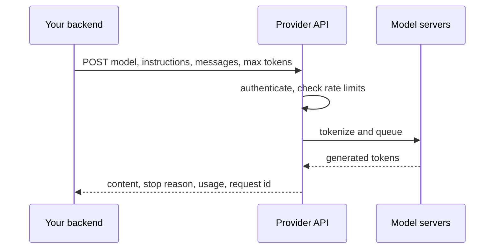

## Introduction

A large language model, on its own, is a file of numbers: billions of trained weights plus the code that runs them on GPUs. Very few product teams want to operate that directly. They want to send some text and get some text back, reliably, at a predictable price, without buying hardware. An **LLM provider API** is the interface that makes this possible. It is an HTTP endpoint run by a provider — OpenAI, Anthropic, Google, a cloud platform, an inference host, or your own server — that accepts a request describing *what the model should do next* and returns the model's response along with metadata about how the call went.

Almost every LLM feature you will build sits on this interface. A support assistant, a document summariser, a ticket classifier, a coding agent and a Retrieval-Augmented Generation (RAG) pipeline all, at the bottom, assemble a request, send it to a provider and interpret the response. Frameworks and agent SDKs wrap the same calls. If you understand the API layer, you can debug all of them; if you do not, a framework's abstractions will hide exactly the details you need when something fails.

Keep four things separate from the start, because beginners often blur them:

| Term | What it is | Example |
|---|---|---|
| **Model** | The trained network that predicts the next token | A specific GPT, Claude, Gemini or Llama checkpoint |
| **Provider API** | The network interface that runs a model for you and meters usage | `POST /v1/messages`, `POST /v1/responses`, `:generateContent` |
| **SDK** | A client library that builds and sends API requests in your language | `openai`, `anthropic`, `google-genai` Python packages |
| **Application** | Your code: prompts, data, validation, storage, UI | A ticket-triage service that calls the API |

This lesson teaches the provider API layer. It starts with what every chat API has in common, then goes provider by provider, then shows how to wrap them all behind a small interface of your own. Two neighbouring lessons build directly on it: [[e3-messages]] goes deeper into roles, conversation state, streaming and token accounting, and [[e3-structured-outputs]] covers getting typed JSON back instead of prose.

> [!NOTE] Model names and versions
> Provider APIs evolve quickly. Model identifiers in this lesson (`gpt-5-mini`, `claude-opus-5-5`, `gemini-2.5-flash`) are examples current at the time of writing; always check the provider's model list before hard-coding one. The request and response *shapes* described here change far more slowly than the model names, and those shapes are what this lesson teaches. Network calls in this lesson were not run against live APIs; every example that shows output runs offline against recorded or simulated responses.

## Before you start

- **What an LLM does** — next-token prediction, prompts and completions. See [[e2-llm-fundamentals]].
- **Tokens** — the unit models read, write and bill in. See [[e2-tokens]] and [[e2-tokenization]].
- **Context windows** — why a request has a maximum size. See [[e2-context-windows]].
- **Sampling and temperature** — what generation settings control. See [[e2-temperature]].
- **HTTP requests and status codes** — methods, headers, JSON bodies and codes such as 429 and 503. See [[c4-http]].
- **Python basics** — dataclasses, dictionaries and exceptions; the examples use Python 3.12. See [[e1-syntax]].

## The intuition

Picture a translator in a booth who has no memory at all. Every time you want something, you slide a folder through the window. The folder contains a cover sheet of standing instructions ("you are translating for a medical conference; be formal"), the full transcript of the conversation so far, and a note saying how long the reply may be. The translator reads the whole folder, writes the next reply, staples a receipt to it — how many words they read, how many they wrote, and why they stopped — and slides it back. Then they forget everything.

That is a chat API. The **instructions** are the cover sheet. The **messages** are the transcript. The **generation settings** are the note about length and style. The **response** is the reply plus the receipt: the **stop reason** and the **usage**. And the forgetting is the most important part: the API is **stateless**. If you want the translator to know what was said three turns ago, it must be in the folder you send now.

The analogy stops working in two places. First, the "translator" does not read words but tokens, and it charges per token read and written, so the folder size is a cost, not only a convenience. Second, some providers now offer optional server-side storage of earlier turns; you will see that this is a convenience layered on top of the same stateless model, not memory inside the model.



## The shared anatomy of a request

Every major chat API asks for the same handful of things, though each spells them differently. Learn the concepts once and the provider documentation becomes a vocabulary exercise.

**Endpoint and authentication.** You send an HTTPS `POST` to a fixed URL and prove who you are with a secret key in a header. The key identifies your account for billing and rate limits, which is why it must stay on your server: anyone who has it can spend your money.

**Model.** A string naming which model should answer. Providers publish stable identifiers and sometimes aliases that move to newer snapshots; pinning a specific identifier makes behaviour reproducible, while an alias quietly changes under you.

**Instructions.** Standing guidance for the whole conversation — persona, rules, output format. Providers call this the **system prompt**, **system instruction**, or **developer message**. It is kept apart from the conversation so that it can be given higher priority and so that it stays fixed while the conversation grows.

**Messages.** The conversation so far, as a list of turns, each tagged with a **role** such as `user` (the person or your application speaking) or `assistant` (the model's earlier replies). A turn's content can be plain text or a list of typed **content parts**: text, images, documents, tool calls and tool results.

**Generation controls.** A maximum number of output tokens, sampling settings such as temperature, optional stop sequences, and on reasoning models a setting for how much internal reasoning to do.

**Optional features.** Tool (function) definitions the model may call, a schema the output must follow, a flag to stream the response, and caching hints.

Here is the same request — one instruction, one user question, a 500-token limit — built for three providers. The program only constructs the requests and prints their shape, so it runs without network access or keys.

```python title="build_requests.py"
import json

SYSTEM = "You are a concise assistant for a bookshop."
QUESTION = "Suggest one novel for a long train ride."


def openai_responses(key: str) -> dict:
    return {
        "url": "https://api.openai.com/v1/responses",
        "headers": {"Authorization": f"Bearer {key}", "Content-Type": "application/json"},
        "body": {
            "model": "gpt-5-mini",
            "instructions": SYSTEM,
            "input": [{"role": "user", "content": QUESTION}],
            "max_output_tokens": 500,
        },
    }


def anthropic_messages(key: str) -> dict:
    return {
        "url": "https://api.anthropic.com/v1/messages",
        "headers": {
            "x-api-key": key,
            "anthropic-version": "2023-06-01",
            "content-type": "application/json",
        },
        "body": {
            "model": "claude-opus-5-5",
            "system": SYSTEM,
            "messages": [{"role": "user", "content": QUESTION}],
            "max_tokens": 500,  # required by this API
        },
    }


def gemini_generate(key: str) -> dict:
    model = "gemini-2.5-flash"
    return {
        "url": "https://generativelanguage.googleapis.com/v1beta/models/"
        f"{model}:generateContent",
        "headers": {"x-goog-api-key": key, "Content-Type": "application/json"},
        "body": {
            "systemInstruction": {"parts": [{"text": SYSTEM}]},
            "contents": [{"role": "user", "parts": [{"text": QUESTION}]}],
            "generationConfig": {"maxOutputTokens": 500},
        },
    }


for build in (openai_responses, anthropic_messages, gemini_generate):
    req = build("sk-REDACTED")
    print(build.__name__)
    print("  POST", req["url"])
    print("  headers:    ", [h for h in req["headers"] if h.lower() != "content-type"])
    print("  body keys:  ", list(req["body"]))
```

```output
openai_responses
  POST https://api.openai.com/v1/responses
  headers:     ['Authorization']
  body keys:   ['model', 'instructions', 'input', 'max_output_tokens']
anthropic_messages
  POST https://api.anthropic.com/v1/messages
  headers:     ['x-api-key', 'anthropic-version']
  body keys:   ['model', 'system', 'messages', 'max_tokens']
gemini_generate
  POST https://generativelanguage.googleapis.com/v1beta/models/gemini-2.5-flash:generateContent
  headers:     ['x-goog-api-key']
  body keys:   ['systemInstruction', 'contents', 'generationConfig']
```

Read the three bodies side by side. All three carry instructions, a conversation and a length limit, but OpenAI's Responses API calls them `instructions`, `input` and `max_output_tokens`; Anthropic calls them `system`, `messages` and `max_tokens`; Gemini puts the model in the URL and nests everything in `parts`. Anthropic also requires a version header that pins the request format, and makes `max_tokens` mandatory rather than optional. None of these differences is deep, but each one is a place where code written for one provider silently breaks on another — which is the motivation for the provider layer at the end of this lesson.

## The shared anatomy of a response

A response carries four things you should always look at, not only the text.

**Content.** The model's output. In older and simpler APIs it is a single string. In current APIs it is usually a list of typed blocks or items, because one turn can contain several kinds of output: visible text, a summary or placeholder of internal reasoning, tool calls, citations. Code that assumes "the first element is the text" breaks the day the model starts returning a reasoning block first.

**Stop reason.** Why generation ended. This is the field beginners ignore and production systems depend on. "The model finished naturally" and "the model ran out of output tokens mid-sentence" both return HTTP 200 with some text; only the stop reason tells them apart. Other values say the model wants to call a tool, or declined for safety reasons.

**Usage.** How many tokens were read (input) and written (output), often with sub-counts for tokens served from a prompt cache and tokens spent on internal reasoning. This is what you are billed for, and what you log for cost dashboards and budgets. [[e3-token-usage]] covers it in depth.

**Identifiers.** A response id in the body and a request id in the headers. When you report a problem to a provider, or correlate a slow request in your logs, this id is what everyone will ask for.

| Concept | OpenAI Chat Completions | OpenAI Responses | Anthropic Messages | Gemini `generateContent` |
|---|---|---|---|---|
| Output text | `choices[0].message.content` | `output[]` items of type `message`; SDK `output_text` | `content[]` blocks of type `text` | `candidates[0].content.parts[].text` |
| Natural finish | `finish_reason: "stop"` | `status: "completed"` | `stop_reason: "end_turn"` | `finishReason: "STOP"` |
| Ran out of tokens | `finish_reason: "length"` | `status: "incomplete"` with reason `max_output_tokens` | `stop_reason: "max_tokens"` | `finishReason: "MAX_TOKENS"` |
| Wants a tool | `finish_reason: "tool_calls"` | `function_call` output items | `stop_reason: "tool_use"` | `functionCall` parts |
| Safety decline | `message.refusal` set | `refusal` content item | `stop_reason: "refusal"` | `finishReason: "SAFETY"` or `promptFeedback.blockReason` |
| Input tokens | `usage.prompt_tokens` | `usage.input_tokens` | `usage.input_tokens` (+ cache fields) | `usageMetadata.promptTokenCount` |
| Output tokens | `usage.completion_tokens` | `usage.output_tokens` | `usage.output_tokens` | `candidatesTokenCount` + `thoughtsTokenCount` |

You do not need to memorise this table. You need to know that every row exists for every provider, and that your code should check the stop reason and record the usage on every call.

> [!IMPORTANT] Check the stop reason before using the text
> A truncated answer looks like a normal answer to code that only reads the text. Treat "ran out of tokens" and "declined" as distinct outcomes: retry with a larger limit, return a clear error, or fall back — but never pass half a JSON object or half a sentence downstream as if it were complete.

## How it works internally

What happens between your `POST` and the response explains most of the latency, cost and error behaviour you will observe.

1. **Edge and authentication.** The provider's gateway terminates TLS, checks your key, and identifies your organisation and project.
2. **Rate limiting.** Your account has limits on requests per minute and tokens per minute (and sometimes per day). If a request would exceed them, it is rejected immediately with HTTP 429, usually with headers telling you how long to wait. See [[e3-rate-limits]].
3. **Validation and rendering.** The request is validated (unknown fields, a missing required field, or too many tokens for the context window produce HTTP 400). The structured messages are then rendered into a single token sequence using the model's **chat template** — special tokens that mark where each role's text starts and ends. The model never sees JSON; it sees one long token sequence. You will see a chat template in the open-model section.
4. **Queueing and scheduling.** The request joins a queue for a pool of GPU servers running that model. Under heavy load, providers return 503 or a provider-specific "overloaded" error (Anthropic uses HTTP 529) rather than queueing forever.
5. **Prefill.** The server runs the whole input through the model in parallel, building the key–value cache. Long prompts make this phase slower; this is what **time to first token** mostly measures. If a prefix of your prompt was cached from a recent request, much of this work is skipped, which is why cached input tokens are cheaper. See [[e8-prefill-decode]] and [[e2-kv-cache]].
6. **Decode.** The model generates output one token at a time, each step sampling from a probability distribution. On reasoning models, many of these tokens are internal reasoning that you are billed for but may never see in full. Decoding continues until the model emits an end-of-turn token, hits your token limit, hits a stop sequence, or decides to call a tool.
7. **Post-processing.** Output is converted back to text, checked by safety systems where the provider applies them, assembled into the response shape, and metered for billing.

Two practical consequences follow. First, **output tokens dominate latency**: each one is a sequential step, so a 2,000-token answer takes far longer than a 200-token answer even with the same prompt. Second, **many failures happen before any model runs** — authentication, rate limits, validation — and these return quickly with 4xx codes that you should not blindly retry.

## OpenAI API Patterns {#e3-openai-api}

The OpenAI API is the interface to OpenAI's GPT and reasoning models, and its request format has become a de facto standard that many other servers imitate. It currently offers two text-generation endpoints, and the first thing to understand is which one you are looking at, because tutorials mix them freely.

**Chat Completions** (`POST /v1/chat/completions`) is the older, widely copied interface. You send a `messages` list where each item has a `role` and `content`, and you get back a `choices` list whose first element holds the assistant `message` and a `finish_reason`. It is stateless: the full history goes in every request.

**Responses** (`POST /v1/responses`) is the newer interface OpenAI recommends for new work. It accepts `input` (a string, or a list of role-tagged items) plus a separate `instructions` field, returns an `output` list of typed items (reasoning items, message items, function calls, built-in tool calls), and can optionally store responses on OpenAI's side so that the next request can refer to the previous one by id instead of resending it. The older Assistants API, which kept "threads" on the server, was deprecated in favour of Responses.

### Calling both endpoints

The official Python SDK (`openai`) reads the key from the `OPENAI_API_KEY` environment variable. These fragments need a key and network access, so they are shown without output.

```python title="openai_basics.py"
from openai import OpenAI

client = OpenAI()  # reads OPENAI_API_KEY; never hard-code keys

# Responses API: instructions are separate from the conversation input.
resp = client.responses.create(
    model="gpt-5-mini",
    instructions="You are a concise assistant for a bookshop.",
    input="Suggest one novel for a long train ride.",
    max_output_tokens=500,
)
print(resp.status)          # "completed" or "incomplete"
print(resp.output_text)     # SDK convenience: all output text joined
print(resp.usage.input_tokens, resp.usage.output_tokens)

# Chat Completions: everything is a message in one list.
chat = client.chat.completions.create(
    model="gpt-5-mini",
    messages=[
        {"role": "developer", "content": "You are a concise assistant for a bookshop."},
        {"role": "user", "content": "Suggest one novel for a long train ride."},
    ],
    max_completion_tokens=500,
)
choice = chat.choices[0]
print(choice.finish_reason)     # "stop", "length", "tool_calls", "content_filter"
print(choice.message.content)
print(chat.usage.prompt_tokens, chat.usage.completion_tokens)
```

Walk through what differs. The Responses call returns an object whose `output` is a list; `output_text` is a helper the SDK computes by joining every text part, so you do not have to walk the items yourself for simple cases. Its completion signal is `status` — `"incomplete"` with `incomplete_details.reason` explaining why (for example `"max_output_tokens"`). The Chat Completions call returns `choices`, and you read `finish_reason` on the first choice. Both report usage, but with different names: `input_tokens`/`output_tokens` in Responses, `prompt_tokens`/`completion_tokens` in Chat Completions.

### Roles: `developer`, `system`, `user`, `assistant`, `tool`

OpenAI introduced the **`developer`** role for instructions from the application developer, alongside the older **`system`** role. For its reasoning models, OpenAI documents `developer` as the role to use, and treats `system` messages as developer messages for compatibility. OpenAI's published model behaviour guidelines describe a chain of command in which platform rules outrank developer instructions, which outrank user messages, and content returned by tools carries no authority to give instructions at all. In Chat Completions, tool results come back as messages with role `tool` that reference the call they answer; in Responses they are `function_call_output` input items. The roles and their priorities are covered in [[e3-instruction-hierarchy]].

### Reasoning models and generation controls

OpenAI's reasoning models (the o-series and GPT-5 family) think internally before answering. Three practical rules follow from that:

- **The output limit covers reasoning too.** `max_output_tokens` (Responses) and `max_completion_tokens` (Chat Completions) cap visible *and* reasoning tokens. Set the limit too low and the model can spend it all on reasoning, returning an `incomplete` response with little or no visible text. The older `max_tokens` parameter is not accepted by reasoning models in Chat Completions.
- **Reasoning effort is a control.** Responses takes `reasoning: {"effort": "low"}` (or `"medium"`, `"high"`); Chat Completions takes `reasoning_effort`. Lower effort is faster and cheaper; higher effort helps on hard problems.
- **Sampling parameters may be rejected.** Many reasoning models do not accept a custom `temperature` or `top_p`. Code that always sends `temperature=0.2` can break when you switch models — one of many reasons to keep provider settings in configuration rather than scattered through call sites.

Usage reports reasoning separately: `usage.output_tokens_details.reasoning_tokens` in Responses, `usage.completion_tokens_details.reasoning_tokens` in Chat Completions. These tokens are *included* in the output total and billed as output.

### Server-side state in the Responses API

By default the Responses API stores responses (`store: true`) for a retention period, so you can continue a conversation with `previous_response_id`:

```python title="openai_continuation.py"
first = client.responses.create(model="gpt-5-mini", input="My name is Asha.")
second = client.responses.create(
    model="gpt-5-mini",
    previous_response_id=first.id,   # the server prepends the earlier turns
    input="What is my name?",
)
```

This is convenient, but two facts keep it honest. The earlier turns are still fed to the model and still **billed as input tokens** on every request; storage saves you bandwidth and bookkeeping, not tokens. And the history now lives in two places — your database and the provider's — with different retention rules, which matters for privacy and for features such as "edit an earlier message". Many production systems set `store: false` and keep history themselves; [[e3-conversation-state]] discusses the trade-off.

### Errors, limits and identifiers

OpenAI returns standard HTTP codes: 400 for invalid requests, 401 for a bad key, 403 for a forbidden resource, 404 for an unknown model, 429 for rate limits *or* exhausted quota (the error body distinguishes them — retrying an out-of-credit 429 will never succeed), and 5xx for server problems. Rate-limit state comes back in headers such as `x-ratelimit-remaining-requests` and `x-ratelimit-remaining-tokens`, and every response carries an `x-request-id` header that you should log. The SDK retries some failures automatically (connection errors, 408, 409, 429 and 5xx, twice by default) and exposes `max_retries` and `timeout` options on the client.

### Where you meet the OpenAI format elsewhere

Because so many tools were written against Chat Completions, "OpenAI-compatible" has become the common language of the ecosystem. vLLM, Ollama, llama.cpp's server, many inference hosts and even Google's Gemini API offer a Chat Completions-shaped endpoint. That compatibility covers the core fields well and the edges (tool calling, structured outputs, usage in streams, newer parameters) unevenly — see [[e3-open-model-api]].

```quiz
Q: A Chat Completions call to a reasoning model returns `finish_reason: "length"` with an empty `content`. What is the most likely cause?
- [ ] The model refused the request
- [x] The output limit was used up by reasoning tokens before any visible text was produced
- [ ] The API key lacks permission for the model
- [ ] The messages list was empty
> On reasoning models, `max_completion_tokens` caps reasoning plus visible output. A low limit can be consumed entirely by internal reasoning, leaving nothing visible. A refusal would populate `message.refusal`, and a permissions problem would be an HTTP error, not a 200 with a finish reason.
```

## Anthropic API Patterns {#e3-anthropic-api}

The Anthropic API is the interface to Anthropic's Claude models. Its central endpoint is the **Messages API** (`POST /v1/messages`), and almost everything — tool use, structured outputs, document and image input, prompt caching, streaming — is a feature of that one endpoint rather than a separate API. Its design choices are slightly stricter than OpenAI's, and the strictness is useful once you understand it.

### The request

```python title="anthropic_basics.py"
import anthropic

client = anthropic.Anthropic()  # reads ANTHROPIC_API_KEY from the environment

message = client.messages.create(
    model="claude-opus-5-5",
    max_tokens=1024,                                   # required
    system="You are a concise assistant for a bookshop.",
    messages=[{"role": "user", "content": "Suggest one novel for a long train ride."}],
)

# content is a list of typed blocks; only some are text.
text = "".join(block.text for block in message.content if block.type == "text")
print(message.stop_reason)   # "end_turn", "max_tokens", "tool_use", "refusal", ...
print(text)
print(message.usage.input_tokens, message.usage.output_tokens)
print(message._request_id)   # from the request-id header; log it
```

Four rules shape every Anthropic request:

- **`max_tokens` is required.** There is no default output length; you decide the ceiling explicitly. Pick it from what the task needs — a classification label needs a few hundred tokens at most, a long report needs thousands — and remember that on models that think, thinking tokens count toward it too.
- **Instructions go in the top-level `system` field**, not in the `messages` list. The `messages` list holds only `user` and `assistant` turns, and the first message must be from the user. Consecutive messages with the same role are merged into one turn.
- **Content is a list of blocks.** A message's `content` may be a plain string as a shorthand, but its full form is a list of typed blocks: `text`, `image`, `document`, `tool_use` (the model asking to call a tool) and `tool_result` (your answer to that call, sent in a *user* message). Responses are always a list of blocks.
- **A version header pins the format.** Raw HTTP requests send `anthropic-version: 2023-06-01` along with the `x-api-key` header; the SDK does this for you.

### The response and its stop reasons

```json title="Typical response body (trimmed)"
{
  "id": "msg_01XyZ",
  "type": "message",
  "role": "assistant",
  "model": "claude-opus-5-5",
  "content": [
    {"type": "thinking", "thinking": "", "signature": "EqQB..."},
    {"type": "text", "text": "Try 'A Gentleman in Moscow'."}
  ],
  "stop_reason": "end_turn",
  "usage": {
    "input_tokens": 38,
    "output_tokens": 95,
    "cache_creation_input_tokens": 0,
    "cache_read_input_tokens": 0
  }
}
```

Notice the first block. Recent Claude models think before answering, and on some of them thinking cannot be switched off — you tune its depth with an effort setting instead. The response then contains `thinking` blocks before the text; depending on the model and the `display` setting, their text may be a summary or empty, but they are present and their tokens are counted in `output_tokens`. This is exactly why the example joins only blocks whose `type` is `"text"` instead of reading `content[0].text`.

The `stop_reason` values you must handle are `end_turn` (finished), `max_tokens` (truncated — raise the limit or continue), `stop_sequence` (hit one of your stop strings), `tool_use` (run the requested tool and send back a `tool_result`), `pause_turn` (a long server-side tool loop paused; send the conversation back to resume) and `refusal` (declined by safety systems; the content may be partial and will not match any requested schema).

### Usage and prompt caching

Anthropic's usage object has a detail that trips up cost dashboards: when prompt caching is in use, **`input_tokens` counts only the uncached part** of the prompt. The full prompt size is `input_tokens + cache_creation_input_tokens + cache_read_input_tokens`. Cache reads are billed at a small fraction of the normal input price and cache writes at a premium, so a dashboard that only sums `input_tokens` will under-report prompt size dramatically for a well-cached application.

Caching is opt-in with `cache_control` markers on the content you want cached — typically a long, stable system prompt or document — and it is a prefix match: change one byte early in the prompt and everything after it misses the cache. Design prompts with stable content first and volatile content (timestamps, the user's question) last. [[e4-context-cache]] covers the design.

### Generation controls on current models

Current Claude models have moved away from some classic controls, and old tutorials will mislead you here:

- **Thinking depth** is controlled with `output_config: {"effort": ...}` (levels from `"low"` to `"max"`) together with adaptive thinking, rather than a fixed thinking-token budget. The default effort differs by model, so set it explicitly when it matters.
- **Sampling parameters** such as `temperature` are rejected by several current models. Steer style with instructions and effort instead.
- **Assistant prefill** — ending the `messages` list with a partial assistant turn so the model continues it, a once-popular way to force JSON — returns an error on recent models. Use structured outputs (`output_config.format`, see [[e3-structured-outputs]]) for format control.

These are model-specific: older Claude models still accept temperature and prefill. That variation is a concrete argument for keeping per-model settings in configuration.

### Streaming events

With `stream: true` (or the SDK's `client.messages.stream(...)` helper), the response arrives as Server-Sent Events in a fixed order: `message_start` (with the input usage), then for each content block a `content_block_start`, a series of `content_block_delta` events (`text_delta` for text, `input_json_delta` for tool arguments), and `content_block_stop`; then `message_delta` (carrying `stop_reason` and the cumulative output token count) and finally `message_stop`. `ping` events may appear at any time, and an `error` event (for example `overloaded_error`) can arrive mid-stream after a successful HTTP 200. [[e3-streaming]] builds a parser for this.

### Errors and limits

Beyond the usual 400/401/403/404/429/500 codes, Anthropic uses **529 `overloaded_error`** when its servers are temporarily at capacity; treat it like a 503 and retry with backoff. Rate-limit headers are prefixed `anthropic-ratelimit-` (requests, input tokens and output tokens each have limit, remaining and reset values), a `retry-after` header accompanies 429s, and the `request-id` header identifies the call. The official SDKs retry connection errors, 408, 409, 429 and 5xx twice by default, with a configurable `max_retries` and `timeout`. Claude models are also available through Amazon Bedrock, Google Cloud Vertex AI and Microsoft Foundry, each with its own client class, authentication and model-identifier conventions.

```quiz
Q: An Anthropic response reports `input_tokens: 400`, `cache_read_input_tokens: 9600` and `cache_creation_input_tokens: 0`. How many prompt tokens did the model actually process?
- [ ] 400
- [ ] 9,600
- [x] 10,000
- [ ] 9,200
> With caching, `input_tokens` is only the uncached remainder. The full prompt is the sum of `input_tokens`, `cache_creation_input_tokens` and `cache_read_input_tokens`: 400 + 0 + 9,600. A dashboard that reports 400 would under-count the prompt by 96%, although the 9,600 cached tokens are billed at a much lower rate.
```

## Gemini API Patterns {#e3-gemini-api}

The Gemini API is Google's interface to its Gemini models. It is reachable in two ways that share request shapes: the **Gemini Developer API** (`generativelanguage.googleapis.com`, authenticated with an API key from Google AI Studio) and **Vertex AI** (Google Cloud's enterprise platform, authenticated with Google Cloud credentials and offering regional endpoints, Virtual Private Cloud controls and cloud billing). Google's current SDK, `google-genai`, talks to either; the older `google-generativeai` package is deprecated.

### Contents, parts and the `model` role

Gemini's data model is slightly different from the others. A request has `contents`: a list of turns, each with a `role` of either `"user"` or `"model"` (not `"assistant"`), and a list of `parts`. A part can be text, inline binary data (an image or audio clip with its MIME type), a reference to an uploaded file, a `functionCall` from the model, or a `functionResponse` from you. Instructions go in a separate `systemInstruction`, and generation settings in `generationConfig` (called `config` in the SDK).

```python title="gemini_basics.py"
from google import genai
from google.genai import types

client = genai.Client()  # reads GEMINI_API_KEY (or GOOGLE_API_KEY)

response = client.models.generate_content(
    model="gemini-2.5-flash",
    contents="Suggest one novel for a long train ride.",
    config=types.GenerateContentConfig(
        system_instruction="You are a concise assistant for a bookshop.",
        max_output_tokens=500,
    ),
)
print(response.text)                                  # joined text of the first candidate
print(response.candidates[0].finish_reason)           # STOP, MAX_TOKENS, SAFETY, ...
print(response.usage_metadata.prompt_token_count,
      response.usage_metadata.candidates_token_count,
      response.usage_metadata.thoughts_token_count)

# Same client against Vertex AI instead of the Developer API:
# client = genai.Client(vertexai=True, project="my-project", location="global")
```

The response's `candidates` list exists because the API can return several alternative answers; in practice you request one and read `candidates[0]`. The SDK's `response.text` joins the text parts of that candidate for you.

### Finish reasons and blocked prompts

Gemini distinguishes two kinds of "no answer". If the **prompt itself** is blocked, the response has no candidates at all and `promptFeedback.blockReason` says why. If generation **started** but stopped, the candidate's `finishReason` explains it: `STOP` (natural end), `MAX_TOKENS` (truncated), `SAFETY` (safety filters stopped it), `RECITATION` (output too close to training data), and several others, including one for a malformed function call. Code that reads `candidates[0]` without checking will crash on a blocked prompt, and code that reads `response.text` without checking `finishReason` will treat a safety stop as an empty answer. Safety thresholds can be adjusted per request with `safetySettings`, within the limits Google allows.

### Thinking, usage and multimodality

Gemini 2.5 models think by default. Their usage metadata reports `thoughtsTokenCount` separately from `candidatesTokenCount`, and both are billed as output; `totalTokenCount` is the sum of prompt, candidate and thought tokens (plus tool-use prompt tokens when built-in tools run). Thinking is configured through a thinking setting in the config — a token budget on the 2.5 generation, where a budget of zero disables thinking on Flash models but not on Pro; newer generations use a coarser thinking-level setting. Check the documentation of the exact model you use.

Gemini is natively multimodal: images, audio, video and PDFs can be passed as parts. Small files go inline as base64 data; larger ones are uploaded once with the Files API and referenced by URI, which keeps request bodies small and avoids re-uploading the same file on every turn. Prompt caching exists both implicitly (automatic discounts on repeated prefixes for supported models) and explicitly (creating a named cached content object you reference in later requests), and cached tokens appear in `cachedContentTokenCount`.

### Streaming, chats and compatibility

Streaming uses a different method rather than a flag: `streamGenerateContent` (add `?alt=sse` for Server-Sent Events over REST), or `client.models.generate_content_stream(...)` in the SDK, which yields partial responses with the same shape as a full one. The SDK also offers `client.chats.create(...)`, a helper that keeps history *in your process* and resends it each call — convenient, but not server-side memory. For teams standardised on the OpenAI format, Google provides an OpenAI-compatible endpoint for Gemini models, with the usual caveat that Gemini-specific features are only fully available through the native API.

```quiz
Q: Your code does `response.candidates[0].content.parts[0].text` and occasionally crashes with an index error. What is the most likely reason?
- [ ] Gemini returns text only in streaming mode
- [x] The prompt was blocked, so the response has no candidates; `promptFeedback.blockReason` explains why
- [ ] The `model` role is not allowed in the first turn
- [ ] `max_output_tokens` was larger than the context window
> When Gemini blocks the prompt itself, there is no candidate at all. Check for candidates and inspect `promptFeedback` before indexing, and check `finishReason` on the candidate before trusting its text. A role or limit problem would produce an HTTP 400, not a successful response with missing candidates.
```

## Open-Model Inference APIs {#e3-open-model-api}

An **open-weight model** is one whose trained weights are published for anyone to download and run, under a licence that may restrict use — Llama, Mistral, Qwen, Gemma, DeepSeek and many others. An **open-model inference API** is any HTTP server that runs such a model and exposes it to applications. You might run that server yourself, on your own GPUs or laptop, or rent it from an inference host that runs open models for you. Either way, from your application's point of view it is another provider API — usually one that speaks the OpenAI Chat Completions format.

Teams choose open models for data control (prompts never leave infrastructure they operate), cost at high volume, fine-tuning freedom, offline or air-gapped deployment, and independence from a single vendor's roadmap. [[e8-hosted-vs-open]] weighs those reasons; this section is about what the API layer looks like.

### The servers you will meet

| Server | Typical use | API surface |
|---|---|---|
| **vLLM** | High-throughput GPU serving in production | OpenAI-compatible (`/v1/chat/completions`, `/v1/completions`, `/v1/models`) |
| **Ollama** | Local development and desktop use | Native `/api/chat` plus an OpenAI-compatible `/v1` |
| **llama.cpp server** | CPU and small-GPU inference of quantised models | OpenAI-compatible |
| **Text Generation Inference (TGI)** | Hugging Face's serving stack | OpenAI-compatible Messages API |
| **Hosted inference providers** | Rented open-model endpoints | Usually OpenAI-compatible, plus provider extras |

Because they share a format, you can often reuse the OpenAI SDK by changing its base URL. Here is a local vLLM server and a local Ollama server, called from the same client library. Neither was run for this lesson; both need the server running and the model downloaded.

```bash title="Start a server (one of these)"
# vLLM on a GPU machine: downloads the weights and serves on port 8000
vllm serve Qwen/Qwen2.5-7B-Instruct

# Ollama on a laptop: pulls a quantised model and serves on port 11434
ollama pull llama3.2
```

```python title="open_model_client.py"
from openai import OpenAI

# vLLM: the "model" must match what the server is serving.
vllm = OpenAI(base_url="http://localhost:8000/v1", api_key="unused-locally")
r1 = vllm.chat.completions.create(
    model="Qwen/Qwen2.5-7B-Instruct",
    messages=[{"role": "system", "content": "You are a concise assistant."},
              {"role": "user", "content": "Capital of Peru?"}],
    max_tokens=100,
)

# Ollama's OpenAI-compatible endpoint; the client requires a key, Ollama ignores it.
ollama = OpenAI(base_url="http://localhost:11434/v1", api_key="ollama")
r2 = ollama.chat.completions.create(
    model="llama3.2",
    messages=[{"role": "user", "content": "Capital of Peru?"}],
)
print(r1.choices[0].message.content, r2.choices[0].message.content)
```

### Chat templates: where roles become tokens

When you call a hosted API, the provider turns your role-tagged messages into tokens for you, and you never see how. With open models, this step is visible and can go wrong. Each instruction-tuned model was trained on conversations formatted with a specific **chat template**: special tokens that mark the start and end of each role's turn and a final marker meaning "now the assistant speaks". The serving software reads the template from the model's configuration files and applies it to your messages.

The program below renders the same two messages with two well-known template styles (simplified: Llama 3.1's real template also inserts a date header into the system turn).

```python title="chat_template.py"
messages = [
    {"role": "system", "content": "You are a concise assistant."},
    {"role": "user", "content": "Capital of Peru?"},
]


def chatml(msgs):  # format used by the Qwen family, among others
    out = "".join(f"<|im_start|>{m['role']}\n{m['content']}<|im_end|>\n" for m in msgs)
    return out + "<|im_start|>assistant\n"      # generation prompt: "your turn"


def llama3(msgs):  # format used by Llama 3 instruct models
    out = "<|begin_of_text|>"
    for m in msgs:
        out += (f"<|start_header_id|>{m['role']}<|end_header_id|>\n\n"
                f"{m['content']}<|eot_id|>")
    return out + "<|start_header_id|>assistant<|end_header_id|>\n\n"


print(chatml(messages))
print("----")
print(llama3(messages))
```

```output
<|im_start|>system
You are a concise assistant.<|im_end|>
<|im_start|>user
Capital of Peru?<|im_end|>
<|im_start|>assistant

----
<|begin_of_text|><|start_header_id|>system<|end_header_id|>

You are a concise assistant.<|eot_id|><|start_header_id|>user<|end_header_id|>

Capital of Peru?<|eot_id|><|start_header_id|>assistant<|end_header_id|>
```

This is what "roles" really are at the model level: text segments between learned marker tokens. It explains several practical facts. A model sent the wrong template produces rambling or role-confused output, because it is reading a format it was never trained on. The `system` role only has force if the template and training gave it force; some small models barely distinguish it from a user turn. And the end-of-turn marker (`<|im_end|>`, `<|eot_id|>`) is what makes generation stop with a natural finish reason — a mismatched stop token is a classic cause of models that keep talking and invent the user's next turn.

### Compatibility gaps to plan for

"OpenAI-compatible" reliably means the basic request and response shapes work. It does not mean every feature behaves identically:

- **Model names** are whatever the server loaded, not OpenAI's names. Read them from `/v1/models`.
- **Tool calling** depends on the model having been trained for it and on the server parsing its tool-call format. vLLM, for example, needs flags enabling automatic tool choice and naming the right parser for the model family.
- **Structured outputs** are implemented by grammar-guided decoding libraries in the server. Support for `response_format` with a JSON schema is common in recent versions, but parameter names for server-specific extras have changed between releases; check the version you deploy.
- **Context length** may be set lower than the model's maximum to save memory. Ollama in particular uses a default context length that is small compared with many models' maximum and has changed between versions; when the conversation exceeds it, older content is dropped rather than raising an error. Set the context size explicitly (`num_ctx` in Ollama's options).
- **Usage reporting**, especially in streaming responses, may be missing or differ from hosted providers.
- **Sampling defaults** often come from the model's own generation configuration rather than the API's documented defaults, so the "same" request can behave differently on two servers.
- **Authentication** is frequently off by default on local servers. Never expose a development inference port to the internet; put the server behind your own authenticated gateway.

Open-model servers are covered operationally in [[e8-vllm]], [[e8-ollama]] and [[e8-llamacpp]].

```quiz
Q: A self-hosted model keeps generating after its answer and writes a fake "user:" turn of its own. Which explanation fits best?
- [ ] The temperature is set to zero
- [x] The chat template or stop token does not match what the model was trained with, so it never emits or never recognises its end-of-turn marker
- [ ] The OpenAI SDK is incompatible with self-hosted servers
- [ ] The model needs a larger context window
> Generation stops naturally when the model emits its end-of-turn token and the server recognises it. A wrong template or stop-token configuration breaks that, so the model continues the transcript, including inventing the next user message. Temperature affects randomness, not turn boundaries.
```

## Thin Provider Abstraction without Framework Lock-in {#e3-provider-abstraction}

A **thin provider abstraction** is a small interface that your application code calls instead of calling a provider SDK directly — for example a single `generate(request) -> result` method — with one adapter per provider behind it. It is "thin" because it normalises only what your application genuinely needs (instructions, messages, limits, the text, a stop reason, usage) and passes everything else through, rather than trying to model every feature of every provider.

### Why put anything between your code and the SDK

If you call a provider SDK from forty places in your codebase, four ordinary events become expensive:

- **A second provider.** A customer requires data residency only one provider offers, or a cheaper model appears elsewhere. Every call site has to change.
- **An outage.** You want to fail over to a backup model when the primary returns 529s for an hour, but there is no single place to put that logic. [[e3-model-routing-fallback]] covers the policy; the abstraction is where it lives.
- **Testing.** Unit tests should not call a paid, non-deterministic API. You need a fake that returns scripted answers.
- **Observability and policy.** Every call should log the request id, model, latency and usage, and enforce budgets and timeouts. Copying that into forty call sites guarantees that some forget.

The alternative many teams reach for first is a large framework that abstracts providers, prompts, chains, memory and agents together. Frameworks can save time, but they add a dependency whose release cycle, abstractions and bugs you inherit, and they tend to lag provider features by weeks or months. [[e8-framework-abstraction-cost]] discusses that trade-off. A thin layer of your own — often a few hundred lines — gets most of the portability benefit with none of the lock-in, as long as you keep it thin.

### Designing the interface

Start from your application's needs, not from the union of all provider features. The interface below has four parts: a request type, a result type with a **normalised stop reason**, normalised usage, and two escape hatches — `provider_options` for provider-specific request settings and `raw` for the untouched provider response.

```python title="llm_core.py"
"""A thin provider layer: our own request/result types plus one adapter per API."""
from dataclasses import dataclass, field
from typing import Any, Callable, Protocol

Transport = Callable[[str, dict, dict], dict]  # (url, headers, body) -> parsed JSON


@dataclass
class Message:
    role: str  # "user" or "assistant"; instructions travel separately
    text: str


@dataclass
class ChatRequest:
    instructions: str
    messages: list[Message]
    max_output_tokens: int = 1024
    provider_options: dict[str, Any] = field(default_factory=dict)  # escape hatch


@dataclass
class Usage:
    input_tokens: int
    output_tokens: int        # everything billed as output, reasoning included
    reasoning_tokens: int | None = None  # None: provider does not report it
    cached_input_tokens: int = 0


@dataclass
class ChatResult:
    text: str
    stop: str                 # "complete" | "length" | "refused" | "tool_call" | "other"
    usage: Usage
    model: str
    provider: str
    raw: dict                 # the untouched provider response, for debugging


class ChatProvider(Protocol):
    name: str
    def generate(self, req: ChatRequest) -> ChatResult: ...


class OpenAIChatAdapter:
    name = "openai"

    def __init__(self, transport: Transport, key: str, model: str):
        self.transport, self.key, self.model = transport, key, model

    def generate(self, req: ChatRequest) -> ChatResult:
        body = {
            "model": self.model,
            "messages": [{"role": "developer", "content": req.instructions}]
            + [{"role": m.role, "content": m.text} for m in req.messages],
            "max_completion_tokens": req.max_output_tokens,
            **req.provider_options,
        }
        raw = self.transport("https://api.openai.com/v1/chat/completions",
                             {"Authorization": f"Bearer {self.key}"}, body)
        choice = raw["choices"][0]
        msg = choice["message"]
        u = raw["usage"]
        stop = {"stop": "complete", "length": "length",
                "tool_calls": "tool_call"}.get(choice["finish_reason"], "other")
        if msg.get("refusal"):
            stop = "refused"
        return ChatResult(
            text=msg.get("content") or "",
            stop=stop,
            usage=Usage(
                input_tokens=u["prompt_tokens"],
                output_tokens=u["completion_tokens"],
                reasoning_tokens=u.get("completion_tokens_details", {})
                .get("reasoning_tokens", 0),
                cached_input_tokens=u.get("prompt_tokens_details", {})
                .get("cached_tokens", 0),
            ),
            model=raw["model"], provider=self.name, raw=raw,
        )


class AnthropicAdapter:
    name = "anthropic"

    def __init__(self, transport: Transport, key: str, model: str):
        self.transport, self.key, self.model = transport, key, model

    def generate(self, req: ChatRequest) -> ChatResult:
        body = {
            "model": self.model,
            "system": req.instructions,
            "messages": [{"role": m.role, "content": m.text} for m in req.messages],
            "max_tokens": req.max_output_tokens,
            **req.provider_options,
        }
        raw = self.transport("https://api.anthropic.com/v1/messages",
                             {"x-api-key": self.key, "anthropic-version": "2023-06-01"},
                             body)
        # content is a list of typed blocks; thinking blocks may come first
        text = "".join(b["text"] for b in raw["content"] if b["type"] == "text")
        u = raw["usage"]
        cache_read = u.get("cache_read_input_tokens") or 0
        cache_write = u.get("cache_creation_input_tokens") or 0
        stop = {"end_turn": "complete", "stop_sequence": "complete",
                "max_tokens": "length", "tool_use": "tool_call",
                "refusal": "refused"}.get(raw["stop_reason"], "other")
        return ChatResult(
            text=text, stop=stop,
            usage=Usage(
                # input_tokens excludes cached tokens, so add them back
                input_tokens=u["input_tokens"] + cache_read + cache_write,
                output_tokens=u["output_tokens"],
                cached_input_tokens=cache_read,
            ),
            model=raw["model"], provider=self.name, raw=raw,
        )


class GeminiAdapter:
    name = "gemini"

    def __init__(self, transport: Transport, key: str, model: str):
        self.transport, self.key, self.model = transport, key, model

    def generate(self, req: ChatRequest) -> ChatResult:
        role = {"user": "user", "assistant": "model"}
        body = {
            "systemInstruction": {"parts": [{"text": req.instructions}]},
            "contents": [{"role": role[m.role], "parts": [{"text": m.text}]}
                         for m in req.messages],
            "generationConfig": {"maxOutputTokens": req.max_output_tokens},
            **req.provider_options,
        }
        url = ("https://generativelanguage.googleapis.com/v1beta/models/"
               f"{self.model}:generateContent")
        raw = self.transport(url, {"x-goog-api-key": self.key}, body)
        u = raw.get("usageMetadata", {})
        thoughts = u.get("thoughtsTokenCount", 0)
        usage = Usage(
            input_tokens=u.get("promptTokenCount", 0),
            output_tokens=u.get("candidatesTokenCount", 0) + thoughts,
            reasoning_tokens=thoughts,
            cached_input_tokens=u.get("cachedContentTokenCount", 0),
        )
        if not raw.get("candidates"):  # the prompt itself was blocked
            return ChatResult("", "refused", usage, self.model, self.name, raw)
        cand = raw["candidates"][0]
        parts = cand.get("content", {}).get("parts", [])
        text = "".join(p.get("text", "") for p in parts if not p.get("thought"))
        stop = {"STOP": "complete", "MAX_TOKENS": "length", "SAFETY": "refused",
                "PROHIBITED_CONTENT": "refused"}.get(cand.get("finishReason"), "other")
        return ChatResult(text, stop, usage, raw.get("modelVersion", self.model),
                          self.name, raw)
```

Look at what each adapter does and does not do. It translates *your* request into the provider's body: OpenAI gets a `developer` message, Anthropic gets a top-level `system` and a mandatory `max_tokens`, Gemini gets `systemInstruction`, `contents` with the `model` role and the model in the URL. It translates the response back: joining only text blocks, mapping each provider's stop vocabulary onto five values, and normalising usage so that "output tokens" always means everything billed as output and "input tokens" always means the whole prompt — which for Anthropic means adding the cache fields back. Where a provider does not report something, the result says `None` instead of inventing a zero.

The adapters take a `transport` function instead of making HTTP calls themselves. In production that is a thin wrapper around an HTTP client (or the provider's SDK) with timeouts and retries; in tests it is a fake. That one design choice is what makes the next program possible: it exercises all three adapters offline, using recorded response bodies shaped like each provider's real JSON.

```python title="demo_adapters.py"
from llm_core import (AnthropicAdapter, ChatRequest, GeminiAdapter, Message,
                      OpenAIChatAdapter)

# Recorded response bodies, shaped like each provider's real JSON (trimmed).
RECORDED = {
    "api.openai.com": {
        "id": "chatcmpl-B9x2", "object": "chat.completion",
        "model": "gpt-5-mini-2025-08-07",
        "choices": [{"index": 0, "finish_reason": "stop", "message": {
            "role": "assistant", "content": "Try 'The Remains of the Day'.",
            "refusal": None}}],
        "usage": {"prompt_tokens": 41, "completion_tokens": 82, "total_tokens": 123,
                  "prompt_tokens_details": {"cached_tokens": 0},
                  "completion_tokens_details": {"reasoning_tokens": 64}},
    },
    "api.anthropic.com": {
        "id": "msg_01XyZ", "type": "message", "role": "assistant",
        "model": "claude-opus-5-5",
        "content": [{"type": "thinking", "thinking": "", "signature": "EqQB..."},
                    {"type": "text", "text": "Try 'A Gentleman in Moscow'."}],
        "stop_reason": "end_turn", "stop_sequence": None,
        "usage": {"input_tokens": 38, "output_tokens": 95,
                  "cache_creation_input_tokens": 0, "cache_read_input_tokens": 0},
    },
    "generativelanguage.googleapis.com": {
        "candidates": [{"index": 0, "finishReason": "STOP", "content": {
            "role": "model", "parts": [{"text": "Try 'Station Eleven'."}]}}],
        "usageMetadata": {"promptTokenCount": 36, "candidatesTokenCount": 19,
                          "thoughtsTokenCount": 65, "totalTokenCount": 120},
        "modelVersion": "gemini-2.5-flash", "responseId": "r-7f3a",
    },
}

sent = []


def fake_transport(url: str, headers: dict, body: dict) -> dict:
    sent.append((url, body))
    host = url.split("/")[2]
    return RECORDED[host]


providers = [
    OpenAIChatAdapter(fake_transport, "k1", "gpt-5-mini"),
    AnthropicAdapter(fake_transport, "k2", "claude-opus-5-5"),
    GeminiAdapter(fake_transport, "k3", "gemini-2.5-flash"),
]
req = ChatRequest(
    instructions="You are a concise assistant for a bookshop.",
    messages=[Message("user", "Suggest one novel for a long train ride.")],
    max_output_tokens=500,
)
for p in providers:
    r = p.generate(req)
    u = r.usage
    print(f"{r.provider:9} {r.stop:8} in={u.input_tokens:3} out={u.output_tokens:3} "
          f"reasoning={u.reasoning_tokens} cached={u.cached_input_tokens} "
          f"| {r.text}")
print("first message role sent to OpenAI:", sent[0][1]["messages"][0]["role"])
```

```output
openai    complete in= 41 out= 82 reasoning=64 cached=0 | Try 'The Remains of the Day'.
anthropic complete in= 38 out= 95 reasoning=None cached=0 | Try 'A Gentleman in Moscow'.
gemini    complete in= 36 out= 84 reasoning=65 cached=0 | Try 'Station Eleven'.
first message role sent to OpenAI: developer
```

Three different JSON shapes came in; one shape came out. The Anthropic adapter skipped the empty thinking block and returned only the text. The Gemini adapter added `thoughtsTokenCount` to the candidate tokens, so its "out" of 84 is comparable with OpenAI's 82, whose `completion_tokens` already includes reasoning. The Anthropic usage object used here has no separate thinking count, so the result honestly reports `None` rather than a misleading zero.

### Fakes and failover come almost for free

Once callers depend on the `ChatProvider` protocol, a fake provider and a failover wrapper are each a few lines, and neither needs to know anything about HTTP.

```python title="fallback_demo.py"
from llm_core import ChatRequest, ChatResult, Message, Usage


class ProviderUnavailable(Exception):
    """Raised by an adapter for errors worth failing over on (429/5xx/timeouts)."""


class FakeProvider:
    """Deterministic stand-in used in unit tests and local development."""

    def __init__(self, name: str, reply: str | None = None):
        self.name, self.reply, self.calls = name, reply, 0

    def generate(self, req: ChatRequest) -> ChatResult:
        self.calls += 1
        if self.reply is None:
            raise ProviderUnavailable(f"{self.name}: 503 service unavailable")
        return ChatResult(self.reply, "complete", Usage(10, 5), f"{self.name}-model",
                          self.name, raw={})


class FallbackProvider:
    """Tries providers in order; only availability errors move to the next one."""

    def __init__(self, *providers):
        self.providers = providers
        self.name = "+".join(p.name for p in providers)

    def generate(self, req: ChatRequest) -> ChatResult:
        errors = []
        for p in self.providers:
            try:
                return p.generate(req)
            except ProviderUnavailable as err:
                errors.append(str(err))
        raise ProviderUnavailable("; ".join(errors))


primary = FakeProvider("anthropic")                    # simulating an outage
secondary = FakeProvider("openai", reply="Try 'The Remains of the Day'.")
llm = FallbackProvider(primary, secondary)

req = ChatRequest("You are a concise assistant for a bookshop.",
                  [Message("user", "Suggest one novel for a long train ride.")])
result = llm.generate(req)
print(result.provider, "answered:", result.text)
print("calls:", {"anthropic": primary.calls, "openai": secondary.calls})
```

```output
openai answered: Try 'The Remains of the Day'.
calls: {'anthropic': 1, 'openai': 1}
```

`FallbackProvider` is itself a `ChatProvider`, so callers cannot tell whether they are talking to one model or a chain. Note what it catches: only `ProviderUnavailable`. A 400 "invalid request" from the primary means *your request* is wrong, and sending the same wrong request to a second provider only doubles the cost of the bug. Also notice that the result records which provider answered — essential for debugging and for evaluating whether the fallback model's answers are good enough.

### Where to stop

The hard part of a provider abstraction is not writing it but keeping it thin. Some guidelines:

- **Do not normalise prompts.** The same instructions can perform differently on different models. Keep prompts per model (or per model family) in configuration and evaluate them separately; a fallback model with an untested prompt is a quality incident waiting to happen.
- **Do not chase the lowest common denominator.** If one provider has a feature you need — prompt caching markers, a particular built-in tool, citations — expose it through `provider_options` or a capability-specific method rather than refusing to use it, or worse, emulating it badly for everyone.
- **Keep `raw`.** When something odd happens, the untouched provider response is what you need. Normalised results lose information by design.
- **Grow it with real needs.** Add streaming, tool calls and structured outputs to the interface when your application uses them — each is a normalisation problem of its own, covered in [[e3-streaming]], [[e3-tool-calling]] and [[e3-structured-outputs]].
- **Consider a gateway when there are many services.** If several services call LLMs, the same layer can run as a separate internal service (an **LLM gateway**) that holds the provider keys, enforces per-team budgets and rate limits, and centralises logging. Open-source and commercial gateways exist; the trade-off is one more network hop and one more system to operate.

## Worked example: a production-shaped call

Calling an API in a notebook is one line. Calling it from a service that thousands of users depend on needs a little more: a timeout so a hung connection cannot hold a worker forever, retries for failures that are worth retrying, respect for the provider's `retry-after` header, and a log line with the request id. The program below implements the retry policy against a scripted fake so you can see every decision; in production, `send` would be one of the adapters above.

```python title="retry_call.py"
import random
import time


class ProviderError(Exception):
    def __init__(self, status: int, message: str, retry_after: float | None = None,
                 request_id: str | None = None):
        super().__init__(f"{status} {message}")
        self.status, self.retry_after, self.request_id = status, retry_after, request_id


# 408 timeout, 409 conflict, 429 rate limit, 5xx server errors, 529 overloaded
RETRYABLE = {408, 409, 429, 500, 502, 503, 504, 529}


def call_with_retries(send, *, max_attempts=4, base_delay=1.0, max_delay=20.0,
                      sleep=time.sleep, rng=random.Random()):
    for attempt in range(1, max_attempts + 1):
        try:
            return send()
        except ProviderError as err:
            if err.status not in RETRYABLE or attempt == max_attempts:
                print(f"attempt {attempt}: {err} -> giving up "
                      f"(request_id={err.request_id})")
                raise
            if err.retry_after is not None:       # the server told us when
                delay = err.retry_after
            else:                                  # exponential backoff, full jitter
                cap = min(max_delay, base_delay * 2 ** (attempt - 1))
                delay = rng.uniform(0, cap)
            print(f"attempt {attempt}: {err} -> retry in {delay:.2f}s")
            sleep(delay)


def scripted(outcomes):
    """A fake provider call that replays a list of errors/results in order."""
    it = iter(outcomes)

    def send():
        item = next(it)
        if isinstance(item, Exception):
            raise item
        return item
    return send


slept = []
result = call_with_retries(
    scripted([
        ProviderError(429, "rate_limit_error", retry_after=2.0, request_id="req_1"),
        ProviderError(529, "overloaded_error", request_id="req_2"),
        {"text": "Try 'Station Eleven'.", "request_id": "req_3",
         "usage": {"input_tokens": 36, "output_tokens": 84}},
    ]),
    sleep=slept.append, rng=random.Random(7),
)
print("result:", result["text"], "| request_id:", result["request_id"])
print("total wait:", round(sum(slept), 2), "s")

try:
    call_with_retries(scripted([ProviderError(400, "invalid_request_error",
                                              request_id="req_4")]),
                      sleep=slept.append)
except ProviderError as err:
    print("caller sees:", err)
```

```output
attempt 1: 429 rate_limit_error -> retry in 2.00s
attempt 2: 529 overloaded_error -> retry in 0.65s
result: Try 'Station Eleven'. | request_id: req_3
total wait: 2.65 s
attempt 1: 400 invalid_request_error -> giving up (request_id=req_4)
caller sees: 400 invalid_request_error
```

Trace the first call. Attempt 1 hits a 429 that carries `retry-after: 2`, so the wrapper waits exactly two seconds — the provider knows when capacity frees up better than any formula. Attempt 2 hits a 529 with no hint, so it uses **exponential backoff with full jitter**: the cap doubles each attempt (1 s, then 2 s, then 4 s…), and the actual wait is a random value below the cap, so that a thousand clients failing at the same moment do not all retry at the same moment. Attempt 3 succeeds. The second call fails with 400, which is not retryable: the request itself is wrong, and repeating it would waste time and money, so it fails immediately with the request id in the log.

The `sleep` and `rng` parameters exist for testing: the demo passes a list's `append` method instead of `time.sleep` and a seeded random generator, so it runs instantly and prints the same delays every time. In real code they keep their defaults.

Three production notes complete the picture. First, the official SDKs already retry (twice by default); if you add your own wrapper, set the SDK's `max_retries` to zero or you will multiply attempts — two SDK retries inside four wrapper attempts is twelve requests. Second, set a **timeout** on every call (the SDKs accept a client-level `timeout`), sized to your longest legitimate response; long generations should stream instead of waiting on one giant response. Third, a retried request is a new request: if the first attempt actually completed on the server but the response was lost, you may be billed twice. For calls that trigger side effects through tools, that is a correctness problem, covered in [[e3-tool-auth-idempotency]]. Retry policy in general is the subject of [[e3-retries]].

## In real systems

**Keys live on the server.** Browser and mobile code must never contain a provider key, because anything shipped to a client can be extracted. The client talks to your backend; your backend holds the key (loaded from a secrets manager, see [[c9-secrets]]), checks that the user is allowed to make the request, applies budgets, and calls the provider.

**One module owns provider calls.** Mature codebases route every LLM call through one internal client or gateway. That is where timeouts, retries, logging, budget enforcement, model configuration and failover live, and where you change models without touching feature code.

**Every call is logged with its metadata.** At minimum: request id, provider, model, latency, time to first token if streaming, stop reason, input/output/cached/reasoning tokens, and the feature and tenant that made the call. These logs drive cost dashboards, regression detection and incident response. Logging full prompts and outputs is useful for debugging but is personal data in many applications; apply retention and redaction policies.

**Model identifiers live in configuration.** Providers retire models on published schedules. A configuration entry per feature ("triage uses model X with effort low") lets you upgrade, A/B test and roll back without a deploy.

**Data handling is a selection criterion.** Enterprise customers ask where prompts are processed, whether they are retained, and whether they are used for training. Providers offer different answers (regional processing, zero-data-retention agreements, private networking through cloud platforms), and these often decide which API a feature may use before any quality comparison begins.

## Trade-offs and alternatives

| Option | Strengths | Costs and limits | Good fit |
|---|---|---|---|
| Direct provider API (OpenAI, Anthropic, Google) | Newest models and features first; no infrastructure | Vendor dependency; data leaves your network; per-token cost | Most product features |
| Same models via a cloud platform (Bedrock, Vertex AI, Azure/Foundry) | Cloud billing, IAM, regional and private networking, compliance programmes | Features can arrive later; platform-specific clients and model identifiers | Enterprises standardised on one cloud |
| Hosted open-model inference | Open weights without running GPUs; often cheap and fast | Quality varies by model; compatibility gaps; another vendor | Cost-sensitive or open-model-specific workloads |
| Self-hosted open models (vLLM, TGI, Ollama) | Full data control; fine-tuning; predictable cost at high, steady volume | GPU operations, capacity planning, upgrades and security are yours | Strict data requirements, very high volume, offline use |
| Framework abstraction (LangChain, LlamaIndex, Vercel AI SDK, LiteLLM) | Fast start; many integrations | Extra dependency, abstraction leaks, feature lag | Prototypes, or teams that adopt the framework fully |
| Thin in-house provider layer | Portability, testability and observability with little code | You maintain the adapters | Production services with one to a few providers |

The decision is rarely permanent. A common path is a direct API behind a thin layer at first, a second provider for failover or a specific feature later, and self-hosting only for the workloads where volume or data rules justify the operational cost.

## Common mistakes

> [!MISTAKE] Putting the API key in frontend code
> A key in a JavaScript bundle, a mobile app or a public repository will be found and used. Keep keys on the server, scope them per environment, rotate them, and add secret scanning to your repository.

**Reading `content[0].text` or `choices[0].message.content` blindly.** Content can start with a reasoning block, contain several text blocks, contain only tool calls, or be empty because the request was refused or blocked. Iterate over typed blocks, and check the stop reason first.

**Ignoring the stop reason.** A `max_tokens`/`length`/`MAX_TOKENS` stop means the output is incomplete. Treating it as success ships half-answers and half-JSON. Decide per feature whether to raise the limit, continue, or fail clearly.

**No timeout, unbounded retries.** A hung request with no timeout holds a worker indefinitely; unbounded retries during an outage multiply load on a provider that is already struggling and multiply your bill. Use timeouts, a small number of attempts, backoff with jitter, and `retry-after` when given — and do not stack your retries on top of the SDK's.

**Retrying non-retryable errors.** A 400 or 401 will fail identically every time, and so will a 429 caused by exhausted credit rather than a per-minute limit. Retry only transient errors.

**Assuming the API remembers.** Each call sees only what you send. If the model "forgot" something, check what your code put in the request. Even with server-side state features, earlier turns are re-processed and billed.

**Setting a tiny output limit on a reasoning model.** The limit covers reasoning. A 100-token cap can produce an empty answer.

**Hard-coding sampling parameters everywhere.** Several current models reject `temperature` or prefill. Keep per-model settings in configuration so changing models is a configuration change.

**Assuming "OpenAI-compatible" means identical.** Tool calling, structured outputs, usage reporting and context limits differ between servers. Test the features you use against the exact server and version you deploy.

## Interview perspective

Interviewers use this topic to see whether you can integrate an LLM like a backend engineer rather than like a notebook user.

> [!INTERVIEW] "How would you integrate an LLM into our product?"
> A strong answer covers the architecture and the failure handling, not only the call: "The client calls our backend; the backend holds the provider key and calls the API through one internal module. That module sets a timeout, retries transient errors with backoff and respects `retry-after`, checks the stop reason, and logs the request id, model, latency and token usage per feature and tenant. Model ids and per-model settings live in configuration. I'd keep a thin provider interface so tests use a fake and we can add a fallback provider later. Every call is stateless, so we store conversation history ourselves and decide what to resend."

Questions you should be able to answer:

- **Why is the API stateless, and what does that imply?** Each request carries its full context; the client owns history, pays for re-sending it, and decides what to trim. Server-side state features are bookkeeping, not model memory.
- **What do you check in a response besides the text?** The stop reason (complete, truncated, tool call, refusal), the usage, and the request id.
- **What is the difference between Chat Completions and Responses?** Chat Completions is the older stateless messages-in, choices-out interface that others copy; Responses is OpenAI's newer interface with typed output items, separate instructions, built-in tools and optional stored state via `previous_response_id`.
- **Name two ways Anthropic's Messages API differs from Chat Completions.** `system` is top-level rather than a message; `max_tokens` is required; content is a list of typed blocks; tool results are sent as `tool_result` blocks in a user message; prompt-cached tokens are excluded from `input_tokens`.
- **Which errors do you retry?** Connection errors, timeouts, 408, 409, 429 (rate limit, not quota), 5xx and overloaded errors — with backoff and jitter, bounded attempts, and `retry-after` when present. Never 400/401/403/404.
- **How would you design an LLM gateway?** Authentication of internal callers, per-team keys and budgets, rate limiting, routing and failover, retries, centralised logging of usage and request ids, prompt and response redaction, and provider keys held in one place.

A common follow-up: *"Why not just use a framework?"* A good answer is balanced: frameworks are fine for prototypes and for teams that adopt them fully, but in production a thin internal layer keeps you close to provider features, avoids dependency churn, and is easy to test — and you can always put a framework behind it later.

## Practice

1. **Add a fourth adapter.** Write an adapter for the OpenAI **Responses** API that fits `ChatProvider`. Map `status`/`incomplete_details` to the normalised stop values, read text from `output` items of type `message`, and read usage from `input_tokens`, `output_tokens` and their `_details` objects. Test it with a recorded response body you write by hand.
2. **Handle a blocked Gemini prompt.** Add a recorded Gemini response with no `candidates` and a `promptFeedback.blockReason`, and confirm the adapter returns `stop="refused"` without crashing.
3. **Make failover smarter.** Extend `FallbackProvider` so that a `"refused"` result from the primary is *not* sent to the secondary by default, and explain why sending refused requests to another provider is a policy decision rather than a reliability one.
4. **Budget the retry.** Modify `call_with_retries` to accept a total deadline (for example 30 seconds) and stop retrying when the next wait would exceed it.
5. **Run a local model.** If you have Ollama installed, call the same prompt through its native `/api/chat` and through its OpenAI-compatible `/v1` endpoint, and compare the response shapes and usage fields.

## Quick revision {#quick-revision}

- Model = trained weights; provider API = HTTP interface that runs a model and meters it; SDK = client library; application = your code around it.
- Request anatomy: endpoint + key, model, instructions, messages (roles + content parts), generation limits, optional tools/schema/stream/caching.
- Response anatomy: content (typed blocks), stop reason, usage, ids. Always check the stop reason; always log usage and request id.
- Every call is stateless: the model sees only what you send now. Server-side state (OpenAI `previous_response_id`) still re-bills earlier turns as input.
- OpenAI: Chat Completions (`messages` → `choices[0].message`, `finish_reason`) and Responses (`instructions` + `input` → typed `output`, `status`). `developer` role for instructions. Reasoning tokens count against `max_output_tokens`/`max_completion_tokens`.
- Anthropic Messages: top-level `system`; `max_tokens` required; first message `user`; content blocks (`text`, `image`, `tool_use`, `tool_result`, `thinking`); stop reasons `end_turn`, `max_tokens`, `stop_sequence`, `tool_use`, `pause_turn`, `refusal`; `input_tokens` excludes cache reads/writes; 529 = overloaded.
- Gemini: `contents` of `parts`, roles `user`/`model`, `systemInstruction`, `generationConfig`; blocked prompt = no candidates + `promptFeedback.blockReason`; `finishReason` STOP/MAX_TOKENS/SAFETY/RECITATION; `thoughtsTokenCount` billed as output; Developer API or Vertex AI via `google-genai`.
- Open models: vLLM, Ollama, llama.cpp, TGI and hosts mostly speak OpenAI Chat Completions; chat templates turn roles into marker tokens; check tool calling, structured output, context length (`num_ctx`), usage and auth.
- Retry only transient errors (timeouts, 408, 409, 429 rate limits, 5xx, 529) with bounded attempts, exponential backoff with jitter, `retry-after`; do not stack on SDK retries.
- Thin abstraction: own request/result types, normalised stop reason and usage, `provider_options` and `raw` escape hatches, fakes for tests, failover only on availability errors; do not normalise prompts.

## Key takeaways {#key-takeaways}

- A provider API turns a model into a stateless HTTP function: instructions plus conversation in, next turn plus stop reason plus usage out.
- The concepts are shared across providers; the field names, role names, required parameters and usage semantics are not, and those differences are where integrations break.
- Production calls need more than one line: server-held keys, timeouts, bounded retries with backoff, stop-reason handling, and logging of request ids and token usage.
- Reasoning models change the arithmetic: thinking tokens count against output limits and are billed as output even when you do not see them.
- Open-weight models are usually reached through OpenAI-compatible servers, but chat templates and uneven feature support mean "compatible" must be tested, not assumed.
- A thin provider layer of your own gives portability, testability and one place for policy, provided you keep it thin and keep prompts and provider-specific features explicit.
